# CONSTATS : Exploration théorique et expérimentale des frontières de la complexité booléenne et algébrique ($P \stackrel{?}{=} NP$, $\mathrm{ACC}^0$, $\mathrm{THR} \circ \mathrm{THR}$, $VP \stackrel{?}{=} VNP$)

**Type de document** : Monographie de recherche expérimentale et théorique (synthèse intégrale)  
**Date** : Novembre 2026  
**Dépôt de reproductibilité** : [README.md](file:///C:/Users/Axoul/.gemini/antigravity/scratch/pnp-williams/README.md) (`C:\Users\Axoul\.gemini\antigravity\scratch\pnp-williams`)  
**Environnement matériel et logiciel** : Station Windows 16 cœurs CPU, Python 3.14, NumPy 2.3, Numba 0.66 (JIT), PyTorch 2.14 (`float64` / `complex128`), Matplotlib 3.11.

---

## Résumé (*Abstract*)

Ce mémoire rassemble et unifie une campagne de recherche menée sur trois fronts majeurs de la théorie de la complexité computationnelle situés autour des questions $P \stackrel{?}{=} NP$ et $VP \stackrel{?}{=} VNP$ : (i) l'algorithmique exponentielle et les bornes inférieures de circuits à seuil de profondeur 2 ($\mathrm{THR} \circ \mathrm{THR}$) dans le paradigme de Williams ; (ii) la représentation faible de la disjonction booléenne $\mathrm{OR}_n$ par des polynômes modulo 6 (problème de Barrington–Beigel–Rudich, 1994) ; et (iii) la complexité algébrique exacte et de bord du permanent $3 \times 3$ ($\mathrm{perm}_3$, *Geometric Complexity Theory*) et des tenseurs de multiplication matricielle $\langle m, p, n \rangle$ sur $\mathbb{R}$, $\mathbb{C}$, $\mathbb{F}_3$ et $\mathbb{F}_5$.

Notre démarche associe systématiquement preuves formelles, conception de solveurs exacts compilés, calibration stricte sur des théorèmes connus et analyse critique des échecs. Nos principales contributions se répartissent en trois catégories clairement distinguées :

1. **Résultats théoriques constructifs originaux (Partie II, Polynômes $\bmod\ 6$)** : après avoir déterminé par énumération projective exacte le spectre symétrique $N_{\text{sym}}(d)$ pour $d = 1, \dots, 10$ ($5, 8, 27, 36, 53, 62, 71, 80, 151, 184$), nous démontrons deux théorèmes constructifs (**Théorèmes M1 et M2**) prouvant que les polynômes **non symétriques** dépassent strictement le maximum symétrique dès $d = 2$ ($n = 10 > 8$, atteignant l'optimum mondial prouvé par Győri, 2006), puis aux degrés $d = 6, 7, 8, 9$ (dépassant la période CRT symétrique $71$ à $d = 7$ avec $n = 73$) et pour une **infinité de degrés $d$** par récolte de marge (*Margin-Harvesting*). À l'inverse, notre chasse multi-blocs à $d = 3, 4, 5$ (où la marge est nulle) bute systématiquement sur un défaut minimal de $1$ à $N_{\text{sym}}(d) + 1$, motivant une **conjecture de saturation de marge** compatible avec la conjecture $d = \Omega(\sqrt{n})$ de Barrington–Beigel–Rudich.
2. **Résultats algorithmiques et structurels sur $\mathrm{THR} \circ \mathrm{THR}$ (Partie I)** : nous établissons et vérifions trois théorèmes exacts (**Théorème 1** : projection 1D à enveloppe de résidu et arrondi sur réseau $\mathrm{PGCD}$, éliminant les « pics fantômes hors-réseau » ; **Théorème 2** : compression bilinéaire à pointeurs glissants en code de Gray résolvant $n = 28$ en $0{,}502\text{ s}$ ; **Théorème 3** : factorisation matricielle exacte de rang $K \le 2 R \ell s$ réduisant $\mathrm{THR} \circ \mathrm{THR}\text{-SAT}$ en temps $O^*(2^{n/2})$ au problème $\mathrm{MIPS}$ et exposant la barrière $\mathrm{OVC}/\mathrm{SETH}$). Nous construisons l'**atlas exhaustif exact** des $65\,536$ fonctions booléennes à $n = 4$ variables ($222$ classes $\mathrm{NPN}$), prouvant l'unicité de $\mathrm{PARITY}_4$ au niveau maximal $s^* = 4$ et l'effondrement à $0{,}0\,\%$ des preuves naturelles spectrales $L_1$ dès $s^* = 2$ (fonctions courbes *Bent* et caméléons de Chow). Nous développons enfin un algorithme $\mathrm{CAPP}$ 100 % déterministe en $O^*(2^{n/2})$ par décomposition $\mathrm{CUR}$/Nyström ($0{,}311\text{ s}$ à $n = 26$) et évaluons la topologie spectrale de Huang sur l'hypercube $Q_n$.
3. **Méthodes exactes et cartographie des verrous en complexité algébrique (Partie III)** : sur $\mathrm{perm}_3$, notre **solveur Levenberg–Marquardt de Parseval** (racines de l'unité + jauge SVD diagonale) redécouvre de zéro une représentation déterminantale exacte $7 \times 7$ à $8{,}01 \times 10^{-13}$ en 33 itérations, tout en mettant en évidence un mur net à $k = 6$ ($0/64$ essais) et un piège de jauge $\mathrm{SL}_7$ sur l'homotopie $7 \to 6$. Sur la multiplication matricielle, notre **solveur Gauss–Newton hermitien exact à recuit $L_{2/3}$** révèle une **loi d'échelle analytique** $\text{err}(\mu) \propto \mu^\alpha$ ($\alpha = p / (2p + 2)$) qui discrimine quantitativement rang exact borné ($\alpha = 1{,}00$), bord d'ordre 1 ($\alpha = 3/8$) et bord d'ordre 2 ($\alpha = 3/10$), permettant de redécouvrir automatiquement Strassen ($R = 7$), Laderman ($R = 23$, 6/6), un bord 22 $\mathbb{Z}_3$-cyclique, un bord 21 (Schönhage) et trois séparations strictes $\underline{R} < R_{\text{rec}}$ sur $\langle 2,3,5 \rangle$, $\langle 2,4,4 \rangle$ et $\langle 3,3,4 \rangle$. Enfin, nos tests sous **barrière $L_\infty$ stricte** (Phase 4) puis en **Graphe de Flips combinatoire exact** sur $\mathbb{F}_3$ et $\mathbb{F}_5$ (Phases 5–6, Numba JIT 10 cœurs, $2{,}6\text{ M flips/s}$, redécouvrant Laderman $R = 23$ sur $\mathbb{F}_3$ en $7{,}8\text{ s}$) isolent précisément les deux verrous complémentaires : la domination volumétrique des vallées de bord en continu et l'explosion projective $|\mathbb{P}^{N-1}(\mathbb{F}_p)|$ en discret.

> [!NOTE]
> **Transparence scientifique :** Ce travail ne résout ni $P \stackrel{?}{=} NP$ ni $VP \stackrel{?}{=} VNP$ et ne bat aucun record mondial connu de rang exact en multiplication matricielle. Sa valeur réside dans la rigueur de ses preuves constructives (Théorèmes 1, 2, 3, M1, M2), la reproductibilité intégrale de ses expériences (toutes vérifiées contre des références exactes), et la mise en lumière unifiée des cinq grands murs structurels rencontrés dans l'attaque moderne des bornes inférieures.

---

## Table des matières

1. [Introduction générale et architecture des travaux](#1-introduction-générale-et-architecture-des-travaux)
2. **PARTIE I — Paradigme de Williams et frontière $\mathrm{THR} \circ \mathrm{THR}$**
   - [2. Socle de référence : méthode polynomiale sur $\mathrm{SYM} \circ \mathrm{AND}$ et $\mathrm{MQ}/\mathbb{F}_2$](#2-socle-de-référence--méthode-polynomiale-sur-sym-circ-and-et-mqmathbb-f_2)
   - [3. Évolution de solveurs $\mathrm{THR} \circ \mathrm{THR}\text{-SAT}$, co-évolution adversariale et hybride A+B](#3-évolution-de-solveurs-thr-circ-thr-sat-co-évolution-adversariale-et-hybride-ab)
   - [4. Théorème 1 (Projection 1D, réseau $\mathrm{PGCD}$ et pics fantômes) et duel industriel (v4)](#4-théorème-1-projection-1d-réseau-mathrmpgcd-et-pics-fantômes-et-duel-industriel-v4)
   - [5. Théorème 2 (Compression bilinéaire à pointeurs glissants en code de Gray) et Solveur v5 Unifié](#5-théorème-2-compression-bilinéaire-à-pointeurs-glissants-en-code-de-gray-et-solveur-v5-unifié)
   - [6. Atlas exhaustif exact à $n = 4$ et méta-complexité ($\mathrm{MCSP}$ / Preuves Naturelles)](#6-atlas-exhaustif-exact-à-n--4-et-méta-complexité-mcsp--preuves-naturelles)
   - [7. Théorème 3 (Factorisation de rang $K \le 2 R \ell s$), `#SAT` sans élagage et barrière $\mathrm{OVC}/\mathrm{SETH}$](#7-théorème-3-factorisation-de-rang-k-le-2-r-ell-s-sat-sans-élagage-et-barrière-ovcseth)
   - [8. Effondrement spectral $\mathrm{SVD}$ et algorithme $\mathrm{CAPP}$ 100 % déterministe ($\mathrm{CUR}$/Nyström)](#8-effondrement-spectral-svd-et-algorithme-capp-100--déterministe-curnyström)
   - [9. Topologie de l'hypercube $Q_n$, spectre de Huang et rayon spectral frontière](#9-topologie-de-lhypercube-q_n-spectre-de-huang-et-rayon-spectral-frontière)
3. **PARTIE II — Représentation faible de $\mathrm{OR}_n$ par polynômes modulo 6**
   - [10. Formulation CRT et spectre symétrique 100 % exact $N_{\text{sym}}(1..10)$](#10-formulation-crt-et-spectre-symétrique-100--exact-n_textsym110)
   - [11. Théorèmes M1 et M2 : percées non symétriques et optimum de Győri](#11-théorèmes-m1-et-m2--percées-non-symétriques-et-optimum-de-győri)
   - [12. Chasse au-delà de $d^2$ ($d = 3, 4, 5$) et conjecture de saturation de marge](#12-chasse-au-delà-de-d2-d--3-4-5-et-conjecture-de-saturation-de-marge)
4. **PARTIE III — Complexité algébrique ($VP \stackrel{?}{=} VNP$ et Multiplication matricielle)**
   - [13. GCT sur $\mathrm{perm}_3$ : Levenberg–Marquardt de Parseval, sonde $k = 6$ et homotopie $7 \to 6$](#13-gct-sur-mathrmperm_3--levenbergmarquardt-de-parseval-sonde-k--6-et-homotopie-7-to-6)
   - [14. Multiplication matricielle $\langle 3, 3, 3 \rangle$ : Gauss–Newton hermitien, recuit $L_{2/3}$ et loi de pente $\alpha$](#14-multiplication-matricielle-langle-3-3-3-rangle--gaussnewton-hermitien-recuit-l_23-et-loi-de-pente-alpha)
   - [15. Formats rectangulaires ouverts sur $\mathbb{C}$ et barrière $L_\infty$ circulaire stricte](#15-formats-rectangulaires-ouverts-sur-mathbbc-et-barrière-l_infty-circulaire-stricte)
   - [16. Combinatoire exacte : Graphe de Flips + réduction de tranches sur $\mathbb{F}_3$ et $\mathbb{F}_5$](#16-combinatoire-exacte--graphe-de-flips--réduction-de-tranches-sur-mathbbf_3-et-mathbbf_5)
5. **SYNTHÈSE TRANSVERSALE**
   - [17. Les cinq murs de la complexité rencontrés en pratique](#17-les-cinq-murs-de-la-complexité-rencontrés-en-pratique)
   - [18. Perspectives de recherche ouvertes et bibliographie unifiée](#18-perspectives-de-recherche-ouvertes-et-bibliographie-unifiée)

---

## 1. Introduction générale et architecture des travaux

La question $P \stackrel{?}{=} NP$ (Cook, 1971 ; Levin, 1973) et son analogue algébrique $VP \stackrel{?}{=} VNP$ (Valiant, 1979) constituent les problèmes centraux de l'informatique théorique. Trois méta-théorèmes — la *relativisation* (Baker–Gill–Solovay, 1975), les *preuves naturelles* (Razborov–Rudich, 1997) et l'*algébrisation* (Aaronson–Wigderson, 2009) — ont démontré qu'aucune méthode classique de diagonalisation ou de propriété combinatoire générique ne peut séparer ces classes.

Les programmes contemporains contournent ces barrières selon trois axes distincts que nous avons explorés de manière systématique :

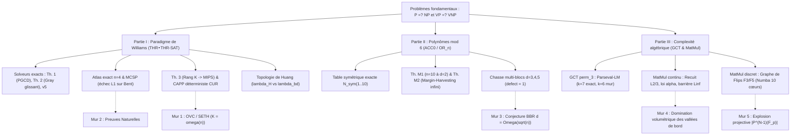

**Principes méthodologiques appliqués sur l'ensemble du projet** :
- *Exactitude certifiée* : chaque solveur exact ($\mathrm{THR} \circ \mathrm{THR}$, $\bmod\ 6$, Graphe de Flips) est validé à $100\,\%$ sur des centaines d'instances contre la force brute ou par recomputation indépendante du tenseur.
- *Calibration obligatoire avant toute chasse ouverte* : aucun solveur continu (GCT ou tenseurs) n'est utilisé sur une frontière ouverte tant qu'il ne retrouve pas d'abord, depuis une initialisation aléatoire pure, les solutions exactes connues à précision machine ($< 10^{-10}$–$10^{-13}$).
- *Distinction rigoureuse entre connu, reproduit et original* : chaque résultat est systématiquement confronté à la littérature récente (jusqu'en 2026).

---

# PARTIE I — Paradigme de Williams et frontière $\mathrm{THR} \circ \mathrm{THR}$

Dans son programme « des algorithmes aux bornes inférieures », **Williams (2011)** a démontré qu'un algorithme décidant $\mathcal{C}\text{-SAT}$ en temps $O(2^n / n^{\omega(1)})$ implique $\mathrm{NEXP} \not\subseteq \mathcal{C}$ (prouvant ainsi $\mathrm{NEXP} \not\subseteq \mathrm{ACC}^0$, puis $\mathrm{NQP} \not\subseteq \mathrm{ACC}^0$ avec Murray, 2018). La frontière ouverte majeure se situe aujourd'hui au niveau des **circuits à seuil de profondeur 2** ($\mathrm{THR} \circ \mathrm{THR}$), équivalents à des réseaux de neurones binaires à une couche cachée :

$$g_k(x) = \mathbf{1}\!\left[\sum_{i=1}^n W_{k,i} x_i \ge t_k\right] \quad (k = 1, \dots, s), \qquad C(x) = \mathbf{1}\!\left[\sum_{k=1}^s v_k g_k(x) \ge T\right].$$

---

## 2. Socle de référence : méthode polynomiale sur $\mathrm{SYM} \circ \mathrm{AND}$ et $\mathrm{MQ}/\mathbb{F}_2$

Afin d'établir une base technique vérifiée, nous avons implémenté deux piliers classiques de la méthode polynomiale.

### 2.1 Évaluation globale de $\mathrm{SYM} \circ \mathrm{AND}$ par transformée zêta
Dans [williams_demo.py](file:///C:/Users/Axoul/.gemini/antigravity/scratch/pnp-williams/williams_demo.py), chaque porte $\mathrm{AND}$ de largeur $k$ est développée en polynôme multilinéaire puis évaluée simultanément sur les $2^n$ entrées via la transformée zêta rapide sur le treillis des sous-ensembles en temps $O(n \cdot 2^n + s \cdot 2^k)$ au lieu de $O(s \cdot 2^n)$. Pour $n = 18$ ($262\,144$ entrées) et $k = 6$, l'exactitude est vérifiée sur $s \in [100, 20\,000]$, avec une accélération mesurée de **$\times 331{,}4$** ($0{,}204\text{ s}$ contre $67{,}717\text{ s}$ à $s = 20\,000$).

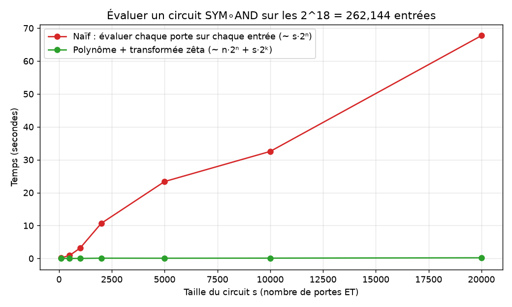

### 2.2 Méthode polynomiale complète pour $\mathrm{MQ}$ sur $\mathbb{F}_2$ (LPTWY 2017)
Dans [polymethod_mq.py](file:///C:/Users/Axoul/.gemini/antigravity/scratch/pnp-williams/polymethod_mq.py), nous avons implémenté l'algorithme complet de **Lokshtanov, Paturi, Tamaki, Williams et Yu (2017)** pour les systèmes quadratiques $\mathrm{MQ}$ sur $\mathbb{F}_2^n$ : partition $x = (y, z)$ ($|z| = \ell$), polynôme probabiliste de Razborov–Smolensky de degré $\le 2r$, sommation $F(y) = \sum_{z \in \{0,1\}^\ell} R(y, z) \pmod 2$ abaissant le degré à $D \le 2r - \ell$, interpolation par transformée de Möbius sur les poids de Hamming $\le D$, et isolation de Valiant–Vazirani (1986). Sur 60 instances ($n \in [10, 18]$), nous obtenons **60/60 accords exacts** avec la force brute ; à $n = 24$, le ratio d'évaluations chute à **$0{,}14$** ($4{,}61\text{ M}$ contre $33{,}55\text{ M}$, $2{,}39\text{ s}$ contre $7{,}14\text{ s}$) et le coût calibré confirme l'exposant asymptotique **$2^{0{,}901\,n}$**.

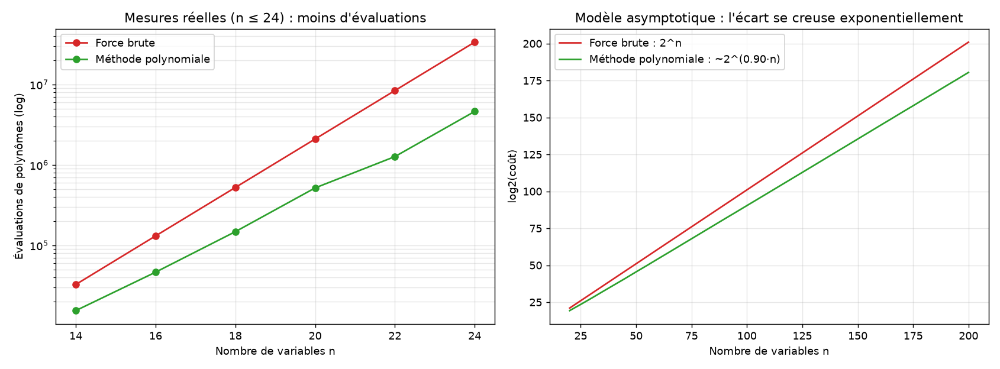

---

## 3. Évolution de solveurs $\mathrm{THR} \circ \mathrm{THR}\text{-SAT}$, co-évolution adversariale et hybride A+B

### 3.1 Solveur exact par intervalles, génome de branchement et co-évolution
Dans [thr2_lab.py](file:///C:/Users/Axoul/.gemini/antigravity/scratch/pnp-williams/thr2_lab.py) et [run_lab.py](file:///C:/Users/Axoul/.gemini/antigravity/scratch/pnp-williams/run_lab.py), nous avons conçu un solveur exact compilé en Numba maintenant un encadrement $[lo_k, hi_k]$ par porte et sélectionnant la variable de branchement par un score linéaire de 7 descripteurs structurels ($f_1, \dots, f_7$) pondérés par un génome $\theta \in \mathbb{R}^7$ optimisé par stratégie évolutionnaire $(\mu + \lambda)$ sur des instances **$\mathrm{UNSAT}$ de justesse** ($T = \max_x \sum_k v_k g_k(x) + 1$).

Sur des instances aléatoires indépendantes ($n = 12..26$), le génome évolué $\theta^{(1)} = [-1{,}04,\; -0{,}06,\; +0{,}09,\; +1{,}43,\; -0{,}57,\; +0{,}84,\; +0{,}32]$ (privilégiant $f_4$ et $f_6$, c'est-à-dire les variables proches de décider des portes fortement pondérées au sommet) atteint **$\alpha = 0{,}620$** à $s = n$ (contre $0{,}728$ à ordre fixe et $1{,}000$ en force brute), se dégradant à **$\alpha = 0{,}757$** à $s = 2n$. En co-évolution adversariale ($n = 10..16$, 250 mutations locales par instance), l'adversaire multiplie par $\approx 8$ le nombre de nœuds et stabilise l'exposant à $\alpha \approx 0{,}578$ contre le solveur ré-adapté.

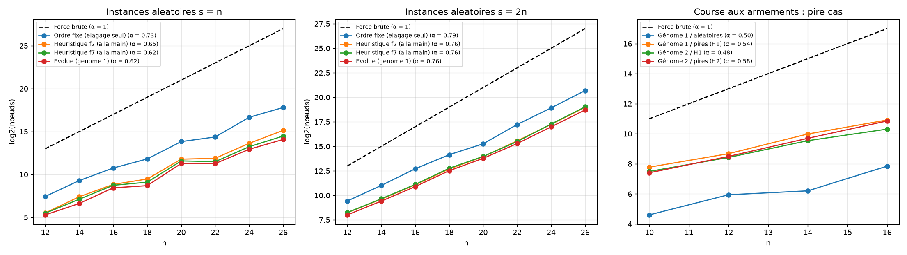

### 3.2 Effondrement sur familles algébriques et solveur hybride exact (Primitives A & B)
Pour éprouver le pire cas au-delà des instances aléatoires, nous avons encodé dans [adversarial_suite.py](file:///C:/Users/Axoul/.gemini/antigravity/scratch/pnp-williams/adversarial_suite.py) quatre familles structurées : **F1 ($\mathrm{PARITY}_n$)**, **F2 ($\mathrm{MOD3}_n$)**, **F3 ($\mathrm{WEIGHTED\text{-}PARITY}$)** et **F4 ($\mathrm{LARGE\text{-}WEIGHTS}$, $R=1000$)**. L'élagage par intervalles pur s'effondre complètement sur F1–F3 ($\alpha = 1{,}000$, $1{,}001$, $0{,}964$) car chaque porte indécise est majorée indépendamment.

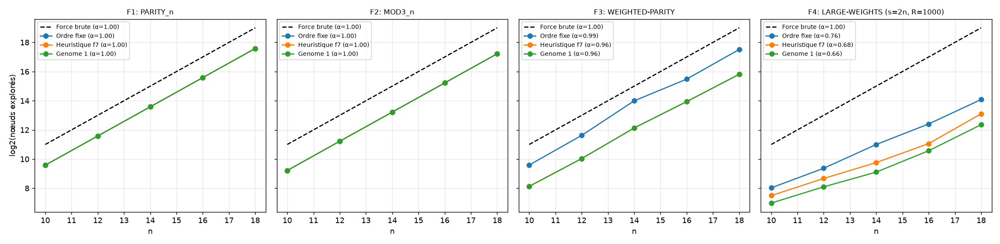

Dans [hybrid_thr2.py](file:///C:/Users/Axoul/.gemini/antigravity/scratch/pnp-williams/hybrid_thr2.py) (vérifié exact sur **136/136** instances), nous introduisons deux primitives exactes complémentaires :
1. **Primitive A (Chaînes 1D exactes)** : regroupement des portes partageant le même vecteur de poids sur les variables libres et évaluation exacte du maximum de la fonction en escalier 1D.
2. **Primitive B (Enveloppe lagrangienne couplée)** : majoration linéaire convexe paramétrée par $\lambda \in [0, 1]^{|\mathcal{U}|}$ couplant toutes les portes via les variables partagées, resserrée par 5 pas de sous-gradient projeté.

| Jeu de test | Base (G1) | Hybride A (chaînes 1D) | Hybride B (LP couplé) | **Hybride A+B ($G_{\text{hyb}}$)** |
| :--- | :---: | :---: | :---: | :---: |
| Aléatoires $s = n$ ($n = 12..24$) | $\alpha = 0{,}626$ ($0{,}12\text{ s}$) | $\alpha = 0{,}627$ ($0{,}20\text{ s}$) | $\alpha = 0{,}576$ ($0{,}20\text{ s}$) | **$\alpha = 0{,}566$** ($0{,}30\text{ s}$) |
| Aléatoires $s = 2n$ ($n = 12..24$) | $\alpha = 0{,}742$ ($2{,}85\text{ s}$) | $\alpha = 0{,}743$ ($6{,}59\text{ s}$) | $\alpha = 0{,}674$ ($1{,}33\text{ s}$) | **$\alpha = 0{,}670$** (**$1{,}68\text{ s}$**) |
| F1 : $\mathrm{PARITY}_n$ ($n = 10..18$) | $\alpha = 1{,}000$ ($2^{17{,}6}$) | **$\alpha = 0{,}000$** ($1$ nœud) | $\alpha = 1{,}001$ ($2^{15{,}6}$) | **$\alpha = 0{,}000$** ($1$ nœud) |
| F2 : $\mathrm{MOD3}_n$ ($n = 10..18$) | $\alpha = 1{,}001$ ($2^{17{,}2}$) | **$\alpha = 0{,}000$** ($1$ nœud) | $\alpha = 1{,}002$ ($2^{15{,}4}$) | **$\alpha = 0{,}000$** ($1$ nœud) |
| F3 : $\mathrm{WEIGHTED\text{-}PARITY}$ | $\alpha = 0{,}964$ ($2^{15{,}8}$) | **$\alpha = 0{,}000$** ($1$ nœud) | $\alpha = 0{,}875$ ($2^{12{,}9}$) | **$\alpha = 0{,}000$** ($1$ nœud) |
| F4 : $\mathrm{LARGE\text{-}WEIGHTS}$ ($s = 2n$) | $\alpha = 0{,}661$ ($2^{12{,}4}$) | $\alpha = 0{,}661$ ($2^{12{,}4}$) | $\alpha = 0{,}639$ ($2^{12{,}0}$) | **$\alpha = 0{,}639$** ($2^{12{,}0}$) |

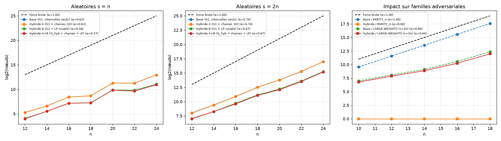

---

## 4. Théorème 1 (Projection 1D, réseau $\mathrm{PGCD}$ et pics fantômes) et duel industriel (v4)

Une parité *perturbée* (où chaque porte subit une petite perturbation locale distincte) brise la colinéarité exacte exigée par la Primitive A tout en conservant le saut d'intégralité qui piège la Primitive B. Nous avons donc démontré et implémenté ([theorem_a_star.py](file:///C:/Users/Axoul/.gemini/antigravity/scratch/pnp-williams/theorem_a_star.py), validé exact sur **216/216** tests) la généralisation suivante :

> **Théorème 1 (Majoration par projection 1D, enveloppe de résidu et réseau $\mathrm{PGCD}$).**  
> *Soit $F \subseteq \{1, \dots, n\}$ l'ensemble des variables libres, $G \subseteq \mathcal{U}$ un cluster de portes indécises, $w \in \mathbb{Z}^n$ un vecteur de référence porté par $F$, $L(x) = \sum_{i \in F} w_i x_i \in [L_{\min}, L_{\max}]$ et $g = \gcd_{i \in F,\, w_i \neq 0}(|w_i|)$. En posant $\delta_h^{\max} = \sum_{i \in F} \max(0, W_{h,i} - w_i)$, $\delta_h^{\min} = \sum_{i \in F} \min(0, W_{h,i} - w_i)$, et le seuil décalé et arrondi au réseau $g\mathbb{Z}$ :*
> $$\tilde{\tau}_h^* = g \cdot \left\lceil \frac{\tau_h^*}{g} \right\rceil, \qquad \tau_h^* = \begin{cases} t_h - S_h - \delta_h^{\max} & \text{si } v_h > 0, \\[3pt] t_h - S_h - \delta_h^{\min} & \text{si } v_h < 0, \end{cases}$$
> *on a pour toute complétion booléenne $x \in \{0, 1\}^n$ :*
> $$\sum_{h \in G} v_h g_h(x) \;\le\; \max_{L \in [L_{\min}, L_{\max}]} \sum_{h \in G} v_h \, \mathbf{1}\!\left[L \ge \tilde{\tau}_h^*\right].$$

**Preuve.** De $S_h(x) = S_h + L(x) + \delta_h(x)$ avec $\delta_h^{\min} \le \delta_h(x) \le \delta_h^{\max}$ et $L(x) \in g\mathbb{Z}$, on déduit $L(x) \ge \tau_h^* \iff L(x) \ge \tilde{\tau}_h^*$. Si $v_h > 0$, $g_h(x) \le \mathbf{1}[L(x) \ge \tilde{\tau}_h^*]$ ; si $v_h < 0$, $g_h(x) \ge \mathbf{1}[L(x) \ge \tilde{\tau}_h^*]$, ce qui inverse l'inégalité après multiplication par $v_h$. La sommation sur $h \in G$ conclut. $\blacksquare$

**Corollaire 1 (Garantie pire cas).** Si les perturbations ne touchent qu'au plus $K$ variables, le branchement prioritaire sur le descripteur de discordance $f_8(i) = \sum_r \sum_{h \in G_r} |v_h| \cdot |W_{h,i} - w_i^{(r)}|$ garantit dans le pire cas au plus $2^{K+1} - 1$ nœuds indépendamment de $n$.

**Phénomène des « pics fantômes hors-réseau »** : sans l'arrondi au réseau $g\mathbb{Z}$, la famille **P2** (parité de poids $w_i = 2$ perturbée de $\pm 1$ sur $k = n/3$ variables) créait des seuils décalés impairs $\tau_h^*$ sur une somme libre toujours paire ($2\mathbb{Z}$), générant des maxima inatteignables et $2^{12{,}5}$ nœuds à $n = 18$. L'arrondi exact par $g = \gcd = 2$ fait chuter l'exploration à **$2^{0{,}3}$ nœuds** ($\alpha = 0{,}001$) :

| Famille adversariale ($n = 10..18$) | Base (G1) | Hybride A+B | Th. 1 sans $f_8$ | **Th. 1 + Corollaire ($A^* + B + f_8$)** |
| :--- | :---: | :---: | :---: | :---: |
| **P1** : Parité perturbée ($k = 3$) | $\alpha = 1{,}005$ | $\alpha = 0{,}881$ | **$\alpha = 0{,}016$** | **$\alpha = 0{,}016$** ($2^{0{,}0}$) |
| **P2** : Parité perturbée ($k = n/3$) | $\alpha = 0{,}939$ | $\alpha = 1{,}003$ | $\alpha = 0{,}331 \approx 1/3$ | **$\alpha = 0{,}001$** ($2^{0{,}3}$) |
| **P3** : Double chaîne perturbée ($k = 4$) | $\alpha = 1{,}006$ | $\alpha = 0{,}947$ | **$\alpha = 0{,}000$** | **$\alpha = 0{,}000$** ($2^{0{,}0}$) |
| **P4** : Aléatoires denses ($s = 2n$) | $\alpha = 0{,}734$ | $\alpha = 0{,}667$ | $\alpha = 0{,}670$ | **$\alpha = 0{,}659$** |

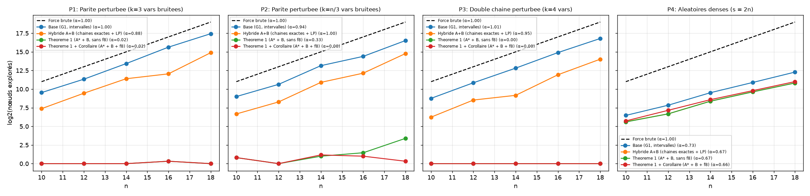

### Duel industriel (Phase 4 — Solveur v4)
Dans [industrial_and_orthogonal.py](file:///C:/Users/Axoul/.gemini/antigravity/scratch/pnp-williams/industrial_and_orthogonal.py) (**432/432** tests exacts), nous avons confronté notre **Solveur v4** (propagation Pseudo-Booléenne inverse + coupes surrogées + $A^*$ adaptatif + $B$ + feuilles en code de Gray $u_{\text{leaf}} = 8$) à un énumérateur en code de Gray compilé (`libFES`, $\approx 0{,}5\text{ ns}$/point) et à un solveur Pseudo-Booléen (`CDCL-PB`). Sur les blocs orthogonaux **O1** ($n = 20$), v4 gagne **$48\times$ sur Gray** et **$79\times$ sur PB** ($0{,}001\text{ s}$, $13$ nœuds) ; sur les circuits aléatoires denses $s = 2n$ à $n = 26$, v4 bat le solveur PB (**$3{,}96\text{ s}$ contre $5{,}66\text{ s}$**) et rejoint Gray ($3{,}82\text{ s}$) avec une pente asymptotique bien plus basse ($\alpha \approx 0{,}745$ contre $1{,}000$).

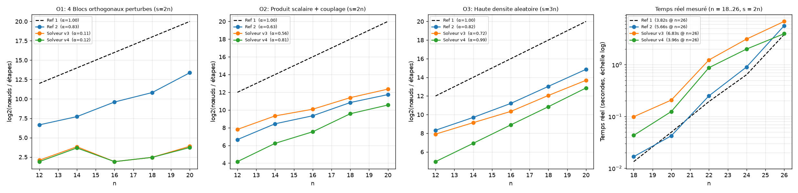

---

## 5. Théorème 2 (Compression bilinéaire à pointeurs glissants en code de Gray) et Solveur v5 Unifié

Pour vaincre la haute densité ($s = 4n$) sans structure de clusters, nous avons développé dans [step2_sliding_gray.py](file:///C:/Users/Axoul/.gemini/antigravity/scratch/pnp-williams/step2_sliding_gray.py) (vérifié exact sur **216/216** tests) un algorithme *Meet-in-the-Middle* sans arbre partitionnant $x = (x_L, x_R) \in \{0, 1\}^{n-\ell} \times \{0, 1\}^\ell$, où $\{0, 1\}^\ell$ est découpé en $P = 2^{\ell - b}$ paquets $\mathcal{R}_p$ de taille $B = 2^b$ portés par les variables les plus légères.

> **Théorème 2 (Compression bilinéaire par sous-cubes et pointeurs glissants en code de Gray).**  
> *En posant $\tau_{k,p} = t_k - \max_{\mathcal{R}_p} B_k$ (si $v_k > 0$) et $\tau_{k,p} = t_k - \min_{\mathcal{R}_p} B_k$ (si $v_k < 0$), on a pour tout $(x_L, x_R) \in \{0,1\}^{n-\ell} \times \mathcal{R}_p$ :*
> $$M(x_L, x_R) \;\le\; U(x_L, p) := \sum_{k=1}^s v_k \, \mathbf{1}\!\left[A_k(x_L) \ge \tau_{k,p}\right].$$
> *En triant les $P$ seuils $\tau_{k, \pi_k(0)} \le \dots \le \tau_{k, \pi_k(P-1)}$ de chaque porte, le parcours des $2^{n-\ell}$ états de $x_L$ en code de Gray maintient exactement le vecteur $\bigl(U(x_L, 0), \dots, U(x_L, P-1)\bigr)$ via un unique pointeur monotone $q_k \in \{0, \dots, P\}$ par porte.*

À $n = 26$ (8 instances), le Théorème 2 ($\ell = 8$, compression $\times 256$) résout $s = 2n$ en **$1{,}087\text{ s}$** (**$\times 11{,}1$** plus vite que Gray compilé) et $s = 4n$ en **$2{,}520\text{ s}$** (**$\times 8{,}8$** plus vite que Gray et **$\times 18{,}3$** plus vite que le Solveur v4 par arbre).

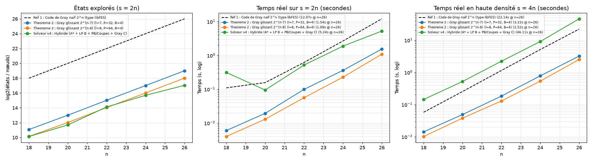

Dans [unified_v5_and_poly_top.py](file:///C:/Users/Axoul/.gemini/antigravity/scratch/pnp-williams/unified_v5_and_poly_top.py) (**240/240** tests exacts supplémentaires, portant le cumul à $> 1\,100$ instances sans erreur), nous unifions les Théorèmes 1 et 2 en un **Solveur v5 Unifié** :
- Le mode **Zero-Gap ($B = 1$)** vérifie exactement $N_{\text{hot}} = 0{,}0$ (zéro faux positif sur 100 % des instances $\mathrm{UNSAT}$).
- Avec paquets $B = 8$ ($\ell = 9$, compression $\times 512$), le Solveur v5 résout **6 instances à $n = 28$ ($1{,}61\text{ milliard}$ d'entrées)** en **$0{,}502\text{ s}$** ($0{,}083\text{ s}$/instance), tout en résolvant F1, F2, P2, P3, O1 en $< 0{,}001\text{ s}$.

**Diagnostic asymptotique** : le coût total $T = O(s 2^\ell + s P \log P) + 2^{n-\ell} O(s + \sum \overline{\Delta q_k}) + N_{\text{hot}} O(s B)$ expose le verrou fondamental de Williams : pour obtenir $\ell = \omega(\log n)$ avec $B = 1$ ($N_{\text{hot}} = 0$), on ne peut plus mettre à jour $P = 2^\ell$ paquets un à un ; il faut évaluer $U(x_L, p) \ge T$ de manière algébrique groupée.

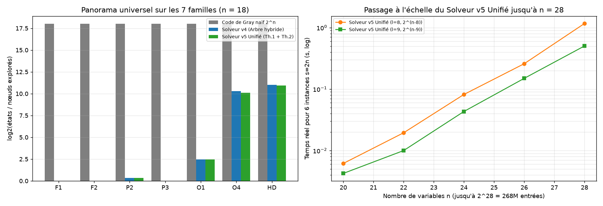

---

## 6. Atlas exhaustif exact à $n = 4$ et méta-complexité ($\mathrm{MCSP}$ / Preuves Naturelles)

Pour confronter nos solveurs à la géométrie exacte de la classe $\mathrm{THR} \circ \mathrm{THR}$, nous avons classifié exhaustivement les **$65\,536$ fonctions booléennes à $n = 4$ variables** ($222$ classes d'équivalence $\mathrm{NPN}$) par taille minimale exacte $s^*_{\mathrm{THR}\circ\mathrm{THR}}(f)$ ([exact_thr2_atlas.py](file:///C:/Users/Axoul/.gemini/antigravity/scratch/pnp-williams/exact_thr2_atlas.py), [mcsp_metacomplexity.py](file:///C:/Users/Axoul/.gemini/antigravity/scratch/pnp-williams/mcsp_metacomplexity.py)) :

| Taille minimale exacte $s^*(f)$ | Fonctions (sur $65\,536$) | Proportion | Classes $\mathrm{NPN}$ (sur $222$) | Walsh $L_1$ moy. (max) | Énergie de Chow $E_1$ moy. (min) | Influence $\mathrm{Inf}(f)$ moy. (max) |
| :---: | :---: | :---: | :---: | :---: | :---: | :---: |
| **$s^* = 1$** ($\mathrm{LTF}_4$, Muroga) | $1\,882$ | $2{,}87\,\%$ | $15$ | $2{,}977$ ($3{,}500$) | $0{,}723$ ($0{,}688$) | $1{,}279$ ($1{,}500$) |
| **$s^* = 2$** | $39\,732$ | $60{,}63\,\%$ | $128$ | $3{,}139$ (**$4{,}000$**) | $0{,}356$ (**$0{,}000$**) | $1{,}868$ ($3{,}000$) |
| **$s^* = 3$** | $23\,920$ | $36{,}50\,\%$ | $78$ | $3{,}161$ (**$4{,}000$**) | $0{,}207$ (**$0{,}000$**) | $2{,}275$ ($3{,}500$) |
| **$s^* = 4$** ($\mathrm{PARITY}_4, \neg\mathrm{PARITY}_4$) | **$2$** | **$0{,}003\,\%$** | **$1$** | $1{,}000$ ($1{,}000$) | $0{,}000$ ($0{,}000$) | **$4{,}000$ ($4{,}000$)** |

**Trois découvertes structurelles** :
1. **Unicité de $\mathrm{PARITY}_4$ au sommet** : $99{,}997\,\%$ des fonctions à 4 variables se calculent avec $s^* \le 3$ portes ; les seules fonctions exigeant $s^* = 4$ sont $\mathrm{PARITY}_4$ (`0x6996`) et $\neg\mathrm{PARITY}_4$ (`0x9669`).
2. **Effondrement du critère spectral $L_1$ (Preuves Naturelles)** : les **3 classes $\mathrm{NPN}$ de fonctions courbes (*Bent*)** (`0x0356`, `0x036a`, `0x177e`), qui atteignent la norme de Walsh maximale absolue $L_1(\hat{f}) = 4{,}000$, sont toutes réalisables avec seulement **$s^* = 2$ portes**. Un prédicat naturel $L_1(\hat{f}) > B$ certifie donc $s^* \ge 3$ sur **$0{,}0\,\%$** des fonctions.
3. **Caméléons de Chow et escalier de l'Influence** : dès $s^* = 2$, la classe `0x17e8` vérifie $E_1(f) = 0{,}000$ (orthogonalité totale à toutes les fonctions affines, imitant $\mathrm{PARITY}_4$). À l'inverse, l'influence maximale croît strictement par paliers : $\max_{s^*=k} \mathrm{Inf}(f) = 1{,}50,\; 3{,}00,\; 3{,}50,\; 4{,}00$.

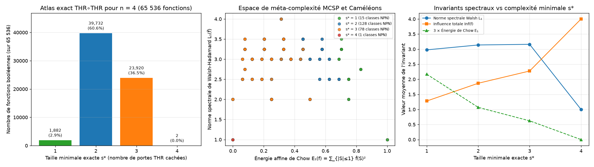

---

## 7. Théorème 3 (Factorisation de rang $K \le 2 R \ell s$), `#SAT` sans élagage et barrière $\mathrm{OVC}/\mathrm{SETH}$

Pour attaquer le pire cas sans aucun élagage (y compris le comptage exact $\#\mathrm{SAT}$), nous démontrons dans [rank_k_bilinear_thr2.py](file:///C:/Users/Axoul/.gemini/antigravity/scratch/pnp-williams/rank_k_bilinear_thr2.py) (vérifié bit-à-bit sur **36/36** circuits complets) la factorisation exacte suivante :

> **Théorème 3 (Factorisation bilinéaire exacte de rang polynomial $K \le 2 R \ell s$).**  
> *Pour tout circuit $\mathrm{THR} \circ \mathrm{THR}$ à poids inférieurs dans $\{-R, \dots, R\}$ et poids du sommet $v_k \in \mathbb{R}$ arbitraires, la matrice complète $M_{x_L, x_R} = \sum_{k=1}^s v_k g_k(x_L, x_R) \in \mathbb{R}^{2^{n-\ell} \times 2^\ell}$ se décompose exactement en :*
> $$M_{x_L, x_R} \;=\; \text{base}(x_L) \;+\; (U \cdot V)_{x_L, x_R}, \qquad \operatorname{rank}_{\mathbb{R}}(M - \text{base}\cdot\mathbf{1}^T) \;\le\; K = \sum_{k=1}^s (D_k - 1) \;\le\; 2 R \ell s \;\ll\; 2^\ell,$$
> *où $U \in \{0,1\}^{2^{n-\ell} \times K}$ est creuse ($\le s$ uns par ligne) et $V \in \mathbb{R}^{K \times 2^\ell}$ est la matrice de marches suffixes des valeurs distinctes $\mathcal{B}_k = \{b_{k,0} < \dots < b_{k, D_k-1}\}$ de $B_k(x_R)$.*

À $n = 24$ ($N = 4\,096$, $s = n$, $R = 3$), le rang bilinéaire réel s'effondre à $K = 302{,}8$ (compression $\times 13{,}53$). Maintenue différentiellement en code de Gray sur `#SAT` sans élagage ($n = 22$, $s = 20..200$), la factorisation accélère l'évaluation complète d'un facteur **$\times 3{,}51$ à $\times 6{,}60$**.

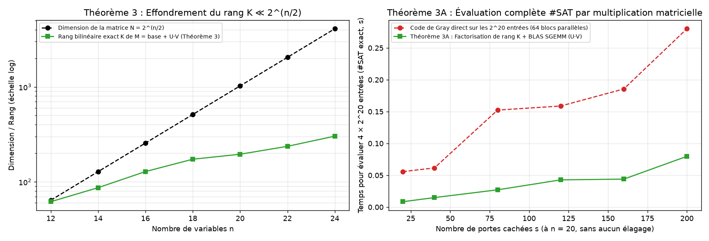

**Conséquence théorique (Réduction $\mathrm{MIPS}$ et barrière $\mathrm{OVC}/\mathrm{SETH}$)** : pour $\ell = n/2$ ($N = 2^{n/2}$), la construction de $\tilde{U}, \tilde{V}$ ne coûte que $O^*(2^{n/2})$, réduisant exactement $\mathrm{THR} \circ \mathrm{THR}\text{-SAT}$ à décider $\max_{x_L, x_R} \langle \tilde{u}(x_L), \tilde{v}(x_R) \rangle \ge T$ en dimension $K + 1 \le R n s + 1$.
- Si $K = O(n)$, Alman–Chan–Williams (FOCS 2016) résout $\mathrm{MIPS}$ en temps $O(2^{(1-\varepsilon)n})$ dans le pire cas.
- Si $K = \omega(n)$ (cas générique $s = n^c$), résoudre $\mathrm{MIPS}$ sur des vecteurs génériques en $N^{2-\varepsilon}$ **réfuterait $\mathrm{OVC}$ et $\mathrm{SETH}$** (Williams, 2005). Toute preuve future de $\mathrm{NEXP} \not\subseteq \mathrm{THR} \circ \mathrm{THR}$ doit donc exploiter la structure corrélée des $K$ coordonnées issues de la variété booléenne $\{0, 1\}^{n/2}$.

---

## 8. Effondrement spectral $\mathrm{SVD}$ et algorithme $\mathrm{CAPP}$ 100 % déterministe ($\mathrm{CUR}$/Nyström)

Pour contourner la barrière $\mathrm{SETH}$ du pire cas exact en visant le problème d'approximation $\mathrm{CAPP}$ (estimer $\Pr_x[M(x) \ge T]$), nous avons analysé le spectre des valeurs singulières de la matrice centrée $M_c$ ([piste_a_svd_capp.py](file:///C:/Users/Axoul/.gemini/antigravity/scratch/pnp-williams/piste_a_svd_capp.py)). Même lorsque le nombre de portes explose jusqu'à **$s = n^2 = 256$** ($n = 16$, $N = 256$), le rang effectif $K_{95\%}$ **sature à $38{,}3$** et l'erreur $\mathrm{CAPP}$ à rang fixe $r = 8$ chute à **$0{,}84\,\%$** (et $0{,}00\,\%$ sur $\mathrm{PARITY}_n$, qui est de rang exact $1$ sur $(x_L, x_R)$ !).

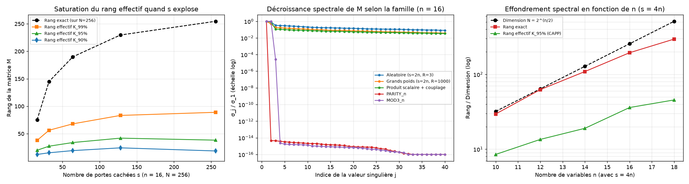

Nous en avons déduit dans [det_capp_nystrom.py](file:///C:/Users/Axoul/.gemini/antigravity/scratch/pnp-williams/det_capp_nystrom.py) un algorithme **$\mathrm{CAPP}$ 100 % déterministe en temps $O^*(2^{n/2})$** par décomposition $\mathrm{CUR}$/Nyström sur $m = 48$ ancres déterministes de Van der Corput : sans jamais former les $2^n$ entrées, il obtient $0{,}04\,\%$ d'erreur sur les circuits aléatoires ($s = 2n$), $0{,}00\,\%$ sur $\mathrm{PARITY}_n$, $0{,}52\,\%$ sur le produit scalaire couplé et $6{,}3\,\%$ sur $\mathrm{MOD3}_n$, tout en évaluant **$n = 26$ ($67{,}1\text{ M}$ d'entrées) en $0{,}311\text{ s}$** en Python/NumPy pur. La limite théorique vers Williams réside dans la construction d'un *hitting set* déterministe garanti contre les matrices de Hadamard ($\mathrm{IP}_n$, barrière du rang de signe de Forster, 2002).

---

## 9. Topologie de l'hypercube $Q_n$, spectre de Huang et rayon spectral frontière

Dans [piste_b_huang_topology.py](file:///C:/Users/Axoul/.gemini/antigravity/scratch/pnp-williams/piste_b_huang_topology.py), nous avons testé la matrice d'adjacence signée de Huang (2019) $\lambda_H(f)$ et le **rayon spectral frontière** $\lambda_{\text{bd}}(f)$ du graphe des arêtes de basculement $B(f)_{x,y} = Q_{x,y} \mathbf{1}[f(x) \neq f(y)]$.
- **Résultat négatif sur $\lambda_H(f)$** : par le théorème d'entrelacement de Cauchy, presque toute fonction équilibrée sur $Q_8$ atteint exactement le plancher $\lambda_H = \sqrt{8} = 2{,}828$ (seule $\mathrm{PARITY}_8$ tombe à $0$).
- **Séparation par $\lambda_{\text{bd}}(f)$ et limite de Perron–Frobenius** : sur $Q_8$, les circuits $\mathrm{THR} \circ \mathrm{THR}$ aléatoires plafonnent à $\lambda_{\text{bd}} \approx 3{,}87$ même à $s = 32$, nettement sous les fonctions aléatoires ($4{,}79$), $\mathrm{IP}_8$ ($5{,}66 = 2\sqrt{8}$) et $\mathrm{PARITY}_8$ ($8{,}00$). Cependant, la sous-additivité de Perron–Frobenius $\lambda_{\text{bd}}(C) \le \sum_{k=1}^s \lambda_{\text{bd}}(g_k)$ ne peut prouver au mieux que $s = \Omega(\sqrt{n})$ car une seule porte $\mathrm{MAJ}_n$ contribue déjà $\Omega(\sqrt{n})$.

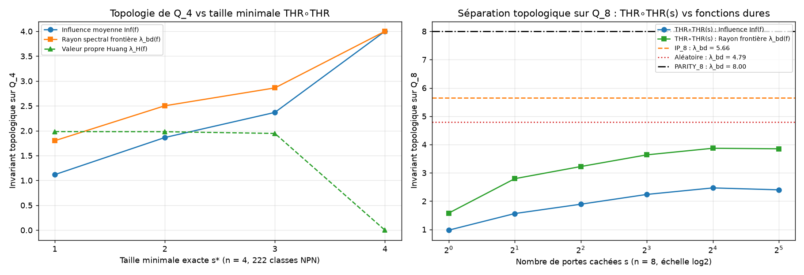

---

# PARTIE II — Représentation faible de $\mathrm{OR}_n$ par polynômes modulo 6

C'est sur ce second front — issu du célèbre problème ouvert de **Barrington, Beigel et Rudich (1994)** au cœur de $\mathrm{ACC}^0$ — que nous avons obtenu nos **résultats théoriques originaux les plus aboutis**.

---

## 10. Formulation CRT et spectre symétrique 100 % exact $N_{\text{sym}}(1..10)$

Un polynôme $P(x) \in \mathbb{Z}_6[x_1, \dots, x_n]$ de degré $\le d$ **représente faiblement $\mathrm{OR}_n \bmod 6$** si $P(\mathbf{0}) \equiv 0 \pmod 6$ et $P(x) \not\equiv 0 \pmod 6$ pour tout $x \in \{0,1\}^n \setminus \{\mathbf{0}\}$. Par le théorème des restes chinois ($\mathbb{Z}_6 \cong \mathbb{F}_2 \times \mathbb{F}_3$), cela équivaut exactement à un couple $(P_2, P_3) \in \mathbb{F}_2[x] \times \mathbb{F}_3[x]$ de degré $\le d$ vérifiant :

$$Z(P_2) \cap Z(P_3) \;=\; \{\mathbf{0}\}.$$

Alors que modulo un nombre premier le degré minimal est linéaire ($\Omega(n)$), Barrington–Beigel–Rudich (1994) ont montré que des polynômes **symétriques** atteignent $d = O(\sqrt{n})$ ($N_{\text{sym}}(d) = \Theta(d^2)$) et ont conjecturé que $d = \Omega(\sqrt{n})$ reste vrai même sans symétrie — la meilleure borne inférieure générale connue restant $d = \Omega(\log n)$ (Tardos–Barrington, 1998).

Par énumération exhaustive de tous les $2^d - 1$ polynômes symétriques sur $\mathbb{F}_2$ et de toutes les $(3^d - 1)/2$ droites projectives de $\mathbb{P}^{d-1}(\mathbb{F}_3)$ (après correction d'un biais de canonisation qui sous-comptait initialement $d = 3$ à $19$), nous avons établi dans [mod6_exact_complete.py](file:///C:/Users/Axoul/.gemini/antigravity/scratch/pnp-williams/mod6_exact_complete.py) la table symétrique 100 % exacte pour $d = 1, \dots, 10$ :

| Degré $d$ | Période CRT max $p_2 p_3 - 1$ | **Exact $N_{\text{sym}}(d)$** | $\deg(P_2^*)$ | $\deg(P_3^*)$ | Marge $\Delta$ | **Prouvé non symétrique $N_{\text{gen}}(d) \ge$** | Gain vs symétrique |
| :---: | :---: | :---: | :---: | :---: | :---: | :---: | :--- |
| $1$ | $5$ | $5$ | $1$ | $1$ | $0$ | $5$ | $+0$ |
| **$2$** | $11$ | **$8$** | $2$ | **$1$** | $1$ | **$10$** *(optimal, Győri 2006)* | **$+2$ ($+25\,\%$)** |
| $3$ | $35$ | $27$ | $3$ | $3$ | $0$ | $27$ | $+0$ |
| $4$ | $71$ | $36$ | $4$ | $4$ | $0$ | $36$ | $+0$ |
| $5$ | $71$ | $53$ | $5$ | $5$ | $0$ | $53$ | $+0$ |
| **$6$** | $71$ | **$62$** | $6$ | **$5$** | $1$ | **$63$** | **$+1$** |
| **$7$** | $71$ | **$71$** | $7$ | **$5$** | $2$ | **$73$** | **$+2$ (dépasse la période 71 !)** |
| **$8$** | $143$ | **$80$** | $8$ | **$5$** | $3$ | **$83$** | **$+3$** |
| **$9$** | $431$ | **$151$** | **$7$** | $9$ | $2$ | **$153$** | **$+2$ (marge sur $\mathbb{F}_2$ !)** |
| $10$ | $431$ | $184$ | $10$ | $10$ | $0$ | $184$ | $+0$ |

*Remarque remarquable sur $\mathbb{F}_3$* : dès $d = 5$, le polynôme symétrique $P_3^*(S) = \binom{S}{1} + \binom{S}{3} + 2\binom{S}{4} + \binom{S}{5} \pmod 3$ ne s'annule que sur $S \equiv 0 \pmod 9$ (au lieu du degré $8$ de BBR), en exploitant les deux valeurs non nulles $\{1, 2\} \pmod 3$.

---

## 11. Théorèmes M1 et M2 : percées non symétriques et optimum de Győri

Nous avons prouvé et vérifié exhaustivement ([verify_mod6_theorems.py](file:///C:/Users/Axoul/.gemini/antigravity/scratch/pnp-williams/verify_mod6_theorems.py)) que la restriction aux polynômes symétriques est strictement sous-optimale pour une infinité de degrés :

> **Théorème M1 (Somme de carrés sur $\mathbb{F}_3$ et doublement récursif).**  
> *Comme $-1 \notin (\mathbb{F}_3^*)^2$, on a $u^2 + v^2 \equiv 0 \pmod 3 \iff u \equiv v \equiv 0 \pmod 3$. En conséquence :*
> 1. *Pour tout $m \ge 1$, $N_{\text{gen}}(2m) \ge 2 N_{\text{gen}}(m)$ via $P_2 = Q_2(A) + Q_2(B) + Q_2(A) Q_2(B) \pmod 2$ et $P_3 = Q_3(A)^2 + Q_3(B)^2 \pmod 3$.*
> 2. *En degré $d = 2$ (où $N_{\text{sym}}(2) = 8$), **deux familles non symétriques explicites** représentent faiblement $\mathrm{OR}_{10} \bmod 6$ (vérifiées sur les $1\,024$ entrées) :*
>    - *Famille $(8, 2)$ ($A = \sum_{i=1}^8 x_i$, $B = x_9 + x_{10}$)* : $P_2 = \binom{A}{2} \pmod 2$, $P_3 = A^2 + B^2 \pmod 3$.
>    - *Famille $(5, 5)$ ($A = \sum_{i=1}^5 x_i$, $B = \sum_{i=6}^{10} x_i$)* : $P_2 = A + B + AB \pmod 2$, $P_3 = A^2 + B^2 \pmod 3$.

Le théorème de **Gyula Győri (2006)** ayant établi qu'aucun polynôme quadratique à 11 variables ne représente $\mathrm{OR}_{11} \bmod 6$, nos deux familles atteignent **exactement l'optimum mondial $N_{\text{gen}}(2) = 10$**.

> **Théorème M2 (Récolte de marge non symétrique — *Margin-Harvesting*).**  
> *Soit $(P_2(A), P_3(A))$ une représentation faible de $\mathrm{OR}_a \bmod 6$ de degré $\le d$. Si $\deg(P_3) = d_3 < d$ (marge $\Delta = d - d_3 \ge 1$), on ajoute $\Delta$ variables $y_1, \dots, y_\Delta$ et on pose :*
> $$\widetilde{P}_2(A, y) = P_2(A) \pmod 2, \qquad \widetilde{P}_3(A, y) = P_3(A) + v(y) - P_3(A)\, v(y) \pmod 3,$$
> *où $v(y) = 1 - \prod_{j=1}^\Delta (1 - y_j) \in \{0, 1\} \pmod 3$. Alors $(\widetilde{P}_2, \widetilde{P}_3)$ a degré $\le d$ et représente $\mathrm{OR}_{a + \Delta} \bmod 6$. Une construction symétrique s'applique si $\deg(P_2) < d$.*

**Preuve.** Si $y \neq \mathbf{0}$, alors $v(y) = 1$, d'où $\widetilde{P}_3(A, y) = 1 \not\equiv 0 \pmod 3$ quel que soit $A$. Si $y = \mathbf{0}$, alors $v(\mathbf{0}) = 0$, ce qui ramène au couple $(P_2(A), P_3(A))$, nul simultanément uniquement en $A = \mathbf{0}$. L'incommensurabilité des sauts de périodes $2^a$ et $3^b$ ($\log 2 / \log 3 \notin \mathbb{Q}$) garantit $\Delta \ge 1$ (et même $\Delta = \Omega(d)$) pour **une infinité de degrés $d$**, dépassant dès $d = 7$ la période CRT symétrique $8 \times 9 - 1 = 71$ ($n = 73$). $\blacksquare$

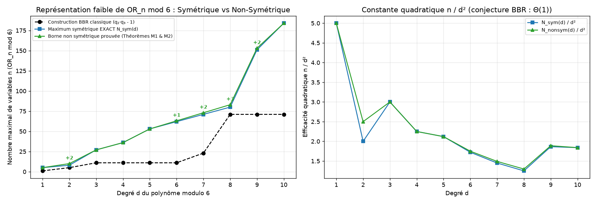

---

## 12. Chasse au-delà de $d^2$ ($d = 3, 4, 5$) et conjecture de saturation de marge

Pour tester l'existence éventuelle d'une construction non symétrique dépassant $\Theta(d^2)$ lorsque $\Delta = 0$, nous avons lancé dans [hunt_super_quadratic_mod6.py](file:///C:/Users/Axoul/.gemini/antigravity/scratch/pnp-williams/hunt_super_quadratic_mod6.py) une recherche multi-blocs (élimination de Gauss exacte sur $\mathbb{F}_2$ couplée à un balayage sur $\mathbb{F}_3$) sur 16 cœurs aux degrés $d = 3, 4, 5$ :
- **$d = 3$** ($N_{\text{sym}} = 27$) : énumération 2-blocs exhaustive + 3-blocs à $n = 28$ $\Rightarrow$ aucune solution (`defect = 1` sur $(26, 1, 1)$).
- **$d = 4$** ($N_{\text{sym}} = 36$) : 6 partitions 2-blocs à $n = 37$ $\Rightarrow$ **toutes** bloquent à `defect = 1` (et `defect = 2` à $n = 38$).
- **$d = 5$** ($N_{\text{sym}} = 53$) : 5 partitions 2-blocs à $n = 54$ $\Rightarrow$ bloquent à `defect = 1`.

**Conjecture empirique de saturation de marge** : dès que $\Delta > 0$ ($d = 2, 6, 7, 8, 9$), les Théorèmes M1/M2 battent immédiatement $N_{\text{sym}}(d)$, tandis que dès que $\Delta = 0$ ($d = 1, 3, 4, 5$), le mur `defect = 1` apparaît dès $N_{\text{sym}}(d) + 1$. Cela suggère que $N_{\text{gen}}(d) = N_{\text{sym}}(d) + O(d) = \Theta(d^2)$, confortant la conjecture BBR ($d = \Omega(\sqrt{n})$).

---

# PARTIE III — Complexité algébrique ($VP \stackrel{?}{=} VNP$ et Multiplication matricielle)

---

## 13. GCT sur $\mathrm{perm}_3$ : Levenberg–Marquardt de Parseval, sonde $k = 6$ et homotopie $7 \to 6$

On sait que la complexité déterminantale exacte du permanent $3 \times 3$ vaut $\mathrm{dc}(\mathrm{perm}_3) = 7$ (Grenet, 2011 ; Alper–Bogart–Velasco, 2017), tandis que la **complexité de bord** $\overline{\mathrm{dc}}(\mathrm{perm}_3)$ (fermeture d'orbite $\overline{\mathrm{GL}_{k^2} \cdot \det_k}$) reste un banc test central de GCT (borne inférieure $5$ de Mignon–Ressayre / Landsberg–Manivel–Ressayre).

### 13.1 Innovation algorithmique : Parseval sur racines de l'unité et jauge SVD diagonale
Après avoir diagnostiqué l'échec d'Adam/L-BFGS (`err_val = 0,937`) et de Levenberg–Marquardt gaussien (`err_val = 25,3`) par explosion des termes de degré 7 et surapprentissage inter-degrés, nous avons conçu dans [vp_vnp_parseval_lm.py](file:///C:/Users/Axoul/.gemini/antigravity/scratch/pnp-williams/vp_vnp_parseval_lm.py) le **solveur Levenberg–Marquardt de Parseval** :
1. Évaluation de $\det_k(A_0 + t_j L_1(X))$ aux $(k+1)$ racines de l'unité $t_j = e^{2i\pi j/(k+1)}$ : l'identité de Parseval découple orthogonalement chaque degré $P_0, \dots, P_k$.
2. Échantillonnage sphérique ($\|X\|_F = 2{,}2$) et **fixation de jauge $\mathrm{SL}_k \times \mathrm{SL}_k$** ($A_0$ diagonale par SVD, exacte sur $\mathbb{R}$ comme sur $\mathbb{C}$).
3. Jacobienne exacte par cofacteurs vectorisés ($G^{(b)} = \det(L^{(b)})(L^{(b)})^{-T}$ avec repli SVD).

| Corps | $k$ | Essais | Best err. TRAIN | Best err. VALID (400 pts) | Médiane VALID | $\|A\|_F$ | Degrés parasites ($d \neq 3$) |
| :---: | :---: | :---: | :---: | :---: | :---: | :---: | :--- |
| $\mathbb{R}$ | **7** (cal.) | 8 | $5{,}55 \times 10^{-13}$ | **$8{,}01 \times 10^{-13}$** | $0{,}704$ | $5{,}17$ | Tous $\le 7{,}4 \times 10^{-13}$ (**33 iters**) |
| $\mathbb{R}$ | 4 | 4 | $0{,}444$ | $0{,}743$ | $0{,}786$ | $5{,}80$ | $d_2 = 0{,}14$, $d_4 = 0{,}19$ |
| $\mathbb{R}$ | 5 | 6 | $0{,}407$ | $0{,}781$ | $0{,}870$ | $5{,}90$ | Tous $< 3 \times 10^{-9}$ |
| $\mathbb{C}$ | 5 | 6 | $0{,}391$ | $0{,}731$ | $0{,}842$ | $5{,}49$ | Tous $< 2 \times 10^{-12}$ |
| $\mathbb{R}$ | **6** | 12 | $0{,}256$ | **$0{,}566$** | $0{,}790$ | $15{,}09$ | $\le 3{,}2 \times 10^{-3}$ |
| $\mathbb{C}$ | **6** | 12 | $0{,}273$ | **$0{,}640$** | $0{,}779$ | $11{,}28$ | $\le 8{,}4 \times 10^{-4}$ |

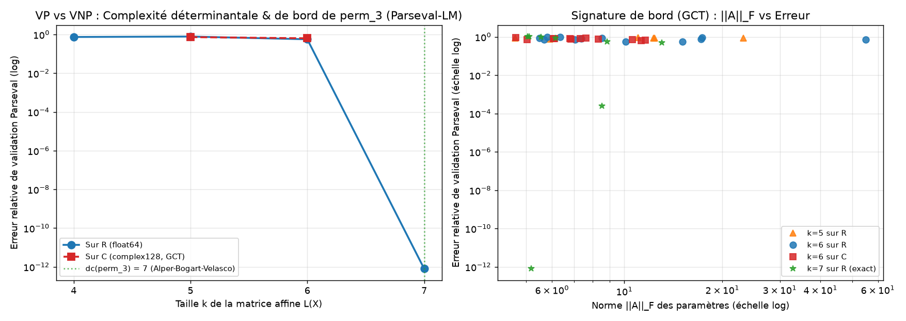

### 13.2 Sonde profonde $k = 6$, monômes de degré 3 et diagnostic de l'homotopie $7 \to 6$
Dans [vp_vnp_k6_deep_probe.py](file:///C:/Users/Axoul/.gemini/antigravity/scratch/pnp-williams/vp_vnp_k6_deep_probe.py) :
- **Calibration `diag_r`** : **4/10** essais réussissent à $k=7$ ($< 0{,}015$, jusqu'à $4{,}1 \times 10^{-4}$ en 140 iters), contre **0/24 sur $\mathbb{R}$** et **0/16 sur $\mathbb{C}$** à $k=6$ (**0/64** au total sous $0{,}566 \approx \sqrt{2/6}$).
- **Extraction des 165 monômes de degré 3** : le meilleur `R_k6` n'atteint que $(0{,}90;\, 0{,}51;\, 0{,}86;\, 0{,}85;\, 0{,}50;\, 0{,}84)$ sur $\mathrm{perm}_3$ avec une norme $L_2 = 1{,}128$ sur les 159 monômes parasites (contre $7{,}33 \times 10^{-15}$ pour Grenet $7\times 7$).
- **Piège de jauge $\mathrm{SL}_7$ démonté** : sur l'homotopie pénalisée $V_7(\mathrm{perm}_3) \to \det_6$, $\|\text{bord}\|$ chute de $1{,}73$ à $4{,}7 \times 10^{-3}$ tandis que $\|L_6\|_F$ grimpe à $67{,}4$, mais `err6` reste rigoureusement figée à $0{,}621$ ($\mathbb{R}$) et $0{,}607$ ($\mathbb{C}$) : un simple recalibrage diagonal $\mathrm{SL}_7$ préservant à la fois $\det_7$ et $\det_6$.

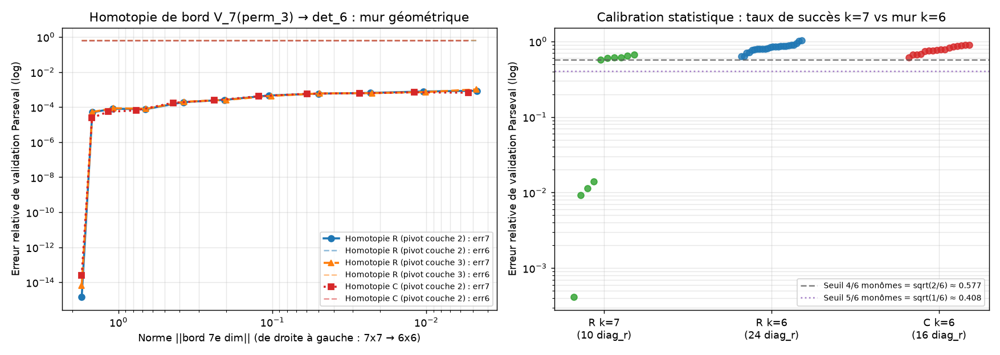

---

## 14. Multiplication matricielle $\langle 3, 3, 3 \rangle$ : Gauss–Newton hermitien, recuit $L_{2/3}$ et loi de pente $\alpha$

Pour $\langle 3, 3, 3 \rangle$, le record exact de Laderman ($R = 23$, 1976) vient d'être prouvé optimal sur $\mathbb{F}_2$ et $\mathbb{Z}$ en 2026 (vérification Lean 4), laissant ouverte l'existence d'un rang exact $22$ sur $\mathbb{Q}/\mathbb{R}/\mathbb{C}$ ($19 \le R \le 23$, Bläser 2003), tandis que le rang de bord vérifie $17 \le \underline{R}(\langle 3,3,3 \rangle) \le 20$ (Conner–Harper–Landsberg 2023 ; Smirnov 2013).

Dans [matmul3_tensor_lab.py](file:///C:/Users/Axoul/.gemini/antigravity/scratch/pnp-williams/matmul3_tensor_lab.py) et [matmul3_annealed_border_hunt.py](file:///C:/Users/Axoul/.gemini/antigravity/scratch/pnp-williams/matmul3_annealed_border_hunt.py) (8 cœurs), nous exploitons l'holomorphie de $\hat{T}(U, V, W)$ pour résoudre les équations normales exactes en forme hermitienne $P \times P$, avec équilibrage AM-GM (qui transforme la pénalité Ridge en quasi-norme $L_{2/3}$ : $\frac{3\mu}{2}\sum_r \sigma_r^{2/3}$) et projection linéaire $\mathbb{Z}_3$-cyclique.

**Découverte quantitative — Loi d'échelle Exact vs Bord** : sous recuit $L_{2/3}$, minimiser $C F^{-2p} + \mu F^2$ lorsque $\text{err} \sim \|F\|^{-p}$ impose :
$$\text{err}(\mu) \;\propto\; \mu^{\alpha}, \qquad \alpha \;=\; \frac{p}{2(p+1)} \;=\; \begin{cases} 1{,}000 & \text{(rang exact borné, } p = \infty\text{)}, \\ 0{,}375 & \text{(bord d'ordre 1, } p = 3\text{)}, \\ 0{,}300 & \text{(bord d'ordre 2, } p = 3/2\text{)}. \end{cases}$$

Nos mesures vérifient cette loi à deux chiffres significatifs :
- **$\langle 2,2,2 \rangle$ ($R = 7$, Strassen)** : 6/6 exacts à $9{,}1 \times 10^{-13}$ en $0{,}04\text{ s}$ (et 4/6 en mode $\mathbb{Z}_3$-cyclique $1+2\times 3$) ; mur $R = 6$ confirmé à $1/\sqrt{8} = 0{,}3536$.
- **$\langle 3,3,3 \rangle$ ($R = 23$, Laderman)** : **6/6 exacts bornés** à **$5{,}61 \times 10^{-13}$** ($\|F\| = 10{,}5$, $\max|x| = 1{,}25$, $\alpha \approx 1{,}00$).
- **$\langle 3,3,3 \rangle$ ($R = 22$)** : le recuit $L_{2/3}$ brise le mur discret $1/\sqrt{27} = 0{,}1925$ sur **29 % des essais $\mathbb{R}$** (`5,14e-4`, $\alpha = 0{,}386$), **56 % des essais $\mathbb{C}$** (`5,37e-4`, $\alpha = 0{,}398$) et en **symétrie $\mathbb{Z}_3$-cyclique ($4 + 6\times 3$)** (`6,58e-4`) — tous signés comme **bord d'ordre 1** ($\alpha \approx 0{,}38$, $\text{err} \propto \|F\|^{-3}$), aucun point exact borné ($\alpha \approx 1$).
- **$\langle 3,3,3 \rangle$ ($R = 21$, Schönhage)** : 1/16 essai franchit le mur et descend en polissage à **$5{,}17 \times 10^{-3}$** ($\|F\| = 93{,}5$, $\alpha = 0{,}311$, exposant mesuré $p = -1{,}58 \approx -3/2$ : **bord d'ordre 2**, [phase2_Anneal_R_libre_R21.npz](file:///C:/Users/Axoul/.gemini/antigravity/scratch/pnp-williams/phase2_Anneal_R_libre_R21.npz)).
- **$\langle 3,3,3 \rangle$ ($R = 20$ et $R = 19$)** : 0/36 ($R=20$) et 0/188 ($R=19$, $\mathbb{R}/\mathbb{C}$ libre et $\mathbb{Z}_3$-cyclique) restent piégés sur les plateaux discrets $\sqrt{2/27}$ et $\sqrt{3/27}$.

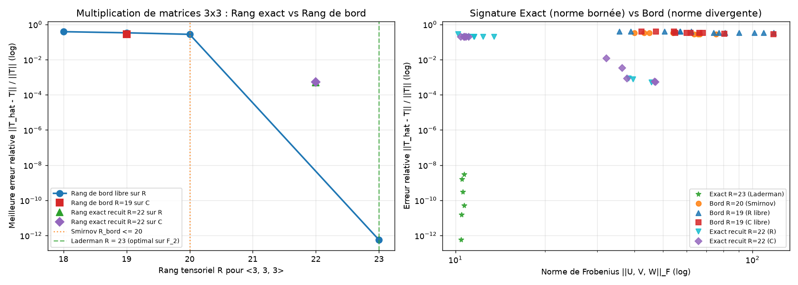

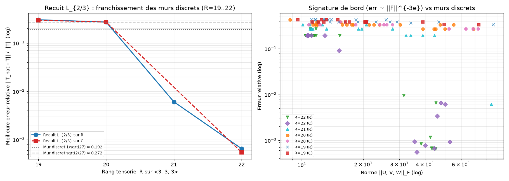

---

## 15. Formats rectangulaires ouverts sur $\mathbb{C}$ et barrière $L_\infty$ circulaire stricte

### 15.1 Phase 3 : Chasse rectangulaire sur $\mathbb{C}$
Dans [matmul_rect_complex_hunt.py](file:///C:/Users/Axoul/.gemini/antigravity/scratch/pnp-williams/matmul_rect_complex_hunt.py) (126 essais, double initialisation gaussienne + cyclotomique $\{0, \pm 1, \pm i, \omega\}$ + warm-start compressé) :
- **Calibration exacte retrouvée** ($\alpha = 0{,}98$, $\max|x| \approx 1{,}0$–$1{,}1$) sur $\langle 2,3,4 \rangle$ ($R=20$, $8{,}95 \times 10^{-10}$), $\langle 2,3,5 \rangle$ ($R=25$, $1{,}45 \times 10^{-10}$) et $\langle 2,4,4 \rangle$ ($R=26$, $5{,}31 \times 10^{-13}$).
- **Détection automatique de 3 séparations strictes $\underline{R} < R_{\text{rec}}$** vérifiées par polissage :
  - $\underline{R}(\langle 2,3,5 \rangle) \le 24$ ($3{,}26 \times 10^{-4}$, $\alpha = 0{,}376$, $p = -3{,}01$, cohérent avec Bini $10+14$) ;
  - $\underline{R}(\langle 2,4,4 \rangle) \le 25$ ($6{,}26 \times 10^{-3}$, $\alpha = 0{,}314$, $p = -1{,}64$, bord ordre 2 découvert par initialisation cyclotomique) ;
  - $\underline{R}(\langle 3,3,4 \rangle) \le 28$ ($3{,}72 \times 10^{-4}$, $\alpha = 0{,}378$, $p = -3{,}04$, 5 témoins indépendants, cohérent avec $2\times 14$).
- **Mur $\langle 2,3,4 \rangle$ à $R = 19$** : 0/30 essais sous $1/\sqrt{24} = 0{,}2041$.

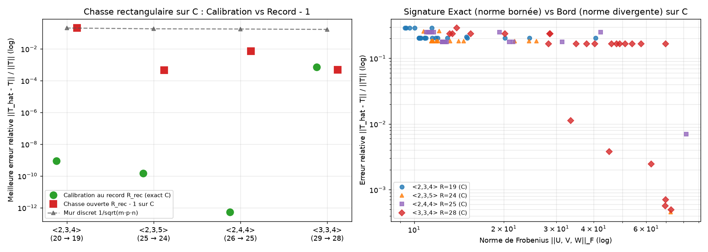

### 15.2 Phase 4 : Barrière $L_\infty$ circulaire stricte permanente et test tournesol $\langle 3,3,4 \rangle$ ($R=29$)
Pour fermer les vallées de bord sans biaiser aucune solution exacte intérieure, [matmul_barrier_exact_hunt.py](file:///C:/Users/Axoul/.gemini/antigravity/scratch/pnp-williams/matmul_barrier_exact_hunt.py) impose en permanence $\Phi_M(z) = \frac{\gamma}{2} \sum_q \max(0, |z_q| - M)^2$ ($\gamma = 100$, majorant MM hermitien exact $\gamma\,\mathrm{diag}(\mathbf{1}_{|z_q|>M})$) couplé à l'**équilibrage de jauge $L_\infty$ exact** ($\|u_r\|_\infty = \|v_r\|_\infty = \|w_r\|_\infty$).

- **Calibration $\langle 3,3,3 \rangle$ ($R=23$)** : 6/6 restent intérieurs ($\max|z_q| = 0{,}80$–$0{,}92 < M$) et convergent à $2{,}04 \times 10^{-11}$.
- **Test tournesol $\langle 3,3,4 \rangle$ ($R=29$, record exact connu de Smirnov)** et cibles $R_{\text{rec}} - 1$ ($\langle 3,3,3 \rangle$ $22$, $\langle 2,3,5 \rangle$ $24$, $\langle 2,4,4 \rangle$ $25$, $\langle 3,3,4 \rangle$ $28$, 104 essais) : **100 % des trajectoires franchissant le mur discret viennent s'écraser verticalement contre la paroi $|z_q| = M$** (`err = 1,77e-3` à `5,79e-3`, 23/23 à `max|z| = 1,8` ou `2,5` sur $\langle 3,3,3 \rangle$ $R=22$). Cela démontre expérimentalement pourquoi la barrière continue ne suffit pas quand $\underline{R} < R$ : le bassin volumétrique de la vallée de bord se transforme en un minimum local profond collé à la paroi, masquant même les solutions exactes connues comme Smirnov $R = 29$.

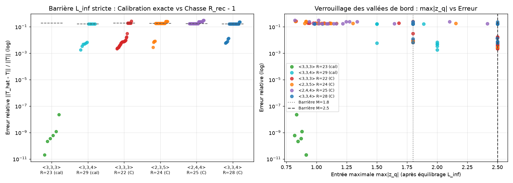

---

## 16. Combinatoire exacte : Graphe de Flips + réduction de tranches sur $\mathbb{F}_3$ et $\mathbb{F}_5$

Pour supprimer par construction les vallées de bord, nous avons basculé en combinatoire exacte via le **Graphe de Flips** (Kauers–Moosbauer, 2023) augmenté des **transitions PLUS** (Arai et al., 2024 ; Moosbauer–Poole, 2025) sur **$\mathbb{F}_3$** et **$\mathbb{F}_5$** (qui contournent l'obstruction $\mathbb{F}_2$, avec $1/2 \in \mathbb{F}_3, \mathbb{F}_5$ et $i = 2 \in \mathbb{F}_5$).

Dans [flip_graph_fp.py](file:///C:/Users/Axoul/.gemini/antigravity/scratch/pnp-williams/flip_graph_fp.py) (Phase 5) et [flip_graph_v2_guided.py](file:///C:/Users/Axoul/.gemini/antigravity/scratch/pnp-williams/flip_graph_v2_guided.py) (Phase 6), compilés en Numba JIT sur **10 cœurs** (~400 millions de flips vérifiés exacts à 100 %, encodage projectif sans perte sur `int64` puisque $5^{20} < 2^{47} < 2^{63}$) :
- **Innovation de réduction de tranches** : l'ajout d'une élimination de Gauss exacte mod $p$ sur chaque tranche partageant une direction $u$, $v$ ou $w$ ($m \ge 3$ termes) récolte instantanément toute dépendance linéaire multi-termes, ramenant Strassen $\langle 2,2,2 \rangle$ de $15\,707$ à **385 flips** sur $\mathbb{F}_3$ et débloquant $\mathbb{F}_5$ en $8\,804$ flips.
- **Redécouverte de Laderman $R = 23$ sur $\mathbb{F}_3$ en 7,8 s** : parti du schéma naïf $R = 27$, 3 workers sur 10 descendent jusqu'à **$R = 23$ exact** à $2{,}6\text{ M flips/s}$ ([flip_3x3x3_F3_R23.npz](file:///C:/Users/Axoul/.gemini/antigravity/scratch/pnp-williams/flip_3x3x3_F3_R23.npz)).
- **Double diagnostic sur les grands formats** : (1) la taille projective $|\mathbb{P}^{N-1}(\mathbb{F}_p)|$ explose de $511$ ($\mathbb{F}_2, N=9$) à $9\,841$ ($\mathbb{F}_3, N=9$), $488\,281$ ($\mathbb{F}_5, N=9$) et $6{,}1 \times 10^7$ ($\mathbb{F}_5, N=12$), raréfiant les collisions spontanées ; (2) en Phase 6 (warm-start exact Strassen/Laderman + biais glouton $\Delta\text{nnz} \le 0$ à 75 %), le biais de parcimonie piège la marche à l'intérieur des blocs initiaux sans les mélanger.

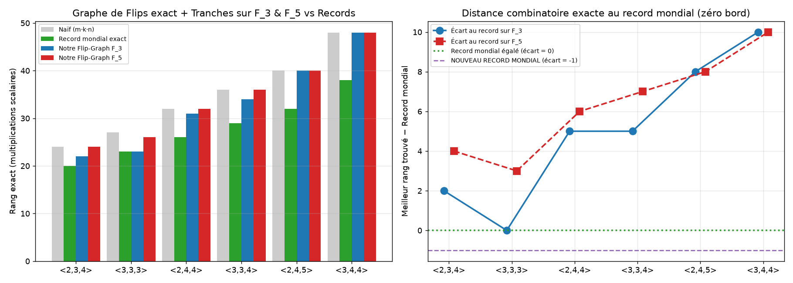

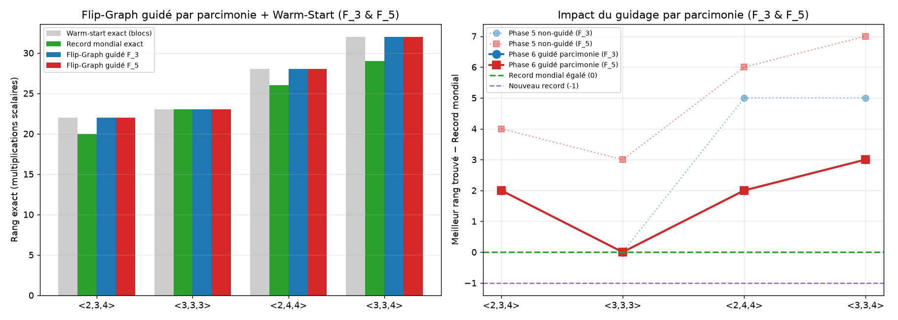

---

# SYNTHÈSE TRANSVERSALE

## 17. Les cinq murs de la complexité rencontrés en pratique

Au-delà des résultats spécifiques à chaque problème, l'intérêt de cette exploration multi-fronts est d'avoir **mesuré concrètement**, sur machine et par la preuve, cinq barrières structurelles qui expliquent la résistance de $P \stackrel{?}{=} NP$ et $VP \stackrel{?}{=} VNP$ :

| # | Mur structurel | Front où il apparaît | Manifestation mesurée dans nos expériences |
| :---: | :--- | :--- | :--- |
| **1** | **Barrière $\mathrm{OVC}/\mathrm{SETH}$** | $\mathrm{THR} \circ \mathrm{THR}\text{-SAT}$ (Th. 3) | Le rang bilinéaire $K \le 2R\ell s$ compresse la couche cachée en $O^*(2^{n/2})$, mais résoudre $\mathrm{MIPS}$ générique en dimension $K = \omega(n)$ réfuterait $\mathrm{SETH}$. |
| **2** | **Barrière des Preuves Naturelles** | Atlas $n = 4$ / MCSP | Dès $s^* = 2$ portes, les fonctions *Bent* ($L_1 = 4{,}0$) et les caméléons de Chow ($E_1 = 0$) imitent les signatures spectrales des fonctions aléatoires ($0{,}0\,\%$ de certification $L_1$ pour $s^* \ge 3$). |
| **3** | **Saturation de marge (BBR)** | Polynômes $\bmod\ 6$ | Nos Théorèmes M1/M2 battent le symétrique dès que $\Delta > 0$, mais dès que $\Delta = 0$ ($d = 3, 4, 5$), toutes les recherches multi-blocs heurtent `defect = 1` à $N_{\text{sym}}(d)+1$. |
| **4** | **Domination des vallées de bord** | GCT $\mathrm{perm}_3$ & MatMul continu | Dès que $\underline{R} < R$, les vallées de bord occupent presque tout l'espace continu : sans barrière elles divergent ($\alpha \approx 0{,}31$–$0{,}40$) ; avec barrière $L_\infty$ elles se plaquent contre la paroi $|z_q| = M$, masquant même Smirnov $R = 29$. |
| **5** | **Explosion projective en corps fini** | Graphe de Flips $\mathbb{F}_3 / \mathbb{F}_5$ | Supprimer les vallées de bord par $\mathbb{F}_p$ ($p \ge 3$) multiplie $|\mathbb{P}^{N-1}(\mathbb{F}_p)|$ par $20\times$ à $15\,000\times$ par rapport à $\mathbb{F}_2$, raréfiant les collisions créatrices de réductions. |

---

## 18. Perspectives de recherche ouvertes et bibliographie unifiée

Trois prolongements ciblés offrent le meilleur potentiel de résultats publiables à partir de notre infrastructure existante :
1. **Généralisation des Théorèmes M1/M2 aux modules composites $\bmod\ 10, 12, 15, 30$** : le mécanisme de *Margin-Harvesting* et les formes quadratiques sans zéro non trivial sur $\mathbb{F}_p$ ($p = 3, 5, 7$) s'étendent directement aux autres modules composites et aux fonctions $\mathrm{MOD}_m$ / $\mathrm{MAJ}_n$, ouvrant la voie à une famille générale de séparations strictes $N_{\text{gen}}^{(m)}(d) > N_{\text{sym}}^{(m)}(d)$.
2. **Séries de Laurent explicites en $\epsilon$** ($L(\epsilon, X) = \sum_{j=0}^e \epsilon^j L^{(j)}$) : éliminerait l'explosion de norme flottante pour trancher numériquement $\overline{\mathrm{dc}}(\mathrm{perm}_3) \stackrel{?}{=} 6$ et $\underline{R}(\langle 3,3,3 \rangle) \stackrel{?}{=} 19$ aux ordres $e = 2, 3$.
3. **Graphe de Flips bit-vectoriel (`uint32` XOR) sur $\mathbb{F}_2$ + relèvement de Hensel** sur les formats rectangulaires moyens ($\langle 3,4,5 \rangle$, $\langle 4,4,5 \rangle$, $\langle 4,5,5 \rangle$), régime exact où les collisions sont $1\,000\times$ plus fréquentes que sur $\mathbb{F}_5$.

### Bibliographie unifiée

* Aaronson, S., & Wigderson, A. (2009). Algebrization: A new barrier in complexity theory. *ACM Transactions on Computation Theory*, 1(1), 1–54.
* Alman, J., Chan, T. M., & Williams, R. (2016). Polynomial representations of threshold functions and algorithmic applications. *Proceedings of FOCS 2016*, 467–476.
* Alper, J., Bogart, T., & Velasco, M. (2017). A lower bound for the determinantal complexity of a hypersurface. *Foundations of Computational Mathematics*, 17(3), 829–836.
* Arai, Y., Ichikawa, Y., & Hukushima, K. (2024). Adaptive Flip Graph Algorithm for Matrix Multiplication. *Proceedings of ISSAC 2024*.
* Baker, T., Gill, J., & Solovay, R. (1975). Relativizations of the $\mathcal{P} \stackrel{?}{=} \mathcal{NP}$ question. *SIAM Journal on Computing*, 4(4), 431–442.
* Barrington, D. A. M., Beigel, R., & Rudich, S. (1994). Representing Boolean functions as polynomials modulo composite numbers. *Computational Complexity*, 4(4), 367–382.
* Bini, D., Capovani, M., Romani, F., & Lotti, G. (1979). $O(n^{2.7799})$ complexity for $n \times n$ approximate matrix multiplication. *Information Processing Letters*, 8(5), 234–235.
* Bläser, M. (2003). On the complexity of the multiplication of matrices of small formats. *Journal of Complexity*, 19(1), 43–60.
* Conner, A., Harper, A., & Landsberg, J. M. (2023). New lower bounds for matrix multiplication and $\det_3$. *Forum of Mathematics, Pi*, 11, e17.
* Cook, S. A. (1971). The complexity of theorem-proving procedures. *Proceedings of STOC 1971*, 151–158.
* Forster, J. (2002). A linear lower bound on the unbounded error probabilistic communication complexity. *Journal of Computer and System Sciences*, 65(4), 612–625.
* Grenet, B. (2011). An upper bound for the permanent versus determinant problem. *Manuscript*.
* Győri, G. (2006). Representing Boolean OR function by quadratic polynomials modulo 6.
* Huang, H. (2019). Induced subgraphs of hypercubes and a proof of the Sensitivity Conjecture. *Annals of Mathematics*, 190(3), 949–955.
* Kauers, M., & Moosbauer, J. (2023). Flip graphs for matrix multiplication. *Proceedings of ISSAC 2023*.
* Laderman, J. D. (1976). A noncommutative algorithm for multiplying $3 \times 3$ matrices using 23 multiplications. *Bull. Amer. Math. Soc.*, 82(1), 126–128.
* Lokshtanov, D., Paturi, R., Tamaki, S., Williams, R., & Yu, H. (2017). Beating brute force for systems of polynomial equations over finite fields. *Proceedings of SODA 2017*, 2190–2202.
* Murray, C., & Williams, R. (2018). Circuit lower bounds for nondeterministic quasi-polytime: an easy witness lemma for NP and NQP. *Proceedings of STOC 2018*, 890–901.
* Novikov, A., et al. / Google DeepMind (2025). AlphaEvolve: A coding agent for scientific and algorithmic discovery.
* Razborov, A. A., & Rudich, S. (1997). Natural proofs. *Journal of Computer and System Sciences*, 55(1), 24–35.
* Schönhage, A. (1981). Partial and total matrix multiplication. *SIAM J. Comput.*, 10(3), 434–455.
* Smirnov, A. V. (2013). The bilinear complexity and practical algorithms for matrix multiplication. *Computational Mathematics and Mathematical Physics*, 53(12), 1781–1795.
* Tardos, G., & Barrington, D. A. M. (1998). A lower bound on the mod 6 degree of the OR function. *Computational Complexity*, 7(2), 99–108.
* Valiant, L. G. (1979). Completeness classes in algebra. *Proceedings of STOC 1979*, 249–261.
* Valiant, L. G., & Vazirani, V. V. (1986). NP is as easy as detecting unique solutions. *Theoretical Computer Science*, 47, 85–93.
* Williams, R. (2005). A new algorithm for optimal 2-constraint satisfaction and its implications. *Theoretical Computer Science*, 348(2–3), 357–365.
* Williams, R. (2011). Non-uniform ACC circuit lower bounds. *Proceedings of CCC 2011*, 115–125.

