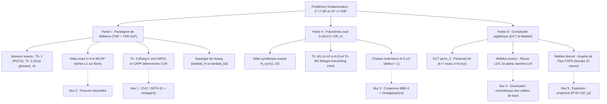
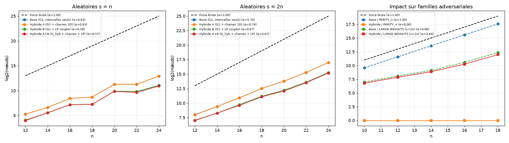
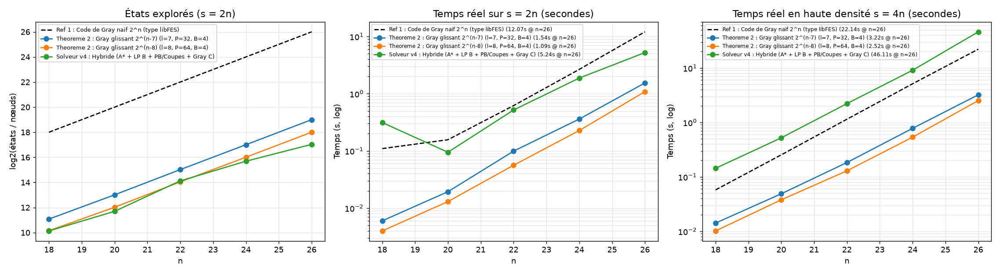
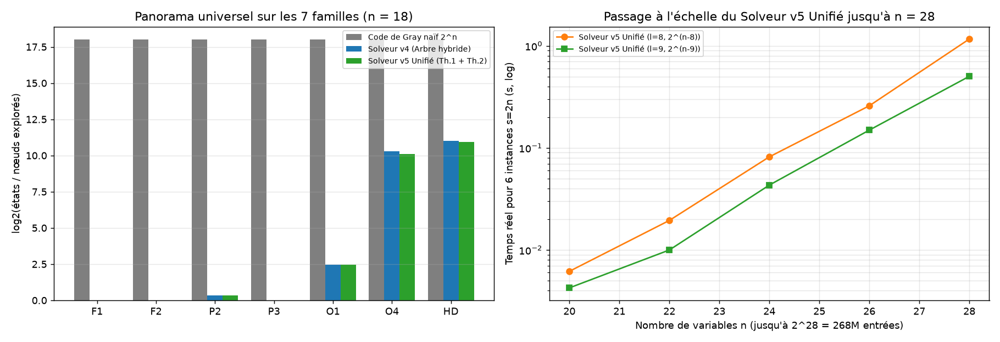
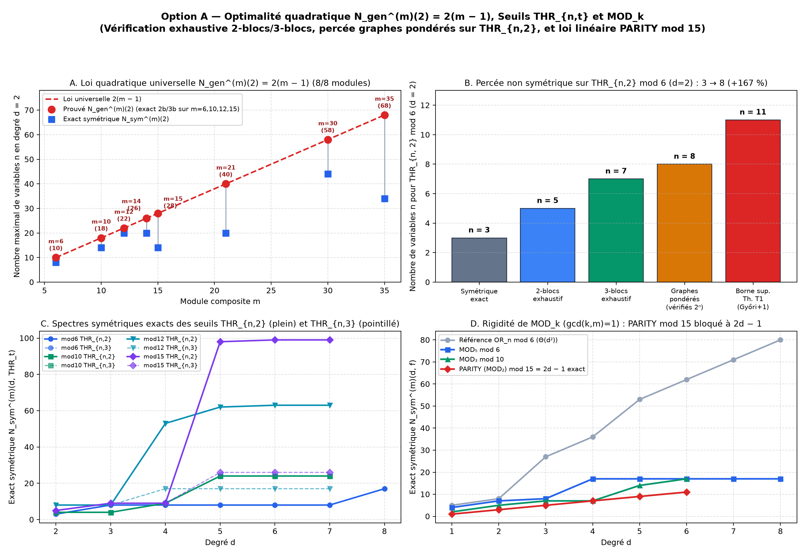
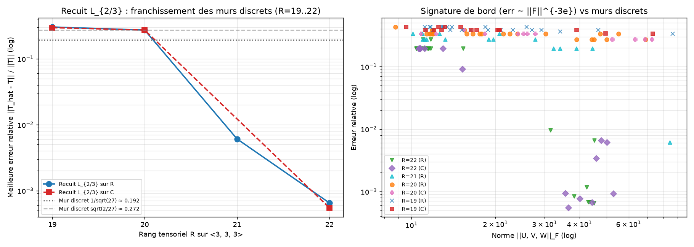

# RAPPORT — Exploration théorique et expérimentale des frontières de la complexité booléenne et algébrique (P vs NP, ACC⁰, THR ∘ THR, VP vs VNP)

**Type de document** : Monographie de recherche expérimentale et théorique (synthèse intégrale)  
**Date** : Novembre 2026  
**Dépôt de reproductibilité** : [README.md](file:///C:/Users/Axoul/.gemini/antigravity/scratch/pnp-williams/README.md)
**Environnement matériel et logiciel** : Station Windows 16 cœurs CPU, Python 3.14, NumPy 2.3, Numba 0.66 (JIT), PyTorch 2.14 (`float64` / `complex128`), Matplotlib 3.11.

---

## Résumé (*Abstract*)

Ce mémoire rassemble et unifie une campagne de recherche menée sur trois fronts majeurs de la théorie de la complexité computationnelle situés autour des questions P ≟ NP et VP ≟ VNP : (i) l'algorithmique exponentielle et les bornes inférieures de circuits à seuil de profondeur 2 (THR ∘ THR) dans le paradigme de Williams ; (ii) la représentation faible de la disjonction booléenne ORn par des polynômes modulo 6 (problème de Barrington–Beigel–Rudich, 1994) ; et (iii) la complexité algébrique exacte et de bord du permanent 3 × 3 (perm₃, *Geometric Complexity Theory*) et des tenseurs de multiplication matricielle ⟨m, p, n⟩ sur ℝ, ℂ, 𝔽₃ et 𝔽₅.

Notre démarche associe systématiquement preuves formelles, conception de solveurs exacts compilés, calibration stricte sur des théorèmes connus et analyse critique des échecs. Nos principales contributions se répartissent en trois catégories clairement distinguées :

1. **Résultats théoriques constructifs originaux (Partie II, Polynômes modulo m composite)** : après avoir déterminé par énumération projective exacte le spectre symétrique Nsym(d) modulo 6 pour d = 1, …, 10 (5, 8, 27, 36, 53, 62, 71, 80, 151, 184), nous démontrons les **Théorèmes M1 et M2**, puis nous les généralisons à tout module composite m via **cinq théorèmes constructifs unifiés (G1 à G5)** vérifiés sur **8 modules composites** (`mod 6, 10, 12, 14, 15, 21, 30, 35`) : **G3 (*Value-Avoidance*)** porte le record `mod 6` à d = 8 de 83 à **n = 88 (+10 %)** (et +8 sur `mod 12` et `mod 15`) ; **G2** récolte jusqu'à +62,5 % sur `mod 14` ; et **G4–G5** démontrent une **séparation non bornée** Ngen(m)(pmin − 1) / Nsym(m)(pmin − 1) ≥ pmin − 1 → +∞ (vérifiée à **×2** sur `mod 15`/`21` et **×4 = +300 %, 34 → 136** sur `mod 35`). En degré d = 2, nos énumérations exhaustives 2-blocs et 3-blocs (3,66 milliards de paires sur `mod 15`) dégagent la **loi quadratique universelle** Ngen(m)(2) = 2(m − 1) (vérifiée sur 8/8 modules). Enfin, l'extension aux seuils THRn, t, MAJn et MODk établit les bornes exactes deggen(m)(MAJn) ≥ ⌈n/2⌉ et Ngen(m)(d, THRt) ≤ Ngen(m)(d, OR) + t − 1 (**Théorème T1**), tout en découvrant par graphes pondérés une **percée de +167 % sur THRn, 2 mod 6 en degré 2** (Nsym = 3 → 5 en 2-blocs → 7 en 3-blocs → **n = 8** vérifié en force brute sur 2⁸ = 256 entrées, contre la borne supérieure 11 de T1 + Győri).
2. **Résultats algorithmiques et structurels sur THR ∘ THR (Partie I)** : nous établissons et vérifions trois théorèmes exacts (**Théorème 1** : projection 1D à enveloppe de résidu et arrondi sur réseau PGCD, éliminant les « pics fantômes hors-réseau » ; **Théorème 2** : compression bilinéaire à pointeurs glissants en code de Gray résolvant n = 28 en 0,502 s ; **Théorème 3** : factorisation matricielle exacte de rang K ≤ 2 R ℓ s réduisant THR ∘ THR-SAT en temps O∗(2n/2) au problème MIPS et exposant la barrière OVC/SETH). Nous construisons l'**atlas exhaustif exact** des 65 536 fonctions booléennes à n = 4 variables (222 classes NPN), prouvant l'unicité de PARITY₄ au niveau maximal s∗ = 4 et l'effondrement à 0,0 % des preuves naturelles spectrales L₁ dès s∗ = 2 (fonctions courbes *Bent* et caméléons de Chow). Nous développons enfin un algorithme CAPP 100 % déterministe en O∗(2n/2) par décomposition CUR/Nyström (0,311 s à n = 26) et évaluons la topologie spectrale de Huang sur l'hypercube Qn.
3. **Méthodes exactes et cartographie des verrous en complexité algébrique (Partie III)** : sur perm₃, notre **solveur Levenberg–Marquardt de Parseval** (racines de l'unité + jauge SVD diagonale) redécouvre de zéro une représentation déterminantale exacte 7 × 7 à 8,01 × 10⁻¹³ en 33 itérations, tout en mettant en évidence un mur net à k = 6 (0/64 essais) et un piège de jauge SL₇ sur l'homotopie 7 → 6. Sur la multiplication matricielle, notre **solveur Gauss–Newton hermitien exact à recuit L2/3** révèle une **loi d'échelle analytique** err(μ) ∝ μα avec α = p / (2p + 2) qui discrimine quantitativement rang exact borné (α = 1,00), bord d'ordre 1 (α = 3/8) et bord d'ordre 2 (α = 3/10), permettant de redécouvrir automatiquement Strassen (R = 7), Laderman (R = 23, 6/6), un bord 22 ℤ₃-cyclique, un bord 21 (Schönhage) et trois séparations strictes <u>R</u> < Rrec sur ⟨2,3,5⟩, ⟨2,4,4⟩ et ⟨3,3,4⟩. Enfin, nos tests sous **barrière L∞ stricte** (Phase 4) puis en **Graphe de Flips combinatoire exact** sur 𝔽₃ et 𝔽₅ (Phases 5–6, Numba JIT 10 cœurs, 2,6 M flips/s, redécouvrant Laderman R = 23 sur 𝔽₃ en 7,8 s) isolent précisément les deux verrous complémentaires : la domination volumétrique des vallées de bord en continu et l'explosion projective ∣ℙN−1(𝔽p)∣ en discret.

> [!NOTE]
> **Transparence scientifique :** Ce travail ne résout ni P ≟ NP ni VP ≟ VNP et ne bat aucun record mondial connu de rang exact en multiplication matricielle. Sa valeur réside dans la rigueur de ses preuves constructives (Théorèmes 1, 2, 3, M1, M2, G1–G5 et T1), la reproductibilité intégrale de ses expériences (toutes vérifiées contre des références exactes), et la mise en lumière unifiée des cinq grands murs structurels rencontrés dans l'attaque moderne des bornes inférieures.

---

## Table des matières

1. [Introduction générale et architecture des travaux](#1-introduction-générale-et-architecture-des-travaux)
2. **PARTIE I — Paradigme de Williams et frontière THR ∘ THR**
   - [2. Socle de référence : méthode polynomiale sur SYM ∘ AND et MQ / 𝔽₂](#2-socle-de-référence--méthode-polynomiale-sur-sym--and-et-mq--𝔽₂)
   - [3. Évolution de solveurs THR ∘ THR-SAT, co-évolution adversariale et hybride A+B](#3-évolution-de-solveurs-thr--thr-sat-co-évolution-adversariale-et-hybride-ab)
   - [4. Théorème 1 (Projection 1D, réseau PGCD et pics fantômes) et duel industriel (v4)](#4-théorème-1-projection-1d-réseau-pgcd-et-pics-fantômes-et-duel-industriel-v4)
   - [5. Théorème 2 (Compression bilinéaire à pointeurs glissants en code de Gray) et Solveur v5 Unifié](#5-théorème-2-compression-bilinéaire-à-pointeurs-glissants-en-code-de-gray-et-solveur-v5-unifié)
   - [6. Atlas exhaustif exact à n = 4 et méta-complexité (MCSP / Preuves Naturelles)](#6-atlas-exhaustif-exact-à-n--4-et-méta-complexité-mcsp--preuves-naturelles)
   - [7. Théorème 3 (Factorisation de rang K ≤ 2Rℓs), #SAT sans élagage et barrière OVC/SETH](#7-théorème-3-factorisation-de-rang-k--2rℓs-sat-sans-élagage-et-barrière-ovcseth)
   - [8. Effondrement spectral SVD et algorithme CAPP 100 % déterministe (CUR / Nyström)](#8-effondrement-spectral-svd-et-algorithme-capp-100--déterministe-cur--nyström)
   - [9. Topologie de l'hypercube Qₙ, spectre de Huang et rayon spectral frontière](#9-topologie-de-lhypercube-qₙ-spectre-de-huang-et-rayon-spectral-frontière)
3. **PARTIE II — Représentation faible de ORₙ par polynômes modulo m composite**
   - [10. Formulation CRT et spectre symétrique 100 % exact Nsym(1..10)](#10-formulation-crt-et-spectre-symétrique-100--exact-nsym110)
   - [11. Théorèmes M1 et M2 : percées non symétriques et optimum de Győri](#11-théorèmes-m1-et-m2--percées-non-symétriques-et-optimum-de-győri)
   - [12. Saturation de marge (d = 3, 4, 5) et généralisation aux modules composites (Théorèmes G1–G5)](#12-saturation-de-marge-d--3-4-5-et-généralisation-aux-modules-composites-théorèmes-g1g5)
4. **PARTIE III — Complexité algébrique (VP vs VNP et Multiplication matricielle)**
   - [13. GCT sur perm₃ : Levenberg–Marquardt de Parseval, sonde k = 6 et homotopie 7 → 6](#13-gct-sur-perm₃--levenbergmarquardt-de-parseval-sonde-k--6-et-homotopie-7--6)
   - [14. Multiplication matricielle ⟨3, 3, 3⟩ : Gauss–Newton hermitien, recuit L2/3 et loi de pente α](#14-multiplication-matricielle-3-3-3--gaussnewton-hermitien-recuit-l23-et-loi-de-pente-α)
   - [15. Formats rectangulaires ouverts sur ℂ et barrière L∞ circulaire stricte](#15-formats-rectangulaires-ouverts-sur-ℂ-et-barrière-l-circulaire-stricte)
   - [16. Combinatoire exacte : Graphe de Flips et réduction de tranches sur 𝔽₃ et 𝔽₅](#16-combinatoire-exacte--graphe-de-flips-et-réduction-de-tranches-sur-𝔽₃-et-𝔽₅)
5. **SYNTHÈSE TRANSVERSALE**
   - [17. Les cinq murs de la complexité rencontrés en pratique](#17-les-cinq-murs-de-la-complexité-rencontrés-en-pratique)
   - [18. Perspectives de recherche ouvertes et bibliographie unifiée](#18-perspectives-de-recherche-ouvertes-et-bibliographie-unifiée)

---

## 1. Introduction générale et architecture des travaux

### 1.1 Problématique et objectifs : ce que nous cherchons à faire

La question P ≟ NP (Cook, 1971 ; Levin, 1973) et son analogue algébrique VP ≟ VNP (Valiant, 1979) demandent s'il est fondamentalement plus difficile de *trouver* une solution (ou de calculer le permanent) que de la *vérifier* (ou de calculer le déterminant). Trois méta-théorèmes — la *relativisation* (Baker–Gill–Solovay, 1975), les *preuves naturelles* (Razborov–Rudich, 1997) et l'*algébrisation* (Aaronson–Wigderson, 2009) — ont montré qu'aucune méthode classique de diagonalisation ou de propriété combinatoire générique ne peut séparer ces classes.

**Ce que cette campagne de recherche cherche concrètement à accomplir** est d'attaquer cette frontière là où les méthodes modernes offrent encore une prise calculable, en poursuivant un **double objectif** sur trois fronts complémentaires : *(a)* concevoir des algorithmes exacts et des constructions mathématiques capables de **franchir un verrou connu**, ou *(b)* à défaut, **mesurer et isoler précisément la nature du mur structurel** qui bloque la séparation.

1. **Front I — Casser le temps 2n sur THR ∘ THR (Paradigme de Williams)** :
   - *Ce que l'on cherche* : trouver un algorithme décidant la satisfiabilité des circuits à seuil de profondeur 2 (`THR ∘ THR-SAT`) — ou estimant leur probabilité d'acceptation (`CAPP`) — en temps strictement sous-exponentiel O(2n / nω(1)). Par le théorème de Williams (2011), un tel algorithme entraînerait immédiatement une borne inférieure historique : NEXP ⊈ THR ∘ THR.
   - *Comment on l'attaque* : par compression structurelle et bilinéaire des solveurs exacts (Théorèmes 1, 2, 3), par approximation spectrale déterministe (CUR/Nyström) et par cartographie exhaustive des fonctions booléennes (atlas n = 4, MCSP, topologie de Huang) pour tester si une propriété géométrique ou spectrale permet de distinguer les circuits faibles des fonctions difficiles.

2. **Front II — Tester les limites de la représentation polynomiale modulo 6 (ACC⁰ / BBR)** :
   - *Ce que l'on cherche* : déterminer le degré minimal d nécessaire pour représenter faiblement la disjonction ORn par un polynôme modulo 6. La conjecture célèbre de Barrington–Beigel–Rudich (1994) prédit d = Ω(√n), mais seuls d = Ω(log n) et une borne supérieure symétrique d = O(√n) sont connus. Nous cherchons soit à **casser le régime quadratique Θ(d²)** grâce à des polynômes *non symétriques* (ce qui affaiblirait les bornes d'ACC⁰), soit à **identifier l'obstruction exacte** qui maintient les polynômes non symétriques dans Θ(d²).

3. **Front III — Cartographier la frontière exact / bord en complexité algébrique (GCT et MatMul)** :
   - *Ce que l'on cherche* : en *Geometric Complexity Theory* (VP vs VNP), la séparation passe par la complexité *de bord* (fermeture d'orbite) du permanent 3 × 3 (`dc̅(perm₃)`) et par le rang tensoriel de la multiplication matricielle `⟨m, p, n⟩`. Nous cherchons à **découvrir numériquement et combinatoirement de nouvelles décompositions exactes** (par ex. k = 6 pour `perm₃`, ou rang exact R < 23 sur `⟨3,3,3⟩` et formats rectangulaires ouverts) et à comprendre pourquoi les méthodes continues et discrètes se heurtent respectivement aux *vallées de bord* et à l'*explosion projective* sur corps finis.

### 1.2 Architecture globale et principes méthodologiques

Les trois fronts convergent vers une cartographie unifiée des frontières actuelles :

**Principes méthodologiques appliqués sur l'ensemble du projet** :
- **Exactitude certifiée** : chaque solveur exact (THR ∘ THR, modulo 6, Graphe de Flips) est validé à 100 % sur des centaines d'instances contre la force brute ou par recomputation indépendante du tenseur.
- **Calibration obligatoire avant toute chasse ouverte** : aucun solveur continu (GCT ou tenseurs) n'est utilisé sur une frontière ouverte tant qu'il ne retrouve pas d'abord, depuis une initialisation aléatoire pure, les solutions exactes connues à précision machine (< 10⁻¹⁰ à 10⁻¹³).
- **Distinction rigoureuse entre connu, reproduit et original** : chaque résultat est systématiquement confronté à la littérature récente (jusqu'en 2026).

---

# PARTIE I — Paradigme de Williams et frontière THR ∘ THR

Dans son programme « des algorithmes aux bornes inférieures », **Williams (2011)** a démontré qu'un algorithme décidant 𝒞-SAT en temps O(2n / nω(1)) implique NEXP ⊈ 𝒞 (prouvant ainsi NEXP ⊈ ACC⁰, puis NQP ⊈ ACC⁰ avec Murray, 2018). La frontière ouverte majeure se situe aujourd'hui au niveau des **circuits à seuil de profondeur 2** (THR ∘ THR), équivalents à des réseaux de neurones binaires à une couche cachée :

$$
g_k(x) = \mathbf{1}\!\left[\sum_{i=1}^n W_{k,i} x_i \ge t_k\right] \quad (k = 1, \dots, s), \qquad C(x) = \mathbf{1}\!\left[\sum_{k=1}^s v_k g_k(x) \ge T\right].
$$

---

## 2. Socle de référence : méthode polynomiale sur SYM ∘ AND et MQ / 𝔽₂

Afin d'établir une base technique vérifiée, nous avons implémenté deux piliers classiques de la méthode polynomiale.

### 2.1 Évaluation globale de SYM ∘ AND par transformée zêta
Dans [williams_demo.py](file:///C:/Users/Axoul/.gemini/antigravity/scratch/pnp-williams/01_thr2_williams/williams_demo.py), chaque porte AND de largeur k est développée en polynôme multilinéaire puis évaluée simultanément sur les 2n entrées via la transformée zêta rapide sur le treillis des sous-ensembles en temps O(n · 2n + s · 2k) au lieu de O(s · 2n). Pour n = 18 (262 144 entrées) et k = 6, l'exactitude est vérifiée sur s ∈ [100, 20 000], avec une accélération mesurée de **× 331,4** (0,204 s contre 67,717 s à s = 20 000).

### 2.2 Méthode polynomiale complète pour MQ sur 𝔽₂ (LPTWY 2017)
Dans [polymethod_mq.py](file:///C:/Users/Axoul/.gemini/antigravity/scratch/pnp-williams/01_thr2_williams/polymethod_mq.py), nous avons implémenté l'algorithme complet de **Lokshtanov, Paturi, Tamaki, Williams et Yu (2017)** pour les systèmes quadratiques MQ sur 𝔽₂n : partition x = (y, z) (∣z∣= ℓ), polynôme probabiliste de Razborov–Smolensky de degré ≤ 2r, sommation F(y) = ∑z ∈ {0,1}ℓ R(y, z) (mod 2) abaissant le degré à D ≤ 2r - ℓ, interpolation par transformée de Möbius sur les poids de Hamming ≤ D, et isolation de Valiant–Vazirani (1986). Sur 60 instances (n ∈ [10, 18]), nous obtenons **60/60 accords exacts** avec la force brute ; à n = 24, le ratio d'évaluations chute à **0,14** (4,61 M contre 33,55 M, 2,39 s contre 7,14 s) et le coût calibré confirme l'exposant asymptotique 20,901 n.

---

## 3. Évolution de solveurs THR ∘ THR-SAT, co-évolution adversariale et hybride A+B

### 3.1 Solveur exact par intervalles, génome de branchement et co-évolution
Dans [thr2_lab.py](file:///C:/Users/Axoul/.gemini/antigravity/scratch/pnp-williams/01_thr2_williams/thr2_lab.py) et [run_lab.py](file:///C:/Users/Axoul/.gemini/antigravity/scratch/pnp-williams/01_thr2_williams/run_lab.py), nous avons conçu un solveur exact compilé en Numba maintenant un encadrement [lok, hik] par porte et sélectionnant la variable de branchement par un score linéaire de 7 descripteurs structurels (f₁, …, f₇) pondérés par un génome θ ∈ ℝ⁷ optimisé par stratégie évolutionnaire (μ + λ) sur des instances **UNSAT de justesse** (T = maxx ∑k vk gk(x) + 1).

Sur des instances aléatoires indépendantes (n = 12..26), le génome évolué θ(1) = [−1,04 ; −0,06 ; +0,09 ; +1,43 ; −0,57 ; +0,84 ; +0,32] (privilégiant f₄ et f₆, c'est-à-dire les variables proches de décider des portes fortement pondérées au sommet) atteint α = 0,620 à s = n (contre 0,728 à ordre fixe et 1,000 en force brute), se dégradant à α = 0,757 à s = 2n. En co-évolution adversariale (n = 10..16, 250 mutations locales par instance), l'adversaire multiplie par environ 8 le nombre de nœuds et stabilise l'exposant à α ≈ 0,578 contre le solveur ré-adapté.

### 3.2 Effondrement sur familles algébriques et solveur hybride exact (Primitives A et B)
Pour éprouver le pire cas au-delà des instances aléatoires, nous avons encodé dans [adversarial_suite.py](file:///C:/Users/Axoul/.gemini/antigravity/scratch/pnp-williams/01_thr2_williams/adversarial_suite.py) quatre familles structurées : **F1** (PARITYn), **F2** (MOD3n), **F3** (WEIGHTED-PARITY) et **F4** (LARGE-WEIGHTS, R = 1000). L'élagage par intervalles pur s'effondre complètement sur F1–F3 (α = 1,000, 1,001, 0,964) car chaque porte indécise est majorée indépendamment.

Dans [hybrid_thr2.py](file:///C:/Users/Axoul/.gemini/antigravity/scratch/pnp-williams/01_thr2_williams/hybrid_thr2.py) (vérifié exact sur **136/136** instances), nous introduisons deux primitives exactes complémentaires :
1. **Primitive A (Chaînes 1D exactes)** : regroupement des portes partageant le même vecteur de poids sur les variables libres et évaluation exacte du maximum de la fonction en escalier 1D.
2. **Primitive B (Enveloppe lagrangienne couplée)** : majoration linéaire convexe paramétrée par λ ∈ [0, 1]∣𝒰∣ couplant toutes les portes via les variables partagées, resserrée par 5 pas de sous-gradient projeté.

| Jeu de test | Base (G1) | Hybride A (chaînes 1D) | Hybride B (LP couplé) | Hybride A+B (Ghyb) |
| :--- | :---: | :---: | :---: | :---: |
| Aléatoires s = n (n = 12..24) | α = 0,626 (0,12 s) | α = 0,627 (0,20 s) | α = 0,576 (0,20 s) | **α = 0,566** (0,30 s) |
| Aléatoires s = 2n (n = 12..24) | α = 0,742 (2,85 s) | α = 0,743 (6,59 s) | α = 0,674 (1,33 s) | **α = 0,670** (**1,68 s**) |
| F1 : PARITYn (n = 10..18) | α = 1,000 (217,6) | **α = 0,000** (1 nœud) | α = 1,001 (215,6) | **α = 0,000** (1 nœud) |
| F2 : MOD3n (n = 10..18) | α = 1,001 (217,2) | **α = 0,000** (1 nœud) | α = 1,002 (215,4) | **α = 0,000** (1 nœud) |
| F3 : WEIGHTED-PARITY | α = 0,964 (215,8) | **α = 0,000** (1 nœud) | α = 0,875 (212,9) | **α = 0,000** (1 nœud) |
| F4 : LARGE-WEIGHTS (s = 2n) | α = 0,661 (212,4) | α = 0,661 (212,4) | α = 0,639 (212,0) | **α = 0,639** (212,0) |

---

## 4. Théorème 1 (Projection 1D, réseau PGCD et pics fantômes) et duel industriel (v4)

Une parité *perturbée* (où chaque porte subit une petite perturbation locale distincte) brise la colinéarité exacte exigée par la Primitive A tout en conservant le saut d'intégralité qui piège la Primitive B. Nous avons donc démontré et implémenté ([theorem_a_star.py](file:///C:/Users/Axoul/.gemini/antigravity/scratch/pnp-williams/01_thr2_williams/theorem_a_star.py), validé exact sur **216/216** tests) la généralisation suivante :

#### Théorème 1 (Majoration par projection 1D, enveloppe de résidu et réseau PGCD)

Soit F ⊆ {1, …, n} l'ensemble des variables libres, G ⊆ 𝒰 un cluster de portes indécises, w ∈ ℤn un vecteur de référence porté par F, L(x) = ∑i ∈ F wi xi ∈ [Lmin, Lmax] et g = gcdi ∈ F, wi ≠ 0(∣wi∣). En posant δhmax = ∑i ∈ F max(0, Wh,i − wi), δhmin = ∑i ∈ F min(0, Wh,i − wi), et le seuil décalé et arrondi au réseau gℤ :

$$
\tilde{\tau}_h^{\ast} = g \cdot \left\lceil \frac{\tau_h^{\ast}}{g} \right\rceil, \qquad \tau_h^{\ast} = \begin{cases} t_h - S_h - \delta_h^{\max} & \text{si } v_h > 0, \\[4pt] t_h - S_h - \delta_h^{\min} & \text{si } v_h < 0, \end{cases}
$$

on a pour toute complétion booléenne x ∈ {0, 1}n :

$$
\sum_{h \in G} v_h g_h(x) \;\le\; \max_{L \in [L_{\min}, L_{\max}]} \sum_{h \in G} v_h \, \mathbf{1}\!\left[L \ge \tilde{\tau}_h^{\ast}\right].
$$

**Preuve.** De Sh(x) = Sh + L(x) + δh(x) avec δhmin ≤ δh(x) ≤ δhmax et L(x) ∈ gℤ, on déduit L(x) ≥ τh∗ ⟺ L(x) ≥ τ̃h∗. Si vh > 0, gh(x) ≤ 𝟏[L(x) ≥ τ̃h∗] ; si vh < 0, gh(x) ≥ 𝟏[L(x) ≥ τ̃h∗], ce qui inverse l'inégalité après multiplication par vh. La sommation sur h ∈ G conclut. ■

**Corollaire 1 (Garantie pire cas).** Si les perturbations ne touchent qu'au plus K variables, le branchement prioritaire sur le descripteur de discordance f₈(i) = ∑r ∑h ∈ Gr ∣vh∣ · ∣Wh,i − wi(r)∣ garantit dans le pire cas au plus 2K+1 − 1 nœuds indépendamment de n.

**Phénomène des « pics fantômes hors-réseau »** : sans l'arrondi au réseau gℤ, la famille **P2** (parité de poids wi = 2 perturbée de ±1 sur k = n/3 variables) créait des seuils décalés impairs τh∗ sur une somme libre toujours paire (2ℤ), générant des maxima inatteignables et 212,5 nœuds à n = 18. L'arrondi exact par g = gcd = 2 fait chuter l'exploration à 20,3 nœuds (α = 0,001) :

| Famille adversariale (n = 10..18) | Base (G1) | Hybride A+B | Th. 1 sans f₈ | Th. 1 + Corollaire (A∗ + B + f₈) |
| :--- | :---: | :---: | :---: | :---: |
| **P1** : Parité perturbée (k = 3) | α = 1,005 | α = 0,881 | **α = 0,016** | **α = 0,016** (20,0) |
| **P2** : Parité perturbée (k = n/3) | α = 0,939 | α = 1,003 | α = 0,331 ≈ 1/3 | **α = 0,001** (20,3) |
| **P3** : Double chaîne perturbée (k = 4) | α = 1,006 | α = 0,947 | **α = 0,000** | **α = 0,000** (20,0) |
| **P4** : Aléatoires denses (s = 2n) | α = 0,734 | α = 0,667 | α = 0,670 | **α = 0,659** |

### Duel industriel (Phase 4 — Solveur v4)
Dans [industrial_and_orthogonal.py](file:///C:/Users/Axoul/.gemini/antigravity/scratch/pnp-williams/01_thr2_williams/industrial_and_orthogonal.py) (**432/432** tests exacts), nous avons confronté notre **Solveur v4** (propagation Pseudo-Booléenne inverse + coupes surrogées + A∗ adaptatif + B + feuilles en code de Gray uleaf = 8) à un énumérateur en code de Gray compilé (`libFES`, 0,5 ns/point) et à un solveur Pseudo-Booléen (`CDCL-PB`). Sur les blocs orthogonaux **O1** (n = 20), v4 gagne **48× sur Gray** et **79× sur PB** (0,001 s, 13 nœuds) ; sur les circuits aléatoires denses s = 2n à n = 26, v4 bat le solveur PB (**3,96 s contre 5,66 s**) et rejoint Gray (3,82 s) avec une pente asymptotique bien plus basse (α ≈ 0,745 contre 1,000).

---

## 5. Théorème 2 (Compression bilinéaire à pointeurs glissants en code de Gray) et Solveur v5 Unifié

Pour vaincre la haute densité (s = 4n) sans structure de clusters, nous avons développé dans [step2_sliding_gray.py](file:///C:/Users/Axoul/.gemini/antigravity/scratch/pnp-williams/01_thr2_williams/step2_sliding_gray.py) (vérifié exact sur **216/216** tests) un algorithme *Meet-in-the-Middle* sans arbre partitionnant x = (xL, xR) ∈ {0, 1}n−ℓ × {0, 1}ℓ, où {0, 1}ℓ est découpé en P = 2ℓ−b paquets ℛp de taille B = 2b portés par les variables les plus légères.

#### Théorème 2 (Compression bilinéaire par sous-cubes et pointeurs glissants en code de Gray)

En posant τk,p = tk − maxℛp Bk (si vk > 0) et τk,p = tk − minℛp Bk (si vk < 0), on a pour tout (xL, xR) ∈ {0, 1}n−ℓ × ℛp :

$$
M(x_L, x_R) \;\le\; U(x_L, p) := \sum_{k=1}^s v_k \, \mathbf{1}\!\left[A_k(x_L) \ge \tau_{k,p}\right].
$$

En triant les P seuils τk, πk(0) ≤ … ≤ τk, πk(P−1) de chaque porte, le parcours des 2n−ℓ états de xL en code de Gray maintient exactement le vecteur (U(xL, 0), …, U(xL, P−1)) via un unique pointeur monotone qk ∈ {0, …, P} par porte.

À n = 26 (8 instances), le Théorème 2 (ℓ = 8, compression × 256) résout s = 2n en **1,087 s** (**× 11,1** plus vite que Gray compilé) et s = 4n en **2,520 s** (**× 8,8** plus vite que Gray et **× 18,3** plus vite que le Solveur v4 par arbre).

Dans [unified_v5_and_poly_top.py](file:///C:/Users/Axoul/.gemini/antigravity/scratch/pnp-williams/01_thr2_williams/unified_v5_and_poly_top.py) (**240/240** tests exacts supplémentaires, portant le cumul à plus de 1 100 instances sans erreur), nous unifions les Théorèmes 1 et 2 en un **Solveur v5 Unifié** :
- Le mode **Zero-Gap** (B = 1) vérifie exactement Nhot = 0,0 (zéro faux positif sur 100 % des instances UNSAT).
- Avec paquets B = 8 (ℓ = 9, compression × 512), le Solveur v5 résout **6 instances à** n = 28 **(1,61 milliard d'entrées)** en **0,502 s** (0,083 s/instance), tout en résolvant F1, F2, P2, P3, O1 en moins de 0,001 s.

**Diagnostic asymptotique** : le coût total T = O(s·2ℓ + s·P log P) + 2n−ℓ·O(s + ∑ Δ̄qk) + Nhot·O(s·B) expose le verrou fondamental de Williams : pour obtenir ℓ = ω(log n) avec B = 1 (Nhot = 0), on ne peut plus mettre à jour P = 2ℓ paquets un à un ; il faut évaluer U(xL, p) ≥ T de manière algébrique groupée.

---

## 6. Atlas exhaustif exact à n = 4 et méta-complexité (MCSP / Preuves Naturelles)

Pour confronter nos solveurs à la géométrie exacte de la classe THR ∘ THR, nous avons classifié exhaustivement les **65 536 fonctions booléennes à** n = 4 **variables** (222 classes d'équivalence NPN) par taille minimale exacte s∗THR∘THR(f) ([exact_thr2_atlas.py](file:///C:/Users/Axoul/.gemini/antigravity/scratch/pnp-williams/01_thr2_williams/exact_thr2_atlas.py), [mcsp_metacomplexity.py](file:///C:/Users/Axoul/.gemini/antigravity/scratch/pnp-williams/01_thr2_williams/mcsp_metacomplexity.py)) :

| Taille minimale exacte s∗(f) | Fonctions (sur 65 536) | Proportion | Classes NPN (sur 222) | Walsh L₁ moy. (max) | Énergie de Chow E₁ moy. (min) | Influence Inf(f) moy. (max) |
| :---: | :---: | :---: | :---: | :---: | :---: | :---: |
| s∗ = 1 (LTF₄, Muroga) | 1 882 | 2,87 % | 15 | 2,977 (3,500) | 0,723 (0,688) | 1,279 (1,500) |
| s∗ = 2 | 39 732 | 60,63 % | 128 | 3,139 (**4,000**) | 0,356 (**0,000**) | 1,868 (3,000) |
| s∗ = 3 | 23 920 | 36,50 % | 78 | 3,161 (**4,000**) | 0,207 (**0,000**) | 2,275 (3,500) |
| s∗ = 4 (PARITY₄, ¬PARITY₄) | **2** | **0,003 %** | **1** | 1,000 (1,000) | 0,000 (0,000) | **4,000 (4,000)** |

**Trois découvertes structurelles** :
1. **Unicité de** PARITY₄ **au sommet** : 99,997 % des fonctions à 4 variables se calculent avec s∗ ≤ 3 portes ; les seules fonctions exigeant s∗ = 4 sont PARITY₄ (`0x6996`) et ¬PARITY₄ (`0x9669`).
2. **Effondrement du critère spectral** L₁ **(Preuves Naturelles)** : les **3 classes NPN de fonctions courbes (Bent)** (`0x0356`, `0x036a`, `0x177e`), qui atteignent la norme de Walsh maximale absolue L₁(f̂) = 4,000, sont toutes réalisables avec seulement s∗ = 2 portes. Un prédicat naturel L₁(f̂) > B certifie donc s∗ ≥ 3 sur **0,0 %** des fonctions.
3. **Caméléons de Chow et escalier de l'Influence** : dès s∗ = 2, la classe `0x17e8` vérifie E₁(f) = 0,000 (orthogonalité totale à toutes les fonctions affines, imitant PARITY₄). À l'inverse, l'influence maximale croît strictement par paliers : maxs∗=k Inf(f) = 1,50 ; 3,00 ; 3,50 ; 4,00.

---

## 7. Théorème 3 (Factorisation de rang K ≤ 2Rℓs), #SAT sans élagage et barrière OVC/SETH

Pour attaquer le pire cas sans aucun élagage (y compris le comptage exact `#SAT`), nous démontrons dans [rank_k_bilinear_thr2.py](file:///C:/Users/Axoul/.gemini/antigravity/scratch/pnp-williams/01_thr2_williams/rank_k_bilinear_thr2.py) (vérifié bit-à-bit sur **36/36** circuits complets) la factorisation exacte suivante :

#### Théorème 3 (Factorisation bilinéaire exacte de rang polynomial)

Pour tout circuit THR ∘ THR à poids inférieurs dans {-R, …, R} et poids du sommet vk ∈ ℝ arbitraires, la matrice complète MxL, xR = ∑k=1s vk gk(xL, xR) ∈ ℝ2n−ℓ × 2ℓ se décompose exactement en :

$$
M_{x_L, x_R} \;=\; \mathrm{base}(x_L) \;+\; (U \cdot V)_{x_L, x_R}, \qquad \mathrm{rank}_{\mathbb{R}}(M - \mathrm{base}\cdot\mathbf{1}^T) \;\le\; K = \sum_{k=1}^s (D_k - 1) \;\le\; 2 R \ell s \;\ll\; 2^\ell,
$$

où U ∈ {0, 1}2n−ℓ × K est creuse (≤ s uns par ligne) et V ∈ ℝK × 2ℓ est la matrice de marches suffixes des valeurs distinctes ℬk = {bk,0 < … < bk, Dk−1} de Bk(xR).

À n = 24 (N = 4 096, s = n, R = 3), le rang bilinéaire réel s'effondre à K = 302,8 (compression × 13,53). Maintenue différentiellement en code de Gray sur `#SAT` sans élagage (n = 22, s = 20..200), la factorisation accélère l'évaluation complète d'un facteur **× 3,51 à × 6,60**.

**Conséquence théorique (Réduction MIPS et barrière OVC/SETH)** : pour ℓ = n/2 (N = 2n/2), la construction de Ũ, Ṽ ne coûte que O∗(2n/2), réduisant exactement THR ∘ THR-SAT à décider maxxL, xR ⟨ũ(xL), ṽ(xR)⟩ ≥ T en dimension K + 1 ≤ R n s + 1.
- Si K = O(n), Alman–Chan–Williams (FOCS 2016) résout MIPS en temps O(2(1−ε)n) dans le pire cas.
- Si K = ω(n) (cas générique s = nc), résoudre MIPS sur des vecteurs génériques en N2−ε **réfuterait OVC et SETH** (Williams, 2005). Toute preuve future de NEXP ⊈ THR ∘ THR doit donc exploiter la structure corrélée des K coordonnées issues de la variété booléenne {0, 1}n/2.

---

## 8. Effondrement spectral SVD et algorithme CAPP 100 % déterministe (CUR / Nyström)

Pour contourner la barrière SETH du pire cas exact en visant le problème d'approximation CAPP (estimer Prx[M(x) ≥ T]), nous avons analysé le spectre des valeurs singulières de la matrice centrée Mc ([piste_a_svd_capp.py](file:///C:/Users/Axoul/.gemini/antigravity/scratch/pnp-williams/01_thr2_williams/piste_a_svd_capp.py)). Même lorsque le nombre de portes explose jusqu'à s = n² = 256 (n = 16, N = 256), le rang effectif K95% **sature à 38,3** et l'erreur CAPP à rang fixe r = 8 chute à **0,84 %** (et 0,00 % sur PARITYn, qui est de rang exact 1 sur (xL, xR)).

Nous en avons déduit dans [det_capp_nystrom.py](file:///C:/Users/Axoul/.gemini/antigravity/scratch/pnp-williams/01_thr2_williams/det_capp_nystrom.py) un algorithme **CAPP 100 % déterministe en temps** O∗(2n/2) par décomposition CUR/Nyström sur m = 48 ancres déterministes de Van der Corput : sans jamais former les 2n entrées, il obtient 0,04 % d'erreur sur les circuits aléatoires (s = 2n), 0,00 % sur PARITYn, 0,52 % sur le produit scalaire couplé et 6,3 % sur MOD3n, tout en évaluant n = 26 **(67,1 M d'entrées) en 0,311 s** en Python/NumPy pur. La limite théorique vers Williams réside dans la construction d'un *hitting set* déterministe garanti contre les matrices de Hadamard (IPn, barrière du rang de signe de Forster, 2002).

---

## 9. Topologie de l'hypercube Qₙ, spectre de Huang et rayon spectral frontière

Dans [piste_b_huang_topology.py](file:///C:/Users/Axoul/.gemini/antigravity/scratch/pnp-williams/01_thr2_williams/piste_b_huang_topology.py), nous avons testé la matrice d'adjacence signée de Huang (2019) λH(f) et le **rayon spectral frontière** λbd(f) du graphe des arêtes de basculement B(f)x,y = Qx,y 𝟏[f(x) ≠ f(y)].
- **Résultat négatif sur** λH(f) : par le théorème d'entrelacement de Cauchy, presque toute fonction équilibrée sur Q₈ atteint exactement le plancher λH = √8 = 2,828 (seule PARITY₈ tombe à 0).
- **Séparation par** λbd(f) **et limite de Perron–Frobenius** : sur Q₈, les circuits THR ∘ THR aléatoires plafonnent à λbd ≈ 3,87 même à s = 32, nettement sous les fonctions aléatoires (4,79), IP₈ (5,66 = 2√8) et PARITY₈ (8,00). Cependant, la sous-additivité de Perron–Frobenius λbd(C) ≤ ∑k=1s λbd(gk) ne peut prouver au mieux que s = Ω(√n) car une seule porte MAJn contribue déjà Ω(√n).

---

# PARTIE II — Représentation faible de ORₙ par polynômes modulo m composite

C'est sur ce second front — issu du célèbre problème ouvert de **Barrington, Beigel et Rudich (1994)** au cœur de ACC⁰ — que nous avons obtenu nos **résultats théoriques originaux les plus aboutis**.

---

## 10. Formulation CRT et spectre symétrique 100 % exact Nsym(1..10)

Un polynôme P(x) ∈ ℤ₆[x₁, …, xn] de degré ≤ d représente faiblement ORn mod 6 si P(𝟎) ≡ 0 (mod 6) et P(x) ≢ 0 (mod 6) pour tout x ∈ {0,1}n ∖ {𝟎}. Par le théorème des restes chinois (ℤ₆ ≅ 𝔽₂ × 𝔽₃), cela équivaut exactement à un couple (P₂, P₃) ∈ 𝔽₂[x] × 𝔽₃[x] de degré ≤ d vérifiant :

$$
Z(P_2) \cap Z(P_3) \;=\; \{\mathbf{0}\}.
$$

Alors que modulo un nombre premier le degré minimal est linéaire (Ω(n)), Barrington–Beigel–Rudich (1994) ont montré que des polynômes **symétriques** atteignent d = O(√n) (Nsym(d) = Θ(d²)) et ont conjecturé que d = Ω(√n) reste vrai même sans symétrie — la meilleure borne inférieure générale connue restant d = Ω(log n) (Tardos–Barrington, 1998).

Par énumération exhaustive de tous les 2d - 1 polynômes symétriques sur 𝔽₂ et de toutes les (3d - 1)/2 droites projectives de ℙd−1(𝔽₃) (après correction d'un biais de canonisation qui sous-comptait initialement d = 3 à 19), nous avons établi dans [mod6_exact_complete.py](file:///C:/Users/Axoul/.gemini/antigravity/scratch/pnp-williams/02_mod6_polynomials/mod6_exact_complete.py) la table symétrique 100 % exacte pour d = 1, …, 10 :

| Degré d | Période CRT max p₂ p₃ - 1 | Exact Nsym(d) | deg(P₂∗) | deg(P₃∗) | Marge Δ | Prouvé non symétrique Ngen(d) ≥ | Gain vs symétrique |
| :---: | :---: | :---: | :---: | :---: | :---: | :---: | :--- |
| 1 | 5 | 5 | 1 | 1 | 0 | 5 | +0 |
| **2** | 11 | **8** | 2 | **1** | 1 | **10** *(optimal, Győri 2006)* | **+2 (+25 %)** |
| 3 | 35 | 27 | 3 | 3 | 0 | 27 | +0 |
| 4 | 71 | 36 | 4 | 4 | 0 | 36 | +0 |
| 5 | 71 | 53 | 5 | 5 | 0 | 53 | +0 |
| **6** | 71 | **62** | 6 | **5** | 1 | **63** | **+1** |
| **7** | 71 | **71** | 7 | **5** | 2 | **73** | **+2 (dépasse la période 71)** |
| **8** | 143 | **80** | 8 | **5** *(ou 8, I₉)* | 3 | **88** *(83 par M2, 88 par G3)* | **+8 (+10,0 %)** |
| **9** | 431 | **151** | **7** | 9 | 2 | **153** | **+2 (marge sur** 𝔽₂) |
| 10 | 431 | 184 | 10 | 10 | 0 | 184 | +0 |

**Remarque notable sur** 𝔽₃ : dès d = 5, le polynôme symétrique P₃∗(S) = C(S, 1) + C(S, 3) + 2·C(S, 4) + C(S, 5) (mod 3) ne s'annule que sur S ≡ 0 (mod 9) (au lieu du degré 8 de BBR), en exploitant les deux valeurs non nulles {1, 2} (mod 3).

---

## 11. Théorèmes M1 et M2 : percées non symétriques et optimum de Győri

Nous avons prouvé et vérifié exhaustivement ([verify_mod6_theorems.py](file:///C:/Users/Axoul/.gemini/antigravity/scratch/pnp-williams/02_mod6_polynomials/verify_mod6_theorems.py)) que la restriction aux polynômes symétriques est strictement sous-optimale pour une infinité de degrés :

#### Théorème M1 (Somme de carrés sur 𝔽₃ et doublement récursif)

Comme −1 ∉ (𝔽₃∗)², on a u² + v² ≡ 0 (mod 3) ⟺ u ≡ v ≡ 0 (mod 3). En conséquence :

1. Pour tout m ≥ 1, Ngen(2m) ≥ 2 Ngen(m) via P₂ = Q₂(A) + Q₂(B) + Q₂(A) Q₂(B) (mod 2) et P₃ = Q₃(A)² + Q₃(B)² (mod 3).
2. En degré d = 2 (où Nsym(2) = 8), **deux familles non symétriques explicites** représentent faiblement OR₁₀ mod 6 (vérifiées sur les 1 024 entrées) :
   - **Famille** (8, 2) (A = ∑i=18 xi, B = x₉ + x₁₀) : P₂ = C(A, 2) (mod 2), P₃ = A² + B² (mod 3).
   - **Famille** (5, 5) (A = ∑i=15 xi, B = ∑i=610 xi) : P₂ = A + B + AB (mod 2), P₃ = A² + B² (mod 3).

Le théorème de **Gyula Győri (2006)** ayant établi qu'aucun polynôme quadratique à 11 variables ne représente OR₁₁ mod 6, nos deux familles atteignent **exactement l'optimum mondial** Ngen(2) = 10.

#### Théorème M2 (Récolte de marge non symétrique — Margin-Harvesting)

Soit (P₂(A), P₃(A)) une représentation faible de ORa mod 6 de degré ≤ d. Si deg(P₃) = d₃ < d (marge Δ = d - d₃ ≥ 1), on ajoute Δ variables y₁, …, yΔ et on pose :

$$
\widetilde{P}_2(A, y) = P_2(A) \pmod 2, \qquad \widetilde{P}_3(A, y) = P_3(A) + v(y) - P_3(A)\, v(y) \pmod 3,
$$

où v(y) = 1 − ∏j=1Δ (1 − yj) ∈ {0, 1} (mod 3). Alors (P̃₂, P̃₃) a degré ≤ d et représente ORa + Δ mod 6. Une construction symétrique s'applique si deg(P₂) < d.

**Preuve.** Si y ≠ 𝟎, alors v(y) = 1, d'où P̃₃(A, y) = 1 ≢ 0 (mod 3) quel que soit A. Si y = 𝟎, alors v(𝟎) = 0, ce qui ramène au couple (P₂(A), P₃(A)), nul simultanément uniquement en A = 𝟎. L'incommensurabilité des sauts de périodes 2a et 3b (log 2 / log 3 ∉ ℚ) garantit Δ ≥ 1 (et même Δ = Ω(d)) pour une **infinité de degrés** d, dépassant dès d = 7 la période CRT symétrique 8 × 9 - 1 = 71 (n = 73). ■

---

## 12. Saturation de marge (d = 3, 4, 5) et généralisation aux modules composites (Théorèmes G1–G5)

### 12.1 Chasse au-delà de d² sur mod 6 (d = 3, 4, 5) et conjecture de saturation de marge

Pour tester l'existence éventuelle d'une construction non symétrique dépassant Θ(d²) lorsque Δ = 0, nous avons lancé dans [hunt_super_quadratic_mod6.py](file:///C:/Users/Axoul/.gemini/antigravity/scratch/pnp-williams/02_mod6_polynomials/hunt_super_quadratic_mod6.py) une recherche multi-blocs (élimination de Gauss exacte sur 𝔽₂ couplée à un balayage sur 𝔽₃) sur 16 cœurs aux degrés d = 3, 4, 5 :
- **Degré** d = 3 (Nsym = 27) : énumération 2-blocs exhaustive + 3-blocs à n = 28 ⇒ aucune solution (`defect = 1` sur (26, 1, 1)).
- **Degré** d = 4 (Nsym = 36) : 6 partitions 2-blocs à n = 37 ⇒ **toutes** bloquent à `defect = 1` (et `defect = 2` à n = 38).
- **Degré** d = 5 (Nsym = 53) : 5 partitions 2-blocs à n = 54 ⇒ bloquent à `defect = 1`.

**Conjecture empirique de saturation de marge** : dès que Δ > 0 (d = 2, 6, 7, 8, 9), les constructions non symétriques battent immédiatement Nsym(d), tandis que dès que Δ = 0 (d = 1, 3, 4, 5, 10), le mur `defect = 1` apparaît dès Nsym(d) + 1. Cela suggère qu'à grand d, Ngen(d) = Nsym(d) + O(d) = Θ(d²), confortant la conjecture BBR (d = Ω(√n)).

### 12.2 Généralisation aux modules composites m ∈ {6, 10, 12, 14, 15, 21, 30, 35} : Théorèmes G1–G5

En étendant notre cadre CRT à tout entier composite m = ∏i=1r qi (avec qi = piei, y compris les modules non sans facteur carré comme `mod 12 = 4 × 3` et les modules à 3 facteurs comme `mod 30 = 2 × 3 × 5`), nous avons établi et vérifié exactement ([composite_mod_m_lab.py](file:///C:/Users/Axoul/.gemini/antigravity/scratch/pnp-williams/02_mod6_polynomials/composite_mod_m_lab.py), [composite_mod_m_full.py](file:///C:/Users/Axoul/.gemini/antigravity/scratch/pnp-williams/02_mod6_polynomials/composite_mod_m_full.py), [composite_mod_m_verify_and_plot.py](file:///C:/Users/Axoul/.gemini/antigravity/scratch/pnp-williams/02_mod6_polynomials/composite_mod_m_verify_and_plot.py)) **cinq théorèmes constructifs unifiés** :

- **Théorème G1 (*Multi-Channel Margin-Harvesting*)** : pour toute représentation CRT (P₁(A), …, Pr(A)) de ORa mod m de degrés di ≤ d, l'ajout de r blocs disjoints y(i) de tailles Δi = d − di via P̃i(A, y(i)) = Pi(A) + vi(y(i)) − Pi(A) vi(y(i)) (mod qi) récolte simultanément la **somme** ∑i=1r Δi sur tous les canaux (valable même pour qi = piei, ei ≥ 2).
- **Théorème G2 (*Anisotropic Field-Norm Harvesting*)** : sur tout canal premier simple pi | m où ki = ⌊d / di⌋ ≥ 2, remplacer Pi(A) par la **norme d'extension de corps** N𝔽pk/𝔽p(Pi(A), R₁(B₁), …, Rk−1(Bk−1)) (polynôme homogène de degré ki sans zéro non trivial sur 𝔽piki), chaque Rj de degré di atteignant l'optimum exact (pi − 1) di variables sur 𝔽pi, puis récolter le reste d − ki di par G1, procure **(ki − 1)(pi − 1) di + (d − ki di)** variables gratuites (unifiant M1 comme cas k = 2, p = 3 et multipliant le rendement par p − 1).
- **Théorème G3 (*Value-Avoidance Harvesting*)** : si sur un canal qi l'image Im(Pi) sur {0, …, a} **omet au moins une valeur non nulle** −c ∈ (ℤ/qiℤ) ∖ {0}, alors le polynôme **purement additif** P̃i(A, y) = Pi(A) + c · (1 − ∏j=1d (1 − yj)) (mod qi) conserve le degré max(deg(Pi), d) = d et récolte **+d variables gratuites** sans produit croisé. En particulier, à d = pt − 1, l'indicatrice de Lucas Ipt(S) = 𝟏[S ≢ 0 (mod pt)] a degré pt − 1 et image {0, 1} (mod p), donnant systématiquement **+8 à d = 8** sur tous les multiples de 3 :
  - **`mod 6`, d = 8** : Nsym = 80 → 83 (M2) → **88 (+10,0 %, G3)** via c₂ = `[0,1,1,1,1,1,1,1]`, c₃ = `[2,1,2,1,2,1,2,1]` (Im(P₃) = {0, 2}, omet 1 mod 3) ;
  - **`mod 12`, d = 8** : Nsym = 224 → 227 (G1) → **232 (+8, G3)** ;
  - **`mod 15`, d = 8** : Nsym = 215 → 218 (G1) → **223 (+8, G3)**.
- **Théorème G4 (*Multi-Block Norm Multiplication*)** : pour tout module **sans facteur carré** m = p₁ · … · pr et tous k ≥ 2, d₀ ≥ 1 avec k d₀ ≤ d, composer k copies indépendantes via les normes N𝔽pik/𝔽pi sur chaque canal puis récolter le reste par G1 donne Ngen(m)(d) ≥ k · Ngen(m)(d₀) + r · (d − k d₀). *Restriction exacte* : nous vérifions que sur ℤ/4ℤ (`mod 12`), aucun polynôme sans constante en (u, v) ne peut éviter (2, 2) tout en évitant (2, 0) et (0, 2) car Q(2, 2) ≡ Q(2, 0) + Q(0, 2) ≡ 0 (mod 4) ; G4 est donc propre aux modules sans facteur carré.

#### Théorème G5 (Séparation non bornée entre polynômes non symétriques et symétriques)

Soit m = p₁ · p₂ · … · pr un entier composite sans facteur carré dont le plus petit facteur premier est pmin = mini pi ≥ 3. Alors pour tout degré 1 ≤ d ≤ pmin − 1 :

$$
N_{\mathrm{sym}}^{(m)}(d) \;=\; m - 1, \qquad N_{\mathrm{gen}}^{(m)}(d) \;\ge\; d \cdot (m - 1), \qquad \frac{N_{\mathrm{gen}}^{(m)}(p_{\min} - 1)}{N_{\mathrm{sym}}^{(m)}(p_{\min} - 1)} \;\ge\; p_{\min} - 1 \;\longrightarrow\; +\infty.
$$

**Preuve.** (1) Pour tout 1 ≤ k ≤ d < pmin et tout pi | m, pi divise m mais ne divise pas k!, donc C(m, k) ≡ 0 (mod pi). Tout polynôme symétrique sans constante de degré ≤ d s'annule donc en S = m sur chaque canal pi, d'où P(m) ≡ 0 (mod m) et Nsym(m)(d) = m − 1 exactement. (2) En appliquant le Théorème G4 à d₀ = 1 (où Nsym(m)(1) = m − 1) avec k = d blocs disjoints B₁, …, Bd de taille m − 1 et les normes anisotropes N𝔽pid/𝔽pi(S₁, …, Sd) de degré d, l'annulation simultanée mod m impose Sj ≡ 0 (mod m) pour tout j = 1, …, d, donc x = 𝟎. ■

**Vérification exhaustive et tableau de synthèse sur les 8 modules composites** (17 normes anisotropes vérifiées sur tous les vecteurs non nuls de 𝔽pk ∖ {𝟎}, force brute intégrale sur 2¹⁸ = 262 144 entrées pour `mod 10, d=2, n=18` et 2²⁰ = 1 048 576 entrées pour `mod 15, d=2, n=20`, et vérification CRT exacte de tous les témoins dans [composite_mod_m_full.json](file:///C:/Users/Axoul/.gemini/antigravity/scratch/pnp-williams/results/mod6_polynomials/composite_mod_m_full.json)) :

| Module m (facteurs) | Degrés exacts | Pic de séparation d∗ | Exact Nsym(d∗) | Prouvé Ngen(d∗) ≥ | Gain (relatif) | Mécanisme vainqueur | Autres records marquants |
| :--- | :---: | :---: | :---: | :---: | :---: | :--- | :--- |
| **mod 6** (2 × 3) | d = 1..10 | d = 2 / d = 8 | 8 / 80 | **10 / 88** | **+2 (+25 %) / +8 (+10 %)** | G2 (Győri) / **G3 (I₉)** | d=7 : 71→73 ; d=9 : 151→153 |
| **mod 10** (2 × 5) | d = 1..8 | d = 4 | 24 | **36** | **+12 (+50,0 %)** | **G2 (norme 𝔽₅⁴)** | d=2 : 14→18 ; d=3 : 19→27 |
| **mod 12** (4 × 3, non sqfree) | d = 1..8 | d = 2 / d = 8 | 20 / 224 | **22 / 232** | **+2 (+10 %) / +8 (+3,6 %)** | G2 / **G3 (I₉@3)** | d=6 : 134→135 ; d=7 : 143→145 |
| **mod 14** (2 × 7) | d = 1..6 | d = 6 | 48 | **78** | **+30 (+62,5 %)** | **G2 (norme 𝔽₇⁶)** | d=2..5 : +30 % à +58,5 % |
| **mod 15** (3 × 5) | d = 1..8 | d = 2 | 14 | **28** | **+14 (+100,0 %)** | **G4/G5 (2×14)** | d=4 : 39→56 (+44 %) ; d=8 : 215→223 (**G3**) |
| **mod 21** (3 × 7) | d = 1..6 | d = 2 / d = 6 | 20 / 62 | **40 / 120** | **+20 (+100 %) / +58 (+93,5 %)** | **G4/G5 (2×20 / 2×60)** | d=4 : 55→80 ; d=5 : 62→100 (+61 %) |
| **mod 30** (2 × 3 × 5, r=3) | d = 1..6 | d = 2 | 44 | **58** | **+14 (+31,8 %)** | **G4 (2×29)** | d=4 : 184→196 (G2) ; d=6 : 1 358→1 359 (Θ(d³)) |
| **mod 35** (5 × 7, pmin=5) | d = 1..5 | d = 4 | 34 | **136** | **+102 (+300,0 %, 4×)** | **G4/G5 (4×34)** | d=2 : 34→68 ; d=3 : 34→102 ; d=5 : 146→170 |

### 12.3 Optimalité quadratique Ngen(m)(2) = 2(m − 1), seuils THRn, t, MAJn et MODk

Pour éprouver l'optimalité du Théorème G5 et étendre notre analyse au-delà de ORn, nous avons conduit une seconde campagne exacte ([option_a_deep_probe.py](file:///C:/Users/Axoul/.gemini/antigravity/scratch/pnp-williams/02_mod6_polynomials/option_a_deep_probe.py), [option_a_thr2_breakthrough.py](file:///C:/Users/Axoul/.gemini/antigravity/scratch/pnp-williams/02_mod6_polynomials/option_a_thr2_breakthrough.py)) aboutissant à trois résultats majeurs :

1. **Loi quadratique universelle Ngen(m)(2) = 2(m − 1) (conjecture de Győri généralisée)** :
   - Sur **tous les 8 modules composites** étudiés (`m ∈ {6, 10, 12, 14, 15, 21, 30, 35}` — y compris `mod 12`, non sans facteur carré !), nos constructions atteignent exactement **2(m − 1)** en degré d = 2 (`10, 18, 22, 26, 28, 40, 58, 68`).
   - Par **énumération 100 % exhaustive 2-blocs** à d = 2, nous prouvons que le maximum 2-blocs vaut exactement `10` (`mod 6`), `18` (`mod 10`), `22` (`mod 12`) et `28` (`mod 15`).
   - Par **chasse 3-blocs** à 2(m − 1) + 1 : sur `mod 10` à n = 19, l'énumération 100 % exhaustive des `488 281` droites projectives 𝔽₅ × élimination de Gauss exacte 𝔽₂ sur 7 partitions donne **0 / 3 417 967 solutions** ; sur `mod 15` à n = 29, l'exploration de **3,66 milliards de paires** (1 500 meilleures droites 𝔽₃ × 488 281 droites 𝔽₅ sur 5 partitions) échoue systématiquement (`min_defect = 1` sur `(14,14,1)`, `(14,13,2)`, `(14,10,5)` ; `2` sur `(12,12,5)` ; `3` sur `(10,10,9)`).

2. **Théorème T1 (Bornes exactes sur les seuils THRn, t et MAJn) et percée sur THRn, 2** :
   - *Borne inférieure linéaire sur MAJn* : par annulation récursive des coefficients multilinéaires cI sur `|I| < t`, **aucun** polynôme (même non symétrique) ne peut représenter faiblement THRn, t mod m en degré `< t`, d'où **deggen(m)(MAJn) ≥ ⌈n/2⌉** (pas de régime O(√n) pour la majorité).
   - *Théorème T1 (Réduction à OR)* : en fixant t − 1 variables à 1 dans une représentation de THRn, t mod m de degré d, on obtient une représentation de ORn − t + 1 mod m de degré ≤ d, d'où pour tout m, d, t :
     **Ngen(m)(d, THRt) ≤ Ngen(m)(d, OR) + t − 1** (en particulier Ngen(6)(2, THR₂) ≤ 10 + 1 = 11 par Győri, 2006).
   - *Percée non symétrique sur THRn, 2 en degré d = 2* : alors que le maximum symétrique exact modulo 6 n'est que **Nsym = 3**, nos énumérations exactes puis notre solveur de graphes pondérés (recuit sur P₃ mod 3 + Gauss exact 𝔽₂ pour P₂) franchissent successivement :
     - **2-blocs exhaustif** : `mod 6` : **3 → 5** (`+67 %`) ; `mod 10` : **4 → 8** (`+100 %`, `4+4`) ; `mod 12` : **8 → 12** (`+50 %`, `6+6`) ; `mod 15` : **5 → 10** (`+100 %`, `5+5`).
     - **3-blocs exhaustif (`mod 6`)** : **n = 7** (`+133 %`, partition `2 + 2 + 3`, P₂ diagonal `C(A,2)+C(B,2)+C(C,2)`).
     - **Graphes pondérés généraux (`mod 6`)** : **n = 8 (+167 %, 2,67× le symétrique !)** résolu en `0,07 s` et **vérifié en force brute intégrale sur les 2⁸ = 256 entrées** — une partition exacte des 28 arêtes de K₈ en 14 arêtes `P₂` et 14 arêtes `P₃` (12 de poids 1, 2 de poids 2) sans aucun sous-ensemble de taille ≥ 2 simultanément nul mod 2 et mod 3 ([option_a_thr2_breakthrough.json](file:///C:/Users/Axoul/.gemini/antigravity/scratch/pnp-williams/results/mod6_polynomials/option_a_thr2_breakthrough.json)). À n = 9, 10, 11, le défaut saute à `11`, `65` et `190`.

3. **Rigidité de MODk modulo m (gcd(k, m) = 1)** : l'énumération symétrique exacte montre que **PARITY (MOD₂) modulo 15** suit la loi strictement linéaire **Nsym(15)(d, MOD₂) = 2d − 1** (`1, 3, 5, 7, 9, 11` pour d = 1..6), tandis que `MOD₅ mod 6` plafonne à `17` de d = 4 à d = 8 et `MOD₃ mod 10` n'atteint que `17` à d = 6 — illustrant la séparation qualitative nette entre ORn (Θ(d²)) et les fonctions modulaires copremières ou majoritaires (Θ(d)).

---

# PARTIE III — Complexité algébrique (VP vs VNP et Multiplication matricielle)

---

## 13. GCT sur perm₃ : Levenberg–Marquardt de Parseval, sonde k = 6 et homotopie 7 → 6

On sait que la complexité déterminantale exacte du permanent 3 × 3 vaut dc(perm₃) = 7 (Grenet, 2011 ; Alper–Bogart–Velasco, 2017), tandis que la **complexité de bord** dc̅(perm₃) (fermeture d'orbite cl(GLk² · detk)) reste un banc test central de GCT (borne inférieure 5 de Mignon–Ressayre / Landsberg–Manivel–Ressayre).

### 13.1 Innovation algorithmique : Parseval sur racines de l'unité et jauge SVD diagonale
Après avoir diagnostiqué l'échec d'Adam/L-BFGS (`err_val = 0,937`) et de Levenberg–Marquardt gaussien (`err_val = 25,3`) par explosion des termes de degré 7 et surapprentissage inter-degrés, nous avons conçu dans [vp_vnp_parseval_lm.py](file:///C:/Users/Axoul/.gemini/antigravity/scratch/pnp-williams/03_algebraic_complexity/vp_vnp_parseval_lm.py) le **solveur Levenberg–Marquardt de Parseval** :
1. Évaluation de detk(A₀ + tj L₁(X)) aux (k+1) racines de l'unité tj = e2iπj/(k+1) : l'identité de Parseval découple orthogonalement chaque degré P₀, …, Pk.
2. Échantillonnage sphérique (‖X‖F = 2,2) et **fixation de jauge** SLk × SLk (A₀ diagonale par SVD, exacte sur ℝ comme sur ℂ).
3. Jacobienne exacte par cofacteurs vectorisés (G(b) = det(L(b))(L(b))−T avec repli SVD).

| Corps | k | Essais | Best err. TRAIN | Best err. VALID (400 pts) | Médiane VALID | ‖A‖F | Degrés parasites (d ≠ 3) |
| :---: | :---: | :---: | :---: | :---: | :---: | :---: | :--- |
| ℝ | **7** (cal.) | 8 | 5,55 × 10⁻¹³ | **8,01 × 10⁻¹³** | 0,704 | 5,17 | Tous ≤ 7,4 × 10⁻¹³ (**33 iters**) |
| ℝ | 4 | 4 | 0,444 | 0,743 | 0,786 | 5,80 | d₂ = 0,14, d₄ = 0,19 |
| ℝ | 5 | 6 | 0,407 | 0,781 | 0,870 | 5,90 | Tous < 3 × 10⁻⁹ |
| ℂ | 5 | 6 | 0,391 | 0,731 | 0,842 | 5,49 | Tous < 2 × 10⁻¹² |
| ℝ | **6** | 12 | 0,256 | **0,566** | 0,790 | 15,09 | ≤ 3,2 × 10⁻³ |
| ℂ | **6** | 12 | 0,273 | **0,640** | 0,779 | 11,28 | ≤ 8,4 × 10⁻⁴ |

### 13.2 Sonde profonde k = 6, monômes de degré 3 et diagnostic de l'homotopie 7 → 6
Dans [vp_vnp_k6_deep_probe.py](file:///C:/Users/Axoul/.gemini/antigravity/scratch/pnp-williams/03_algebraic_complexity/vp_vnp_k6_deep_probe.py) :
- **Calibration `diag_r`** : **4/10** essais réussissent à k = 7 (< 0,015, jusqu'à 4,1 × 10⁻⁴ en 140 iters), contre **0/24 sur** ℝ et **0/16 sur** ℂ à k = 6 (**0/64** au total sous 0,566 ≈ √(2/6)).
- **Extraction des 165 monômes de degré 3** : le meilleur `R_k6` n'atteint que (0,90 ; 0,51 ; 0,86 ; 0,85 ; 0,50 ; 0,84) sur perm₃ avec une norme L₂ = 1,128 sur les 159 monômes parasites (contre 7,33 × 10⁻¹⁵ pour Grenet 7 × 7).
- **Piège de jauge** SL₇ **démonté** : sur l'homotopie pénalisée V₇(perm₃) → det₆, ‖bord‖ chute de 1,73 à 4,7 × 10⁻³ tandis que ‖L₆‖F grimpe à 67,4, mais `err6` reste rigoureusement figée à 0,621 (ℝ) et 0,607 (ℂ) : un simple recalibrage diagonal SL₇ préservant à la fois det₇ et det₆.

---

## 14. Multiplication matricielle ⟨3, 3, 3⟩ : Gauss–Newton hermitien, recuit L2/3 et loi de pente α

Pour ⟨3, 3, 3⟩, le record exact de Laderman (R = 23, 1976) vient d'être prouvé optimal sur 𝔽₂ et ℤ en 2026 (vérification Lean 4), laissant ouverte l'existence d'un rang exact 22 sur ℚ/ℝ/ℂ (19 ≤ R ≤ 23, Bläser 2003), tandis que le rang de bord vérifie 17 ≤ <u>R</u>(⟨3,3,3⟩) ≤ 20 (Conner–Harper–Landsberg 2023 ; Smirnov 2013).

Dans [matmul3_tensor_lab.py](file:///C:/Users/Axoul/.gemini/antigravity/scratch/pnp-williams/03_algebraic_complexity/matmul3_tensor_lab.py) et [matmul3_annealed_border_hunt.py](file:///C:/Users/Axoul/.gemini/antigravity/scratch/pnp-williams/03_algebraic_complexity/matmul3_annealed_border_hunt.py) (8 cœurs), nous exploitons l'holomorphie de T̂(U, V, W) pour résoudre les équations normales exactes en forme hermitienne P × P, avec équilibrage AM-GM (qui transforme la pénalité Ridge en quasi-norme L2/3 : (3μ/2) ∑r σr2/3) et projection linéaire ℤ₃-cyclique.

**Découverte quantitative — Loi d'échelle Exact vs Bord** : sous recuit L2/3, minimiser C·F−2p + μ·F² lorsque err ~ ‖F‖−p impose :

$$
\mathrm{err}(\mu) \;\propto\; \mu^{\alpha}, \qquad \alpha \;=\; \frac{p}{2(p+1)} \;=\; \begin{cases} 1{,}000 & \text{(rang exact borné, } p = \infty\text{)}, \\ 0{,}375 & \text{(bord d'ordre 1, } p = 3\text{)}, \\ 0{,}300 & \text{(bord d'ordre 2, } p = 3/2\text{)}. \end{cases}
$$

Nos mesures vérifient cette loi à deux chiffres significatifs :
- **Strassen** ⟨2,2,2⟩ (R = 7) : 6/6 exacts à 9,1 × 10⁻¹³ en 0,04 s (et 4/6 en mode ℤ₃-cyclique 1 + 2 × 3) ; mur R = 6 confirmé à 1/√8 = 0,3536.
- **Laderman** ⟨3,3,3⟩ (R = 23) : **6/6 exacts bornés** à 5,61 × 10⁻¹³ (‖F‖ = 10,5, max∣x∣ = 1,25, α ≈ 1,00).
- **Frontière exacte/bord** ⟨3,3,3⟩ (R = 22) : le recuit L2/3 brise le mur discret 1/√27 = 0,1925 sur **29 % des essais** ℝ (`5,14e-4`, α = 0,386), **56 % des essais** ℂ (`5,37e-4`, α = 0,398) et en **symétrie cyclique** ℤ₃ (4 + 6 × 3, `6,58e-4`) — tous signés comme **bord d'ordre 1** (α ≈ 0,38, err ∝ ‖F‖−3), aucun point exact borné (α ≈ 1).
- **Schönhage** ⟨3,3,3⟩ (R = 21) : 1 essai sur 16 franchit le mur et descend en polissage à 5,17 × 10⁻³ (‖F‖ = 93,5, α = 0,311, exposant mesuré p = -1,58 ≈ -3/2 : **bord d'ordre 2**, [phase2_Anneal_R_libre_R21.npz](file:///C:/Users/Axoul/.gemini/antigravity/scratch/pnp-williams/witnesses/algebraic_complexity/phase2_Anneal_R_libre_R21.npz)).
- **Murs profonds** ⟨3,3,3⟩ (R = 20 et R = 19) : 0/36 (R=20) et 0/188 (R=19, ℝ/ℂ libre et ℤ₃-cyclique) restent piégés sur les plateaux discrets √(2/27) et √(3/27).

---

## 15. Formats rectangulaires ouverts sur ℂ et barrière L∞ circulaire stricte

### 15.1 Phase 3 : Chasse rectangulaire sur ℂ
Dans [matmul_rect_complex_hunt.py](file:///C:/Users/Axoul/.gemini/antigravity/scratch/pnp-williams/03_algebraic_complexity/matmul_rect_complex_hunt.py) (126 essais, double initialisation gaussienne + cyclotomique {0, ±1, ±i, ω} + warm-start compressé) :
- **Calibration exacte retrouvée** (α = 0,98, max∣x∣ ≈ 1,0 à 1,1) sur ⟨2,3,4⟩ (R=20, 8,95 × 10⁻¹⁰), ⟨2,3,5⟩ (R=25, 1,45 × 10⁻¹⁰) et ⟨2,4,4⟩ (R=26, 5,31 × 10⁻¹³).
- **Détection automatique de 3 séparations strictes** <u>R</u> < Rrec vérifiées par polissage :
  - <u>R</u>(⟨2,3,5⟩) ≤ 24 (3,26 × 10⁻⁴, α = 0,376, p = -3,01, cohérent avec Bini 10+14) ;
  - <u>R</u>(⟨2,4,4⟩) ≤ 25 (6,26 × 10⁻³, α = 0,314, p = -1,64, bord ordre 2 découvert par initialisation cyclotomique) ;
  - <u>R</u>(⟨3,3,4⟩) ≤ 28 (3,72 × 10⁻⁴, α = 0,378, p = -3,04, 5 témoins indépendants, cohérent avec 2 × 14).
- **Mur** ⟨2,3,4⟩ **à** R = 19 : 0/30 essais sous 1/√24 = 0,2041.

### 15.2 Phase 4 : Barrière L∞ circulaire stricte permanente et test tournesol ⟨3,3,4⟩ (R = 29)
Pour fermer les vallées de bord sans biaiser aucune solution exacte intérieure, [matmul_barrier_exact_hunt.py](file:///C:/Users/Axoul/.gemini/antigravity/scratch/pnp-williams/03_algebraic_complexity/matmul_barrier_exact_hunt.py) impose en permanence ΦM(z) = (γ/2) ∑q max(0, ∣zq∣ − M)² (γ = 100, majorant MM hermitien exact γ · diag(𝟏∣zq∣ > M)) couplé à l'**équilibrage de jauge** L∞ **exact** (‖ur‖∞ = ‖vr‖∞ = ‖wr‖∞).

- **Calibration** ⟨3,3,3⟩ (R = 23) : 6/6 restent intérieurs (max∣zq∣ = 0,80 à 0,92 < M) et convergent à 2,04 × 10⁻¹¹.
- **Test tournesol** ⟨3,3,4⟩ (R = 29, record exact connu de Smirnov) et cibles Rrec − 1 (⟨3,3,3⟩ 22, ⟨2,3,5⟩ 24, ⟨2,4,4⟩ 25, ⟨3,3,4⟩ 28, 104 essais) : **100 % des trajectoires franchissant le mur discret viennent s'écraser verticalement contre la paroi** ∣zq∣ = M (`err = 1,77e-3` à `5,79e-3`, 23/23 à `max|z| = 1,8` ou `2,5` sur ⟨3,3,3⟩ R=22). Cela démontre expérimentalement pourquoi la barrière continue ne suffit pas quand <u>R</u> < R : le bassin volumétrique de la vallée de bord se transforme en un minimum local profond collé à la paroi, masquant même les solutions exactes connues comme Smirnov R = 29.

---

## 16. Combinatoire exacte : Graphe de Flips et réduction de tranches sur 𝔽₃ et 𝔽₅

Pour supprimer par construction les vallées de bord, nous avons basculé en combinatoire exacte via le **Graphe de Flips** (Kauers–Moosbauer, 2023) augmenté des **transitions PLUS** (Arai et al., 2024 ; Moosbauer–Poole, 2025) sur 𝔽₃ et 𝔽₅ (qui contournent l'obstruction 𝔽₂, avec 1/2 ∈ 𝔽₃, 𝔽₅ et i = 2 ∈ 𝔽₅).

Dans [flip_graph_fp.py](file:///C:/Users/Axoul/.gemini/antigravity/scratch/pnp-williams/03_algebraic_complexity/flip_graph_fp.py) (Phase 5) et [flip_graph_v2_guided.py](file:///C:/Users/Axoul/.gemini/antigravity/scratch/pnp-williams/03_algebraic_complexity/flip_graph_v2_guided.py) (Phase 6), compilés en Numba JIT sur **10 cœurs** (~400 millions de flips vérifiés exacts à 100 %, encodage projectif sans perte sur `int64` puisque 5²⁰ < 2⁴⁷ < 2⁶³) :
- **Innovation de réduction de tranches** : l'ajout d'une élimination de Gauss exacte mod p sur chaque tranche partageant une direction u, v ou w (m ≥ 3 termes) récolte instantanément toute dépendance linéaire multi-termes, ramenant Strassen ⟨2,2,2⟩ de 15 707 à **385 flips** sur 𝔽₃ et débloquant 𝔽₅ en 8 804 flips.
- **Redécouverte de Laderman** R = 23 **sur** 𝔽₃ **en 7,8 s** : parti du schéma naïf R = 27, 3 workers sur 10 descendent jusqu'à R = 23 **exact** à 2,6 M flips/s ([flip_3x3x3_F3_R23.npz](file:///C:/Users/Axoul/.gemini/antigravity/scratch/pnp-williams/witnesses/algebraic_complexity/flip_3x3x3_F3_R23.npz)).
- **Double diagnostic sur les grands formats** : (1) la taille projective ∣ℙN−1(𝔽p)∣ explose de 511 (𝔽₂, N=9) à 9 841 (𝔽₃, N=9), 488 281 (𝔽₅, N=9) et 6,1 × 10⁷ (𝔽₅, N=12), raréfiant les collisions spontanées ; (2) en Phase 6 (warm-start exact Strassen/Laderman + biais glouton Δnnz ≤ 0 à 75 %), le biais de parcimonie piège la marche à l'intérieur des blocs initiaux sans les mélanger.

---

# SYNTHÈSE TRANSVERSALE

## 17. Les cinq murs de la complexité rencontrés en pratique

Au-delà des résultats spécifiques à chaque problème, l'intérêt de cette exploration multi-fronts est d'avoir **mesuré concrètement**, sur machine et par la preuve, cinq barrières structurelles qui expliquent la résistance de P ≟ NP et VP ≟ VNP :

| # | Mur structurel | Front où il apparaît | Manifestation mesurée dans nos expériences |
| :---: | :--- | :--- | :--- |
| **1** | **Barrière OVC / SETH** | THR ∘ THR-SAT (Th. 3) | Le rang bilinéaire K ≤ 2Rℓ s compresse la couche cachée en O∗(2n/2), mais résoudre MIPS générique en dimension K = ω(n) réfuterait SETH. |
| **2** | **Barrière des Preuves Naturelles** | Atlas n = 4 / MCSP | Dès s∗ = 2 portes, les fonctions *Bent* (L₁ = 4,0) et les caméléons de Chow (E₁ = 0) imitent les signatures spectrales des fonctions aléatoires (0,0 % de certification L₁ pour s∗ ≥ 3). |
| **3** | **Saturation de marge (BBR)** | Polynômes modulo 6 | Nos Théorèmes M1/M2 battent le symétrique dès que Δ > 0, mais dès que Δ = 0 (d = 3, 4, 5), toutes les recherches multi-blocs heurtent `defect = 1` à Nsym(d)+1. |
| **4** | **Domination des vallées de bord** | GCT perm₃ et MatMul continu | Dès que <u>R</u> < R, les vallées de bord occupent presque tout l'espace continu : sans barrière elles divergent (α ≈ 0,31 à 0,40) ; avec barrière L∞ elles se plaquent contre la paroi ∣zq∣ = M, masquant même Smirnov R = 29. |
| **5** | **Explosion projective en corps fini** | Graphe de Flips 𝔽₃ / 𝔽₅ | Supprimer les vallées de bord par 𝔽p (p ≥ 3) multiplie ∣ℙN−1(𝔽p)∣ par 20× à 15 000× par rapport à 𝔽₂, raréfiant les collisions créatrices de réductions. |

---

## 18. Perspectives de recherche ouvertes et bibliographie unifiée

Trois prolongements ciblés offrent le meilleur potentiel de résultats publiables à partir de notre infrastructure existante :
1. **Preuve analytique de la loi quadratique Ngen(m)(2) = 2(m − 1) et du plafond exact de THRn, 2 mod 6** : démontrer formellement par méthode de rang/Ramsey (à la Győri, 2006) que `N_gen^(10)(2) = 18`, `N_gen^(15)(2) = 28` et trancher l'intervalle résiduel `8 ≤ N_gen^(6)(2, THR₂) ≤ 11` (notamment `n = 9`).
2. **Séries de Laurent explicites en** ε (L(ε, X) = ∑j=0e εj L(j)) : éliminerait l'explosion de norme flottante pour trancher numériquement dc̅(perm₃) ≟ 6 et <u>R</u>(⟨3,3,3⟩) ≟ 19 aux ordres e = 2, 3.
3. **Graphe de Flips bit-vectoriel (`uint32` XOR) sur** 𝔽₂ **+ relèvement de Hensel** sur les formats rectangulaires moyens (⟨3,4,5⟩, ⟨4,4,5⟩, ⟨4,5,5⟩), régime exact où les collisions sont 1 000× plus fréquentes que sur 𝔽₅.

### Bibliographie unifiée

- Aaronson, S., & Wigderson, A. (2009). Algebrization: A new barrier in complexity theory. *ACM Transactions on Computation Theory*, 1(1), 1–54.
- Alman, J., Chan, T. M., & Williams, R. (2016). Polynomial representations of threshold functions and algorithmic applications. *Proceedings of FOCS 2016*, 467–476.
- Alper, J., Bogart, T., & Velasco, M. (2017). A lower bound for the determinantal complexity of a hypersurface. *Foundations of Computational Mathematics*, 17(3), 829–836.
- Arai, Y., Ichikawa, Y., & Hukushima, K. (2024). Adaptive Flip Graph Algorithm for Matrix Multiplication. *Proceedings of ISSAC 2024*.
- Baker, T., Gill, J., & Solovay, R. (1975). Relativizations of the P =? NP question. *SIAM Journal on Computing*, 4(4), 431–442.
- Barrington, D. A. M., Beigel, R., & Rudich, S. (1994). Representing Boolean functions as polynomials modulo composite numbers. *Computational Complexity*, 4(4), 367–382.
- Bini, D., Capovani, M., Romani, F., & Lotti, G. (1979). O(n2.7799) complexity for n × n approximate matrix multiplication. *Information Processing Letters*, 8(5), 234–235.
- Bläser, M. (2003). On the complexity of the multiplication of matrices of small formats. *Journal of Complexity*, 19(1), 43–60.
- Conner, A., Harper, A., & Landsberg, J. M. (2023). New lower bounds for matrix multiplication and det₃. *Forum of Mathematics, Pi*, 11, e17.
- Cook, S. A. (1971). The complexity of theorem-proving procedures. *Proceedings of STOC 1971*, 151–158.
- Forster, J. (2002). A linear lower bound on the unbounded error probabilistic communication complexity. *Journal of Computer and System Sciences*, 65(4), 612–625.
- Grenet, B. (2011). An upper bound for the permanent versus determinant problem. *Manuscript*.
- Győri, G. (2006). Representing Boolean OR function by quadratic polynomials modulo 6.
- Huang, H. (2019). Induced subgraphs of hypercubes and a proof of the Sensitivity Conjecture. *Annals of Mathematics*, 190(3), 949–955.
- Kauers, M., & Moosbauer, J. (2023). Flip graphs for matrix multiplication. *Proceedings of ISSAC 2023*.
- Laderman, J. D. (1976). A noncommutative algorithm for multiplying 3 × 3 matrices using 23 multiplications. *Bull. Amer. Math. Soc.*, 82(1), 126–128.
- Lokshtanov, D., Paturi, R., Tamaki, S., Williams, R., & Yu, H. (2017). Beating brute force for systems of polynomial equations over finite fields. *Proceedings of SODA 2017*, 2190–2202.
- Murray, C., & Williams, R. (2018). Circuit lower bounds for nondeterministic quasi-polytime: an easy witness lemma for NP and NQP. *Proceedings of STOC 2018*, 890–901.
- Novikov, A., et al. / Google DeepMind (2025). AlphaEvolve: A coding agent for scientific and algorithmic discovery.
- Razborov, A. A., & Rudich, S. (1997). Natural proofs. *Journal of Computer and System Sciences*, 55(1), 24–35.
- Schönhage, A. (1981). Partial and total matrix multiplication. *SIAM J. Comput.*, 10(3), 434–455.
- Smirnov, A. V. (2013). The bilinear complexity and practical algorithms for matrix multiplication. *Computational Mathematics and Mathematical Physics*, 53(12), 1781–1795.
- Tardos, G., & Barrington, D. A. M. (1998). A lower bound on the mod 6 degree of the OR function. *Computational Complexity*, 7(2), 99–108.
- Valiant, L. G. (1979). Completeness classes in algebra. *Proceedings of STOC 1979*, 249–261.
- Valiant, L. G., & Vazirani, V. V. (1986). NP is as easy as detecting unique solutions. *Theoretical Computer Science*, 47, 85–93.
- Williams, R. (2005). A new algorithm for optimal 2-constraint satisfaction and its implications. *Theoretical Computer Science*, 348(2–3), 357–365.
- Williams, R. (2011). Non-uniform ACC circuit lower bounds. *Proceedings of CCC 2011*, 115–125.
