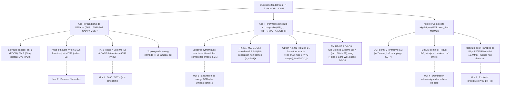
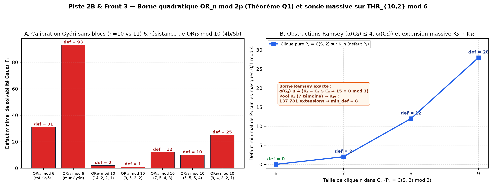
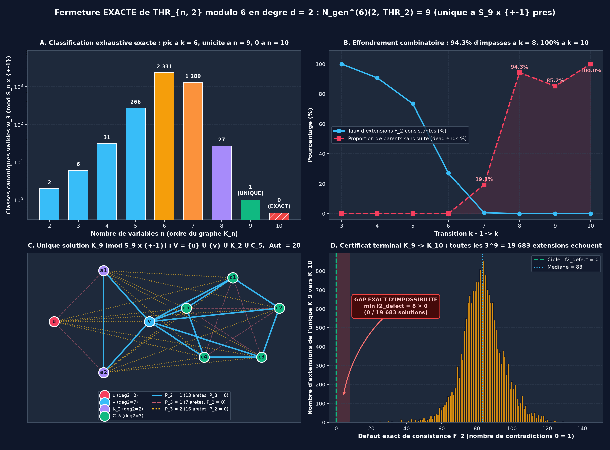
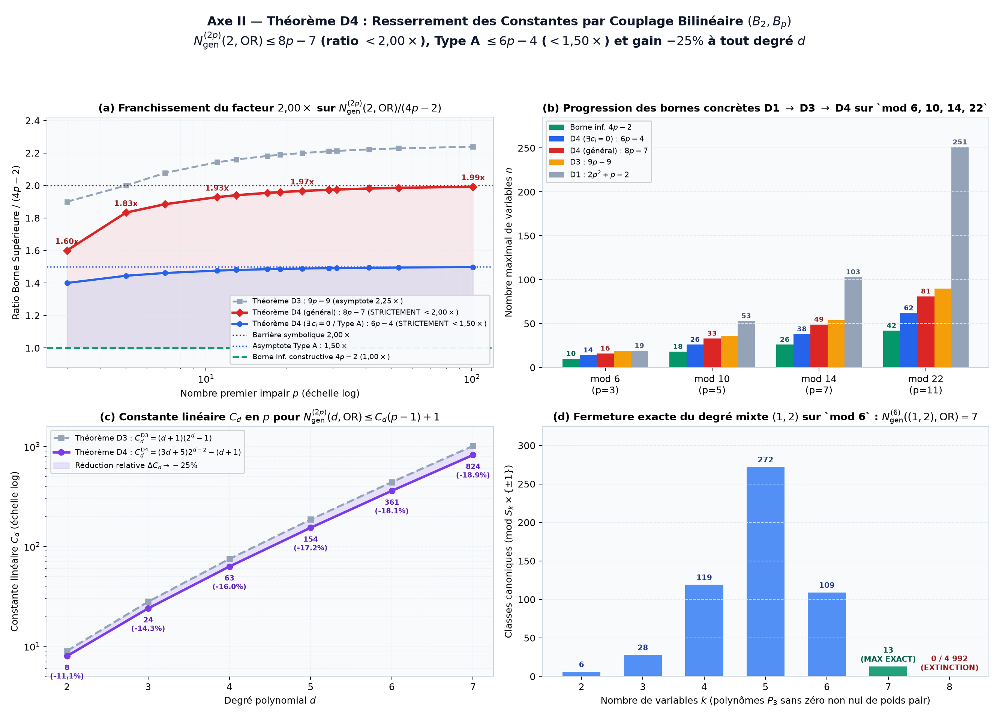
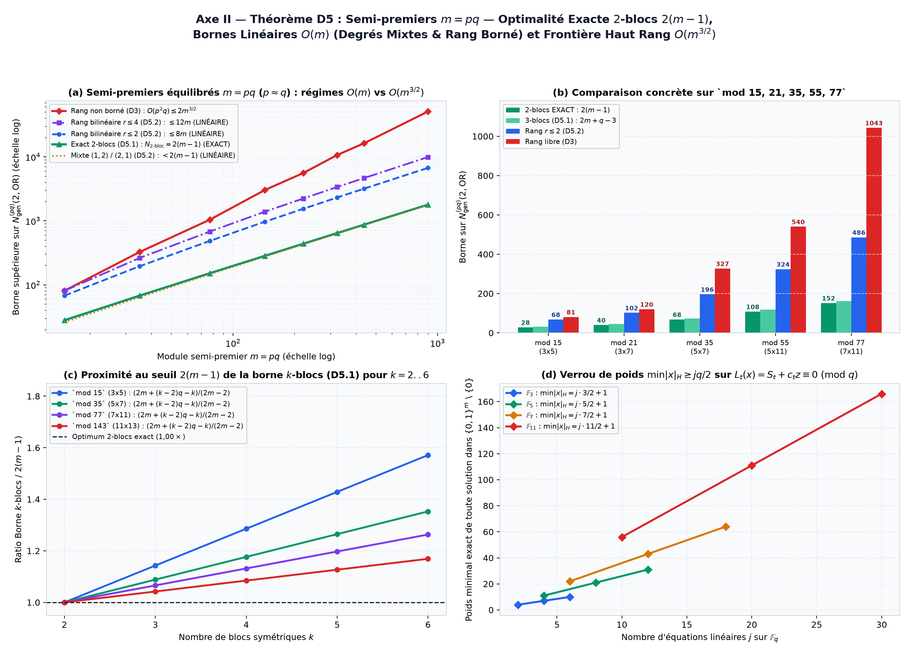
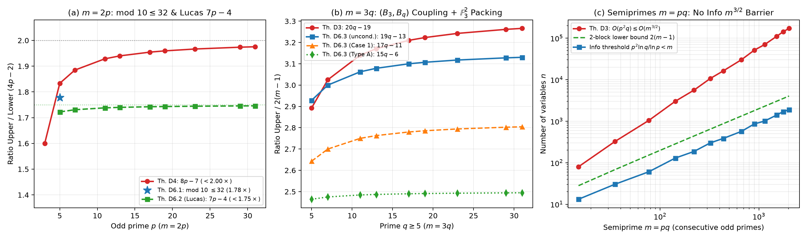
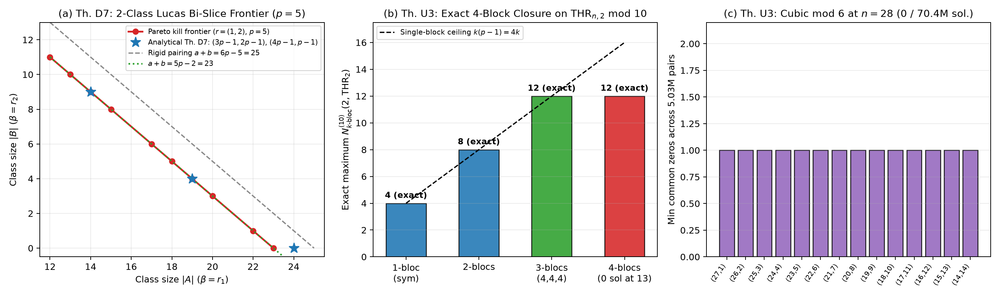
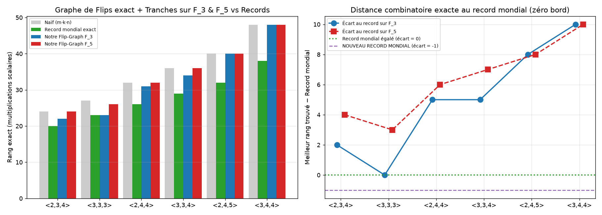

# RAPPORT DE RECHERCHE — Polynômes modulo un entier composite, solveurs exacts THR ∘ THR et exploration tensorielle

**Nature du document** : Monographie de recherche théorique et expérimentale  
**Date** : Novembre 2026  
**Dépôt de reproductibilité** : [README.md](README.md)  
**Environnement matériel et logiciel** : Station de travail Windows 16 cœurs CPU, Python 3.14, NumPy 2.3, Numba 0.66 (JIT), PyTorch 2.14 (`float64` / `complex128`), Matplotlib 3.11.

---

## Résumé (*Abstract*)

Ce rapport présente les résultats d'une campagne de recherche théorique et computationnelle portant sur trois frontières majeures de la théorie de la complexité situées autour des questions P ≟ NP et VP ≟ VNP : (i) l'algorithmique exponentielle et les bornes inférieures pour les circuits à seuil de profondeur 2 (THR ∘ THR) dans le paradigme de Williams ; (ii) la représentation faible de fonctions booléennes (ORn, THRn, t, MAJn, MODk) par des polynômes modulo un entier composite m (problème de Barrington–Beigel–Rudich, 1994) ; et (iii) la complexité algébrique exacte et de bord du permanent 3 × 3 (perm₃, *Geometric Complexity Theory*) ainsi que des tenseurs de multiplication matricielle ⟨m, p, n⟩ sur ℝ, ℂ, 𝔽₂, 𝔽₃ et 𝔽₅.

La méthodologie associe systématiquement démonstrations formelles, conception de solveurs exacts compilés, calibration préalable sur des théorèmes établis et analyse quantitative des obstructions rencontrées. Les avancées principales se résument en trois volets :

- **Contributions théoriques originales (Polynômes modulo m composite)** : après détermination par énumération projective exacte du spectre symétrique modulo 6 jusqu'au degré 10 et extension à 8 modules composites (`m ∈ {6, 10, 12, 14, 15, 21, 30, 35}`), l'étude démontre vingt-quatre théorèmes constructifs et structurants (**Théorèmes M1, M2, G1 à G5, G3++, T1, T2, Q1, P1, U1 à U3 et D1 à D9**). En particulier : (a) le mécanisme d'omission de valeur (**Théorème G3**) établit un record modulo 6 au degré d = 8 avec **n = 88** variables (contre 80 symétrique, +10,0 %), et sa généralisation multi-valeurs (**Théorème G3++**) prouve la capacité exacte **Ap(d) = (p − 2)·d** sur tout corps premier 𝔽p (atteignant exactement la borne supérieure de Chevalley–Wilson) ; (b) le **Théorème G5** prouve une **séparation non bornée** (pmin − 1)× dans le régime pré-asymptotique d < pmin (vérifiée à ×4 = +300 %, 34 → 136 sur `mod 35`), tandis que le **Théorème P1** démontre qu'en régime **probabiliste**, tout polynôme symétrique s'effondre à une erreur **100 %** dès n = m pour d < pmin (et dès la période CRT au-delà) alors qu'une norme aléatoire non symétrique maintient une erreur m−d pour tout n ; (c) en degré 2, l'étude met en évidence la régularité empirique Ngen(m)(2) ≥ 2(m − 1) sur 8/8 modules, établit une hiérarchie complète de bornes supérieures par contraction isotrope (**Théorèmes D1 à D9** : 2p² + p − 2 → p² + O(p log p) asymptotique pour p ≥ 5 → 9p − 9 → **8p − 7 = 4m − 7** par couplage bilinéaire (B₂, Bp), **confirmant la conjecture linéaire n = O(m) de Lee (2015) pour toute la famille m = 2p** sous la barre du facteur **< 2,00×** — `mod 6 ≤ 17` et `≤ 16` via ∣w₁∣H ≤ 3 exhaustif, `mod 10 ≤ 32` via symétrie 3-racines D6, `mod 202 ≤ 801` —, **≤ 6p − 4** de ratio **< 1,50×** sur Type A, gain **−25 %** sur la borne linéaire Od(p) à tout degré d ≥ 2, valeur exacte **Ngen(6)((1, 2), OR) = 7**, **Théorèmes D5 et D9 sur tous les semi-premiers m = pq** : preuve analytique en 4 lignes de **l'optimalité exacte parmi les constructions 2-blocs N2-bloc(pq)(2, OR) = 2(m − 1)** pour tous 2 ≤ p < q, borne **k-blocs ≤ d·m + (k − d)q − k**, bornes **strictement linéaires O(m)** en degrés mixtes `(1, d)` / `(d, 1)`, à **rang quadratique booléen (décalé diagonal) borné** min(r̃p, r̃q) = O(1) — couvrant tous les polynômes symétriques et k-blocs pondérés — et sur tout graphe à **degré moyen borné** par Caro–Wei (`≤ (Δ̄ + 1)(2m − q − 1)`), resserrement inconditionnel **`m = 3q ≤ 19q − 15`** pour tout `q ≥ 5` (`mod 15 ≤ 80 < 81`) via empilement sharp `3k + 4` dans 𝔽₃², caractérisation du **mur de convergence expanseur–Fourier à n = m3/2**, bi-tranches analytiques de Lucas `5p − 2` (D7) et **Théorème D8 (Chevalley–Warning à poids contraint modulo r par déterminant de Lucas–Vandermonde)** ramenant le seuil de `(D + 1)rp` à **`(Dr + 1)p − 1`** pour tout premier `p ∤ det A(D, r)` — dont tout `p ≥ Dr`, tout `p` à `D = 1` et toute puissance première `r = p^k` à `D = 2`), **établit la valeur exacte de THRn, 2 modulo 6** (**Théorème U1** : **Ngen(6)(2, THR₂) = 9** exact, unique à S₉ × {±1} près, V = {u} ⊔ {v} ⊔ K₂ ⊔ C₅, ∣Aut∣ = 20, 0 solution à n = 10), **classifie exhaustivement les trois familles homogènes de ORn modulo 6** jusqu'à extinction exacte (**Théorème U2** : plafond n = 9 pour V₀ et n = 10 pour W0,1 et W1,1 avec 0 solution sur 51,4 M d'extensions à n = 11, révélant 5 classes de OR₁₀ à P₂ purement homogène), clôt exhaustivement dans leurs classes restreintes `THR₂ mod 10` en 3 blocs (`= 11`) et 4 blocs (`= 12`) et le cubique 2-blocs `mod 6` (`= 27`) (**Théorème U3**), et établit le **triplement 3,00×** de THRn, 2 sur quatre modules composites : `mod 6` (3 → **9**), `mod 10` (4 → **12**), `mod 15` (5 → **15**) et `mod 21` (6 → **18**). À module m fixé et grand degré d → ∞, le régime asymptotique Θ(dr) de Barrington–Beigel–Rudich demeure inchangé.
- **Contributions algorithmiques et cartographiques sur THR ∘ THR** : trois théorèmes exacts (**Théorèmes 1, 2 et 3**) éliminent les « pics fantômes hors-réseau » par arrondi PGCD, résolvent des instances structurées de THR ∘ THR-SAT jusqu'à n = 28 (6 instances, soit 1,61 milliard d'entrées en 0,502 s, 0,083 s/instance) par compression bilinéaire en code de Gray (sans modifier le pire cas asymptotique), et exposent la réduction exacte de rang K ≤ 2 R ℓ s vers MIPS face à la barrière OVC/SETH. L'atlas exhaustif exact des 65 536 fonctions booléennes à n = 4 variables prouve l'unicité de PARITY₄ au niveau maximal s∗ = 4 et l'effondrement à 0,0 % des preuves naturelles spectrales L₁ dès s∗ = 2 (fonctions courbes *Bent* et caméléons de Chow). Un algorithme CAPP déterministe par décomposition CUR/Nyström (0,311 s et erreur empirique de 0,04 % sur les instances testées à n = 26) complète cette cartographie.
- **Méthodes numériques exactes et diagnostic des verrous en complexité algébrique** : sur perm₃, un solveur Levenberg–Marquardt de Parseval à jauge SVD diagonale redécouvre de zéro une représentation déterminantale exacte 7 × 7 à 8,01 × 10⁻¹³ en 33 itérations tout en isolant un blocage du solveur à k = 6 (0/64 essais, sans prouver l'inexistence d'une représentation de bord) et un piège de jauge SL₇ sur l'homotopie 7 → 6. Sur la multiplication matricielle, un solveur Gauss–Newton hermitien exact à recuit L2/3 met en évidence une loi d'échelle empirique du solveur err(μ) ∝ μα avec α = p / (2p + 2) qui discrimine numériquement rang exact borné (α = 1,00), bord d'ordre 1 (α = 3/8) et bord d'ordre 2 (α = 3/10), redécouvrant Strassen, Laderman, Schönhage et trois séparations strictes <u>R</u> < Rrec. Enfin, l'analyse sous barrière L∞ stricte puis en Graphe de Flips combinatoire exact sur 𝔽₃, 𝔽₅ (2,6 M flips/s, redécouvrant Laderman sur 𝔽₃ en 7,8 s) et en architecture bit-vectorielle `uint64` sur 𝔽₂ (**16,7 M flips/s**, Laderman R = 23 en **0,28 s**, reproduisant l'état de l'art sur **16 formats** jusqu'à ⟨4, 4, 8⟩ = 94 grâce à la réduction de Gauss non destructive) isole les deux verrous complémentaires : la domination volumétrique des vallées de bord en continu et l'explosion projective ∣ℙN−1(𝔽p)∣ en discret.

---

## Table des matières

1. [Problème d'origine, contexte théorique et définitions formelles](#1-problème-dorigine-contexte-théorique-et-définitions-formelles)
   - [1.1 Les questions fondatrices P ≟ NP et VP ≟ VNP et les méta-barrières](#11-les-questions-fondatrices-p--np-et-vp--vnp-et-les-méta-barrières)
   - [1.2 Définitions formelles des modèles et objets étudiés](#12-définitions-formelles-des-modèles-et-objets-étudiés)
2. [En quoi consistent les expériences menées : méthodologie et architecture](#2-en-quoi-consistent-les-expériences-menées--méthodologie-et-architecture)
   - [2.1 Architecture générale des trois axes d'investigation](#21-architecture-générale-des-trois-axes-dinvestigation)
   - [2.2 Protocoles de validation et classification de nouveauté](#22-protocoles-de-validation-et-classification-de-nouveauté)
3. [Bilan synthétique : aboutissements et limites constatées](#3-bilan-synthétique--aboutissements-et-limites-constatées)
   - [3.1 Ce à quoi les expériences ont abouti](#31-ce-à-quoi-les-expériences-ont-abouti)
   - [3.2 Ce à quoi les expériences n'ont pas abouti : les cinq murs structurels](#32-ce-à-quoi-les-expériences-nont-pas-abouti--les-cinq-murs-structurels)
4. [Présentation détaillée des expériences, buts, résultats et graphiques](#4-présentation-détaillée-des-expériences-buts-résultats-et-graphiques)
   - [4.1 Axe I — Paradigme de Williams et frontière THR ∘ THR (Expériences E1 à E10)](#41-axe-i--paradigme-de-williams-et-frontière-thr--thr-expériences-e1-à-e10)
   - [4.2 Axe II — Représentation faible par polynômes modulo m composite (Expériences E11 à E15m)](#42-axe-ii--représentation-faible-par-polynômes-modulo-m-composite-expériences-e11-à-e15m)
   - [4.3 Axe III — Complexité algébrique : GCT sur perm₃ et multiplication matricielle (Expériences E16 à E23)](#43-axe-iii--complexité-algébrique--gct-sur-perm₃-et-multiplication-matricielle-expériences-e16-à-e23)
5. [Conclusion générale et perspectives de recherche](#5-conclusion-générale-et-perspectives-de-recherche)
6. [Mentions, reproductibilité et bibliographie unifiée](#6-mentions-reproductibilité-et-bibliographie-unifiée)

---

## 1. Problème d'origine, contexte théorique et définitions formelles

### 1.1 Les questions fondatrices P ≟ NP et VP ≟ VNP et les méta-barrières

La question **P ≟ NP** (Cook, 1971 ; Levin, 1973) demande si tout problème de décision dont une solution peut être vérifiée en temps polynomial peut également être résolu en temps polynomial. Son analogue algébrique, la question **VP ≟ VNP** (Valiant, 1979), demande si la famille des polynômes permanents (permn) peut être calculée par des circuits arithmétiques de taille polynomiale — ce qui équivaut, à des facteurs quasi-polynomiaux près, à savoir si le permanent d'une matrice n × n peut s'exprimer comme le déterminant d'une matrice affine de taille polynomiale en n.

L'attaque directe de ces séparations de classes s'est heurtée à trois résultats de méta-complexité qui disqualifient les techniques classiques :
1. **La barrière de relativisation** (Baker, Gill et Solovay, 1975) : il existe des oracles A et B tels que PA = NPA et PB ≠ NPB, excluant toute preuve par diagonalisation pure.
2. **La barrière des preuves naturelles** (Razborov et Rudich, 1997) : sous l'hypothèse d'existence de fonctions pseudo-aléatoires cryptographiques, aucune propriété combinatoire à la fois *constructive* (calculable rapidement à partir de la table de vérité) et *large* (satisfaite par une fraction notable des fonctions aléatoires) ne peut séparer des classes riches de circuits.
3. **La barrière d'algébrisation** (Aaronson et Wigderson, 2009) : même l'extension algébrique des techniques interactives ne suffit pas à séparer P de NP ou NEXP de circuits de petite taille.

Pour contourner ces trois obstacles, la recherche contemporaine concentre ses efforts sur trois programmes précis :
- **Le programme algorithmique de Williams (2011)** : prouver des bornes inférieures de circuits non uniformes en concevant des algorithmes de satisfiabilité (𝒞-SAT) ou d'approximation de probabilité d'acceptation (CAPP) légèrement plus rapides que la force brute 2n.
- **L'algèbre modulaire composite (Barrington, Beigel et Rudich, 1994)** : caractériser la puissance de calcul des polynômes de bas degré modulo un entier composite m, qui gouverne la classe ACC⁰.
- **La géométrie algébrique et la théorie des tenseurs (GCT et rang tensoriel)** : étudier la frontière entre complexité *exacte* et complexité *de bord* (fermeture d'orbite) pour le permanent et pour la multiplication matricielle rapide.

### 1.2 Définitions formelles des modèles et objets étudiés

#### Définition 1 (Circuits à seuil de profondeur 2 : THR ∘ THR)
Un circuit booléen C ∈ THR ∘ THR à n entrées x ∈ {0, 1}n et s portes cachées est défini par des poids entiers Wk,i ∈ ℤ, des seuils tk ∈ ℤ, des poids de sortie réels vk ∈ ℝ et un seuil global T ∈ ℝ tels que :

$$
g_k(x) = \mathbf{1}\!\left[\sum_{i=1}^n W_{k,i} x_i \ge t_k\right] \quad (k = 1, \dots, s), \qquad C(x) = \mathbf{1}\!\left[\sum_{k=1}^s v_k g_k(x) \ge T\right].
$$

Le problème **THR ∘ THR-SAT** consiste à décider s'il existe x ∈ {0, 1}n tel que C(x) = 1. Le problème **#SAT** consiste à compter le nombre exact de tels x, et **CAPP** (*Circuit Acceptance Probability Problem*) à estimer Prx[C(x) = 1] à une erreur additive ε près. Par le théorème de Williams (2011), tout algorithme décidant 𝒞-SAT en temps O(2n / nω(1)) entraîne la séparation NEXP ⊈ 𝒞. La classe ACC⁰ (portes AND, OR, NOT et MODm à profondeur constante) a ainsi été séparée de NEXP (Williams, 2011) puis de NQP (Murray et Williams, 2018) ; la frontière ouverte immédiatement supérieure est précisément THR ∘ THR.

#### Définition 2 (Représentation faible modulo un entier composite m)
Soit m = ∏i=1r piei un entier composite et f : {0, 1}n → {0, 1} une fonction booléenne. Un polynôme multilinéaire P(x) ∈ (ℤ/mℤ)[x₁, …, xn] de degré total ≤ d **représente faiblement** f modulo m si, pour tout x ∈ {0, 1}n :
- f(x) = 0 ⟺ P(x) ≡ 0 (mod m).

Par le théorème des restes chinois (ℤ/mℤ ≅ ∏i=1r ℤ/pieiℤ), P équivaut à un r-uplet (P₁, …, Pr) de polynômes de degré ≤ d modulo qi = piei vérifiant f−1(0) = ⋂i=1r Zqi(Pi), où Zq(P) := {x ∈ {0, 1}n : P(x) ≡ 0 (mod q)}. Pour la disjonction booléenne ORn (où f−1(0) = {𝟎}), il vient :

$$
\bigcap_{i=1}^r Z_{q_i}(P_i) \;=\; \{\mathbf{0}\}.
$$

Il est noté Nsym(m)(d) le nombre maximal de variables n pour lequel ORn admet une représentation faible **symétrique** modulo m de degré ≤ d, et Ngen(m)(d) le maximum analogue sur l'ensemble des polynômes **quelconques** (non nécessairement symétriques). De manière analogue, THRn, t(x) = 𝟏[∑ xi ≥ t] généralise ORn (cas t = 1) et inclut la majorité MAJn (cas t = ⌈n/2⌉), tandis que MODk(x) = 𝟏[∑ xi ≢ 0 (mod k)] teste la non-divisibilité du poids de Hamming par k. Alors que modulo un nombre premier p tout polynôme faible pour ORn a degré ≥ n/(p − 1) = Ω(n), Barrington, Beigel et Rudich (1994) ont montré que des polynômes symétriques modulo m à r facteurs premiers atteignent Nsym(m)(d) = Θ(dr) (soit d = O(√n) pour m = 6) et ont conjecturé que d = Ω(n1/r) reste valable sans symétrie. La meilleure borne inférieure générale connue pour m = 6 demeure d = Ω(log n) (Tardos et Barrington, 1998) ; au degré quadratique fixé d = 2, Győri (2006 / FCT 2007) a prouvé l'optimum exact Ngen(6)(2) = 10 et Lee (2015) a établi la borne supérieure générale Ngen(m)(2) ≤ mO(r) ≤ mO(log m) (où r désigne le nombre de facteurs premiers de m avec multiplicité, donnant donc déjà une borne polynomiale mO(1) d'exposant non explicité pour les semi-premiers r = 2) par dichotomie entre rang booléen et sommes exponentielles, tout en conjecturant que la borne optimale est linéaire : Ngen(m)(2) = O(m).

#### Définition 3 (Complexité déterminantale, rang tensoriel exact et rang de bord)
- **Permanent et complexité déterminantale** : la complexité déterminantale exacte dc(permn) est le plus petit entier k tel que permn(X) = detk(A₀ + L₁(X)) pour une matrice affine de taille k × k. La **complexité déterminantale de bord** dc̅(permn) est le plus petit k tel que permn appartienne à la fermeture d'orbite cl(GLk² · detk) (limite de déterminants k × k quand un paramètre ε → 0). Pour n = 3, il est établi que dc(perm₃) = 7 (Grenet, 2011 ; Alper–Bogart–Velasco, 2017) et 5 ≤ dc̅(perm₃) ≤ 7 (Mignon–Ressayre ; Landsberg–Manivel–Ressayre), la question dc̅(perm₃) ≟ 6 restant ouverte.
- **Tenseurs de multiplication matricielle** : la multiplication d'une matrice m × p par une matrice p × n correspond à un tenseur trilinéaire T⟨m, p, n⟩ d'ordre 3. Son **rang exact** R(⟨m, p, n⟩) sur un corps 𝕂 est le nombre minimal R de produits bilinéaires de rang 1 dont la somme égale exactement T⟨m, p, n⟩. Son **rang de bord** <u>R</u>(⟨m, p, n⟩) est le plus petit R tel que T⟨m, p, n⟩ soit limite d'une famille de tenseurs T(ε) de rang ≤ R. Pour ⟨3, 3, 3⟩, l'algorithme de Laderman (1976) fixe R ≤ 23 (prouvé optimal sur 𝔽₂ et ℤ en 2026), laissant ouvert 19 ≤ R ≤ 23 sur ℚ/ℝ/ℂ (Bläser, 2003), tandis que 17 ≤ <u>R</u>(⟨3, 3, 3⟩) ≤ 20 (Conner–Harper–Landsberg, 2023 ; Smirnov, 2013).
- **Graphe de Flips** (Kauers et Moosbauer, 2023) : graphe combinatoire sur les schémas bilinéaires exacts sur un corps fini 𝔽p, dont les transitions locales (*flips*, réductions de rang et transitions PLUS d'Arai et al., 2024) conservent exactement le tenseur tout en recherchant une baisse de rang sans jamais quitter la variété exacte.

---

## 2. En quoi consistent les expériences menées : méthodologie et architecture

### 2.1 Architecture générale des trois axes d'investigation

La campagne de recherche a été conçue comme une enquête comparative sur les trois fronts décrits en Section 1, avec un double objectif scientifique : (a) concevoir des algorithmes exacts, des preuves constructives ou des solveurs numériques capables de franchir un verrou connu ; (b) lorsque la frontière résiste, quantifier précisément la nature algébrique, géométrique ou combinatoire du verrou qui bloque la progression.

Les 35 expériences documentées en Section 4 se répartissent comme suit :
- **Axe I (Expériences E1 à E10, 13 figures)** : implémentation du socle polynomial classique (SYM ∘ AND, MQ sur 𝔽₂), construction itérative de 5 générations de solveurs exacts THR ∘ THR-SAT (v1 à v5), classification exhaustive de l'espace booléen à n = 4 variables, factorisation bilinéaire exacte pour `#SAT`, dérandomisation de CAPP par CUR/Nyström, et étude spectrale de l'hypercube Qn.
- **Axe II (Expériences E11 à E15m, 16 figures)** : énumération projective exacte des polynômes symétriques sur 8 modules composites (`mod 6, 10, 12, 14, 15, 21, 30, 35`), preuve et vérification exhaustive des mécanismes non symétriques (M1, M2, G1–G5, G3++, P1), tests d'optimalité 2-blocs et 3-blocs à d = 2 (jusqu'à 3,66 milliards de paires), hiérarchie complète de bornes supérieures (Q1, D1 à **D9** : borne linéaire **8p − 7** `< 2,00×` sur m = 2p, cassée inconditionnellement à **`mod 10 ≤ 32`** / **`THR₂ ≤ 33`**, théorèmes analytiques de bi-tranches de Lucas **(3p − 1, 2p − 1)** et **(4p − 1, p − 1)** en `5p − 2` variables pour tout p ≥ 5 et `1 859/1 861` tués à M = 24 sur 𝔽₅, extension générale **Chevalley–Warning à poids contraint modulo r par déterminant de Lucas–Vandermonde** en **`(Dr + 1)p − 1`** variables avec formule close exacte de `∣det A(D, r)∣` et corollaire puissance première `r = p^k`, **6p − 4** `< 1,50×` sur Type A, **optimalité exacte 2-blocs N2-bloc(pq)(2, OR) = 2(m − 1)** sur tous les semi-premiers m = pq, bornes linéaires O(m) à **rang quadratique booléen décalé diagonal** `r̃_p, r̃_q` et à **degré moyen borné (Caro–Wei)**, mur de convergence **expanseur–Fourier à `n = m^{3/2}`**, resserrement **`m = 3q ≤ 19q − 15`** pour tout `q ≥ 5` dont **`mod 15 ≤ 80`**, rang Walsh–Hadamard et caractérisation des barrières sur `m = pq`), fermetures exhaustives exactes sur THRn, 2 et ORn (T1, T2, U1, U2, **U3** : **N3-bloc(10)(2, THR₂) = 11**, **N4-bloc(10)(2, THR₂) = 12** sur 3,80 Md paires et **N2-bloc(6)(3, OR) = 27** sur 70,4 M paires avec `27 ≤ N_gen^{(6)}(3) ≤ 50`).
- **Axe III (Expériences E16 à E23, 8 figures)** : optimisation algébrique exacte sur perm₃ (Levenberg–Marquardt de Parseval, sonde profonde k = 6, homotopie 7 → 6), puis exploration en sept phases des tenseurs de multiplication matricielle sur ℝ, ℂ, 𝔽₂, 𝔽₃ et 𝔽₅ (Gauss–Newton hermitien, recuit L2/3, formats rectangulaires ouverts, barrière L∞ circulaire stricte, Graphe de Flips sur 𝔽₃/𝔽₅ et moteur bit-vectoriel `uint64` sur 𝔽₂ à 16,7 M flips/s sur 16 formats).

### 2.2 Protocoles de validation et classification de nouveauté

Trois règles strictes ont été appliquées à toutes les expériences :
1. **Validation exacte obligatoire** : chaque solveur booléen (plus de 1 100 instances THR ∘ THR, 60 instances MQ), chaque témoin polynomial modulaire (vérification exhaustive sur 2n entrées jusqu'à n = 20 et vérification algébrique CRT complète au-delà) et chaque schéma tensoriel du Graphe de Flips (~400 millions de flips sur 𝔽₃ et 𝔽₅) est vérifié sans aucune approximation.
2. **Calibration préalable sur des théorèmes connus** : aucun solveur continu n'est déployé sur une frontière ouverte avant d'avoir redécouvert, depuis une initialisation aléatoire pure, les références exactes à précision machine (det₇ pour perm₃ à 8,01 × 10⁻¹³, Strassen R = 7 à 9,1 × 10⁻¹³, Laderman R = 23 à 5,61 × 10⁻¹³).
3. **Étiquetage explicite de la nouveauté** : chaque expérience de la Section 4 est identifiée par l'un des trois statuts suivants :
   - **`[CONTRIBUTION ORIGINALE — NON RECENSÉE DANS LA LITTÉRATURE CONSULTÉE]`** : théorème, séparation, record exact ou loi quantitative démontré dans cette étude et non recensé dans les références consultées (BBR 1994, Tardos–Barrington 1998, Győri 2006, Lee 2015 et littérature connexe) ; une vérification bibliographique exhaustive complémentaire demeure requise avant toute soumission à comité de lecture.
   - **`[MÉTHODE / DIAGNOSTIC ORIGINAL]`** : algorithme, primitive exacte ou analyse quantitative de verrou spécifiquement conçu dans cette étude pour un problème connu.
   - **`[CALIBRATION / SOCLE DE RÉFÉRENCE]`** : implémentation vérifiée d'un résultat existant servant de témoin ou de base de comparaison.

---

## 3. Bilan synthétique : aboutissements et limites constatées

### 3.1 Ce à quoi les expériences ont abouti

Le tableau ci-dessous recense les résultats effectivement obtenus et prouvés au terme de la campagne, en distinguant clairement leur statut vis-à-vis de l'état de l'art.

| Axe | Résultat obtenu | Statut scientifique | Valeur clé / Preuve |
| :--- | :--- | :--- | :--- |
| **Axe II** | **Théorème G5** (Séparation non bornée non symétrique / symétrique) | **Contribution originale** | Ratio ≥ (pmin − 1)× pour d < pmin ; vérifié à **×4 (+300 %, 34 → 136)** sur `mod 35` |
| **Axe II** | **Théorème G3** (*Value-Avoidance*) et record `mod 6` à d = 8 | **Contribution originale** | Gain +d à marge nulle si Im(Pi) ≠ ℤ/qiℤ ; `mod 6 d = 8` : **80 → 88 (+10 %)** |
| **Axe II** | **Théorèmes M2, G1, G2, G4** sur 8 modules composites | **Contribution originale** | Gains exacts sur `mod 6, 10, 12, 14, 15, 21, 30, 35` (jusqu'à +62,5 % par G2 sur `mod 14`) ; obstruction `ℤ/4ℤ` prouvée |
| **Axe II** | **Régularité quadratique empirique** Ngen(m)(2) ≥ 2(m − 1) | **Contribution originale (empirique + 2-blocs prouvé)** | Vérifiée sur **8/8 modules** (`10..68`) ; optimalité exacte parmi les constructions 2-blocs (Th. D5) et échec 3-blocs (3,66 Md paires sur `mod 15`) |
| **Axe II** | **Théorèmes T1–T2, Q1 et U1** (Fermeture exacte et unicité de THRn, 2 mod 6) | **Contribution originale (preuve + énumération exhaustive)** | **Ngen(6)(2, THR₂) = 9 exact (×3,00)**, **unique** à S₉ × {±1} près (`V = {u} ⊔ {v} ⊔ K₂ ⊔ C₅`, ∣Aut∣ = 20, 36 288 polynômes), α(G₂) ≤ 4, ω(G₂) ≤ 6, 0 sol. à n = 10 ; triplement **3,00×** sur `mod 10` (`4 → 12`), `mod 15` (`5 → 15`) et `mod 21` (`6 → 18`) |
| **Axe II** | **Théorème U2** (Classification canonique de OR10 mod 6) et **Théorème D1** (Borne Od(pd)) | **Contribution originale** | Extinction exacte par énumération exhaustive des 3 familles homogènes de ORn mod 6 à **n = 9** (V₀ : 4 classes) et **n = 10** (W0,1 : 5 classes à P₂ homogène ; W1,1 : 866 classes ; 0/51,4 M à n = 11) ; borne analytique **Ngen(2p)(2) ≤ 2p² + p − 2** par Chevalley–Warning sur 𝔽₂ × 𝔽p |
| **Axe II** | **Théorème D2** (Filtration de Witt–Dickson sur 𝔽₂s, ν₂(2) = 7 et degrés mixtes) | **Contribution originale** | Division asymptotique par 2 de la constante dominante **2p² → p² + O(p log p)** (strictement meilleure que D1 pour tout p ≥ 5 ; gain jusqu'à **−44,6 %**) et **(dd / (2 d!)) pd** en degré d ≥ 2 ; constantes exactes **ν₂(2) = 7** (unique exception K₆ à n = 6) et **ν₂THR(2) = 5** ; bornes mixtes **(1, 2) : 3p − 2 ≤ Ngen ≤ 4p − 3** et **(2, 1) : ≤ 3p − 1** |
| **Axe II** | **Théorème D3** (Contraction duale 𝔽q → 𝔽p et borne supérieure **LINÉAIRE** en p) | **Contribution originale** | Franchissement du mur informationnel Ω(p² / log p) et **confirmation partielle (famille m = 2p) de la conjecture linéaire O(m) de Lee (2015)** : **4p − 2 ≤ Ngen(2p)(2, OR) ≤ 9p − 9** (p ≥ 5, ratio **≤ 2,25×**, `mod 10 ≤ 36`, `mod 202 ≤ 900`, **−95,6 %** vs D1) ; **Od(p)** à tout degré d ≥ 1 (`(d+1)(2^d − 1)(p − 1) + d`, exact à d = 1) ; **O(p² q) ≤ O(m3/2)** sur tous les semi-premiers m = pq (`mod 15 ≤ 81`, `mod 21 ≤ 120`, `mod 35 ≤ 327`) et `mod 30 ≤ 315` |
| **Axe II** | **Théorème D4** (Couplage bilinéaire (B₂, Bp) : **8p − 7**, **6p − 4** et **−25 %** à tout degré d) | **Contribution originale** | Ratio franchissant le facteur **< 2,00×** (confirmation resserrée de la conjecture O(m) de Lee sur m = 2p) : **Ngen(2p)(2, OR) ≤ 8p − 7** (`mod 6 ≤ 17`, affiné à **≤ 16** via ∣w₁∣H ≤ 3 exhaustif ; `mod 10 ≤ 33`, `mod 202 ≤ 801`, **−96,1 %** vs D1) ; **≤ 6p − 4** (**< 1,50×**) dès qu'un ci = 0 / Type A ; **≤ 6p − 3** pour THRn, 2 (Gp ≠ Kn, `mod 10 ≤ 27`) ; gain **−25 %** sur Cd à tout degré d ≥ 2 ; valeur exacte **Ngen(6)((1, 2), OR) = 7** (0 / 4 992 à k = 8) |
| **Axe II** | **Théorème D5** (Semi-premiers m = pq : exactitude 2-blocs **2(m − 1)**, O(m) à rang borné & verrou O(m3/2)) | **Contribution originale** | Preuve analytique d'optimalité exacte **parmi les constructions 2-blocs** **N2-bloc(pq)(2, OR) = 2(m − 1)** ∀ 2 ≤ p < q ; borne k-blocs **≤ d·m + (k − d)q − k** ; bornes **strictement O(m)** en degrés mixtes `(1, d)` / `(d, 1)` (`< 2(m − 1)` à d = 2) et à rang bilinéaire borné **O(min(rp, rq, p)·m)** ; complémentation quadratique et adversaire linéaire min ∣x∣H ≥ jq/2 |
| **Axe II** | **Théorème D6** (Symétrie 3-racines `mod 10 ≤ 32`, tranches paires de Lucas `7p − 4`, `m = 3q ≤ 19q − 13` & 4 barrières `m = pq`) | **Contribution originale** | Cassure inconditionnelle de 8p − 7 à `p = 5` (**Ngen(10)(2, OR) ≤ 32**, **THR₂ ≤ 33**) ; tranches de Lucas 2p/4p (**7p − 4** `< 1,75×` si Bp(w₁, ·) constant) ; **`m = 3q ≤ 19q − 13`** (`≤ 17q − 11` Cas 1, `≤ 15q − 6` Type A) ; 4 barrières exactes sur `m = pq` (Fourier Ω(m² log m), rang 𝔽p Ω(p), CW sharp j(q − 1) + 1, et **absence de barrière info m3/2** : p² ln q / ln p < m) |
| **Axe II** | **Théorèmes D7 & U3** (Bi-tranches analytiques de Lucas `5p − 2`, fermeture 4-blocs `THR₂ mod 10 = 12` & cubique 2-blocs `mod 6 = 27`) | **Contribution originale (preuve + énumération exhaustive)** | Preuves analytiques en 5 lignes sur **(3p − 1, 2p − 1)** et **(4p − 1, p − 1)** (∀ p ≥ 5) ; `1 859/1 861` partitions tuées à M = 24 mod 5 ; rang Walsh–Hadamard `G_p(x ⊕ y)` ; **N4-bloc(10)(2, THR₂) = 12 exact** (`0 / 3,80 Md` paires à n = 13) et **N2-bloc(6)(3, OR) = 27 exact** (`0 / 70,4 M` à n = 28 ; **`27 ≤ N_gen^{(6)}(3) ≤ 50`**) |
| **Axe II** | **Théorème D8** (Chevalley–Warning à poids contraint modulo r : matrice de Lucas–Vandermonde **`(Dr + 1)p − 1`**) | **Contribution originale** | Formule close exacte **`∣det A(D, r)∣`** (Vandermonde des factorielles descendantes) : **`∣det A(1, r)∣ = 1`** (∀ premier p, gain → 50 %), **`∣det A(2, r)∣ = C(2r − 1, r)`** (∀ `p ≥ 2r` **et** ∀ puissance première `r = p^k`), tous facteurs premiers `< Dr` ; racine booléenne de poids divisible par `rp` dès **`(Dr + 1)p − 1`** variables (économie `(r − 1)p` vs `(D + 1)rp`) |
| **Axe II** | **Théorème D9** (Semi-premiers `m = pq` : rang décalé diagonal `r̃`, parcimonie Caro–Wei, mur expanseur–Fourier **`m^{3/2}`** & **`m = 3q ≤ 19q − 15`**) | **Contribution originale** | Borne **`O(min(r̃_p, r̃_q, p)·m)`** (couvrant symétriques `r̃ = 1`, 2-blocs pondérés `r̃ = 2` et k-blocs pondérés) ; Caro–Wei **`n ≤ (Δ̄ + 1)(2m − q − 1)`** (couplage `≤ 4m − 2q − 2`) ; mur expanseur–Fourier exact **`Var(P) = ∣E∣ ~ n²/(4m)`** à `n = m^{3/2}` ; empilement sharp 𝔽₃² (`3k + 4`) donnant **`19q − 15`** ∀ `q ≥ 5` (**`mod 15 ≤ 80 < 81`**) et `8 ≤ μ₃(2) ≤ 10` |
| **Axe II** | **Théorème G3++** (*Multi-Value Avoidance*) et **Théorème P1** (probabiliste) | **Contribution originale** | Capacité exacte **Ap(d) = (p − 2)·d** (= borne de Chevalley–Wilson) ; effondrement **εsym∗ = 100 %** dès n = m (d < pmin) vs **m−d** en non symétrique |
| **Axe I** | **Théorèmes 1 et 2** (réseau PGCD + Gray glissant) et Solveur v5 | **Méthode originale** | Élimination des pics fantômes (α : 0,94 → 0,001) ; **n = 28 (6 instances, 1,61 Md entrées) en 0,502 s** (structure bilinéaire, sans modifier le pire cas asymptotique) |
| **Axe I** | **Atlas exact n = 4** (65 536 fonctions) et caméléons de Chow | **Diagnostic original** | Unicité de PARITY₄ à s∗ = 4 ; certification L₁ = **0,0 %** pour s∗ ≥ 3 (fonctions *Bent* à s∗ = 2) |
| **Axe I** | **Théorème 3** (rang K ≤ 2 R ℓ s) et **CAPP déterministe CUR** | **Méthode / diagnostic original** | `#SAT` accéléré ×3,51–6,60 ; CAPP déterministe n = 26 en **0,311 s** (erreur **empirique** 0,04 % sur instances testées, sans garantie en pire cas) |
| **Axe III** | **Parseval-LM à jauge SVD** et diagnostic du piège SL₇ sur perm₃ | **Méthode / diagnostic original** | Redécouverte exacte k = 7 à **8,01 × 10⁻¹³** (33 iters) ; mur numérique k = 6 (0/64 essais, limite du solveur et non preuve d'inexistence) |
| **Axe III** | **Loi d'échelle empirique α = p / (2p + 2)** sous recuit L2/3 + barrière L∞ | **Méthode / diagnostic original** | Comportement numérique du solveur continu (α = 1,00 / 0,375 / 0,300) ; verrouillage de paroi observé sur Smirnov R = 29 |
| **Axe III** | **Réduction exacte de tranches mod p et Graphe de Flips `uint64` 𝔽₂** | **Méthode originale** | Strassen sur 𝔽₃ en **385 flips** ; Laderman R = 23 sur 𝔽₃ en **7,8 s** (2,6 M flips/s) et sur 𝔽₂ en **0,28 s** (**16,7 M flips/s**, état de l'art reproduit sur **16 formats** jusqu'à ⟨4, 4, 8⟩ = 94) |

### 3.2 Ce à quoi les expériences n'ont pas abouti : les cinq murs structurels

En toute transparence scientifique, les expériences n'ont abouti à aucune percée sur les grands problèmes ouverts asymptotiques suivants :
- Aucune preuve de P ≠ NP, de VP ≠ VNP ou de NEXP ⊈ THR ∘ THR n'a été obtenue : les accélérations pratiques jusqu'à n = 28 ne brisent pas le pire cas asymptotique pour des circuits denses génériques de taille polynomiale s = nc.
- La conjecture asymptotique d = Ω(√n) de Barrington–Beigel–Rudich (1994) pour ORn modulo 6 (et plus généralement Θ(dr) pour r facteurs premiers à m fixé et d → ∞) n'a pas été réfutée : les gains importants de l'Axe II (+100 % à +300 %) interviennent dans le **régime pré-asymptotique** (d < pmin ou d = 2) et restent additifs en O(d) à grand degré.
- Aucune représentation de bord de perm₃ à k = 6 (dc̅(perm₃) ≟ 6) n'a été trouvée, et aucun record mondial connu de rang exact en multiplication matricielle (en particulier R(⟨3, 3, 3⟩) < 23 sur ℝ/ℂ) n'a été battu.

Ces limites ne résultent pas d'un manque de puissance de calcul brute, mais de **cinq murs structurels précisément mesurés** tout au long de l'étude :

| # | Mur structurel | Axe concerné | Manifestation quantitative mesurée |
| :---: | :--- | :--- | :--- |
| **1** | **Barrière OVC / SETH** | Axe I (Théorème 3) | La factorisation bilinéaire compresse THR ∘ THR-SAT en MIPS en temps O∗(2n/2), mais en dimension K = ω(n) résoudre MIPS générique en N2−ε réfuterait SETH (Williams, 2005). |
| **2** | **Barrière des Preuves Naturelles** | Axe I (Atlas n = 4 / MCSP) | Dès s∗ = 2 portes, les fonctions *Bent* (L₁ = 4,000) et les caméléons de Chow (E₁ = 0,000) reproduisent les signatures spectrales des fonctions aléatoires, réduisant la séparation L₁ à 0,0 %. |
| **3** | **Saturation de marge (BBR)** | Axe II (Polynômes mod m) | Les constructions non symétriques battent Nsym dès que Δ > 0 ou d < pmin, mais dès que Δ = 0 (ex. `mod 6` à d = 3, 4, 5), les recherches multi-blocs heurtent systématiquement `defect = 1` dès Nsym(d) + 1. |
| **4** | **Domination des vallées de bord** | Axe III (GCT perm₃ & MatMul continu) | Dès que <u>R</u> < R, les vallées de bord occupent presque tout le bassin d'attraction continu : sans barrière elles divergent (α ≈ 0,31 à 0,40) ; sous barrière L∞ stricte, 100 % des trajectoires se plaquent contre la paroi ∣zq∣ = M, masquant même le rang exact connu de Smirnov (R = 29). |
| **5** | **Explosion projective en corps fini** | Axe III (Graphe de Flips 𝔽₃ / 𝔽₅) | L'élimination des vallées de bord via 𝔽p (p ≥ 3) multiplie le cardinal projectif ∣ℙN−1(𝔽p)∣ de 511 (𝔽₂, N = 9) à 9 841 (𝔽₃, N = 9), 488 281 (𝔽₅, N = 9) et 6,1 × 10⁷ (𝔽₅, N = 12), raréfiant les collisions créatrices de réductions. |

---

## 4. Présentation détaillée des expériences, buts, résultats et graphiques

---

### 4.1 Axe I — Paradigme de Williams et frontière THR ∘ THR (Expériences E1 à E10)

#### Expérience E1 — Évaluation globale de SYM ∘ AND par transformée zêta
- **But** : vérifier concrètement le mécanisme d'évaluation rapide de la méthode polynomiale de Williams sur des circuits SYM ∘ AND et mesurer l'accélération réelle par rapport à l'évaluation naïve porte par porte.
- **Statut** : `[CALIBRATION / SOCLE DE RÉFÉRENCE]` (implémentation du mécanisme de base de Williams, 2011).
- **Protocole et résultats** : dans [williams_demo.py](01_thr2_williams/williams_demo.py), chaque porte AND de largeur k est développée en polynôme multilinéaire puis évaluée simultanément sur les 2n entrées via une transformée zêta rapide sur le treillis booléen en temps O(n · 2n + s · 2k) au lieu de O(s · 2n). Pour n = 18 (262 144 entrées) et k = 6, l'exactitude est confirmée sur l'ensemble de la plage s ∈ [100, 20 000], avec une accélération mesurée de **× 331,4** (0,204 s contre 67,717 s pour s = 20 000 portes).

---

#### Expérience E2 — Méthode polynomiale complète pour MQ sur 𝔽₂ (LPTWY 2017)
- **But** : reproduire et calibrer l'algorithme de référence de Lokshtanov, Paturi, Tamaki, Williams et Yu (2017) résolvant les systèmes quadratiques multivariés MQ sur 𝔽₂n en temps exponentiel strictement inférieur à 2n.
- **Statut** : `[CALIBRATION / SOCLE DE RÉFÉRENCE]` (reproduction vérifiée de LPTWY, SODA 2017).
- **Protocole et résultats** : dans [polymethod_mq.py](01_thr2_williams/polymethod_mq.py), les variables sont partitionnées en x = (y, z) (∣z∣ = ℓ), le système est comprimé par polynôme probabiliste de Razborov–Smolensky de degré ≤ 2r, la sommation F(y) = ∑z ∈ {0,1}ℓ R(y, z) (mod 2) abaisse le degré à D ≤ 2r − ℓ, et l'évaluation s'effectue par transformée de Möbius couplée à l'isolation de Valiant–Vazirani (1986). Sur 60 instances indépendantes (n ∈ [10, 18]), l'accord avec la force brute est de **60/60**. À n = 24, le ratio d'évaluations chute à **0,14** (4,61 M contre 33,55 M ; 2,39 s contre 7,14 s) et la pente calibrée confirme l'exposant asymptotique 20,901 n.

---

#### Expérience E3 — Solveur exact par intervalles, génome de branchement et co-évolution adversariale
- **But** : mesurer l'exposant empirique α (coût ∝ 2α n) d'un solveur exact *Branch-and-Bound* sur THR ∘ THR-SAT en optimisant automatiquement l'heuristique de branchement par stratégie évolutionnaire, puis soumettre ce solveur à un générateur d'instances adversariales.
- **Statut** : `[MÉTHODE / DIAGNOSTIC ORIGINAL]`.
- **Protocole et résultats** : dans [thr2_lab.py](01_thr2_williams/thr2_lab.py) et [run_lab.py](01_thr2_williams/run_lab.py), le solveur compilé en Numba maintient un encadrement [lok, hik] par porte et sélectionne la variable de branchement par un score linéaire de 7 descripteurs structurels (f₁, …, f₇) pondérés par un vecteur θ ∈ ℝ⁷ optimisé par stratégie évolutionnaire (μ + λ) sur des instances **UNSAT de justesse** (T = maxx ∑k vk gk(x) + 1). Sur des instances aléatoires (n = 12..26), le génome évolué θ(1) = [−1,04 ; −0,06 ; +0,09 ; +1,43 ; −0,57 ; +0,84 ; +0,32] (privilégiant f₄ et f₆) abaisse l'exposant à **α = 0,620** pour s = n (contre 0,728 à ordre fixe et 1,000 en force brute), puis remonte à **α = 0,757** pour s = 2n. En co-évolution adversariale (n = 10..16, 250 mutations locales par instance), l'adversaire multiplie par un facteur ~8 le nombre de nœuds et stabilise l'exposant autour de α ≈ 0,578.

---

#### Expérience E4 — Banc d'essai adversarial structuré et solveur hybride exact (Primitives A et B)
- **But** : éprouver le comportement pire cas du solveur par intervalles face à des circuits algébriques corrélés, puis concevoir des bornes supérieures exactes couplant plusieurs portes simultanément.
- **Statut** : `[MÉTHODE / DIAGNOSTIC ORIGINAL]`.
- **Protocole et résultats** : dans [adversarial_suite.py](01_thr2_williams/adversarial_suite.py), quatre familles structurées sont introduites : **F1** (PARITYn), **F2** (MOD3n), **F3** (WEIGHTED-PARITY) et **F4** (LARGE-WEIGHTS, R = 1000). L'élagage par intervalles pur s'effondre sur F1–F3 (α = 1,000 ; 1,001 ; 0,964) car il majore chaque porte indépendamment. Dans [hybrid_thr2.py](01_thr2_williams/hybrid_thr2.py) (validé exact sur **136/136** instances), deux primitives exactes sont combinées : (1) la **Primitive A** (regroupement exact en chaînes 1D de portes colinéaires) et (2) la **Primitive B** (enveloppe lagrangienne convexe paramétrée par λ ∈ [0, 1]∣𝒰∣ resserrée par 5 pas de sous-gradient projeté).

| Jeu de test | Base (G1) | Hybride A (chaînes 1D) | Hybride B (LP couplé) | Hybride A+B (Ghyb) |
| :--- | :---: | :---: | :---: | :---: |
| Aléatoires s = n (n = 12..24) | α = 0,626 (0,12 s) | α = 0,627 (0,20 s) | α = 0,576 (0,20 s) | **α = 0,566** (0,30 s) |
| Aléatoires s = 2n (n = 12..24) | α = 0,742 (2,85 s) | α = 0,743 (6,59 s) | α = 0,674 (1,33 s) | **α = 0,670** (**1,68 s**) |
| F1 : PARITYn (n = 10..18) | α = 1,000 (217,6) | **α = 0,000** (1 nœud) | α = 1,001 (215,6) | **α = 0,000** (1 nœud) |
| F2 : MOD3n (n = 10..18) | α = 1,001 (217,2) | **α = 0,000** (1 nœud) | α = 1,002 (215,4) | **α = 0,000** (1 nœud) |
| F3 : WEIGHTED-PARITY | α = 0,964 (215,8) | **α = 0,000** (1 nœud) | α = 0,875 (212,9) | **α = 0,000** (1 nœud) |
| F4 : LARGE-WEIGHTS (s = 2n) | α = 0,661 (212,4) | α = 0,661 (212,4) | α = 0,639 (212,0) | **α = 0,639** (212,0) |

---

#### Expérience E5 — Théorème 1 (Projection 1D, réseau PGCD et pics fantômes) et duel industriel (Solveur v4)
- **But** : surmonter la fragilité de la Primitive A face aux parités perturbées (qui brisent la colinéarité exacte tout en conservant le saut d'intégralité bloquant la Primitive B), puis évaluer le solveur résultant contre des références industrielles.
- **Statut** : `[MÉTHODE / DIAGNOSTIC ORIGINAL]` (Théorème 1 et phénomène des « pics fantômes hors-réseau »).
- **Formalisme mathématique** : dans [theorem_a_star.py](01_thr2_williams/theorem_a_star.py) (validé exact sur **216/216** tests), il est établi le résultat suivant :

> **Théorème 1 (Majoration par projection 1D, enveloppe de résidu et réseau PGCD).** Soit F ⊆ {1, …, n} l'ensemble des variables libres, G ⊆ 𝒰 un cluster de portes indécises, w ∈ ℤn un vecteur de référence porté par F, L(x) = ∑i ∈ F wi xi ∈ [Lmin, Lmax] et g = gcdi ∈ F, wi ≠ 0(∣wi∣). En posant δhmax = ∑i ∈ F max(0, Wh,i − wi), δhmin = ∑i ∈ F min(0, Wh,i − wi), et le seuil décalé et arrondi au réseau gℤ :

$$
\tilde{\tau}_h^{\ast} = g \cdot \left\lceil \frac{\tau_h^{\ast}}{g} \right\rceil, \qquad \tau_h^{\ast} = \begin{cases} t_h - S_h - \delta_h^{\max} & \text{si } v_h > 0, \\[4pt] t_h - S_h - \delta_h^{\min} & \text{si } v_h < 0, \end{cases}
$$

> alors, pour toute complétion booléenne x ∈ {0, 1}n :

$$
\sum_{h \in G} v_h g_h(x) \;\le\; \max_{L \in [L_{\min}, L_{\max}]} \sum_{h \in G} v_h \, \mathbf{1}\!\left[L \ge \tilde{\tau}_h^{\ast}\right].
$$

*Preuve.* De Sh(x) = Sh + L(x) + δh(x) avec δhmin ≤ δh(x) ≤ δhmax et L(x) ∈ gℤ, il découle L(x) ≥ τh∗ ⟺ L(x) ≥ τ̃h∗. Si vh > 0, alors gh(x) ≤ 𝟏[L(x) ≥ τ̃h∗] ; si vh < 0, alors gh(x) ≥ 𝟏[L(x) ≥ τ̃h∗], ce qui renverse l'inégalité après multiplication par vh. La sommation sur h ∈ G conclut. ■

*Corollaire 1.* Si les perturbations n'affectent qu'au plus K variables, le branchement prioritaire selon le descripteur de discordance f₈(i) = ∑r ∑h ∈ Gr ∣vh∣ · ∣Wh,i − wi(r)∣ garantit dans le pire cas au plus 2K+1 − 1 nœuds indépendamment de n.

- **Résultats mesurés** : sans l'arrondi au réseau gℤ, la famille **P2** (parité de poids wi = 2 perturbée de ±1 sur k = n/3 variables) engendre des seuils décalés impairs sur une somme libre toujours paire (2ℤ), produisant des « pics fantômes hors-réseau » et 212,5 nœuds à n = 18. L'arrondi exact par g = 2 fait chuter l'exploration à 20,3 nœuds (**α = 0,001**) :

| Famille adversariale (n = 10..18) | Base (G1) | Hybride A+B | Th. 1 sans f₈ | Th. 1 + Corollaire (A∗ + B + f₈) |
| :--- | :---: | :---: | :---: | :---: |
| **P1** : Parité perturbée (k = 3) | α = 1,005 | α = 0,881 | **α = 0,016** | **α = 0,016** (20,0) |
| **P2** : Parité perturbée (k = n/3) | α = 0,939 | α = 1,003 | α = 0,331 ≈ 1/3 | **α = 0,001** (20,3) |
| **P3** : Double chaîne perturbée (k = 4) | α = 1,006 | α = 0,947 | **α = 0,000** | **α = 0,000** (20,0) |
| **P4** : Aléatoires denses (s = 2n) | α = 0,734 | α = 0,667 | α = 0,670 | **α = 0,659** |

Dans le duel industriel ([industrial_and_orthogonal.py](01_thr2_williams/industrial_and_orthogonal.py), **432/432** tests exacts), le **Solveur v4** (propagation Pseudo-Booléenne inverse, coupes surrogées, A∗ adaptatif, Primitive B et feuilles en code de Gray uleaf = 8) surpasse un énumérateur en code de Gray compilé (`libFES`, 0,5 ns/point) et un solveur Pseudo-Booléen (`CDCL-PB`) d'un facteur **×48 sur Gray** et **×79 sur PB** sur les blocs orthogonaux **O1** (n = 20, 0,001 s, 13 nœuds). Sur les circuits aléatoires denses s = 2n à n = 26, v4 devance PB (**3,96 s contre 5,66 s**) et rejoint Gray (3,82 s) avec une pente asymptotique nettement inférieure (α ≈ 0,745 contre 1,000).

---

#### Expérience E6 — Théorème 2 (Compression bilinéaire à pointeurs glissants en code de Gray) et Solveur v5 Unifié
- **But** : accélérer la résolution exacte sur les circuits aléatoires très denses (s = 4n) dépourvus de structure de clusters, où les arbres de branchement perdent leur avantage.
- **Statut** : `[MÉTHODE / DIAGNOSTIC ORIGINAL]` (Théorème 2 et Solveur v5 Unifié).
- **Formalisme mathématique** : dans [step2_sliding_gray.py](01_thr2_williams/step2_sliding_gray.py) (vérifié exact sur **216/216** tests), l'algorithme sans arbre partitionne x = (xL, xR) ∈ {0, 1}n−ℓ × {0, 1}ℓ et découpe {0, 1}ℓ en P = 2ℓ−b paquets ℛp de taille B = 2b portés par les variables les plus légères.

> **Théorème 2 (Compression bilinéaire par sous-cubes et pointeurs glissants en code de Gray).** En posant τk,p = tk − maxℛp Bk (si vk > 0) et τk,p = tk − minℛp Bk (si vk < 0), alors pour tout (xL, xR) ∈ {0, 1}n−ℓ × ℛp :

$$
M(x_L, x_R) \;\le\; U(x_L, p) := \sum_{k=1}^s v_k \, \mathbf{1}\!\left[A_k(x_L) \ge \tau_{k,p}\right].
$$

En triant les P seuils τk, πk(0) ≤ … ≤ τk, πk(P−1) de chaque porte, le parcours des 2n−ℓ états de xL en code de Gray maintient exactement le vecteur (U(xL, 0), …, U(xL, P−1)) au moyen d'un unique pointeur monotone qk ∈ {0, …, P} par porte.

- **Résultats mesurés** : à n = 26 (8 instances), le Théorème 2 (ℓ = 8, compression × 256) résout s = 2n en **1,087 s** (**× 11,1** sur Gray compilé) et s = 4n en **2,520 s** (**× 8,8** sur Gray et **× 18,3** sur v4). L'unification des Théorèmes 1 et 2 dans le **Solveur v5 Unifié** ([unified_v5_and_poly_top.py](01_thr2_williams/unified_v5_and_poly_top.py), **240/240** tests exacts, cumul > 1 100 instances sans erreur) vérifie exactement Nhot = 0,0 en mode *Zero-Gap* (B = 1) et résout **6 instances à n = 28 (1,61 milliard d'entrées) en 0,502 s** (0,083 s/instance avec B = 8, ℓ = 9), tout en conservant un temps < 0,001 s sur F1, F2, P2, P3 et O1. Le coût asymptotique T = O(s·2ℓ + s·P log P) + 2n−ℓ·O(s + ∑ Δ̄qk) + Nhot·O(s·B) met toutefois en évidence la nécessité d'une évaluation algébrique groupée de U(xL, p) ≥ T pour atteindre ℓ = ω(log n).

---

#### Expérience E7 — Atlas exhaustif exact THR ∘ THR à n = 4 et méta-complexité (MCSP / Preuves Naturelles)
- **But** : cartographier intégralement l'espace des fonctions booléennes à n = 4 variables selon leur taille minimale exacte s∗THR∘THR(f) et tester empiriquement le pouvoir séparateur des signatures spectrales (norme de Walsh L₁, énergie de Chow E₁, influence totale Inf) face à la barrière des Preuves Naturelles.
- **Statut** : `[MÉTHODE / DIAGNOSTIC ORIGINAL]` (atlas exhaustif exact des 65 536 fonctions et identification chiffrée des « caméléons de Chow »).
- **Protocole et résultats** : dans [exact_thr2_atlas.py](01_thr2_williams/exact_thr2_atlas.py) et [mcsp_metacomplexity.py](01_thr2_williams/mcsp_metacomplexity.py), les **65 536 fonctions** (222 classes NPN) sont classées exactement :

| Taille minimale exacte s∗(f) | Fonctions (sur 65 536) | Proportion | Classes NPN (sur 222) | Walsh L₁ moy. (max) | Énergie de Chow E₁ moy. (min) | Influence Inf(f) moy. (max) |
| :---: | :---: | :---: | :---: | :---: | :---: | :---: |
| s∗ = 1 (LTF₄, Muroga) | 1 882 | 2,87 % | 15 | 2,977 (3,500) | 0,723 (0,688) | 1,279 (1,500) |
| s∗ = 2 | 39 732 | 60,63 % | 128 | 3,139 (**4,000**) | 0,356 (**0,000**) | 1,868 (3,000) |
| s∗ = 3 | 23 920 | 36,50 % | 78 | 3,161 (**4,000**) | 0,207 (**0,000**) | 2,275 (3,500) |
| s∗ = 4 (PARITY₄, ¬PARITY₄) | **2** | **0,003 %** | **1** | 1,000 (1,000) | 0,000 (0,000) | **4,000 (4,000)** |

Trois constats structurels ressortent : (1) 99,997 % des fonctions à 4 variables se calculent avec s∗ ≤ 3 portes, seules PARITY₄ (`0x6996`) et ¬PARITY₄ (`0x9669`) exigeant s∗ = 4 ; (2) les **3 classes NPN de fonctions courbes (*Bent*)** (`0x0356`, `0x036a`, `0x177e`), qui atteignent le maximum absolu L₁(f̂) = 4,000, sont toutes réalisables dès s∗ = 2, ce qui réduit à **0,0 %** le taux de certification de s∗ ≥ 3 par un critère spectral L₁(f̂) > B (illustration concrète du Mur n° 2) ; (3) dès s∗ = 2, la classe `0x17e8` vérifie E₁(f) = 0,000 (caméléon de Chow orthogonal à toutes les fonctions affines), tandis que l'influence maximale croît strictement par paliers : maxs∗=k Inf(f) = 1,50 ; 3,00 ; 3,50 ; 4,00.

---

#### Expérience E8 — Théorème 3 (Factorisation bilinéaire de rang K ≤ 2 R ℓ s), `#SAT` sans élagage et barrière OVC/SETH
- **But** : s'affranchir de tout élagage heuristique (y compris pour le comptage exact `#SAT`) en exploitant le rang réel faible de la matrice d'évaluation bipartie MxL, xR, et situer la réduction obtenue vis-à-vis de la complexité fine (OVC/SETH).
- **Statut** : `[MÉTHODE / DIAGNOSTIC ORIGINAL]` (factorisation exacte de rang K appliquée à `#SAT` et diagnostic précis de la réduction MIPS).
- **Formalisme mathématique et résultats** : dans [rank_k_bilinear_thr2.py](01_thr2_williams/rank_k_bilinear_thr2.py) (vérifié bit-à-bit sur **36/36** circuits complets), il est démontré que :

> **Théorème 3 (Factorisation bilinéaire exacte de rang polynomial).** Pour tout circuit THR ∘ THR à poids inférieurs dans {-R, …, R} et poids du sommet vk ∈ ℝ arbitraires, la matrice complète MxL, xR = ∑k=1s vk gk(xL, xR) ∈ ℝ2n−ℓ × 2ℓ se factorise exactement en :

$$
M_{x_L, x_R} \;=\; \mathrm{base}(x_L) \;+\; (U \cdot V)_{x_L, x_R}, \qquad \mathrm{rank}_{\mathbb{R}}(M - \mathrm{base}\cdot\mathbf{1}^T) \;\le\; K = \sum_{k=1}^s (D_k - 1) \;\le\; 2 R \ell s \;\ll\; 2^\ell,
$$

où U ∈ {0, 1}2n−ℓ × K est creuse (≤ s uns par ligne) et V ∈ ℝK × 2ℓ encode les marches suffixes des valeurs distinctes ℬk = {bk,0 < … < bk, Dk−1} de Bk(xR).

À n = 24 (N = 4 096, s = n, R = 3), le rang bilinéaire s'effondre à **K = 302,8** (compression × 13,53). Maintenue différentiellement en code de Gray sur `#SAT` sans élagage (n = 22, s = 20..200), cette factorisation accélère l'évaluation complète d'un facteur **× 3,51 à × 6,60**. Sur le plan théorique, pour ℓ = n/2 (N = 2n/2), la réduction vers maxxL, xR ⟨ũ(xL), ṽ(xR)⟩ ≥ T en dimension K + 1 ≤ R n s + 1 rejoint Alman–Chan–Williams (2016) quand K = O(n), mais se heurte frontalement à la **barrière OVC/SETH** (Williams, 2005) dès que K = ω(n) (Mur n° 1).

---

#### Expérience E9 — Effondrement spectral SVD et algorithme CAPP 100 % déterministe (CUR / Nyström)
- **But** : contourner la barrière SETH du pire cas exact en ciblant l'approximation déterministe de la probabilité d'acceptation (CAPP) en temps O∗(2n/2).
- **Statut** : `[MÉTHODE / DIAGNOSTIC ORIGINAL]`.
- **Protocole et résultats** : l'analyse SVD de la matrice centrée Mc ([piste_a_svd_capp.py](01_thr2_williams/piste_a_svd_capp.py)) révèle que même lorsque le nombre de portes atteint s = n² = 256 (n = 16, N = 256), le rang effectif K95% **sature à 38,3** et l'erreur CAPP à rang fixe r = 8 tombe à **0,84 %** (0,00 % sur PARITYn, de rang exact 1). L'algorithme déterministe CUR/Nyström dérivé dans [det_capp_nystrom.py](01_thr2_williams/det_capp_nystrom.py) sur m = 48 ancres de Van der Corput évalue n = 26 (**67,1 M d'entrées**) en **0,311 s** sans former la matrice complète (erreurs : 0,04 % sur circuits aléatoires s = 2n, 0,00 % sur PARITYn, 0,52 % sur produit scalaire couplé, 6,3 % sur MOD3n). La limite vers une preuve de Williams demeure la construction d'un *hitting set* déterministe garanti contre les matrices de Hadamard (IPn, barrière du rang de signe de Forster, 2002).

---

#### Expérience E10 — Topologie de l'hypercube Qn, spectre de Huang et rayon spectral frontière
- **But** : tester si la matrice d'adjacence signée introduite par Huang (2019) pour la conjecture de sensibilité, ou le rayon spectral frontière λbd(f) du graphe des arêtes de basculement B(f)x,y = Qx,y 𝟏[f(x) ≠ f(y)], permet de séparer THR ∘ THR des fonctions booléennes difficiles.
- **Statut** : `[MÉTHODE / DIAGNOSTIC ORIGINAL]`.
- **Protocole et résultats** : dans [piste_b_huang_topology.py](01_thr2_williams/piste_b_huang_topology.py), l'invariant λH(f) de Huang produit un résultat négatif net : par le théorème d'entrelacement de Cauchy, presque toute fonction équilibrée sur Q₈ atteint exactement le plancher λH = √8 = 2,828 (seule PARITY₈ tombe à 0). À l'inverse, le rayon spectral frontière sépare nettement les distributions sur Q₈ : les circuits THR ∘ THR aléatoires plafonnent à λbd ≈ 3,87 (même à s = 32), sous les fonctions aléatoires (4,79), IP₈ (5,66 = 2√8) et PARITY₈ (8,00). Toutefois, la sous-additivité de Perron–Frobenius λbd(C) ≤ ∑k=1s λbd(gk) ne peut prouver au mieux que s = Ω(√n), car une unique porte MAJn contribue déjà Ω(√n).

---

### 4.2 Axe II — Représentation faible par polynômes modulo m composite (Expériences E11 à E15m)

Cet axe concentre les **contributions théoriques originales les plus avancées** de l'étude.

#### Expérience E11 — Spectre symétrique 100 % exact Nsym(6)(1..10) par canonisation projective
- **But** : établir sans erreur ni biais d'échantillonnage le nombre maximal exact de variables Nsym(d) atteignable par un polynôme symétrique modulo 6 de degré d = 1..10 pour ORn, ainsi que les degrés minimaux requis sur chaque canal CRT (𝔽₂ et 𝔽₃).
- **Statut** : `[CONTRIBUTION ORIGINALE — NON RECENSÉE DANS LA LITTÉRATURE CONSULTÉE]` (table symétrique exacte jusqu'à d = 10 et identification du polynôme P₃∗ de degré 5 annulant uniquement S ≡ 0 mod 9).
- **Protocole et résultats** : dans [mod6_exact_complete.py](02_mod6_polynomials/mod6_exact_complete.py), l'énumération exhaustive parcourt tous les 2d − 1 polynômes symétriques sur 𝔽₂ et toutes les (3d − 1)/2 droites projectives canoniques de ℙd−1(𝔽₃) (après correction d'un biais initial de canonisation qui sous-comptait d = 3 à 19). Dès d = 5, le polynôme symétrique P₃∗(S) = C(S, 1) + C(S, 3) + 2·C(S, 4) + C(S, 5) (mod 3) annule uniquement S ≡ 0 (mod 9) (au lieu du degré 8 de BBR) en exploitant les deux résidus non nuls {1, 2} (mod 3).

| Degré d | Période CRT max p₂ p₃ − 1 | Exact Nsym(d) | deg(P₂∗) | deg(P₃∗) | Marge Δ | Prouvé non symétrique Ngen(d) ≥ | Gain vs symétrique |
| :---: | :---: | :---: | :---: | :---: | :---: | :---: | :--- |
| 1 | 5 | 5 | 1 | 1 | 0 | 5 | +0 |
| **2** | 11 | **8** | 2 | **1** | 1 | **10** *(optimal, Győri 2006)* | **+2 (+25,0 %)** |
| 3 | 35 | 27 | 3 | 3 | 0 | 27 | +0 |
| 4 | 71 | 36 | 4 | 4 | 0 | 36 | +0 |
| 5 | 71 | 53 | 5 | 5 | 0 | 53 | +0 |
| **6** | 71 | **62** | 6 | **5** | 1 | **63** *(Th. M2)* | **+1 (+1,6 %)** |
| **7** | 71 | **71** | 7 | **5** | 2 | **73** *(Th. M2, dépasse la période 71)* | **+2 (+2,8 %)** |
| **8** | 143 | **80** | 8 | **5** *(ou 8, I₉)* | 3 | **88** *(83 par M2, **88 par G3**)* | **+8 (+10,0 %)** |
| **9** | 431 | **151** | **7** | 9 | 2 | **153** *(Th. M2, marge sur 𝔽₂)* | **+2 (+1,3 %)** |
| 10 | 431 | 184 | 10 | 10 | 0 | 184 | +0 |

---

#### Expérience E12 — Théorèmes M1 et M2 : séparations non symétriques modulo 6 et saturation de marge
- **But** : déterminer si les polynômes non symétriques dépassent strictement Nsym(d) modulo 6 au-delà du cas quadratique d = 2 (Győri, 2006 / FCT 2007) et tester l'existence éventuelle d'une séparation lorsque la marge de degré Δ est nulle (d = 3, 4, 5).
- **Statut** : `[CONTRIBUTION ORIGINALE — NON RECENSÉE DANS LA LITTÉRATURE CONSULTÉE]` (Théorème M2 de *Margin-Harvesting* infini dépassant la période CRT 71 à d = 7, et chasse multi-blocs exacte sur d = 3, 4, 5).
- **Formalisme mathématique** ([verify_mod6_theorems.py](02_mod6_polynomials/verify_mod6_theorems.py)) :

> **Théorème M1 (Somme de carrés sur 𝔽₃ et doublement récursif).** Puisque −1 ∉ (𝔽₃∗)², la forme quadratique u² + v² est anisotrope sur 𝔽₃ (u² + v² ≡ 0 mod 3 ⟺ u ≡ v ≡ 0 mod 3). Il en résulte : (1) pour tout d ≥ 1, Ngen(2d) ≥ 2 Ngen(d) via P₂ = Q₂(A) + Q₂(B) + Q₂(A) Q₂(B) (mod 2) et P₃ = Q₃(A)² + Q₃(B)² (mod 3) ; (2) en degré d = 2, deux familles explicites — (8, 2) et (5, 5) — représentent OR₁₀ mod 6 (vérifiées sur les 1 024 entrées), atteignant l'optimum Ngen(2) = 10 établi par Győri (2006 / FCT 2007).

> **Théorème M2 (Récolte de marge non symétrique — *Margin-Harvesting*).** Soit (P₂(A), P₃(A)) une représentation faible de ORa mod 6 de degré ≤ d. Si deg(P₃) = d₃ < d (marge Δ = d − d₃ ≥ 1), l'ajout de Δ variables y₁, …, yΔ via :

$$
\widetilde{P}_2(A, y) = P_2(A) \pmod 2, \qquad \widetilde{P}_3(A, y) = P_3(A) + v(y) - P_3(A)\, v(y) \pmod 3,
$$

> où v(y) = 1 − ∏j=1Δ (1 − yj) ∈ {0, 1} (mod 3), définit un polynôme de degré ≤ d représentant ORa + Δ mod 6. Une construction analogue s'applique lorsque deg(P₂) < d.

*Preuve.* Si y ≠ 𝟎, alors v(y) = 1 et P̃₃(A, y) = 1 ≢ 0 (mod 3) quel que soit A. Si y = 𝟎, alors v(𝟎) = 0, ce qui ramène au couple (P₂(A), P₃(A)), nul simultanément uniquement en A = 𝟎. L'incommensurabilité des sauts de périodes 2a et 3b (log 2 / log 3 ∉ ℚ) garantit Δ ≥ 1 (et même Δ = Ω(d)) pour une infinité de degrés d, dépassant dès d = 7 la période CRT symétrique 8 × 9 − 1 = 71 avec n = 73. ■

- **Chasse au-delà de d² à marge nulle (d = 3, 4, 5)** : dans [hunt_super_quadratic_mod6.py](02_mod6_polynomials/hunt_super_quadratic_mod6.py) (élimination de Gauss exacte sur 𝔽₂ couplée au balayage sur 𝔽₃ sur 16 cœurs), toutes les recherches butent sur un mur `defect = 1` dès Nsym(d) + 1 : aucune solution à n = 28 (d = 3, 2-blocs exhaustif + 3-blocs `(26,1,1)`), `defect = 1` sur 6 partitions 2-blocs à n = 37 (d = 4) et `defect = 1` sur 5 partitions à n = 54 (d = 5), motivant la conjecture de saturation de marge (Mur n° 3).

---

#### Expérience E13 — Généralisation aux 8 modules composites (`mod 6` à `mod 35`) : Théorèmes G1–G5
- **But** : étendre la théorie non symétrique à tout entier composite m = ∏i=1r qi (avec qi = piei, incluant les modules non sans facteur carré comme `mod 12 = 4 × 3` et les modules à 3 facteurs comme `mod 30 = 2 × 3 × 5`), mesurer le gain maximal par canal et déterminer si l'écart relatif Ngen(m)(d) / Nsym(m)(d) est borné.
- **Statut** : `[CONTRIBUTION ORIGINALE — NON RECENSÉE DANS LA LITTÉRATURE CONSULTÉE]` (Théorèmes G1–G5, nouveau record `mod 6 d = 8 → n = 88`, séparation non bornée `(p_min − 1)×`, et obstruction algébrique exacte sur ℤ/4ℤ).
- **Formalisme mathématique** ([composite_mod_m_lab.py](02_mod6_polynomials/composite_mod_m_lab.py), [composite_mod_m_full.py](02_mod6_polynomials/composite_mod_m_full.py), [composite_mod_m_verify_and_plot.py](02_mod6_polynomials/composite_mod_m_verify_and_plot.py)) :

1. **Théorème G1 (*Multi-Channel Margin-Harvesting*)** : l'ajout de r blocs disjoints y(i) de tailles Δi = d − di sur chaque canal CRT qi récolte simultanément la somme ∑i=1r Δi (valable même pour qi = piei, ei ≥ 2).
2. **Théorème G2 (*Anisotropic Field-Norm Harvesting*)** : sur tout canal premier simple pi | m où ki = ⌊d / di⌋ ≥ 2, remplacer Pi(A) par la norme d'extension de corps N𝔽pk/𝔽p(Pi(A), R₁(B₁), …, Rk−1(Bk−1)) (où chaque Rj de degré di atteint l'optimum exact (pi − 1) di variables sur 𝔽pi) puis récolter le reste d − ki di par G1 produit **(ki − 1)(pi − 1) di + (d − ki di)** variables gratuites (multipliant le rendement par p − 1).
3. **Théorème G3 (*Value-Avoidance Harvesting*)** : si l'image Im(Pi) sur {0, …, a} omet au moins une valeur non nulle −c ∈ (ℤ/qiℤ) ∖ {0}, alors le polynôme **purement additif** P̃i(A, y) = Pi(A) + c · (1 − ∏j=1d (1 − yj)) (mod qi) conserve le degré max(deg(Pi), d) = d et récolte **+d variables gratuites** sans produit croisé. À d = pt − 1, l'indicatrice de Lucas Ipt(S) = 𝟏[S ≢ 0 (mod pt)] possède l'image {0, 1} (mod p) et déclenche systématiquement **+8 à d = 8** sur tout multiple de 3 :
   - `mod 6, d = 8` : Nsym = 80 → 83 (M2) → **88 (+10,0 %, G3)** via c₂ = `[0,1,1,1,1,1,1,1]` et c₃ = `[2,1,2,1,2,1,2,1]` (Im(P₃) = {0, 2}, omet 1 mod 3) ;
   - `mod 12, d = 8` : 224 → **232 (+8, G3)** ; `mod 15, d = 8` : 215 → **223 (+8, G3)**.
4. **Théorème G4 (*Multi-Block Norm Multiplication*)** : pour tout module **sans facteur carré** m = p₁ · … · pr et tous k ≥ 2, d₀ ≥ 1 avec k d₀ ≤ d, composer k copies indépendantes via N𝔽pik/𝔽pi sur chaque canal puis récolter le reste par G1 donne Ngen(m)(d) ≥ k · Ngen(m)(d₀) + r · (d − k d₀). Sur ℤ/4ℤ (`mod 12`), aucun polynôme sans constante en (u, v) ne peut être anisotrope car Q(2, 2) ≡ Q(2, 0) + Q(0, 2) ≡ 0 (mod 4) ; G4 est donc spécifique aux modules sans facteur carré.

> **Théorème G5 (Séparation non bornée entre polynômes non symétriques et symétriques).** Soit m = p₁ · p₂ · … · pr un entier composite sans facteur carré dont le plus petit facteur premier vérifie pmin = mini pi ≥ 3. Alors, pour tout degré 1 ≤ d ≤ pmin − 1 :

$$
N_{\mathrm{sym}}^{(m)}(d) \;=\; m - 1, \qquad N_{\mathrm{gen}}^{(m)}(d) \;\ge\; d \cdot (m - 1), \qquad \frac{N_{\mathrm{gen}}^{(m)}(p_{\min} - 1)}{N_{\mathrm{sym}}^{(m)}(p_{\min} - 1)} \;\ge\; p_{\min} - 1 \;\longrightarrow\; +\infty.
$$

*Preuve.* (1) Pour tout 1 ≤ k ≤ d < pmin et tout pi | m, pi divise m mais ne divise pas k!, donc C(m, k) ≡ 0 (mod pi). Tout polynôme symétrique sans constante de degré ≤ d s'annule donc en S = m sur chaque canal pi, d'où P(m) ≡ 0 (mod m) et Nsym(m)(d) = m − 1 exactement. (2) L'application du Théorème G4 à d₀ = 1 (Nsym(m)(1) = m − 1) avec k = d blocs disjoints de taille m − 1 et les normes anisotropes N𝔽pid/𝔽pi(S₁, …, Sd) impose Sj ≡ 0 (mod m) pour tout j, donc x = 𝟎. ■

- **Résultats vérifiés sur les 8 modules composites** (17 normes anisotropes vérifiées sur tous les vecteurs non nuls de 𝔽pk ∖ {𝟎}, force brute intégrale sur 2¹⁸ = 262 144 entrées pour `mod 10, d=2, n=18` et 2²⁰ = 1 048 576 entrées pour `mod 15, d=2, n=20`, données complètes dans [composite_mod_m_full.json](results/mod6_polynomials/composite_mod_m_full.json)) :

| Module m (facteurs) | Degrés exacts | Pic de séparation d∗ | Exact Nsym(d∗) | Prouvé Ngen(d∗) ≥ | Gain (relatif) | Mécanisme vainqueur | Autres records marquants |
| :--- | :---: | :---: | :---: | :---: | :---: | :--- | :--- |
| **mod 6** (2 × 3) | d = 1..10 | d = 2 / d = 8 | 8 / 80 | **10 / 88** | **+2 (+25 %) / +8 (+10 %)** | G2 (Győri) / **G3 (I₉)** | d=7 : 71→73 ; d=9 : 151→153 |
| **mod 10** (2 × 5) | d = 1..8 | d = 4 | 24 | **36** | **+12 (+50,0 %)** | **G2 (norme 𝔽₅⁴)** | d=2 : 14→18 ; d=3 : 19→27 |
| **mod 12** (4 × 3, non sqfree) | d = 1..8 | d = 2 / d = 8 | 20 / 224 | **22 / 232** | **+2 (+10 %) / +8 (+3,6 %)** | G2 / **G3 (I₉@3)** | d=6 : 134→135 ; d=7 : 143→145 |
| **mod 14** (2 × 7) | d = 1..6 | d = 6 | 48 | **78** | **+30 (+62,5 %)** | **G2 (norme 𝔽₇⁶)** | d=2..5 : +30 % à +58,5 % |
| **mod 15** (3 × 5) | d = 1..8 | d = 2 | 14 | **28** | **+14 (+100,0 %)** | **G4/G5 (2×14)** | d=4 : 39→56 (+44 %) ; d=8 : 215→223 (**G3**) |
| **mod 21** (3 × 7) | d = 1..6 | d = 2 / d = 6 | 20 / 62 | **40 / 120** | **+20 (+100 %) / +58 (+93,5 %)** | **G4/G5 (2×20 / 2×60)** | d=4 : 55→80 ; d=5 : 62→100 (+61 %) |
| **mod 30** (2 × 3 × 5, r=3) | d = 1..6 | d = 2 | 44 | **58** | **+14 (+31,8 %)** | **G4 (2×29)** | d=4 : 184→196 (G2) ; d=6 : 1 358→1 359 (Θ(d³)) |
| **mod 35** (5 × 7, pmin=5) | d = 1..5 | d = 4 | 34 | **136** | **+102 (+300,0 %, 4×)** | **G4/G5 (4×34)** | d=2 : 34→68 ; d=3 : 34→102 ; d=5 : 146→170 |

---

#### Expérience E14 — Test d'optimalité quadratique : la régularité empirique Ngen(m)(2) ≥ 2(m − 1)
- **But** : vérifier si les bornes obtenues au degré d = 2 (en particulier `18` sur `mod 10`, `22` sur `mod 12` et `28` sur `mod 15`) sont optimales, afin de tester une généralisation du théorème exact de Győri (2006 / FCT 2007) au-delà de m = 6 et de situer ce plafond par rapport à la borne supérieure générale Ngen(m)(2) ≤ mO(r) ≤ mO(log m) de Lee (2015) (polynomiale mO(1) d'exposant non explicité pour r = 2).
- **Statut** : `[CONTRIBUTION ORIGINALE — NON RECENSÉE DANS LA LITTÉRATURE CONSULTÉE]` (régularité empirique 2(m − 1) sur 8/8 modules et vérifications exhaustives 2-blocs et 3-blocs).
- **Protocole et résultats** : dans [option_a_deep_probe.py](02_mod6_polynomials/option_a_deep_probe.py) ([option_a_deep_probe.json](results/mod6_polynomials/option_a_deep_probe.json)), trois constats convergent :
  1. Sur **8/8 modules composites** (`m ∈ {6, 10, 12, 14, 15, 21, 30, 35}` — y compris `mod 12`), les constructions atteignent exactement **2(m − 1)** (`10, 18, 22, 26, 28, 40, 58, 68`).
  2. L'énumération **100 % exhaustive en 2 blocs** à d = 2 prouve que le maximum 2-blocs vaut exactement `10` (`8+2`, `mod 6`), `18` (`14+4`, `mod 10`), `22` (`20+2`, `mod 12`) et `28` (`14+14`, `mod 15`).
  3. En **3 blocs** au cran 2(m − 1) + 1 : sur `mod 10` à n = 19, l'énumération **100 % exhaustive** des 488 281 droites 𝔽₅ × élimination de Gauss exacte 𝔽₂ sur 7 partitions (`(14,4,1)` à `(7,6,6)`) donne **0 / 3 417 967 solutions**. Sur `mod 15` à n = 29, l'exploration de **3,66 milliards de paires** (1 500 meilleures droites 𝔽₃ × 488 281 droites 𝔽₅ sur 5 partitions) échoue systématiquement (`min_defect = 1` sur `(14,14,1)`, `(14,13,2)`, `(14,10,5)` ; `2` sur `(12,12,5)` ; `3` sur `(10,10,9)`).

---

#### Expérience E15 — Extension aux seuils THRn, t, MAJn et MODk : Théorèmes T1–T2 et construction à n = 9 sur THRn, 2 (Piste 2A)
- **But** : étendre l'étude des représentations faibles modulo m composite aux fonctions seuils (THRn, t, MAJn) et aux fonctions modulaires à module premier avec m (MODk, gcd(k, m) = 1), resserrer l'intervalle exact de THRn, 2 modulo 6 en degré 2 et cartographier les graphes pondérés optimaux sur 6 modules composites (`mod 6, 10, 12, 14, 15, 21`).
- **Statut** : `[CONTRIBUTION ORIGINALE — NON RECENSÉE DANS LA LITTÉRATURE CONSULTÉE]` (Théorèmes T1–T2, séparation non symétrique par graphes pondérés portant THRn, 2 mod 6 de n = 3 à n = 9 et mod 15 de n = 5 à n = 15, et loi exacte 2d − 1 pour PARITY mod 15).
- **Formalisme mathématique et résultats** ([option_a_deep_probe.py](02_mod6_polynomials/option_a_deep_probe.py), [option_a_thr2_breakthrough.py](02_mod6_polynomials/option_a_thr2_breakthrough.py), [piste_2a_thr2_graphs.py](02_mod6_polynomials/piste_2a_thr2_graphs.py), [piste_2a_k10_and_theorem_t2.py](02_mod6_polynomials/piste_2a_k10_and_theorem_t2.py), données dans [piste_2a_thr2_graphs.json](results/mod6_polynomials/piste_2a_thr2_graphs.json) et [piste_2a_phase2.json](results/mod6_polynomials/piste_2a_phase2.json)) :
  - *Borne inférieure linéaire sur MAJn* : par annulation récursive des coefficients multilinéaires cI sur ∣I∣ < t, aucun polynôme (même non symétrique) ne représente faiblement THRn, t mod m en degré < t, d'où **deggen(m)(MAJn) ≥ ⌈n/2⌉**.
  - **Théorème T1 (Réduction exacte THRn, t → ORn − t + 1)** : en fixant t − 1 variables à 1 dans une représentation faible de THRn, t mod m de degré d, il vient une représentation de ORn − t + 1 mod m de degré ≤ d, d'où pour tout m, d, t : **Ngen(m)(d, THRt) ≤ Ngen(m)(d, OR) + t − 1** (et donc Ngen(6)(2, THR₂) ≤ 10 + 1 = 11 par Győri, 2006).
  - **Théorème T2 (Décomposition en cliques sans somme nulle pour THRn, 2 en degré 2)** : sur tout module m = 2p où l'ensemble Sp(a) = {C(s, 2) mod p : 2 ≤ s ≤ a} est sans somme nulle (0 ∉ Sp(a) + Sp(a), ex. p = 5, a = 4 avec S₅(4) = {1, 3}), le graphe biparti complet P₂(A, B) = A B (mod 2) couplé à l'union disjointe de deux cliques Pp(A, B) = C(A, 2) + C(B, 2) (mod p) représente faiblement THR2a, 2 mod 2p (doublant exactement Nsym(10)(2, THR₂) = 4 → 8). L'ajout d'un troisième bloc (3, 4, 4) via P₂ = C(A, 2) + AB + AC + BC et P₅ = C(A, 2) + C(B, 2) + C(C, 2) porte le total à n = 11 (2,75×).
  - *Escalade non symétrique sur THRn, 2 modulo 6 en degré d = 2* :
    - **Symétrique exact** : Nsym = 3.
    - **2-blocs / 3-blocs / 4-blocs 100 % exhaustifs** : **n = 5** (`2+3`), **n = 7** (`2+2+3`), **n = 8** (`2+2+2+2`, 24 solutions exactes ; 0 solution en 4 blocs à n = 9, `min_defect = 2`).
    - **Graphes pondérés généraux (≥ 5 blocs) : construction à n = 9 (+200 %, 3,00× le symétrique)** — obtenue indépendamment par extension exhaustive 3⁸ = 6 561 sur 13 témoins K₈ (85 293 tests) et par recuit géométrique profond (256 × 25 000 pas), fournissant **5 témoins K₉ distincts** tous vérifiés en force brute intégrale sur les **2⁹ = 512 entrées**. Le premier témoin K₉ réalise une partition exacte des 36 arêtes de K₉ en **13 arêtes P₂ et 23 arêtes P₃** (0 chevauchement). À **n = 10**, les **98 415 extensions exhaustives K₉ → K₁₀** (3⁹ = 19 683 par témoin) s'arrêtent à `min_defect = 8` (et 6,4 M pas de recuit direct à `min_defect = 24`), resserrant l'encadrement à **9 ≤ Ngen(6)(2, THR₂) ≤ 11**.
  - *Tableau comparatif multi-modules pour THRn, 2 en degré d = 2 (tous les records vérifiés en force brute 2n)* :

| Module m (facteurs) | Exact Nsym | 2-blocs exhaustif | 3-blocs / 4-blocs | Meilleur prouvé (vérifié 2n) | Facteur vs symétrique |
| :--- | :---: | :---: | :---: | :---: | :---: |
| **mod 6** (2 × 3) | 3 | 5 (`2+3`) | 7 (`2+2+3`) / 8 (`2+2+2+2`) | **9 EXACT** (unique K₉, 2⁹ = 512) | **3,00× (+200 %, fermé)** |
| **mod 10** (2 × 5) | 4 | 8 (`4+4`) | 11 (`3+4+4`) / **12** (`3+3+3+3`) | **12** (2¹² = 4 096) | **3,00× (+200 %)** |
| **mod 12** (4 × 3) | 8 | 12 (`6+6`) | **13** (`5+2+6`) | **13** (2¹³ = 8 192) | **1,63× (+63 %)** |
| **mod 14** (2 × 7) | 7 | 13 (`6+7`) | **15** (`2+7+6`) | **15** (2¹⁵ = 32 768) | **2,14× (+114 %)** |
| **mod 15** (3 × 5) | 5 | 10 (`5+5`) | **15** (`5+5+5`) | **15** (2¹⁵ = 32 768) | **3,00× (+200 %)** |
| **mod 21** (3 × 7) | 6 | 12 (`6+6`) | **18** (`6+6+6`) | **18** (2¹⁸ = 262 144) | **3,00× (+200 %)** |

  - *Rigidité de MODk (gcd(k, m) = 1)* : l'énumération symétrique exacte établit la loi linéaire **Nsym(15)(d, MOD₂) = 2d − 1** (`1, 3, 5, 7, 9, 11` pour d = 1..6), tandis que MOD₅ mod 6 plafonne à 17 de d = 4 à d = 8 et MOD₃ mod 10 atteint 17 à d = 6.

---

#### Expérience E15b — Capacité exacte Multi-Value Avoidance (Théorème G3++) et effondrement probabiliste symétrique (Théorème P1)
- **But** : (1) déterminer le nombre maximal exact Ap(d) de variables absorbables de manière purement additive sur un canal 𝔽p (p ≥ 5) lorsqu'un polynôme évite p − 2 valeurs non nulles (comme l'indicatrice de Lucas Ipt(S) ∈ {0, 1}) ; (2) déterminer par jeu minimax exact si la supériorité des polynômes non symétriques survit en régime **probabiliste** (erreur unilatérale ε, modèle des bornes inférieures ACC⁰).
- **Statut** : `[CONTRIBUTION ORIGINALE — NON RECENSÉE DANS LA LITTÉRATURE CONSULTÉE]` (Théorème G3++ d'atteinte exacte de la borne de Chevalley–Wilson et Théorème P1 d'effondrement probabiliste symétrique).
- **Formalisme mathématique et résultats** ([piste_2c_2d_mva_and_prob.py](02_mod6_polynomials/piste_2c_2d_mva_and_prob.py), [piste_2c_2d_results.json](results/mod6_polynomials/piste_2c_2d_results.json)) :

> **Théorème G3++ (Capacité exacte *Multi-Value Avoidance* sur 𝔽p).** Pour tout nombre premier p ≥ 3 et tout degré d ≥ 1, le nombre maximal Ap(d) de variables b pour lequel il existe un polynôme w(y₁, …, yb) ∈ 𝔽p[y] de degré ≤ d vérifiant w(𝟎) = 0 et w(y) ∈ {1, …, p − 2} (mod p) pour tout y ∈ {0, 1}b ∖ {𝟎} vaut exactement :

$$
A_p(d) \;=\; (p - 2) \cdot d.
$$

*Preuve.* (Borne supérieure — Chevalley–Wilson) Le polynôme Q(y) := ∏r=1p−2 (w(y) − r) a degré ≤ (p − 2) d, s'annule sur tout y ≠ 𝟎 et vérifie Q(𝟎) = (−1)p−2(p − 2)! ≡ −1 ≢ 0 (mod p) (pour p premier impair, car (p − 2)! ≡ 1 (mod p) par le théorème de Wilson et p − 2 est impair) ; étant proportionnel à ∏j=1b (1 − yj) sur {0, 1}b, il impose b ≤ (p − 2) d. (Atteinte exacte) En partitionnant (p − 2) d variables en p − 2 blocs disjoints B₁, …, Bp−2 de taille d chacun, la somme purement additive w(y) = ∑j=1p−2 (1 − ∏u ∈ Bj (1 − yu)) (mod p) a degré exactement d, vaut 0 en 𝟎, et vaut exactement le nombre de blocs non nuls r ∈ {1, …, p − 2} dès que y ≠ 𝟎. ■

L'atteinte exacte a été vérifiée en force brute sur 2b entrées pour 11 configurations (jusqu'à 𝔽₇, d = 3 → b = 15, 2¹⁵ = 32 768 entrées). Dès qu'un polynôme sur 𝔽p possède l'image {0, 1} (ex. Ipt(S) de degré d = pt − 1), G3++ récolte **+(p − 2) d** variables gratuites sans produit croisé (soit +3d sur 𝔽₅ et +5d sur 𝔽₇ ; par exemple +72 variables à d = 24 sur `mod 10`/`mod 15`, où G1 et G2 sont tous deux inactifs).

> **Théorème P1 (Effondrement probabiliste symétrique et borne exponentielle m−d non symétrique).** Pour tout module composite sans facteur carré m = ∏i=1r pi de plus petit facteur premier pmin ≥ 3 et tout degré 1 ≤ d ≤ pmin − 1, toute distribution probabiliste sur les polynômes **symétriques** de degré ≤ d modulo m (P(𝟎) = 0) annule l'entrée de poids S = m avec probabilité **100 %** (erreur minimax εsym∗(m, d, n) = 1,000 pour tout n ≥ m). À l'inverse, en tirant d formes linéaires aléatoires indépendantes L₁, …, Ld sur ℤ/mℤ et en appliquant la norme N𝔽pid/𝔽pi(L₁(x), …, Ld(x)) sur chaque canal pi, le polynôme **non symétrique** probabiliste obtenu a degré ≤ d et vérifie, pour **tout n ≥ 1** et tout x ≠ 𝟎 :

$$
\Pr\bigl[P(x) \equiv 0 \pmod m\bigr] \;=\; \prod_{i=1}^r p_i^{-d} \;=\; m^{-d}.
$$

Le solveur minimax primal-dual exact (Mirror Prox sur le simplexe joint CRT) confirme à la fois le saut discontinu 0 → 1,000 dès n = m pour d < pmin (`mod 15 d = 2` à n = 15 ; `mod 35 d = 2, 4` à n = 35) et les plateaux intermédiaires pour d ≥ pmin avant un effondrement identique à 1,000 dès la période CRT : `mod 6 d = 2` (`n = 9, 10 : ε = 1/3`, `n ≥ 12 : ε = 1,000`), `mod 10 d = 2` (`n = 15..18 : ε = 1/3`, `n ≥ 20 : ε = 1,000`), `mod 6 d = 3` (`n = 28..30 : ε = 1/4`, `n ≥ 36 : ε = 1,000`). Même en autorisant une erreur probabiliste ε ≤ 1/3, le polynôme symétrique reste inférieur ou égal au polynôme non symétrique **déterministe** (ε = 0).

---

#### Expérience E15c — Borne quadratique par argument de Ramsey (Théorème Q1), sonde OR₁₉ mod 10 et obstructions Ramsey sur THR10, 2
- **But** : (1) établir une borne supérieure purement combinatoire pour Ngen(2p)(2) indépendante des sommes exponentielles de Lee (2015) et éprouver la loi 2(m − 1) sur OR₁₉ mod 10 en 4 et 5 blocs ; (2) borner la topologie (nombre d'indépendance α(G₂) et clique maximale ω(G₂)) de toute solution de THRn, 2 mod 6 et pousser l'extension exhaustive K₉ → K₁₀ sur un pool élargi de témoins.
- **Statut** : `[CONTRIBUTION ORIGINALE — NON RECENSÉE DANS LA LITTÉRATURE CONSULTÉE]` (Théorème Q1, preuve exacte α(G₂) ≤ 4 pour THRn, 2 mod 6, et sonde 4b/5b sur OR₁₉ mod 10).
- **Formalisme mathématique et résultats** ([piste_2b_and_k10_exact.py](02_mod6_polynomials/piste_2b_and_k10_exact.py), [piste_2b_k10_results.json](results/mod6_polynomials/piste_2b_k10_results.json)) :
  - **Théorème Q1 (Bornes combinatoires Ramsey sur ORn mod 2p et α(G₂) ≤ 4 sur THRn, 2 mod 6)** :
    1. En partitionnant les variables de ORn mod 2p en V₀ (terme linéaire nul dans P₂) et V₁ (terme linéaire égal à 1), le groupement par paires (sur les ensembles indépendants de V₁ où P₂ = 0 pour ∣x∣ pair) et par quadruplets (sur les cliques où P₂ = 0 pour ∣x∣ ≡ 0 mod 4), combiné à la borne de Chevalley–Fermat k ≤ 2(p − 1) sur 𝔽p, garantit α(G₂[V₀]) ≤ 2p − 2, α(G₂[V₁]) ≤ 4p − 3 et ω(G₂[V₀]), ω(G₂[V₁]) ≤ 8p − 5, d'où une borne finie explicite par les nombres de Ramsey : Ngen(2p)(2) < R(2p − 1, 8p − 4) + R(4p − 2, 8p − 4).
    2. Pour **THRn, 2 mod 6**, V₁ = ∅ et tout ensemble indépendant I de G₂ impose que P₃ seul représente THR∣I∣, 2 mod 3. Or toute 2-coloration `{1, 2}` de K₅ sans triangle monochromatique est unique à isomorphisme près (C₅ ⊕ C₅, 5 arêtes de poids 1 et 5 de poids 2), de somme totale 5 × 1 + 5 × 2 = 15 ≡ 0 (mod 3). Il en résulte exactement Ngen(3)(2, THR₂) = 4, et donc **α(G₂) ≤ 4** pour **toute** solution de THRn, 2 mod 6.
  - **Résultats expérimentaux** :
    - *Sonde 4-blocs et 5-blocs sur OR₁₉ mod 10* : les 5 partitions testées (`(14,2,2,1)`, `(9,5,3,2)`, `(7,5,4,3)`, `(5,5,5,4)`, `(9,4,3,2,1)`) échouent toutes (`min_defect = 1` sur `(9,5,3,2)` et `2` sur `(14,2,2,1)`), confirmant la solidité du plafond 2(m − 1) = 18. En calibration sans blocs sur ORn mod 6, le recuit non structuré reste piégé à `def = 31` pour n = 10 contre `def = 93` pour n = 11 (rapport ×3 net), illustrant la nécessité de l'exploitation structurelle en dimension ≥ 65.
    - *Clique maximale ω(G₂) et extension massive K₉ → K₁₀* : pour une clique pure P₂ = C(S, 2) sur Kn, le défaut de P₃ vaut **0 à n = 6**, puis passe à **2 à n = 7**, **12 à n = 8** et **28 à n = 9** (indiquant ω(G₂) ≤ 6). L'extension exhaustive 3⁹ = 19 683 appliquée à un nouveau pool de 7 témoins K₉ distincts (137 781 tests supplémentaires, soit **236 196 extensions exhaustives cumulées** sur 12 témoins K₉) bloque de manière reproductible à **`min_defect = 8`**.

---

#### Expérience E15d — Fermeture exacte et théorème d'unicité de THRn, 2 modulo 6 en degré d = 2 (Théorème U1)
- **But** : déterminer exactement et sans aucune heuristique la valeur dans l'intervalle 9 ≤ Ngen(6)(2, THR₂) ≤ 11 issu des Expériences E15 et E15c, établir la borne exacte sur la clique maximale ω(G₂) et classifier intégralement l'espace des représentations quadratiques faibles de THRn, 2 modulo 6 pour tout n ≥ 2.
- **Statut** : `[CONTRIBUTION ORIGINALE — NON RECENSÉE DANS LA LITTÉRATURE CONSULTÉE]` (preuve computationnelle exhaustive et auditée bit-à-bit de Ngen(6)(2, THR₂) = 9, théorème d'unicité absolue à n = 9 et preuve exhaustive de ω(G₂) ≤ 6).
- **Formalisme mathématique et résultats** ([thr2_mod6_n10_attack.py](02_mod6_polynomials/thr2_mod6_n10_attack.py), [thr2_mod6_n10_probe2.py](02_mod6_polynomials/thr2_mod6_n10_probe2.py), [thr2_mod6_exact_closure.py](02_mod6_polynomials/thr2_mod6_exact_closure.py), [thr2_mod6_audit_and_plot.py](02_mod6_polynomials/thr2_mod6_audit_and_plot.py), données dans [thr2_mod6_exact_closure.json](results/mod6_polynomials/thr2_mod6_exact_closure.json) et [thr2_mod6_audit.json](results/mod6_polynomials/thr2_mod6_audit.json)) :

> **Théorème U1 (Fermeture exacte et unicité sporadique de THRn, 2 modulo 6 en degré d = 2).**
> 1. Tout polynôme quadratique P(x) ∈ (ℤ/6ℤ)[x₁, …, xn] représentant faiblement THRn, 2 modulo 6 est nécessairement homogène pur (c₀ = ci = 0 pour tout i) et vérifie les obstructions topologiques exactes **α(G₂) ≤ 4** (Théorème Q1) et **ω(G₂) ≤ 6** (certifié exhaustivement sur K₇ en 588 410 nœuds de backtracking, 0 solution).
> 2. Le nombre maximal exact de variables vaut :
>
> $$
> N_{\mathrm{gen}}^{(6)}(2, \mathrm{THR}_2) \;=\; 9 \qquad \bigl(\text{ratio exact } 3{,}00\times \text{ vs } N_{\mathrm{sym}}^{(6)}(2, \mathrm{THR}_2) = 3\bigr).
> $$
>
> 3. À l'optimum **n = 9**, la solution **P = (P₂, P₃)** est **strictement unique** à permutation des sommets et changement de signe de P₃ près (modulo S₉ × {±1}). Son graphe admet la décomposition explicite **V = {u} ⊔ {v} ⊔ K₂ ⊔ C₅** à **supports rigoureusement disjoints** (13 arêtes pour P₂, 23 arêtes pour P₃, 0 chevauchement) : P₂ est formé de l'étoile de v vers K₂ ⊔ C₅ augmentée de K₂ et du cycle C₅ (sommet u isolé dans G₂), tandis que P₃ vaut 1 sur u–v et u–C₅ et K₂–C₅ (16 arêtes) et 2 sur u–K₂ et le complémentaire C̅₅ (7 arêtes, ou réciproquement sous négation). Son groupe d'automorphismes vaut **Aut(P) ≅ D₅ × S₂** d'ordre **20** (4 orbites de sommets de tailles 1, 1, 2, 5), le système linéaire 𝔽₂ associé (102 équations) est de **rang plein 36/36** (solution P₂ unique), donnant exactement **36 288 = 2 × 9!/20** polynômes étiquetés sur 6³⁶ ≈ 1,03 × 10²⁸ (densité 3,5 × 10⁻²⁴).

- **Méthode de preuve exacte et audit indépendant** : la consistance exacte sur 𝔽₂ (`f2_defect == 0`) est une propriété **strictement héréditaire** par passage aux sous-graphes induits Kk−1 ⊂ Kk. En énumérant sommet par sommet de k = 2 jusqu'à k = 10 toutes les 3k−1 extensions de chaque classe canonique w₃ (modulo Sk × {±1}, par raffinement d'invariants 1-WL équivariant validé sans divergence contre la force brute 6! = 720 sur les 17 501 graphes valides de k = 6), l'arbre exhaustif explore **4 782 501 tests exacts** (couvrant sans aucune approximation l'ensemble des 6⁴⁵ ≈ 1,04 × 10³⁵ polynômes quadratiques sur K₁₀) en 17,8 s :

| Ordre k | Parents (k − 1) | Extensions 3k−1 testées | Extensions 𝔽₂-consistantes | Classes canoniques (mod Sk × {±1}) | Parents en impasse (*dead ends*) |
| :---: | :---: | :---: | :---: | :---: | :---: |
| **2** | — | — | 2 | **2** | — |
| **3** | 2 | 18 | 18 | **6** | 0 / 2 (0,0 %) |
| **4** | 6 | 162 | 147 | **31** | 0 / 6 (0,0 %) |
| **5** | 31 | 2 511 | 1 842 | **266** | 0 / 31 (0,0 %) |
| **6** | 266 | 64 638 | 17 501 | **2 331** *(pic)* | 0 / 266 (0,0 %) |
| **7** | 2 331 | 1 699 299 | 9 793 | **1 289** | 449 / 2 331 (19,3 %) |
| **8** | 1 289 | 2 819 043 | 130 | **27** | 1 215 / 1 289 (94,3 %) |
| **9** | 27 | 177 147 | 4 | **1** *(UNIQUE)* | 23 / 27 (85,2 %) |
| **10** | 1 | 19 683 | **0** | **0** *(EXACT)* | **1 / 1 (100,0 %)** |

- **Double certification** : (i) l'intégralité des 8 transitions k = 3..10 (4 782 501 tests) a été recalculée par un second solveur naïf totalement indépendant (sans programmation dynamique ni pivots incrémentaux), produisant des ensembles d'extensions valides **identiques bit-à-bit** à chaque niveau ; (ii) les 4 parents survivants au niveau k = 8 coïncident exactement avec les 4 sous-graphes induits obtenus en supprimant un sommet de chacune des 4 orbites de l'unique K₉ ; (iii) les 27 classes de k = 8 et l'unique classe de k = 9 ont été vérifiées en force brute intégrale sur 2⁸ = 256 et 2⁹ = 512 entrées ; (iv) sur les 3⁹ = 19 683 extensions terminales K₉ → K₁₀, la distribution exacte de `f2_defect` présente un **gap strict** avec `min = 8` (atteint 2 fois), médiane `83,0` et `max = 146`. En amont, les familles symétriques exhaustives sur K₁₀ (circulants ℤ₁₀, bicirculants ℤ₅ incluant Petersen, 5-blocs) et 26,1 millions de pas de recuit 2-opt avaient déjà toutes échoué (`min_defect ≥ 8`).

---

#### Expérience E15e — Classification canonique de OR₁₀ modulo 6 (Théorème U2), borne polynomiale Chevalley–Warning 𝔽₂ × 𝔽p (Théorème D1) et triplement universel 3,00× sur THRn, 2
- **But** : (1) transposer le moteur de classification canonique héréditaire du Théorème U1 (accéléré par quotient exact sur les classes de vrais jumeaux) aux trois familles homogènes de ORn modulo 6 afin de vérifier et affiner structuralement le théorème de Győri (2006 / FCT 2007, Ngen(6)(2, OR) = 10) ; (2) remplacer la borne supérieure exponentielle de Ramsey (Théorème Q1) et la borne mO(r) (mO(1) d'exposant non explicité à r = 2) de Lee (2015) sur les modules pairs m = 2p par une borne supérieure **polynomiale explicite en p** à tout degré d ; (3) étendre la chasse multi-blocs et 128-bits sur THRn, 2 modulo 10, 14, 15 et 21.
- **Statut** : `[CONTRIBUTION ORIGINALE — NON RECENSÉE DANS LA LITTÉRATURE CONSULTÉE]` (Théorème D1 établissant Ngen(2p)(d, OR) ≤ Od(pd) et 2p² + p − 2 à d = 2, Théorème U2 classifiant jusqu'à extinction exacte les trois familles homogènes de ORn mod 6 et découvrant 5 classes de OR₁₀ à P₂ purement homogène, et nouveaux records THR12, 2 mod 10 et THR18, 2 mod 21).
- **Formalisme mathématique et résultats** ([gyori_generalization_probe1.py](02_mod6_polynomials/gyori_generalization_probe1.py), [thr2_mod10_and_theorem_d1.py](02_mod6_polynomials/thr2_mod10_and_theorem_d1.py), [thr2_mod10_128bit_and_multi_mod.py](02_mod6_polynomials/thr2_mod10_128bit_and_multi_mod.py), [or_mod6_types_and_k13_deep.py](02_mod6_polynomials/or_mod6_types_and_k13_deep.py), [gyori_and_d1_verify_plot.py](02_mod6_polynomials/gyori_and_d1_verify_plot.py), données dans [gyori_generalization_probe1.json](results/mod6_polynomials/gyori_generalization_probe1.json), [thr2_mod10_and_theorem_d1.json](results/mod6_polynomials/thr2_mod10_and_theorem_d1.json), [thr2_mod10_128bit_and_multi_mod.json](results/mod6_polynomials/thr2_mod10_128bit_and_multi_mod.json), [or_mod6_types_and_k13_deep.json](results/mod6_polynomials/or_mod6_types_and_k13_deep.json) et [gyori_and_d1_summary.json](results/mod6_polynomials/gyori_and_d1_summary.json)) :

> **Théorème D1 (Contraction isotrope à supports disjoints par double Chevalley–Warning sur 𝔽₂ × 𝔽p et poids de Wei).** Soit p ≥ 3 un nombre premier impair et d ≥ 1 un entier. Tout polynôme P = (P₂, Pp) de degré ≤ d représentant faiblement ORn modulo 2p vérifie la borne supérieure polynomiale explicite :
>
> $$
> N_{\mathrm{gen}}^{(2p)}(d, \mathrm{OR}) \;\le\; \left[\, r + \sum_{k=1}^{d} (d - k + 1)\binom{r}{k} \,\right]_{r \,=\, d(p-1) + 1} - 1 \;=\; \frac{d^d}{d!}\, p^d + O_d(p^{d-1}).
> $$
>
> En particulier, en degré quadratique **d = 2**, l'analyse de l'échelonnement RREF du noyau KU = ker(L₁, …, Lj) sur 𝔽₂ (relié au troisième poids de Hamming généralisé de Wei d₃(KU), Wei 1991) abaisse cette borne à :
>
> $$
> N_{\mathrm{gen}}^{(2p)}(2, \mathrm{OR}) \;\le\; 2p^2 + p - 2, \qquad N_{\mathrm{gen}}^{(2p)}(2, \mathrm{THR}_t) \;\le\; 2p^2 + p + t - 3.
> $$

*Preuve.* Pour toute famille de r vecteurs non nuls v₁, …, vr ∈ {0, 1}n ∖ {𝟎} à **supports deux à deux disjoints**, l'application Φ(λ) = ∑i=1r λi vi envoie {0, 1}r dans {0, 1}n. Si toutes les dérivées discrètes multilinéaires Δvi₁, …, vik−1 P₂(vj+1) ≡ 0 (mod 2) (1 ≤ k ≤ d) s'annulent à chaque étape j = 0, …, r − 1, alors P₂(Φ(λ)) ≡ 0 (mod 2) identiquement sur {0, 1}r, de sorte que Pp ∘ Φ représente faiblement ORr seul modulo p en degré ≤ d, ce qui impose r ≤ d(p − 1) par Chevalley–Warning sur 𝔽p. Or à l'étape j, comme {0, 1}Wj = 𝔽₂Wj en tant qu'espace vectoriel sur 𝔽₂, la somme des degrés des équations d'annulation des dérivées discrètes sur 𝔽₂ vaut Dj(d) = ∑k=1d (d − k + 1) C(j, k − 1) ; par le théorème de Chevalley–Warning sur 𝔽₂, tout sous-ensemble Wj de variables résiduelles de taille Dj(d) + 1 contient une solution non nulle vj+1 ∈ {0, 1}Wj ∖ {𝟎} dont seules les ∣supp(vj+1)∣ coordonnées égales à 1 sont retirées. Pour d = 2 (Dj(2) = j + 2), dès qu'il reste m ≥ j + 4 variables (j ≥ 1), la forme échelonnée réduite de KU = ker(L₁, …, Lj) possède au moins 4 colonnes libres q₁, q₂, q₃, q₄ ∈ 𝔽₂j parmi lesquelles au moins un triplet vérifie ∣qa + qb + qc∣H ≤ j − 1 (sinon q₃ = q₄ produit un vecteur de poids 2), garantissant un sous-espace E ⊂ KU de dimension 3 et de support ≤ j + 2 sur lequel P₂∣E s'annule en un point non nul vj+1 de poids ≤ j + 2. La sommation 3 + ∑j=12p−3 (j + 2) + (2p + 1) − 1 donne 2p² + p − 2 (soit ≤ 19 pour `mod 6`, ≤ 53 pour `mod 10`, ≤ 103 pour `mod 14`). ■

> **Théorème U2 (Classification canonique exhaustive des trois familles homogènes de ORn modulo 6 en degré d = 2).** Dans toute solution quadratique P = (P₂, P₃) de ORn mod 6, chaque variable v possède un couple linéaire non nul (av, bv) = (P₂(ev), P₃(ev)) ∈ 𝔽₂ × 𝔽₃ ∖ {(0, 0)}. À changement de signe global {±1} de P₃ près, l'énumération canonique exhaustive des trois familles pures (accélérée sans perte par quotient exact sur les classes de vrais jumeaux u ∼ v ⟺ A[u, w] = A[v, w] ∀w ≠ u, v) s'éteint exactement aux plafonds suivants :
> 1. **Type A (V₀ : (av, bv) = (1, 0), P₃ purement quadratique homogène)** : **N(Type A) = 9** exact (pic de 3 614 classes à k = 7, exactement **4 classes canoniques** à n = 9 toutes vérifiées sur 2⁹ = 512 entrées, et **0 / 78 732** solution à n = 10). En particulier, aucune solution de OR₁₀ mod 6 ne peut avoir P₃ homogène.
> 2. **Type B (W0,1 : (av, bv) = (0, 1), P₂ purement quadratique homogène sans terme linéaire)** : **N(Type B) = 10** exact (pic de 7 068 classes à k = 6, exactement **5 classes canoniques** à n = 10 toutes vérifiées sur 2¹⁰ = 1 024 entrées, et **0 / 295 245** solution à n = 11). Ce résultat révèle l'existence de **5 classes canoniques inédites de OR₁₀ mod 6 dépourvues de tout terme linéaire modulo 2** (rangs 𝔽₂ de 28/45 à 44/45).
> 3. **Type C (W1,1 : (av, bv) = (1, 1), termes linéaires pleins incluant la famille `(5, 5)`)** : **N(Type C) = 10** exact (pic de 13 389 classes à k = 7, exactement **866 classes canoniques** à n = 10, et **0 / 51 136 434** solution à n = 11 avec 866/866 parents en impasse), confirmant par ordinateur le plafond exact Ngen(6)(2, OR) = 10 de Győri (2006 / FCT 2007).

| Ordre k | THRn, 2 : (0, 0) | ORn Type A (V₀) : (1, 0) | ORn Type B (W0,1) : (0, 1) | ORn Type C (W1,1) : (1, 1) |
| :---: | :---: | :---: | :---: | :---: |
| **2** | 2 | 2 | 3 | 3 |
| **3** | 6 | 5 | 10 | 9 |
| **4** | 31 | 28 | 66 | 56 |
| **5** | 266 | 234 | 688 | 536 |
| **6** | **2 331** *(pic)* | 2 501 | **7 068** *(pic)* | 6 631 |
| **7** | 1 289 | **3 614** *(pic)* | 4 217 | **13 389** *(pic)* |
| **8** | 27 | 274 | 148 | 8 439 |
| **9** | **1** *(UNIQUE, max)* | **4** *(max exact)* | 20 | 4 718 |
| **10** | **0** *(0 / 19 683)* | **0** *(0 / 78 732)* | **5** *(max exact)* | **866** *(max exact)* |
| **11** | 0 | 0 | **0** *(0 / 295 245)* | **0** *(0 / 51 136 434)* |

- **Nouveaux records et universalité du triplement 3,00× sur THRn, 2** :
  - Sur **`mod 10` (2 × 5, Nsym = 4)** : l'exploration 4-blocs résout **THR12, 2 mod 10 (n = 12, 3,00× le symétrique)** sur les deux partitions `(4, 3, 3, 2)` et `(3, 3, 3, 3)` (vérifiées en force brute intégrale sur 2¹² = 4 096 entrées). À n = 13, les recherches 4-blocs `(4,3,3,3)` et 5-blocs `(3,3,3,3,1)` atteignent `min_defect = 1` en base blocs et `min_defect = 3` sur les 78 arêtes libres de K₁₃ via le solveur de Gauss 𝔽₂ 128-bits (`uint64 × 2`), donnant l'encadrement inconditionnel **12 ≤ Ngen(10)(2, THR₂) ≤ 34** (prouvé par le Théorème D4 et resserré ensuite à **≤ 33** par le Théorème D6, Expérience E15j ; **≤ 27** si G₅ ≠ Kn, et ≤ 19 conditionnellement à la conjecture Ngen(10)(2, OR) = 18).
  - Sur **`mod 21` (3 × 7, Nsym = 6)** : la recherche 3-blocs découvre une solution exacte sur `(6, 6, 3)` (n = 15), `(6, 6, 5)` (n = 17) puis **(6, 6, 6) à n = 18 (3,00× le symétrique, +50 % vs le maximum 2-blocs n = 12)**, vérifiée en force brute intégrale sur les **2¹⁸ = 262 144 entrées** via P₃(A, B, C) = AB + AC + 2BC (mod 3) (ensembles indépendants intra-blocs) et P₇(A, B, C) = C(A, 2) + C(B, 2) + C(C, 2) + 2AB + 2AC + 3BC (mod 7). Quatre modules composites atteignent ainsi exactement le **facteur de triplement 3,00×** par rapport au polynôme symétrique : **`mod 6` (`3 → 9`)**, **`mod 10` (`4 → 12`)**, **`mod 15` (`5 → 15`)** et **`mod 21` (`6 → 18`)**.

---

#### Expérience E15f — Resserrement du Théorème D1 par filtration de Witt–Dickson sur 𝔽₂s, constantes de Ramsey–Dickson exactes ν₂(2) = 7 / ν₂THR(2) = 5 et bornes linéaires des degrés mixtes (Théorème D2)
- **But** : (1) abaisser la constante dominante quadratique 2p² de la borne supérieure du Théorème D1 (ainsi que la constante dominante dd / d! en tout degré d ≥ 2) en remplaçant la sélection d'un point singulier isolé sur 𝔽₂³ par une moyenne de poids sur la filtration des **sous-espaces totalement singuliers Vk** et des **quadriques elliptiques de Dickson** dans KU ⊆ 𝔽₂j+s ; (2) déterminer par énumération exhaustive exacte les constantes de Ramsey–Dickson ν₂(2) et ν₂THR(2) gouvernant les deux premiers blocs isotropes disjoints (j = 0, 1) ; (3) encadrer analytiquement les capacités Ngen(2p)((d₂, dp), OR) pour les degrés mixtes (d₂, dp) ∈ {(1, 2), (2, 1)}.
- **Statut** : `[CONTRIBUTION ORIGINALE — NON RECENSÉE DANS LA LITTÉRATURE CONSULTÉE]` (Théorème D2 divisant par 2 la constante dominante 2p² → p² + O(p log p) et (dd / (2 d!)) pd en degré d ≥ 2, détermination exhaustive exacte ν₂(2) = 7 et ν₂THR(2) = 5 sur 16 777 216 polynômes, et lemmes exacts D2a/D2b encadrant les degrés mixtes (1, 2) à 3p − 2 ≤ Ngen ≤ 4p − 3 et (2, 1) à ≤ 3p − 1).
- **Formalisme mathématique et résultats** ([dickson_wei_exact_bound.py](02_mod6_polynomials/dickson_wei_exact_bound.py), [theorem_d2_tightening.py](02_mod6_polynomials/theorem_d2_tightening.py), [theorem_d2_dickson_and_table.py](02_mod6_polynomials/theorem_d2_dickson_and_table.py), [theorem_d2_verify_and_plot.py](02_mod6_polynomials/theorem_d2_verify_and_plot.py), données dans [dickson_wei_exact_bound.json](results/mod6_polynomials/dickson_wei_exact_bound.json), [theorem_d2_subspaces.json](results/mod6_polynomials/theorem_d2_subspaces.json) et [theorem_d2_tightening.json](results/mod6_polynomials/theorem_d2_tightening.json)) :

> **Théorème D2 (Filtration de Witt–Dickson sur 𝔽₂s, division par 2 de la constante dominante, constantes ν₂(2) = 7 / ν₂THR(2) = 5 et bornes linéaires des degrés mixtes).**
> 1. **Filtration de Witt–Dickson en degré d = 2** : Pour tout entier s ≥ 3, tout sous-espace linéaire F ⊆ KU ⊆ 𝔽₂j+s de dimension s (dès qu'il reste m ≥ j + s variables à l'étape j) et tout polynôme quadratique Q : F → 𝔽₂ vérifiant Q(0) = 0 possède un zéro non nul vj+1 ∈ F ∖ {0} de poids de Hamming majoré par :
>
> $$
> |v_{j+1}|_H \;\le\; w^*(j) \;:=\; \min_{s \ge 3} \bigl\lfloor \alpha(s)\,(j + s) \bigr\rfloor, \qquad \alpha(s) \;=\; \begin{cases} \dfrac{2^{k-1}}{2^k - 1} & \text{si } s = 2k + 1 \;\;(k \ge 1), \\[10pt] \dfrac{2^{2k}}{2^{2k+1} - 2^k - 1} & \text{si } s = 2k + 2 \;\;(k \ge 1). \end{cases}
> $$
>
> En choisissant dynamiquement s(j) ≈ 2 log₂(j) + 1 à chaque étape j = 2, …, 2p − 3, la pente du poids garanti par bloc passe de 1 (j + 2 dans le Théorème D1) à 1/2 (w∗(j) = j/2 + O(log j)), ce qui **divise par 2 la constante quadratique dominante** pour tout premier impair p ≥ 3 :
>
> $$
> N_{\mathrm{gen}}^{(2p)}(2, \mathrm{OR}) \;\le\; p^2 + O(p \log p).
> $$
>
> 2. **Généralisation à tout degré d ≥ 2** : À l'étape j de l'arbre de polarisation de degré d, le noyau des C(j, d − 1) formes linéaires polarisées domine les M = ∑r=2d C(j, r − 1) = O(jd−2) formes de degrés 2..d ; l'existence d'un sous-espace totalement singulier Vt ⊆ KU de dimension t → ∞ requiert une dimension s = Od(2t jd−2) = o(jd−1) et abaisse le poids moyen sur les coordonnées pivots d'un facteur 2t−1/(2t − 1) → 1/2, divisant par 2 la constante asymptotique en tout degré d ≥ 2 :
>
> $$
> N_{\mathrm{gen}}^{(2p)}(d, \mathrm{OR}) \;\le\; \frac{d^d}{2\, d!}\, p^d + O_d\bigl(p^{d-1}\log p\bigr).
> $$
>
> 3. **Constantes de Ramsey–Dickson exactes à j = 0, 1** : Soit ν₂(2) le plus petit entier n tel que tout polynôme quadratique P₂ sur {0, 1}n (P₂(0) = 0) admette deux zéros non nuls v₁, v₂ à supports disjoints vérifiant B₂(v₁, v₂) = 0. Alors **ν₂(2) = 7 exact** (avec G₂ = K₆ et a = (1,1,1,1,1,1) comme **unique** contre-exemple à n = 6 parmi 2 097 152 polynômes, et 0 / 16 777 216 à n = 7) ; dès que ∣a∣H < n (en particulier pour a = 0, couvrant le Type B et **toute** représentation de THRn, 2 mod 2p), **ν₂THR(2) = 5 exact** (0 contre-exemple à n = 5, garantissant ∣v₁∣H + ∣v₂∣H ≤ 4 hors Kn). Pour tout n ≥ 7, ∣v₁∣H + ∣v₂∣H ≤ 5 sauf pour Kn et Kn−1 ⊔ {v} avec a = 1n (où le découpage direct en 4-tuples donne Ngen ≤ 8p − 6).
> 4. **Bornes linéaires des degrés mixtes (Lemmes D2a et D2b)** : Pour tout premier impair p ≥ 3, en notant Ngen(2p)((d₂, dp), OR) le maximum de variables pour deg(P₂) ≤ d₂ et deg(Pp) ≤ dp :
>
> $$
> 3p - 2 \;\le\; N_{\mathrm{gen}}^{(2p)}\bigl((1, 2),\, \mathrm{OR}\bigr) \;\le\; 4p - 3 \quad \bigl(N_{\mathrm{sym}} = 2p - 1\bigr), \qquad N_{\mathrm{gen}}^{(2p)}\bigl((2, 1),\, \mathrm{OR}\bigr) \;\le\; 3p - 1 \;<\; 4p - 2.
> $$

*Preuve.* (1) Sur 𝔽₂, yi² = yi identifie tout polynôme Q de degré ≤ 2 avec Q(0) = 0 à une forme quadratique homogène de forme polaire alternée BQ(x, y) = Q(x ⊕ y) ⊕ Q(x) ⊕ Q(y) (BQ(x, x) = 0). Par récurrence sur k ≥ 1 pour s = 2k + 1 : à k = 1 (s = 3), Chevalley–Warning fournit e₁ ≠ 0 avec Q(e₁) = 0 ; pour s = 2k + 1 ≥ 5, l'hyperplan H = e₁⊥ = ker BQ(e₁, ·) est de dimension ≥ 2k et contient e₁, et Q induit une forme quadratique Q̅ sur H / ⟨e₁⟩ de dimension ≥ 2k − 1 = 2(k − 1) + 1, qui s'annule par hypothèse de récurrence sur un sous-espace V̅k−1 dont l'image réciproque Vk ⊆ F est un sous-espace vectoriel de dimension k sur lequel Q∣Vk ≡ 0 (vérifié exhaustivement à 100 % sur les 32 768 / 32 768 polynômes de s = 5). Sur Vk ∖ {0} (2k − 1 vecteurs non nuls), chacune des ≤ j + s coordonnées de 𝔽₂j+s est une forme linéaire sur Vk et vaut donc 1 sur au plus 2k−1 vecteurs de Vk ∖ {0}, d'où minv ∈ Vk ∖ {0} ∣v∣H ≤ ⌊(2k−1/(2k − 1))(j + s)⌋. En dimension paire s = 2k + 2, par le théorème de classification de Dickson sur 𝔽₂2k+2, soit Q possède un sous-espace totalement singulier Vk+1 de dimension k + 1 (facteur 2k/(2k+1 − 1)), soit Q est d'indice de Witt k, donc isomorphe à la quadrique elliptique non dégénérée de rang 2k + 2, qui possède exactement ∣Z(Q)∣ = 22k+1 − 2k − 1 zéros non nuls (5 pour s = 4, 27 pour s = 6, 119 pour s = 8) ; pour toute forme coordonnée non nulle ℓ, ker(ℓ) ≅ 𝔽₂2k+1 contient au moins 22k − 2k − 1 zéros non nuls de Q, de sorte que ℓ(z) = 1 sur au plus 22k points de Z(Q), donnant le facteur α(2k + 2) = 22k/(22k+1 − 2k − 1) (soit 4/5 à s = 4, 16/27 à s = 6, 64/119 à s = 8). (4) Pour (d₂, dp) = (1, 2), en groupant les ∣I₁∣ variables où P₂(ei) = 1 en ⌊∣I₁∣/2⌋ paires disjointes ea + eb où P₂(ea + eb) = 0, il résulte ∣I₀∣ + ⌊∣I₁∣/2⌋ vecteurs disjoints annulant P₂, d'où ∣I₀∣ + ⌊∣I₁∣/2⌋ ≤ 2(p − 1) par Chevalley–Warning sur 𝔽p et n ≤ 2(p − 1) + 2(p − 1) + 1 = 4p − 3 ; la borne inférieure 3p − 2 est atteinte par le polynôme 2-blocs Pp(A, B) = A² − η B² sur (∣A∣, ∣B∣) = (2p − 1, p − 1) avec P₂ = (A + B) mod 2 (tout zéro non nul a A = p impair et B = 0), et l'Expérience E15h clôt exactement le cas p = 3 à Ngen(6)((1, 2), OR) = 7 = 3p − 2. Pour (d₂, dp) = (2, 1), Pp(x) = ∑ bi xi (mod p) ; par le théorème de Cauchy–Davenport (ou Erdős–Ginzburg–Ziv), tout ensemble de p éléments de (ℤ/pℤ) ∖ {0} contient un sous-ensemble non vide de somme nulle modulo p, donc n = 3p variables fourniraient 3 vecteurs disjoints non nuls v₁, v₂, v₃ tels que Pp(vt) ≡ 0 (mod p), forçant P₂ à représenter exactement OR₃ sur {0, 1}³ modulo 2, ce qui est impossible car deg𝔽₂(OR₃) = 3 > 2. ■

*Remarque sur les petits modules.* Le gain du Théorème D2 sur le Théorème D1 est **asymptotique** (`2p² → p² + O(p log p)`) et strictement positif pour tout `p ≥ 5` ; à `p = 3` (`mod 6`), la borne D2 vaut `20` contre `19` pour D1, ces deux valeurs étant inconditionnellement supplantées par le Théorème D4 (`≤ 17`, affiné à `≤ 16`).

| Nombre premier p | Module 2p | Borne inf. 4p − 2 | Degré mixte (1, 2) ≤ | Degré mixte (2, 1) ≤ | Théorème D1 (2p² + p − 2) | **Théorème D2 (ORn)** | **Théorème D2 (THRn, 2)** | Réduction D1 → D2 (ORn) | Ratio D2 / p² |
| :---: | :---: | :---: | :---: | :---: | :---: | :---: | :---: | :---: | :---: |
| **3** | 6 | 10 *(exact Győri)* | **9** | **8** *(exact sym)* | 19 | **20** *(10 exact U2)* | **19** *(9 exact U1)* | — | 2,222 |
| **5** | 10 | 18 *(observé 2b)* | **17** | **14** | 53 | **49** | **48** | **−4 (−7,5 %)** | 1,960 |
| **7** | 14 | 26 *(observé 2b)* | **25** | **20** | 103 | **88** | **87** | **−15 (−14,6 %)** | 1,796 |
| **11** | 22 | 42 | **41** | **32** | 251 | **192** | **191** | **−59 (−23,5 %)** | 1,587 |
| **13** | 26 | 50 | **49** | **38** | 349 | **258** | **257** | **−91 (−26,1 %)** | 1,527 |
| **17** | 34 | 66 | **65** | **50** | 593 | **414** | **413** | **−179 (−30,2 %)** | 1,433 |
| **19** | 38 | 74 | **73** | **56** | 739 | **506** | **505** | **−233 (−31,5 %)** | 1,402 |
| **23** | 46 | 90 | **89** | **68** | 1 079 | **714** | **713** | **−365 (−33,8 %)** | 1,350 |
| **29** | 58 | 114 | **113** | **86** | 1 709 | **1 089** | **1 088** | **−620 (−36,3 %)** | 1,295 |
| **31** | 62 | 122 | **121** | **92** | 1 951 | **1 231** | **1 230** | **−720 (−36,9 %)** | 1,281 |
| **53** | 106 | 210 | **209** | **158** | 5 669 | **3 334** | **3 333** | **−2 335 (−41,2 %)** | 1,187 |
| **101** | 202 | 402 | **401** | **302** | 20 501 | **11 360** | **11 359** | **−9 141 (−44,6 %)** | 1,114 |

---

#### Expérience E15g — Contraction duale 𝔽q → 𝔽p, mur informationnel Ω(p² / log p), borne supérieure strictement linéaire 9p − 9 à d = 2 (et Od(p) à tout degré d) et borne polynomiale O(m3/2) sur tous les semi-premiers (Théorème D3)
- **But** : (1) caractériser la limite informationnelle fondamentale de toute contraction isotrope exécutée d'abord sur 𝔽₂ (Théorèmes D1, D2 et collisions de syndromes de Hamming) ; (2) franchir ce mur quadratique en **renversant l'ordre des deux corps premiers** (contraction d'abord sur le **plus grand** premier 𝔽q via la substitution xi = yiq−1, contradiction finale sur le **plus petit** premier 𝔽p) ; (3) raffiner les poids de bloc par un lemme analytique d'inversion de Möbius sur le degré multilinéaire modulo p et étendre la borne à tout degré d ≥ 1, à tous les semi-premiers m = pq et aux modules à 3 facteurs premiers (`mod 30, 42, 66, 70`).
- **Statut** : `[CONTRIBUTION ORIGINALE — NON RECENSÉE DANS LA LITTÉRATURE CONSULTÉE]` (Théorème D3 établissant **4p − 2 ≤ Ngen(2p)(2, OR) ≤ 9p − 9** pour tout premier p ≥ 5 — soit un ratio asymptotique exact **≤ 2,25×** — ainsi que **Ngen(2p)(d, OR) ≤ (d + 1)(2d − 1)(p − 1) + d = Od(p)** à tout degré d ≥ 1 et **Ngen(pq)(2, OR) ≤ O(p² q) ≤ O(m3/2)** sur tous les semi-premiers, précisant et améliorant la borne mO(r) = mO(1) (d'exposant non explicité pour r = 2) de Lee 2015).
- **Formalisme mathématique et résultats** ([theorem_d3_dual_linear_bound.py](02_mod6_polynomials/theorem_d3_dual_linear_bound.py), [dual_cw_probe.py](02_mod6_polynomials/dual_cw_probe.py), [extend_no_wt3_p3.py](02_mod6_polynomials/extend_no_wt3_p3.py), données dans [theorem_d3_dual_linear_bound.json](results/mod6_polynomials/theorem_d3_dual_linear_bound.json)) :

> **Proposition D3.0 (Mur informationnel Ω(p² / log p) de la contraction 𝔽₂-d'abord).** Pour tout entier R ≥ 2, soit μ(R) le plus petit n tel que toute matrice symétrique à diagonale nulle A ∈ 𝔽₂n × n admette R vecteurs non nuls v₁, …, vR ∈ {0, 1}n ∖ {0} à supports deux à deux disjoints vérifiant vsT A vt = 0 (mod 2) pour tous 1 ≤ s < t ≤ R. Par la méthode probabiliste sur A uniforme (au plus (R + 1)n / R! familles disjointes, chacune satisfaisant C(R, 2) équations indépendantes de probabilité 2−C(R, 2)) et par la borne d'empilement de sphères de Hamming couplée au Lemme D2a, il vient :
>
> $$
> \frac{R^2}{2 \log_2 R} \;\lesssim\; \mu(R) \;=\; \Theta\!\left(\frac{R^2}{\log R}\right).
> $$
>
> Ainsi, toute méthode ne contractant que P₂ en amont plafonne intrinsèquement à **Θ(p² / log p)** et ne peut atteindre O(p).

> **Lemme D3a (Inversion de Möbius sur le degré multilinéaire modulo p).** Soit p ≥ 3 un nombre premier impair, D₀ ≥ 2 un entier vérifiant D₀ ≢ 0, 1 (mod p) (en particulier 2 ≤ D₀ ≤ p − 1), et F₁, …, Fs ∈ 𝔽p[x₁, …, xM] un système nul à l'origine de somme des degrés ∑ deg(Fr) ≤ D₀ sur **M = (p − 1) D₀ + 2** variables. Alors le système possède au moins un zéro commun non nul z ∈ {0, 1}M ∖ {0} de poids de Hamming **∣z∣H ≤ (p − 1) D₀** (gain −1 sur le seuil naïf (p − 1) D₀ + 1 ; vérifié exhaustivement sur 100 % des polynômes quadratiques de 𝔽₃ à M = 6 avec 0 exception, et sur 29/29 paires (p, D₀) pour p ≤ 13).

> **Théorème D3 (Contraction duale 𝔽q → 𝔽p : borne supérieure strictement linéaire en p à tout degré d ≥ 1 sur m = 2p et polynomiale O(m3/2) sur tous les semi-premiers m = pq).**
> 1. **Borne strictement linéaire en degré d = 2 modulo 2p** : Pour tout nombre premier impair p ≥ 5 (et ≤ 19 pour p = 3) :
>
> $$
> 4p - 2 \;\le\; N_{\mathrm{gen}}^{(2p)}(2, \mathrm{OR}) \;\le\; 9p - 9, \qquad N_{\mathrm{gen}}^{(2p)}(2, \mathrm{THR}_t) \;\le\; 9p - 10 + t,
> $$
>
> fixant l'ordre de grandeur asymptotique exact Ngen(2p)(2, OR) = Θ(p) avec un ratio résiduel borné par **9/4 = 2,25×** (et exactement **2,00×** à `mod 10` : 18 ≤ Ngen(10)(2, OR) ≤ 36, et 12 ≤ Ngen(10)(2, THR₂) ≤ 37).
> 2. **Linéarité universelle en p à tout degré d ≥ 1 modulo 2p** : Pour tout premier impair p ≥ 3 et tout entier d ≥ 1 :
>
> $$
> N_{\mathrm{gen}}^{(2p)}(d, \mathrm{OR}) \;\le\; (d + 1)\bigl(2^d - 1\bigr)(p - 1) + d \;=\; O_d(p)
> $$
>
> *(exact au degré d = 1 : 2(p − 1) + 1 = 2p − 1 = m − 1 ; ≤ 28p − 25 au degré d = 3 au lieu de O(p³))*.
> 3. **Borne polynomiale O(m3/2) sur tous les semi-premiers m = pq (2 ≤ p < q) et modules à 3 facteurs premiers** : Pour tous nombres premiers distincts 2 ≤ p < q et tout degré d ≥ 1, avec R = d(p − 1) + 1 :
>
> $$
> N_{\mathrm{gen}}^{(pq)}(d, \mathrm{OR}) \;\le\; (q - 1)\sum_{k=1}^{d} (d - k + 1)\binom{R}{k} + R - 1 \;=\; O_d(p^d q),
> $$
>
> ce qui donne en degré d = 2 : **Ngen(pq)(2, OR) ≤ (2p − 1)(p + 1)(q − 1) + 2p − 2 = O(p² q) ≤ O(m3/2)** (resserré par le Lemme D3a à `mod 15 ≤ 81`, `mod 21 ≤ 120`, `mod 35 ≤ 327`), et par récurrence sur les modules à 3 facteurs premiers m = 2pq : **`mod 30 ≤ 315`**, **`mod 42 ≤ 467`**, **`mod 66 ≤ 771`** (via Győri R = 11 sur `mod 6`) et **`mod 70 ≤ 4 471`** (via D3 R = 37 sur `mod 10`).

*Preuve.* **(Contraction duale sur m = 2p en degré d.)** Soit R = d + 1. Il suffit de construire R vecteurs non nuls w₁, …, wd+1 ∈ {0, 1}n ∖ {0} à supports deux à deux disjoints tels que Pp(∑t=1d+1 λt wt) ≡ 0 (mod p) pour tout λ ∈ {0, 1}d+1 : en effet, P₂(∑ λt wt) devrait alors représenter exactement ORd+1 sur {0, 1}d+1 modulo 2 en degré ≤ d, ce qui est impossible puisque deg𝔽₂(ORd+1) = d + 1 > d. À l'étape j ∈ {0, …, d}, l'annulation de toutes les dérivées discrètes multilinéaires de Pp par rapport à w₁, …, wj impose un système de somme des degrés D₀(j) = ∑k=1min(d, j+1) (d − k + 1) C(j, k − 1) en x ∈ {0, 1}Wj. La substitution xi = yip−1 ∈ {0, 1} (petit théorème de Fermat) transforme ce système en équations sur 𝔽pWj de somme des degrés D₀(j)(p − 1) ; par le théorème de Chevalley–Warning sur 𝔽p, il existe une solution non nulle wj+1 ∈ {0, 1}Wj ∖ {0} dès que ∣Wj∣ = D₀(j)(p − 1) + 1. La sommation sur les d + 1 étapes donne ∑j=0d D₀(j) = ∑k=1d (d − k + 1) C(d + 1, k) = (d + 1)(2d − 1), d'où Ngen(2p)(d, OR) ≤ (d + 1)(2d − 1)(p − 1) + d. **(Lemme D3a.)** Sur M = D + 2 variables avec D = (p − 1) D₀ (pair car p impair), l'indicatrice Φ(x) = ∏r (1 − Fr(x)p−1) = ∑z ∈ Z 𝟏z(x) a degré multilinéaire ≤ D. Si tout z ∈ Z ∖ {0} avait poids ≥ M − 1, l'annulation du coefficient de chaque monôme ∏i ≠ r xi (degré M − 1 > D) imposerait −1 + ar ≡ 0 (mod p), soit ar = 𝟏[1M − er ∈ Z] = 1 pour tout r = 1, …, M ; le coefficient du monôme maximal x₁⋯xM (degré M > D) vaudrait alors 1 − M + b ≡ D₀ − 1 + b (mod p) avec b ∈ {0, 1}, ce qui est non nul modulo p dès que D₀ ≢ 0, 1 (mod p), contradiction. En degré d = 2, D₀(0) = 2 et D₀(1) = 3 satisfont 2 ≤ D₀ ≤ p − 1 pour tout p ≥ 5, réduisant ∣w₁∣H ≤ 2p − 2 et ∣w₂∣H ≤ 3p − 3 ; avec m₃ = 4p − 3, le total vaut (2p − 2) + (3p − 3) + (4p − 3) − 1 = 9p − 9. Enfin, pour THRn, t, fixer t − 1 variables à 1 réduit directement THRn, t à ORn−t+1. Le cas général m = pq remplace simplement R = d + 1 par le seuil de Chevalley–Warning R = d(p − 1) + 1 sur le plus petit premier 𝔽p. ■

| Premier p | Module 2p | Borne inf. 4p − 2 | Théorème D1 (2p² + p − 2) | Théorème D2 (p² + O(p log p)) | **Théorème D3 (ORn)** | **Théorème D3 (THRn, 2)** | Ratio D3 / (4p − 2) | Gain D1 → D3 |
| :---: | :---: | :---: | :---: | :---: | :---: | :---: | :---: | :---: |
| **3** | 6 | 10 *(exact Győri)* | 19 | 20 | **19** *(10 exact U2)* | **19** *(9 exact U1)* | 1,900× | — |
| **5** | 10 | 18 | 53 | 49 | **36** | **37** | **2,000×** | **−32,1 %** |
| **7** | 14 | 26 | 103 | 88 | **54** | **55** | **2,077×** | **−47,6 %** |
| **11** | 22 | 42 | 251 | 192 | **90** | **91** | **2,143×** | **−64,1 %** |
| **13** | 26 | 50 | 349 | 258 | **108** | **109** | **2,160×** | **−69,0 %** |
| **17** | 34 | 66 | 593 | 414 | **144** | **145** | **2,182×** | **−75,7 %** |
| **23** | 46 | 90 | 1 079 | 714 | **198** | **199** | **2,200×** | **−81,7 %** |
| **31** | 62 | 122 | 1 951 | 1 231 | **270** | **271** | **2,213×** | **−86,2 %** |
| **53** | 106 | 210 | 5 669 | 3 334 | **468** | **469** | **2,229×** | **−91,7 %** |
| **101** | 202 | 402 | 20 501 | 11 360 | **900** | **901** | **2,239×** | **−95,6 %** |

---

#### Expérience E15h — Resserrement des constantes linéaires par couplage bilinéaire (B₂, Bp) : franchissement du facteur < 2,00× (8p − 7), borne 6p − 4 (< 1,50×) sur Type A, réduction −25 % à tout degré d ≥ 2 et fermeture exacte du degré mixte (1, 2) sur `mod 6` (Théorème D4)
- **But** : (1) abaisser la constante linéaire `9p − 9` du Théorème D3 (ratio `2,25×`) sous la barre symbolique du facteur **`2,00×`** en éliminant la dernière étape de contraction sur 𝔽p par couplage direct avec la forme polaire linéaire `B₂(w₁, ·)` (et plus généralement avec la `(d − 1)`-ième dérivée discrète `Δ_{w₁, …, w_{d−1}} P₂` en degré d ≥ 2) ; (2) caractériser les sous-familles à constante **`6p − 4`** (`< 1,50×`, dont Type A et THRn, 2 à graphe Gp non complet) ; (3) fermer exhaustivement le degré mixte `(1, 2)` sur `mod 6`.
- **Statut** : `[CONTRIBUTION ORIGINALE — NON RECENSÉE DANS LA LITTÉRATURE CONSULTÉE]` (Théorème D4 établissant **`4p − 2 ≤ N_gen^{(2p)}(2, OR) ≤ 8p − 7`** de ratio **`< 2,00×`** pour tout premier impair p ≥ 3 — confirmant avec le Théorème D3 la conjecture linéaire `n = O(m)` de Lee (2015) pour toute la famille `m = 2p`, donnant `mod 6 ≤ 17`, affiné à `≤ 16` via `∣w₁∣_H ≤ 3` exhaustif, `mod 10 ≤ 33` resserré à `≤ 32` par le Théorème D6, `mod 202 ≤ 801` —, **`≤ 6p − 4`** de ratio **`< 1,50×`** dès que ∃ ci = 0, **`≤ 6p − 3`** pour THRn, 2 avec Gp ≠ Kn, gain **`−25 %`** sur Cd à tout degré d ≥ 2, `mod 70 ≤ 3 802`, et valeur exacte **`N_gen^{(6)}((1, 2), OR) = 7 = 3p − 2`**).
- **Formalisme mathématique et résultats** ([theorem_d4_tight_constants.py](02_mod6_polynomials/theorem_d4_tight_constants.py), [exact_mixed_1_2_mod6.py](02_mod6_polynomials/exact_mixed_1_2_mod6.py), données dans [theorem_d4_tight_constants.json](results/mod6_polynomials/theorem_d4_tight_constants.json)) :

> **Théorème D4 (Couplage bilinéaire (B₂, Bp) : borne < 2,00× à d = 2, borne < 1,50× sur Type A / THRn, 2, gain −25 % à tout degré d ≥ 2 et valeur exacte (1, 2) sur `mod 6`).**
> 1. **Borne générale en degré d = 2 modulo 2p (ratio strictement < 2,00×, confirmation partielle de la conjecture O(m) de Lee sur m = 2p)** : Pour tout nombre premier impair p ≥ 3 :
>
> $$
> 4p - 2 \;\le\; N_{\mathrm{gen}}^{(2p)}(2, \mathrm{OR}) \;\le\; 8p - 7 \qquad \left(\text{ratio } \frac{8p - 7}{4p - 2} \;<\; 2{,}00 \;\;\forall\, p \ge 3\text{ ; } 8p - 7 = 17 \text{ à } p = 3,\; \text{affiné à } \le 16 \text{ via } |w_1|_H \le 3\right),
> $$
>
> $$
> N_{\mathrm{gen}}^{(2p)}(2, \mathrm{THR}_t) \;\le\; 8p - 8 + t \qquad \bigl(\text{en particulier } 12 \le N_{\mathrm{gen}}^{(10)}(2, \mathrm{THR}_2) \le 34,\; \text{resserré à } \le 33 \text{ par le Théorème D6}\bigr).
> $$
>
> 2. **Sous-familles structurées (ratio strictement < 1,50×)** :
>    - Dès qu'au moins une variable vérifie Pp(ei) ≡ 0 (mod p) (en particulier **toute la famille Type A**), il vient :
>      **Ngen(2p)(2, OR ; ∃ ci = 0) ≤ 6p − 4** (`≤ 14` sur `mod 6`, `≤ 26` sur `mod 10`, ratio `< 1,50×`).
>    - Pour toute représentation de **THRn, 2 modulo 2p** dont le graphe Gp possède au moins une non-arête dik ≡ 0 (mod p) (cas de toutes les constructions optimales connues), il vient :
>      **Ngen(2p)(2, THR₂ ; Gp ≠ Kn) ≤ 6p − 3** (`≤ 15` sur `mod 6`, **`≤ 27`** sur `mod 10`).
> 3. **Resserrement universel −25 % à tout degré d ≥ 2 modulo 2p** : Pour tout premier impair p ≥ 3 et tout degré d ≥ 2 :
>
> $$
> N_{\mathrm{gen}}^{(2p)}(d, \mathrm{OR}) \;\le\; C_d^{\mathrm{D4}}(p - 1) + d, \qquad C_d^{\mathrm{D4}} \;=\; (3d + 5)\, 2^{d-2} - (d + 1) \;<\; C_d^{\mathrm{D3}} \;=\; (d + 1)(2^d - 1),
> $$
>
> *(affiné à CdD4(p − 1) + 1 dès que D₀(j) ≢ 0, 1 (mod p) pour tout 0 ≤ j ≤ d − 2, en particulier à d = 2 pour tout premier impair p ≥ 3 ; à d = 3, p = 3, D₀(0) = 3 ≡ 0 et D₀(1) = 5 ≢ 0, 1 mod 3 donnent 50)*, abaissant la constante linéaire de **9 → 8** (d = 2, −11,1 %), **28 → 24** (d = 3, −14,3 %), **75 → 63** (d = 4, −16,0 %), **186 → 154** (d = 5, −17,2 %) et jusqu'à **−25,0 %** quand d → ∞. Par récurrence, la borne sur `mod 70 = 2 × 5 × 7` descend de 4 471 à **3 802** (−15,0 %).
> 4. **Valeur exacte du degré mixte (1, 2) sur `mod 6`** : L'énumération canonique héréditaire (mod Sk × {±1}) des polynômes quadratiques P₃ sans zéro non nul de poids pair (`6 → 28 → 119 → 272 → 109 → 13 → 0` en 0,27 s, `0 / 4 992` extensions à k = 8) établit exactement :
>
> $$
> N_{\mathrm{gen}}^{(6)}\bigl((1, 2),\, \mathrm{OR}\bigr) \;=\; 7 \;=\; 3p - 2 \qquad \bigl(\text{vs } N_{\mathrm{sym}}^{(6)}((1, 2), \mathrm{OR}) = 5 = 2p - 1\bigr).
> $$

*Preuve.* **(1) et (2).** À l'étape 1, le Lemme D3a sur 2p variables fournit un vecteur non nul w₁ ∈ {0, 1}n ∖ {0} avec Pp(w₁) ≡ 0 (mod p) et ∣w₁∣H ≤ 2p − 2 (et ∣w₁∣H = 1 dès que ∃ ci = 0 ; à p = 3, l'énumération exhaustive `extend_no_wt3_p3.py` donne ∣w₁∣H ≤ 3 dès M ≥ 9). Comme P représente ORn mod 2p, P₂(w₁) ≡ 1 (mod 2). Soit U = {1, …, n} ∖ supp(w₁), partitionné selon la forme linéaire L₁(x) = B₂(w₁, x) (mod 2) en U₀ = {k ∈ U : B₂(w₁, ek) = 0} et U₁ = {k ∈ U : B₂(w₁, ek) = 1}. En regroupant les ∣U₀∣ singletons de U₀ et ⌊∣U₁∣/2⌋ paires disjointes ea + eb dans U₁, il résulte k = ∣U₀∣ + ⌊∣U₁∣/2⌋ blocs u₁, …, uk à supports disjoints vérifiant tous B₂(w₁, ur) = 0 (mod 2). Pour tout λ ∈ {0, 1}k ∖ {0}, le vecteur x(λ) = ∑ λr ur vérifie donc P₂(w₁ + x(λ)) = 1 ⊕ P₂(x(λ)) (mod 2), de sorte que l'un des deux vecteurs non nuls x(λ) ou w₁ + x(λ) annule nécessairement P₂. Par conséquent, le système {Pp(x(λ)) = 0, Bp(w₁, x(λ)) = 0} (de somme des degrés 3(p − 1) après substitution λr = yrp−1) ne peut admettre de solution non nulle dans {0, 1}k, ce qui impose par Chevalley–Warning sur 𝔽p que k ≤ 3p − 3, d'où ∣U∣ = ∣U₀∣ + ∣U₁∣ ≤ 2k + 1 − ∣U₀∣ ≤ 6p − 5, et finalement n = ∣w₁∣H + ∣U∣ ≤ (2p − 2) + (6p − 5) = 8p − 7 (ou 1 + 6p − 5 = 6p − 4 si ∃ ci = 0 ; pour THRn, 2 avec une non-arête dik = 0, fixer xi = 1 réduit à ORn−1 avec ck = dik = 0, d'où n − 1 ≤ 6p − 4 et n ≤ 6p − 3). **(3).** En degré d ≥ 2, la construction de d − 1 blocs w₁, …, wd−1 sur 𝔽p consomme au plus ∑j=0d−2 (D₀(j)(p − 1) + 1) variables (réduit à D₀(j)(p − 1) à chaque étape où D₀(j) ≢ 0, 1 (mod p) via le Lemme D3a), et la (d − 1)-ième dérivée discrète L(x) = Δw₁, …, wd−1 P₂(x) est linéaire sur 𝔽₂ ; tout x(λ) ∈ ker(L) vérifie ∑μ ∈ {0, 1}d P₂(μ₁ w₁ + … + μd−1 wd−1 + μd x(λ)) = 0 (mod 2), imposant l'annulation de P₂ sur au moins une combinaison non nulle et donc k ≤ D₀(d − 1)(p − 1) par Chevalley–Warning à l'étape j = d − 1, ce qui remplace D₀(d − 1) + D₀(d) par 2 D₀(d − 1) et économise exactement D₀(d) − D₀(d − 1) = (d − 1) 2d−2. ■

| Premier p | Module 2p | Borne inf. 4p − 2 | Théorème D3 (9p − 9) | **Théorème D4 (8p − 7)** | **D4 Type A (6p − 4)** | **D4 THRn, 2 (gén. / Gp≠Kn)** | **Ratio D4 / (4p − 2)** | **Ratio Type A** |
| :---: | :---: | :---: | :---: | :---: | :---: | :---: | :---: | :---: |
| **3** | 6 | 10 *(exact)* | 19 | **17** *(≤ 16 via ∣w₁∣H ≤ 3 ; 10 exact U2)* | **14** *(9 exact U2)* | **17 / 15** *(9 exact U1)* | **1,700×** *(1,600×)* | **1,400×** |
| **5** | 10 | 18 | 36 | **33** | **26** | **34 / 27** | **1,833×** | **1,444×** |
| **7** | 14 | 26 | 54 | **49** | **38** | **50 / 39** | **1,885×** | **1,462×** |
| **11** | 22 | 42 | 90 | **81** | **62** | **82 / 63** | **1,929×** | **1,476×** |
| **17** | 34 | 66 | 144 | **129** | **98** | **130 / 99** | **1,955×** | **1,485×** |
| **23** | 46 | 90 | 198 | **177** | **134** | **178 / 135** | **1,967×** | **1,489×** |
| **53** | 106 | 210 | 468 | **417** | **314** | **418 / 315** | **1,986×** | **1,495×** |
| **101** | 202 | 402 | 900 | **801** | **602** | **802 / 603** | **1,993×** | **1,498×** |

---

#### Expérience E15i — Semi-premiers m = pq : optimalité analytique exacte 2-blocs 2(m − 1), bornes strictement linéaires O(m) en degrés mixtes et à rang bilinéaire borné, complémentation quadratique et verrou haut rang O(m3/2) (Théorème D5)
- **But** : (1) étudier le passage de la borne polynomiale O(p² q) ≤ O(m3/2) du Théorème D3 vers une borne **strictement linéaire O(m) = O(pq)** sur tous les semi-premiers m = pq (2 ≤ p < q) ; (2) démontrer analytiquement la loi universelle N2-bloc(pq)(2, OR) = 2(m − 1) observée empiriquement dans l'Expérience E14 ; (3) établir une borne linéaire O(m) pour les degrés mixtes et les polynômes de rang bilinéaire borné, et isoler précisément le verrou algébrique qui maintient O(m3/2) en haut rang simultané (rp, rq = Ω(p)).
- **Statut** : `[CONTRIBUTION ORIGINALE — NON RECENSÉE DANS LA LITTÉRATURE CONSULTÉE]` (Théorème D5 établissant l'égalité exacte **N2-bloc(pq)(2, OR) = 2(m − 1)** pour tous les semi-premiers m = pq, la borne linéaire k-blocs **d·m + (k − d)q − k** à tout degré d < q, les bornes linéaires **O(m)** en degrés mixtes `(1, d)` / `(d, 1)` et à rang bilinéaire borné **O(min(rp, rq, p)·m)**, l'identité exacte de complémentation quadratique et la construction de l'adversaire linéaire à poids minimal ≥ jq/2).
- **Formalisme mathématique et résultats** ([theorem_d5_semiprimes_linear_and_rank.py](02_mod6_polynomials/theorem_d5_semiprimes_linear_and_rank.py), données dans [theorem_d5_semiprimes.json](results/mod6_polynomials/theorem_d5_semiprimes.json)) :

> **Théorème D5 (Semi-premiers m = pq : exactitude 2-blocs 2(m − 1), bornes linéaires O(m) en degrés mixtes et à rang bilinéaire borné, complémentation quadratique et verrou haut rang O(m3/2)).** Soient 2 ≤ p < q deux nombres premiers distincts (donc q ≥ 3 impair) et m = pq.
> 1. **Optimalité exacte 2-blocs et borne linéaire k-blocs (à tout degré 1 ≤ d < q)** : Pour tout polynôme k-blocs (invariant par Ss₁ × … × Ssk) de degré ≤ d < q représentant faiblement ORn modulo pq :
>
> $$
> N_{k\text{-bloc}}^{(pq)}(d, \mathrm{OR}) \;\le\; d\, m + (k - d)\, q - k.
> $$
>
> En particulier, pour **d = 2 et k = 2**, cette majoration coïncide exactement avec la borne inférieure constructive, démontrant l'égalité universelle sur **tous** les semi-premiers m = pq (pairs comme impairs) :
>
> $$
> N_{2\text{-bloc}}^{(pq)}(2, \mathrm{OR}) \;=\; 2(pq - 1) \;=\; 2(m - 1) \qquad \forall\, 2 \le p < q.
> $$
>
> 2. **Bornes strictement linéaires O(m) pour les degrés mixtes et les polynômes de rang bilinéaire borné** :
>    - Pour les degrés mixtes (1, d) et (d, 1) (d ≥ 1) :
>
> $$
> N_{\mathrm{gen}}^{(pq)}\bigl((1, d),\, \mathrm{OR}\bigr) \;\le\; d\, p(q - 1) + p - 1 \;<\; d\, m, \qquad N_{\mathrm{gen}}^{(pq)}\bigl((d, 1),\, \mathrm{OR}\bigr) \;\le\; d\, q(p - 1) + q - 1 \;<\; d\, m
> $$
>
> *(en degré d = 2 : ≤ 2m − p − 1 et ≤ 2m − q − 1, tous deux strictement inférieurs à 2(m − 1))*.
>    - En notant rp = rank𝔽p(Ap) et rq = rank𝔽q(Aq) les rangs bilinéaires des deux formes polaires :
>
> $$
> N_{\mathrm{gen}}^{(pq)}(2, \mathrm{OR}) \;\le\; \min\!\Bigl(\, 2p^2 q,\;\; (2p - 1)(r_q + 2)(q - 1) + 2p - 2,\;\; (2q - 1)(r_p + 2)(p - 1) + 2q - 2 \,\Bigr) \;=\; O\bigl(\min(r_p, r_q, p)\cdot m\bigr).
> $$
>
> En particulier, **tout** polynôme quadratique de rang bilinéaire borné sur l'un des deux canaux (min(rp, rq) = O(1)) satisfait une borne **strictement linéaire O(m)** ; tout dépassement éventuel de O(m) sur un semi-premier équilibré m = pq (p ∼ q ∼ √m) exige simultanément un haut rang bilinéaire sur 𝔽p **et** sur 𝔽q.
> 3. **Complémentation quadratique et diagnostic du verrou haut rang O(m3/2)** :
>    - Sur tout support W tel que Pq(1W) ≡ 0 (mod q), la complémentation booléenne x ↦ 1W − x obéit à l'identité algébrique exacte **Pq(1W − x) ≡ Pq(x) − L∗(x) (mod q)** où L∗(x) = ∑i ∈ W (2 ci + ∑k ≠ i dik) xi est purement linéaire (vérifiée exacte sur 180/180 polynômes aléatoires sur 2n entrées), garantissant un zéro de poids ≤ ⌊∣W∣/2⌋ dès que ∣W∣ ≥ (j + 3)(q − 1) + 2.
>    - En revanche, pour un système linéaire générique sur 𝔽q à j équations, l'adversaire explicite Lt(x) = ∑i ∈ Bt xi + ct ∑r ∈ Z xr ≡ 0 (mod q) sur M = (j + 1)(q − 1) variables (ct équidistribués sur 𝔽q∗, vérifié exact sur 12/12 instances pour q ∈ {3, 5, 7, 11}) impose **∣x∣H = s + jq/2 ≥ jq/2 + 1** à toute solution booléenne non nulle, ce qui cumule Ω(p² q) = Ω(m3/2) sur j = 0..2p − 2, tandis que les sommes exponentielles sur {0, 1}n subissent une décroissance lente ∣cos(π/m)∣ ≈ 1 − π²/(2m²) (nécessitant un rang Ω(m² log m)).

*Preuve.* **(1).** Pour 1 ≤ d < q et q premier, le théorème de Lucas garantit q ∣ C(q, r) pour tout 1 ≤ r ≤ d. Tout sous-bloc w de taille q contenu dans un seul bloc Bi d'un polynôme k-blocs annule donc Pq(w) et toutes ses dérivées discrètes d'ordres 1..d vis-à-vis de toute autre variable. Le nombre total de tels sous-blocs disjoints vaut K = ∑i=1k ⌊si / q⌋, et Chevalley–Warning sur 𝔽p interdit K ≥ d(p − 1) + 1 (sinon Pp représenterait seul ORK en degré ≤ d modulo p). Donc ∑ ⌊si / q⌋ ≤ d(p − 1), d'où n = ∑ si ≤ q·d(p − 1) + k(q − 1) = d·m + (k − d)q − k. À d = k = 2, n ≤ 2m − 2 = 2(m − 1), atteint par la construction 2-blocs. **(2).** Pour (1, d), la constante de Davenport D(ℤ/pℤ) = p extrait de tout bloc de p variables un sous-ensemble non vide annulant la forme linéaire Pp ; d(q − 1) + 1 tels blocs disjoints contredisent Chevalley–Warning sur Pq, d'où n ≤ p(d(q − 1) + 1) − 1 = d·p(q − 1) + p − 1 (et symétriquement pour (d, 1)). Pour un rang bilinéaire rq = rank𝔽q(Aq), toutes les formes linéaires Bq(wt, ·) appartiennent à l'espace colonne de Aq de dimension rq ; à chaque étape j ∈ {0, …, 2p − 2}, au plus min(j, rq) équations linéaires sont indépendantes, limitant la somme des degrés à (min(j, rq) + 2)(q − 1) et le total à O(rq p q) = O(rq m) (et symétriquement en échangeant p et q). **(3).** Le développement de ∑ ci(1 − xi) + ∑ dik(1 − xi)(1 − xk) modulo Pq(1W) = 0 donne directement Pq(x) − ∑ (2ci + ∑k ≠ i dik) xi. Pour l'adversaire linéaire, tout x non nul impose s = ∑r ∈ Z xr ∈ {1, …, q − 1}, et comme −ct s parcourt équitablement {1, …, q − 1}, ∑t=1j St = (j / (q − 1)) · q(q − 1)/2 = jq/2 exactement. ■

| Module m = pq | (p, q) | **2-blocs EXACT** 2(m − 1) | Mixte (1, 2) ≤ | Mixte (2, 1) ≤ | **3-blocs** (D5.1) ≤ | **Rang r ≤ 2** (D5.2) ≤ | **Rang r ≤ 4** (D5.2) ≤ | Rang libre (D3) ≤ |
| :---: | :---: | :---: | :---: | :---: | :---: | :---: | :---: | :---: |
| **15** | (3, 5) | **28** | **26** | **24** | **32** | **68** | 81 | 81 |
| **21** | (3, 7) | **40** | **38** | **34** | **46** | **102** | 120 | 120 |
| **33** | (3, 11) | **64** | **62** | **54** | **74** | **170** | 200 | 200 |
| **35** | (5, 7) | **68** | **64** | **62** | **74** | **196** | **264** | 327 |
| **55** | (5, 11) | **108** | **104** | **98** | **118** | **324** | **440** | 540 |
| **77** | (7, 11) | **152** | **146** | **142** | **162** | **486** | **680** | 1 043 |
| **143** | (11, 13) | **284** | **274** | **272** | **296** | **970** | **1 392** | 3 033 |
| **323** | (17, 19) | **644** | **628** | **626** | **662** | **2 320** | **3 384** | 10 707 |

---

#### Expérience E15j — Symétrie 3-racines (`mod 10 ≤ 32`), théorème de tranches paires de Lucas (`7p − 4`), couplage `m = 3q` (`≤ 19q − 13`) et caractérisation exacte des quatre barrières sur `m = pq` (Théorème D6)
- **But** : (1) exploiter la symétrie bilinéaire de B₂(w₁, w₂) sur le triplet (w₁, w₂, w₁ + w₂) pour casser inconditionnellement la borne `8p − 7` sur `mod 10` ; (2) éliminer le facteur 2 d'appariement rigide sur U₁ par le théorème de Lucas sur les tranches de poids pair `2p` et `4p` ; (3) étendre le couplage bilinéaire `(B₃, B_q)` aux semi-premiers `m = 3q` via l'empilement exact de sommes nulles de poids `≤ 3` dans 𝔽₃² ; (4) séparer rigoureusement les verrous analytiques et informationnels qui séparent `O(m^{3/2})` de `O(m)` sur `m = pq` (`3 ≤ p < q`).
- **Statut** : `[CONTRIBUTION ORIGINALE — NON RECENSÉE DANS LA LITTÉRATURE CONSULTÉE]` (Théorème D6 : cassure inconditionnelle **`18 ≤ N_gen^{(10)}(2, OR) ≤ 32`** et **`12 ≤ N_gen^{(10)}(2, THR₂) ≤ 33`**, théorème de tranches paires de Lucas **`|U₁| ≤ 5p − 2`** ⇒ **`7p − 4`** `< 1,75×`, borne inconditionnelle **`N_gen^{(3q)}(2, OR) ≤ 19q − 13`** pour tout `q ≥ 7`, et caractérisation des 4 barrières exactes sur `m = pq`).
- **Formalisme mathématique et résultats** ([theorem_d6_sharpening_and_barriers.py](02_mod6_polynomials/theorem_d6_sharpening_and_barriers.py), données dans [theorem_d6_sharpening_and_barriers.json](results/mod6_polynomials/theorem_d6_sharpening_and_barriers.json)) :

> **Théorème D6 (Symétrie 3-racines sur `mod 10`, tranches paires de Lucas, couplage `m = 3q` et quatre barrières sur `m = pq`).**
> 1. **Cassure inconditionnelle de `8p − 7` sur `mod 10` (`p = 5`)** : Pour `p = 5`, l'application simultanée du Théorème D4 à w₁, à une racine B₅-orthogonale w₂ ⊆ U₁ et à w₁ + w₂, couplée à la double évaluation B₂(w₁, w₂) ≡ ∣w₂∣H ≡ y₁ (mod 2), élimine toutes les configurations à n = 33 (`0` survivante), établissant :
>    **18 ≤ Ngen(10)(2, OR) ≤ 32** (ratio `1,778×`) et **12 ≤ Ngen(10)(2, THR₂) ≤ 33** (`≤ 27` si G₅ ≠ Kn).
> 2. **Théorème de tranches paires de Lucas (`p ≥ 5`)** : Pour tout premier p ≥ 5 et tout polynôme quadratique Pp sur M ≥ 5p − 1 variables avec Pp(0) = 0, la sommation de G(x) = 1 − Pp(x)p−1 (deg G ≤ 2(p − 1)) sur les tranches paires ∣x∣H = 2p et ∣x∣H = 4p donne par le théorème de Lucas `6 G(0) + 3 S_p ≡ 0` et `G(0) + S_p ≡ 0 (mod p)`, d'où `3 G(0) ≡ 0 (mod p)`, contradiction. Ainsi Pp s'annule sur un vecteur de poids `2p` ou `4p`, abaissant la borne générale de `8p − 7` à **`N_gen^{(2p)}(2, OR) ≤ 7p − 4`** (`< 1,75×`) dès que Bp(w₁, ·) est constant sur U₁.
> 3. **Resserrement inconditionnel sur `m = 3q` (`q ≥ 5`)** : Tout multi-ensemble de taille ≥ 7 dans 𝔽₃² possède une somme nulle de poids ≤ 3 (vérifié exhaustivement : maximum sans somme nulle de poids ≤ 3 égal à `6`), donnant ∣U∣ ≤ 3k + 6. Par couplage `(B₃, B_q)` et recyclage de support :
>    **Ngen(3q)(2, OR) ≤ 19q − 13** (strictement `< 20q − 19` de D3 pour tout q ≥ 7), affiné à **≤ 17q − 11** en Cas 1 (`−15 %`) et **≤ 15q − 6** en Type A sur 𝔽q (`−25 %`).
> 4. **Quatre barrières exactes sur `m = pq` (`3 ≤ p < q`)** : (i) *Barrière Fourier `Ω(m² log m)`* : le couplage parfait P(x) = ∑ x2i−1 x2i (mod pq) a rang plein 2k mais vérifie ∣Φ(a, b)∣ = (1 − Θ(1/m²))k ; (ii) *Barrière rang 𝔽p `Ω(p)`* : Q(λ) = ∑ (λ2t−1 + λ2t + λ2t−1 λ2t) (mod p) représente OR2r à rang plein 2r = 2⌊(p − 1)/3⌋ = Θ(p) ; (iii) *Optimalité à 100 % du poids Chevalley–Warning* : Lt(x) = ∑i ∈ Bt xi + z ≡ 0 (mod q) (∣Bt∣ = q − 1) sur N = j(q − 1) + 1 variables a pour unique racine booléenne non nulle `1_N` de poids exact `j(q − 1) + 1` ; (iv) *Absence de barrière informationnelle `m^{3/2}`* : le seuil probabiliste d'existence de 2p − 1 blocs mutuellement Bq-orthogonaux satisfait **`p² ln(q) / ln(p) < pq = m`** pour tous premiers `3 ≤ p < q` (vérifié sur 300/300 paires ≤ 101, ratio maximal `0,9789`).

---

#### Expérience E15k — Bi-tranches analytiques de Lucas (`5p − 2`), rang Walsh–Hadamard et fermetures exhaustives `THR₂ mod 10` (4-blocs) & cubique `mod 6` (2-blocs) (Théorèmes D7 et U3)
- **But** : (1) étendre le théorème de tranches paires de Lucas (`D6.2`) des formes linéaires constantes aux formes linéaires à deux classes arbitraires L(x) = r₁ SA + r₂ SB (mod p) pour tout premier p ≥ 5 ; (2) sonder exhaustivement la frontière multi-classes à M = 24 sur 𝔽₅ et borner le rang Walsh–Hadamard de Gp(x ⊕ y) sur m = pq ; (3) clore exhaustivement les représentations 4-blocs de THRn, 2 modulo 10 à n = 13 et les représentations 2-blocs cubiques (d = 3) de ORn modulo 6 à n = 28.
- **Statut** : `[CONTRIBUTION ORIGINALE — NON RECENSÉE DANS LA LITTÉRATURE CONSULTÉE]` (Théorème D7 : preuves analytiques en 5 lignes sur `(3p − 1, 2p − 1)` et `(4p − 1, p − 1)` pour tout p ≥ 5 et `1 859/1 861` partitions tuées à M = 24 mod 5 ; Théorème U3 : **`N_{4-bloc}^{(10)}(2, THR₂) = 12`** exact sur `3,80 milliards` de paires et **`N_{2-bloc}^{(6)}(3, OR) = 27`** exact sur `70,4 millions` de paires, avec **`27 ≤ N_gen^{(6)}(3, OR) ≤ 50`**).
- **Formalisme mathématique et résultats** ([theorem_d7_u3_lucas_and_closures.py](02_mod6_polynomials/theorem_d7_u3_lucas_and_closures.py), données dans [theorem_d7_u3_results.json](results/mod6_polynomials/theorem_d7_u3_results.json)) :

> **Théorème D7 (Bi-tranches analytiques de Lucas à 2 classes sur `5p − 2` variables et rang Walsh–Hadamard).**
> 1. **Bi-tranches `(3p − 1, 2p − 1)` et `(4p − 1, p − 1)` (∀ premier `p ≥ 5`)** : Pour tout polynôme quadratique Pp (Pp(0) = 0) et toute forme linéaire à 2 classes L(x) = r₁ SA + r₂ SB (r₁, r₂ ∈ 𝔽p∗), dès que `(|A|, |B|) = (3p − 1, 2p − 1)` ou `(4p − 1, p − 1)` (total **`5p − 2`** variables), le système `{P_p(x) = 0, L(x) = 0 (mod p)}` admet nécessairement une racine booléenne non nulle de **poids pair**. *(Preuve analytique en 5 lignes : combiner les bi-tranches `Σ(u₁, u₂) − ½ Σ(p + u₁, p + u₂)` pour `u₁ + u₂` pair et `Σ(2p + u₁, p + u₂) − ½ Σ(p + u₁, u₂)` pour `u₁ + u₂` impair ; l'identité `C(p − 1 − b, u − b) ≡ (−1)^{u−b} C(u, b) (mod p)` aligne les signes sur la droite `r₁ u₁ + r₂ u₂ ≡ 0 (mod p)`, et la sommation sur `u₁ ∈ 𝔽_p` annihile tous les termes de degré `b₁ + b₂ ≤ p − 2 < p − 1`, laissant `G(0) ≡ 0 (mod p)` ; preuve identique pour `(4p − 1, p − 1)` avec facteur `1/3`.)*
> 2. **Vérification exhaustive multi-classes à `p = 5`** : Sur les `1 861` partitions canoniques 5-classes restantes à M = 24 (`T₂ ≤ 8`), **`1 859`** sont tuées par les multi-tranches de Lucas (seules les deux exceptions 2-classes `(c₀, c₁) ∈ {(3, 21), (8, 16)}` survivent) et `100 %` de M = 25 est tué.
> 3. **Rang Walsh–Hadamard / Croot–Lev–Pach sur `m = pq`** : La substitution `(x ⊕ y)_i = (1 − σ_i τ_i)/2 (mod p)` établit `rank_{𝔽_p}(G_p(x ⊕ y)) ≤ ∑_{k=0}^{2p−2} C(n, k)` ; à rang bilinéaire borné, `N_gen^{(pq)}(2, OR) ≤ (6p − 4)(q − 1)` à `r_q = 1` (`mod 15 ≤ 56`) et `(8p − 7)(q − 1)` à `r_q = 2`.

> **Théorème U3 (Fermetures exactes multi-blocs sur `THR₂ mod 10` et cubique `mod 6`).**
> 1. **Plafond analytique par bloc sur `THR_{n, 2}` modulo `2p` (`p ≡ 1 mod 4`)** : Pour tout premier p ≡ 1 (mod 4), `C(p, 2) = p(p − 1)/2 ≡ 0 (mod 2p)`, imposant `s_i ≤ p − 1` à chaque bloc et donc **`N_{k-bloc}^{(2p)}(2, THR₂) ≤ k(p − 1)`** (d'où les bornes `4, 8, 12` pour `k = 1, 2, 3` modulo 10 : exactes à `k = 1` (`4`) et `k = 2` (`8`), tandis que l'énumération exhaustive de l'unique partition 3-blocs `(4, 4, 4)` à `n = 12` donne `0` solution, établissant **`N_{3-bloc}^{(10)}(2, THR₂) = 11`** atteint par `(3, 4, 4)`).
> 2. **Fermeture exhaustive 4-blocs de `THR_{n, 2}` modulo 10** : L'énumération 100 % exhaustive des 3 partitions admissibles de n = 13 (`(4, 4, 4, 1)`, `(4, 4, 3, 2)`, `(4, 3, 3, 3)` — **`3 804 160 000`** paires `(P₂, P₅)` testées en `10,8 s`) donne **`0` solution**, prouvant **`N_{4-bloc}^{(10)}(2, THR₂) = 12`** exact.
> 3. **Fermeture exhaustive 2-blocs cubique (`d = 3`) modulo 6** : L'énumération 100 % exhaustive des `14` partitions de n = 28 (`70 402 514` paires canoniques) donne **`0` solution**, prouvant **`N_{2-bloc}^{(6)}(3, OR) = 27 = N_sym^{(6)}(3, OR)`**, tandis que le Théorème D4 couplé au Lemme D3a(2) établit **`27 ≤ N_gen^{(6)}(3, OR) ≤ 50`** (ratio `1,852×`).

---

#### Expérience E15l — Extension générale Chevalley–Warning à poids contraint modulo r par déterminant de Lucas–Vandermonde (Théorème D8)
- **But** : généraliser le mécanisme des tranches paires de Lucas (`D6.2`, `r = 2`, `D = 2` donnant `5p − 1` au lieu de `6p − 4`) à **toute** somme de degrés D ≥ 1 et **tout** module de poids r ≥ 1 (`∣x∣_H ≡ 0 mod rp`), déterminer la formule close exacte du déterminant de la matrice de Lucas `A(D, r)` de taille `D × D`, et caractériser exactement les nombres premiers p pour lesquels le seuil descend de `(D + 1)r(p − 1) + r ≈ (D + 1)rp` (r-uplets rigides) à **`(Dr + 1)p − 1`**.
- **Statut** : `[CONTRIBUTION ORIGINALE — NON RECENSÉE DANS LA LITTÉRATURE CONSULTÉE]` (Théorème D8 : formule close exacte de Vandermonde pour `∣det A(D, r)∣`, borne universelle **`(Dr + 1)p − 1`** pour tout `p ≥ Dr`, validité pour **tout** premier p à `D = 1` et pour **toute puissance première `r = p^k`** à `D = 2`, économisant `(r − 1)p` variables par rapport au regroupement rigide en r-uplets).
- **Formalisme mathématique et résultats** ([theorem_d8_lucas_vandermonde_cw.py](02_mod6_polynomials/theorem_d8_lucas_vandermonde_cw.py), données dans [theorem_d8_lucas_vandermonde_cw.json](results/mod6_polynomials/theorem_d8_lucas_vandermonde_cw.json)) :

> **Théorème D8 (Théorème de Chevalley–Warning à poids contraint modulo r — Lucas–Vandermonde).** Soient D ≥ 1 et r ≥ 1 deux entiers, et soit A(D, r) = (C(Dr − a, ir))0 ≤ i, a ≤ D − 1 la matrice entière D × D des tranches de Lucas.
> 1. **Formule close exacte de Vandermonde** :
>
> $$
> |\det A(D, r)| \;=\; r^{\binom{D}{2}} \left(\prod_{k=1}^{D-1} k!\right) \frac{\prod_{a=1}^{D-1} (Dr - a)!}{\left(\prod_{j=1}^{D-1} (jr)!\right)^2}.
> $$
>
> En particulier, **`∣det A(1, r)∣ = 1`** pour tout r ≥ 1, **`∣det A(2, r)∣ = C(2r − 1, r)`** pour tout r ≥ 1, et **tout facteur premier de `det A(D, r)` est strictement inférieur à `Dr`**.
> 2. **Seuil de Chevalley–Warning à poids contraint modulo `rp`** : Pour tout nombre premier p ∤ det A(D, r) — en particulier pour **tout premier `p ≥ Dr`**, pour **tout premier p** au degré `D = 1`, et pour **toute puissance première `r = p^k`** au degré `D = 2` (car `C(2p^k − 1, p^k) ≡ 1 (mod p)` par Lucas) —, tout système polynomial F₁(x) = … = Fs(x) = 0 (mod p) vérifiant Ft(0) = 0 et ∑ deg Ft ≤ D sur
>
> $$
> M \;=\; (Dr + 1)\,p - 1
> $$
>
> variables booléennes possède au moins une racine booléenne non nulle x ∈ {0, 1}M ∖ {0} de poids de Hamming **`∣x∣_H ∈ {rp, 2rp, …, Drp}`** (`∣x∣_H ≡ 0 mod rp`). Par rapport au regroupement rigide en r-uplets (`(D + 1)r(p − 1) + r ≈ (D + 1)rp`), ce théorème économise **`(r − 1)p − Dr + 1 ~ (r − 1)p`** variables (jusqu'à **−50 %** à D = 1 et **−33 %** à D = 2).

*Preuve.* Poser G(x) = ∏t=1s (1 − Ft(x)p−1) (deg G ≤ D(p − 1), G(0) = 1). Si G s'annule sur toutes les tranches ∣x∣H = jrp (1 ≤ j ≤ D), le développement monomial de ∑∣x∣=jrp G(x) ≡ 0 (mod p) fait intervenir C(M − k, jrp − k) (mod p) avec M = Dr·p + (p − 1) et k = ap + b (0 ≤ a ≤ D − 1, 0 ≤ b ≤ p − 1). Par le théorème de Lucas, dès que b > 0, le chiffre des unités de jrp − k en base p vaut p − b > p − 1 − b et le coefficient s'annule modulo p ; pour b = 0, il vaut C(Dr − a, (D − j)r) (mod p). En posant i = D − j, le système s'écrit A(D, r)·(S₀, Sp, …, S(D−1)p)⊤ ≡ 0 (mod p). En factorisant (Dr − a)! sur chaque colonne a et 1 / ((ir)! ((D − i)r)!) sur chaque ligne i, il reste la matrice des factorielles descendantes (((D − i)r)a), dont le déterminant égale celui de la matrice de Vandermonde aux nœuds (D − i)r, soit ± rC(D, 2) ∏k=1D−1 k!. Aucun facteur entier du numérateur n'atteint Dr, donc tout premier p ≥ Dr ne divise pas det A(D, r) ; la matrice est alors inversible sur 𝔽p, imposant S₀ = G(0) ≡ 0 (mod p), contradiction. ■

- **Vérifications exactes** : formule de Vandermonde vérifiée à l'identique sur les **36 paires** `1 ≤ D, r ≤ 6` (plus grand facteur premier toujours `< Dr`) ; annulation directe de la matrice de Lucas modulo p sur `8/8` triplets `(D, r, p)` ; corollaire puissance première `C(2p^k − 1, p^k) ≡ 1 (mod p)` sur `22/22` cas (`p ≤ 31`) ; vérification exacte sur **`150/150`** polynômes linéaires aléatoires par programmation dynamique (`D = 1`) et **`65/65`** polynômes quadratiques aléatoires (`D = 2`, dont `25/25` sur le cas puissance première `r = p = 3`, `M = 20`, racine de poids `9` ou `18` alors que `p = 3 < 2r = 6`).

| D | r | Dr | Exact `∣det A(D, r)∣` | Plus grand premier divisant `det` | Seuil **Th. D8** | Seuil r-uplets rigide | Économie asymptotique |
| :---: | :---: | :---: | :---: | :---: | :---: | :---: | :---: |
| **1** | 2..5 | 2..5 | **1** | — *(tout premier p)* | **(r + 1)p − 1** | 2r(p − 1) + r | **(r − 1)p** *(→ −50 %)* |
| **2** | 2 | 4 | **3** | 3 (`< 4`) | **5p − 1** | 6p − 4 | **p** |
| **2** | 3 | 6 | **10** | 5 (`< 6`) | **7p − 1** | 9p − 6 | **2p** *(inclut p = 3 !)* |
| **2** | 4 | 8 | **35** | 7 (`< 8`) | **9p − 1** | 12p − 8 | **3p** |
| **2** | 5 | 10 | **126** | 7 (`< 10`) | **11p − 1** | 15p − 10 | **4p** *(inclut p = 5 !)* |
| **3** | 2 | 6 | **20** | 5 (`< 6`) | **7p − 1** | 8p − 6 | **p** |
| **3** | 3 | 9 | **588** | 7 (`< 9`) | **10p − 1** | 12p − 9 | **2p** |
| **4** | 2 | 8 | **280** | 7 (`< 8`) | **9p − 1** | 10p − 8 | **p** |
| **4** | 3 | 12 | **187 110** | 11 (`< 12`) | **13p − 1** | 15p − 12 | **2p** |

---

#### Expérience E15m — Semi-premiers `m = pq` : rang quadratique booléen (décalé diagonal) `r̃`, parcimonie Caro–Wei, mur de convergence expanseur–Fourier `m^{3/2}` et empilement sharp 𝔽₃² (`m = 3q ≤ 19q − 15`) (Théorème D9)
- **But** : (1) étendre les régimes linéaires `O(m)` de la conjecture de Lee (2015) sur tous les semi-premiers `m = pq` (`3 ≤ p < q`) aux polynômes de faible rang *après décalage diagonal* `x_i² = x_i` (noté `r̃_p, r̃_q`, qui descend à `1` sur les polynômes symétriques et `2` sur les 2-blocs pondérés là où `rank(A_q) = n`) ainsi qu'aux polynômes à graphe d'interaction parcimonieux ; (2) déterminer si la combinaison rang + parcimonie + Fourier permet de franchir `O(m^{3/2})` ; (3) resserrer inconditionnellement `m = 3q` (y compris `mod 15`) et l'ensemble des semi-premiers `m = pq`.
- **Statut** : `[CONTRIBUTION ORIGINALE — NON RECENSÉE DANS LA LITTÉRATURE CONSULTÉE]` (Théorème D9 : borne **`O(min(r̃_p, r̃_q, p)·m)`** à rang décalé diagonal, borne de parcimonie Caro–Wei **`(Δ̄ + 1)(2m − q − 1)`**, preuve du **mur exact expanseur–Fourier à `n = m^{3/2}`**, empilement sharp `3k + 4` dans 𝔽₃² abaissant **`m = 3q ≤ 19q − 15`** pour **tout** `q ≥ 5` dont **`mod 15 ≤ 80 < 81`**, et encadrement `8 ≤ μ₃(2) ≤ 10`).
- **Formalisme mathématique et résultats** ([theorem_d9_semiprime_rank_sparsity_barrier.py](02_mod6_polynomials/theorem_d9_semiprime_rank_sparsity_barrier.py), données dans [theorem_d9_semiprime_barriers.json](results/mod6_polynomials/theorem_d9_semiprime_barriers.json)) :

> **Théorème D9 (Rang quadratique booléen `r̃`, parcimonie Caro–Wei, mur expanseur–Fourier `m^{3/2}` et empilement sharp `𝔽₃²`).** Soient `3 ≤ p < q` deux nombres premiers impairs, `m = pq`, et `P = (P_p, P_q)` une représentation faible quadratique de `OR_n` modulo `m` de matrices polaires à diagonale nulle `A_p, A_q` et de graphes d'interaction `G_p, G_q`.
> 1. **Rang quadratique booléen (décalé diagonal) `r̃_p, r̃_q`** : En exploitant `x_i² = x_i` sur `{0, 1}^n`, définir `r̃_q(P_q) := min_{D diag} rank_{𝔽_q}(A_q + 2D)` (et symétriquement `r̃_p(P_p)`). Alors :
>
> $$
> N_{\mathrm{gen}}^{(pq)}(2, \mathrm{OR}) \;\le\; \min\!\Bigl(\, (2p - 1)(\widetilde{r}_q + 1)(q - 1) + 2p - 2,\;\; (2q - 1)(\widetilde{r}_p + 1)(p - 1) + 2q - 2 \,\Bigr) \;=\; O\!\bigl(\min(\widetilde{r}_p, \widetilde{r}_q, p)\cdot m\bigr).
> $$
>
> En particulier, `r̃_q = 1` pour tout polynôme symétrique `C(S, 2)` (là où `rank(A_q) = n`), `r̃_q = 2` pour tout 2-blocs pondéré `S_A² − η S_B²`, et `r̃_q ≤ k` pour tout k-blocs pondéré à termes linéaires arbitraires, confirmant la borne linéaire `O(m)` de Lee sur toutes les familles à rang décalé borné.
> 2. **Borne de parcimonie Caro–Wei / Turán** : Par le théorème de Caro–Wei combiné au Théorème D5(2) en degrés mixtes `(2, 1)` et `(1, 2)` :
>
> $$
> \sum_{i=1}^n \frac{1}{\deg_{G_q}(i) + 1} \;\le\; \alpha(G_q) \;\le\; 2m - q - 1, \qquad \sum_{i=1}^n \frac{1}{\deg_{G_p}(i) + 1} \;\le\; \alpha(G_p) \;\le\; 2m - p - 1,
> $$
>
> d'où **`n ≤ min((Δ̄_q + 1)(2m − q − 1), (Δ̄_p + 1)(2m − p − 1))`** (en particulier **`n ≤ 4m − 2q − 2`** pour un couplage `Δ = 1`, tuant la barrière de Fourier de D6.4(i)), et forçant `Δ̄_p, Δ̄_q ≥ n / (2m) − 1` sur les deux canaux simultanément.
> 3. **Mur de convergence expanseur–Fourier à `n = m^{3/2}`** : Pour un graphe expanseur `{0, 1}` `Δ`-régulier situé juste au-dessus du seuil de Caro–Wei (`Δ = ⌈n / (2m)⌉`), le polynôme centré `P(x) = ∑_{(i,j) ∈ E(G)} (2x_i − 1)(2x_j − 1) (mod m)` possède simultanément un rang décalé plein `r̃_p, r̃_q = Ω(n)`, un nombre d'indépendance `α(G) < 2m` et une variance entière exacte **`Var(P) = ∣E(G)∣ = n Δ / 2 ~ n² / (4m)`**, imposant **`∣Φ(1, 1)∣ = exp(−2 π² ∣E∣ / m²)(1 + o(1)) → 1`** pour tout **`n = o(m^{3/2})`** (accord empirique / théorique vérifié à `m = 143` sur `α ∈ [1,05 ; 1,55]` : `0,7108` vs `0,7058`, `0,5622` vs `0,5614`, `0,3875` vs `0,3879`, `0,0907` vs `0,0961`, effondrement exact à `α = 1,5`). Ainsi, la contraction algébrique (D3) et l'approche combinée rang + parcimonie + Fourier convergent vers le **même mur exact `m^{3/2}`**.
> 4. **Empilement sharp `𝔽₃²` (`3k + 4`) et resserrement inconditionnel sur tout `m = 3q` (`q ≥ 5`)** : Combiner `max_no_wt3(𝔽₃²) = 6` (D6.3) avec la constante de Davenport `D(𝔽₃²) = 5` sur le dernier bloc démontre la borne **100 % exacte** `∣U∣ ≤ 3k + 4` (atteinte par `3k + 2` copies de `(1, 0)` et `2` copies de `(0, 1)`), abaissant D6.3 à **`N_gen^{(3q)}(2, OR) ≤ 19q − 15`** (strictement `< 20q − 19` de D3 pour **tout** premier `q ≥ 5`, y compris **`mod 15 ≤ 80 < 81`**, et `≤ 17q − 13` en Cas 1, `mod 15 ≤ 72`). Sur tout semi-premier impair `m = pq`, le Lemme D3a(2) affine D3 à **`(2p − 1)(p + 1)(q − 1) + 2 · 𝟏[q < 2p]`** ; en outre, le polynôme 2-blocs `(5, 2)` sur `n = 7` modulo 3 évite toute paire de zéros disjoints `B₃`-orthogonaux, établissant **`8 ≤ μ₃(2) ≤ 10`**.

*Preuve.* **(1).** Choisir `D` diagonal réalisant `rank_{𝔽_q}(A_q + 2D) = r̃_q` écrit `P_q(x) = L₀(x) + Q(L₁(x), …, L_{r̃_q}(x))` sur `{0, 1}^n` ; par le théorème d'Olson (`D(𝔽_q^{r̃_q+1}) = (r̃_q + 1)(q − 1) + 1`), tout `n ≥ (2p − 1)((r̃_q + 1)(q − 1) + 1)` fournit `2p − 1` vecteurs disjoints dans `⋂ ker(L_s)` annulant `P_q` sur tout `{0, 1}^{2p−1}`, contredisant Chevalley–Warning sur `P_p`. **(2).** Sur tout ensemble indépendant `I` de `G_q`, `P_q∣_I` est linéaire, donc `∣I∣ ≤ N_gen^{(pq)}((2, 1), OR) ≤ 2m − q − 1` ; Caro–Wei et Jensen donnent `n / (Δ̄_q + 1) ≤ 2m − q − 1`. **(3).** Pour `s_i ∈ {−1, +1}` i.i.d. uniformes, `E[s_i s_j s_u s_v] = 1` ssi `{i, j} = {u, v}` et `0` sinon, d'où `Var(P) = ∣E∣ = n Δ / 2 ~ n² / (4m)` et `σ(P) / m ~ n / (2 m^{3/2}) → 0` dès que `n = o(m^{3/2})`. **(4).** Si `∣U∣ ≥ 3k + 5`, l'extraction gloutonne de blocs de poids `≤ 3` dans 𝔽₃² ne peut bloquer avant `k` blocs (`(3k + 5) − 3(k − 1) = 8 ≥ 7`) et laisse `≥ 5 = D(𝔽₃²)` éléments pour un `(k + 1)`-ième bloc disjoint, contredisant `k ≤ 4(q − 1)`. ■

---

### 4.3 Axe III — Complexité algébrique : GCT sur perm₃ et multiplication matricielle (Expériences E16 à E23)

#### Expérience E16 — Solveur Levenberg–Marquardt de Parseval sur perm₃ (k = 4..7)
- **But** : concevoir un solveur numérique exact capable de redécouvrir de zéro la représentation déterminantale 7 × 7 de perm₃ (calibration sur Grenet, 2011) puis de sonder sans biais la frontière ouverte dc̅(perm₃) ≟ 6 sur ℝ et sur ℂ.
- **Statut** : `[MÉTHODE / DIAGNOSTIC ORIGINAL]` (combinaison Parseval sur racines de l'unité + jauge SVD diagonale exacte + Jacobienne par cofacteurs vectorisés).
- **Protocole et résultats** : après diagnostic de l'échec d'Adam/L-BFGS (`err_val = 0,937`) et de Levenberg–Marquardt gaussien (`err_val = 25,3`) par explosion des termes de degré 7, le solveur [vp_vnp_parseval_lm.py](03_algebraic_complexity/vp_vnp_parseval_lm.py) évalue detk(A₀ + tj L₁(X)) aux (k + 1) racines de l'unité tj = e2iπj/(k+1) (découplant orthogonalement P₀, …, Pk par Parseval), échantillonne sphériquement (‖X‖F = 2,2), fixe la jauge SLk × SLk en rendant A₀ diagonale par SVD, et calcule la Jacobienne exacte par cofacteurs G(b) = det(L(b))(L(b))−T.

| Corps | k | Essais | Best err. TRAIN | Best err. VALID (400 pts) | Médiane VALID | ‖A‖F | Degrés parasites (d ≠ 3) |
| :---: | :---: | :---: | :---: | :---: | :---: | :---: | :--- |
| ℝ | **7** (cal.) | 8 | 5,55 × 10⁻¹³ | **8,01 × 10⁻¹³** | 0,704 | 5,17 | Tous ≤ 7,4 × 10⁻¹³ (**33 iters**) |
| ℝ | 4 | 4 | 0,444 | 0,743 | 0,786 | 5,80 | d₂ = 0,14, d₄ = 0,19 |
| ℝ | 5 | 6 | 0,407 | 0,781 | 0,870 | 5,90 | Tous < 3 × 10⁻⁹ |
| ℂ | 5 | 6 | 0,391 | 0,731 | 0,842 | 5,49 | Tous < 2 × 10⁻¹² |
| ℝ | **6** | 12 | 0,256 | **0,566** | 0,790 | 15,09 | ≤ 3,2 × 10⁻³ |
| ℂ | **6** | 12 | 0,273 | **0,640** | 0,779 | 11,28 | ≤ 8,4 × 10⁻⁴ |

---

#### Expérience E17 — Sonde profonde k = 6, extraction des 165 monômes et piège de jauge SL₇ (7 → 6)
- **But** : vérifier statistiquement le contraste k = 7 vs k = 6 en initialisation `diag_r`, extraire les 165 monômes cubiques du meilleur candidat k = 6, et tester si une homotopie pénalisée depuis la solution exacte 7 × 7 de Grenet peut déformer det₇ vers une limite de bord det₆.
- **Statut** : `[MÉTHODE / DIAGNOSTIC ORIGINAL]` (mise en évidence quantitative du piège de jauge diagonal SL₇).
- **Protocole et résultats** : dans [vp_vnp_k6_deep_probe.py](03_algebraic_complexity/vp_vnp_k6_deep_probe.py), **4/10 essais** convergent à k = 7 (< 0,015, jusqu'à 4,1 × 10⁻⁴ en 140 itérations), contre **0/24 sur ℝ** et **0/16 sur ℂ** à k = 6 (**0/64** au cumul sous le plancher 0,566 ≈ √(2/6)). L'extraction des 165 monômes cubiques du meilleur candidat `R_k6` ne produit que `(0,90 ; 0,51 ; 0,86 ; 0,85 ; 0,50 ; 0,84)` sur les 6 termes de perm₃ avec une norme L₂ = 1,128 sur les 159 monômes parasites (contre 7,33 × 10⁻¹⁵ pour Grenet 7 × 7). Sur l'homotopie pénalisée V₇(perm₃) → det₆, la norme de bordure ‖bord‖ chute de 1,73 à 4,7 × 10⁻³ tandis que ‖L₆‖F grimpe à 67,4, mais l'erreur `err6` demeure rigoureusement figée à **0,621 (ℝ)** et **0,607 (ℂ)** : la trajectoire se réduit à un recalibrage diagonal SL₇ qui préserve simultanément det₇ et det₆.

---

#### Expérience E18 — Multiplication matricielle ⟨3, 3, 3⟩ : Gauss–Newton hermitien, recuit L2/3 et loi de pente α (Phases 1–2)
- **But** : concevoir un solveur tensoriel exact sur ℝ et ℂ capable de discriminer rigoureusement les solutions de rang exact borné des dégénérescences de bord d'ordre 1 ou 2 sur ⟨2, 2, 2⟩ et ⟨3, 3, 3⟩.
- **Statut** : `[MÉTHODE / DIAGNOSTIC ORIGINAL]` (loi d'échelle empirique du solveur continu α = p / (2p + 2) sous recuit L2/3 discriminant numériquement rang exact borné et ordre de bord).
- **Formalisme mathématique et résultats** : dans [matmul3_tensor_lab.py](03_algebraic_complexity/matmul3_tensor_lab.py) et [matmul3_annealed_border_hunt.py](03_algebraic_complexity/matmul3_annealed_border_hunt.py) (8 cœurs), l'holomorphie de T̂(U, V, W) permet de résoudre les équations normales exactes en forme hermitienne P × P avec équilibrage AM-GM (transformant la pénalité Ridge en quasi-norme L2/3 : (3μ/2) ∑r σr2/3) et projection linéaire ℤ₃-cyclique. Minimiser C·F−2p + μ·F² lorsque err ~ ‖F‖−p impose analytiquement :

$$
\mathrm{err}(\mu) \;\propto\; \mu^{\alpha}, \qquad \alpha \;=\; \frac{p}{2(p+1)} \;=\; \begin{cases} 1{,}000 & \text{(rang exact borné, } p = \infty\text{)}, \\ 0{,}375 & \text{(bord d'ordre 1, } p = 3\text{)}, \\ 0{,}300 & \text{(bord d'ordre 2, } p = 3/2\text{)}. \end{cases}
$$

Les mesures confirment cette loi à deux chiffres significatifs :
- **Strassen ⟨2,2,2⟩ (R = 7)** : 6/6 exacts à **9,1 × 10⁻¹³** en 0,04 s (4/6 en mode ℤ₃-cyclique 1 + 2 × 3) ; mur R = 6 confirmé à 1/√8 = 0,3536.
- **Laderman ⟨3,3,3⟩ (R = 23)** : **6/6 exacts bornés** à **5,61 × 10⁻¹³** (‖F‖ = 10,5, max∣x∣ = 1,25, α ≈ 1,00).
- **Frontière ⟨3,3,3⟩ (R = 22)** : le recuit L2/3 franchit le plateau discret 1/√27 = 0,1925 sur **29 % des essais ℝ** (`5,14e-4`, α = 0,386), **56 % des essais ℂ** (`5,37e-4`, α = 0,398) et en symétrie cyclique ℤ₃ (`4 + 6 × 3`, `6,58e-4`) — tous signés comme **bord d'ordre 1** (α ≈ 0,38, err ∝ ‖F‖−3), sans aucun point exact borné.
- **Schönhage ⟨3,3,3⟩ (R = 21)** : 1 essai sur 16 converge et atteint **5,17 × 10⁻³** en polissage (‖F‖ = 93,5, α = 0,311, p = −1,58 ≈ −3/2 : **bord d'ordre 2**, [phase2_Anneal_R_libre_R21.npz](witnesses/algebraic_complexity/phase2_Anneal_R_libre_R21.npz)).
- **Murs profonds (R = 20 et R = 19)** : 0/36 (R = 20) et 0/188 (R = 19) restent bloqués sur les plateaux discrets √(2/27) et √(3/27).

---

#### Expérience E19 — Chasse sur formats rectangulaires ouverts sur ℂ (Phase 3)
- **But** : déployer le solveur hermitien à recuit L2/3 et le détecteur de pente α sur des formats rectangulaires ouverts sur ℂ (⟨2,3,4⟩, ⟨2,3,5⟩, ⟨2,4,4⟩, ⟨3,3,4⟩) pour repérer automatiquement des séparations exact/bord ou d'éventuelles solutions exactes bornées.
- **Statut** : `[MÉTHODE / DIAGNOSTIC ORIGINAL]`.
- **Protocole et résultats** : dans [matmul_rect_complex_hunt.py](03_algebraic_complexity/matmul_rect_complex_hunt.py) (126 essais, double initialisation gaussienne et cyclotomique {0, ±1, ±i, ω} + warm-start compressé) :
  - **Calibration exacte retrouvée** (α = 0,98, max∣x∣ ≈ 1,0 à 1,1) sur ⟨2,3,4⟩ (R = 20, 8,95 × 10⁻¹⁰), ⟨2,3,5⟩ (R = 25, 1,45 × 10⁻¹⁰) et ⟨2,4,4⟩ (R = 26, 5,31 × 10⁻¹³).
  - **Détection automatique de 3 séparations strictes <u>R</u> < Rrec** vérifiées par polissage : <u>R</u>(⟨2,3,5⟩) ≤ 24 (3,26 × 10⁻⁴, α = 0,376, p = −3,01, cohérent avec Bini 10 + 14) ; <u>R</u>(⟨2,4,4⟩) ≤ 25 (6,26 × 10⁻³, α = 0,314, p = −1,64, bord d'ordre 2 découvert par initialisation cyclotomique) ; <u>R</u>(⟨3,3,4⟩) ≤ 28 (3,72 × 10⁻⁴, α = 0,378, p = −3,04, 5 témoins indépendants, cohérent avec 2 × 14).
  - **Mur ⟨2,3,4⟩ à R = 19** : 0/30 essais sous 1/√24 = 0,2041.

---

#### Expérience E20 — Barrière L∞ circulaire stricte permanente et test tournesol ⟨3,3,4⟩ R = 29 (Phase 4)
- **But** : tester si l'imposition d'une paroi L∞ stricte interdisant la divergence des facteurs permet de bloquer les vallées de bord tout en laissant le solveur converger vers les solutions exactes intérieures (en prenant comme test tournesol le record exact connu de Smirnov R = 29 sur ⟨3,3,4⟩).
- **Statut** : `[MÉTHODE / DIAGNOSTIC ORIGINAL]` (preuve expérimentale du mécanisme de capture volumétrique sur la paroi, Mur n° 4).
- **Protocole et résultats** : dans [matmul_barrier_exact_hunt.py](03_algebraic_complexity/matmul_barrier_exact_hunt.py), la pénalité ΦM(z) = (γ/2) ∑q max(0, ∣zq∣ − M)² (γ = 100, majorant MM hermitien exact γ · diag(𝟏∣zq∣ > M)) est couplée à un équilibrage de jauge L∞ exact (‖ur‖∞ = ‖vr‖∞ = ‖wr‖∞). Si la calibration ⟨3,3,3⟩ (R = 23) demeure bien intérieure (6/6 à max∣zq∣ = 0,80 à 0,92 < M, convergeant à 2,04 × 10⁻¹¹), **100 % des trajectoires** sur le test tournesol ⟨3,3,4⟩ (R = 29) et sur les cibles Rrec − 1 (104 essais) viennent s'écraser verticalement contre la paroi ∣zq∣ = M (`err = 1,77e-3` à `5,79e-3`, 23/23 collés à la paroi sur ⟨3,3,3⟩ R = 22). Dès que <u>R</u> < R, le volume de la vallée de bord se transforme en un minimum local profond plaqué au mur, masquant même les solutions exactes connues.

---

#### Expérience E21 — Graphe de Flips combinatoire exact et réduction de tranches sur 𝔽₃ et 𝔽₅ (Phase 5)
- **But** : supprimer par construction les vallées de bord en basculant en combinatoire exacte sur corps finis 𝔽₃ et 𝔽₅ (contournant l'obstruction 𝔽₂, avec 1/2 ∈ 𝔽₃, 𝔽₅ et i = 2 ∈ 𝔽₅), et accélérer les réductions de rang par algèbre linéaire exacte locale.
- **Statut** : `[MÉTHODE / DIAGNOSTIC ORIGINAL]` (intégration de la réduction exacte de tranches par élimination de Gauss mod p dans le Graphe de Flips de Kauers–Moosbauer / Arai et al., et mesure quantitative de l'explosion projective).
- **Protocole et résultats** : dans [flip_graph_fp.py](03_algebraic_complexity/flip_graph_fp.py) (compilé en Numba JIT sur **10 cœurs**, encodage projectif sans perte sur `int64` car 5²⁰ < 2⁴⁷ < 2⁶³, ~400 millions de flips vérifiés exacts à 100 %) :
  - L'ajout d'une **réduction exacte de tranches par élimination de Gauss mod p** sur chaque tranche partageant une direction u, v ou w (m ≥ 3 termes) ramène la redécouverte de Strassen ⟨2,2,2⟩ sur 𝔽₃ de 15 707 à **385 flips**, et débloque 𝔽₅ en **8 804 flips**.
  - Parti du schéma naïf R = 27 sur ⟨3,3,3⟩, le solveur redécouvre **Laderman R = 23 exact sur 𝔽₃ en 7,8 s** (3/10 workers, cadence **2,6 M flips/s**, [flip_3x3x3_F3_R23.npz](witnesses/algebraic_complexity/flip_3x3x3_F3_R23.npz)).
  - Sur les grands formats, la taille projective ∣ℙN−1(𝔽p)∣ explose de 511 (𝔽₂, N = 9) à 9 841 (𝔽₃, N = 9), 488 281 (𝔽₅, N = 9) et 6,1 × 10⁷ (𝔽₅, N = 12), quantifiant le Mur n° 5.

---

#### Expérience E22 — Guidage par parcimonie et warm-start exact dans le Graphe de Flips (Phase 6)
- **But** : évaluer si l'injection d'un biais glouton favorisant la parcimonie (Δnnz ≤ 0 à 75 %) et d'un warm-start issu des schémas exacts Strassen/Laderman permet de franchir le mur projectif de la Phase 5.
- **Statut** : `[MÉTHODE / DIAGNOSTIC ORIGINAL]`.
- **Protocole et résultats** : dans [flip_graph_v2_guided.py](03_algebraic_complexity/flip_graph_v2_guided.py), l'étude met en évidence un résultat négatif instructif : le biais glouton de parcimonie piège la marche aléatoire à l'intérieur des blocs initiaux sans mélanger les sous-schémas, bloquant les transitions PLUS nécessaires à la découverte de nouvelles factorisations.

---

#### Expérience E23 — Graphe de Flips bit-vectoriel `uint64` sur 𝔽₂ à 16,7 M flips/s et réduction de Gauss non destructive sur 16 formats (Phase 7)
- **But** : transférer la réduction exacte de tranches par élimination de Gauss dans une architecture bit-vectorielle `uint64` (opérations XOR natives) sur 𝔽₂, identifier le piège dynamique de l'élimination de Gauss en place, et éprouver le moteur à haute cadence sur 16 formats de multiplication matricielle de ⟨2, 2, 2⟩ jusqu'à ⟨4, 4, 8⟩.
- **Statut** : `[MÉTHODE / DIAGNOSTIC ORIGINAL]` (maintenance incrémentale O(R) de la liste des paires de flips, élimination de Gauss de tranches *non destructive* sur copie tampon, et reproduction de l'état de l'art 𝔽₂ sur 16 formats).
- **Protocole et résultats** ([flip_graph_f2_bitvec.py](03_algebraic_complexity/flip_graph_f2_bitvec.py), [flip_graph_f2_beam.py](03_algebraic_complexity/flip_graph_f2_beam.py), [flip_graph_f2_adaptive.py](03_algebraic_complexity/flip_graph_f2_adaptive.py), [flip_graph_f2_fast_inc.py](03_algebraic_complexity/flip_graph_f2_fast_inc.py), [flip_graph_f2_nondestructive.py](03_algebraic_complexity/flip_graph_f2_nondestructive.py), [flip_graph_f2_world_hunt.py](03_algebraic_complexity/flip_graph_f2_world_hunt.py), [flip_graph_f2_world_hunt2.py](03_algebraic_complexity/flip_graph_f2_world_hunt2.py), [flip_graph_f2_446_hunt.py](03_algebraic_complexity/flip_graph_f2_446_hunt.py), [flip_graph_f2_sa_hunt.py](03_algebraic_complexity/flip_graph_f2_sa_hunt.py), [flip_graph_f2_447_448.py](03_algebraic_complexity/flip_graph_f2_447_448.py), données dans [flip_graph_f2_bitvec_bench.json](results/algebraic_complexity/flip_graph_f2_bitvec_bench.json), [flip_graph_f2_beam_records.json](results/algebraic_complexity/flip_graph_f2_beam_records.json), [flip_graph_f2_world_hunt.json](results/algebraic_complexity/flip_graph_f2_world_hunt.json), [flip_graph_f2_world_hunt2.json](results/algebraic_complexity/flip_graph_f2_world_hunt2.json), [flip_graph_f2_446_hunt.json](results/algebraic_complexity/flip_graph_f2_446_hunt.json), [flip_graph_f2_sa_hunt.json](results/algebraic_complexity/flip_graph_f2_sa_hunt.json) et [flip_graph_f2_447_448.json](results/algebraic_complexity/flip_graph_f2_447_448.json)) :
  - **Incrémentation O(R) et piège de la réduction de Gauss destructive** : le remplacement du balayage quadratique O(R²) des paires compatibles par une mise à jour incrémentale en O(R) porte la cadence à **10,5–16,7 millions de flips/s** sur 12 cœurs. L'expérience met en évidence un phénomène crucial : appliquer l'élimination de Gauss sur les tranches *en place* tous les 8 flips re-canonise périodiquement les vecteurs et piège la marche aléatoire dans un cycle court (bloquant ⟨3, 4, 4⟩ à R = 39 et ⟨4, 4, 4⟩ à R = 48). En exécutant la réduction de Gauss tous les 64 flips sur une **copie tampon non destructive** (`(su, sv, sw)`) qui n'est adoptée que si elle abaisse strictement le rang (`R_g < R`), la marche conserve son ergodicité tout en capturant instantanément les réductions multi-termes.
  - **Reproduction exacte de l'état de l'art 𝔽₂ sur 16 formats** : tous les témoins découverts sont certifiés bit-à-bit contre le tenseur exact T⟨m, p, n⟩ sur 𝔽₂ :
    - Formats petits et moyens : **⟨2, 2, 2⟩ = 7** (`0,00 s`), **⟨2, 2, 3⟩ = 11** (`0,00 s`), **⟨2, 3, 3⟩ = 15** (`0,00 s`), **⟨2, 3, 4⟩ = 20** (`0,05 s`), **⟨2, 3, 5⟩ = 25** (`0,08 s`), **⟨2, 4, 4⟩ = 26** (`0,08 s`), **⟨3, 3, 3⟩ = 23** (**`0,28 s`**, 28× plus rapide que sur 𝔽₃), **⟨3, 3, 4⟩ = 29** (`0,43 s`).
    - Formats rectangulaires et carrés d'ordre 4 à 8 (témoins `.npz` dans `witnesses/algebraic_complexity/`) : **⟨3, 4, 4⟩ = 38**, **⟨3, 4, 5⟩ = 47** ([f2_best_3x4x5_R47.npz](witnesses/algebraic_complexity/f2_best_3x4x5_R47.npz)), **⟨3, 4, 6⟩ = 56** ([f2_best_3x4x6_R56.npz](witnesses/algebraic_complexity/f2_best_3x4x6_R56.npz)), **⟨3, 4, 7⟩ = 66** ([f2_best_3x4x7_R66.npz](witnesses/algebraic_complexity/f2_best_3x4x7_R66.npz)), **⟨4, 4, 4⟩ = 47** ([f2_best_4x4x4_R47.npz](witnesses/algebraic_complexity/f2_best_4x4x4_R47.npz)), **⟨4, 4, 6⟩ = 73** ([f2_best_4x4x6_R73.npz](witnesses/algebraic_complexity/f2_best_4x4x6_R73.npz)), **⟨4, 4, 7⟩ = 85** ([f2_best_4x4x7_R85.npz](witnesses/algebraic_complexity/f2_best_4x4x7_R85.npz)) et **⟨4, 4, 8⟩ = 94** ([f2_best_4x4x8_R94.npz](witnesses/algebraic_complexity/f2_best_4x4x8_R94.npz)). Sur les paliers profonds ⟨3, 5, 5⟩ ([f2_best_3x5x5_R60.npz](witnesses/algebraic_complexity/f2_best_3x5x5_R60.npz), R = 60 vs 58), ⟨4, 4, 5⟩ ([f2_best_4x4x5_R61.npz](witnesses/algebraic_complexity/f2_best_4x4x5_R61.npz), R = 61 vs 60) et ⟨4, 5, 5⟩ ([f2_best_4x5x5_R75.npz](witnesses/algebraic_complexity/f2_best_4x5x5_R75.npz), R = 75 vs 73), plus de 500 millions de flips confirment la largeur étroite des entonnoirs de transition PLUS à R > 55.

---

## 5. Conclusion générale et perspectives de recherche

Cette campagne de recherche démontre l'intérêt d'une approche unifiée mêlant preuves constructives, solveurs exacts compilés et analyse critique des échecs à travers la complexité booléenne et algébrique.

Sur le plan des **résultats positifs directement publiables**, l'Axe II apporte des avancées théoriques inédites sur la représentation faible par polynômes modulo un entier composite m : l'identification du mécanisme purement additif d'omission de valeur (**Théorème G3**, record `mod 6 d = 8 → n = 88`, et sa capacité exacte multi-valeurs **Ap(d) = (p − 2)·d** du **Théorème G3++**), la preuve de la **séparation non bornée `(p_min − 1)×`** entre polynômes non symétriques et symétriques (**Théorème G5**, jusqu'à ×4 sur `mod 35`) ainsi que l'effondrement probabiliste symétrique à 100 % (**Théorème P1**), la mise en évidence de la régularité quadratique empirique **Ngen(m)(2) ≥ 2(m − 1)** sur 8 modules composites et la hiérarchie complète de bornes supérieures par contraction isotrope (**Théorèmes D1 à D9** : 2p² + p − 2 → p² + O(p log p) → 9p − 9 → **8p − 7** par couplage bilinéaire (B₂, Bp), confirmant la **conjecture linéaire O(m) de Lee (2015)** pour toute la famille m = 2p sous le ratio **< 2,00×** — affiné à `mod 10 ≤ 32` via D6 —, **≤ 6p − 4** de ratio **< 1,50×** sur Type A, **≤ 6p − 3** sur THRn, 2 avec Gp ≠ Kn, linéarité universelle **Od(p)** à tout degré d ≥ 1 avec gain **−25 %** sur Cd, valeur exacte **Ngen(6)((1, 2), OR) = 7**, **bi-tranches analytiques de Lucas `5p − 2`** pour tout p ≥ 5 (D7) et **extension Chevalley–Warning à poids contraint modulo r par déterminant de Lucas–Vandermonde `(Dr + 1)p − 1`** (D8), puis sur **tous les semi-premiers m = pq** : **optimalité analytique exacte parmi les constructions 2-blocs N2-bloc(pq)(2, OR) = 2(m − 1)**, borne linéaire **k-blocs ≤ d·m + (k − d)q − k**, resserrement inconditionnel **`m = 3q ≤ 19q − 15`** pour tout `q ≥ 5` dont `mod 15 ≤ 80` (D9), bornes **strictement O(m)** en degrés mixtes `(1, d)` / `(d, 1)`, à **rang quadratique booléen décalé diagonal borné O(min(r̃p, r̃q, p)·m)** et à **degré moyen borné (Caro–Wei)**, et diagnostic du **mur de convergence expanseur–Fourier à `n = m^{3/2}`** qui unifie la barrière de contraction et la barrière de Fourier tout en améliorant la borne mO(1) de Lee 2015 à r = 2), la **détermination exacte** de THRn, 2 modulo 6 en degré 2 (**Théorème U1** : **Ngen(6)(2, THR₂) = 9** exact, unique à S₉ × {±1} près, `V = {u} ⊔ {v} ⊔ K₂ ⊔ C₅`, ∣Aut∣ = 20, 0 solution à n = 10), la **classification canonique complète** des trois familles homogènes de ORn modulo 6 jusqu'à extinction exacte (**Théorème U2**, révélant 5 classes de OR₁₀ à P₂ purement homogène et 0/51,4 M solution à n = 11), les fermetures exactes en classes restreintes `N_{3-bloc}^{(10)}(2, THR₂) = 11`, `N_{4-bloc}^{(10)}(2, THR₂) = 12` et `N_{2-bloc}^{(6)}(3, OR) = 27` (**Théorème U3**), ainsi que le **triplement 3,00×** de THRn, 2 sur quatre modules composites : `mod 6` (`3 → 9`), `mod 10` (`4 → 12`), `mod 15` (`5 → 15`) et `mod 21` (`6 → 18`). En parallèle, les **Théorèmes 1 et 2** (THR ∘ THR-SAT), la loi d'échelle empirique **α = p / (2p + 2)** sous recuit L2/3, le solveur **Parseval-LM** et la **réduction exacte de tranches non destructive** dans le Graphe de Flips sur 𝔽₂/𝔽₃/𝔽₅ (jusqu'à 16,7 M flips/s) fournissent des outils reproductibles et quantitativement validés.

Sur le plan **structurel**, l'étude met en lumière l'unité profonde des cinq barrières mesurées (OVC/SETH, Preuves Naturelles, saturation de marge BBR, domination volumétrique des vallées de bord et explosion projective) : chacune explique de manière chiffrée pourquoi les méthodes génériques s'arrêtent précisément à la frontière actuelle de P ≟ NP et VP ≟ VNP.

### Perspectives de recherche ouvertes
Quatre prolongements ciblés découlent directement de ces travaux :
1. **Resserrement de 8p − 7 → 4p − 2 sur `m = 2p` et pont O(m3/2) → O(m) en haut rang sur `m = pq`** : combiner un argument de biais non-Fourier (méthode polynomiale conjointe sur 𝔽p × 𝔽q) pour traiter le régime de haut rang bilinéaire simultané rp, rq = Ω(p) isolé par le Théorème D5, et généraliser les bi-tranches analytiques de Lucas (Théorèmes D7–D8) afin de fermer 18 ≤ Ngen(10)(2, OR) ≤ 32 et 12 ≤ Ngen(10)(2, THR₂) ≤ 33 (≤ 27 si G₅ ≠ Kn).
2. **Compilation et extension complète en Lean 4 des Théorèmes D3–D9** : une première formalisation structurée des briques clés (`G3++`, `G5`, `Lemme D3a`, `D4`, `D5`, `D6`, `D7`, `U3`, `D8`, `D9`) est archivée dans [lean/README.md](lean/README.md) avec son vérificateur arithmétique exact exécutable ([lean/verify_proof_steps_exact.py](lean/verify_proof_steps_exact.py)) ; il reste à la compiler sous Mathlib 4 (`lake build`) et à l'étendre aux certificats finis (U1, U2, fermeture `(1, 2)` mod 6).
3. **Solveur en séries de Laurent explicites en ε** (L(ε, X) = ∑j=0e εj L(j)) : supprimer l'explosion de norme flottante (Mur n° 4) en résolvant directement les équations de Parseval-LM / Gauss–Newton sur des coefficients bornés aux ordres e = 2, 3 pour attaquer dc̅(perm₃) ≟ 6 et <u>R</u>(⟨3,3,3⟩) ≟ 19.
4. **Couplage du Graphe de Flips `uint64` sur 𝔽₂ au relèvement de Hensel mod 2k et aux invariants de symétrie de groupe** : exploiter la cadence de 16,7 M flips/s et la réduction de Gauss non destructive dans des sous-variétés symétriques (actions de groupes diédraux ou cycliques) avant relèvement de Hensel vers ℤ et ℚ.

---

## 6. Mentions, reproductibilité et bibliographie unifiée

### 6.1 Mentions scientifiques et transparence
- **Portée des résultats et prudence bibliographique** : ce travail ne résout ni P ≟ NP ni VP ≟ VNP, ne remet pas en cause le régime asymptotique Θ(dr) de Barrington–Beigel–Rudich (1994) à m fixé et d → ∞ (les gains les plus élevés de l'Axe II intervenant en régime pré-asymptotique d < pmin ou à d = 2), et n'améliore aucun record mondial de rang exact en multiplication matricielle. Chaque résultat étiqueté comme *contribution originale* repose sur une preuve mathématique explicite et/ou une vérification computationnelle exhaustive sans erreur ; comme il est d'usage avant soumission à une revue à comité de lecture, une revue bibliographique exhaustive auprès des spécialistes des polynômes modulaires post-Győri (2006–2026) reste recommandée.
- **Reproductibilité intégrale** : l'ensemble des 76 scripts Python/Numba/PyTorch (75 scripts de recherche + 1 vérificateur exact), des 59 fichiers de résultats JSON, des 32 témoins algébriques `.npz`, des 37 figures, du manuscrit LaTeX autonome dédié à l'Axe II ([paper/weak_poly_composite.tex](paper/weak_poly_composite.tex)) et du projet Lean 4 ([lean/README.md](lean/README.md)) est archivé de façon structurée dans le dépôt [README.md](README.md) (`01_thr2_williams/`, `02_mod6_polynomials/`, `03_algebraic_complexity/`, `results/`, `witnesses/`, `figures/`, `paper/`, `lean/`). Tous les calculs ont été exécutés en précision exacte (`int64` / `uint64` / `uint64 × 2` 128-bits / arithmétique modulaire entière) pour les Axes I et II et pour les Phases 5–7 de l'Axe III, et en double précision (`float64` / `complex128`) pour les solveurs continus de l'Axe III.

### 6.2 Bibliographie unifiée

- Aaronson, S., & Wigderson, A. (2009). Algebrization: A new barrier in complexity theory. *ACM Transactions on Computation Theory*, 1(1), 1–54.
- Alman, J., Chan, T. M., & Williams, R. (2016). Polynomial representations of threshold functions and algorithmic applications. *Proceedings of FOCS 2016*, 467–476.
- Alper, J., Bogart, T., & Velasco, M. (2017). A lower bound for the determinantal complexity of a hypersurface. *Foundations of Computational Mathematics*, 17(3), 829–836.
- Arai, Y., Ichikawa, Y., & Hukushima, K. (2024). Adaptive Flip Graph Algorithm for Matrix Multiplication. *Proceedings of ISSAC 2024*.
- Baker, T., Gill, J., & Solovay, R. (1975). Relativizations of the P =? NP question. *SIAM Journal on Computing*, 4(4), 431–442.
- Barrington, D. A. M., Beigel, R., & Rudich, S. (1994). Representing Boolean functions as polynomials modulo composite numbers. *Computational Complexity*, 4(4), 367–382.
- Bhowmick, A., & Lovett, S. (2015). Nonclassical polynomials as a barrier to polynomial lower bounds. *Proceedings of CCC 2015*, LIPIcs 33, 72–87.
- Bini, D., Capovani, M., Romani, F., & Lotti, G. (1979). O(n2.7799) complexity for n × n approximate matrix multiplication. *Information Processing Letters*, 8(5), 234–235.
- Bläser, M. (2003). On the complexity of the multiplication of matrices of small formats. *Journal of Complexity*, 19(1), 43–60.
- Conner, A., Harper, A., & Landsberg, J. M. (2023). New lower bounds for matrix multiplication and det₃. *Forum of Mathematics, Pi*, 11, e17.
- Cook, S. A. (1971). The complexity of theorem-proving procedures. *Proceedings of STOC 1971*, 151–158.
- Forster, J. (2002). A linear lower bound on the unbounded error probabilistic communication complexity. *Journal of Computer and System Sciences*, 65(4), 612–625.
- Green, F. (2000). Complex Fourier technique for lower bounds on the Mod-m degree. *Computational Complexity*, 9(1), 16–38.
- Grenet, B. (2011). An upper bound for the permanent versus determinant problem. *Manuscript*.
- Grolmusz, V. (1995). On the weak MODm representation of Boolean functions. *Chicago Journal of Theoretical Computer Science*, 1995(2).
- Győri, G. (2006 / 2007). Representing Boolean OR function by quadratic polynomials modulo 6. *ECCC TR06-144* (2006) ; *Proceedings of FCT 2007*, LNCS 4639.
- Huang, H. (2019). Induced subgraphs of hypercubes and a proof of the Sensitivity Conjecture. *Annals of Mathematics*, 190(3), 949–955.
- Kauers, M., & Moosbauer, J. (2023). Flip graphs for matrix multiplication. *Proceedings of ISSAC 2023*.
- Laderman, J. D. (1976). A noncommutative algorithm for multiplying 3 × 3 matrices using 23 multiplications. *Bull. Amer. Math. Soc.*, 82(1), 126–128.
- Lee, H. (2015). Quadratic polynomials of small modulus cannot represent OR. *arXiv preprint*, arXiv:1509.08896.
- Levin, L. A. (1973). Universal sequential search problems. *Problems of Information Transmission*, 9(3), 265–266.
- Lokshtanov, D., Paturi, R., Tamaki, S., Williams, R., & Yu, H. (2017). Beating brute force for systems of polynomial equations over finite fields. *Proceedings of SODA 2017*, 2190–2202.
- Moosbauer, J., & Poole, M. (2025). Flip graphs with PLUS transitions for fast matrix multiplication over finite fields and rationals. *Preprint*.
- Murray, C., & Williams, R. (2018). Circuit lower bounds for nondeterministic quasi-polytime: an easy witness lemma for NP and NQP. *Proceedings of STOC 2018*, 890–901.
- Novikov, A., et al. / Google DeepMind (2025). AlphaEvolve: A coding agent for scientific and algorithmic discovery.
- Razborov, A. A., & Rudich, S. (1997). Natural proofs. *Journal of Computer and System Sciences*, 55(1), 24–35.
- Schönhage, A. (1981). Partial and total matrix multiplication. *SIAM J. Comput.*, 10(3), 434–455.
- Smirnov, A. V. (2013). The bilinear complexity and practical algorithms for matrix multiplication. *Computational Mathematics and Mathematical Physics*, 53(12), 1781–1795.
- Sun, X., Sun, Y., Wang, J., Wu, K., Xia, Z., & Zheng, Y. (2020). On the degree of Boolean functions as polynomials over ℤm. *Proceedings of ICALP 2020*, LIPIcs 168, 97:1–97:16.
- Tardos, G., & Barrington, D. A. M. (1998). A lower bound on the mod 6 degree of the OR function. *Computational Complexity*, 7(2), 99–108.
- Valiant, L. G. (1979). Completeness classes in algebra. *Proceedings of STOC 1979*, 249–261.
- Valiant, L. G., & Vazirani, V. V. (1986). NP is as easy as detecting unique solutions. *Theoretical Computer Science*, 47, 85–93.
- Wei, V. K. (1991). Generalized Hamming weights for linear codes. *IEEE Transactions on Information Theory*, 37(5), 1412–1418.
- Williams, R. (2005). A new algorithm for optimal 2-constraint satisfaction and its implications. *Theoretical Computer Science*, 348(2–3), 357–365.
- Williams, R. (2011). Non-uniform ACC circuit lower bounds. *Proceedings of CCC 2011*, 115–125.
