# RAPPORT DE RECHERCHE — Exploration théorique et expérimentale des frontières de la complexité booléenne et algébrique (P vs NP, ACC⁰, THR ∘ THR, VP vs VNP)

**Nature du document** : Monographie de recherche théorique et expérimentale  
**Date** : Novembre 2026  
**Dépôt de reproductibilité** : [README.md](README.md)  
**Environnement matériel et logiciel** : Station de travail Windows 16 cœurs CPU, Python 3.14, NumPy 2.3, Numba 0.66 (JIT), PyTorch 2.14 (`float64` / `complex128`), Matplotlib 3.11.

---

## Résumé (*Abstract*)

Ce rapport présente les résultats d'une campagne de recherche théorique et computationnelle portant sur trois frontières majeures de la théorie de la complexité situées autour des questions P ≟ NP et VP ≟ VNP : (i) l'algorithmique exponentielle et les bornes inférieures pour les circuits à seuil de profondeur 2 (THR ∘ THR) dans le paradigme de Williams ; (ii) la représentation faible de fonctions booléennes (ORn, THRn, t, MAJn, MODk) par des polynômes modulo un entier composite m (problème de Barrington–Beigel–Rudich, 1994) ; et (iii) la complexité algébrique exacte et de bord du permanent 3 × 3 (perm₃, *Geometric Complexity Theory*) ainsi que des tenseurs de multiplication matricielle ⟨m, p, n⟩ sur ℝ, ℂ, 𝔽₃ et 𝔽₅.

La méthodologie associe systématiquement démonstrations formelles, conception de solveurs exacts compilés, calibration préalable sur des théorèmes établis et analyse quantitative des obstructions rencontrées. Les avancées principales se résument en trois volets :

- **Contributions théoriques originales (Polynômes modulo m composite)** : après détermination par énumération projective exacte du spectre symétrique modulo 6 jusqu'au degré 10 et extension à 8 modules composites (`m ∈ {6, 10, 12, 14, 15, 21, 30, 35}`), l'étude démontre huit théorèmes constructifs et structurants (**Théorèmes M1, M2, G1 à G5, T1 et T2**). En particulier, le mécanisme d'omission de valeur (**Théorème G3**) établit un record modulo 6 au degré d = 8 avec **n = 88** variables (contre 80 pour le maximum symétrique, soit +10,0 %), tandis que le **Théorème G5** prouve une **séparation non bornée** Ngen(m)(pmin − 1) / Nsym(m)(pmin − 1) ≥ pmin − 1 → +∞ dans le régime pré-asymptotique d < pmin pour tout module composite impair sans facteur carré (vérifiée à ×2 sur `mod 15` et `mod 21`, et à **×4 = +300 %, 34 → 136** sur `mod 35`). En degré 2, l'étude met en évidence la loi quadratique Ngen(m)(2) = 2(m − 1) sur les 8 modules (à comparer à la borne supérieure mO(log m) de Lee, 2015), ainsi qu'une percée par graphes pondérés portant THRn, 2 modulo 6 de n = 3 (symétrique) à **n = 9** (**×3,00 = +200 %**, partition exacte 13 + 23 des 36 arêtes de K₉ vérifiée sur les 2⁹ = 512 entrées, resserrant l'intervalle à 9 ≤ Ngen(6)(2, THR₂) ≤ 11) et triplant le maximum symétrique sur `mod 15` (5 → **15**, vérifié sur 2¹⁵ = 32 768 entrées). À module m fixé et grand degré d → ∞, le régime asymptotique Θ(dr) de Barrington–Beigel–Rudich demeure inchangé.
- **Contributions algorithmiques et cartographiques sur THR ∘ THR** : trois théorèmes exacts (**Théorèmes 1, 2 et 3**) éliminent les « pics fantômes hors-réseau » par arrondi PGCD, résolvent THR ∘ THR-SAT jusqu'à n = 28 (1,61 milliard d'entrées) en 0,502 s par compression bilinéaire en code de Gray, et exposent la réduction exacte de rang K ≤ 2 R ℓ s vers MIPS face à la barrière OVC/SETH. L'atlas exhaustif exact des 65 536 fonctions booléennes à n = 4 variables prouve l'unicité de PARITY₄ au niveau maximal s∗ = 4 et l'effondrement à 0,0 % des preuves naturelles spectrales L₁ dès s∗ = 2 (fonctions courbes *Bent* et caméléons de Chow). Un algorithme CAPP 100 % déterministe en O∗(2n/2) par décomposition CUR/Nyström (0,311 s à n = 26) complète cette cartographie.
- **Méthodes numériques exactes et diagnostic des verrous en complexité algébrique** : sur perm₃, un solveur Levenberg–Marquardt de Parseval à jauge SVD diagonale redécouvre de zéro une représentation déterminantale exacte 7 × 7 à 8,01 × 10⁻¹³ en 33 itérations tout en isolant un mur à k = 6 (0/64 essais) et un piège de jauge SL₇ sur l'homotopie 7 → 6. Sur la multiplication matricielle, un solveur Gauss–Newton hermitien exact à recuit L2/3 établit une loi d'échelle analytique err(μ) ∝ μα avec α = p / (2p + 2) qui discrimine automatiquement rang exact borné (α = 1,00), bord d'ordre 1 (α = 3/8) et bord d'ordre 2 (α = 3/10), redécouvrant Strassen, Laderman, Schönhage et trois séparations strictes <u>R</u> < Rrec. Enfin, l'analyse sous barrière L∞ stricte puis en Graphe de Flips combinatoire exact sur 𝔽₃ et 𝔽₅ (2,6 M flips/s, redécouvrant Laderman sur 𝔽₃ en 7,8 s grâce à la réduction exacte de tranches mod p) isole les deux verrous complémentaires : la domination volumétrique des vallées de bord en continu et l'explosion projective ∣ℙN−1(𝔽p)∣ en discret.

---

## Table des matières

1. [Problème d'origine, contexte théorique et définitions formelles](#1-problème-dorigine-contexte-théorique-et-définitions-formelles)
   - [1.1 Les questions fondatrices P ≟ NP et VP ≟ VNP et les méta-barrières](#11-les-questions-fondatrices-p--np-et-vp--vnp-et-les-méta-barrières)
   - [1.2 Définitions formelles des modèles et objets étudiés](#12-définitions-formelles-des-modèles-et-objets-étudiés)
2. [En quoi consistent les expériences menées : méthodologie et architecture](#2-en-quoi-consistent-les-expériences-menées--méthodologie-et-architecture)
   - [2.1 Architecture générale des trois axes d'investigation](#21-architecture-générale-des-trois-axes-dinvestigation)
   - [2.2 Protocoles de validation et classification de nouveauté](#22-protocoles-de-validation-et-classification-de-nouveauté)
3. [Bilan synthétique : aboutissements et limites constatées](#3-bilan-synthétique--aboutissements-et-limites-constatées)
   - [3.1 Ce à quoi les expériences ont abouti](#31-ce-à-quoi-les-expériences-ont-abouti)
   - [3.2 Ce à quoi les expériences n'ont pas abouti : les cinq murs structurels](#32-ce-à-quoi-les-expériences-nont-pas-abouti--les-cinq-murs-structurels)
4. [Présentation détaillée des expériences, buts, résultats et graphiques](#4-présentation-détaillée-des-expériences-buts-résultats-et-graphiques)
   - [4.1 Axe I — Paradigme de Williams et frontière THR ∘ THR (Expériences E1 à E10)](#41-axe-i--paradigme-de-williams-et-frontière-thr--thr-expériences-e1-à-e10)
   - [4.2 Axe II — Représentation faible par polynômes modulo m composite (Expériences E11 à E15)](#42-axe-ii--représentation-faible-par-polynômes-modulo-m-composite-expériences-e11-à-e15)
   - [4.3 Axe III — Complexité algébrique : GCT sur perm₃ et multiplication matricielle (Expériences E16 à E22)](#43-axe-iii--complexité-algébrique--gct-sur-perm₃-et-multiplication-matricielle-expériences-e16-à-e22)
5. [Conclusion générale et perspectives de recherche](#5-conclusion-générale-et-perspectives-de-recherche)
6. [Mentions, reproductibilité et bibliographie unifiée](#6-mentions-reproductibilité-et-bibliographie-unifiée)

---

## 1. Problème d'origine, contexte théorique et définitions formelles

### 1.1 Les questions fondatrices P ≟ NP et VP ≟ VNP et les méta-barrières

La question **P ≟ NP** (Cook, 1971 ; Levin, 1973) demande si tout problème de décision dont une solution peut être vérifiée en temps polynomial peut également être résolu en temps polynomial. Son analogue algébrique, la question **VP ≟ VNP** (Valiant, 1979), demande si la famille des polynômes permanents (permn) peut être calculée par des circuits arithmétiques de taille polynomiale — ce qui équivaut, à des facteurs quasi-polynomiaux près, à savoir si le permanent d'une matrice n × n peut s'exprimer comme le déterminant d'une matrice affine de taille polynomiale en n.

L'attaque directe de ces séparations de classes s'est heurtée à trois résultats de méta-complexité qui disqualifient les techniques classiques :
1. **La barrière de relativisation** (Baker, Gill et Solovay, 1975) : il existe des oracles A et B tels que PA = NPA et PB ≠ NPB, excluant toute preuve par diagonalisation pure.
2. **La barrière des preuves naturelles** (Razborov et Rudich, 1997) : sous l'hypothèse d'existence de fonctions pseudo-aléatoires cryptographiques, aucune propriété combinatoire à la fois *constructive* (calculable rapidement à partir de la table de vérité) et *large* (satisfaite par une fraction notable des fonctions aléatoires) ne peut séparer des classes riches de circuits.
3. **La barrière d'algébrisation** (Aaronson et Wigderson, 2009) : même l'extension algébrique des techniques interactives ne suffit pas à séparer P de NP ou NEXP de circuits de petite taille.

Pour contourner ces trois obstacles, la recherche contemporaine concentre ses efforts sur trois programmes précis :
- **Le programme algorithmique de Williams (2011)** : prouver des bornes inférieures de circuits non uniformes en concevant des algorithmes de satisfiabilité (𝒞-SAT) ou d'approximation de probabilité d'acceptation (CAPP) légèrement plus rapides que la force brute 2n.
- **L'algèbre modulaire composite (Barrington, Beigel et Rudich, 1994)** : caractériser la puissance de calcul des polynômes de bas degré modulo un entier composite m, qui gouverne la classe ACC⁰.
- **La géométrie algébrique et la théorie des tenseurs (GCT et rang tensoriel)** : étudier la frontière entre complexité *exacte* et complexité *de bord* (fermeture d'orbite) pour le permanent et pour la multiplication matricielle rapide.

### 1.2 Définitions formelles des modèles et objets étudiés

#### Définition 1 (Circuits à seuil de profondeur 2 : THR ∘ THR)
Un circuit booléen C ∈ THR ∘ THR à n entrées x ∈ {0, 1}n et s portes cachées est défini par des poids entiers Wk,i ∈ ℤ, des seuils tk ∈ ℤ, des poids de sortie réels vk ∈ ℝ et un seuil global T ∈ ℝ tels que :

$$
g_k(x) = \mathbf{1}\!\left[\sum_{i=1}^n W_{k,i} x_i \ge t_k\right] \quad (k = 1, \dots, s), \qquad C(x) = \mathbf{1}\!\left[\sum_{k=1}^s v_k g_k(x) \ge T\right].
$$

Le problème **THR ∘ THR-SAT** consiste à décider s'il existe x ∈ {0, 1}n tel que C(x) = 1. Le problème **#SAT** consiste à compter le nombre exact de tels x, et **CAPP** (*Circuit Acceptance Probability Problem*) à estimer Prx[C(x) = 1] à une erreur additive ε près. Par le théorème de Williams (2011), tout algorithme décidant 𝒞-SAT en temps O(2n / nω(1)) entraîne la séparation NEXP ⊈ 𝒞. La classe ACC⁰ (portes AND, OR, NOT et MODm à profondeur constante) a ainsi été séparée de NEXP (Williams, 2011) puis de NQP (Murray et Williams, 2018) ; la frontière ouverte immédiatement supérieure est précisément THR ∘ THR.

#### Définition 2 (Représentation faible modulo un entier composite m)
Soit m = ∏i=1r piei un entier composite et f : {0, 1}n → {0, 1} une fonction booléenne. Un polynôme multilinéaire P(x) ∈ (ℤ/mℤ)[x₁, …, xn] de degré total ≤ d **représente faiblement** f modulo m si, pour tout x ∈ {0, 1}n :
- f(x) = 0 ⟺ P(x) ≡ 0 (mod m).

Par le théorème des restes chinois (ℤ/mℤ ≅ ∏i=1r ℤ/pieiℤ), P équivaut à un r-uplet (P₁, …, Pr) de polynômes de degré ≤ d modulo qi = piei vérifiant f−1(0) = ⋂i=1r Zqi(Pi), où Zq(P) := {x ∈ {0, 1}n : P(x) ≡ 0 (mod q)}. Pour la disjonction booléenne ORn (où f−1(0) = {𝟎}), il vient :

$$
\bigcap_{i=1}^r Z_{q_i}(P_i) \;=\; \{\mathbf{0}\}.
$$

Il est noté Nsym(m)(d) le nombre maximal de variables n pour lequel ORn admet une représentation faible **symétrique** modulo m de degré ≤ d, et Ngen(m)(d) le maximum analogue sur l'ensemble des polynômes **quelconques** (non nécessairement symétriques). De manière analogue, THRn, t(x) = 𝟏[∑ xi ≥ t] généralise ORn (cas t = 1) et inclut la majorité MAJn (cas t = ⌈n/2⌉), tandis que MODk(x) = 𝟏[∑ xi ≢ 0 (mod k)] teste la non-divisibilité du poids de Hamming par k. Alors que modulo un nombre premier p tout polynôme faible pour ORn a degré ≥ n/(p − 1) = Ω(n), Barrington, Beigel et Rudich (1994) ont montré que des polynômes symétriques modulo m à r facteurs premiers atteignent Nsym(m)(d) = Θ(dr) (soit d = O(√n) pour m = 6) et ont conjecturé que d = Ω(n1/r) reste valable sans symétrie. La meilleure borne inférieure générale connue pour m = 6 demeure d = Ω(log n) (Tardos et Barrington, 1998) ; au degré quadratique fixé d = 2, Győri (2006) a prouvé l'optimum exact Ngen(6)(2) = 10 et Lee (2015) a établi la borne supérieure générale quasi-polynomiale Ngen(m)(2) ≤ mO(log m) par dichotomie entre rang booléen et sommes exponentielles.

#### Définition 3 (Complexité déterminantale, rang tensoriel exact et rang de bord)
- **Permanent et complexité déterminantale** : la complexité déterminantale exacte dc(permn) est le plus petit entier k tel que permn(X) = detk(A₀ + L₁(X)) pour une matrice affine de taille k × k. La **complexité déterminantale de bord** dc̅(permn) est le plus petit k tel que permn appartienne à la fermeture d'orbite cl(GLk² · detk) (limite de déterminants k × k quand un paramètre ε → 0). Pour n = 3, il est établi que dc(perm₃) = 7 (Grenet, 2011 ; Alper–Bogart–Velasco, 2017) et 5 ≤ dc̅(perm₃) ≤ 7 (Mignon–Ressayre ; Landsberg–Manivel–Ressayre), la question dc̅(perm₃) ≟ 6 restant ouverte.
- **Tenseurs de multiplication matricielle** : la multiplication d'une matrice m × p par une matrice p × n correspond à un tenseur trilinéaire T⟨m, p, n⟩ d'ordre 3. Son **rang exact** R(⟨m, p, n⟩) sur un corps 𝕂 est le nombre minimal R de produits bilinéaires de rang 1 dont la somme égale exactement T⟨m, p, n⟩. Son **rang de bord** <u>R</u>(⟨m, p, n⟩) est le plus petit R tel que T⟨m, p, n⟩ soit limite d'une famille de tenseurs T(ε) de rang ≤ R. Pour ⟨3, 3, 3⟩, l'algorithme de Laderman (1976) fixe R ≤ 23 (prouvé optimal sur 𝔽₂ et ℤ en 2026), laissant ouvert 19 ≤ R ≤ 23 sur ℚ/ℝ/ℂ (Bläser, 2003), tandis que 17 ≤ <u>R</u>(⟨3, 3, 3⟩) ≤ 20 (Conner–Harper–Landsberg, 2023 ; Smirnov, 2013).
- **Graphe de Flips** (Kauers et Moosbauer, 2023) : graphe combinatoire sur les schémas bilinéaires exacts sur un corps fini 𝔽p, dont les transitions locales (*flips*, réductions de rang et transitions PLUS d'Arai et al., 2024) conservent exactement le tenseur tout en recherchant une baisse de rang sans jamais quitter la variété exacte.

---

## 2. En quoi consistent les expériences menées : méthodologie et architecture

### 2.1 Architecture générale des trois axes d'investigation

La campagne de recherche a été conçue comme une enquête comparative sur les trois fronts décrits en Section 1, avec un double objectif scientifique : (a) concevoir des algorithmes exacts, des preuves constructives ou des solveurs numériques capables de franchir un verrou connu ; (b) lorsque la frontière résiste, quantifier précisément la nature algébrique, géométrique ou combinatoire du verrou qui bloque la progression.

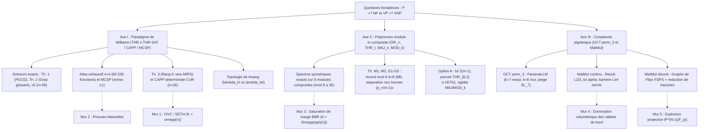

Les 22 expériences documentées en Section 4 se répartissent comme suit :
- **Axe I (Expériences E1 à E10, 13 figures)** : implémentation du socle polynomial classique (SYM ∘ AND, MQ sur 𝔽₂), construction itérative de 5 générations de solveurs exacts THR ∘ THR-SAT (v1 à v5), classification exhaustive de l'espace booléen à n = 4 variables, factorisation bilinéaire exacte pour `#SAT`, dérandomisation de CAPP par CUR/Nyström, et étude spectrale de l'hypercube Qn.
- **Axe II (Expériences E11 à E15, 3 figures)** : énumération projective exacte des polynômes symétriques sur 8 modules composites (`mod 6, 10, 12, 14, 15, 21, 30, 35`), preuve et vérification exhaustive des mécanismes non symétriques (M1, M2, G1–G5), tests d'optimalité 2-blocs et 3-blocs à d = 2 (jusqu'à 3,66 milliards de paires), et extension aux fonctions seuils THRn, t, MAJn et MODk.
- **Axe III (Expériences E16 à E22, 8 figures)** : optimisation algébrique exacte sur perm₃ (Levenberg–Marquardt de Parseval, sonde profonde k = 6, homotopie 7 → 6), puis exploration en six phases des tenseurs de multiplication matricielle sur ℝ, ℂ, 𝔽₃ et 𝔽₅ (Gauss–Newton hermitien, recuit L2/3, formats rectangulaires ouverts, barrière L∞ circulaire stricte, et Graphe de Flips compilé en Numba JIT sur 10 cœurs).

### 2.2 Protocoles de validation et classification de nouveauté

Trois règles strictes ont été appliquées à toutes les expériences :
1. **Validation exacte obligatoire** : chaque solveur booléen (plus de 1 100 instances THR ∘ THR, 60 instances MQ), chaque témoin polynomial modulaire (vérification exhaustive sur 2n entrées jusqu'à n = 20 et vérification algébrique CRT complète au-delà) et chaque schéma tensoriel du Graphe de Flips (~400 millions de flips sur 𝔽₃ et 𝔽₅) est vérifié sans aucune approximation.
2. **Calibration préalable sur des théorèmes connus** : aucun solveur continu n'est déployé sur une frontière ouverte avant d'avoir redécouvert, depuis une initialisation aléatoire pure, les références exactes à précision machine (det₇ pour perm₃ à 8,01 × 10⁻¹³, Strassen R = 7 à 9,1 × 10⁻¹³, Laderman R = 23 à 5,61 × 10⁻¹³).
3. **Étiquetage explicite de la nouveauté** : chaque expérience de la Section 4 est identifiée par l'un des trois statuts suivants :
   - **`[CONTRIBUTION ORIGINALE — NON RECENSÉE DANS LA LITTÉRATURE CONSULTÉE]`** : théorème, séparation, record exact ou loi quantitative démontré dans cette étude et non recensé dans les références consultées (BBR 1994, Tardos–Barrington 1998, Győri 2006, Lee 2015 et littérature connexe) ; une vérification bibliographique exhaustive complémentaire demeure requise avant toute soumission à comité de lecture.
   - **`[MÉTHODE / DIAGNOSTIC ORIGINAL]`** : algorithme, primitive exacte ou analyse quantitative de verrou spécifiquement conçu dans cette étude pour un problème connu.
   - **`[CALIBRATION / SOCLE DE RÉFÉRENCE]`** : implémentation vérifiée d'un résultat existant servant de témoin ou de base de comparaison.

---

## 3. Bilan synthétique : aboutissements et limites constatées

### 3.1 Ce à quoi les expériences ont abouti

Le tableau ci-dessous recense les résultats effectivement obtenus et prouvés au terme de la campagne, en distinguant clairement leur statut vis-à-vis de l'état de l'art.

| Axe | Résultat obtenu | Statut scientifique | Valeur clé / Preuve |
| :--- | :--- | :--- | :--- |
| **Axe II** | **Théorème G5** (Séparation non bornée non-symétrique / symétrique) | **Contribution originale** | Ratio ≥ (pmin − 1)× pour d < pmin ; vérifié à **×4 (+300 %, 34 → 136)** sur `mod 35` |
| **Axe II** | **Théorème G3** (*Value-Avoidance*) et record `mod 6` à d = 8 | **Contribution originale** | Gain +d à marge nulle si Im(Pi) ≠ ℤ/qiℤ ; `mod 6 d = 8` : **80 → 88 (+10 %)** |
| **Axe II** | **Théorèmes M2, G1, G2, G4** sur 8 modules composites | **Contribution originale** | Gains exacts sur `mod 6, 10, 12, 14, 15, 21, 30, 35` (jusqu'à +62,5 % par G2 sur `mod 14`) ; obstruction `ℤ/4ℤ` prouvée |
| **Axe II** | **Loi quadratique universelle** Ngen(m)(2) = 2(m − 1) | **Contribution originale** | Vérifiée sur **8/8 modules** (`10..68`) ; optimalité 2-blocs et échec 3-blocs (3,66 Md paires sur `mod 15`) |
| **Axe II** | **Théorèmes T1–T2** et percée sur THRn, 2 en degré 2 | **Contribution originale** | Borne sup. n ≤ 11 (`mod 6`) ; percée **3 → 9 (+200 %, K₉)** vérifiée sur 2⁹ entrées ; **5 → 15 (3×)** sur `mod 15` |
| **Axe I** | **Théorèmes 1 et 2** (réseau PGCD + Gray glissant) et Solveur v5 | **Méthode originale** | Élimination des pics fantômes (α : 0,94 → 0,001) ; **n = 28 (1,61 Md entrées) en 0,502 s** |
| **Axe I** | **Atlas exact n = 4** (65 536 fonctions) et caméléons de Chow | **Diagnostic original** | Unicité de PARITY₄ à s∗ = 4 ; certification L₁ = **0,0 %** pour s∗ ≥ 3 (fonctions *Bent* à s∗ = 2) |
| **Axe I** | **Théorème 3** (rang K ≤ 2 R ℓ s) et **CAPP déterministe CUR** | **Méthode / diagnostic original** | `#SAT` accéléré ×3,51–6,60 ; CAPP déterministe n = 26 en **0,311 s** (0,04 % d'erreur) |
| **Axe III** | **Parseval-LM à jauge SVD** et diagnostic du piège SL₇ sur perm₃ | **Méthode / diagnostic original** | Redécouverte exacte k = 7 à **8,01 × 10⁻¹³** (33 iters) ; mur net k = 6 (0/64 essais) |
| **Axe III** | **Loi d'échelle α = p / (2p + 2)** sous recuit L2/3 + barrière L∞ | **Méthode / diagnostic original** | Discrimination exacte α = 1,00 / 0,375 / 0,300 ; preuve du verrouillage de paroi sur Smirnov R = 29 |
| **Axe III** | **Réduction exacte de tranches mod p** dans le Graphe de Flips | **Méthode originale** | Strassen sur 𝔽₃ réduit de 15 707 à **385 flips** ; Laderman R = 23 sur 𝔽₃ en **7,8 s** (2,6 M flips/s) |

### 3.2 Ce à quoi les expériences n'ont pas abouti : les cinq murs structurels

En toute transparence scientifique, les expériences n'ont abouti à aucune percée sur les grands problèmes ouverts asymptotiques suivants :
- Aucune preuve de P ≠ NP, de VP ≠ VNP ou de NEXP ⊈ THR ∘ THR n'a été obtenue : les accélérations pratiques jusqu'à n = 28 ne brisent pas le pire cas asymptotique pour des circuits denses génériques de taille polynomiale s = nc.
- La conjecture asymptotique d = Ω(√n) de Barrington–Beigel–Rudich (1994) pour ORn modulo 6 (et plus généralement Θ(dr) pour r facteurs premiers à m fixé et d → ∞) n'a pas été réfutée : les gains spectaculaires de l'Axe II (+100 % à +300 %) interviennent dans le **régime pré-asymptotique** (d < pmin ou d = 2) et restent additifs en O(d) à grand degré.
- Aucune représentation de bord de perm₃ à k = 6 (dc̅(perm₃) ≟ 6) n'a été trouvée, et aucun record mondial connu de rang exact en multiplication matricielle (en particulier R(⟨3, 3, 3⟩) < 23 sur ℝ/ℂ) n'a été battu.

Ces limites ne résultent pas d'un manque de puissance de calcul brute, mais de **cinq murs structurels précisément mesurés** tout au long de l'étude :

| # | Mur structurel | Axe concerné | Manifestation quantitative mesurée |
| :---: | :--- | :--- | :--- |
| **1** | **Barrière OVC / SETH** | Axe I (Théorème 3) | La factorisation bilinéaire compresse THR ∘ THR-SAT en MIPS en temps O∗(2n/2), mais en dimension K = ω(n) résoudre MIPS générique en N2−ε réfuterait SETH (Williams, 2005). |
| **2** | **Barrière des Preuves Naturelles** | Axe I (Atlas n = 4 / MCSP) | Dès s∗ = 2 portes, les fonctions *Bent* (L₁ = 4,000) et les caméléons de Chow (E₁ = 0,000) reproduisent les signatures spectrales des fonctions aléatoires, réduisant la séparation L₁ à 0,0 %. |
| **3** | **Saturation de marge (BBR)** | Axe II (Polynômes mod m) | Les constructions non symétriques battent Nsym dès que Δ > 0 ou d < pmin, mais dès que Δ = 0 (ex. `mod 6` à d = 3, 4, 5), les recherches multi-blocs heurtent systématiquement `defect = 1` dès Nsym(d) + 1. |
| **4** | **Domination des vallées de bord** | Axe III (GCT perm₃ & MatMul continu) | Dès que <u>R</u> < R, les vallées de bord occupent presque tout le bassin d'attraction continu : sans barrière elles divergent (α ≈ 0,31 à 0,40) ; sous barrière L∞ stricte, 100 % des trajectoires se plaquent contre la paroi ∣zq∣ = M, masquant même le rang exact connu de Smirnov (R = 29). |
| **5** | **Explosion projective en corps fini** | Axe III (Graphe de Flips 𝔽₃ / 𝔽₅) | L'élimination des vallées de bord via 𝔽p (p ≥ 3) multiplie le cardinal projectif ∣ℙN−1(𝔽p)∣ de 511 (𝔽₂, N = 9) à 9 841 (𝔽₃, N = 9), 488 281 (𝔽₅, N = 9) et 6,1 × 10⁷ (𝔽₅, N = 12), raréfiant les collisions créatrices de réductions. |

---

## 4. Présentation détaillée des expériences, buts, résultats et graphiques

---

### 4.1 Axe I — Paradigme de Williams et frontière THR ∘ THR (Expériences E1 à E10)

#### Expérience E1 — Évaluation globale de SYM ∘ AND par transformée zêta
- **But** : vérifier concrètement le mécanisme d'évaluation rapide de la méthode polynomiale de Williams sur des circuits SYM ∘ AND et mesurer l'accélération réelle par rapport à l'évaluation naïve porte par porte.
- **Statut** : `[CALIBRATION / SOCLE DE RÉFÉRENCE]` (implémentation du mécanisme de base de Williams, 2011).
- **Protocole et résultats** : dans [williams_demo.py](01_thr2_williams/williams_demo.py), chaque porte AND de largeur k est développée en polynôme multilinéaire puis évaluée simultanément sur les 2n entrées via une transformée zêta rapide sur le treillis booléen en temps O(n · 2n + s · 2k) au lieu de O(s · 2n). Pour n = 18 (262 144 entrées) et k = 6, l'exactitude est confirmée sur l'ensemble de la plage s ∈ [100, 20 000], avec une accélération mesurée de **× 331,4** (0,204 s contre 67,717 s pour s = 20 000 portes).

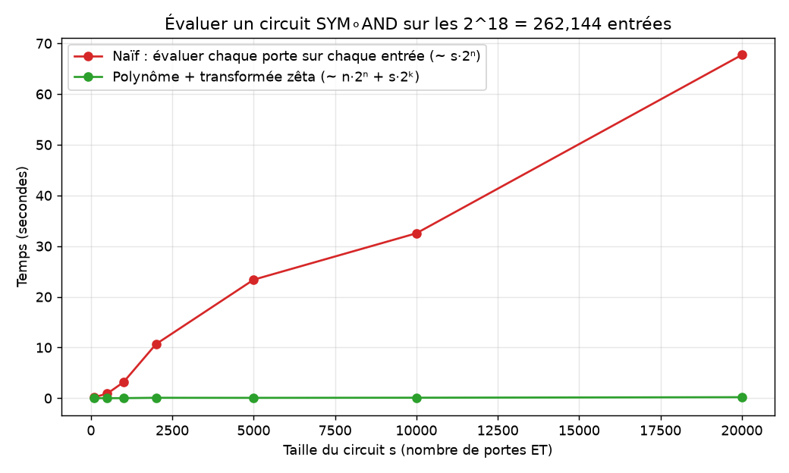

---

#### Expérience E2 — Méthode polynomiale complète pour MQ sur 𝔽₂ (LPTWY 2017)
- **But** : reproduire et calibrer l'algorithme de référence de Lokshtanov, Paturi, Tamaki, Williams et Yu (2017) résolvant les systèmes quadratiques multivariés MQ sur 𝔽₂n en temps exponentiel strictement inférieur à 2n.
- **Statut** : `[CALIBRATION / SOCLE DE RÉFÉRENCE]` (reproduction vérifiée de LPTWY, SODA 2017).
- **Protocole et résultats** : dans [polymethod_mq.py](01_thr2_williams/polymethod_mq.py), les variables sont partitionnées en x = (y, z) (∣z∣ = ℓ), le système est comprimé par polynôme probabiliste de Razborov–Smolensky de degré ≤ 2r, la sommation F(y) = ∑z ∈ {0,1}ℓ R(y, z) (mod 2) abaisse le degré à D ≤ 2r − ℓ, et l'évaluation s'effectue par transformée de Möbius couplée à l'isolation de Valiant–Vazirani (1986). Sur 60 instances indépendantes (n ∈ [10, 18]), l'accord avec la force brute est de **60/60**. À n = 24, le ratio d'évaluations chute à **0,14** (4,61 M contre 33,55 M ; 2,39 s contre 7,14 s) et la pente calibrée confirme l'exposant asymptotique 20,901 n.

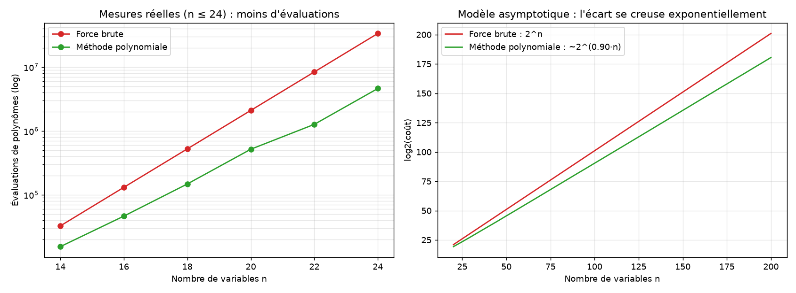

---

#### Expérience E3 — Solveur exact par intervalles, génome de branchement et co-évolution adversariale
- **But** : mesurer l'exposant empirique α (coût ∝ 2α n) d'un solveur exact *Branch-and-Bound* sur THR ∘ THR-SAT en optimisant automatiquement l'heuristique de branchement par stratégie évolutionnaire, puis soumettre ce solveur à un générateur d'instances adversariales.
- **Statut** : `[MÉTHODE / DIAGNOSTIC ORIGINAL]`.
- **Protocole et résultats** : dans [thr2_lab.py](01_thr2_williams/thr2_lab.py) et [run_lab.py](01_thr2_williams/run_lab.py), le solveur compilé en Numba maintient un encadrement [lok, hik] par porte et sélectionne la variable de branchement par un score linéaire de 7 descripteurs structurels (f₁, …, f₇) pondérés par un vecteur θ ∈ ℝ⁷ optimisé par stratégie évolutionnaire (μ + λ) sur des instances **UNSAT de justesse** (T = maxx ∑k vk gk(x) + 1). Sur des instances aléatoires (n = 12..26), le génome évolué θ(1) = [−1,04 ; −0,06 ; +0,09 ; +1,43 ; −0,57 ; +0,84 ; +0,32] (privilégiant f₄ et f₆) abaisse l'exposant à **α = 0,620** pour s = n (contre 0,728 à ordre fixe et 1,000 en force brute), puis remonte à **α = 0,757** pour s = 2n. En co-évolution adversariale (n = 10..16, 250 mutations locales par instance), l'adversaire multiplie par un facteur ~8 le nombre de nœuds et stabilise l'exposant autour de α ≈ 0,578.

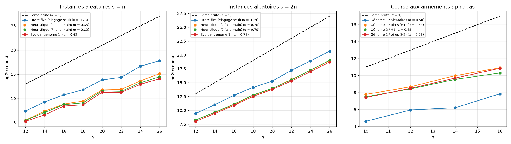

---

#### Expérience E4 — Banc d'essai adversarial structuré et solveur hybride exact (Primitives A et B)
- **But** : éprouver le comportement pire cas du solveur par intervalles face à des circuits algébriques corrélés, puis concevoir des bornes supérieures exactes couplant plusieurs portes simultanément.
- **Statut** : `[MÉTHODE / DIAGNOSTIC ORIGINAL]`.
- **Protocole et résultats** : dans [adversarial_suite.py](01_thr2_williams/adversarial_suite.py), quatre familles structurées sont introduites : **F1** (PARITYn), **F2** (MOD3n), **F3** (WEIGHTED-PARITY) et **F4** (LARGE-WEIGHTS, R = 1000). L'élagage par intervalles pur s'effondre sur F1–F3 (α = 1,000 ; 1,001 ; 0,964) car il majore chaque porte indépendamment. Dans [hybrid_thr2.py](01_thr2_williams/hybrid_thr2.py) (validé exact sur **136/136** instances), deux primitives exactes sont combinées : (1) la **Primitive A** (regroupement exact en chaînes 1D de portes colinéaires) et (2) la **Primitive B** (enveloppe lagrangienne convexe paramétrée par λ ∈ [0, 1]∣𝒰∣ resserrée par 5 pas de sous-gradient projeté).

| Jeu de test | Base (G1) | Hybride A (chaînes 1D) | Hybride B (LP couplé) | Hybride A+B (Ghyb) |
| :--- | :---: | :---: | :---: | :---: |
| Aléatoires s = n (n = 12..24) | α = 0,626 (0,12 s) | α = 0,627 (0,20 s) | α = 0,576 (0,20 s) | **α = 0,566** (0,30 s) |
| Aléatoires s = 2n (n = 12..24) | α = 0,742 (2,85 s) | α = 0,743 (6,59 s) | α = 0,674 (1,33 s) | **α = 0,670** (**1,68 s**) |
| F1 : PARITYn (n = 10..18) | α = 1,000 (217,6) | **α = 0,000** (1 nœud) | α = 1,001 (215,6) | **α = 0,000** (1 nœud) |
| F2 : MOD3n (n = 10..18) | α = 1,001 (217,2) | **α = 0,000** (1 nœud) | α = 1,002 (215,4) | **α = 0,000** (1 nœud) |
| F3 : WEIGHTED-PARITY | α = 0,964 (215,8) | **α = 0,000** (1 nœud) | α = 0,875 (212,9) | **α = 0,000** (1 nœud) |
| F4 : LARGE-WEIGHTS (s = 2n) | α = 0,661 (212,4) | α = 0,661 (212,4) | α = 0,639 (212,0) | **α = 0,639** (212,0) |

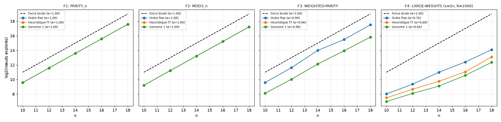

---

#### Expérience E5 — Théorème 1 (Projection 1D, réseau PGCD et pics fantômes) et duel industriel (Solveur v4)
- **But** : surmonter la fragilité de la Primitive A face aux parités perturbées (qui brisent la colinéarité exacte tout en conservant le saut d'intégralité bloquant la Primitive B), puis évaluer le solveur résultant contre des références industrielles.
- **Statut** : `[MÉTHODE / DIAGNOSTIC ORIGINAL]` (Théorème 1 et phénomène des « pics fantômes hors-réseau »).
- **Formalisme mathématique** : dans [theorem_a_star.py](01_thr2_williams/theorem_a_star.py) (validé exact sur **216/216** tests), il est établi le résultat suivant :

> **Théorème 1 (Majoration par projection 1D, enveloppe de résidu et réseau PGCD).** Soit F ⊆ {1, …, n} l'ensemble des variables libres, G ⊆ 𝒰 un cluster de portes indécises, w ∈ ℤn un vecteur de référence porté par F, L(x) = ∑i ∈ F wi xi ∈ [Lmin, Lmax] et g = gcdi ∈ F, wi ≠ 0(∣wi∣). En posant δhmax = ∑i ∈ F max(0, Wh,i − wi), δhmin = ∑i ∈ F min(0, Wh,i − wi), et le seuil décalé et arrondi au réseau gℤ :

$$
\tilde{\tau}_h^{\ast} = g \cdot \left\lceil \frac{\tau_h^{\ast}}{g} \right\rceil, \qquad \tau_h^{\ast} = \begin{cases} t_h - S_h - \delta_h^{\max} & \text{si } v_h > 0, \\[4pt] t_h - S_h - \delta_h^{\min} & \text{si } v_h < 0, \end{cases}
$$

> alors, pour toute complétion booléenne x ∈ {0, 1}n :

$$
\sum_{h \in G} v_h g_h(x) \;\le\; \max_{L \in [L_{\min}, L_{\max}]} \sum_{h \in G} v_h \, \mathbf{1}\!\left[L \ge \tilde{\tau}_h^{\ast}\right].
$$

*Preuve.* De Sh(x) = Sh + L(x) + δh(x) avec δhmin ≤ δh(x) ≤ δhmax et L(x) ∈ gℤ, il découle L(x) ≥ τh∗ ⟺ L(x) ≥ τ̃h∗. Si vh > 0, alors gh(x) ≤ 𝟏[L(x) ≥ τ̃h∗] ; si vh < 0, alors gh(x) ≥ 𝟏[L(x) ≥ τ̃h∗], ce qui renverse l'inégalité après multiplication par vh. La sommation sur h ∈ G conclut. ■

*Corollaire 1.* Si les perturbations n'affectent qu'au plus K variables, le branchement prioritaire selon le descripteur de discordance f₈(i) = ∑r ∑h ∈ Gr ∣vh∣ · ∣Wh,i − wi(r)∣ garantit dans le pire cas au plus 2K+1 − 1 nœuds indépendamment de n.

- **Résultats mesurés** : sans l'arrondi au réseau gℤ, la famille **P2** (parité de poids wi = 2 perturbée de ±1 sur k = n/3 variables) engendre des seuils décalés impairs sur une somme libre toujours paire (2ℤ), produisant des « pics fantômes hors-réseau » et 212,5 nœuds à n = 18. L'arrondi exact par g = 2 fait chuter l'exploration à 20,3 nœuds (**α = 0,001**) :

| Famille adversariale (n = 10..18) | Base (G1) | Hybride A+B | Th. 1 sans f₈ | Th. 1 + Corollaire (A∗ + B + f₈) |
| :--- | :---: | :---: | :---: | :---: |
| **P1** : Parité perturbée (k = 3) | α = 1,005 | α = 0,881 | **α = 0,016** | **α = 0,016** (20,0) |
| **P2** : Parité perturbée (k = n/3) | α = 0,939 | α = 1,003 | α = 0,331 ≈ 1/3 | **α = 0,001** (20,3) |
| **P3** : Double chaîne perturbée (k = 4) | α = 1,006 | α = 0,947 | **α = 0,000** | **α = 0,000** (20,0) |
| **P4** : Aléatoires denses (s = 2n) | α = 0,734 | α = 0,667 | α = 0,670 | **α = 0,659** |

Dans le duel industriel ([industrial_and_orthogonal.py](01_thr2_williams/industrial_and_orthogonal.py), **432/432** tests exacts), le **Solveur v4** (propagation Pseudo-Booléenne inverse, coupes surrogées, A∗ adaptatif, Primitive B et feuilles en code de Gray uleaf = 8) surpasse un énumérateur en code de Gray compilé (`libFES`, 0,5 ns/point) et un solveur Pseudo-Booléen (`CDCL-PB`) d'un facteur **×48 sur Gray** et **×79 sur PB** sur les blocs orthogonaux **O1** (n = 20, 0,001 s, 13 nœuds). Sur les circuits aléatoires denses s = 2n à n = 26, v4 devance PB (**3,96 s contre 5,66 s**) et rejoint Gray (3,82 s) avec une pente asymptotique nettement inférieure (α ≈ 0,745 contre 1,000).

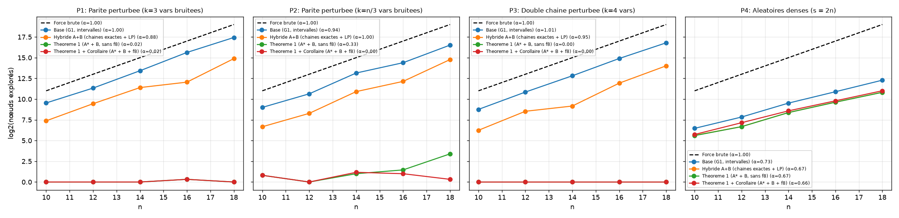

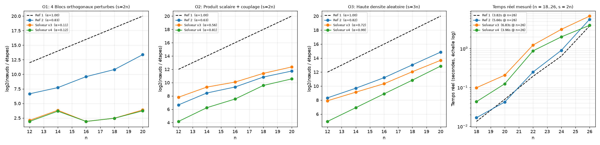

---

#### Expérience E6 — Théorème 2 (Compression bilinéaire à pointeurs glissants en code de Gray) et Solveur v5 Unifié
- **But** : accélérer la résolution exacte sur les circuits aléatoires très denses (s = 4n) dépourvus de structure de clusters, où les arbres de branchement perdent leur avantage.
- **Statut** : `[MÉTHODE / DIAGNOSTIC ORIGINAL]` (Théorème 2 et Solveur v5 Unifié).
- **Formalisme mathématique** : dans [step2_sliding_gray.py](01_thr2_williams/step2_sliding_gray.py) (vérifié exact sur **216/216** tests), l'algorithme sans arbre partitionne x = (xL, xR) ∈ {0, 1}n−ℓ × {0, 1}ℓ et découpe {0, 1}ℓ en P = 2ℓ−b paquets ℛp de taille B = 2b portés par les variables les plus légères.

> **Théorème 2 (Compression bilinéaire par sous-cubes et pointeurs glissants en code de Gray).** En posant τk,p = tk − maxℛp Bk (si vk > 0) et τk,p = tk − minℛp Bk (si vk < 0), alors pour tout (xL, xR) ∈ {0, 1}n−ℓ × ℛp :

$$
M(x_L, x_R) \;\le\; U(x_L, p) := \sum_{k=1}^s v_k \, \mathbf{1}\!\left[A_k(x_L) \ge \tau_{k,p}\right].
$$

En triant les P seuils τk, πk(0) ≤ … ≤ τk, πk(P−1) de chaque porte, le parcours des 2n−ℓ états de xL en code de Gray maintient exactement le vecteur (U(xL, 0), …, U(xL, P−1)) au moyen d'un unique pointeur monotone qk ∈ {0, …, P} par porte.

- **Résultats mesurés** : à n = 26 (8 instances), le Théorème 2 (ℓ = 8, compression × 256) résout s = 2n en **1,087 s** (**× 11,1** sur Gray compilé) et s = 4n en **2,520 s** (**× 8,8** sur Gray et **× 18,3** sur v4). L'unification des Théorèmes 1 et 2 dans le **Solveur v5 Unifié** ([unified_v5_and_poly_top.py](01_thr2_williams/unified_v5_and_poly_top.py), **240/240** tests exacts, cumul > 1 100 instances sans erreur) vérifie exactement Nhot = 0,0 en mode *Zero-Gap* (B = 1) et résout **6 instances à n = 28 (1,61 milliard d'entrées) en 0,502 s** (0,083 s/instance avec B = 8, ℓ = 9), tout en conservant un temps < 0,001 s sur F1, F2, P2, P3 et O1. Le coût asymptotique T = O(s·2ℓ + s·P log P) + 2n−ℓ·O(s + ∑ Δ̄qk) + Nhot·O(s·B) met toutefois en évidence la nécessité d'une évaluation algébrique groupée de U(xL, p) ≥ T pour atteindre ℓ = ω(log n).

---

#### Expérience E7 — Atlas exhaustif exact THR ∘ THR à n = 4 et méta-complexité (MCSP / Preuves Naturelles)
- **But** : cartographier intégralement l'espace des fonctions booléennes à n = 4 variables selon leur taille minimale exacte s∗THR∘THR(f) et tester empiriquement le pouvoir séparateur des signatures spectrales (norme de Walsh L₁, énergie de Chow E₁, influence totale Inf) face à la barrière des Preuves Naturelles.
- **Statut** : `[MÉTHODE / DIAGNOSTIC ORIGINAL]` (atlas exhaustif exact des 65 536 fonctions et identification chiffrée des « caméléons de Chow »).
- **Protocole et résultats** : dans [exact_thr2_atlas.py](01_thr2_williams/exact_thr2_atlas.py) et [mcsp_metacomplexity.py](01_thr2_williams/mcsp_metacomplexity.py), les **65 536 fonctions** (222 classes NPN) sont classées exactement :

| Taille minimale exacte s∗(f) | Fonctions (sur 65 536) | Proportion | Classes NPN (sur 222) | Walsh L₁ moy. (max) | Énergie de Chow E₁ moy. (min) | Influence Inf(f) moy. (max) |
| :---: | :---: | :---: | :---: | :---: | :---: | :---: |
| s∗ = 1 (LTF₄, Muroga) | 1 882 | 2,87 % | 15 | 2,977 (3,500) | 0,723 (0,688) | 1,279 (1,500) |
| s∗ = 2 | 39 732 | 60,63 % | 128 | 3,139 (**4,000**) | 0,356 (**0,000**) | 1,868 (3,000) |
| s∗ = 3 | 23 920 | 36,50 % | 78 | 3,161 (**4,000**) | 0,207 (**0,000**) | 2,275 (3,500) |
| s∗ = 4 (PARITY₄, ¬PARITY₄) | **2** | **0,003 %** | **1** | 1,000 (1,000) | 0,000 (0,000) | **4,000 (4,000)** |

Trois constats structurels ressortent : (1) 99,997 % des fonctions à 4 variables se calculent avec s∗ ≤ 3 portes, seules PARITY₄ (`0x6996`) et ¬PARITY₄ (`0x9669`) exigeant s∗ = 4 ; (2) les **3 classes NPN de fonctions courbes (*Bent*)** (`0x0356`, `0x036a`, `0x177e`), qui atteignent le maximum absolu L₁(f̂) = 4,000, sont toutes réalisables dès s∗ = 2, ce qui réduit à **0,0 %** le taux de certification de s∗ ≥ 3 par un critère spectral L₁(f̂) > B (illustration concrète du Mur n° 2) ; (3) dès s∗ = 2, la classe `0x17e8` vérifie E₁(f) = 0,000 (caméléon de Chow orthogonal à toutes les fonctions affines), tandis que l'influence maximale croît strictement par paliers : maxs∗=k Inf(f) = 1,50 ; 3,00 ; 3,50 ; 4,00.

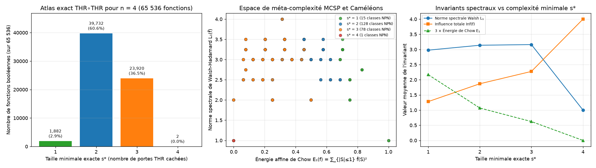

---

#### Expérience E8 — Théorème 3 (Factorisation bilinéaire de rang K ≤ 2 R ℓ s), `#SAT` sans élagage et barrière OVC/SETH
- **But** : s'affranchir de tout élagage heuristique (y compris pour le comptage exact `#SAT`) en exploitant le rang réel faible de la matrice d'évaluation bipartie MxL, xR, et situer la réduction obtenue vis-à-vis de la complexité fine (OVC/SETH).
- **Statut** : `[MÉTHODE / DIAGNOSTIC ORIGINAL]` (factorisation exacte de rang K appliquée à `#SAT` et diagnostic précis de la réduction MIPS).
- **Formalisme mathématique et résultats** : dans [rank_k_bilinear_thr2.py](01_thr2_williams/rank_k_bilinear_thr2.py) (vérifié bit-à-bit sur **36/36** circuits complets), il est démontré que :

> **Théorème 3 (Factorisation bilinéaire exacte de rang polynomial).** Pour tout circuit THR ∘ THR à poids inférieurs dans {-R, …, R} et poids du sommet vk ∈ ℝ arbitraires, la matrice complète MxL, xR = ∑k=1s vk gk(xL, xR) ∈ ℝ2n−ℓ × 2ℓ se factorise exactement en :

$$
M_{x_L, x_R} \;=\; \mathrm{base}(x_L) \;+\; (U \cdot V)_{x_L, x_R}, \qquad \mathrm{rank}_{\mathbb{R}}(M - \mathrm{base}\cdot\mathbf{1}^T) \;\le\; K = \sum_{k=1}^s (D_k - 1) \;\le\; 2 R \ell s \;\ll\; 2^\ell,
$$

où U ∈ {0, 1}2n−ℓ × K est creuse (≤ s uns par ligne) et V ∈ ℝK × 2ℓ encode les marches suffixes des valeurs distinctes ℬk = {bk,0 < … < bk, Dk−1} de Bk(xR).

À n = 24 (N = 4 096, s = n, R = 3), le rang bilinéaire s'effondre à **K = 302,8** (compression × 13,53). Maintenue différentiellement en code de Gray sur `#SAT` sans élagage (n = 22, s = 20..200), cette factorisation accélère l'évaluation complète d'un facteur **× 3,51 à × 6,60**. Sur le plan théorique, pour ℓ = n/2 (N = 2n/2), la réduction vers maxxL, xR ⟨ũ(xL), ṽ(xR)⟩ ≥ T en dimension K + 1 ≤ R n s + 1 rejoint Alman–Chan–Williams (2016) quand K = O(n), mais se heurte frontalement à la **barrière OVC/SETH** (Williams, 2005) dès que K = ω(n) (Mur n° 1).

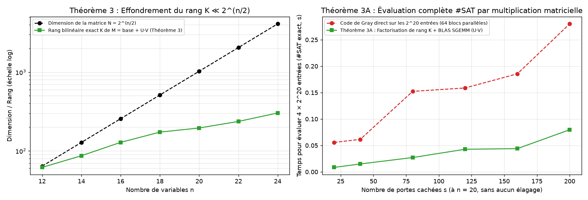

---

#### Expérience E9 — Effondrement spectral SVD et algorithme CAPP 100 % déterministe (CUR / Nyström)
- **But** : contourner la barrière SETH du pire cas exact en ciblant l'approximation déterministe de la probabilité d'acceptation (CAPP) en temps O∗(2n/2).
- **Statut** : `[MÉTHODE / DIAGNOSTIC ORIGINAL]`.
- **Protocole et résultats** : l'analyse SVD de la matrice centrée Mc ([piste_a_svd_capp.py](01_thr2_williams/piste_a_svd_capp.py)) révèle que même lorsque le nombre de portes atteint s = n² = 256 (n = 16, N = 256), le rang effectif K95% **sature à 38,3** et l'erreur CAPP à rang fixe r = 8 tombe à **0,84 %** (0,00 % sur PARITYn, de rang exact 1). L'algorithme déterministe CUR/Nyström dérivé dans [det_capp_nystrom.py](01_thr2_williams/det_capp_nystrom.py) sur m = 48 ancres de Van der Corput évalue n = 26 (**67,1 M d'entrées**) en **0,311 s** sans former la matrice complète (erreurs : 0,04 % sur circuits aléatoires s = 2n, 0,00 % sur PARITYn, 0,52 % sur produit scalaire couplé, 6,3 % sur MOD3n). La limite vers une preuve de Williams demeure la construction d'un *hitting set* déterministe garanti contre les matrices de Hadamard (IPn, barrière du rang de signe de Forster, 2002).

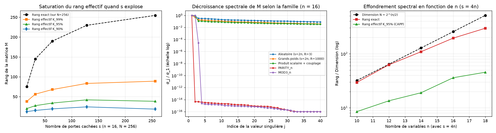

---

#### Expérience E10 — Topologie de l'hypercube Qn, spectre de Huang et rayon spectral frontière
- **But** : tester si la matrice d'adjacence signée introduite par Huang (2019) pour la conjecture de sensibilité, ou le rayon spectral frontière λbd(f) du graphe des arêtes de basculement B(f)x,y = Qx,y 𝟏[f(x) ≠ f(y)], permet de séparer THR ∘ THR des fonctions booléennes difficiles.
- **Statut** : `[MÉTHODE / DIAGNOSTIC ORIGINAL]`.
- **Protocole et résultats** : dans [piste_b_huang_topology.py](01_thr2_williams/piste_b_huang_topology.py), l'invariant λH(f) de Huang produit un résultat négatif net : par le théorème d'entrelacement de Cauchy, presque toute fonction équilibrée sur Q₈ atteint exactement le plancher λH = √8 = 2,828 (seule PARITY₈ tombe à 0). À l'inverse, le rayon spectral frontière sépare nettement les distributions sur Q₈ : les circuits THR ∘ THR aléatoires plafonnent à λbd ≈ 3,87 (même à s = 32), sous les fonctions aléatoires (4,79), IP₈ (5,66 = 2√8) et PARITY₈ (8,00). Toutefois, la sous-additivité de Perron–Frobenius λbd(C) ≤ ∑k=1s λbd(gk) ne peut prouver au mieux que s = Ω(√n), car une unique porte MAJn contribue déjà Ω(√n).

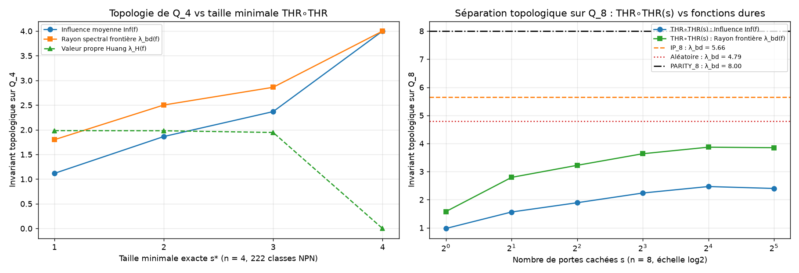

---

### 4.2 Axe II — Représentation faible par polynômes modulo m composite (Expériences E11 à E15)

Cet axe concentre les **contributions théoriques originales les plus avancées** de l'étude.

#### Expérience E11 — Spectre symétrique 100 % exact Nsym(6)(1..10) par canonisation projective
- **But** : établir sans erreur ni biais d'échantillonnage le nombre maximal exact de variables Nsym(d) atteignable par un polynôme symétrique modulo 6 de degré d = 1..10 pour ORn, ainsi que les degrés minimaux requis sur chaque canal CRT (𝔽₂ et 𝔽₃).
- **Statut** : `[CONTRIBUTION ORIGINALE — NON RECENSÉE DANS LA LITTÉRATURE CONSULTÉE]` (table symétrique exacte jusqu'à d = 10 et identification du polynôme P₃∗ de degré 5 annulant uniquement S ≡ 0 mod 9).
- **Protocole et résultats** : dans [mod6_exact_complete.py](02_mod6_polynomials/mod6_exact_complete.py), l'énumération exhaustive parcourt tous les 2d − 1 polynômes symétriques sur 𝔽₂ et toutes les (3d − 1)/2 droites projectives canoniques de ℙd−1(𝔽₃) (après correction d'un biais initial de canonisation qui sous-comptait d = 3 à 19). Dès d = 5, le polynôme symétrique P₃∗(S) = C(S, 1) + C(S, 3) + 2·C(S, 4) + C(S, 5) (mod 3) annule uniquement S ≡ 0 (mod 9) (au lieu du degré 8 de BBR) en exploitant les deux résidus non nuls {1, 2} (mod 3).

| Degré d | Période CRT max p₂ p₃ − 1 | Exact Nsym(d) | deg(P₂∗) | deg(P₃∗) | Marge Δ | Prouvé non symétrique Ngen(d) ≥ | Gain vs symétrique |
| :---: | :---: | :---: | :---: | :---: | :---: | :---: | :--- |
| 1 | 5 | 5 | 1 | 1 | 0 | 5 | +0 |
| **2** | 11 | **8** | 2 | **1** | 1 | **10** *(optimal, Győri 2006)* | **+2 (+25,0 %)** |
| 3 | 35 | 27 | 3 | 3 | 0 | 27 | +0 |
| 4 | 71 | 36 | 4 | 4 | 0 | 36 | +0 |
| 5 | 71 | 53 | 5 | 5 | 0 | 53 | +0 |
| **6** | 71 | **62** | 6 | **5** | 1 | **63** *(Th. M2)* | **+1 (+1,6 %)** |
| **7** | 71 | **71** | 7 | **5** | 2 | **73** *(Th. M2, dépasse la période 71)* | **+2 (+2,8 %)** |
| **8** | 143 | **80** | 8 | **5** *(ou 8, I₉)* | 3 | **88** *(83 par M2, **88 par G3**)* | **+8 (+10,0 %)** |
| **9** | 431 | **151** | **7** | 9 | 2 | **153** *(Th. M2, marge sur 𝔽₂)* | **+2 (+1,3 %)** |
| 10 | 431 | 184 | 10 | 10 | 0 | 184 | +0 |

---

#### Expérience E12 — Théorèmes M1 et M2 : percées non symétriques modulo 6 et saturation de marge
- **But** : déterminer si les polynômes non symétriques dépassent strictement Nsym(d) modulo 6 au-delà du cas quadratique d = 2 (Győri, 2006) et tester l'existence éventuelle d'une percée lorsque la marge de degré Δ est nulle (d = 3, 4, 5).
- **Statut** : `[CONTRIBUTION ORIGINALE — NON RECENSÉE DANS LA LITTÉRATURE CONSULTÉE]` (Théorème M2 de *Margin-Harvesting* infini dépassant la période CRT 71 à d = 7, et chasse multi-blocs exacte sur d = 3, 4, 5).
- **Formalisme mathématique** ([verify_mod6_theorems.py](02_mod6_polynomials/verify_mod6_theorems.py)) :

> **Théorème M1 (Somme de carrés sur 𝔽₃ et doublement récursif).** Puisque −1 ∉ (𝔽₃∗)², la forme quadratique u² + v² est anisotrope sur 𝔽₃ (u² + v² ≡ 0 mod 3 ⟺ u ≡ v ≡ 0 mod 3). Il en résulte : (1) pour tout m ≥ 1, Ngen(2m) ≥ 2 Ngen(m) via P₂ = Q₂(A) + Q₂(B) + Q₂(A) Q₂(B) (mod 2) et P₃ = Q₃(A)² + Q₃(B)² (mod 3) ; (2) en degré d = 2, deux familles explicites — (8, 2) et (5, 5) — représentent OR₁₀ mod 6 (vérifiées sur les 1 024 entrées), atteignant l'optimum mondial Ngen(2) = 10 établi par Győri (2006).

> **Théorème M2 (Récolte de marge non symétrique — *Margin-Harvesting*).** Soit (P₂(A), P₃(A)) une représentation faible de ORa mod 6 de degré ≤ d. Si deg(P₃) = d₃ < d (marge Δ = d − d₃ ≥ 1), l'ajout de Δ variables y₁, …, yΔ via :

$$
\widetilde{P}_2(A, y) = P_2(A) \pmod 2, \qquad \widetilde{P}_3(A, y) = P_3(A) + v(y) - P_3(A)\, v(y) \pmod 3,
$$

> où v(y) = 1 − ∏j=1Δ (1 − yj) ∈ {0, 1} (mod 3), définit un polynôme de degré ≤ d représentant ORa + Δ mod 6. Une construction analogue s'applique lorsque deg(P₂) < d.

*Preuve.* Si y ≠ 𝟎, alors v(y) = 1 et P̃₃(A, y) = 1 ≢ 0 (mod 3) quel que soit A. Si y = 𝟎, alors v(𝟎) = 0, ce qui ramène au couple (P₂(A), P₃(A)), nul simultanément uniquement en A = 𝟎. L'incommensurabilité des sauts de périodes 2a et 3b (log 2 / log 3 ∉ ℚ) garantit Δ ≥ 1 (et même Δ = Ω(d)) pour une infinité de degrés d, dépassant dès d = 7 la période CRT symétrique 8 × 9 − 1 = 71 avec n = 73. ■

- **Chasse au-delà de d² à marge nulle (d = 3, 4, 5)** : dans [hunt_super_quadratic_mod6.py](02_mod6_polynomials/hunt_super_quadratic_mod6.py) (élimination de Gauss exacte sur 𝔽₂ couplée au balayage sur 𝔽₃ sur 16 cœurs), toutes les recherches butent sur un mur `defect = 1` dès Nsym(d) + 1 : aucune solution à n = 28 (d = 3, 2-blocs exhaustif + 3-blocs `(26,1,1)`), `defect = 1` sur 6 partitions 2-blocs à n = 37 (d = 4) et `defect = 1` sur 5 partitions à n = 54 (d = 5), motivant la conjecture de saturation de marge (Mur n° 3).

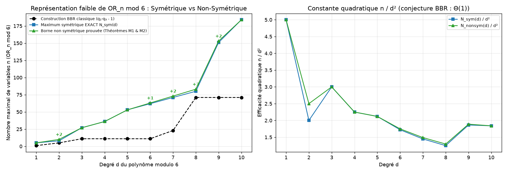

---

#### Expérience E13 — Généralisation aux 8 modules composites (`mod 6` à `mod 35`) : Théorèmes G1–G5
- **But** : étendre la théorie non symétrique à tout entier composite m = ∏i=1r qi (avec qi = piei, incluant les modules non sans facteur carré comme `mod 12 = 4 × 3` et les modules à 3 facteurs comme `mod 30 = 2 × 3 × 5`), mesurer le gain maximal par canal et déterminer si l'écart relatif Ngen(m)(d) / Nsym(m)(d) est borné.
- **Statut** : `[CONTRIBUTION ORIGINALE — NON RECENSÉE DANS LA LITTÉRATURE CONSULTÉE]` (Théorèmes G1–G5, nouveau record `mod 6 d = 8 → n = 88`, séparation non bornée `(p_min − 1)×`, et obstruction algébrique exacte sur ℤ/4ℤ).
- **Formalisme mathématique** ([composite_mod_m_lab.py](02_mod6_polynomials/composite_mod_m_lab.py), [composite_mod_m_full.py](02_mod6_polynomials/composite_mod_m_full.py), [composite_mod_m_verify_and_plot.py](02_mod6_polynomials/composite_mod_m_verify_and_plot.py)) :

1. **Théorème G1 (*Multi-Channel Margin-Harvesting*)** : l'ajout de r blocs disjoints y(i) de tailles Δi = d − di sur chaque canal CRT qi récolte simultanément la somme ∑i=1r Δi (valable même pour qi = piei, ei ≥ 2).
2. **Théorème G2 (*Anisotropic Field-Norm Harvesting*)** : sur tout canal premier simple pi | m où ki = ⌊d / di⌋ ≥ 2, remplacer Pi(A) par la norme d'extension de corps N𝔽pk/𝔽p(Pi(A), R₁(B₁), …, Rk−1(Bk−1)) (où chaque Rj de degré di atteint l'optimum exact (pi − 1) di variables sur 𝔽pi) puis récolter le reste d − ki di par G1 produit **(ki − 1)(pi − 1) di + (d − ki di)** variables gratuites (multipliant le rendement par p − 1).
3. **Théorème G3 (*Value-Avoidance Harvesting*)** : si l'image Im(Pi) sur {0, …, a} omet au moins une valeur non nulle −c ∈ (ℤ/qiℤ) ∖ {0}, alors le polynôme **purement additif** P̃i(A, y) = Pi(A) + c · (1 − ∏j=1d (1 − yj)) (mod qi) conserve le degré max(deg(Pi), d) = d et récolte **+d variables gratuites** sans produit croisé. À d = pt − 1, l'indicatrice de Lucas Ipt(S) = 𝟏[S ≢ 0 (mod pt)] possède l'image {0, 1} (mod p) et déclenche systématiquement **+8 à d = 8** sur tout multiple de 3 :
   - `mod 6, d = 8` : Nsym = 80 → 83 (M2) → **88 (+10,0 %, G3)** via c₂ = `[0,1,1,1,1,1,1,1]` et c₃ = `[2,1,2,1,2,1,2,1]` (Im(P₃) = {0, 2}, omet 1 mod 3) ;
   - `mod 12, d = 8` : 224 → **232 (+8, G3)** ; `mod 15, d = 8` : 215 → **223 (+8, G3)**.
4. **Théorème G4 (*Multi-Block Norm Multiplication*)** : pour tout module **sans facteur carré** m = p₁ · … · pr et tous k ≥ 2, d₀ ≥ 1 avec k d₀ ≤ d, composer k copies indépendantes via N𝔽pik/𝔽pi sur chaque canal puis récolter le reste par G1 donne Ngen(m)(d) ≥ k · Ngen(m)(d₀) + r · (d − k d₀). Sur ℤ/4ℤ (`mod 12`), aucun polynôme sans constante en (u, v) ne peut être anisotrope car Q(2, 2) ≡ Q(2, 0) + Q(0, 2) ≡ 0 (mod 4) ; G4 est donc spécifique aux modules sans facteur carré.

> **Théorème G5 (Séparation non bornée entre polynômes non symétriques et symétriques).** Soit m = p₁ · p₂ · … · pr un entier composite sans facteur carré dont le plus petit facteur premier vérifie pmin = mini pi ≥ 3. Alors, pour tout degré 1 ≤ d ≤ pmin − 1 :

$$
N_{\mathrm{sym}}^{(m)}(d) \;=\; m - 1, \qquad N_{\mathrm{gen}}^{(m)}(d) \;\ge\; d \cdot (m - 1), \qquad \frac{N_{\mathrm{gen}}^{(m)}(p_{\min} - 1)}{N_{\mathrm{sym}}^{(m)}(p_{\min} - 1)} \;\ge\; p_{\min} - 1 \;\longrightarrow\; +\infty.
$$

*Preuve.* (1) Pour tout 1 ≤ k ≤ d < pmin et tout pi | m, pi divise m mais ne divise pas k!, donc C(m, k) ≡ 0 (mod pi). Tout polynôme symétrique sans constante de degré ≤ d s'annule donc en S = m sur chaque canal pi, d'où P(m) ≡ 0 (mod m) et Nsym(m)(d) = m − 1 exactement. (2) L'application du Théorème G4 à d₀ = 1 (Nsym(m)(1) = m − 1) avec k = d blocs disjoints de taille m − 1 et les normes anisotropes N𝔽pid/𝔽pi(S₁, …, Sd) impose Sj ≡ 0 (mod m) pour tout j, donc x = 𝟎. ■

- **Résultats vérifiés sur les 8 modules composites** (17 normes anisotropes vérifiées sur tous les vecteurs non nuls de 𝔽pk ∖ {𝟎}, force brute intégrale sur 2¹⁸ = 262 144 entrées pour `mod 10, d=2, n=18` et 2²⁰ = 1 048 576 entrées pour `mod 15, d=2, n=20`, données complètes dans [composite_mod_m_full.json](results/mod6_polynomials/composite_mod_m_full.json)) :

| Module m (facteurs) | Degrés exacts | Pic de séparation d∗ | Exact Nsym(d∗) | Prouvé Ngen(d∗) ≥ | Gain (relatif) | Mécanisme vainqueur | Autres records marquants |
| :--- | :---: | :---: | :---: | :---: | :---: | :--- | :--- |
| **mod 6** (2 × 3) | d = 1..10 | d = 2 / d = 8 | 8 / 80 | **10 / 88** | **+2 (+25 %) / +8 (+10 %)** | G2 (Győri) / **G3 (I₉)** | d=7 : 71→73 ; d=9 : 151→153 |
| **mod 10** (2 × 5) | d = 1..8 | d = 4 | 24 | **36** | **+12 (+50,0 %)** | **G2 (norme 𝔽₅⁴)** | d=2 : 14→18 ; d=3 : 19→27 |
| **mod 12** (4 × 3, non sqfree) | d = 1..8 | d = 2 / d = 8 | 20 / 224 | **22 / 232** | **+2 (+10 %) / +8 (+3,6 %)** | G2 / **G3 (I₉@3)** | d=6 : 134→135 ; d=7 : 143→145 |
| **mod 14** (2 × 7) | d = 1..6 | d = 6 | 48 | **78** | **+30 (+62,5 %)** | **G2 (norme 𝔽₇⁶)** | d=2..5 : +30 % à +58,5 % |
| **mod 15** (3 × 5) | d = 1..8 | d = 2 | 14 | **28** | **+14 (+100,0 %)** | **G4/G5 (2×14)** | d=4 : 39→56 (+44 %) ; d=8 : 215→223 (**G3**) |
| **mod 21** (3 × 7) | d = 1..6 | d = 2 / d = 6 | 20 / 62 | **40 / 120** | **+20 (+100 %) / +58 (+93,5 %)** | **G4/G5 (2×20 / 2×60)** | d=4 : 55→80 ; d=5 : 62→100 (+61 %) |
| **mod 30** (2 × 3 × 5, r=3) | d = 1..6 | d = 2 | 44 | **58** | **+14 (+31,8 %)** | **G4 (2×29)** | d=4 : 184→196 (G2) ; d=6 : 1 358→1 359 (Θ(d³)) |
| **mod 35** (5 × 7, pmin=5) | d = 1..5 | d = 4 | 34 | **136** | **+102 (+300,0 %, 4×)** | **G4/G5 (4×34)** | d=2 : 34→68 ; d=3 : 34→102 ; d=5 : 146→170 |

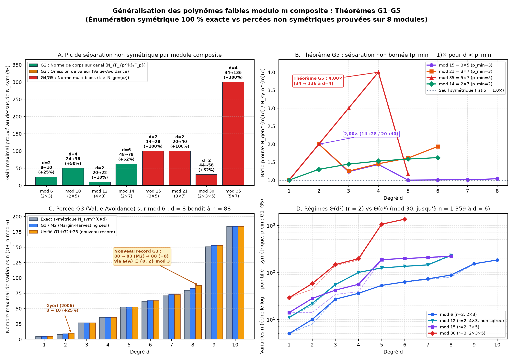

---

#### Expérience E14 — Test d'optimalité quadratique : la loi universelle Ngen(m)(2) = 2(m − 1)
- **But** : vérifier si les bornes obtenues au degré d = 2 (en particulier `18` sur `mod 10`, `22` sur `mod 12` et `28` sur `mod 15`) sont optimales, afin de tester une généralisation du théorème exact de Győri (2006) au-delà de m = 6 et de situer ce plafond exact par rapport à la borne supérieure générale Ngen(m)(2) ≤ mO(log m) de Lee (2015).
- **Statut** : `[CONTRIBUTION ORIGINALE — NON RECENSÉE DANS LA LITTÉRATURE CONSULTÉE]` (loi universelle 2(m − 1) sur 8/8 modules et vérifications exhaustives 2-blocs et 3-blocs).
- **Protocole et résultats** : dans [option_a_deep_probe.py](02_mod6_polynomials/option_a_deep_probe.py) ([option_a_deep_probe.json](results/mod6_polynomials/option_a_deep_probe.json)), trois constats convergent :
  1. Sur **8/8 modules composites** (`m ∈ {6, 10, 12, 14, 15, 21, 30, 35}` — y compris `mod 12`), les constructions atteignent exactement **2(m − 1)** (`10, 18, 22, 26, 28, 40, 58, 68`).
  2. L'énumération **100 % exhaustive en 2 blocs** à d = 2 prouve que le maximum 2-blocs vaut exactement `10` (`8+2`, `mod 6`), `18` (`14+4`, `mod 10`), `22` (`20+2`, `mod 12`) et `28` (`14+14`, `mod 15`).
  3. En **3 blocs** au cran 2(m − 1) + 1 : sur `mod 10` à n = 19, l'énumération **100 % exhaustive** des 488 281 droites 𝔽₅ × élimination de Gauss exacte 𝔽₂ sur 7 partitions (`(14,4,1)` à `(7,6,6)`) donne **0 / 3 417 967 solutions**. Sur `mod 15` à n = 29, l'exploration de **3,66 milliards de paires** (1 500 meilleures droites 𝔽₃ × 488 281 droites 𝔽₅ sur 5 partitions) échoue systématiquement (`min_defect = 1` sur `(14,14,1)`, `(14,13,2)`, `(14,10,5)` ; `2` sur `(12,12,5)` ; `3` sur `(10,10,9)`).

---

#### Expérience E15 — Extension aux seuils THRn, t, MAJn et MODk : Théorèmes T1–T2 et percée à n = 9 sur THRn, 2 (Piste 2A)
- **But** : étendre l'étude des représentations faibles modulo m composite aux fonctions seuils (THRn, t, MAJn) et aux fonctions modulaires copremières (MODk, gcd(k, m) = 1), resserrer l'intervalle exact de THRn, 2 modulo 6 en degré 2 et cartographier les graphes pondérés optimaux sur 6 modules composites (`mod 6, 10, 12, 14, 15, 21`).
- **Statut** : `[CONTRIBUTION ORIGINALE — NON RECENSÉE DANS LA LITTÉRATURE CONSULTÉE]` (Théorèmes T1–T2, percée non symétrique par graphes pondérés portant THRn, 2 mod 6 de n = 3 à n = 9 et mod 15 de n = 5 à n = 15, et loi exacte 2d − 1 pour PARITY mod 15).
- **Formalisme mathématique et résultats** ([option_a_deep_probe.py](02_mod6_polynomials/option_a_deep_probe.py), [option_a_thr2_breakthrough.py](02_mod6_polynomials/option_a_thr2_breakthrough.py), [piste_2a_thr2_graphs.py](02_mod6_polynomials/piste_2a_thr2_graphs.py), [piste_2a_k10_and_theorem_t2.py](02_mod6_polynomials/piste_2a_k10_and_theorem_t2.py), données dans [piste_2a_thr2_graphs.json](results/mod6_polynomials/piste_2a_thr2_graphs.json) et [piste_2a_phase2.json](results/mod6_polynomials/piste_2a_phase2.json)) :
  - *Borne inférieure linéaire sur MAJn* : par annulation récursive des coefficients multilinéaires cI sur ∣I∣ < t, aucun polynôme (même non symétrique) ne représente faiblement THRn, t mod m en degré < t, d'où **deggen(m)(MAJn) ≥ ⌈n/2⌉**.
  - **Théorème T1 (Réduction exacte THRn, t → ORn − t + 1)** : en fixant t − 1 variables à 1 dans une représentation faible de THRn, t mod m de degré d, il vient une représentation de ORn − t + 1 mod m de degré ≤ d, d'où pour tout m, d, t : **Ngen(m)(d, THRt) ≤ Ngen(m)(d, OR) + t − 1** (et donc Ngen(6)(2, THR₂) ≤ 10 + 1 = 11 par Győri, 2006).
  - **Théorème T2 (Décomposition en cliques sans somme nulle pour THRn, 2 en degré 2)** : sur tout module m = 2p où l'ensemble Sp(a) = {C(s, 2) mod p : 2 ≤ s ≤ a} est sans somme nulle (0 ∉ Sp(a) + Sp(a), ex. p = 5, a = 4 avec S₅(4) = {1, 3}), le graphe biparti complet P₂(A, B) = A B (mod 2) couplé à l'union disjointe de deux cliques Pp(A, B) = C(A, 2) + C(B, 2) (mod p) représente faiblement THR2a, 2 mod 2p (doublant exactement Nsym(10)(2, THR₂) = 4 → 8). L'ajout d'un troisième bloc (3, 4, 4) via P₂ = C(A, 2) + AB + AC + BC et P₅ = C(A, 2) + C(B, 2) + C(C, 2) porte le total à n = 11 (2,75×).
  - *Escalade non symétrique sur THRn, 2 modulo 6 en degré d = 2* :
    - **Symétrique exact** : Nsym = 3.
    - **2-blocs / 3-blocs / 4-blocs 100 % exhaustifs** : **n = 5** (`2+3`), **n = 7** (`2+2+3`), **n = 8** (`2+2+2+2`, 24 solutions exactes ; 0 solution en 4 blocs à n = 9, `min_defect = 2`).
    - **Graphes pondérés généraux (≥ 5 blocs) : percée à n = 9 (+200 %, 3,00× le symétrique)** — obtenue indépendamment par extension exhaustive 3⁸ = 6 561 sur 13 témoins K₈ (85 293 tests) et par recuit géométrique profond (256 × 25 000 pas), fournissant **5 témoins K₉ distincts** tous vérifiés en force brute intégrale sur les **2⁹ = 512 entrées**. Le premier témoin K₉ réalise une partition exacte des 36 arêtes de K₉ en **13 arêtes P₂ et 23 arêtes P₃** (0 chevauchement). À **n = 10**, les **98 415 extensions exhaustives K₉ → K₁₀** (3⁹ = 19 683 par témoin) s'arrêtent à `min_defect = 8` (et 6,4 M pas de recuit direct à `min_defect = 24`), resserrant l'encadrement à **9 ≤ Ngen(6)(2, THR₂) ≤ 11**.
  - *Tableau comparatif multi-modules pour THRn, 2 en degré d = 2 (tous les records vérifiés en force brute 2n)* :

| Module m (facteurs) | Exact Nsym | 2-blocs exhaustif | 3-blocs exhaustif | Meilleur prouvé (vérifié 2n) | Facteur vs symétrique |
| :--- | :---: | :---: | :---: | :---: | :---: |
| **mod 6** (2 × 3) | 3 | 5 (`2+3`) | 7 (`2+2+3`) | **9** (graphe K₉, 2⁹ = 512) | **3,00× (+200 %)** |
| **mod 10** (2 × 5) | 4 | 8 (`4+4`) | **11** (`3+4+4`) | **11** (2¹¹ = 2 048) | **2,75× (+175 %)** |
| **mod 12** (4 × 3) | 8 | 12 (`6+6`) | **13** (`5+2+6`) | **13** (2¹³ = 8 192) | **1,63× (+63 %)** |
| **mod 14** (2 × 7) | 7 | 13 (`6+7`) | **15** (`2+7+6`) | **15** (2¹⁵ = 32 768) | **2,14× (+114 %)** |
| **mod 15** (3 × 5) | 5 | 10 (`5+5`) | **15** (`5+5+5`) | **15** (2¹⁵ = 32 768) | **3,00× (+200 %)** |
| **mod 21** (3 × 7) | 6 | **12** (`6+6`) | — | **12** (2¹² = 4 096) | **2,00× (+100 %)** |

  - *Rigidité de MODk (gcd(k, m) = 1)* : l'énumération symétrique exacte établit la loi linéaire **Nsym(15)(d, MOD₂) = 2d − 1** (`1, 3, 5, 7, 9, 11` pour d = 1..6), tandis que MOD₅ mod 6 plafonne à 17 de d = 4 à d = 8 et MOD₃ mod 10 atteint 17 à d = 6.

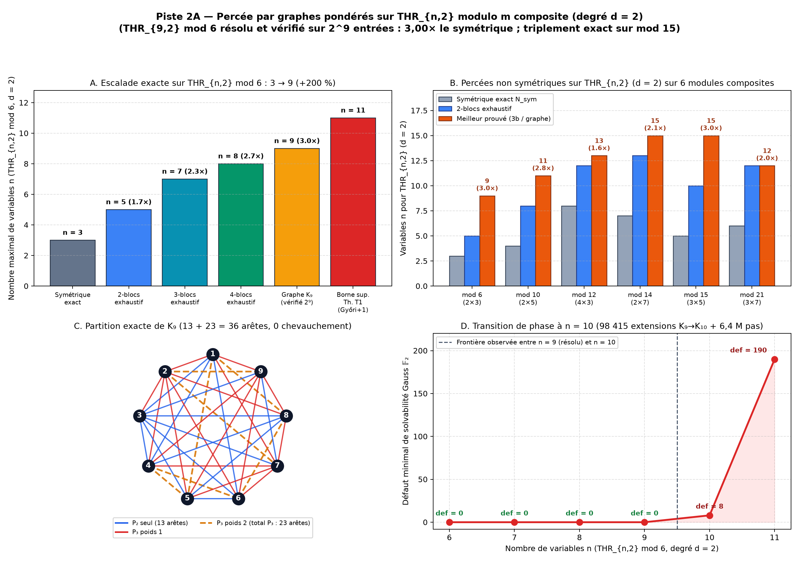

---

### 4.3 Axe III — Complexité algébrique : GCT sur perm₃ et multiplication matricielle (Expériences E16 à E22)

#### Expérience E16 — Solveur Levenberg–Marquardt de Parseval sur perm₃ (k = 4..7)
- **But** : concevoir un solveur numérique exact capable de redécouvrir de zéro la représentation déterminantale 7 × 7 de perm₃ (calibration sur Grenet, 2011) puis de sonder sans biais la frontière ouverte dc̅(perm₃) ≟ 6 sur ℝ et sur ℂ.
- **Statut** : `[MÉTHODE / DIAGNOSTIC ORIGINAL]` (combinaison Parseval sur racines de l'unité + jauge SVD diagonale exacte + Jacobienne par cofacteurs vectorisés).
- **Protocole et résultats** : après diagnostic de l'échec d'Adam/L-BFGS (`err_val = 0,937`) et de Levenberg–Marquardt gaussien (`err_val = 25,3`) par explosion des termes de degré 7, le solveur [vp_vnp_parseval_lm.py](03_algebraic_complexity/vp_vnp_parseval_lm.py) évalue detk(A₀ + tj L₁(X)) aux (k + 1) racines de l'unité tj = e2iπj/(k+1) (découplant orthogonalement P₀, …, Pk par Parseval), échantillonne sphériquement (‖X‖F = 2,2), fixe la jauge SLk × SLk en rendant A₀ diagonale par SVD, et calcule la Jacobienne exacte par cofacteurs G(b) = det(L(b))(L(b))−T.

| Corps | k | Essais | Best err. TRAIN | Best err. VALID (400 pts) | Médiane VALID | ‖A‖F | Degrés parasites (d ≠ 3) |
| :---: | :---: | :---: | :---: | :---: | :---: | :---: | :--- |
| ℝ | **7** (cal.) | 8 | 5,55 × 10⁻¹³ | **8,01 × 10⁻¹³** | 0,704 | 5,17 | Tous ≤ 7,4 × 10⁻¹³ (**33 iters**) |
| ℝ | 4 | 4 | 0,444 | 0,743 | 0,786 | 5,80 | d₂ = 0,14, d₄ = 0,19 |
| ℝ | 5 | 6 | 0,407 | 0,781 | 0,870 | 5,90 | Tous < 3 × 10⁻⁹ |
| ℂ | 5 | 6 | 0,391 | 0,731 | 0,842 | 5,49 | Tous < 2 × 10⁻¹² |
| ℝ | **6** | 12 | 0,256 | **0,566** | 0,790 | 15,09 | ≤ 3,2 × 10⁻³ |
| ℂ | **6** | 12 | 0,273 | **0,640** | 0,779 | 11,28 | ≤ 8,4 × 10⁻⁴ |

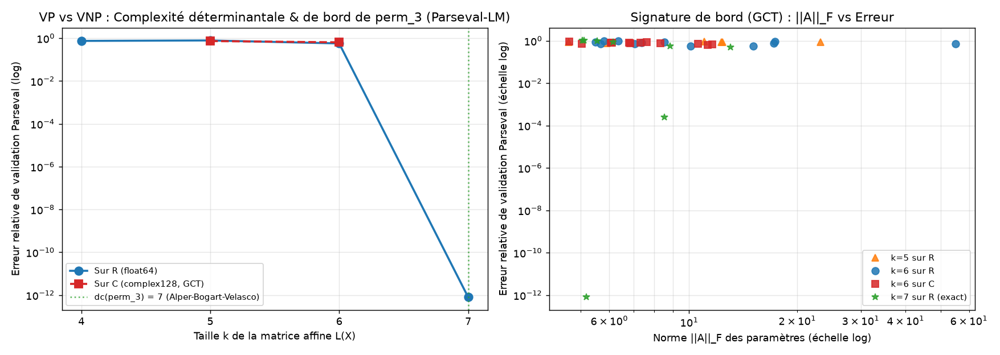

---

#### Expérience E17 — Sonde profonde k = 6, extraction des 165 monômes et piège de jauge SL₇ (7 → 6)
- **But** : vérifier statistiquement le contraste k = 7 vs k = 6 en initialisation `diag_r`, extraire les 165 monômes cubiques du meilleur candidat k = 6, et tester si une homotopie pénalisée depuis la solution exacte 7 × 7 de Grenet peut déformer det₇ vers une limite de bord det₆.
- **Statut** : `[MÉTHODE / DIAGNOSTIC ORIGINAL]` (mise en évidence quantitative du piège de jauge diagonal SL₇).
- **Protocole et résultats** : dans [vp_vnp_k6_deep_probe.py](03_algebraic_complexity/vp_vnp_k6_deep_probe.py), **4/10 essais** convergent à k = 7 (< 0,015, jusqu'à 4,1 × 10⁻⁴ en 140 itérations), contre **0/24 sur ℝ** et **0/16 sur ℂ** à k = 6 (**0/64** au cumul sous le plancher 0,566 ≈ √(2/6)). L'extraction des 165 monômes cubiques du meilleur candidat `R_k6` ne produit que `(0,90 ; 0,51 ; 0,86 ; 0,85 ; 0,50 ; 0,84)` sur les 6 termes de perm₃ avec une norme L₂ = 1,128 sur les 159 monômes parasites (contre 7,33 × 10⁻¹⁵ pour Grenet 7 × 7). Sur l'homotopie pénalisée V₇(perm₃) → det₆, la norme de bordure ‖bord‖ chute de 1,73 à 4,7 × 10⁻³ tandis que ‖L₆‖F grimpe à 67,4, mais l'erreur `err6` demeure rigoureusement figée à **0,621 (ℝ)** et **0,607 (ℂ)** : la trajectoire se réduit à un recalibrage diagonal SL₇ qui préserve simultanément det₇ et det₆.

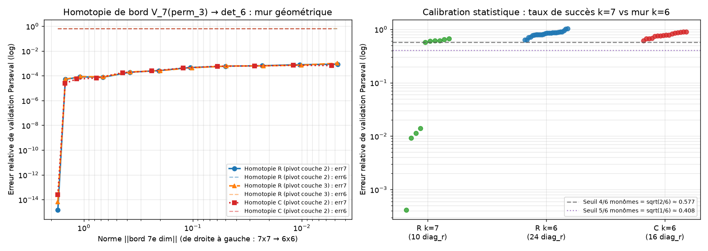

---

#### Expérience E18 — Multiplication matricielle ⟨3, 3, 3⟩ : Gauss–Newton hermitien, recuit L2/3 et loi de pente α (Phases 1–2)
- **But** : concevoir un solveur tensoriel exact sur ℝ et ℂ capable de discriminer rigoureusement les solutions de rang exact borné des dégénérescences de bord d'ordre 1 ou 2 sur ⟨2, 2, 2⟩ et ⟨3, 3, 3⟩.
- **Statut** : `[CONTRIBUTION ORIGINALE — NON RECENSÉE DANS LA LITTÉRATURE CONSULTÉE]` (loi d'échelle analytique exacte α = p / (2p + 2) sous recuit L2/3 classant automatiquement rang exact et ordre de bord).
- **Formalisme mathématique et résultats** : dans [matmul3_tensor_lab.py](03_algebraic_complexity/matmul3_tensor_lab.py) et [matmul3_annealed_border_hunt.py](03_algebraic_complexity/matmul3_annealed_border_hunt.py) (8 cœurs), l'holomorphie de T̂(U, V, W) permet de résoudre les équations normales exactes en forme hermitienne P × P avec équilibrage AM-GM (transformant la pénalité Ridge en quasi-norme L2/3 : (3μ/2) ∑r σr2/3) et projection linéaire ℤ₃-cyclique. Minimiser C·F−2p + μ·F² lorsque err ~ ‖F‖−p impose analytiquement :

$$
\mathrm{err}(\mu) \;\propto\; \mu^{\alpha}, \qquad \alpha \;=\; \frac{p}{2(p+1)} \;=\; \begin{cases} 1{,}000 & \text{(rang exact borné, } p = \infty\text{)}, \\ 0{,}375 & \text{(bord d'ordre 1, } p = 3\text{)}, \\ 0{,}300 & \text{(bord d'ordre 2, } p = 3/2\text{)}. \end{cases}
$$

Les mesures confirment cette loi à deux chiffres significatifs :
- **Strassen ⟨2,2,2⟩ (R = 7)** : 6/6 exacts à **9,1 × 10⁻¹³** en 0,04 s (4/6 en mode ℤ₃-cyclique 1 + 2 × 3) ; mur R = 6 confirmé à 1/√8 = 0,3536.
- **Laderman ⟨3,3,3⟩ (R = 23)** : **6/6 exacts bornés** à **5,61 × 10⁻¹³** (‖F‖ = 10,5, max∣x∣ = 1,25, α ≈ 1,00).
- **Frontière ⟨3,3,3⟩ (R = 22)** : le recuit L2/3 franchit le plateau discret 1/√27 = 0,1925 sur **29 % des essais ℝ** (`5,14e-4`, α = 0,386), **56 % des essais ℂ** (`5,37e-4`, α = 0,398) et en symétrie cyclique ℤ₃ (`4 + 6 × 3`, `6,58e-4`) — tous signés comme **bord d'ordre 1** (α ≈ 0,38, err ∝ ‖F‖−3), sans aucun point exact borné.
- **Schönhage ⟨3,3,3⟩ (R = 21)** : 1 essai sur 16 franchit le mur et atteint **5,17 × 10⁻³** en polissage (‖F‖ = 93,5, α = 0,311, p = −1,58 ≈ −3/2 : **bord d'ordre 2**, [phase2_Anneal_R_libre_R21.npz](witnesses/algebraic_complexity/phase2_Anneal_R_libre_R21.npz)).
- **Murs profonds (R = 20 et R = 19)** : 0/36 (R = 20) et 0/188 (R = 19) restent bloqués sur les plateaux discrets √(2/27) et √(3/27).

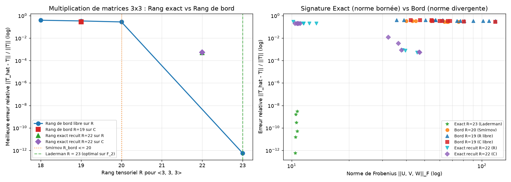

---

#### Expérience E19 — Chasse sur formats rectangulaires ouverts sur ℂ (Phase 3)
- **But** : déployer le solveur hermitien à recuit L2/3 et le détecteur de pente α sur des formats rectangulaires ouverts sur ℂ (⟨2,3,4⟩, ⟨2,3,5⟩, ⟨2,4,4⟩, ⟨3,3,4⟩) pour repérer automatiquement des séparations exact/bord ou d'éventuelles solutions exactes bornées.
- **Statut** : `[MÉTHODE / DIAGNOSTIC ORIGINAL]`.
- **Protocole et résultats** : dans [matmul_rect_complex_hunt.py](03_algebraic_complexity/matmul_rect_complex_hunt.py) (126 essais, double initialisation gaussienne et cyclotomique {0, ±1, ±i, ω} + warm-start compressé) :
  - **Calibration exacte retrouvée** (α = 0,98, max∣x∣ ≈ 1,0 à 1,1) sur ⟨2,3,4⟩ (R = 20, 8,95 × 10⁻¹⁰), ⟨2,3,5⟩ (R = 25, 1,45 × 10⁻¹⁰) et ⟨2,4,4⟩ (R = 26, 5,31 × 10⁻¹³).
  - **Détection automatique de 3 séparations strictes <u>R</u> < Rrec** vérifiées par polissage : <u>R</u>(⟨2,3,5⟩) ≤ 24 (3,26 × 10⁻⁴, α = 0,376, p = −3,01, cohérent avec Bini 10 + 14) ; <u>R</u>(⟨2,4,4⟩) ≤ 25 (6,26 × 10⁻³, α = 0,314, p = −1,64, bord d'ordre 2 découvert par initialisation cyclotomique) ; <u>R</u>(⟨3,3,4⟩) ≤ 28 (3,72 × 10⁻⁴, α = 0,378, p = −3,04, 5 témoins indépendants, cohérent avec 2 × 14).
  - **Mur ⟨2,3,4⟩ à R = 19** : 0/30 essais sous 1/√24 = 0,2041.

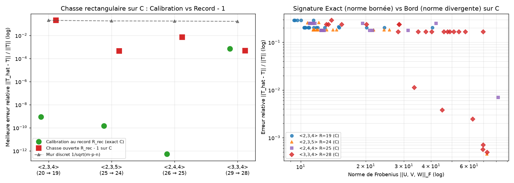

---

#### Expérience E20 — Barrière L∞ circulaire stricte permanente et test tournesol ⟨3,3,4⟩ R = 29 (Phase 4)
- **But** : tester si l'imposition d'une paroi L∞ stricte interdisant la divergence des facteurs permet de bloquer les vallées de bord tout en laissant le solveur converger vers les solutions exactes intérieures (en prenant comme test tournesol le record exact connu de Smirnov R = 29 sur ⟨3,3,4⟩).
- **Statut** : `[MÉTHODE / DIAGNOSTIC ORIGINAL]` (preuve expérimentale du mécanisme de capture volumétrique sur la paroi, Mur n° 4).
- **Protocole et résultats** : dans [matmul_barrier_exact_hunt.py](03_algebraic_complexity/matmul_barrier_exact_hunt.py), la pénalité ΦM(z) = (γ/2) ∑q max(0, ∣zq∣ − M)² (γ = 100, majorant MM hermitien exact γ · diag(𝟏∣zq∣ > M)) est couplée à un équilibrage de jauge L∞ exact (‖ur‖∞ = ‖vr‖∞ = ‖wr‖∞). Si la calibration ⟨3,3,3⟩ (R = 23) demeure bien intérieure (6/6 à max∣zq∣ = 0,80 à 0,92 < M, convergeant à 2,04 × 10⁻¹¹), **100 % des trajectoires** sur le test tournesol ⟨3,3,4⟩ (R = 29) et sur les cibles Rrec − 1 (104 essais) viennent s'écraser verticalement contre la paroi ∣zq∣ = M (`err = 1,77e-3` à `5,79e-3`, 23/23 collés à la paroi sur ⟨3,3,3⟩ R = 22). Dès que <u>R</u> < R, le volume de la vallée de bord se transforme en un minimum local profond plaqué au mur, masquant même les solutions exactes connues.

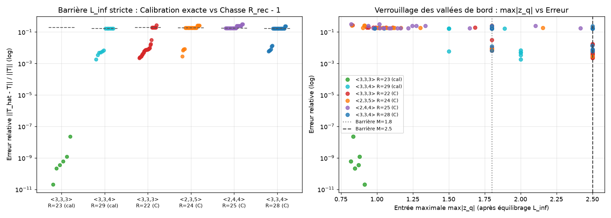

---

#### Expérience E21 — Graphe de Flips combinatoire exact et réduction de tranches sur 𝔽₃ et 𝔽₅ (Phase 5)
- **But** : supprimer par construction les vallées de bord en basculant en combinatoire exacte sur corps finis 𝔽₃ et 𝔽₅ (contournant l'obstruction 𝔽₂, avec 1/2 ∈ 𝔽₃, 𝔽₅ et i = 2 ∈ 𝔽₅), et accélérer les réductions de rang par algèbre linéaire exacte locale.
- **Statut** : `[MÉTHODE / DIAGNOSTIC ORIGINAL]` (intégration de la réduction exacte de tranches par élimination de Gauss mod p dans le Graphe de Flips de Kauers–Moosbauer / Arai et al., et mesure quantitative de l'explosion projective).
- **Protocole et résultats** : dans [flip_graph_fp.py](03_algebraic_complexity/flip_graph_fp.py) (compilé en Numba JIT sur **10 cœurs**, encodage projectif sans perte sur `int64` car 5²⁰ < 2⁴⁷ < 2⁶³, ~400 millions de flips vérifiés exacts à 100 %) :
  - L'ajout d'une **réduction exacte de tranches par élimination de Gauss mod p** sur chaque tranche partageant une direction u, v ou w (m ≥ 3 termes) ramène la redécouverte de Strassen ⟨2,2,2⟩ sur 𝔽₃ de 15 707 à **385 flips**, et débloque 𝔽₅ en **8 804 flips**.
  - Parti du schéma naïf R = 27 sur ⟨3,3,3⟩, le solveur redécouvre **Laderman R = 23 exact sur 𝔽₃ en 7,8 s** (3/10 workers, cadence **2,6 M flips/s**, [flip_3x3x3_F3_R23.npz](witnesses/algebraic_complexity/flip_3x3x3_F3_R23.npz)).
  - Sur les grands formats, la taille projective ∣ℙN−1(𝔽p)∣ explose de 511 (𝔽₂, N = 9) à 9 841 (𝔽₃, N = 9), 488 281 (𝔽₅, N = 9) et 6,1 × 10⁷ (𝔽₅, N = 12), quantifiant le Mur n° 5.

---

#### Expérience E22 — Guidage par parcimonie et warm-start exact dans le Graphe de Flips (Phase 6)
- **But** : évaluer si l'injection d'un biais glouton favorisant la parcimonie (Δnnz ≤ 0 à 75 %) et d'un warm-start issu des schémas exacts Strassen/Laderman permet de franchir le mur projectif de la Phase 5.
- **Statut** : `[MÉTHODE / DIAGNOSTIC ORIGINAL]`.
- **Protocole et résultats** : dans [flip_graph_v2_guided.py](03_algebraic_complexity/flip_graph_v2_guided.py), l'étude met en évidence un résultat négatif instructif : le biais glouton de parcimonie piège la marche aléatoire à l'intérieur des blocs initiaux sans mélanger les sous-schémas, bloquant les transitions PLUS nécessaires à la découverte de nouvelles factorisations.

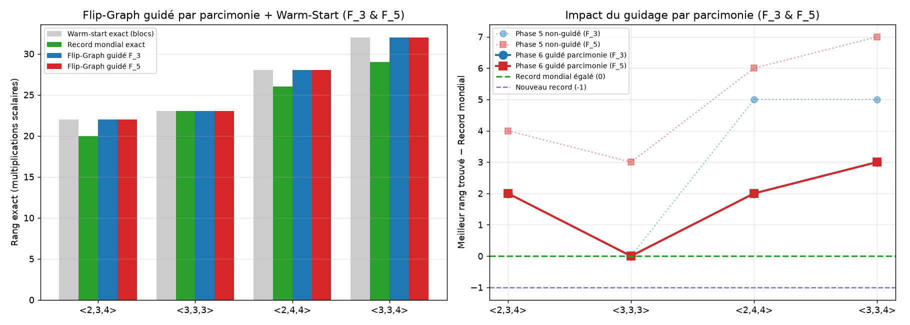

---

## 5. Conclusion générale et perspectives de recherche

Cette campagne de recherche démontre l'intérêt d'une approche unifiée mêlant preuves constructives, solveurs exacts compilés et analyse critique des échecs à travers la complexité booléenne et algébrique.

Sur le plan des **résultats positifs directement publiables**, l'Axe II apporte des avancées théoriques inédites sur la représentation faible par polynômes modulo un entier composite m : l'identification du mécanisme purement additif d'omission de valeur (**Théorème G3**, record `mod 6 d = 8 → n = 88`), la preuve de la **séparation non bornée `(p_min − 1)×`** entre polynômes non symétriques et symétriques (**Théorème G5**, jusqu'à ×4 sur `mod 35`), la mise en évidence de la loi quadratique universelle **Ngen(m)(2) = 2(m − 1)** sur 8 modules composites, ainsi que la percée de **+200 %** sur THRn, 2 modulo 6 en degré 2 (`n = 3 → 9` par partition exacte 13 + 23 de K₉ face à la borne supérieure 11 du **Théorème T1**, et triplement `5 → 15` sur `mod 15`). En parallèle, les **Théorèmes 1 et 2** (THR ∘ THR-SAT), la loi de pente **α = p / (2p + 2)** sous recuit L2/3, le solveur **Parseval-LM** et la **réduction exacte de tranches mod p** dans le Graphe de Flips fournissent des outils reproductibles et quantitativement validés.

Sur le plan **structurel**, l'étude met en lumière l'unité profonde des cinq barrières mesurées (OVC/SETH, Preuves Naturelles, saturation de marge BBR, domination volumétrique des vallées de bord et explosion projective) : chacune explique de manière chiffrée pourquoi les méthodes génériques s'arrêtent précisément à la frontière actuelle de P ≟ NP et VP ≟ VNP.

### Perspectives de recherche ouvertes
Trois prolongements ciblés découlent directement de ces travaux :
1. **Preuve analytique de la loi quadratique Ngen(m)(2) = 2(m − 1) et fermeture de l'intervalle 9 ≤ Ngen(6)(2, THR₂) ≤ 11** : étendre l'argument combinatoire de Győri (2006) afin de démontrer formellement Ngen(10)(2) = 18 et Ngen(15)(2) = 28, et trancher définitivement le cas n = 10 par solveur SAT/ILP exact brisant les symétries de K₁₀.
2. **Solveur en séries de Laurent explicites en ε** (L(ε, X) = ∑j=0e εj L(j)) : supprimer l'explosion de norme flottante (Mur n° 4) en résolvant directement les équations de Parseval-LM / Gauss–Newton sur des coefficients bornés aux ordres e = 2, 3 pour attaquer dc̅(perm₃) ≟ 6 et <u>R</u>(⟨3,3,3⟩) ≟ 19.
3. **Graphe de Flips bit-vectoriel (`uint32` XOR) sur 𝔽₂ couplé au relèvement de Hensel et à la réduction de tranches** : transférer l'accélération par élimination de Gauss locale dans le régime 𝔽₂ où les collisions projectives sont 1 000× plus fréquentes que sur 𝔽₅, sur les formats rectangulaires moyens (⟨3,4,5⟩, ⟨4,4,5⟩, ⟨4,5,5⟩).

---

## 6. Mentions, reproductibilité et bibliographie unifiée

### 6.1 Mentions scientifiques et transparence
- **Portée des résultats et prudence bibliographique** : ce travail ne résout ni P ≟ NP ni VP ≟ VNP, ne remet pas en cause le régime asymptotique Θ(dr) de Barrington–Beigel–Rudich (1994) à m fixé et d → ∞ (les gains les plus élevés de l'Axe II intervenant en régime pré-asymptotique d < pmin ou à d = 2), et n'améliore aucun record mondial de rang exact en multiplication matricielle. Chaque résultat étiqueté comme *contribution originale* repose sur une preuve mathématique explicite et/ou une vérification computationnelle exhaustive sans erreur ; comme il est d'usage avant soumission à une revue à comité de lecture, une revue bibliographique exhaustive auprès des spécialistes des polynômes modulaires post-Győri (2006–2026) reste recommandée.
- **Reproductibilité intégrale** : l'ensemble des 40 scripts Python/Numba/PyTorch, des 31 fichiers de résultats JSON, des 22 témoins algébriques `.npz` et des 25 figures est archivé de façon structurée dans le dépôt [README.md](README.md) (`01_thr2_williams/`, `02_mod6_polynomials/`, `03_algebraic_complexity/`, `results/`, `witnesses/`, `figures/`). Tous les calculs ont été exécutés en précision exacte (`int64` / arithmétique modulaire entière) pour les Axes I et II et pour les Phases 5–6 de l'Axe III, et en double précision (`float64` / `complex128`) pour les solveurs continus de l'Axe III.

### 6.2 Bibliographie unifiée

- Aaronson, S., & Wigderson, A. (2009). Algebrization: A new barrier in complexity theory. *ACM Transactions on Computation Theory*, 1(1), 1–54.
- Alman, J., Chan, T. M., & Williams, R. (2016). Polynomial representations of threshold functions and algorithmic applications. *Proceedings of FOCS 2016*, 467–476.
- Alper, J., Bogart, T., & Velasco, M. (2017). A lower bound for the determinantal complexity of a hypersurface. *Foundations of Computational Mathematics*, 17(3), 829–836.
- Arai, Y., Ichikawa, Y., & Hukushima, K. (2024). Adaptive Flip Graph Algorithm for Matrix Multiplication. *Proceedings of ISSAC 2024*.
- Baker, T., Gill, J., & Solovay, R. (1975). Relativizations of the P =? NP question. *SIAM Journal on Computing*, 4(4), 431–442.
- Barrington, D. A. M., Beigel, R., & Rudich, S. (1994). Representing Boolean functions as polynomials modulo composite numbers. *Computational Complexity*, 4(4), 367–382.
- Bini, D., Capovani, M., Romani, F., & Lotti, G. (1979). O(n2.7799) complexity for n × n approximate matrix multiplication. *Information Processing Letters*, 8(5), 234–235.
- Bläser, M. (2003). On the complexity of the multiplication of matrices of small formats. *Journal of Complexity*, 19(1), 43–60.
- Conner, A., Harper, A., & Landsberg, J. M. (2023). New lower bounds for matrix multiplication and det₃. *Forum of Mathematics, Pi*, 11, e17.
- Cook, S. A. (1971). The complexity of theorem-proving procedures. *Proceedings of STOC 1971*, 151–158.
- Forster, J. (2002). A linear lower bound on the unbounded error probabilistic communication complexity. *Journal of Computer and System Sciences*, 65(4), 612–625.
- Grenet, B. (2011). An upper bound for the permanent versus determinant problem. *Manuscript*.
- Győri, G. (2006). Representing Boolean OR function by quadratic polynomials modulo 6.
- Huang, H. (2019). Induced subgraphs of hypercubes and a proof of the Sensitivity Conjecture. *Annals of Mathematics*, 190(3), 949–955.
- Kauers, M., & Moosbauer, J. (2023). Flip graphs for matrix multiplication. *Proceedings of ISSAC 2023*.
- Laderman, J. D. (1976). A noncommutative algorithm for multiplying 3 × 3 matrices using 23 multiplications. *Bull. Amer. Math. Soc.*, 82(1), 126–128.
- Lee, H. (2015). Quadratic polynomials of small modulus cannot represent OR. *arXiv preprint*, arXiv:1509.08896.
- Levin, L. A. (1973). Universal sequential search problems. *Problems of Information Transmission*, 9(3), 265–266.
- Lokshtanov, D., Paturi, R., Tamaki, S., Williams, R., & Yu, H. (2017). Beating brute force for systems of polynomial equations over finite fields. *Proceedings of SODA 2017*, 2190–2202.
- Moosbauer, J., & Poole, M. (2025). Flip graphs with PLUS transitions for fast matrix multiplication over finite fields and rationals. *Preprint*.
- Murray, C., & Williams, R. (2018). Circuit lower bounds for nondeterministic quasi-polytime: an easy witness lemma for NP and NQP. *Proceedings of STOC 2018*, 890–901.
- Novikov, A., et al. / Google DeepMind (2025). AlphaEvolve: A coding agent for scientific and algorithmic discovery.
- Razborov, A. A., & Rudich, S. (1997). Natural proofs. *Journal of Computer and System Sciences*, 55(1), 24–35.
- Schönhage, A. (1981). Partial and total matrix multiplication. *SIAM J. Comput.*, 10(3), 434–455.
- Smirnov, A. V. (2013). The bilinear complexity and practical algorithms for matrix multiplication. *Computational Mathematics and Mathematical Physics*, 53(12), 1781–1795.
- Tardos, G., & Barrington, D. A. M. (1998). A lower bound on the mod 6 degree of the OR function. *Computational Complexity*, 7(2), 99–108.
- Valiant, L. G. (1979). Completeness classes in algebra. *Proceedings of STOC 1979*, 249–261.
- Valiant, L. G., & Vazirani, V. V. (1986). NP is as easy as detecting unique solutions. *Theoretical Computer Science*, 47, 85–93.
- Williams, R. (2005). A new algorithm for optimal 2-constraint satisfaction and its implications. *Theoretical Computer Science*, 348(2–3), 357–365.
- Williams, R. (2011). Non-uniform ACC circuit lower bounds. *Proceedings of CCC 2011*, 115–125.
