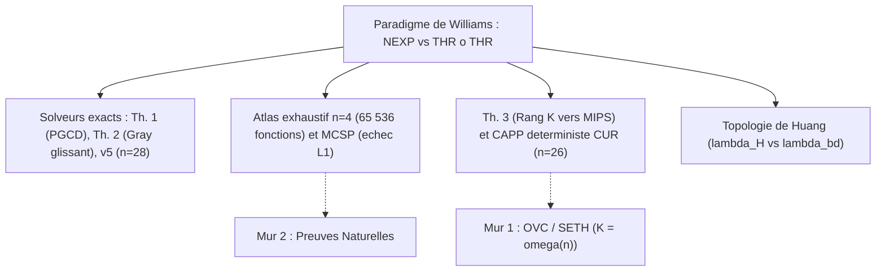
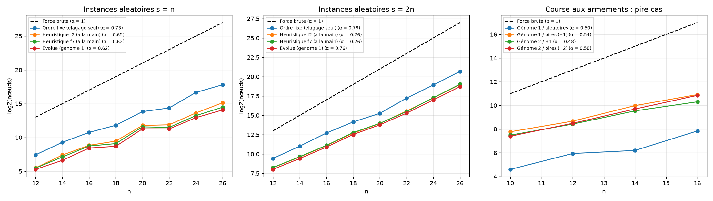
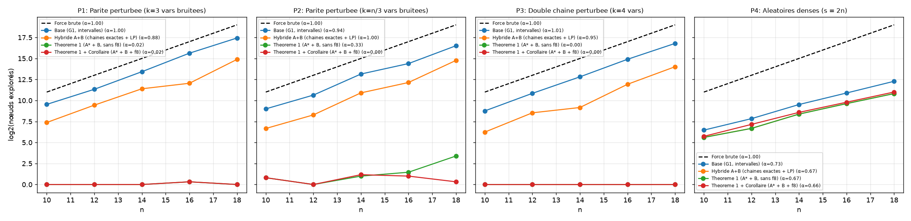
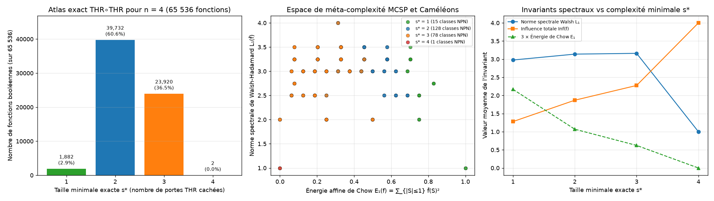
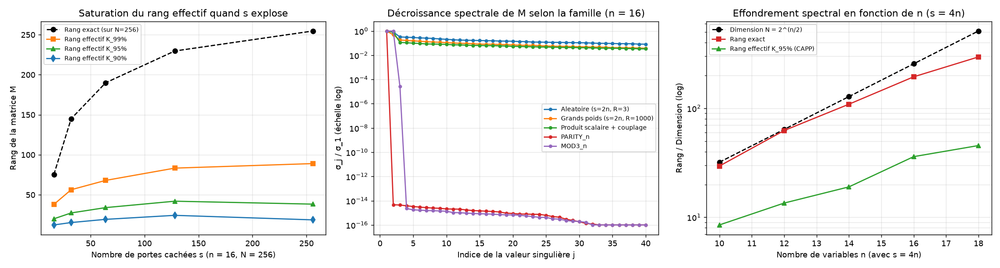

# RAPPORT DE RECHERCHE — Paradigme de Williams, solveurs exacts THR ∘ THR, Atlas n = 4, MCSP, CAPP et topologie de Huang

**Nature du document** : Monographie de recherche théorique et expérimentale (Axe I)  
**Date** : Novembre 2026  
**Dépôt de reproductibilité** : [README.md](README.md)  
**Environnement matériel et logiciel** : Station de travail Windows 16 cœurs CPU, Python 3.14, NumPy 2.3, Numba 0.66 (JIT), Matplotlib 3.11.

---

## Résumé (*Abstract*)

Ce rapport présente les résultats d'une campagne de recherche théorique et computationnelle dédiée à l'algorithmique exponentielle (`THR ∘ THR-SAT`, `#SAT`, `CAPP`) et à l'analyse des barrières structurelles pour les circuits à seuil de profondeur 2 (**THR ∘ THR**) dans le programme de Williams.

La démarche suit un fil continu allant de la calibration des outils polynomiaux classiques (`SYM ∘ AND`, `MQ` sur $`\mathbb{F}_2`$) jusqu'à la conception de solveurs exacts de plus en plus structurés, puis à l'analyse des murs théoriques rencontrés. Sur le plan algorithmique, trois théorèmes exacts sont démontrés et validés : le **Théorème 1** élimine les « pics fantômes hors-réseau » par arrondi au réseau PGCD (faisant chuter l'exposant $`\alpha`$ de $`0{,}94`$ à $`0{,}001`$ sur les parités perturbées) ; le **Théorème 2** introduit une compression bilinéaire à pointeurs glissants en code de Gray qui permet au **Solveur v5 Unifié** de résoudre des instances structurées de `THR ∘ THR-SAT` jusqu'à $n = 28$ (6 instances, soit $`1{,}61`$ milliard d'entrées en $`0{,}502\text{ s}`$, soit $`0{,}083\text{ s}`$/instance, sans modifier le pire cas asymptotique) ; enfin, le **Théorème 3** établit une factorisation bilinéaire exacte de rang $`K \le 2 R \ell s`$ qui accélère `#SAT` sans élagage d'un facteur $`\times 3{,}51`$ à $`\times 6{,}60`$ tout en exposant la réduction vers `MIPS` face à la barrière `OVC/SETH`.

En parallèle, la classification exhaustive exacte des **$`65\,536`$ fonctions booléennes** à $n = 4$ variables (222 classes NPN) prouve l'unicité de $`\mathrm{PARITY}_4`$ et $`\neg\mathrm{PARITY}_4`$ au niveau maximal $`s^{\ast} = 4`$ et mesure l'effondrement à $`0{,}0\,\%`$ des preuves naturelles spectrales $`L_1`$ dès $`s^{\ast} = 2`$ (fonctions courbes *Bent* et caméléons de Chow). Enfin, l'exploration se prolonge vers l'approximation déterministe (`CAPP` par décomposition CUR/Nyström évaluant $n = 26$, soit $`67{,}1\text{ M}`$ d'entrées, en $`0{,}311\text{ s}`$ avec une erreur empirique de $`0{,}04\,\%`$ sur les instances aléatoires testées) et vers une étude spectrale comparative sur l'hypercube $`Q_n`$ entre l'invariant signé de Huang (2019) et le rayon spectral frontière $`\lambda_{\mathrm{bd}}`$.

---

## Table des matières

1. [Problème d'origine, contexte théorique et définitions formelles](#1-problème-dorigine-contexte-théorique-et-définitions-formelles)
   - [1.1 Le paradigme de Williams et les méta-barrières des circuits](#11-le-paradigme-de-williams-et-les-méta-barrières-des-circuits)
   - [1.2 Définition formelle des circuits à seuil de profondeur 2 (THR ∘ THR)](#12-définition-formelle-des-circuits-à-seuil-de-profondeur-2-thr--thr)
2. [Méthodologie, architecture et protocoles de validation](#2-méthodologie-architecture-et-protocoles-de-validation)
3. [Bilan synthétique : résultats établis et obstructions structurelles](#3-bilan-synthétique--résultats-établis-et-obstructions-structurelles)
   - [3.1 Synthèse des résultats établis](#31-synthèse-des-résultats-établis)
   - [3.2 Limites et obstructions structurelles](#32-limites-et-obstructions-structurelles)
4. [Présentation détaillée des expériences, buts, résultats et graphiques (Expériences E1 à E10)](#4-présentation-détaillée-des-expériences-buts-résultats-et-graphiques-expériences-e1-à-e10)
5. [Conclusion générale et perspectives de recherche](#5-conclusion-générale-et-perspectives-de-recherche)
6. [Mentions, reproductibilité et bibliographie](#6-mentions-reproductibilité-et-bibliographie)

---

## 1. Problème d'origine, contexte théorique et définitions formelles

### 1.1 Le paradigme de Williams et les méta-barrières des circuits

La démonstration de bornes inférieures non uniformes pour des classes de circuits booléens s'est historiquement heurtée à trois résultats de méta-complexité. La **barrière de relativisation** (Baker, Gill et Solovay, 1975) montre d'abord que l'existence d'oracles séparateurs ou égalisateurs exclut toute preuve par diagonalisation pure. La **barrière des preuves naturelles** (Razborov et Rudich, 1997) établit ensuite que, sous l'hypothèse d'existence de fonctions pseudo-aléatoires cryptographiques, aucune propriété combinatoire à la fois *constructive* et *large* ne peut séparer des classes riches de circuits. Enfin, la **barrière d'algébrisation** (Aaronson et Wigderson, 2009) indique que même l'extension algébrique des techniques interactives ne suffit pas à séparer les grandes classes de complexité de circuits de petite taille.

Pour contourner ces trois obstacles, le **programme algorithmique de Williams (2011)** inverse la perspective : il prouve des bornes inférieures de circuits non uniformes en concevant des algorithmes de satisfiabilité ($`\mathcal{C}\text{-SAT}`$) ou d'approximation de probabilité d'acceptation ($`\mathrm{CAPP}`$) légèrement plus rapides que la force brute $`2^n`$. La classe $`\mathsf{ACC}^0`$ a ainsi été séparée de $`\mathsf{NEXP}`$ (Williams, 2011) puis de $`\mathsf{NQP}`$ (Murray et Williams, 2018) ; la frontière ouverte immédiatement supérieure est précisément $`\mathrm{THR} \circ \mathrm{THR}`$.

### 1.2 Définition formelle des circuits à seuil de profondeur 2 (THR ∘ THR)

Un circuit booléen $`C \in \mathrm{THR} \circ \mathrm{THR}`$ à $n$ entrées $`x \in \lbrace 0, 1\rbrace^n`$ et $s$ portes cachées est défini par des poids entiers $`W_{k,i} \in \mathbb{Z}`$, des seuils $`t_k \in \mathbb{Z}`$, des poids de sortie réels $`v_k \in \mathbb{R}`$ et un seuil global $`T \in \mathbb{R}`$ tels que :

```math
g_k(x) = \mathbf{1}\!\left[\sum_{i=1}^n W_{k,i} x_i \ge t_k\right] \quad (k = 1, \dots, s), \qquad C(x) = \mathbf{1}\!\left[\sum_{k=1}^s v_k g_k(x) \ge T\right].
```

Le problème $`\mathrm{THR} \circ \mathrm{THR}\text{-SAT}`$ consiste à décider s'il existe $`x \in \lbrace 0, 1\rbrace^n`$ tel que $C(x) = 1$. Le problème **`#SAT`** consiste à compter le nombre exact de tels $x$, et **`CAPP`** (*Circuit Acceptance Probability Problem*) à estimer $`\Pr_x[C(x) = 1]`$ à une erreur additive $`\varepsilon`$ près. Par le théorème de Williams (2011), tout algorithme décidant $`\mathcal{C}\text{-SAT}`$ en temps $`O(2^n / n^{\omega(1)})`$ entraîne la séparation $`\mathsf{NEXP} \not\subseteq \mathcal{C}`$.

---

## 2. Méthodologie, architecture et protocoles de validation



Les **10 expériences (E1 à E10, 13 figures)** s'enchaînent comme une progression raisonnée : on commence par implémenter et calibrer le socle polynomial classique ($`\mathrm{SYM} \circ \mathrm{AND}`$, $`\mathrm{MQ}`$ sur $`\mathbb{F}_2`$), puis on construit de manière itérative cinq générations de solveurs exacts $`\mathrm{THR} \circ \mathrm{THR}\text{-SAT}`$ (v1 à v5) en répondant à chaque fois à l'échec précis de la génération précédente. Une fois atteintes les limites de l'élagage, l'étude change d'angle à trois reprises : classification exhaustive de l'espace booléen à $n = 4$ variables, factorisation bilinéaire exacte pour `#SAT`, puis approximation déterministe (`CAPP` par CUR/Nyström) et analyse spectrale sur l'hypercube $`Q_n`$.

Chaque solveur booléen (plus de $`1\,100`$ instances $`\mathrm{THR} \circ \mathrm{THR}`$, $60$ instances $`\mathrm{MQ}`$) est validé exactement contre la force brute, sans aucune approximation, en distinguant les étapes de calibration sur des algorithmes de référence des méthodes et analyses développées dans cette étude.

---

## 3. Bilan synthétique : résultats établis et obstructions structurelles

### 3.1 Synthèse des résultats établis

| Résultat | Nature | Énoncé clé / Vérification |
| :--- | :--- | :--- |
| **Théorèmes 1 et 2** (réseau PGCD + Gray glissant) et Solveur v5 | **Théorèmes et algorithme exact** | Élimination des pics fantômes ($`\alpha`$ : $`0{,}94 \to 0{,}001`$) ; **$n = 28$ (6 instances, $`1{,}61\text{ Md}`$ entrées) en $`0{,}502\text{ s}`$** (structure bilinéaire, sans modifier le pire cas asymptotique) |
| **Atlas exact $n = 4$** ($`65\,536`$ fonctions) et caméléons de Chow | **Classification exhaustive** | Unicité de $`\mathrm{PARITY}_4`$ à $`s^{\ast} = 4`$ ; certification $`L_1 = \mathbf{0{,}0\,\%}`$ pour $`s^{\ast} \ge 3`$ (fonctions *Bent* à $`s^{\ast} = 2`$) |
| **Théorème 3** (rang $`K \le 2 R \ell s`$) et **CAPP déterministe CUR** | **Théorème et algorithme déterministe** | `#SAT` accéléré $`\times 3{,}51`$–$`6{,}60`$ ; CAPP déterministe $n = 26$ en $`0{,}311\text{ s}`$ (erreur **empirique** $`0{,}04\,\%`$ sur instances testées, sans garantie en pire cas) |

### 3.2 Limites et obstructions structurelles

Aucune séparation $`\mathsf{NEXP} \not\subseteq \mathrm{THR} \circ \mathrm{THR}`$ n'est obtenue : les accélérations pratiques jusqu'à $n = 28$ exploitent des structures spécifiques sans briser le pire cas asymptotique pour des circuits denses génériques de taille polynomiale $`s = n^c`$. Deux murs structurels précisément mesurés expliquent cette frontière :

| # | Mur structurel | Contexte | Manifestation quantitative mesurée |
| :---: | :--- | :--- | :--- |
| **1** | **Barrière OVC / SETH** | Théorème 3 (`#SAT` / MIPS) | La factorisation bilinéaire compresse $`\mathrm{THR} \circ \mathrm{THR}\text{-SAT}`$ en MIPS en temps $`O^{\ast}(2^{n/2})`$, mais en dimension $`K = \omega(n)`$ résoudre MIPS générique en $`N^{2-\varepsilon}`$ réfuterait SETH (Williams, 2005). |
| **2** | **Barrière des Preuves Naturelles** | Atlas $n = 4$ / MCSP | Dès $`s^{\ast} = 2`$ portes, les fonctions *Bent* ($`L_1 = 4{,}000`$) et les caméléons de Chow ($`E_1 = 0{,}000`$) reproduisent les signatures spectrales des fonctions aléatoires, réduisant la séparation $`L_1`$ à $`0{,}0\,\%`$. |

---

## 4. Présentation détaillée des expériences, buts, résultats et graphiques (Expériences E1 à E10)

#### Expérience E1 — Évaluation globale de SYM ∘ AND par transformée zêta

Avant d'attaquer la classe ouverte $`\mathrm{THR} \circ \mathrm{THR}`$, il est indispensable de disposer d'un point de référence concret illustrant comment la méthode polynomiale de Williams (2011) bat la force brute sur des circuits plus simples. Cette première expérience de calibration ([williams_demo.py](src/williams_demo.py)) met donc en œuvre l'évaluation globale de circuits $`\mathrm{SYM} \circ \mathrm{AND}`$ : chaque porte $`\mathrm{AND}`$ de largeur $k$ est développée en polynôme multilinéaire, puis évaluée simultanément sur les $`2^n`$ entrées au moyen d'une transformée zêta rapide sur le treillis booléen. La complexité passe ainsi de $`O(s \cdot 2^n)`$ (évaluation naïve porte par porte) à $`O(n \cdot 2^n + s \cdot 2^k)`$. Pour $n = 18$ ($`262\,144`$ entrées) et $k = 6$, l'exactitude est confirmée sur toute la plage $`s \in [100, 20\,000]`$, avec une accélération mesurée de $`\times 331{,}4`$ ($`0{,}204\text{ s}`$ contre $`67{,}717\text{ s}`$ pour $`s = 20\,000`$ portes).


---

#### Expérience E2 — Méthode polynomiale complète pour MQ sur 𝔽₂ (LPTWY 2017)

La transformée zêta de l'Expérience E1 accélère le facteur $s$, mais laisse intact le coût $`2^n`$ en nombre de variables. Pour franchir véritablement la barrière exponentielle $`2^n`$, il faut comprimer l'espace des entrées lui-même : c'est précisément ce qu'accomplit l'algorithme de référence de Lokshtanov, Paturi, Tamaki, Williams et Yu (SODA 2017) pour les systèmes quadratiques multivariés $`\mathrm{MQ}`$ sur $`\mathbb{F}_2^n`$. Dans cette seconde calibration ([polymethod_mq.py](src/polymethod_mq.py)), les variables sont partitionnées en $x = (y, z)$ avec $`\vert z\vert = \ell`$, le système est comprimé par un polynôme probabiliste de Razborov–Smolensky de degré $`\le 2r`$, puis la sommation $`F(y) = \sum_{z \in \lbrace 0,1\rbrace^\ell} R(y, z) \pmod 2`$ abaisse le degré effectif à $`D \le 2r - \ell`$. L'évaluation rapide s'opère alors par transformée de Möbius couplée à l'isolation de Valiant–Vazirani (1986). Sur $60$ instances indépendantes ($`n \in [10, 18]`$), l'accord avec la force brute est de $60/60$. À $n = 24$, le ratio d'évaluations chute à $`0{,}14`$ ($`4{,}61\text{ M}`$ contre $`33{,}55\text{ M}`$, soit $`2{,}39\text{ s}`$ contre $`7{,}14\text{ s}`$) et la pente calibrée confirme l'exposant asymptotique $`2^{0{,}901\,n}`$.


---

#### Expérience E3 — Solveur exact par intervalles, génome de branchement et co-évolution adversariale

Contrairement à $`\mathrm{SYM} \circ \mathrm{AND}`$ ou $`\mathrm{MQ}`$ sur $`\mathbb{F}_2`$, les portes à seuil $`\mathrm{THR}`$ ne possèdent pas de représentation polynomiale exacte de bas degré sur un corps fini. Pour attaquer $`\mathrm{THR} \circ \mathrm{THR}\text{-SAT}`$ sans renoncer à l'exactitude, nous changeons donc d'approche et construisons ([thr2_lab.py](src/thr2_lab.py), [run_lab.py](src/run_lab.py), banc unitaire [test_thr2.py](src/test_thr2.py)) un solveur *Branch-and-Bound* compilé en Numba qui maintient un encadrement exact $`[\mathrm{lo}_k, \mathrm{hi}_k]`$ pour chaque porte cachée. L'enjeu est de mesurer l'exposant empirique $`\alpha`$ (coût $`\propto 2^{\alpha n}`$) lorsque la variable de branchement est sélectionnée par un score linéaire combinant $7$ descripteurs structurels $`(f_1, \dots, f_7)`$, pondérés par un vecteur $`\theta \in \mathbb{R}^7`$ optimisé par stratégie évolutionnaire $`(\mu + \lambda)`$ sur des instances **UNSAT de justesse** ($`T = \max_x \sum_k v_k g_k(x) + 1`$).

Sur des instances aléatoires ($n = 12..26$), le génome évolué $`\theta^{(1)} = [-1{,}04;\; -0{,}06;\; +0{,}09;\; +1{,}43;\; -0{,}57;\; +0{,}84;\; +0{,}32]`$ (privilégiant $`f_4`$ et $`f_6`$) abaisse l'exposant à $`\alpha = 0{,}620`$ pour $s = n$ (contre $`0{,}728`$ à ordre fixe et $`1{,}000`$ en force brute), avant de remonter à $`\alpha = 0{,}757`$ lorsque la densité double à $s = 2n$. Soumis à une co-évolution adversariale ($n = 10..16$, $250$ mutations locales par instance), l'adversaire multiplie par un facteur $`\sim 8`$ le nombre de nœuds tout en laissant l'exposant se stabiliser autour de $`\alpha \approx 0{,}578`$.



---

#### Expérience E4 — Banc d'essai adversarial structuré et solveur hybride exact (Primitives A et B)

La stabilité observée en co-évolution aléatoire dans l'Expérience E3 ne garantit rien contre des circuits construits algébriquement pour déjouer l'élagage par intervalles. Pour éprouver le comportement pire cas du solveur, nous introduisons dans [adversarial_suite.py](src/adversarial_suite.py) quatre familles structurées : **F1** ($`\mathrm{PARITY}_n`$), **F2** ($`\mathrm{MOD3}_n`$), **F3** ($`\mathrm{WEIGHTED\text{-}PARITY}`$) et **F4** ($`\mathrm{LARGE\text{-}WEIGHTS}`$, $R = 1000$). Le verdict est immédiat : l'élagage par intervalles pur s'effondre totalement sur F1–F3 ($`\alpha = 1{,}000`$; $`1{,}001`$; $`0{,}964`$) parce qu'il majore chaque porte indépendamment, ignorant que deux portes colinéaires de signes opposés ne peuvent pas être simultanément actives dans certaines plages de somme.

Pour corriger cette myopie porte par porte, [hybrid_thr2.py](src/hybrid_thr2.py) (validé exact sur $136/136$ instances) combine deux primitives de couplage exactes : la **Primitive A**, qui regroupe les portes colinéaires en chaînes 1D exactement évaluables, et la **Primitive B**, qui construit une enveloppe lagrangienne convexe paramétrée par $`\lambda \in [0, 1]^{\vert \mathcal{U}\vert}`$ et resserrée par $5$ pas de sous-gradient projeté. Le tableau d'ablation ci-dessous montre la complémentarité des deux primitives : la Primitive A effondre instantanément F1–F3 à un unique nœud ($`\alpha = 0{,}000`$), tandis que la Primitive B abaisse l'exposant sur les circuits aléatoires denses et à grands poids.

| Jeu de test | Base (G1) | Hybride A (chaînes 1D) | Hybride B (LP couplé) | Hybride A+B ($`G_{\mathrm{hyb}}`$) |
| :--- | :---: | :---: | :---: | :---: |
| Aléatoires $s = n$ ($n = 12..24$) | $`\alpha = 0{,}626`$ ($`0{,}12\text{ s}`$) | $`\alpha = 0{,}627`$ ($`0{,}20\text{ s}`$) | $`\alpha = 0{,}576`$ ($`0{,}20\text{ s}`$) | $`\alpha = 0{,}566`$ ($`0{,}30\text{ s}`$) |
| Aléatoires $s = 2n$ ($n = 12..24$) | $`\alpha = 0{,}742`$ ($`2{,}85\text{ s}`$) | $`\alpha = 0{,}743`$ ($`6{,}59\text{ s}`$) | $`\alpha = 0{,}674`$ ($`1{,}33\text{ s}`$) | $`\alpha = 0{,}670`$ ($`1{,}68\text{ s}`$) |
| F1 : $`\mathrm{PARITY}_n`$ ($n = 10..18$) | $`\alpha = 1{,}000`$ ($`2^{17{,}6}`$) | $`\alpha = 0{,}000`$ (1 nœud) | $`\alpha = 1{,}001`$ ($`2^{15{,}6}`$) | $`\alpha = 0{,}000`$ (1 nœud) |
| F2 : $`\mathrm{MOD3}_n`$ ($n = 10..18$) | $`\alpha = 1{,}001`$ ($`2^{17{,}2}`$) | $`\alpha = 0{,}000`$ (1 nœud) | $`\alpha = 1{,}002`$ ($`2^{15{,}4}`$) | $`\alpha = 0{,}000`$ (1 nœud) |
| F3 : $`\mathrm{WEIGHTED\text{-}PARITY}`$ | $`\alpha = 0{,}964`$ ($`2^{15{,}8}`$) | $`\alpha = 0{,}000`$ (1 nœud) | $`\alpha = 0{,}875`$ ($`2^{12{,}9}`$) | $`\alpha = 0{,}000`$ (1 nœud) |
| F4 : $`\mathrm{LARGE\text{-}WEIGHTS}`$ ($s = 2n$) | $`\alpha = 0{,}661`$ ($`2^{12{,}4}`$) | $`\alpha = 0{,}661`$ ($`2^{12{,}4}`$) | $`\alpha = 0{,}639`$ ($`2^{12{,}0}`$) | $`\alpha = 0{,}639`$ ($`2^{12{,}0}`$) |


---

#### Expérience E5 — Théorème 1 (Projection 1D, réseau PGCD et pics fantômes) et duel industriel (Solveur v4)

La victoire de la Primitive A sur F1–F3 dans l'Expérience E4 repose toutefois sur une hypothèse fragile : la colinéarité *exacte* des vecteurs de poids. Il suffit de perturber quelques poids de $`\pm 1`$ dans une parité pour briser instantanément cette colinéarité (désactivant la Primitive A) tout en conservant le saut d'intégralité qui met en échec la relaxation convexe de la Primitive B. Pour surmonter ce verrou, nous démontrons et validons dans [theorem_a_star.py](src/theorem_a_star.py) ($216/216$ tests exacts) une généralisation tolérante aux résidus qui exploite l'arithmétique du réseau PGCD :

> **Théorème 1 (Majoration par projection 1D, enveloppe de résidu et réseau PGCD).** Soit $`F \subseteq \lbrace 1, \dots, n\rbrace`$ l'ensemble des variables libres, $`G \subseteq \mathcal{U}`$ un cluster de portes indécises, $`w \in \mathbb{Z}^n`$ un vecteur de référence porté par $F$, $`L(x) = \sum_{i \in F} w_i x_i \in [L_{\min}, L_{\max}]`$ et $`g = \gcd_{i \in F,\, w_i \ne 0}(\vert w_i\vert)`$. En posant $`\delta_h^{\max} = \sum_{i \in F} \max(0, W_{h,i} - w_i)`$, $`\delta_h^{\min} = \sum_{i \in F} \min(0, W_{h,i} - w_i)`$, et le seuil décalé et arrondi au réseau $`g\mathbb{Z}`$ :

```math
\tilde{\tau}_h^{\ast} = g \cdot \left\lceil \frac{\tau_h^{\ast}}{g} \right\rceil, \qquad \tau_h^{\ast} = \begin{cases} t_h - S_h - \delta_h^{\max} & \text{si } v_h > 0, \\ t_h - S_h - \delta_h^{\min} & \text{si } v_h < 0, \end{cases}
```

> alors, pour toute complétion booléenne $`x \in \lbrace 0, 1\rbrace^n`$ :

```math
\sum_{h \in G} v_h g_h(x) \;\le\; \max_{L \in [L_{\min}, L_{\max}]} \sum_{h \in G} v_h \, \mathbf{1}\!\left[L \ge \tilde{\tau}_h^{\ast}\right].
```

*Preuve.* De $`S_h(x) = S_h + L(x) + \delta_h(x)`$ avec $`\delta_h^{\min} \le \delta_h(x) \le \delta_h^{\max}`$ et $`L(x) \in g\mathbb{Z}`$, il découle $`L(x) \ge \tau_h^{\ast} \iff L(x) \ge \tilde{\tau}_h^{\ast}`$. Si $`v_h > 0`$, alors $`g_h(x) \le \mathbf{1}[L(x) \ge \tilde{\tau}_h^{\ast}]`$ ; si $`v_h < 0`$, alors $`g_h(x) \ge \mathbf{1}[L(x) \ge \tilde{\tau}_h^{\ast}]`$, ce qui renverse l'inégalité après multiplication par $`v_h`$. La sommation sur $`h \in G`$ conclut. ■

*Corollaire 1.* Si les perturbations n'affectent qu'au plus $K$ variables, le branchement prioritaire selon le descripteur de discordance $`f_8(i) = \sum_r \sum_{h \in G_r} \vert v_h\vert \cdot \vert W_{h,i} - w_i^{(r)}\vert`$ garantit dans le pire cas au plus $`2^{K+1} - 1`$ nœuds indépendamment de $n$.

Le rôle de l'arrondi au réseau $`g\mathbb{Z}`$ se révèle spectaculaire sur la famille **P2** (parité de poids $`w_i = 2`$ perturbée de $`\pm 1`$ sur $k = n/3$ variables) : sans cet arrondi, les seuils décalés tombent sur des entiers impairs alors que la somme libre reste toujours paire ($`2\mathbb{Z}`$), créant des « pics fantômes hors-réseau » qui font exploser l'arbre à $`2^{12{,}5}`$ nœuds à $n = 18$. L'arrondi exact par $g = 2$ supprime ces pics fantômes et ramène l'exploration à $`2^{0{,}3}`$ nœuds ($`\alpha = 0{,}001`$) :

| Famille adversariale ($n = 10..18$) | Base (G1) | Hybride A+B | Th. 1 sans $`f_8`$ | Th. 1 + Corollaire ($`A^{\ast} + B + f_8`$) |
| :--- | :---: | :---: | :---: | :---: |
| **P1** : Parité perturbée ($k = 3$) | $`\alpha = 1{,}005`$ | $`\alpha = 0{,}881`$ | $`\alpha = 0{,}016`$ | $`\alpha = 0{,}016`$ ($`2^{0{,}0}`$) |
| **P2** : Parité perturbée ($k = n/3$) | $`\alpha = 0{,}939`$ | $`\alpha = 1{,}003`$ | $`\alpha = 0{,}331 \approx 1/3`$ | $`\alpha = 0{,}001`$ ($`2^{0{,}3}`$) |
| **P3** : Double chaîne perturbée ($k = 4$) | $`\alpha = 1{,}006`$ | $`\alpha = 0{,}947`$ | $`\alpha = 0{,}000`$ | $`\alpha = 0{,}000`$ ($`2^{0{,}0}`$) |
| **P4** : Aléatoires denses ($s = 2n$) | $`\alpha = 0{,}734`$ | $`\alpha = 0{,}667`$ | $`\alpha = 0{,}670`$ | $`\alpha = 0{,}659`$ |

Pour situer ces gains face à des références industrielles, le **Solveur v4** ([industrial_and_orthogonal.py](src/industrial_and_orthogonal.py), $432/432$ tests exacts) assemble la propagation Pseudo-Booléenne inverse, des coupes surrogées, $`A^{\ast}`$ adaptatif, la Primitive B et des feuilles en code de Gray ($`u_{\mathrm{leaf}} = 8`$). Il surpasse alors un énumérateur en code de Gray compilé (`libFES`, $`0{,}5\text{ ns}`$/point) et un solveur Pseudo-Booléen (`CDCL-PB`) d'un facteur **$`\times 48`$ sur Gray** et **$`\times 79`$ sur PB** sur les blocs orthogonaux **O1** ($n = 20$, $`0{,}001\text{ s}`$, $13$ nœuds). Sur les circuits aléatoires denses $s = 2n$ à $n = 26$, v4 devance PB (**$`3{,}96\text{ s}`$ contre $`5{,}66\text{ s}`$**) et rejoint Gray ($`3{,}82\text{ s}`$) avec une pente asymptotique nettement inférieure ($`\alpha \approx 0{,}745`$ contre $`1{,}000`$).




---

#### Expérience E6 — Théorème 2 (Compression bilinéaire à pointeurs glissants en code de Gray) et Solveur v5 Unifié

Le duel de l'Expérience E5 met en lumière la limite suivante : sur des circuits aléatoires très denses ($s = 4n$) dépourvus de structure de clusters, le surcoût de l'arbre de branchement finit par annuler le gain d'élagage. Pour surmonter ce régime, nous concevons dans [step2_sliding_gray.py](src/step2_sliding_gray.py) ($216/216$ tests exacts) un algorithme sans arbre qui partitionne les variables en $`x = (x_L, x_R) \in \lbrace 0, 1\rbrace^{n-\ell} \times \lbrace 0, 1\rbrace^\ell`$ et découpe $`\lbrace 0, 1\rbrace^\ell`$ en $`P = 2^{\ell-b}`$ paquets $`\mathcal{R}_p`$ de taille $`B = 2^b`$ portés par les variables les plus légères :

> **Théorème 2 (Compression bilinéaire par sous-cubes et pointeurs glissants en code de Gray).** En posant $`\tau_{k,p} = t_k - \max_{\mathcal{R}_p} B_k`$ (si $`v_k > 0`$) et $`\tau_{k,p} = t_k - \min_{\mathcal{R}_p} B_k`$ (si $`v_k < 0`$), alors pour tout $`(x_L, x_R) \in \lbrace 0, 1\rbrace^{n-\ell} \times \mathcal{R}_p`$ :

```math
M(x_L, x_R) \;\le\; U(x_L, p) := \sum_{k=1}^s v_k \, \mathbf{1}\!\left[A_k(x_L) \ge \tau_{k,p}\right].
```

En triant les $P$ seuils $`\tau_{k, \pi_k(0)} \le \dots \le \tau_{k, \pi_k(P-1)}`$ de chaque porte, le parcours des $`2^{n-\ell}`$ états de $`x_L`$ en code de Gray maintient exactement le vecteur $`(U(x_L, 0), \dots, U(x_L, P-1))`$ au moyen d'un unique pointeur monotone $`q_k \in \lbrace 0, \dots, P\rbrace`$ par porte. À $n = 26$ (8 instances), cette compression ($`\ell = 8`$, facteur $`\times 256`$) résout $s = 2n$ en $`1{,}087\text{ s}`$ ($`\times 11{,}1`$ sur Gray compilé) et $s = 4n$ en $`2{,}520\text{ s}`$ ($`\times 8{,}8`$ sur Gray et $`\times 18{,}3`$ sur v4).

L'unification des Théorèmes 1 et 2 au sein du **Solveur v5 Unifié** ([unified_v5_and_poly_top.py](src/unified_v5_and_poly_top.py), $240/240$ tests exacts, portant le cumul sans erreur à plus de $`1\,100`$ instances) vérifie exactement $`N_{\mathrm{hot}} = 0{,}0`$ en mode *Zero-Gap* ($B = 1$) et résout **6 instances à $n = 28$ ($`1{,}61`$ milliard d'entrées) en $`0{,}502\text{ s}`$** ($`0{,}083\text{ s}`$/instance avec $`B = 8, \ell = 9`$), tout en conservant un temps $`< 0{,}001\text{ s}`$ sur F1, F2, P2, P3 et O1. L'expression du coût asymptotique $`T = O(s \cdot 2^\ell + s \cdot P \log P) + 2^{n-\ell} \cdot O(s + \sum \bar{\Delta} q_k) + N_{\mathrm{hot}} \cdot O(s \cdot B)`$ montre cependant la limite de cette voie : atteindre le régime super-logarithmique $`\ell = \omega(\log n)`$ exigé par le théorème de Williams requiert une évaluation algébrique groupée de la condition $`U(x_L, p) \ge T`$.


---

#### Expérience E7 — Atlas exhaustif exact THR ∘ THR à n = 4 et méta-complexité (MCSP / Preuves Naturelles)

Face à la difficulté de casser $`2^n`$ dans le pire cas par des solveurs SAT, il est naturel de se tourner vers l'autre versant du problème : les invariants structurels ou spectraux des fonctions calculées par $`\mathrm{THR} \circ \mathrm{THR}`$ permettent-ils de distinguer les fonctions simples des fonctions complexes ? Pour répondre sans biais statistique, nous cartographions intégralement dans [exact_thr2_atlas.py](src/exact_thr2_atlas.py) et [mcsp_metacomplexity.py](src/mcsp_metacomplexity.py) l'ensemble des **$`65\,536`$ fonctions booléennes** à $n = 4$ variables ($222$ classes NPN) selon leur taille minimale exacte $`s^{\ast}_{\mathrm{THR}\circ\mathrm{THR}}(f)`$, puis nous évaluons le pouvoir séparateur de trois descripteurs classiques : la norme de Walsh $`L_1`$, l'énergie de Chow $`E_1`$ et l'influence totale $`\mathrm{Inf}(f)`$.

| Taille minimale exacte $`s^{\ast}(f)`$ | Fonctions (sur $`65\,536`$) | Proportion | Classes NPN (sur $222$) | Walsh $`L_1`$ moy. (max) | Énergie de Chow $`E_1`$ moy. (min) | Influence $`\mathrm{Inf}(f)`$ moy. (max) |
| :---: | :---: | :---: | :---: | :---: | :---: | :---: |
| $`s^{\ast} = 1`$ ($`\mathrm{LTF}_4`$, Muroga) | $`1\,882`$ | $`2{,}87\,\%`$ | $15$ | $`2{,}977`$ ($`3{,}500`$) | $`0{,}723`$ ($`0{,}688`$) | $`1{,}279`$ ($`1{,}500`$) |
| $`s^{\ast} = 2`$ | $`39\,732`$ | $`60{,}63\,\%`$ | $128$ | $`3{,}139`$ ($`4{,}000`$) | $`0{,}356`$ ($`0{,}000`$) | $`1{,}868`$ ($`3{,}000`$) |
| $`s^{\ast} = 3`$ | $`23\,920`$ | $`36{,}50\,\%`$ | $78$ | $`3{,}161`$ ($`4{,}000`$) | $`0{,}207`$ ($`0{,}000`$) | $`2{,}275`$ ($`3{,}500`$) |
| $`s^{\ast} = 4`$ ($`\mathrm{PARITY}_4, \neg\mathrm{PARITY}_4`$) | $2$ | $`0{,}003\,\%`$ | $1$ | $`1{,}000`$ ($`1{,}000`$) | $`0{,}000`$ ($`0{,}000`$) | **$`4{,}000`$ ($`4{,}000`$)** |

Cet atlas révèle trois phénomènes nets. D'abord, $`99{,}997\,\%`$ des fonctions à $4$ variables se calculent avec au plus $3$ portes, seules $`\mathrm{PARITY}_4`$ (`0x6996`) et $`\neg\mathrm{PARITY}_4`$ (`0x9669`) exigeant $`s^{\ast} = 4`$. Ensuite, les **3 classes NPN de fonctions courbes (*Bent*)** (`0x0356`, `0x036a`, `0x177e`), qui atteignent le maximum absolu $`L_1(\hat{f}) = 4{,}000`$, sont toutes réalisables dès $`s^{\ast} = 2`$ ; tout critère spectral de la forme $`L_1(\hat{f}) > B`$ certifie donc $`0{,}0\,\%`$ des fonctions de taille $`s^{\ast} \ge 3`$ — une manifestation directe, à petite échelle, du Mur n° 2 (Preuves Naturelles). Enfin, dès $`s^{\ast} = 2`$, la classe `0x17e8` vérifie $`E_1(f) = 0{,}000`$ (un « caméléon de Chow » orthogonal à toutes les fonctions affines), alors que seule l'influence maximale croît strictement par paliers : $`\max_{s^{\ast} = k} \mathrm{Inf}(f) = 1{,}50;\; 3{,}00;\; 3{,}50;\; 4{,}00`$.



---

#### Expérience E8 — Théorème 3 (Factorisation bilinéaire de rang K ≤ 2 R ℓ s), `#SAT` sans élagage et barrière OVC/SETH

L'Expérience E6 a montré que la compression bilinéaire pouvait dépasser les arbres de branchement, mais au prix d'un élagage dépendant du seuil $T$ (inapplicable tel quel au comptage exact `#SAT`). En poussant la logique de décomposition bilinéaire jusqu'à son terme algébrique, nous montrons dans [rank_k_bilinear_thr2.py](src/rank_k_bilinear_thr2.py) (vérifié bit-à-bit sur $36/36$ circuits complets) que la matrice d'évaluation entière $`M_{x_L, x_R}`$ possède en réalité un rang réel polynomial, sans aucun élagage :

> **Théorème 3 (Factorisation bilinéaire exacte de rang polynomial).** Pour tout circuit $`\mathrm{THR} \circ \mathrm{THR}`$ à poids inférieurs dans $`\lbrace -R, \dots, R\rbrace`$ et poids du sommet $`v_k \in \mathbb{R}`$ arbitraires, la matrice complète $`M_{x_L, x_R} = \sum_{k=1}^s v_k g_k(x_L, x_R) \in \mathbb{R}^{2^{n-\ell} \times 2^\ell}`$ se factorise exactement en :

```math
M_{x_L, x_R} \;=\; \mathrm{base}(x_L) \;+\; (U \cdot V)_{x_L, x_R}, \qquad \mathrm{rank}_{\mathbb{R}}(M - \mathrm{base}\cdot\mathbf{1}^T) \;\le\; K = \sum_{k=1}^s (D_k - 1) \;\le\; 2 R \ell s \;\ll\; 2^\ell,
```

> où $`U \in \lbrace 0, 1\rbrace^{2^{n-\ell} \times K}`$ est creuse ($`\le s`$ uns par ligne) et $`V \in \mathbb{R}^{K \times 2^\ell}`$ encode les marches suffixes des valeurs distinctes $`\mathcal{B}_k = \lbrace b_{k,0} < \dots < b_{k, D_k - 1}\rbrace`$ de $`B_k(x_R)`$.

L'effondrement du rang est massif : à $n = 24$ ($`N = 4\,096`$, $s = n$, $R = 3$), le rang bilinéaire tombe à $`K = 302{,}8`$ (compression $`\times 13{,}53`$). Maintenue différentiellement en code de Gray sur `#SAT` sans élagage ($n = 22$, $s = 20..200$), cette factorisation accélère l'évaluation complète d'un facteur **$`\times 3{,}51`$ à $`\times 6{,}60`$**. Mais ce théorème éclaire surtout le verrou théorique fondamental : pour $`\ell = n/2`$ ($`N = 2^{n/2}`$), la décision de $`\mathrm{THR} \circ \mathrm{THR}\text{-SAT}`$ se réduit exactement au problème de produit scalaire maximal $`\max_{x_L, x_R} \langle \tilde{u}(x_L), \tilde{v}(x_R) \rangle \ge T`$ en dimension $`K + 1 \le R n s + 1`$. Lorsque $K = O(n)$, cette réduction rejoint les résultats d'Alman–Chan–Williams (2016) ; mais dès que $`K = \omega(n)`$, tout algorithme résolvant `MIPS` générique en temps $`N^{2-\varepsilon}`$ réfuterait `SETH` (Williams, 2005) — c'est le **Mur n° 1**.


---

#### Expérience E9 — Effondrement spectral SVD et algorithme CAPP 100 % déterministe (CUR / Nyström)

Puisque la résolution *exacte* du pire cas se heurte à la barrière `OVC/SETH` dans l'Expérience E8, le programme de Williams offre une échappatoire naturelle : remplacer `SAT` par l'approximation déterministe de la probabilité d'acceptation (`CAPP`), qui suffit également à déduire $`\mathsf{NEXP} \not\subseteq \mathrm{THR} \circ \mathrm{THR}`$. L'analyse en valeurs singulières (SVD) de la matrice centrée $`M_c`$ ([piste_a_svd_capp.py](src/piste_a_svd_capp.py)) confirme que le rang numérique s'effondre encore bien davantage que le rang algébrique $K$ : même lorsque le nombre de portes atteint $`s = n^2 = 256`$ ($n = 16$, $N = 256$), le rang effectif $`K_{95\%}`$ **sature à $`38{,}3`$** et l'erreur `CAPP` à rang fixe $r = 8$ descend à $`0{,}84\,\%`$ ($`0{,}00\,\%`$ sur $`\mathrm{PARITY}_n`$, de rang exact $1$).

Nous en dérivons dans [det_capp_nystrom.py](src/det_capp_nystrom.py) un algorithme `CAPP` $`100\,\%`$ déterministe par décomposition CUR/Nyström appuyé sur $m = 48$ ancres de Van der Corput. Sans jamais former la matrice complète, il évalue $n = 26$ (**$`67{,}1\text{ M}`$ d'entrées**) en $`0{,}311\text{ s}`$, avec des erreurs empiriques de $`0{,}04\,\%`$ sur les circuits aléatoires ($s = 2n$), $`0{,}00\,\%`$ sur $`\mathrm{PARITY}_n`$, $`0{,}52\,\%`$ sur le produit scalaire couplé et $`6{,}3\,\%`$ sur $`\mathrm{MOD3}_n`$. L'obstacle qui sépare cette heuristique déterministe d'un théorème au sens de Williams est clairement identifié : garantir un *hitting set* déterministe contre des matrices de Hadamard ($`\mathrm{IP}_n`$), ce qui renvoie directement à la barrière du rang de signe de Forster (2002).



---

#### Expérience E10 — Topologie de l'hypercube $`Q_n`$, spectre de Huang et rayon spectral frontière

En clôture de cet axe, une dernière piste consiste à quitter les méthodes algébriques et bilinéaires pour interroger la géométrie discrète de l'hypercube $`Q_n`$ : la matrice d'adjacence signée introduite par Huang (2019) pour démontrer la conjecture de sensibilité, ou le rayon spectral frontière $`\lambda_{\mathrm{bd}}(f)`$ du graphe des arêtes de basculement $`B(f)_{x,y} = Q_{x,y}\,\mathbf{1}[f(x) \ne f(y)]`$, fournissent-ils une mesure de complexité séparant $`\mathrm{THR} \circ \mathrm{THR}`$ des fonctions difficiles ?

Les mesures effectuées dans [piste_b_huang_topology.py](src/piste_b_huang_topology.py) tranchent nettement les deux candidats. D'une part, l'invariant $`\lambda_H(f)`$ de Huang produit un résultat négatif franc : par le théorème d'entrelacement de Cauchy, presque toute fonction équilibrée sur $`Q_8`$ atteint exactement le plancher $`\lambda_H = \sqrt{8} = 2{,}828`$ (seule $`\mathrm{PARITY}_8`$ tombe à $0$). D'autre part, le rayon spectral frontière $`\lambda_{\mathrm{bd}}`$ discrimine nettement les distributions sur $`Q_8`$ : les circuits $`\mathrm{THR} \circ \mathrm{THR}`$ aléatoires plafonnent à $`\lambda_{\mathrm{bd}} \approx 3{,}87`$ (même à $s = 32$), sous les fonctions aléatoires ($`4{,}79`$), $`\mathrm{IP}_8`$ ($`5{,}66 = 2\sqrt{8}`$) et $`\mathrm{PARITY}_8`$ ($`8{,}00`$). Néanmoins, la sous-additivité de Perron–Frobenius $`\lambda_{\mathrm{bd}}(C) \le \sum_{k=1}^s \lambda_{\mathrm{bd}}(g_k)`$ ne permet de démontrer au mieux que $`s = \Omega(\sqrt{n})`$, puisqu'une unique porte $`\mathrm{MAJ}_n`$ contribue déjà à hauteur de $`\Omega(\sqrt{n})`$.


---

## 5. Conclusion générale et perspectives de recherche

Au terme de cette progression en dix expériences, l'Axe I rassemble trois théorèmes exacts reproductibles (**Théorèmes 1, 2 et 3**), un solveur exact unifié (**Solveur v5**, $n = 28$ en $`0{,}502\text{ s}`$ sur instances structurées), l'atlas exhaustif exact des $`65\,536`$ fonctions booléennes à $n = 4$ variables, un algorithme `CAPP` déterministe par décomposition CUR/Nyström et un diagnostic quantitatif précis des deux barrières rencontrées (**OVC/SETH** et **Preuves Naturelles**).

Deux perspectives ouvertes prolongent directement ce fil : d'une part, la mise au point d'une évaluation algébrique groupée de la condition $`U(x_L, p) \ge T`$ afin de porter le paramètre de compression $`\ell`$ du Théorème 2 au régime super-logarithmique $`\ell = \omega(\log n)`$ ; d'autre part, la construction de *hitting sets* déterministes pour `CAPP` capables de contourner l'obstruction du rang de signe de Forster (2002) sur les matrices de Hadamard.

---

## 6. Mentions, reproductibilité et bibliographie

### 6.1 Mentions scientifiques et reproductibilité
Les accélérations mesurées sur les solveurs exacts exploitent des structures spécifiques (réseau PGCD, compression bilinéaire) sans abaisser la borne pire cas asymptotique des circuits denses arbitraires ni établir de séparation $`\mathsf{NEXP} \not\subseteq \mathrm{THR} \circ \mathrm{THR}`$. L'ensemble des **17 scripts** (`src/`), des **13 fichiers JSON** (`results/`), du témoin exact `witnesses/atlas_n4.npz` et des **13 figures** (`figures/`) est archivé dans ce dossier et indexé dans [README.md](README.md).

### 6.2 Bibliographie

- Aaronson, S., & Wigderson, A. (2009). Algebrization: A new barrier in complexity theory. *ACM Transactions on Computation Theory*, 1(1), 1–54.
- Alman, J., Chan, T. M., & Williams, R. (2016). Polynomial representations of threshold functions and algorithmic applications. *Proceedings of FOCS 2016*, 467–476.
- Baker, T., Gill, J., & Solovay, R. (1975). Relativizations of the P =? NP question. *SIAM Journal on Computing*, 4(4), 431–442.
- Cook, S. A. (1971). The complexity of theorem-proving procedures. *Proceedings of STOC 1971*, 151–158.
- Forster, J. (2002). A linear lower bound on the unbounded error probabilistic communication complexity. *Journal of Computer and System Sciences*, 65(4), 612–625.
- Huang, H. (2019). Induced subgraphs of hypercubes and a proof of the Sensitivity Conjecture. *Annals of Mathematics*, 190(3), 949–955.
- Levin, L. A. (1973). Universal sequential search problems. *Problems of Information Transmission*, 9(3), 265–266.
- Lokshtanov, D., Paturi, R., Tamaki, S., Williams, R., & Yu, H. (2017). Beating brute force for systems of polynomial equations over finite fields. *Proceedings of SODA 2017*, 2190–2202.
- Murray, C., & Williams, R. (2018). Circuit lower bounds for nondeterministic quasi-polytime: an easy witness lemma for NP and NQP. *Proceedings of STOC 2018*, 890–901.
- Razborov, A. A., & Rudich, S. (1997). Natural proofs. *Journal of Computer and System Sciences*, 55(1), 24–35.
- Valiant, L. G., & Vazirani, V. V. (1986). NP is as easy as detecting unique solutions. *Theoretical Computer Science*, 47, 85–93.
- Williams, R. (2005). A new algorithm for optimal 2-constraint satisfaction and its implications. *Theoretical Computer Science*, 348(2–3), 357–365.
- Williams, R. (2011). Non-uniform ACC circuit lower bounds. *Proceedings of CCC 2011*, 115–125.
