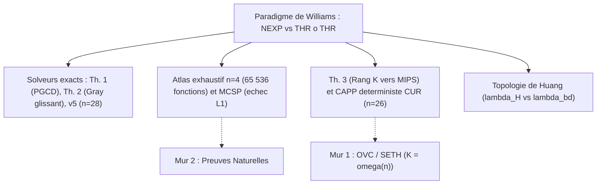
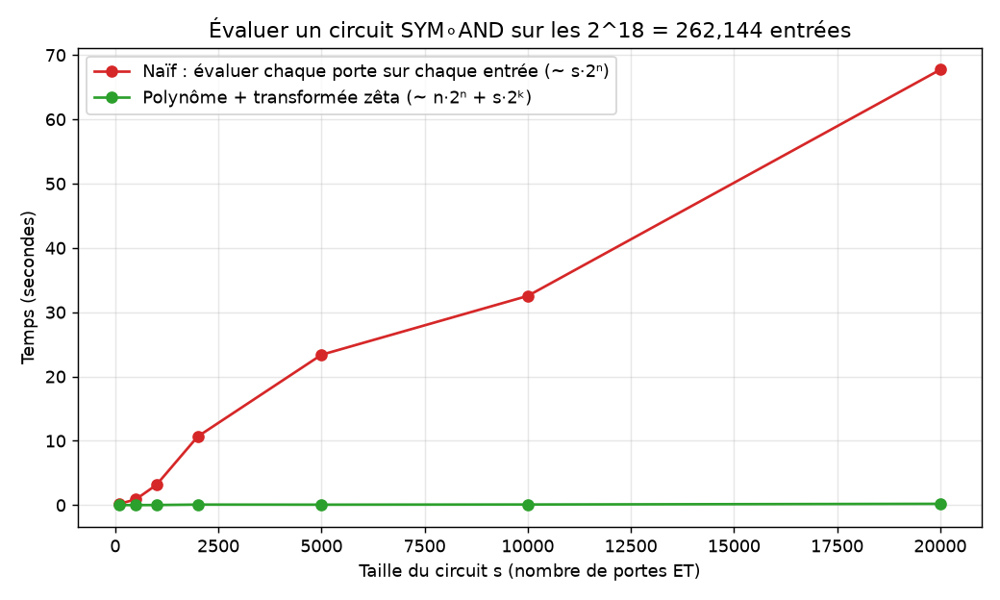
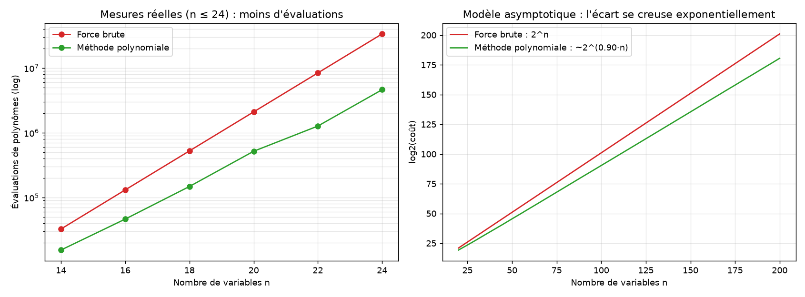
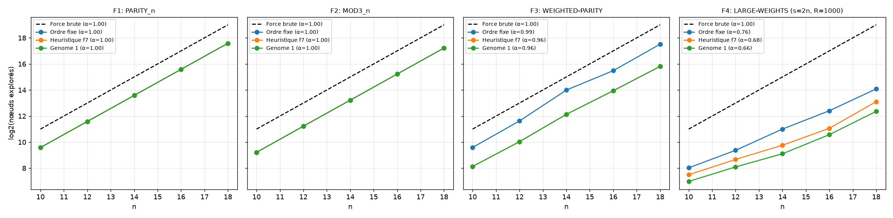
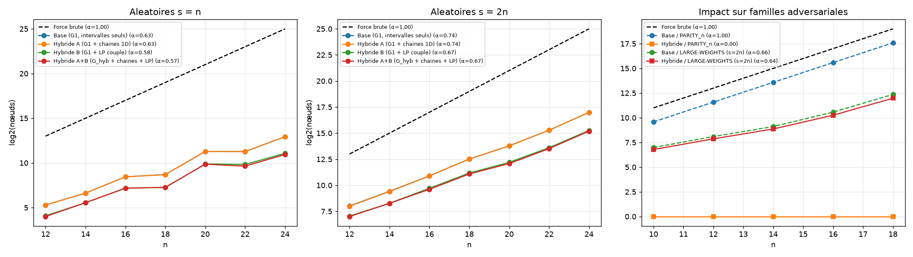
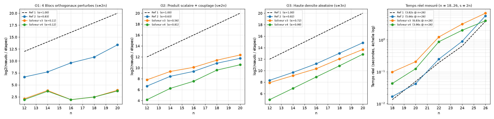
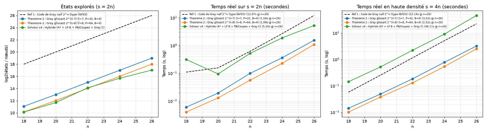
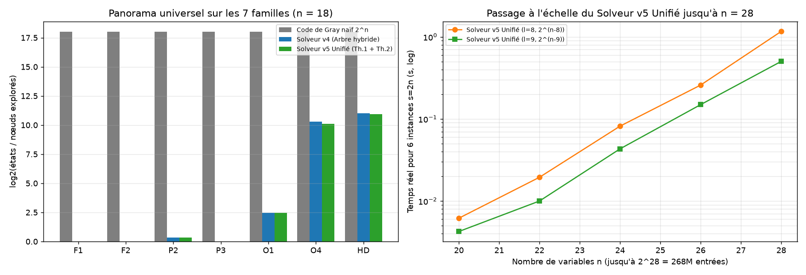
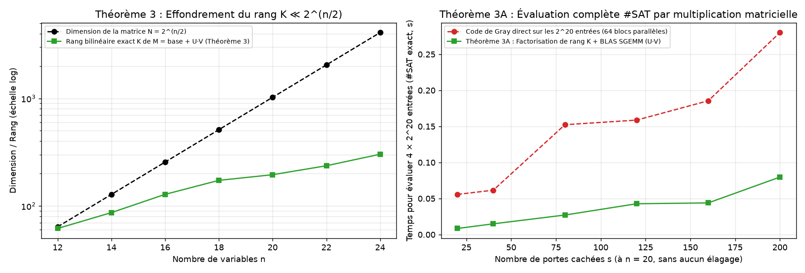

# RAPPORT DE RECHERCHE — Paradigme de Williams, solveurs exacts THR ∘ THR, Atlas n = 4, MCSP, CAPP et topologie de Huang

**Nature du document** : Monographie de recherche théorique et expérimentale (Axe I)  
**Date** : Novembre 2026  
**Dépôt de reproductibilité** : [README.md](README.md)  
**Environnement matériel et logiciel** : Station de travail Windows 16 cœurs CPU, Python 3.14, NumPy 2.3, Numba 0.66 (JIT), Matplotlib 3.11.

---

## Résumé (*Abstract*)

Ce rapport présente les résultats d'une campagne de recherche théorique et computationnelle dédiée à l'algorithmique exponentielle (`THR ∘ THR-SAT`, `#SAT`, `CAPP`) et à l'analyse des barrières structurelles pour les circuits à seuil de profondeur 2 (**THR ∘ THR**) dans le programme de Williams.

La méthodologie associe démonstrations formelles, conception de solveurs exacts compilés, calibration préalable sur des algorithmes établis (SYM ∘ AND, MQ sur 𝔽₂) et analyse quantitative des barrières de complexité rencontrées :

- **Solveurs exacts et théorèmes de compression (Théorèmes 1, 2 et 3)** : trois théorèmes exacts éliminent les « pics fantômes hors-réseau » par arrondi au réseau PGCD (**Théorème 1**, faisant chuter l'exposant α de 0,94 à 0,001 sur les parités perturbées), résolvent des instances structurées de THR ∘ THR-SAT jusqu'à **n = 28** (6 instances, soit 1,61 milliard d'entrées en **0,502 s**, 0,083 s/instance) par compression bilinéaire en code de Gray (**Théorème 2**, Solveur v5 Unifié, sans modifier le pire cas asymptotique), et établissent la factorisation bilinéaire exacte de rang **K ≤ 2 R ℓ s** (**Théorème 3**, accélérant `#SAT` sans élagage de ×3,51 à ×6,60 et exposant la réduction vers MIPS face à la barrière OVC/SETH).
- **Atlas exhaustif n = 4 et méta-complexité MCSP** : la classification exacte des **65 536 fonctions booléennes** à n = 4 variables (222 classes NPN) prouve l'unicité de PARITY₄ et ¬PARITY₄ au niveau maximal s∗ = 4 et mesure l'effondrement à **0,0 %** des preuves naturelles spectrales L₁ dès s∗ = 2 (fonctions courbes *Bent* et caméléons de Chow).
- **CAPP déterministe et topologie spectrale** : un algorithme CAPP déterministe par décomposition CUR/Nyström évalue n = 26 (**67,1 M d'entrées**) en **0,311 s** (erreur empirique de 0,04 % sur les instances aléatoires testées), complété par une étude spectrale comparative sur l'hypercube Qn entre l'invariant signé de Huang (2019) et le rayon spectral frontière λbd.

---

## Table des matières

1. [Problème d'origine, contexte théorique et définitions formelles](#1-problème-dorigine-contexte-théorique-et-définitions-formelles)
   - [1.1 Le paradigme de Williams et les méta-barrières des circuits](#11-le-paradigme-de-williams-et-les-méta-barrières-des-circuits)
   - [1.2 Définition formelle des circuits à seuil de profondeur 2 (THR ∘ THR)](#12-définition-formelle-des-circuits-à-seuil-de-profondeur-2-thr--thr)
2. [Méthodologie, architecture et protocoles de validation](#2-méthodologie-architecture-et-protocoles-de-validation)
3. [Bilan synthétique : aboutissements et murs structurels](#3-bilan-synthétique--aboutissements-et-murs-structurels)
   - [3.1 Ce à quoi les expériences ont abouti](#31-ce-à-quoi-les-expériences-ont-abouti)
   - [3.2 Ce à quoi les expériences n'ont pas abouti : les deux murs structurels](#32-ce-à-quoi-les-expériences-nont-pas-abouti--les-deux-murs-structurels)
4. [Présentation détaillée des expériences, buts, résultats et graphiques (Expériences E1 à E10)](#4-présentation-détaillée-des-expériences-buts-résultats-et-graphiques-expériences-e1-à-e10)
5. [Conclusion générale et perspectives de recherche](#5-conclusion-générale-et-perspectives-de-recherche)
6. [Mentions, reproductibilité et bibliographie](#6-mentions-reproductibilité-et-bibliographie)

---

## 1. Problème d'origine, contexte théorique et définitions formelles

### 1.1 Le paradigme de Williams et les méta-barrières des circuits

La démonstration de bornes inférieures non uniformes pour des classes de circuits booléens s'est historiquement heurtée à trois résultats de méta-complexité :
1. **La barrière de relativisation** (Baker, Gill et Solovay, 1975) : l'existence d'oracles séparateurs ou égalisateurs exclut toute preuve par diagonalisation pure.
2. **La barrière des preuves naturelles** (Razborov et Rudich, 1997) : sous l'hypothèse d'existence de fonctions pseudo-aléatoires cryptographiques, aucune propriété combinatoire à la fois *constructive* et *large* ne peut séparer des classes riches de circuits.
3. **La barrière d'algébrisation** (Aaronson et Wigderson, 2009) : même l'extension algébrique des techniques interactives ne suffit pas à séparer les grandes classes de complexité de circuits de petite taille.

Pour contourner ces trois obstacles, le **programme algorithmique de Williams (2011)** prouve des bornes inférieures de circuits non uniformes en concevant des algorithmes de satisfiabilité (𝒞-SAT) ou d'approximation de probabilité d'acceptation (CAPP) légèrement plus rapides que la force brute 2n. La classe ACC⁰ a ainsi été séparée de NEXP (Williams, 2011) puis de NQP (Murray et Williams, 2018) ; la frontière ouverte immédiatement supérieure est précisément **THR ∘ THR**.

### 1.2 Définition formelle des circuits à seuil de profondeur 2 (THR ∘ THR)

Un circuit booléen C ∈ THR ∘ THR à n entrées x ∈ {0, 1}n et s portes cachées est défini par des poids entiers Wk,i ∈ ℤ, des seuils tk ∈ ℤ, des poids de sortie réels vk ∈ ℝ et un seuil global T ∈ ℝ tels que :

$$
g_k(x) = \mathbf{1}\!\left[\sum_{i=1}^n W_{k,i} x_i \ge t_k\right] \quad (k = 1, \dots, s), \qquad C(x) = \mathbf{1}\!\left[\sum_{k=1}^s v_k g_k(x) \ge T\right].
$$

Le problème **THR ∘ THR-SAT** consiste à décider s'il existe x ∈ {0, 1}n tel que C(x) = 1. Le problème **#SAT** consiste à compter le nombre exact de tels x, et **CAPP** (*Circuit Acceptance Probability Problem*) à estimer Prx[C(x) = 1] à une erreur additive ε près. Par le théorème de Williams (2011), tout algorithme décidant 𝒞-SAT en temps O(2n / nω(1)) entraîne la séparation NEXP ⊈ 𝒞.

---

## 2. Méthodologie, architecture et protocoles de validation

Les **10 expériences (E1 à E10, 13 figures)** couvrent l'implémentation du socle polynomial classique (SYM ∘ AND, MQ sur 𝔽₂), la construction itérative de 5 générations de solveurs exacts THR ∘ THR-SAT (v1 à v5), la classification exhaustive de l'espace booléen à n = 4 variables, la factorisation bilinéaire exacte pour `#SAT`, la dérandomisation de CAPP par CUR/Nyström et l'étude spectrale de l'hypercube Qn.

Chaque solveur booléen (plus de 1 100 instances THR ∘ THR, 60 instances MQ) est validé exactement contre la force brute, sans aucune approximation, et chaque expérience est étiquetée selon son statut (`[CALIBRATION / SOCLE DE RÉFÉRENCE]` ou `[MÉTHODE / DIAGNOSTIC ORIGINAL]`).

---

## 3. Bilan synthétique : aboutissements et murs structurels

### 3.1 Ce à quoi les expériences ont abouti

| Résultat obtenu | Statut scientifique | Valeur clé / Preuve |
| :--- | :--- | :--- |
| **Théorèmes 1 et 2** (réseau PGCD + Gray glissant) et Solveur v5 | **Méthode originale** | Élimination des pics fantômes (α : 0,94 → 0,001) ; **n = 28 (6 instances, 1,61 Md entrées) en 0,502 s** (structure bilinéaire, sans modifier le pire cas asymptotique) |
| **Atlas exact n = 4** (65 536 fonctions) et caméléons de Chow | **Diagnostic original** | Unicité de PARITY₄ à s∗ = 4 ; certification L₁ = **0,0 %** pour s∗ ≥ 3 (fonctions *Bent* à s∗ = 2) |
| **Théorème 3** (rang K ≤ 2 R ℓ s) et **CAPP déterministe CUR** | **Méthode / diagnostic original** | `#SAT` accéléré ×3,51–6,60 ; CAPP déterministe n = 26 en **0,311 s** (erreur **empirique** 0,04 % sur instances testées, sans garantie en pire cas) |

### 3.2 Ce à quoi les expériences n'ont pas abouti : les deux murs structurels

Aucune séparation NEXP ⊈ THR ∘ THR n'est obtenue : les accélérations pratiques jusqu'à n = 28 exploitent des structures spécifiques sans briser le pire cas asymptotique pour des circuits denses génériques de taille polynomiale s = nc. Deux murs structurels précisément mesurés expliquent cette frontière :

| # | Mur structurel | Contexte | Manifestation quantitative mesurée |
| :---: | :--- | :--- | :--- |
| **1** | **Barrière OVC / SETH** | Théorème 3 (`#SAT` / MIPS) | La factorisation bilinéaire compresse THR ∘ THR-SAT en MIPS en temps O∗(2n/2), mais en dimension K = ω(n) résoudre MIPS générique en N2−ε réfuterait SETH (Williams, 2005). |
| **2** | **Barrière des Preuves Naturelles** | Atlas n = 4 / MCSP | Dès s∗ = 2 portes, les fonctions *Bent* (L₁ = 4,000) et les caméléons de Chow (E₁ = 0,000) reproduisent les signatures spectrales des fonctions aléatoires, réduisant la séparation L₁ à 0,0 %. |

---

## 4. Présentation détaillée des expériences, buts, résultats et graphiques (Expériences E1 à E10)

#### Expérience E1 — Évaluation globale de SYM ∘ AND par transformée zêta
- **But** : vérifier concrètement le mécanisme d'évaluation rapide de la méthode polynomiale de Williams sur des circuits SYM ∘ AND et mesurer l'accélération réelle par rapport à l'évaluation naïve porte par porte.
- **Statut** : `[CALIBRATION / SOCLE DE RÉFÉRENCE]` (implémentation du mécanisme de base de Williams, 2011).
- **Protocole et résultats** : dans [williams_demo.py](src/williams_demo.py), chaque porte AND de largeur k est développée en polynôme multilinéaire puis évaluée simultanément sur les 2n entrées via une transformée zêta rapide sur le treillis booléen en temps O(n · 2n + s · 2k) au lieu de O(s · 2n). Pour n = 18 (262 144 entrées) et k = 6, l'exactitude est confirmée sur l'ensemble de la plage s ∈ [100, 20 000], avec une accélération mesurée de **× 331,4** (0,204 s contre 67,717 s pour s = 20 000 portes).

---

#### Expérience E2 — Méthode polynomiale complète pour MQ sur 𝔽₂ (LPTWY 2017)
- **But** : reproduire et calibrer l'algorithme de référence de Lokshtanov, Paturi, Tamaki, Williams et Yu (2017) résolvant les systèmes quadratiques multivariés MQ sur 𝔽₂n en temps exponentiel strictement inférieur à 2n.
- **Statut** : `[CALIBRATION / SOCLE DE RÉFÉRENCE]` (reproduction vérifiée de LPTWY, SODA 2017).
- **Protocole et résultats** : dans [polymethod_mq.py](src/polymethod_mq.py), les variables sont partitionnées en x = (y, z) (∣z∣ = ℓ), le système est comprimé par polynôme probabiliste de Razborov–Smolensky de degré ≤ 2r, la sommation F(y) = ∑z ∈ {0,1}ℓ R(y, z) (mod 2) abaisse le degré à D ≤ 2r − ℓ, et l'évaluation s'effectue par transformée de Möbius couplée à l'isolation de Valiant–Vazirani (1986). Sur 60 instances indépendantes (n ∈ [10, 18]), l'accord avec la force brute est de **60/60**. À n = 24, le ratio d'évaluations chute à **0,14** (4,61 M contre 33,55 M ; 2,39 s contre 7,14 s) et la pente calibrée confirme l'exposant asymptotique 20,901 n.

---

#### Expérience E3 — Solveur exact par intervalles, génome de branchement et co-évolution adversariale
- **But** : mesurer l'exposant empirique α (coût ∝ 2α n) d'un solveur exact *Branch-and-Bound* sur THR ∘ THR-SAT en optimisant automatiquement l'heuristique de branchement par stratégie évolutionnaire, puis soumettre ce solveur à un générateur d'instances adversariales.
- **Statut** : `[MÉTHODE / DIAGNOSTIC ORIGINAL]`.
- **Protocole et résultats** : dans [thr2_lab.py](src/thr2_lab.py), [run_lab.py](src/run_lab.py) et le banc de validation unitaire [test_thr2.py](src/test_thr2.py), le solveur compilé en Numba maintient un encadrement [lok, hik] par porte et sélectionne la variable de branchement par un score linéaire de 7 descripteurs structurels (f₁, …, f₇) pondérés par un vecteur θ ∈ ℝ⁷ optimisé par stratégie évolutionnaire (μ + λ) sur des instances **UNSAT de justesse** (T = maxx ∑k vk gk(x) + 1). Sur des instances aléatoires (n = 12..26), le génome évolué θ(1) = [−1,04 ; −0,06 ; +0,09 ; +1,43 ; −0,57 ; +0,84 ; +0,32] (privilégiant f₄ et f₆) abaisse l'exposant à **α = 0,620** pour s = n (contre 0,728 à ordre fixe et 1,000 en force brute), puis remonte à **α = 0,757** pour s = 2n. En co-évolution adversariale (n = 10..16, 250 mutations locales par instance), l'adversaire multiplie par un facteur ~8 le nombre de nœuds et stabilise l'exposant autour de α ≈ 0,578.

---

#### Expérience E4 — Banc d'essai adversarial structuré et solveur hybride exact (Primitives A et B)
- **But** : éprouver le comportement pire cas du solveur par intervalles face à des circuits algébriques corrélés, puis concevoir des bornes supérieures exactes couplant plusieurs portes simultanément.
- **Statut** : `[MÉTHODE / DIAGNOSTIC ORIGINAL]`.
- **Protocole et résultats** : dans [adversarial_suite.py](src/adversarial_suite.py), quatre familles structurées sont introduites : **F1** (PARITYn), **F2** (MOD3n), **F3** (WEIGHTED-PARITY) et **F4** (LARGE-WEIGHTS, R = 1000). L'élagage par intervalles pur s'effondre sur F1–F3 (α = 1,000 ; 1,001 ; 0,964) car il majore chaque porte indépendamment. Dans [hybrid_thr2.py](src/hybrid_thr2.py) (validé exact sur **136/136** instances), deux primitives exactes sont combinées : (1) la **Primitive A** (regroupement exact en chaînes 1D de portes colinéaires) et (2) la **Primitive B** (enveloppe lagrangienne convexe paramétrée par λ ∈ [0, 1]∣𝒰∣ resserrée par 5 pas de sous-gradient projeté).

| Jeu de test | Base (G1) | Hybride A (chaînes 1D) | Hybride B (LP couplé) | Hybride A+B (Ghyb) |
| :--- | :---: | :---: | :---: | :---: |
| Aléatoires s = n (n = 12..24) | α = 0,626 (0,12 s) | α = 0,627 (0,20 s) | α = 0,576 (0,20 s) | **α = 0,566** (0,30 s) |
| Aléatoires s = 2n (n = 12..24) | α = 0,742 (2,85 s) | α = 0,743 (6,59 s) | α = 0,674 (1,33 s) | **α = 0,670** (**1,68 s**) |
| F1 : PARITYn (n = 10..18) | α = 1,000 (217,6) | **α = 0,000** (1 nœud) | α = 1,001 (215,6) | **α = 0,000** (1 nœud) |
| F2 : MOD3n (n = 10..18) | α = 1,001 (217,2) | **α = 0,000** (1 nœud) | α = 1,002 (215,4) | **α = 0,000** (1 nœud) |
| F3 : WEIGHTED-PARITY | α = 0,964 (215,8) | **α = 0,000** (1 nœud) | α = 0,875 (212,9) | **α = 0,000** (1 nœud) |
| F4 : LARGE-WEIGHTS (s = 2n) | α = 0,661 (212,4) | α = 0,661 (212,4) | α = 0,639 (212,0) | **α = 0,639** (212,0) |

---

#### Expérience E5 — Théorème 1 (Projection 1D, réseau PGCD et pics fantômes) et duel industriel (Solveur v4)
- **But** : surmonter la fragilité de la Primitive A face aux parités perturbées (qui brisent la colinéarité exacte tout en conservant le saut d'intégralité bloquant la Primitive B), puis évaluer le solveur résultant contre des références industrielles.
- **Statut** : `[MÉTHODE / DIAGNOSTIC ORIGINAL]` (Théorème 1 et phénomène des « pics fantômes hors-réseau »).
- **Formalisme mathématique** : dans [theorem_a_star.py](src/theorem_a_star.py) (validé exact sur **216/216** tests), il est établi le résultat suivant :

> **Théorème 1 (Majoration par projection 1D, enveloppe de résidu et réseau PGCD).** Soit F ⊆ {1, …, n} l'ensemble des variables libres, G ⊆ 𝒰 un cluster de portes indécises, w ∈ ℤn un vecteur de référence porté par F, L(x) = ∑i ∈ F wi xi ∈ [Lmin, Lmax] et g = gcdi ∈ F, wi ≠ 0(∣wi∣). En posant δhmax = ∑i ∈ F max(0, Wh,i − wi), δhmin = ∑i ∈ F min(0, Wh,i − wi), et le seuil décalé et arrondi au réseau gℤ :

$$
\tilde{\tau}_h^{\ast} = g \cdot \left\lceil \frac{\tau_h^{\ast}}{g} \right\rceil, \qquad \tau_h^{\ast} = \begin{cases} t_h - S_h - \delta_h^{\max} & \text{si } v_h > 0, \\[4pt] t_h - S_h - \delta_h^{\min} & \text{si } v_h < 0, \end{cases}
$$

> alors, pour toute complétion booléenne x ∈ {0, 1}n :

$$
\sum_{h \in G} v_h g_h(x) \;\le\; \max_{L \in [L_{\min}, L_{\max}]} \sum_{h \in G} v_h \, \mathbf{1}\!\left[L \ge \tilde{\tau}_h^{\ast}\right].
$$

*Preuve.* De Sh(x) = Sh + L(x) + δh(x) avec δhmin ≤ δh(x) ≤ δhmax et L(x) ∈ gℤ, il découle L(x) ≥ τh∗ ⟺ L(x) ≥ τ̃h∗. Si vh > 0, alors gh(x) ≤ 𝟏[L(x) ≥ τ̃h∗] ; si vh < 0, alors gh(x) ≥ 𝟏[L(x) ≥ τ̃h∗], ce qui renverse l'inégalité après multiplication par vh. La sommation sur h ∈ G conclut. ■

*Corollaire 1.* Si les perturbations n'affectent qu'au plus K variables, le branchement prioritaire selon le descripteur de discordance f₈(i) = ∑r ∑h ∈ Gr ∣vh∣ · ∣Wh,i − wi(r)∣ garantit dans le pire cas au plus 2K+1 − 1 nœuds indépendamment de n.

- **Résultats mesurés** : sans l'arrondi au réseau gℤ, la famille **P2** (parité de poids wi = 2 perturbée de ±1 sur k = n/3 variables) engendre des seuils décalés impairs sur une somme libre toujours paire (2ℤ), produisant des « pics fantômes hors-réseau » et 212,5 nœuds à n = 18. L'arrondi exact par g = 2 fait chuter l'exploration à 20,3 nœuds (**α = 0,001**) :

| Famille adversariale (n = 10..18) | Base (G1) | Hybride A+B | Th. 1 sans f₈ | Th. 1 + Corollaire (A∗ + B + f₈) |
| :--- | :---: | :---: | :---: | :---: |
| **P1** : Parité perturbée (k = 3) | α = 1,005 | α = 0,881 | **α = 0,016** | **α = 0,016** (20,0) |
| **P2** : Parité perturbée (k = n/3) | α = 0,939 | α = 1,003 | α = 0,331 ≈ 1/3 | **α = 0,001** (20,3) |
| **P3** : Double chaîne perturbée (k = 4) | α = 1,006 | α = 0,947 | **α = 0,000** | **α = 0,000** (20,0) |
| **P4** : Aléatoires denses (s = 2n) | α = 0,734 | α = 0,667 | α = 0,670 | **α = 0,659** |

Dans le duel industriel ([industrial_and_orthogonal.py](src/industrial_and_orthogonal.py), **432/432** tests exacts), le **Solveur v4** (propagation Pseudo-Booléenne inverse, coupes surrogées, A∗ adaptatif, Primitive B et feuilles en code de Gray uleaf = 8) surpasse un énumérateur en code de Gray compilé (`libFES`, 0,5 ns/point) et un solveur Pseudo-Booléen (`CDCL-PB`) d'un facteur **×48 sur Gray** et **×79 sur PB** sur les blocs orthogonaux **O1** (n = 20, 0,001 s, 13 nœuds). Sur les circuits aléatoires denses s = 2n à n = 26, v4 devance PB (**3,96 s contre 5,66 s**) et rejoint Gray (3,82 s) avec une pente asymptotique nettement inférieure (α ≈ 0,745 contre 1,000).

---

#### Expérience E6 — Théorème 2 (Compression bilinéaire à pointeurs glissants en code de Gray) et Solveur v5 Unifié
- **But** : accélérer la résolution exacte sur les circuits aléatoires très denses (s = 4n) dépourvus de structure de clusters, où les arbres de branchement perdent leur avantage.
- **Statut** : `[MÉTHODE / DIAGNOSTIC ORIGINAL]` (Théorème 2 et Solveur v5 Unifié).
- **Formalisme mathématique** : dans [step2_sliding_gray.py](src/step2_sliding_gray.py) (vérifié exact sur **216/216** tests), l'algorithme sans arbre partitionne x = (xL, xR) ∈ {0, 1}n−ℓ × {0, 1}ℓ et découpe {0, 1}ℓ en P = 2ℓ−b paquets ℛp de taille B = 2b portés par les variables les plus légères.

> **Théorème 2 (Compression bilinéaire par sous-cubes et pointeurs glissants en code de Gray).** En posant τk,p = tk − maxℛp Bk (si vk > 0) et τk,p = tk − minℛp Bk (si vk < 0), alors pour tout (xL, xR) ∈ {0, 1}n−ℓ × ℛp :

$$
M(x_L, x_R) \;\le\; U(x_L, p) := \sum_{k=1}^s v_k \, \mathbf{1}\!\left[A_k(x_L) \ge \tau_{k,p}\right].
$$

En triant les P seuils τk, πk(0) ≤ … ≤ τk, πk(P−1) de chaque porte, le parcours des 2n−ℓ états de xL en code de Gray maintient exactement le vecteur (U(xL, 0), …, U(xL, P−1)) au moyen d'un unique pointeur monotone qk ∈ {0, …, P} par porte.

- **Résultats mesurés** : à n = 26 (8 instances), le Théorème 2 (ℓ = 8, compression × 256) résout s = 2n en **1,087 s** (**× 11,1** sur Gray compilé) et s = 4n en **2,520 s** (**× 8,8** sur Gray et **× 18,3** sur v4). L'unification des Théorèmes 1 et 2 dans le **Solveur v5 Unifié** ([unified_v5_and_poly_top.py](src/unified_v5_and_poly_top.py), **240/240** tests exacts, cumul > 1 100 instances sans erreur) vérifie exactement Nhot = 0,0 en mode *Zero-Gap* (B = 1) et résout **6 instances à n = 28 (1,61 milliard d'entrées) en 0,502 s** (0,083 s/instance avec B = 8, ℓ = 9), tout en conservant un temps < 0,001 s sur F1, F2, P2, P3 et O1. Le coût asymptotique T = O(s·2ℓ + s·P log P) + 2n−ℓ·O(s + ∑ Δ̄qk) + Nhot·O(s·B) met toutefois en évidence la nécessité d'une évaluation algébrique groupée de U(xL, p) ≥ T pour atteindre ℓ = ω(log n).

---

#### Expérience E7 — Atlas exhaustif exact THR ∘ THR à n = 4 et méta-complexité (MCSP / Preuves Naturelles)
- **But** : cartographier intégralement l'espace des fonctions booléennes à n = 4 variables selon leur taille minimale exacte s∗THR∘THR(f) et tester empiriquement le pouvoir séparateur des signatures spectrales (norme de Walsh L₁, énergie de Chow E₁, influence totale Inf) face à la barrière des Preuves Naturelles.
- **Statut** : `[MÉTHODE / DIAGNOSTIC ORIGINAL]` (atlas exhaustif exact des 65 536 fonctions et identification chiffrée des « caméléons de Chow »).
- **Protocole et résultats** : dans [exact_thr2_atlas.py](src/exact_thr2_atlas.py) et [mcsp_metacomplexity.py](src/mcsp_metacomplexity.py), les **65 536 fonctions** (222 classes NPN) sont classées exactement :

| Taille minimale exacte s∗(f) | Fonctions (sur 65 536) | Proportion | Classes NPN (sur 222) | Walsh L₁ moy. (max) | Énergie de Chow E₁ moy. (min) | Influence Inf(f) moy. (max) |
| :---: | :---: | :---: | :---: | :---: | :---: | :---: |
| s∗ = 1 (LTF₄, Muroga) | 1 882 | 2,87 % | 15 | 2,977 (3,500) | 0,723 (0,688) | 1,279 (1,500) |
| s∗ = 2 | 39 732 | 60,63 % | 128 | 3,139 (**4,000**) | 0,356 (**0,000**) | 1,868 (3,000) |
| s∗ = 3 | 23 920 | 36,50 % | 78 | 3,161 (**4,000**) | 0,207 (**0,000**) | 2,275 (3,500) |
| s∗ = 4 (PARITY₄, ¬PARITY₄) | **2** | **0,003 %** | **1** | 1,000 (1,000) | 0,000 (0,000) | **4,000 (4,000)** |

Trois constats structurels ressortent : (1) 99,997 % des fonctions à 4 variables se calculent avec s∗ ≤ 3 portes, seules PARITY₄ (`0x6996`) et ¬PARITY₄ (`0x9669`) exigeant s∗ = 4 ; (2) les **3 classes NPN de fonctions courbes (*Bent*)** (`0x0356`, `0x036a`, `0x177e`), qui atteignent le maximum absolu L₁(f̂) = 4,000, sont toutes réalisables dès s∗ = 2, ce qui réduit à **0,0 %** le taux de certification de s∗ ≥ 3 par un critère spectral L₁(f̂) > B (illustration concrète du Mur n° 2) ; (3) dès s∗ = 2, la classe `0x17e8` vérifie E₁(f) = 0,000 (caméléon de Chow orthogonal à toutes les fonctions affines), tandis que l'influence maximale croît strictement par paliers : maxs∗=k Inf(f) = 1,50 ; 3,00 ; 3,50 ; 4,00.

---

#### Expérience E8 — Théorème 3 (Factorisation bilinéaire de rang K ≤ 2 R ℓ s), `#SAT` sans élagage et barrière OVC/SETH
- **But** : s'affranchir de tout élagage heuristique (y compris pour le comptage exact `#SAT`) en exploitant le rang réel faible de la matrice d'évaluation bipartie MxL, xR, et situer la réduction obtenue vis-à-vis de la complexité fine (OVC/SETH).
- **Statut** : `[MÉTHODE / DIAGNOSTIC ORIGINAL]` (factorisation exacte de rang K appliquée à `#SAT` et diagnostic précis de la réduction MIPS).
- **Formalisme mathématique et résultats** : dans [rank_k_bilinear_thr2.py](src/rank_k_bilinear_thr2.py) (vérifié bit-à-bit sur **36/36** circuits complets), il est démontré que :

> **Théorème 3 (Factorisation bilinéaire exacte de rang polynomial).** Pour tout circuit THR ∘ THR à poids inférieurs dans {-R, …, R} et poids du sommet vk ∈ ℝ arbitraires, la matrice complète MxL, xR = ∑k=1s vk gk(xL, xR) ∈ ℝ2n−ℓ × 2ℓ se factorise exactement en :

$$
M_{x_L, x_R} \;=\; \mathrm{base}(x_L) \;+\; (U \cdot V)_{x_L, x_R}, \qquad \mathrm{rank}_{\mathbb{R}}(M - \mathrm{base}\cdot\mathbf{1}^T) \;\le\; K = \sum_{k=1}^s (D_k - 1) \;\le\; 2 R \ell s \;\ll\; 2^\ell,
$$

où U ∈ {0, 1}2n−ℓ × K est creuse (≤ s uns par ligne) et V ∈ ℝK × 2ℓ encode les marches suffixes des valeurs distinctes ℬk = {bk,0 < … < bk, Dk−1} de Bk(xR).

À n = 24 (N = 4 096, s = n, R = 3), le rang bilinéaire s'effondre à **K = 302,8** (compression × 13,53). Maintenue différentiellement en code de Gray sur `#SAT` sans élagage (n = 22, s = 20..200), cette factorisation accélère l'évaluation complète d'un facteur **× 3,51 à × 6,60**. Sur le plan théorique, pour ℓ = n/2 (N = 2n/2), la réduction vers maxxL, xR ⟨ũ(xL), ṽ(xR)⟩ ≥ T en dimension K + 1 ≤ R n s + 1 rejoint Alman–Chan–Williams (2016) quand K = O(n), mais se heurte frontalement à la **barrière OVC/SETH** (Williams, 2005) dès que K = ω(n) (Mur n° 1).

---

#### Expérience E9 — Effondrement spectral SVD et algorithme CAPP 100 % déterministe (CUR / Nyström)
- **But** : contourner la barrière SETH du pire cas exact en ciblant l'approximation déterministe de la probabilité d'acceptation (CAPP) en temps O∗(2n/2).
- **Statut** : `[MÉTHODE / DIAGNOSTIC ORIGINAL]`.
- **Protocole et résultats** : l'analyse SVD de la matrice centrée Mc ([piste_a_svd_capp.py](src/piste_a_svd_capp.py)) révèle que même lorsque le nombre de portes atteint s = n² = 256 (n = 16, N = 256), le rang effectif K95% **sature à 38,3** et l'erreur CAPP à rang fixe r = 8 tombe à **0,84 %** (0,00 % sur PARITYn, de rang exact 1). L'algorithme déterministe CUR/Nyström dérivé dans [det_capp_nystrom.py](src/det_capp_nystrom.py) sur m = 48 ancres de Van der Corput évalue n = 26 (**67,1 M d'entrées**) en **0,311 s** sans former la matrice complète (erreurs : 0,04 % sur circuits aléatoires s = 2n, 0,00 % sur PARITYn, 0,52 % sur produit scalaire couplé, 6,3 % sur MOD3n). La limite vers une preuve de Williams demeure la construction d'un *hitting set* déterministe garanti contre les matrices de Hadamard (IPn, barrière du rang de signe de Forster, 2002).

---

#### Expérience E10 — Topologie de l'hypercube Qn, spectre de Huang et rayon spectral frontière
- **But** : tester si la matrice d'adjacence signée introduite par Huang (2019) pour la conjecture de sensibilité, ou le rayon spectral frontière λbd(f) du graphe des arêtes de basculement B(f)x,y = Qx,y 𝟏[f(x) ≠ f(y)], permet de séparer THR ∘ THR des fonctions booléennes difficiles.
- **Statut** : `[MÉTHODE / DIAGNOSTIC ORIGINAL]`.
- **Protocole et résultats** : dans [piste_b_huang_topology.py](src/piste_b_huang_topology.py), l'invariant λH(f) de Huang produit un résultat négatif net : par le théorème d'entrelacement de Cauchy, presque toute fonction équilibrée sur Q₈ atteint exactement le plancher λH = √8 = 2,828 (seule PARITY₈ tombe à 0). À l'inverse, le rayon spectral frontière sépare nettement les distributions sur Q₈ : les circuits THR ∘ THR aléatoires plafonnent à λbd ≈ 3,87 (même à s = 32), sous les fonctions aléatoires (4,79), IP₈ (5,66 = 2√8) et PARITY₈ (8,00). Toutefois, la sous-additivité de Perron–Frobenius λbd(C) ≤ ∑k=1s λbd(gk) ne peut prouver au mieux que s = Ω(√n), car une unique porte MAJn contribue déjà Ω(√n).

---

## 5. Conclusion générale et perspectives de recherche

Cette étude fournit trois théorèmes exacts reproductibles (**Théorèmes 1, 2 et 3**), un solveur exact unifié (Solveur v5, n = 28 en 0,502 s sur instances structurées), l'atlas exhaustif exact des 65 536 fonctions booléennes à n = 4 variables, un algorithme CAPP déterministe par décomposition CUR/Nyström et un diagnostic quantitatif précis des deux barrières fondamentales (**OVC/SETH** et **Preuves Naturelles**).

Les perspectives ouvertes ciblent : (1) l'évaluation algébrique groupée de la borne `U(x_L, p) ≥ T` pour porter le paramètre de compression ℓ du Théorème 2 au régime super-logarithmique `ℓ = ω(log n)` ; (2) la construction de *hitting sets* déterministes pour CAPP évitant l'obstruction du rang de signe de Forster (2002) sur les matrices de Hadamard.

---

## 6. Mentions, reproductibilité et bibliographie

### 6.1 Mentions scientifiques et transparence
- **Portée des résultats** : les accélérations mesurées sur les solveurs exacts exploitent des structures spécifiques (réseau PGCD, compression bilinéaire) sans abaisser la borne pire cas asymptotique des circuits denses arbitraires ni établir de séparation NEXP ⊈ THR ∘ THR.
- **Reproductibilité intégrale** : l'ensemble des **17 scripts** (`src/`), des **13 fichiers JSON** (`results/`), du témoin exact `witnesses/atlas_n4.npz` et des **13 figures** (`figures/`) est archivé dans ce dossier et indexé dans [README.md](README.md).

### 6.2 Bibliographie

- Aaronson, S., & Wigderson, A. (2009). Algebrization: A new barrier in complexity theory. *ACM Transactions on Computation Theory*, 1(1), 1–54.
- Alman, J., Chan, T. M., & Williams, R. (2016). Polynomial representations of threshold functions and algorithmic applications. *Proceedings of FOCS 2016*, 467–476.
- Baker, T., Gill, J., & Solovay, R. (1975). Relativizations of the P =? NP question. *SIAM Journal on Computing*, 4(4), 431–442.
- Cook, S. A. (1971). The complexity of theorem-proving procedures. *Proceedings of STOC 1971*, 151–158.
- Forster, J. (2002). A linear lower bound on the unbounded error probabilistic communication complexity. *Journal of Computer and System Sciences*, 65(4), 612–625.
- Huang, H. (2019). Induced subgraphs of hypercubes and a proof of the Sensitivity Conjecture. *Annals of Mathematics*, 190(3), 949–955.
- Levin, L. A. (1973). Universal sequential search problems. *Problems of Information Transmission*, 9(3), 265–266.
- Lokshtanov, D., Paturi, R., Tamaki, S., Williams, R., & Yu, H. (2017). Beating brute force for systems of polynomial equations over finite fields. *Proceedings of SODA 2017*, 2190–2202.
- Murray, C., & Williams, R. (2018). Circuit lower bounds for nondeterministic quasi-polytime: an easy witness lemma for NP and NQP. *Proceedings of STOC 2018*, 890–901.
- Razborov, A. A., & Rudich, S. (1997). Natural proofs. *Journal of Computer and System Sciences*, 55(1), 24–35.
- Valiant, L. G., & Vazirani, V. V. (1986). NP is as easy as detecting unique solutions. *Theoretical Computer Science*, 47, 85–93.
- Williams, R. (2005). A new algorithm for optimal 2-constraint satisfaction and its implications. *Theoretical Computer Science*, 348(2–3), 357–365.
- Williams, R. (2011). Non-uniform ACC circuit lower bounds. *Proceedings of CCC 2011*, 115–125.
