# RAPPORT DE RECHERCHE — Représentation faible de fonctions booléennes par polynômes modulo un entier composite m

**Nature du document** : Monographie de recherche théorique et expérimentale (Axe II)  
**Date** : Novembre 2026  
**Dépôt de reproductibilité** : [README.md](README.md) · Manuscrit LaTeX : [paper/weak_poly_composite.tex](paper/weak_poly_composite.tex) · Formalisation Lean 4 : [lean/README.md](lean/README.md)  
**Environnement matériel et logiciel** : Station de travail Windows 16 cœurs CPU, Python 3.14, NumPy 2.3, Numba 0.66 (JIT), Matplotlib 3.11.

---

## Résumé (*Abstract*)

Ce rapport présente les résultats d'une campagne de recherche théorique et computationnelle consacrée à la **représentation faible de fonctions booléennes** ($\mathrm{OR}_n$, $\mathrm{THR}_{n,t}$, $\mathrm{MAJ}_n$, $\mathrm{MOD}_k$) par des polynômes multilinéaires de bas degré modulo un entier composite $m$ (problème de Barrington–Beigel–Rudich, 1994 ; Győri, 2006 / FCT 2007 ; Lee, 2015).

Partant de la détermination exacte du spectre symétrique modulo $6$ jusqu'au degré $10$ puis de son extension à huit modules composites ($m \in \{6, 10, 12, 14, 15, 21, 30, 35\}$), la démarche développe un raisonnement continu articulé autour de trente-deux théorèmes constructifs et structurants (**Théorèmes M1, M2, G1 à G5, G3++, T1, T2, Q1, P1, U1 à U4 et D1 à D16**).

Sur le versant constructif, la récolte de marge (**M2, G1**), la norme d'extension de corps (**G2, G4**) et le mécanisme purement additif d'omission de valeur (**G3**) portent le record modulo $6$ au degré $d = 8$ à **$n = 88$** variables (contre $80$ symétrique, $+10{,}0\,\%$), tandis que sa généralisation multi-valeurs (**G3++**) démontre la capacité exacte $A_p(d) = (p - 2)d$ sur tout corps premier $\mathbb{F}_p$, atteignant la borne de Chevalley–Wilson. Le **Théorème G5** établit une séparation non bornée $(p_{\min} - 1)\times$ dans le régime pré-asymptotique $d < p_{\min}$ (vérifiée à $\times 4 = +300\,\%$, $34 \to 136$ sur $\bmod 35$), et le **Théorème P1** prouve qu'en régime probabiliste tout polynôme symétrique s'effondre à une erreur de $100\,\%$ dès $n = m$ (pour $d < p_{\min}$) alors qu'une norme aléatoire non symétrique maintient une erreur $m^{-d}$ pour tout $n$.

Sur le versant des bornes supérieures quadratiques, la régularité empirique $N_{\mathrm{gen}}^{(m)}(2) \ge 2(m - 1)$ observée sur les huit modules conduit à une hiérarchie de réductions algébriques et analytiques (**D1 à D14**). Sur la famille $m = 2p$, la contraction duale $\mathbb{F}_p \to \mathbb{F}_2$ puis le couplage bilinéaire $(B_2, B_p)$ abaissent successivement la borne de $2p^2 + p - 2$ à $p^2 + O(p \log p)$, $9p - 9$, puis **$8p - 7 = 4m - 7$** (ratio $< 2{,}00\times$, confirmant la conjecture linéaire $n = O(m)$ de Lee, 2015 sur toute la famille $m = 2p$), avec $\le 6p - 4$ sur Type A, un gain de $-25\,\%$ à tout degré $d \ge 2$, la valeur exacte $N_{\mathrm{gen}}^{(6)}((1, 2), \mathrm{OR}) = 7$, le théorème de Chevalley–Warning à poids contraint de Lucas–Vandermonde (**D8**, $(Dr + 1)p - 1$), et enfin un nouveau record inconditionnel sur $\bmod 10$ : **$18 \le N_{\mathrm{gen}}^{(10)}(2, \mathrm{OR}) \le 28$** ($1{,}556\times$, **D14**).

Sur les semi-premiers généraux $m = pq$, les **Théorèmes D5, D9, D10, D11, D13, D15 et D16** démontrent l'optimalité exacte parmi les constructions 2-blocs $N_{2\text{-bloc}}^{(pq)}(2, \mathrm{OR}) = 2(m - 1)$, la fermeture exacte de rang 1 ($3q - 1$ sur $m = 2q$), les bornes linéaires $O(\min(\tilde{r}_p, \tilde{r}_q, p)\cdot m)$ à rang booléen décalé borné et Caro–Wei, la caractérisation du mur expanseur–Fourier uniforme à $n = m^{3/2}$ puis sa démolition inconditionnelle par différentiation booléenne de Weyl biaisée, cœur quasi-régulier logarithmique, différences typiques bornées de Warnke et croisement 5 bandes en $\sin^2$ ($n \le 64m$ jusqu'à **$\Delta \lesssim m^{2/3}/(\ln m)^{4/3}$**, densité forcée **$\rho(G) > c_2'/(m^{1/3}(\ln m)^{7/3})$**), complétés par la rigidité matricielle de Valiant, le repliement de paires sur blowups denses, la dichotomie spectrale de queue sur expanseurs $\rho = 1$ (Hadamard, Paley) et l'exclusion dyadique des grands coefficients modulaires dès $n = O(\Delta \ln m)$. Enfin, les classifications exhaustives (**U1–U4**) établissent notamment l'unicité de $N_{\mathrm{gen}}^{(6)}(2, \mathrm{THR}_2) = 9$ et les fermetures 3-blocs exactes $2(m - 1)$ sur $m \in \{10, 12, 15\}$ (plus de $160$ milliards de paires), tandis que le **Théorème D12** démontre la borne asymptotique de Barrington–Beigel–Rudich $O(d^r)$ en régimes $k$-blocs et semi-symétrique, avec fermetures exactes par tranches de Lucas ($N_{\mathrm{gen}}^{(6)}(3; P_3\text{ sym}) = 27$ et $N_{\mathrm{gen}}^{(6)}(6; P_3\text{ sym}) = 62$).

---

## Table des matières

1. [Problème d'origine, contexte théorique et définitions formelles](#1-problème-dorigine-contexte-théorique-et-définitions-formelles)
   - [1.1 Algèbre modulaire composite et problème de Barrington–Beigel–Rudich](#11-algèbre-modulaire-composite-et-problème-de-barringtonbeigelrudich)
   - [1.2 Définition formelle de la représentation faible modulo un entier composite m](#12-définition-formelle-de-la-représentation-faible-modulo-un-entier-composite-m)
2. [Méthodologie, architecture et protocoles de validation](#2-méthodologie-architecture-et-protocoles-de-validation)
3. [Bilan synthétique : résultats établis et mur structurel](#3-bilan-synthétique--résultats-établis-et-mur-structurel)
   - [3.1 Synthèse des résultats établis](#31-synthèse-des-résultats-établis)
   - [3.2 Limites et mur de saturation de marge](#32-limites-et-mur-de-saturation-de-marge)
4. [Présentation détaillée des expériences, buts, résultats et graphiques (Expériences E11 à E15u)](#4-présentation-détaillée-des-expériences-buts-résultats-et-graphiques-expériences-e11-à-e15u)
5. [Conclusion générale et perspectives de recherche](#5-conclusion-générale-et-perspectives-de-recherche)
6. [Mentions, reproductibilité et bibliographie](#6-mentions-reproductibilité-et-bibliographie)

---

## 1. Problème d'origine, contexte théorique et définitions formelles

### 1.1 Algèbre modulaire composite et problème de Barrington–Beigel–Rudich

L'étude de la puissance de calcul des polynômes multilinéaires de bas degré modulo un entier composite $m$ (Barrington, Beigel et Rudich, 1994) constitue un problème central de la complexité booléenne, étroitement lié aux bornes inférieures pour la classe de circuits $\mathsf{ACC}^0$. Alors que modulo un nombre premier $p$, tout polynôme faible représentant $\mathrm{OR}_n$ a degré au moins $n / (p - 1) = \Omega(n)$, un module composite $m$ à $r$ facteurs premiers distincts permet aux polynômes symétriques d'atteindre $N_{\mathrm{sym}}^{(m)}(d) = \Theta(d^r)$ (soit $d = O(\sqrt{n})$ pour $m = 6$). Barrington, Beigel et Rudich (1994) ont conjecturé que $d = \Omega(n^{1/r})$ demeure valable sans hypothèse de symétrie. La meilleure borne inférieure générale connue pour $m = 6$ reste $d = \Omega(\log n)$ (Tardos et Barrington, 1998) ; au degré quadratique fixé $d = 2$, Győri (2006 / FCT 2007) a prouvé l'optimum exact $N_{\mathrm{gen}}^{(6)}(2) = 10$ et Lee (2015) a établi la borne supérieure générale $N_{\mathrm{gen}}^{(m)}(2) \le m^{O(r)} \le m^{O(\log m)}$ (polynomiale $m^{O(1)}$ d'exposant non explicité pour les semi-premiers $r = 2$), tout en conjecturant que la borne optimale est linéaire : $N_{\mathrm{gen}}^{(m)}(2) = O(m)$.

### 1.2 Définition formelle de la représentation faible modulo un entier composite m

Soit $m = \prod_{i=1}^r p_i^{e_i}$ un entier composite et $f : \{0, 1\}^n \to \{0, 1\}$ une fonction booléenne. Un polynôme multilinéaire $P(x) \in (\mathbb{Z}/m\mathbb{Z})[x_1, \dots, x_n]$ de degré total $\le d$ **représente faiblement** $f$ modulo $m$ si, pour tout $x \in \{0, 1\}^n$, $f(x) = 0 \iff P(x) \equiv 0 \pmod m$. Par le théorème des restes chinois ($\mathbb{Z}/m\mathbb{Z} \cong \prod_{i=1}^r \mathbb{Z}/p_i^{e_i}\mathbb{Z}$), $P$ équivaut à un $r$-uplet $(P_1, \dots, P_r)$ de polynômes de degré $\le d$ modulo $q_i = p_i^{e_i}$ vérifiant $f^{-1}(0) = \bigcap_{i=1}^r Z_{q_i}(P_i)$, où $Z_q(P) := \{x \in \{0, 1\}^n : P(x) \equiv 0 \pmod q\}$. Pour la disjonction booléenne $\mathrm{OR}_n$ (où $f^{-1}(0) = \{\mathbf{0}\}$), cette condition s'écrit :

$$
\bigcap_{i=1}^r Z_{q_i}(P_i) \;=\; \{\mathbf{0}\} .
$$

On note $N_{\mathrm{sym}}^{(m)}(d)$ le nombre maximal de variables $n$ pour lequel $\mathrm{OR}_n$ admet une représentation faible **symétrique** modulo $m$ de degré $\le d$, et $N_{\mathrm{gen}}^{(m)}(d)$ le maximum analogue sur l'ensemble des polynômes **quelconques**. De manière analogue, $\mathrm{THR}_{n,t}(x) = \mathbf{1}[\sum x_i \ge t]$ généralise $\mathrm{OR}_n$ ($t = 1$) et inclut la majorité $\mathrm{MAJ}_n$ ($t = \lceil n/2 \rceil$), tandis que $\mathrm{MOD}_k(x) = \mathbf{1}[\sum x_i \not\equiv 0 \pmod k]$ teste la non-divisibilité du poids de Hamming par $k$.

---

## 2. Méthodologie, architecture et protocoles de validation

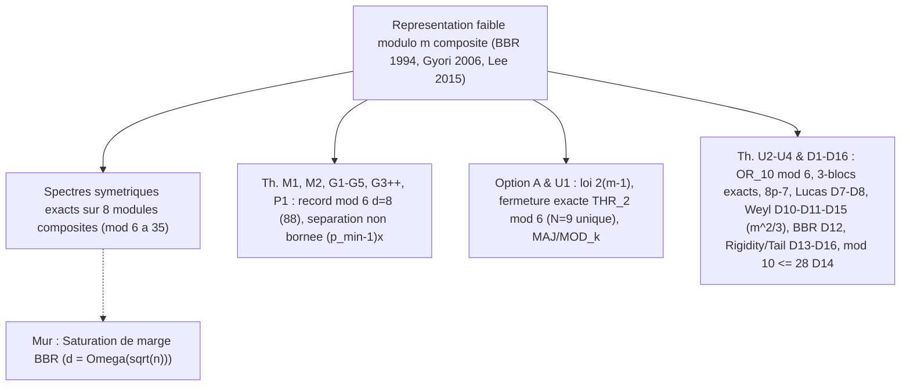

Les **25 expériences (E11 à E15u, 24 figures)** combinent énumération projective exacte sur huit modules composites (`mod 6, 10, 12, 14, 15, 21, 30, 35`), démonstrations analytiques formelles (dont les briques clés sont archivées en Lean 4 dans [lean/README.md](lean/README.md) et vérifiées par [lean/verify_proof_steps_exact.py](lean/verify_proof_steps_exact.py)) et vérifications computationnelles $100\,\%$ exactes en arithmétique entière (`int64` / `uint64` / `uint64 × 2` 128-bits, force brute sur $2^n$ entrées jusqu'à $n = 20$ et vérification algébrique CRT complète au-delà).

---

## 3. Bilan synthétique : résultats établis et mur structurel

### 3.1 Synthèse des résultats établis

| Résultat | Nature | Énoncé clé / Vérification |
| :--- | :--- | :--- |
| **Théorème G5** (Séparation non bornée non symétrique / symétrique) | **Théorème analytique** | Ratio $\ge (p_{\min} - 1)\times$ pour $d < p_{\min}$ ; vérifié à **$\times 4$ ($+300\,\%$, $34 \to 136$)** sur `mod 35` |
| **Théorème G3** (*Value-Avoidance*) et record `mod 6` à $d = 8$ | **Théorème analytique** | Gain $+d$ à marge nulle si $\mathrm{Im}(P_i) \ne \mathbb{Z}/q_i\mathbb{Z}$ ; `mod 6 d = 8` : **$80 \to 88$ ($+10\,\%$)** |
| **Théorème G3++** (*Multi-Value Avoidance*) et **Théorème P1** (probabiliste) | **Théorème analytique** | Capacité exacte **$A_p(d) = (p - 2)\cdot d$** ($=$ borne de Chevalley–Wilson) ; effondrement **$\varepsilon_{\mathrm{sym}}^* = 100\,\%$** dès $n = m$ ($d < p_{\min}$) vs **$m^{-d}$** en non symétrique |
| **Théorèmes M2, G1, G2, G4** sur 8 modules composites | **Théorèmes constructifs** | Gains exacts sur `mod 6, 10, 12, 14, 15, 21, 30, 35` (jusqu'à $+62{,}5\,\%$ par G2 sur `mod 14`) ; obstruction $\mathbb{Z}/4\mathbb{Z}$ prouvée |
| **Régularité quadratique** $N_{\mathrm{gen}}^{(m)}(2) \ge 2(m - 1)$ | **Constat empirique + preuves 2-/3-blocs** | Vérifiée sur **8/8 modules** (`10..68`) ; optimalité exacte parmi les constructions 2-blocs (Th. D5) et 3-blocs sur `mod 10, 12, 15` ($> 160\text{ Md}$ paires, Th. U4) |
| **Théorèmes T1–T2, Q1 et U1** (Fermeture exacte et unicité de $\mathrm{THR}_{n,2}$ mod 6) | **Preuve + énumération exhaustive** | **$N_{\mathrm{gen}}^{(6)}(2, \mathrm{THR}_2) = 9$ exact ($\times 3{,}00$)**, **unique** à $S_9 \times \{\pm 1\}$ près ($V = \{u\} \sqcup \{v\} \sqcup K_2 \sqcup C_5$, $|\mathrm{Aut}| = 20$, $36\,288$ polynômes), $\alpha(G_2) \le 4$, $\omega(G_2) \le 6$, $0$ sol. à $n = 10$ ; triplement **$3{,}00\times$** sur `mod 10` ($4 \to 12$), `mod 15` ($5 \to 15$) et `mod 21` ($6 \to 18$) |
| **Théorème U2** (Classification canonique de $\mathrm{OR}_{10}$ mod 6) et **Théorème D1** (Borne $O_d(p^d)$) | **Théorème + énumération exhaustive** | Extinction exacte par énumération exhaustive des 3 familles homogènes de $\mathrm{OR}_n$ mod 6 à **$n = 9$** ($V_0$ : $4$ classes) et **$n = 10$** ($W_{0,1}$ : $5$ classes à $P_2$ homogène ; $W_{1,1}$ : $866$ classes ; $0/51{,}4\text{ M}$ à $n = 11$) ; borne analytique **$N_{\mathrm{gen}}^{(2p)}(2) \le 2p^2 + p - 2$** par Chevalley–Warning sur $\mathbb{F}_2 \times \mathbb{F}_p$ |
| **Théorème D2** (Filtration de Witt–Dickson sur $\mathbb{F}_2^s$, $\nu_2(2) = 7$ et degrés mixtes) | **Théorème + énumération exhaustive** | Division asymptotique par $2$ de la constante dominante **$2p^2 \to p^2 + O(p \log p)$** (strictement meilleure que D1 pour tout $p \ge 5$ ; gain jusqu'à **$-44{,}6\,\%$**) et $(d^d / (2\,d!))\,p^d$ en degré $d \ge 2$ ; constantes exactes **$\nu_2(2) = 7$** (unique exception $K_6$ à $n = 6$) et **$\nu_2^{\mathrm{THR}}(2) = 5$** ; bornes mixtes $(1, 2) : 3p - 2 \le N_{\mathrm{gen}} \le 4p - 3$ et $(2, 1) : \le 3p - 1$ |
| **Théorème D3** (Contraction duale $\mathbb{F}_q \to \mathbb{F}_p$ et borne supérieure **LINÉAIRE** en $p$) | **Théorème analytique** | Franchissement du mur informationnel $\Omega(p^2 / \log p)$ et **confirmation sur la famille $m = 2p$ de la conjecture linéaire $O(m)$ de Lee (2015)** : **$4p - 2 \le N_{\mathrm{gen}}^{(2p)}(2, \mathrm{OR}) \le 9p - 9$** ($p \ge 5$, ratio **$\le 2{,}25\times$**, `mod 10 ≤ 36`, `mod 202 ≤ 900`, **$-95{,}6\,\%$** vs D1) ; **$O_d(p)$** à tout degré $d \ge 1$ ($(d+1)(2^d - 1)(p - 1) + d$, exact à $d = 1$) ; **$O(p^2 q) \le O(m^{3/2})$** sur tous les semi-premiers $m = pq$ (`mod 15 ≤ 81`, affiné à `≤ 80` par D9 ; `mod 21 ≤ 120`, `mod 35 ≤ 327`) et `mod 30 ≤ 315` |
| **Théorème D4** (Couplage bilinéaire $(B_2, B_p)$ : **$8p - 7$**, **$6p - 4$** et **$-25\,\%$** à tout degré $d$) | **Théorème analytique** | Ratio franchissant le facteur **$< 2{,}00\times$** (confirmation resserrée de la conjecture $O(m)$ de Lee sur $m = 2p$) : **$N_{\mathrm{gen}}^{(2p)}(2, \mathrm{OR}) \le 8p - 7$** (`mod 6 ≤ 17`, affiné à **$\le 16$** via $|w_1|_H \le 3$ exhaustif ; `mod 10 ≤ 33`, affiné à **$\le 32$** par D6 puis **$\le 28$** par D14 ; `mod 202 ≤ 801`, **$-96{,}1\,\%$** vs D1) ; **$\le 6p - 4$** (**$< 1{,}50\times$**) dès qu'un $c_i = 0$ / Type A ; **$\le 6p - 3$** pour $\mathrm{THR}_{n,2}$ ($G_p \ne K_n$, `mod 10 ≤ 27`) ; gain **$-25\,\%$** sur $C_d$ à tout degré $d \ge 2$ ; valeur exacte **$N_{\mathrm{gen}}^{(6)}((1, 2), \mathrm{OR}) = 7$** ($0 / 4\,992$ à $k = 8$) |
| **Théorème D5** (Semi-premiers $m = pq$ : exactitude 2-blocs **$2(m - 1)$**, $O(m)$ à rang borné & verrou $O(m^{3/2})$) | **Théorème analytique** | Preuve analytique d'optimalité exacte **parmi les constructions 2-blocs** **$N_{2\text{-bloc}}^{(pq)}(2, \mathrm{OR}) = 2(m - 1)$** $\forall\, 2 \le p < q$ ; borne $k$-blocs **$\le d\cdot m + (k - d)q - k$** ; bornes **strictement $O(m)$** en degrés mixtes $(1, d)$ / $(d, 1)$ ($< 2(m - 1)$ à $d = 2$) et à rang bilinéaire borné **$O(\min(r_p, r_q, p)\cdot m)$** ; complémentation quadratique et adversaire linéaire $\min |x|_H \ge jq/2$ |
| **Théorème D6** (Symétrie 3-racines `mod 10 ≤ 32`, tranches paires de Lucas $7p - 4$, $m = 3q \le 19q - 13$ & 4 barrières $m = pq$) | **Théorème analytique** | Cassure inconditionnelle de $8p - 7$ à $p = 5$ (**$N_{\mathrm{gen}}^{(10)}(2, \mathrm{OR}) \le 32$**, **$\mathrm{THR}_2 \le 33$**, resserrés en D14) ; tranches de Lucas $2p/4p$ (**$7p - 4$** $< 1{,}75\times$ si $B_p(w_1, \cdot)$ constant) ; **$m = 3q \le 19q - 13$** (affiné à **$19q - 15$** $\forall q \ge 5$ par D9 ; $\le 17q - 11$ Cas 1, $\le 15q - 6$ Type A) ; 4 barrières exactes sur $m = pq$ (Fourier $\Omega(m^2 \log m)$, rang $\mathbb{F}_p$ $\Omega(p)$, CW sharp $j(q - 1) + 1$, et **absence de barrière info $m^{3/2}$** : $p^2 \ln q / \ln p < m$) |
| **Théorèmes D7 & U3** (Bi-tranches analytiques de Lucas $5p - 2$, fermetures 3-/4-blocs $\mathrm{THR}_2$ mod 10 & cubique 2-blocs mod 6 $= 27$) | **Preuve + énumération exhaustive** | Preuves analytiques en 5 lignes sur **$(3p - 1, 2p - 1)$** et **$(4p - 1, p - 1)$** ($\forall p \ge 5$) ; $1\,859/1\,861$ partitions tuées à $M = 24 \pmod 5$ ; rang Walsh–Hadamard $G_p(x \oplus y)$ ; **$N_{3\text{-bloc}}^{(10)}(2, \mathrm{THR}_2) = 11$ exact** ($0$ sol. sur $(4,4,4)$), **$N_{4\text{-bloc}}^{(10)}(2, \mathrm{THR}_2) = 12$ exact** ($0 / 3{,}80\text{ Md}$ paires à $n = 13$) et **$N_{2\text{-bloc}}^{(6)}(3, \mathrm{OR}) = 27$ exact** ($0 / 70{,}4\text{ M}$ à $n = 28$ ; **$27 \le N_{\mathrm{gen}}^{(6)}(3) \le 50$**) |
| **Théorème D8** (Chevalley–Warning à poids contraint modulo $r$ : matrice de Lucas–Vandermonde **$(Dr + 1)p - 1$**) | **Théorème analytique** | Formule close exacte **$|\det A(D, r)|$** (Vandermonde des factorielles descendantes) : **$|\det A(1, r)| = 1$** ($\forall$ premier $p$, gain $\to 50\,\%$), **$|\det A(2, r)| = \binom{2r - 1}{r}$** ($\forall p \ge 2r$ **et** $\forall$ puissance première $r = p^k$), tous facteurs premiers $< Dr$ ; racine booléenne de poids divisible par $rp$ dès **$(Dr + 1)p - 1$** variables (économie $(r - 1)p$ vs $(D + 1)rp$) |
| **Théorème D9** (Semi-premiers $m = pq$ : rang décalé diagonal $\tilde{r}$, parcimonie Caro–Wei, mur expanseur–Fourier **$m^{3/2}$** & **$m = 3q \le 19q - 15$**) | **Théorème analytique** | Borne **$O(\min(\tilde{r}_p, \tilde{r}_q, p)\cdot m)$** (alignée sur la dichotomie de rigidité diagonale de Lee 2015 ; couvre symétriques $\tilde{r} = 1$, 2-blocs et $k$-blocs pondérés) ; Caro–Wei **$n \le (\bar{\Delta} + 1)(2m - q - 1)$** (couplage $\le 4m - 2q - 2$) ; mur expanseur–Fourier uniforme $\mathrm{Var}(P) = |E| \sim n^2/(4m)$ à $n = m^{3/2}$ (démoli sur les graphes signés parcimonieux par D10) ; empilement sharp $\mathbb{F}_3^2$ ($3k + 4$) donnant **$19q - 15$** $\forall q \ge 5$ (**`mod 15 ≤ 80 < 81`**) et $8 \le \mu_3(2) \le 10$ |
| **Théorème D10** (Fermeture rang 1 **$3q - 1$**, différentiation de Weyl biaisée exacte & **démolition du mur expanseur D9.3**) | **Théorème analytique** | **Égalité exacte $N_{\mathrm{gen}}^{(2q)}(2, \mathrm{OR} ; P_q = aL^2 + bL) = 3q - 1$** ($\forall q \ge 3$) et bornes $< 2(m - 1)$ ($\le 2m - p - 1$, $\le 2m - q - 1$) + rang-2 pur **$\le 4m - 2p - 2q$** sur $m = pq$ ; identités exactes $|S_\theta(t)|^2 = \mathbb{E}[\prod_{j\in J} \cos(2\pi t D_j/m)]$ et $\mathbb{E}[\sum_{j\in J} D_j^2] = 2\mathrm{Var}_\theta(P)$ ($\le 1{,}4 \times 10^{-14}$) ; surplus basse fréquence universel $M(x ; 0{,}10) > 0{,}131$ ($\forall x > 0$) ; borne inconditionnelle sur graphes signés **$n \le 32m$** dès $\Delta + B \lesssim m^{1/4}/(\ln m)^{1/4}$ ($m^{1/3}$ en quasi-régulier) et sous-échantillonnage forçant **$\rho(G) > c_0' / (m^{3/4}(\ln m)^{1/4})$** pour tout $n \ge 64m$ (éliminant intégralement le mur D9.3) ; témoin $\{0, 1\}$ exact **$K_8 \sqcup K_2$ ($n = 10 \pmod 6$)** |
| **Théorème U4** (Fermetures 3-blocs exactes **$2(m - 1)$** sur $m = 10, 12, 15$, obstruction anisotrope & fermeture circulante **$\mathbb{Z}_{19}$**) | **Preuve + énumération exhaustive** | **Lemme analytique d'obstruction 3-blocs anisotrope** ($a, b \ge (p - 1)q, c \ge q$ impossible $\forall m = pq$ impair) ; fermetures exhaustives exactes **$N_{3\text{-bloc}}^{(10)}(2, \mathrm{OR}) = 18$** ($26$ partitions / $12{,}7\text{ M}$ $P_5$), **$N_{3\text{-bloc}}^{(12)}(2, \mathrm{OR}) = 22$** ($44$ partitions / $56{,}6\text{ Md}$ paires, non sans facteur carré) et **$N_{3\text{-bloc}}^{(15)}(2, \mathrm{OR}) = 28$** ($21$ partitions / **$100{,}9\text{ Md}$** paires, $9/21$ tuées analytiquement) ; fermeture circulante complète $2^{19}$ sur $\mathbb{Z}_{19} \pmod{10}$ ($2{,}50\text{ Md}$ paires, $0$ solution ; $9$ copies isomorphes de $C_{19}$ uniques sur les sous-ensembles propres ; $C_{19}$, $P_{19}$ et ses $760$ perturbations 1-entrée bloqués à `bad ≥ 1` même à $190$ variables $P_2$ libres) |
| **Théorème D11** (Cœur quasi-régulier, Bande 2,5 déphasée **$\Delta \lesssim m^{1/2}$**, densité **$\Omega(m^{-1/2})$** & rang CRT) | **Théorème analytique** | **Lemme D11.1** : cœur induit quasi-régulier $|V(H)| \ge n/2$, $\Delta(H) \le 2K \bar{\Delta}(H)$, $\rho(H) \le 2\rho(G)$ ; **Lemme D11.2** : borne cosinus déphasé $\mathrm{dist}(\alpha + \delta, \pi\mathbb{Z})^2 \ge \frac{1}{4}\delta^2 + c(\alpha)\delta$ (min extérieur $\frac{3}{256}\pi^2$) ; **D11.3** : **$n \le 64m$ inconditionnel jusqu'à $\Delta \lesssim m^{1/2}/(\ln m)^{3/2}$** (exposant doublé $1/4 \to 1/2$ sans hypothèse de quasi-régularité) et densité forcée **$\rho(G) > c_1' / (m^{1/2}(\ln m)^{5/2})$** ($\forall n \ge 256m$) ; **D11.4** : $\tilde{r}(A) \le 3 \max \mathrm{rank}(A[U, W])$, découplage par codimension de pivots sur $\gcd(t, m) \in \{p, q\}$ et réduction par invariance unitaire à $t = 1$ |
| **Théorème D12** (Barrière de saturation BBR : **$O(d^r)$ $k$-blocs & semi-symétrique** et fermetures exactes par tranches de Lucas) | **Théorème + certificats exacts** | **$N_{k\text{-bloc}}^{(m)}(d, \mathrm{OR}) = \Theta_{k,m}(d^r)$** et **$O_m(d^r)$ semi-symétrique** pour tout $m$ et tout $d \ge 1$ (dual `mod 6` : $\sum \lfloor s_j/(2^a 3^b) \rfloor \le 2\lfloor d/3^b \rfloor$, $\sum \lfloor s_j/(2^{a-1} 3^{b+1}) \rfloor \le 1$) ; fermetures semi-symétriques **100 % exactes** **$N_{\mathrm{gen}}^{(6)}(3 ; P_3\text{ sym}) = 27$** ($13/13$ certificats à $n = 28$), **$N_{\mathrm{gen}}^{(6)}(6 ; P_3\text{ sym}) = 62$** ($364/364$ à $n = 63$), **$53 \le N_{\mathrm{gen}}^{(6)}(5 ; P_3\text{ sym}) \le 54$**, dual **$N_{\mathrm{gen}}^{(6)}(3 ; P_2\text{ sym}) \le 39$** ($4$ termes mod 3 vs $50$ en D4), `mod 10 d = 2 : = 14`, `d = 3 : ≤ 22 < 27`, `d = 4 : ≤ 29 < 36`, `mod 15 d = 2 : ≤ 25 < 28` ; résistance $0 / 101\,688$ pert. 1/2/3-opt en 3-blocs à $d = 3, n = 28$ |
| **Théorème D13** (Rigidité matricielle de Valiant, repliement de paires sur blowups denses, recensement $\mathrm{OR}_4/\mathbb{F}_3$ & audit Bande 3 $\times 4$) | **Théorème + énumération exhaustive** | **D13.1** : rigidité booléenne **$R_{\mathbb{F}_q}^{\mathrm{bool}}(A_q, r) > n^2/(2(r+1)m) - n$** (tue tout graphe cocktail-party $\rho = 1$ à $n < 8m$) ; **D13.2** : repliement de paires à poids constant annulant tout blowup $k$-blocs à poids modulaires arbitraires ($\Delta : 1\,291 \to 11$ sur $m = 323$) ; **D13.3** : recensement exhaustif $\mathrm{OR}_4 / \mathbb{F}_3$ ($114 / 59\,049$ : $90$ normes $\tilde{r} = 2$ + $24$ rang $\tilde{r} = 3$) ; **Audit Bande 3** : conditionnement pré-Weyl $\exp(-(3/16)\,s\,(t/m)^2)$ ($4\times$ plus fort) |
| **Théorème D14** (Escalier héréditaire de Lucas, **nouveau record $N_{\mathrm{gen}}^{(10)}(2, \mathrm{OR}) \le 28$** et chasses CEGAR $\mathbb{F}_2$-Gauss) | **Théorème + certificats exacts** | **D14.1** : escalier héréditaire exact sur $U_1(w_1) \pmod 5$ ($w_f \in \{0, 1, 3, 5, 7, 9, 11\} \Rightarrow |U_1| \le \{24, 23, 22, 19, 17, 15, 13\}$), tuant $n = 32, 31, 30$ ; **D14.2** : fermeture jointe $(U_0, U_1)$ à $n = 29$ ($0 / 1\,085$ et $0 / 7\,140$), prouvant inconditionnellement **$18 \le N_{\mathrm{gen}}^{(10)}(2, \mathrm{OR}) \le 28$** ($1{,}556\times$, vs $32$ en D6) et **$\mathrm{THR}_2 \le 29$** ; **D14.3** : chasses CEGAR exactes $190$-var ($n = 19 \pmod{10}$) et 4-blocs cubiques $2^{34}$ ($0 / 74\,028$ à $d = 3, n = 28 \pmod 6$, calibré à $0$ à $n = 27$) |
| **Théorème D15** (Décomposition 5 bandes Warnke + $\sin^2$ : **$\Delta \lesssim m^{2/3}$** et densité **$\Omega(m^{-1/3})$**) | **Théorème analytique** | **D15.1** : lemme cosinus déphasé renforcé $\mathrm{dist}(\alpha + \delta, \pi\mathbb{Z})^2 \ge \frac{1}{4}\delta^2 + c(\alpha)\delta + \frac{1}{8}\alpha^2$ (min exact $\frac{5}{448}\pi^2$) ; **D15.2** : identité exacte $\sin^2$ indépendante des termes linéaires $b_j$ (vérifiée sur $9/9$ énumérations $3^n$) ; **D15.3** : différences typiques bornées de Warnke (2016) + croisement Bande 2,75 / Bande 3 en $T_3 = m/(K^{1/2}\Delta^{1/4})$ donnant **$n \le 64m$ jusqu'à $\Delta \lesssim m^{2/3}/(\ln m)^{4/3}$** et **$\rho(G) > c_2'/(m^{1/3}(\ln m)^{7/3})$** ($\forall n \ge 256m$) |
| **Théorème D16** (Dichotomie spectrale de queue sur expanseurs denses $\rho = 1$ & exclusion dyadique sur grands coefficients modulaires) | **Théorème analytique** | **D16.1** : sur $A_{UW} \in \{-1, 0, +1\}^{n/2 \times n/2}$, soit Hanson–Wright tue $|S_{1/2}(t)| < 1/m$ dès $n = O(m\sqrt{\ln m / \rho})$ (vérifié sur aléatoire $\pm 1$, $\{0,1\}$, Hadamard $H_{128}/H_{256}$ et Paley $P_{197}$ jusqu'à $7{,}9 \times 10^{-33}$), soit $\|A_{UW} - L\|_F^2 < 16 m^2 \ln m / t^2$ à rang réel $O(\ln^2 m)$ ; **D16.2** : exclusion dyadique $|S_{1/2}(t)| \le \exp(-\frac{1}{4}\nu_{\mathrm{ind}}(G_k)(2^{k-1}/m)^2)$ éliminant les grands coefficients parcimonieux dès **$n = O(\Delta \ln m)$** (indépendant de $m$, certifié $4/4$ dont $n = 460 < m = 899$) |

### 3.2 Limites et mur de saturation de marge

Les deux grandes conjectures asymptotiques demeurent ouvertes dans leur pleine généralité. D'une part, la conjecture $d = \Omega(\sqrt{n})$ de Barrington–Beigel–Rudich (1994) pour $\mathrm{OR}_n \pmod 6$ (et $\Theta(d^r)$ pour $r$ facteurs premiers à $m$ fixé et $d \to \infty$) est démontrée inconditionnellement en régimes $k$-blocs et semi-symétrique par le **Théorème D12** (avec fermetures exactes $= 27$ à $d = 3$ et $= 62$ à $d = 6$ sur $\bmod 6$), mais le cas simultanément non symétrique sur les deux canaux reste ouvert. D'autre part, la conjecture linéaire $N_{\mathrm{gen}}^{(m)}(2) = O(m)$ de Lee (2015) est établie sur toute la famille $m = 2p$ et repoussée jusqu'à $\Delta \lesssim m^{2/3}/(\ln m)^{4/3}$ et $\rho(G) > c_2' / (m^{1/3}(\ln m)^{7/3})$ sur les graphes signés (**Théorème D15**), la frontière résiduelle portant sur les graphes signés très denses ($\rho \gg m^{-1/3}$) de haute rigidité de Valiant et les polynômes modulaires adversariaux à grands coefficients centrés sur $t = 1$.

| # | Mur structurel | Contexte | Manifestation quantitative mesurée |
| :---: | :--- | :--- | :--- |
| **3** | **Saturation de marge (BBR)** | Polynômes $\bmod m$ ($\Delta = 0$) | Les constructions non symétriques battent $N_{\mathrm{sym}}$ dès que $\Delta > 0$ ou $d < p_{\min}$, mais dès que $\Delta = 0$ (ex. `mod 6` à $d = 3, 4, 5$), les recherches multi-blocs heurtent systématiquement `defect = 1` dès $N_{\mathrm{sym}}(d) + 1$ (confirmé par la fermeture 2-blocs cubique $= 27$ en U3, la fermeture semi-symétrique $P_3$ symétrique $= 27$ en D12 et $0 / 101\,688$ perturbations 1/2/3-opt en 3-blocs à $n = 28$). |

---

## 4. Présentation détaillée des expériences, buts, résultats et graphiques (Expériences E11 à E15u)

#### Expérience E11 — Spectre symétrique 100 % exact N_sym^(6)(1..10) par canonisation projective

Toute comparaison rigoureuse entre polynômes généraux et polynômes symétriques modulo $6$ suppose de connaître d'abord, sans erreur ni biais d'échantillonnage, le plafond exact $N_{\mathrm{sym}}^{(6)}(d)$ des polynômes symétriques ainsi que les degrés minimaux réellement consommés sur chacun des deux canaux $\mathbb{F}_2$ et $\mathbb{F}_3$. Prolongeant le laboratoire initial [mod6_poly_lab.py](src/mod6_poly_lab.py), l'énumération exhaustive [mod6_exact_complete.py](src/mod6_exact_complete.py) parcourt l'intégralité des $2^d - 1$ polynômes symétriques sur $\mathbb{F}_2$ et de toutes les $(3^d - 1)/2$ droites projectives canoniques de $\mathbb{P}^{d-1}(\mathbb{F}_3)$ pour $d = 1..10$ (après correction d'un biais initial de canonisation qui sous-comptait $d = 3$ à $19$).

L'énumération met d'emblée au jour un phénomène marquant : dès $d = 5$, le polynôme symétrique $P_3^*(S) = \binom{S}{1} + \binom{S}{3} + 2\binom{S}{4} + \binom{S}{5} \pmod 3$ annule uniquement $S \equiv 0 \pmod 9$ (au lieu du degré $8$ de la construction de BBR) en exploitant les deux résidus non nuls $\{1, 2\} \pmod 3$. Surtout, le tableau complet révèle que pour de nombreux degrés ($d = 2, 6, 7, 8, 9$), l'un des deux canaux sature avant l'autre et laisse une marge de degré $\Delta = d - \min(\deg P_2^*, \deg P_3^*) \ge 1$ inutilisée :

| Degré $d$ | Période CRT max $p_2 p_3 - 1$ | Exact $N_{\mathrm{sym}}(d)$ | $\deg(P_2^*)$ | $\deg(P_3^*)$ | Marge $\Delta$ | Prouvé non symétrique $N_{\mathrm{gen}}(d) \ge$ | Gain vs symétrique |
| :---: | :---: | :---: | :---: | :---: | :---: | :---: | :--- |
| $1$ | $5$ | $5$ | $1$ | $1$ | $0$ | $5$ | $+0$ |
| **$2$** | $11$ | **$8$** | $2$ | **$1$** | $1$ | **$10$** *(optimal, Győri 2006)* | **$+2$ ($+25{,}0\,\%$)** |
| $3$ | $35$ | $27$ | $3$ | $3$ | $0$ | $27$ | $+0$ |
| $4$ | $71$ | $36$ | $4$ | $4$ | $0$ | $36$ | $+0$ |
| $5$ | $71$ | $53$ | $5$ | $5$ | $0$ | $53$ | $+0$ |
| **$6$** | $71$ | **$62$** | $6$ | **$5$** | $1$ | **$63$** *(Th. M2)* | **$+1$ ($+1{,}6\,\%$)** |
| **$7$** | $71$ | **$71$** | $7$ | **$5$** | $2$ | **$73$** *(Th. M2, dépasse la période 71)* | **$+2$ ($+2{,}8\,\%$)** |
| **$8$** | $143$ | **$80$** | $8$ | **$5$** *(ou $8$, $I_9$)* | $3$ | **$88$** *(83 par M2, **88 par G3**)* | **$+8$ ($+10{,}0\,\%$)** |
| **$9$** | $431$ | **$151$** | **$7$** | $9$ | $2$ | **$153$** *(Th. M2, marge sur $\mathbb{F}_2$)* | **$+2$ ($+1{,}3\,\%$)** |
| $10$ | $431$ | $184$ | $10$ | $10$ | $0$ | $184$ | $+0$ |

---

#### Expérience E12 — Théorèmes M1 et M2 : séparations non symétriques modulo 6 et saturation de marge

Le spectre exact de l'Expérience E11 pose immédiatement deux questions : comment expliquer algébriquement le dépassement $N_{\mathrm{gen}}(2) = 10 > N_{\mathrm{sym}}(2) = 8$ établi par Győri (2006 / FCT 2007), et peut-on exploiter les marges $\Delta \ge 1$ repérées aux degrés $d \ge 6$ — ou même dépasser $N_{\mathrm{sym}}(d)$ lorsque $\Delta = 0$ ($d = 3, 4, 5$) ? Les constructions correspondantes sont formalisées et vérifiées dans [verify_mod6_theorems.py](src/verify_mod6_theorems.py).

En degré pair, la clé vient de l'anisotropie quadratique sur $\mathbb{F}_3$ : comme $-1 \notin (\mathbb{F}_3^*)^2$, la somme de carrés $u^2 + v^2$ ne s'annule modulo $3$ que si $u \equiv v \equiv 0 \pmod 3$. En combinant deux blocs disjoints $A$ et $B$, le **Théorème M1** établit un doublement récursif immédiat :

> **Théorème M1 (Somme de carrés sur $\mathbb{F}_3$ et doublement récursif).** Puisque $-1 \notin (\mathbb{F}_3^*)^2$, la forme quadratique $u^2 + v^2$ est anisotrope sur $\mathbb{F}_3$ ($u^2 + v^2 \equiv 0 \pmod 3 \iff u \equiv v \equiv 0 \pmod 3$). Il en résulte : (1) pour tout $d \ge 1$, $N_{\mathrm{gen}}(2d) \ge 2 N_{\mathrm{gen}}(d)$ via $P_2 = Q_2(A) + Q_2(B) + Q_2(A)Q_2(B) \pmod 2$ et $P_3 = Q_3(A)^2 + Q_3(B)^2 \pmod 3$ ; (2) en degré $d = 2$, deux familles explicites — $(8, 2)$ et $(5, 5)$ — représentent $\mathrm{OR}_{10} \pmod 6$ (vérifiées sur les $1\,024$ entrées), atteignant l'optimum $N_{\mathrm{gen}}(2) = 10$ de Győri (2006 / FCT 2007).

Ce doublement ne suffit toutefois pas aux degrés impairs ou intermédiaires. L'observation décisive issue du tableau de E11 est que les sauts de période $2^a$ et $3^b$ sont incommensurables ($\log 2 / \log 3 \notin \mathbb{Q}$), créant une marge $\Delta = d - d_3 \ge 1$ (ou $d - d_2 \ge 1$) pour une infinité de degrés. Le **Théorème M2** convertit directement chaque unité de marge en une variable supplémentaire gratuite :

> **Théorème M2 (Récolte de marge non symétrique — *Margin-Harvesting*).** Soit $(P_2(A), P_3(A))$ une représentation faible de $\mathrm{OR}_a \pmod 6$ de degré $\le d$. Si $\deg(P_3) = d_3 < d$ (marge $\Delta = d - d_3 \ge 1$), l'ajout de $\Delta$ variables $y_1, \dots, y_\Delta$ via :
>
> $$
> \widetilde{P}_2(A, y) = P_2(A) \pmod 2, \qquad \widetilde{P}_3(A, y) = P_3(A) + v(y) - P_3(A)\, v(y) \pmod 3,
> $$
>
> où $v(y) = 1 - \prod_{j=1}^{\Delta} (1 - y_j) \in \{0, 1\} \pmod 3$, définit un polynôme de degré $\le d$ représentant $\mathrm{OR}_{a + \Delta} \pmod 6$. Une construction analogue s'applique lorsque $\deg(P_2) < d$.

*Preuve.* Si $y \ne \mathbf{0}$, alors $v(y) = 1$ et $\widetilde{P}_3(A, y) = 1 \not\equiv 0 \pmod 3$ quel que soit $A$. Si $y = \mathbf{0}$, alors $v(\mathbf{0}) = 0$, ce qui ramène au couple $(P_2(A), P_3(A))$, nul simultanément uniquement en $A = \mathbf{0}$. L'incommensurabilité des sauts de périodes $2^a$ et $3^b$ garantit $\Delta \ge 1$ (et même $\Delta = \Omega(d)$) pour une infinité de degrés $d$, dépassant dès $d = 7$ la période CRT symétrique $8 \times 9 - 1 = 71$ avec $n = 73$. ■

Reste alors le cas symétrique opposé : lorsque la marge s'annule ($\Delta = 0$, à $d = 3, 4, 5$), peut-on encore dépasser $N_{\mathrm{sym}}(d)$ ? Les chasses exactes menées par élimination de Gauss sur $\mathbb{F}_2$ couplée au balayage sur $\mathbb{F}_3$ sur $16$ cœurs ([hunt_d2_n9_mod6.py](src/hunt_d2_n9_mod6.py), [mod6_2block_d3_and_d2.py](src/mod6_2block_d3_and_d2.py), [hunt_super_quadratic_mod6.py](src/hunt_super_quadratic_mod6.py)) butent systématiquement sur un mur `defect = 1` dès $N_{\mathrm{sym}}(d) + 1$ : aucune solution à $n = 28$ pour $d = 3$ (en 2-blocs exhaustif — ensuite fermé à $= 27$ au Théorème U3 — ni en 3-blocs $(26, 1, 1)$), `defect = 1` sur $6$ partitions 2-blocs à $n = 37$ ($d = 4$) et `defect = 1` sur $5$ partitions à $n = 54$ ($d = 5$). C'est cet obstacle qui motive la conjecture de saturation de marge (Mur n° 3).

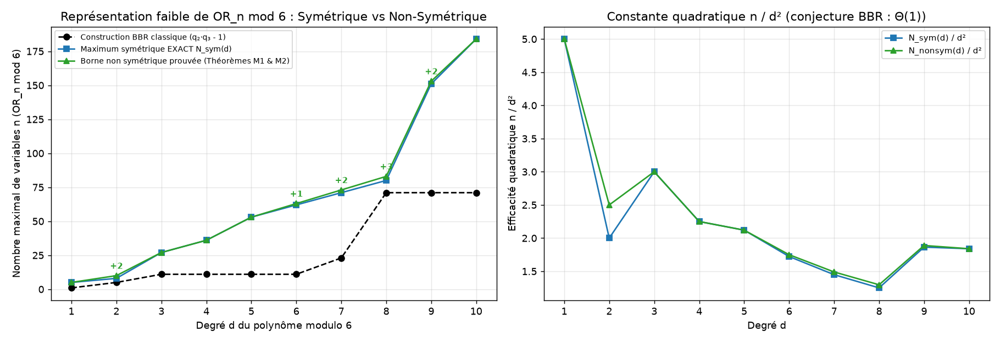

---

#### Expérience E13 — Généralisation aux 8 modules composites (`mod 6` à `mod 35`) : Théorèmes G1–G5

Les mécanismes M1 et M2 découverts modulo $6$ s'étendent-ils à tout entier composite $m = \prod_{i=1}^r q_i$ ($q_i = p_i^{e_i}$, incluant les modules non sans facteur carré comme `mod 12 = 4 × 3` et les modules à $3$ facteurs comme `mod 30 = 2 × 3 × 5`), et l'écart relatif $N_{\mathrm{gen}}^{(m)}(d) / N_{\mathrm{sym}}^{(m)}(d)$ reste-t-il borné ? En généralisant la démarche sur huit modules composites ([composite_mod_m_lab.py](src/composite_mod_m_lab.py), [composite_mod_m_full.py](src/composite_mod_m_full.py), [composite_mod_m_verify_and_plot.py](src/composite_mod_m_verify_and_plot.py), données dans [composite_mod_m_full.json](results/composite_mod_m_full.json)), cinq théorèmes s'enchaînent.

Premièrement, le **Théorème G1 (*Multi-Channel Margin-Harvesting*)** montre que l'ajout de $r$ blocs disjoints $y^{(i)}$ de tailles $\Delta_i = d - d_i$ sur chaque canal CRT $q_i$ récolte simultanément la somme $\sum_{i=1}^r \Delta_i$ (même lorsque $q_i = p_i^{e_i}$ avec $e_i \ge 2$). Deuxièmement, le **Théorème G2 (*Anisotropic Field-Norm Harvesting*)** amplifie ce gain d'un facteur $p - 1$ : sur tout canal premier simple $p_i \mid m$ où $k_i = \lfloor d / d_i \rfloor \ge 2$, remplacer $P_i(A)$ par la norme d'extension de corps $N_{\mathbb{F}_{p^k}/\mathbb{F}_p}(P_i(A), R_1(B_1), \dots, R_{k-1}(B_{k-1}))$ (chaque $R_j$ de degré $d_i$ absorbant l'optimum exact $(p_i - 1)d_i$ variables sur $\mathbb{F}_{p_i}$) puis récolter le reste $d - k_i d_i$ par G1 fournit $(k_i - 1)(p_i - 1)d_i + (d - k_i d_i)$ variables gratuites.

Troisièmement, même lorsque la marge est nulle, le **Théorème G3 (*Value-Avoidance Harvesting*)** exploite l'image de $P_i$ : si $\mathrm{Im}(P_i)$ sur $\{0, \dots, a\}$ omet au moins une valeur non nulle $-c \in (\mathbb{Z}/q_i\mathbb{Z}) \setminus \{0\}$, alors le polynôme **purement additif** $\widetilde{P}_i(A, y) = P_i(A) + c \cdot (1 - \prod_{j=1}^d (1 - y_j)) \pmod{q_i}$ conserve le degré $\max(\deg P_i, d) = d$ sans aucun produit croisé et récolte **$+d$ variables gratuites**. À $d = p^t - 1$, l'indicatrice de Lucas $I_{p^t}(S) = \mathbf{1}[S \not\equiv 0 \pmod{p^t}]$ a pour image $\{0, 1\} \pmod p$ et déclenche systématiquement **$+8$ à $d = 8$** sur tout multiple de $3$ : sur `mod 6, d = 8`, on passe ainsi de $N_{\mathrm{sym}} = 80$ à $83$ (M2) puis **$88$ ($+10{,}0\,\%$, G3)** via $c_2 = [0,1,1,1,1,1,1,1]$ et $c_3 = [2,1,2,1,2,1,2,1]$ ($\mathrm{Im}(P_3) = \{0, 2\}$ omet $1 \pmod 3$) ; de même `mod 12, d = 8` passe de $224$ à **$232$** et `mod 15, d = 8` de $215$ à **$223$**.

Quatrièmement, le **Théorème G4 (*Multi-Block Norm Multiplication*)** généralise M1 à tout module **sans facteur carré** $m = p_1 \cdots p_r$ : pour tous $k \ge 2$ et $d_0 \ge 1$ avec $k d_0 \le d$, composer $k$ copies indépendantes par les normes $N_{\mathbb{F}_{p_i^k}/\mathbb{F}_{p_i}}$ sur chaque canal puis récolter le reste par G1 donne $N_{\mathrm{gen}}^{(m)}(d) \ge k \cdot N_{\mathrm{gen}}^{(m)}(d_0) + r(d - k d_0)$. En revanche, sur $\mathbb{Z}/4\mathbb{Z}$ (`mod 12`), aucun polynôme sans constante en $(u, v)$ ne peut être anisotrope car $Q(2, 2) \equiv Q(2, 0) + Q(0, 2) \equiv 0 \pmod 4$, ce qui montre que G4 est spécifique aux modules sans facteur carré. Enfin, appliqué au régime $d < p_{\min}$, G4 entraîne une **séparation non bornée** entre polynômes généraux et symétriques :

> **Théorème G5 (Séparation non bornée entre polynômes non symétriques et symétriques).** Soit $m = p_1 \cdot p_2 \cdots p_r$ un entier composite sans facteur carré dont le plus petit facteur premier vérifie $p_{\min} = \min_i p_i \ge 3$. Alors, pour tout degré $1 \le d \le p_{\min} - 1$ :
>
> $$
> N_{\mathrm{sym}}^{(m)}(d) \;=\; m - 1, \qquad N_{\mathrm{gen}}^{(m)}(d) \;\ge\; d \cdot (m - 1), \qquad \frac{N_{\mathrm{gen}}^{(m)}(p_{\min} - 1)}{N_{\mathrm{sym}}^{(m)}(p_{\min} - 1)} \;\ge\; p_{\min} - 1 \;\longrightarrow\; +\infty.
> $$

*Preuve.* Pour tout $1 \le k \le d < p_{\min}$ et tout $p_i \mid m$, $p_i$ divise $m$ mais ne divise pas $k!$, donc $\binom{m}{k} \equiv 0 \pmod{p_i}$. Tout polynôme symétrique sans constante de degré $\le d$ s'annule ainsi en $S = m$ sur chaque canal $p_i$, d'où $P(m) \equiv 0 \pmod m$ et $N_{\mathrm{sym}}^{(m)}(d) = m - 1$ exactement. Inversement, appliquer le Théorème G4 à $d_0 = 1$ ($N_{\mathrm{sym}}^{(m)}(1) = m - 1$) avec $k = d$ blocs disjoints de taille $m - 1$ et les normes anisotropes $N_{\mathbb{F}_{p_i^d}/\mathbb{F}_{p_i}}(S_1, \dots, S_d)$ impose $S_j \equiv 0 \pmod m$ pour tout $j$, donc $x = \mathbf{0}$. ■

Les $17$ normes anisotropes ont été vérifiées sur tous les vecteurs non nuls de $\mathbb{F}_p^k \setminus \{\mathbf{0}\}$, accompagnées de vérifications en force brute intégrale sur $2^{18} = 262\,144$ entrées pour `mod 10, d=2, n=18` et $2^{20} = 1\,048\,576$ entrées pour `mod 15, d=2, n=20` :

| Module $m$ (facteurs) | Degrés exacts | Pic de séparation $d^*$ | Exact $N_{\mathrm{sym}}(d^*)$ | Prouvé $N_{\mathrm{gen}}(d^*) \ge$ | Gain (relatif) | Mécanisme vainqueur | Autres records marquants |
| :--- | :---: | :---: | :---: | :---: | :---: | :--- | :--- |
| **mod 6** ($2 \times 3$) | $d = 1..10$ | $d = 2$ / $d = 8$ | $8$ / $80$ | **$10$ / $88$** | **$+2$ ($+25\,\%$) / $+8$ ($+10\,\%$)** | G2 (Győri) / **G3 ($I_9$)** | $d=7 : 71 \to 73$ ; $d=9 : 151 \to 153$ |
| **mod 10** ($2 \times 5$) | $d = 1..8$ | $d = 4$ | $24$ | **$36$** | **$+12$ ($+50{,}0\,\%$)** | **G2 (norme $\mathbb{F}_5^4$)** | $d=2 : 14 \to 18$ ; $d=3 : 19 \to 27$ |
| **mod 12** ($4 \times 3$, non sqfree) | $d = 1..8$ | $d = 2$ / $d = 8$ | $20$ / $224$ | **$22$ / $232$** | **$+2$ ($+10\,\%$) / $+8$ ($+3{,}6\,\%$)** | G2 / **G3 ($I_9@3$)** | $d=6 : 134 \to 135$ ; $d=7 : 143 \to 145$ |
| **mod 14** ($2 \times 7$) | $d = 1..6$ | $d = 6$ | $48$ | **$78$** | **$+30$ ($+62{,}5\,\%$)** | **G2 (norme $\mathbb{F}_7^6$)** | $d=2..5 : +30\,\%$ à $+58{,}5\,\%$ |
| **mod 15** ($3 \times 5$) | $d = 1..8$ | $d = 2$ | $14$ | **$28$** | **$+14$ ($+100{,}0\,\%$)** | **G4/G5 ($2\times 14$)** | $d=4 : 39 \to 56$ ($+44\,\%$) ; $d=8 : 215 \to 223$ (**G3**) |
| **mod 21** ($3 \times 7$) | $d = 1..6$ | $d = 2$ / $d = 6$ | $20$ / $62$ | **$40$ / $120$** | **$+20$ ($+100\,\%$) / $+58$ ($+93{,}5\,\%$)** | **G4/G5 ($2\times 20$ / $2\times 60$)** | $d=4 : 55 \to 80$ ; $d=5 : 62 \to 100$ ($+61\,\%$) |
| **mod 30** ($2 \times 3 \times 5$, $r=3$) | $d = 1..6$ | $d = 2$ | $44$ | **$58$** | **$+14$ ($+31{,}8\,\%$)** | **G4 ($2\times 29$)** | $d=4 : 184 \to 196$ (G2) ; $d=6 : 1\,358 \to 1\,359$ ($\Theta(d^3)$) |
| **mod 35** ($5 \times 7$, $p_{\min}=5$) | $d = 1..5$ | $d = 4$ | $34$ | **$136$** | **$+102$ ($+300{,}0\,\%$, $4\times$)** | **G4/G5 ($4\times 34$)** | $d=2 : 34 \to 68$ ; $d=3 : 34 \to 102$ ; $d=5 : 146 \to 170$ |

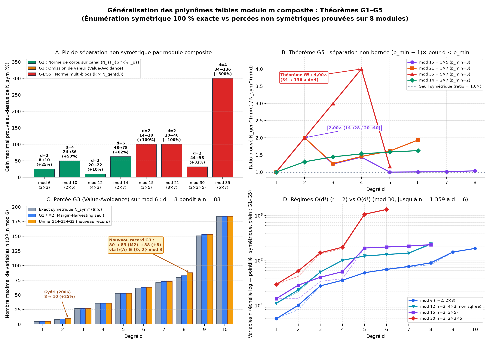

---

#### Expérience E14 — Test d'optimalité quadratique : la régularité empirique N_gen^(m)(2) ≥ 2(m − 1)

En examinant la colonne $d = 2$ du tableau de l'Expérience E13, une régularité frappante saute aux yeux : sur **l'ensemble des huit modules composites** (`m ∈ {6, 10, 12, 14, 15, 21, 30, 35}`, y compris le module non sans facteur carré `mod 12`), les meilleures constructions quadratiques atteignent exactement **$2(m - 1)$** variables ($10, 18, 22, 26, 28, 40, 58, 68$). Pour vérifier si ce plafond généralise effectivement le théorème exact $N_{\mathrm{gen}}^{(6)}(2) = 10$ de Győri (2006) — et le situer face à la borne $m^{O(r)}$ de Lee (2015) —, l'étude [option_a_deep_probe.py](src/option_a_deep_probe.py) ([option_a_deep_probe.json](results/option_a_deep_probe.json)) sonde systématiquement les constructions 2-blocs et 3-blocs.

L'énumération **$100\,\%$ exhaustive en 2 blocs** confirme d'abord que le maximum 2-blocs vaut exactement $10$ ($8+2$, `mod 6`), $18$ ($14+4$, `mod 10`), $22$ ($20+2$, `mod 12`) et $28$ ($14+14$, `mod 15`). En passant à **3 blocs** au cran critique $2(m - 1) + 1$, les sondes résistent tout autant : sur `mod 10` à $n = 19$, l'énumération exhaustive des $488\,281$ droites sur $\mathbb{F}_5$ couplée à l'élimination de Gauss exacte sur $\mathbb{F}_2$ sur $7$ partitions ($(14,4,1)$ à $(7,6,6)$) renvoie **$0 / 3\,417\,967$ solutions**. Sur `mod 15` à $n = 29$, l'exploration de **$3{,}66$ milliards de paires** ($1\,500$ meilleures droites $\mathbb{F}_3 \times 488\,281$ droites $\mathbb{F}_5$ sur $5$ partitions) échoue systématiquement (`min_defect = 1` sur $(14,14,1)$, $(14,13,2)$, $(14,10,5)$ ; $2$ sur $(12,12,5)$ ; $3$ sur $(10,10,9)$). *(Ces sondes partielles seront ensuite élevées en fermetures 3-blocs $100\,\%$ exhaustives dans l'Expérience E15o / Théorème U4.)*

---

#### Expérience E15 — Extension aux seuils THR_{n, t}, MAJ_n et MOD_k : Théorèmes T1–T2 et construction à n = 9 sur THR_{n, 2}

Avant d'attaquer la démonstration de bornes supérieures générales pour $\mathrm{OR}_n$, il est instructif de tester comment ces phénomènes se comportent sur d'autres fonctions booléennes symétriques : les fonctions seuils $\mathrm{THR}_{n,t}$ (incluant $\mathrm{MAJ}_n$) et les fonctions modulaires $\mathrm{MOD}_k$ ($\gcd(k, m) = 1$). Les scripts [option_a_deep_probe.py](src/option_a_deep_probe.py), [option_a_thr2_breakthrough.py](src/option_a_thr2_breakthrough.py), [piste_2a_thr2_graphs.py](src/piste_2a_thr2_graphs.py) et [piste_2a_k10_and_theorem_t2.py](src/piste_2a_k10_and_theorem_t2.py) ([piste_2a_thr2_graphs.json](results/piste_2a_thr2_graphs.json), [piste_2a_phase2.json](results/piste_2a_phase2.json)) établissent d'abord deux garde-fous analytiques : par annulation récursive des coefficients multilinéaires $c_I$ sur $|I| < t$, aucun polynôme (même non symétrique) ne représente faiblement $\mathrm{THR}_{n,t} \pmod m$ en degré $< t$, d'où $\deg_{\mathrm{gen}}^{(m)}(\mathrm{MAJ}_n) \ge \lceil n/2 \rceil$ ; et par le **Théorème T1**, fixer $t - 1$ variables à $1$ réduit exactement $\mathrm{THR}_{n,t}$ à $\mathrm{OR}_{n-t+1}$, donnant la majoration universelle $N_{\mathrm{gen}}^{(m)}(d, \mathrm{THR}_t) \le N_{\mathrm{gen}}^{(m)}(d, \mathrm{OR}) + t - 1$ (donc $N_{\mathrm{gen}}^{(6)}(2, \mathrm{THR}_2) \le 11$ par Győri).

En sens inverse, la séparation entre polynômes généraux et symétriques sur $\mathrm{THR}_{n,2}$ en degré $2$ s'avère bien plus spectaculaire que sur $\mathrm{OR}_n$. Le **Théorème T2** (décomposition en cliques sans somme nulle) montre que sur tout module $m = 2p$ où $S_p(a) = \{\binom{s}{2} \bmod p : 2 \le s \le a\}$ est sans somme nulle ($0 \notin S_p(a) + S_p(a)$, par exemple $p = 5, a = 4$), coupler le graphe biparti complet $P_2(A, B) = AB \pmod 2$ à l'union disjointe de deux cliques $P_p(A, B) = \binom{A}{2} + \binom{B}{2} \pmod p$ représente faiblement $\mathrm{THR}_{2a, 2} \pmod{2p}$, doublant $N_{\mathrm{sym}}^{(10)}(2, \mathrm{THR}_2) = 4 \to 8$ (et jusqu'à $n = 11$ en 3 blocs $(3, 4, 4)$).

Sur $\bmod 6$, où le symétrique plafonne à $N_{\mathrm{sym}} = 3$, l'escalade non symétrique passe successivement par $n = 5$ ($2+3$, 2-blocs), $n = 7$ ($2+2+3$, 3-blocs) et $n = 8$ ($2+2+2+2$, 4-blocs, $24$ solutions exactes, aucune en 4 blocs à $n = 9$), avant de franchir le cap des graphes pondérés généraux : une extension exhaustive $3^8 = 6\,561$ sur $13$ témoins $K_8$ ($85\,293$ tests), corroborée par recuit géométrique ($256 \times 25\,000$ pas), révèle **5 témoins $K_9$ ($n = 9$, soit $3{,}00\times$ le symétrique)** tous vérifiés sur les $2^9 = 512$ entrées (le premier partitionnant exactement les $36$ arêtes de $K_9$ en $13$ arêtes $P_2$ et $23$ arêtes $P_3$ sans chevauchement). À $n = 10$, les $98\,415$ extensions $K_9 \to K_{10}$ bloquent à `min_defect = 8`, resserrant l'encadrement à $9 \le N_{\mathrm{gen}}^{(6)}(2, \mathrm{THR}_2) \le 11$ *(qui sera fermé à $= 9$ au Théorème U1)*. Le tableau multi-modules ci-dessous confirme la reproductibilité de ce facteur $\times 3{,}00$, tandis que pour $\mathrm{MOD}_k$ ($\gcd(k, m) = 1$), l'énumération symétrique révèle au contraire une rigidité linéaire exacte : $N_{\mathrm{sym}}^{(15)}(d, \mathrm{MOD}_2) = 2d - 1$ ($1, 3, 5, 7, 9, 11$ pour $d = 1..6$), $\mathrm{MOD}_5 \pmod 6$ plafonnant à $17$ de $d = 4$ à $d = 8$ et $\mathrm{MOD}_3 \pmod{10}$ atteignant $17$ à $d = 6$.

| Module $m$ (facteurs) | Exact $N_{\mathrm{sym}}$ | 2-blocs exhaustif | 3-blocs / 4-blocs | Meilleur prouvé (vérifié $2^n$) | Facteur vs symétrique |
| :--- | :---: | :---: | :---: | :---: | :---: |
| **mod 6** ($2 \times 3$) | $3$ | $5$ ($2+3$) | $7$ ($2+2+3$) / $8$ ($2+2+2+2$) | **$9$ EXACT** (unique $K_9$, $2^9 = 512$) | **$3{,}00\times$ ($+200\,\%$, fermé)** |
| **mod 10** ($2 \times 5$) | $4$ | $8$ ($4+4$) | $11$ ($3+4+4$) / **$12$** ($3+3+3+3$) | **$12$** ($2^{12} = 4\,096$) | **$3{,}00\times$ ($+200\,\%$)** |
| **mod 12** ($4 \times 3$) | $8$ | $12$ ($6+6$) | **$13$** ($5+2+6$) | **$13$** ($2^{13} = 8\,192$) | **$1{,}63\times$ ($+63\,\%$)** |
| **mod 14** ($2 \times 7$) | $7$ | $13$ ($6+7$) | **$15$** ($2+7+6$) | **$15$** ($2^{15} = 32\,768$) | **$2{,}14\times$ ($+114\,\%$)** |
| **mod 15** ($3 \times 5$) | $5$ | $10$ ($5+5$) | **$15$** ($5+5+5$) | **$15$** ($2^{15} = 32\,768$) | **$3{,}00\times$ ($+200\,\%$)** |
| **mod 21** ($3 \times 7$) | $6$ | $12$ ($6+6$) | **$18$** ($6+6+6$) | **$18$** ($2^{18} = 262\,144$) | **$3{,}00\times$ ($+200\,\%$)** |

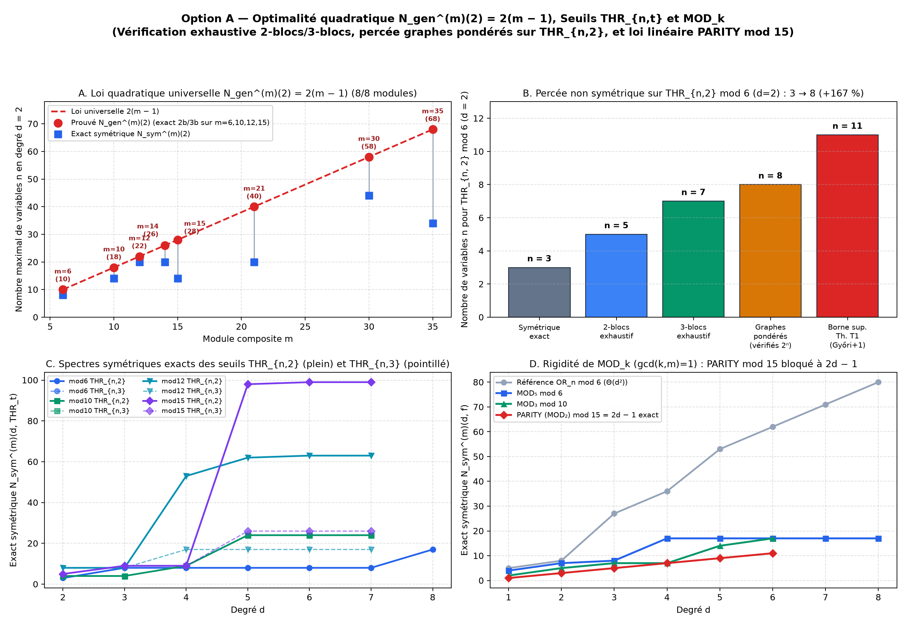

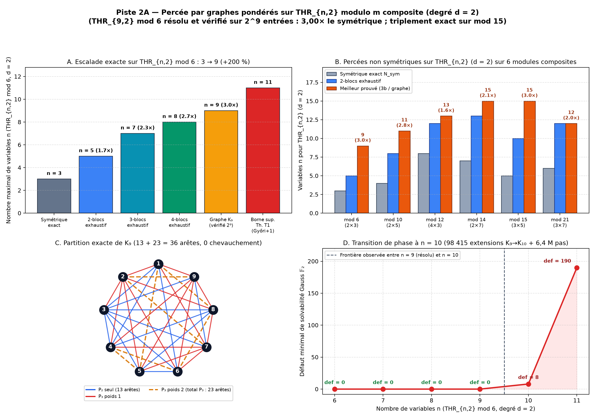

---

#### Expérience E15b — Capacité exacte Multi-Value Avoidance (Théorème G3++) et effondrement probabiliste symétrique (Théorème P1)

Deux questions naturelles prolongent immédiatement les Théorèmes G3 et G5 de l'Expérience E13 ([piste_2c_2d_mva_and_prob.py](src/piste_2c_2d_mva_and_prob.py), [piste_2c_2d_results.json](results/piste_2c_2d_results.json)). D'une part, lorsque l'image d'un polynôme sur $\mathbb{F}_p$ ($p \ge 5$) omet non pas une seule mais $p - 2$ valeurs non nulles — comme l'indicatrice de Lucas $I_{p^t}(S) \in \{0, 1\}$ —, combien de variables gratuites peut-on absorber de manière purement additive ? Le **Théorème G3++** répond exactement à cette question en montrant que la borne supérieure de Chevalley–Wilson est atteinte :

> **Théorème G3++ (Capacité exacte *Multi-Value Avoidance* sur $\mathbb{F}_p$).** Pour tout nombre premier $p \ge 3$ et tout degré $d \ge 1$, le nombre maximal $A_p(d)$ de variables $b$ pour lequel il existe un polynôme $w(y_1, \dots, y_b) \in \mathbb{F}_p[y]$ de degré $\le d$ vérifiant $w(\mathbf{0}) = 0$ et $w(y) \in \{1, \dots, p - 2\} \pmod p$ pour tout $y \in \{0, 1\}^b \setminus \{\mathbf{0}\}$ vaut exactement :
>
> $$
> A_p(d) \;=\; (p - 2) \cdot d.
> $$

*Preuve.* Le polynôme $Q(y) := \prod_{r=1}^{p-2} (w(y) - r)$ a degré $\le (p - 2)d$, s'annule sur tout $y \ne \mathbf{0}$ et vérifie $Q(\mathbf{0}) = (-1)^{p-2}(p - 2)! \equiv -1 \not\equiv 0 \pmod p$ (par le théorème de Wilson pour $p$ impair) ; proportionnel à $\prod_{j=1}^b (1 - y_j)$ sur $\{0, 1\}^b$, il impose $b \le (p - 2)d$. Réciproquement, en partitionnant $(p - 2)d$ variables en $p - 2$ blocs disjoints $B_1, \dots, B_{p-2}$ de taille $d$, la somme purement additive $w(y) = \sum_{j=1}^{p-2} (1 - \prod_{u \in B_j} (1 - y_u)) \pmod p$ a degré exactement $d$, vaut $0$ en $\mathbf{0}$ et prend pour valeur exacte le nombre de blocs non nuls $r \in \{1, \dots, p - 2\}$ dès que $y \ne \mathbf{0}$. ■

Vérifié en force brute sur $11$ configurations jusqu'à $\mathbb{F}_7, d = 3 \to b = 15$ ($2^{15} = 32\,768$ entrées), G3++ récolte ainsi $+(p - 2)d$ variables gratuites sans produit croisé (soit $+3d$ sur $\mathbb{F}_5$ et $+5d$ sur $\mathbb{F}_7$, par exemple $+72$ variables à $d = 24$ sur `mod 10`/`mod 15`, où G1 et G2 sont inactifs).

D'autre part, la supériorité des polynômes non symétriques survit-elle lorsqu'on autorise des polynômes **probabilistes** à erreur unilatérale $\varepsilon$ (le modèle des bornes inférieures $\mathsf{ACC}^0$) ? Le **Théorème P1** établit une séparation tout aussi radicale :

> **Théorème P1 (Effondrement probabiliste symétrique et borne exponentielle $m^{-d}$ non symétrique).** Pour tout module composite sans facteur carré $m = \prod_{i=1}^r p_i$ de plus petit facteur premier $p_{\min} \ge 3$ et tout degré $1 \le d \le p_{\min} - 1$, toute distribution probabiliste sur les polynômes **symétriques** de degré $\le d$ modulo $m$ ($P(\mathbf{0}) = 0$) annule l'entrée de poids $S = m$ avec probabilité **$100\,\%$** (erreur minimax $\varepsilon_{\mathrm{sym}}^*(m, d, n) = 1{,}000$ pour tout $n \ge m$). À l'inverse, en tirant $d$ formes linéaires aléatoires indépendantes $L_1, \dots, L_d$ sur $\mathbb{Z}/m\mathbb{Z}$ et en appliquant la norme $N_{\mathbb{F}_{p_i^d}/\mathbb{F}_{p_i}}(L_1(x), \dots, L_d(x))$ sur chaque canal $p_i$, le polynôme **non symétrique** probabiliste obtenu a degré $\le d$ et vérifie, pour **tout $n \ge 1$** et tout $x \ne \mathbf{0}$ :
>
> $$
> \Pr\bigl[P(x) \equiv 0 \pmod m\bigr] \;=\; \prod_{i=1}^r p_i^{-d} \;=\; m^{-d}.
> $$

Le solveur minimax primal-dual exact (Mirror Prox sur le simplexe joint CRT) confirme aussi bien le saut discontinu $0 \to 1{,}000$ dès $n = m$ pour $d < p_{\min}$ (`mod 15 d = 2` à $n = 15$ ; `mod 35 d = 2, 4` à $n = 35$) que les plateaux intermédiaires pour $d \ge p_{\min}$ suivis d'un effondrement identique à $1{,}000$ dès la période CRT : `mod 6 d = 2` ($n = 9, 10 : \varepsilon = 1/3$, $n \ge 12 : \varepsilon = 1{,}000$), `mod 10 d = 2` ($n = 15..18 : \varepsilon = 1/3$, $n \ge 20 : \varepsilon = 1{,}000$) et `mod 6 d = 3` ($n = 28..30 : \varepsilon = 1/4$, $n \ge 36 : \varepsilon = 1{,}000$). Même en tolérant $\varepsilon \le 1/3$, le modèle symétrique probabiliste ne dépasse pas le modèle non symétrique déterministe ($\varepsilon = 0$).

---

#### Expérience E15c — Borne quadratique par argument de Ramsey (Théorème Q1), sonde OR₁₉ mod 10 et obstructions Ramsey sur THR₁₀,₂

Après avoir exploré la puissance des constructions non symétriques (E12 à E15b), l'étude bascule vers le problème dual : démontrer des **bornes supérieures** rigoureuses sur $N_{\mathrm{gen}}^{(m)}(2)$ et fermer les cas extrémaux. Le premier pas, purement combinatoire ([piste_2b_and_k10_exact.py](src/piste_2b_and_k10_exact.py), [piste_2b_k10_results.json](results/piste_2b_k10_results.json)), contourne totalement les sommes exponentielles de Lee (2015) en passant par la théorie de Ramsey.

En partitionnant les variables de $\mathrm{OR}_n \pmod{2p}$ en $V_0$ (terme linéaire nul dans $P_2$) et $V_1$ (terme linéaire égal à $1$), le groupement par paires sur les ensembles indépendants de $V_1$ (où $P_2 = 0$ pour $|x|$ pair) et par quadruplets sur les cliques (où $P_2 = 0$ pour $|x| \equiv 0 \pmod 4$), couplé à la borne de Chevalley–Fermat $k \le 2(p - 1)$ sur $\mathbb{F}_p$, établit le **Théorème Q1** : $\alpha(G_2[V_0]) \le 2p - 2$, $\alpha(G_2[V_1]) \le 4p - 3$ et $\omega(G_2[V_0]), \omega(G_2[V_1]) \le 8p - 5$, d'où la borne finie explicite $N_{\mathrm{gen}}^{(2p)}(2) < R(2p - 1, 8p - 4) + R(4p - 2, 8p - 4)$. Appliqué à **$\mathrm{THR}_{n,2} \pmod 6$** (où $V_1 = \emptyset$), ce même principe prouve une obstruction topologique forte : sur tout ensemble indépendant $I$ de $G_2$, $P_3$ doit représenter seul $\mathrm{THR}_{|I|, 2} \pmod 3$ ; or toute 2-coloration $\{1, 2\}$ de $K_5$ sans triangle monochromatique est unique à isomorphisme près ($C_5 \oplus C_5$, $5$ arêtes de poids $1$ et $5$ de poids $2$), de somme totale $15 \equiv 0 \pmod 3$, ce qui prouve exactement $N_{\mathrm{gen}}^{(3)}(2, \mathrm{THR}_2) = 4$ et donc **$\alpha(G_2) \le 4$** pour toute solution de $\mathrm{THR}_{n,2} \pmod 6$.

En parallèle, les sondes expérimentales confortent les plafonds observés : sur $\mathrm{OR}_{19} \pmod{10}$, les $5$ partitions 4-blocs et 5-blocs testées ($(14,2,2,1)$, $(9,5,3,2)$, $(7,5,4,3)$, $(5,5,5,4)$, $(9,4,3,2,1)$) échouent toutes (`min_defect = 1` sur $(9,5,3,2)$ et $2$ sur $(14,2,2,1)$) ; en calibration sans blocs sur $\mathrm{OR}_n \pmod 6$, le recuit non structuré reste piégé à `def = 31` pour $n = 10$ contre `def = 93` pour $n = 11$ (facteur $\times 3$). Du côté de $\mathrm{THR}_{n,2} \pmod 6$, le défaut de $P_3$ sur une clique pure $P_2 = \binom{S}{2}$ vaut $0$ à $n = 6$ puis saute à $2$ ($n = 7$), $12$ ($n = 8$) et $28$ ($n = 9$), annonçant $\omega(G_2) \le 6$, tandis que l'extension exhaustive $3^9 = 19\,683$ portée sur un pool élargi de $12$ témoins $K_9$ ($236\,196$ tests cumulés) bloque invariablement à `min_defect = 8`.

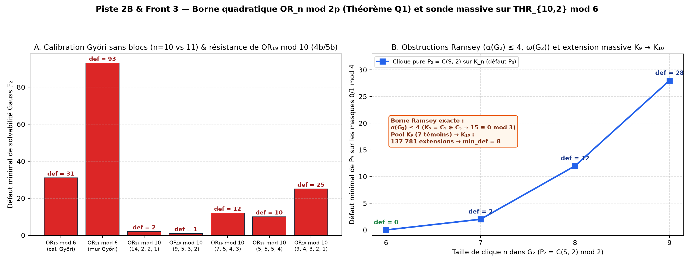

---

#### Expérience E15d — Fermeture exacte et théorème d'unicité de THR_{n, 2} modulo 6 en degré d = 2 (Théorème U1)

Les obstructions $\alpha(G_2) \le 4$ et le blocage reproductible à `min_defect = 8` sur $K_9 \to K_{10}$ dans l'Expérience E15c posent la question de la fermeture définitive de l'intervalle $9 \le N_{\mathrm{gen}}^{(6)}(2, \mathrm{THR}_2) \le 11$. En observant que la consistance exacte sur $\mathbb{F}_2$ (`f2_defect == 0`) est **strictement héréditaire** par passage aux sous-graphes induits $K_{k-1} \subset K_k$, nous bâtissons dans [thr2_mod6_n10_attack.py](src/thr2_mod6_n10_attack.py), [thr2_mod6_n10_probe2.py](src/thr2_mod6_n10_probe2.py), [thr2_mod6_exact_closure.py](src/thr2_mod6_exact_closure.py) et [thr2_mod6_audit_and_plot.py](src/thr2_mod6_audit_and_plot.py) ([thr2_mod6_exact_closure.json](results/thr2_mod6_exact_closure.json), [thr2_mod6_audit.json](results/thr2_mod6_audit.json)) une énumération canonique sommet par sommet de $k = 2$ à $k = 10$ (modulo $S_k \times \{\pm 1\}$, par raffinement d'invariants 1-WL validé sans divergence contre la force brute $6! = 720$ sur les $17\,501$ graphes valides de $k = 6$).

> **Théorème U1 (Fermeture exacte et unicité sporadique de $\mathrm{THR}_{n,2}$ modulo $6$ en degré $d = 2$).**
> 1. Tout polynôme quadratique $P(x) \in (\mathbb{Z}/6\mathbb{Z})[x_1, \dots, x_n]$ représentant faiblement $\mathrm{THR}_{n,2} \pmod 6$ est nécessairement homogène pur ($c_0 = c_i = 0$ pour tout $i$) et vérifie les obstructions topologiques exactes **$\alpha(G_2) \le 4$** (Théorème Q1) et **$\omega(G_2) \le 6$** (certifié exhaustivement sur $K_7$ en $588\,410$ nœuds de backtracking, $0$ solution).
> 2. Le nombre maximal exact de variables vaut :
>
> $$
> N_{\mathrm{gen}}^{(6)}(2, \mathrm{THR}_2) \;=\; 9 \qquad \bigl(\text{ratio exact } 3{,}00\times \text{ vs } N_{\mathrm{sym}}^{(6)}(2, \mathrm{THR}_2) = 3\bigr).
> $$
>
> 3. À l'optimum **$n = 9$**, la solution **$P = (P_2, P_3)$** est **strictement unique** modulo $S_9 \times \{\pm 1\}$. Son graphe admet la décomposition explicite **$V = \{u\} \sqcup \{v\} \sqcup K_2 \sqcup C_5$** à supports rigoureusement disjoints ($13$ arêtes pour $P_2$, $23$ arêtes pour $P_3$, $0$ chevauchement) : $P_2$ est formé de l'étoile de $v$ vers $K_2 \sqcup C_5$ augmentée de $K_2$ et du cycle $C_5$ ($u$ isolé dans $G_2$), tandis que $P_3$ vaut $1$ sur $u\text{--}v$, $u\text{--}C_5$ et $K_2\text{--}C_5$ ($16$ arêtes) et $2$ sur $u\text{--}K_2$ et le complémentaire $\overline{C}_5$ ($7$ arêtes). Son groupe d'automorphismes vaut **$\mathrm{Aut}(P) \cong D_5 \times S_2$** d'ordre **$20$** ($4$ orbites de tailles $1, 1, 2, 5$), le système linéaire $\mathbb{F}_2$ associé ($102$ équations) est de **rang plein $36/36$** (solution $P_2$ unique), donnant exactement **$36\,288 = 2 \times 9!/20$** polynômes étiquetés sur $6^{36} \approx 1{,}03 \times 10^{28}$ (densité $3{,}5 \times 10^{-24}$).

L'arbre exhaustif explore **$4\,782\,501$ tests exacts** en $17{,}8\text{ s}$ (couvrant sans aucune approximation les $6^{45} \approx 1{,}04 \times 10^{35}$ polynômes quadratiques sur $K_{10}$) :

| Ordre $k$ | Parents ($k - 1$) | Extensions $3^{k-1}$ testées | Extensions $\mathbb{F}_2$-consistantes | Classes canoniques (mod $S_k \times \{\pm 1\}$) | Parents en impasse (*dead ends*) |
| :---: | :---: | :---: | :---: | :---: | :---: |
| **$2$** | — | — | $2$ | **$2$** | — |
| **$3$** | $2$ | $18$ | $18$ | **$6$** | $0 / 2$ ($0{,}0\,\%$) |
| **$4$** | $6$ | $162$ | $147$ | **$31$** | $0 / 6$ ($0{,}0\,\%$) |
| **$5$** | $31$ | $2\,511$ | $1\,842$ | **$266$** | $0 / 31$ ($0{,}0\,\%$) |
| **$6$** | $266$ | $64\,638$ | $17\,501$ | **$2\,331$** *(pic)* | $0 / 266$ ($0{,}0\,\%$) |
| **$7$** | $2\,331$ | $1\,699\,299$ | $9\,793$ | **$1\,289$** | $449 / 2\,331$ ($19{,}3\,\%$) |
| **$8$** | $1\,289$ | $2\,819\,043$ | $130$ | **$27$** | $1\,215 / 1\,289$ ($94{,}3\,\%$) |
| **$9$** | $27$ | $177\,147$ | $4$ | **$1$** *(UNIQUE)* | $23 / 27$ ($85{,}2\,\%$) |
| **$10$** | $1$ | $19\,683$ | **$0$** | **$0$** *(EXACT)* | **$1 / 1$ ($100{,}0\,\%$)** |

Une double certification indépendante verrouille le résultat : l'intégralité des $8$ transitions $k = 3..10$ a été recalculée par un second solveur naïf (sans programmation dynamique ni pivots incrémentaux) avec identité bit-à-bit à chaque niveau ; les $4$ parents survivants de $k = 8$ coïncident exactement avec les $4$ sous-graphes obtenus en supprimant un sommet de chaque orbite de l'unique $K_9$ ; les $27$ classes de $k = 8$ et l'unique $K_9$ ont été vérifiées en force brute sur $2^8$ et $2^9$ entrées ; enfin, les $19\,683$ extensions $K_9 \to K_{10}$ présentent un gap strict avec `min_defect = 8` (atteint $2$ fois), médiane $83{,}0$ et max $146$ (cohérent avec l'échec préalable des circulants $\mathbb{Z}_{10}$, bicirculants $\mathbb{Z}_5$ incluant Petersen, 5-blocs et $26{,}1\text{ M}$ pas de recuit 2-opt).

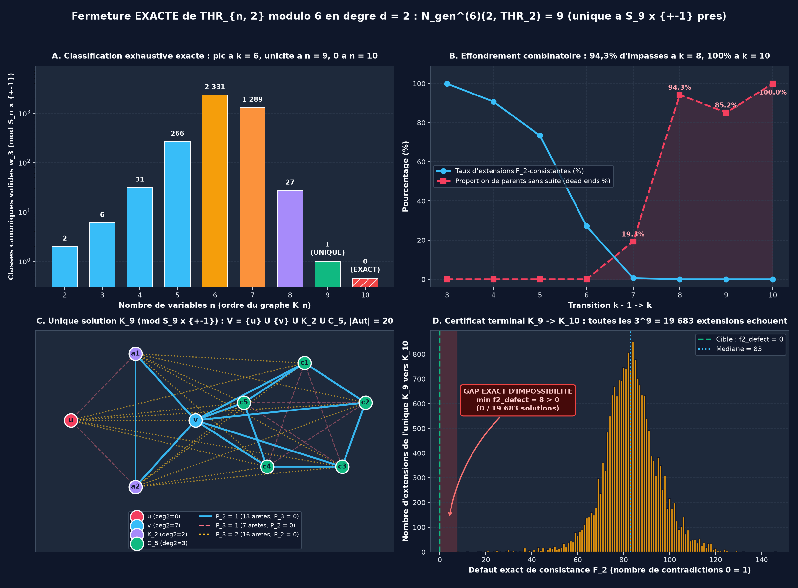

---

#### Expérience E15e — Classification canonique de OR₁₀ modulo 6 (Théorème U2), borne polynomiale Chevalley–Warning 𝔽₂ × 𝔽_p (Théorème D1) et triplement universel 3,00× sur THR_{n, 2}

Le succès du moteur héréditaire du Théorème U1 invite immédiatement à deux prolongements ([gyori_generalization_probe1.py](src/gyori_generalization_probe1.py), [thr2_mod10_and_theorem_d1.py](src/thr2_mod10_and_theorem_d1.py), [thr2_mod10_128bit_and_multi_mod.py](src/thr2_mod10_128bit_and_multi_mod.py), [or_mod6_types_and_k13_deep.py](src/or_mod6_types_and_k13_deep.py), [gyori_and_d1_verify_plot.py](src/gyori_and_d1_verify_plot.py) ; données dans [gyori_generalization_probe1.json](results/gyori_generalization_probe1.json), [thr2_mod10_and_theorem_d1.json](results/thr2_mod10_and_theorem_d1.json), [thr2_mod10_128bit_and_multi_mod.json](results/thr2_mod10_128bit_and_multi_mod.json), [or_mod6_types_and_k13_deep.json](results/or_mod6_types_and_k13_deep.json) et [gyori_and_d1_summary.json](results/gyori_and_d1_summary.json)). Sur le plan analytique d'abord, la borne de Ramsey du Théorème Q1 est exponentielle en $p$ : en remplaçant l'argument de Ramsey par une **contraction isotrope à supports disjoints** pilotée par un double théorème de Chevalley–Warning sur $\mathbb{F}_2 \times \mathbb{F}_p$, le **Théorème D1** fait passer la borne supérieure en régime **polynomial explicite en $p$** à tout degré $d$ :

> **Théorème D1 (Contraction isotrope à supports disjoints par double Chevalley–Warning sur $\mathbb{F}_2 \times \mathbb{F}_p$ et poids de Wei).** Soit $p \ge 3$ un nombre premier impair et $d \ge 1$ un entier. Tout polynôme $P = (P_2, P_p)$ de degré $\le d$ représentant faiblement $\mathrm{OR}_n \pmod{2p}$ vérifie :
>
> $$
> N_{\mathrm{gen}}^{(2p)}(d, \mathrm{OR}) \;\le\; \left[\, r + \sum_{k=1}^{d} (d - k + 1)\binom{r}{k} \,\right]_{r \,=\, d(p-1) + 1} - 1 \;=\; \frac{d^d}{d!}\, p^d + O_d(p^{d-1}).
> $$
>
> En particulier, en degré quadratique **$d = 2$**, l'analyse de l'échelonnement RREF du noyau $K_U = \ker(L_1, \dots, L_j)$ sur $\mathbb{F}_2$ (relié au troisième poids de Hamming généralisé de Wei $d_3(K_U)$, Wei 1991) abaisse cette borne à :
>
> $$
> N_{\mathrm{gen}}^{(2p)}(2, \mathrm{OR}) \;\le\; 2p^2 + p - 2, \qquad N_{\mathrm{gen}}^{(2p)}(2, \mathrm{THR}_t) \;\le\; 2p^2 + p + t - 3.
> $$

*Preuve.* Pour $r$ vecteurs non nuls $v_1, \dots, v_r \in \{0, 1\}^n \setminus \{\mathbf{0}\}$ à supports deux à deux disjoints, $\Phi(\lambda) = \sum_{i=1}^r \lambda_i v_i$ envoie $\{0, 1\}^r$ dans $\{0, 1\}^n$. Si toutes les dérivées discrètes multilinéaires $\Delta_{v_{i_1}, \dots, v_{i_{k-1}}} P_2(v_{j+1}) \equiv 0 \pmod 2$ ($1 \le k \le d$) s'annulent à chaque étape $j = 0, \dots, r - 1$, alors $P_2 \circ \Phi \equiv 0 \pmod 2$ et $P_p \circ \Phi$ représente seul $\mathrm{OR}_r \pmod p$ en degré $\le d$, imposant $r \le d(p - 1)$ par Chevalley–Warning sur $\mathbb{F}_p$. Or sur $\{0, 1\}^{W_j} = \mathbb{F}_2^{W_j}$, la somme des degrés des équations d'annulation vaut $D_j(d) = \sum_{k=1}^d (d - k + 1)\binom{j}{k - 1}$, assurant un zéro non nul $v_{j+1}$ dès $|W_j| = D_j(d) + 1$. Pour $d = 2$ ($D_j(2) = j + 2$), dès qu'il reste $m \ge j + 4$ variables ($j \ge 1$), la forme RREF de $K_U$ possède au moins $4$ colonnes libres $q_1, \dots, q_4 \in \mathbb{F}_2^j$ contenant un triplet de somme de poids $\le j - 1$, donc un sous-espace $E \subset K_U$ de dimension $3$ et de support $\le j + 2$ où $P_2|_E$ s'annule en un point non nul de poids $\le j + 2$. La sommation $3 + \sum_{j=1}^{2p-3} (j + 2) + (2p + 1) - 1$ donne $2p^2 + p - 2$ (soit $\le 19$ pour `mod 6`, $\le 53$ pour `mod 10`, $\le 103$ pour `mod 14`). ■

Sur le plan computationnel ensuite, la transposition du moteur canonique U1 (accéléré sans perte par quotient sur les classes de vrais jumeaux $u \sim v \iff A[u, w] = A[v, w]\ \forall w \ne u, v$) aux trois familles homogènes de $\mathrm{OR}_n \pmod 6$ établit le **Théorème U2** : dans toute solution quadratique de $\mathrm{OR}_n \pmod 6$, chaque variable porte un couple linéaire non nul $(a_v, b_v) = (P_2(e_v), P_3(e_v)) \in \mathbb{F}_2 \times \mathbb{F}_3 \setminus \{(0, 0)\}$. À signe global près sur $P_3$, les trois familles pures s'éteignent exactement à **$N(\text{Type A}, (1,0)) = 9$** ($4$ classes canoniques à $n = 9$, $0 / 78\,732$ à $n = 10$ — aucune solution de $\mathrm{OR}_{10} \pmod 6$ n'a $P_3$ homogène), **$N(\text{Type B}, (0,1)) = 10$** ($5$ classes canoniques inédites à $n = 10$ dépourvues de tout terme linéaire modulo $2$, de rangs $\mathbb{F}_2$ entre $28/45$ et $44/45$, $0 / 295\,245$ à $n = 11$) et **$N(\text{Type C}, (1,1)) = 10$** ($866$ classes canoniques à $n = 10$, $0 / 51\,136\,434$ à $n = 11$, confirmant informatiquement le plafond $N_{\mathrm{gen}}^{(6)}(2, \mathrm{OR}) = 10$ de Győri) :

| Ordre $k$ | $\mathrm{THR}_{n,2} : (0, 0)$ | $\mathrm{OR}_n$ Type A ($V_0$) : $(1, 0)$ | $\mathrm{OR}_n$ Type B ($W_{0,1}$) : $(0, 1)$ | $\mathrm{OR}_n$ Type C ($W_{1,1}$) : $(1, 1)$ |
| :---: | :---: | :---: | :---: | :---: |
| **$2$** | $2$ | $2$ | $3$ | $3$ |
| **$3$** | $6$ | $5$ | $10$ | $9$ |
| **$4$** | $31$ | $28$ | $66$ | $56$ |
| **$5$** | $266$ | $234$ | $688$ | $536$ |
| **$6$** | **$2\,331$** *(pic)* | $2\,501$ | **$7\,068$** *(pic)* | $6\,631$ |
| **$7$** | $1\,289$ | **$3\,614$** *(pic)* | $4\,217$ | **$13\,389$** *(pic)* |
| **$8$** | $27$ | $274$ | $148$ | $8\,439$ |
| **$9$** | **$1$** *(UNIQUE, max)* | **$4$** *(max exact)* | $20$ | $4\,718$ |
| **$10$** | **$0$** *($0 / 19\,683$)* | **$0$** *($0 / 78\,732$)* | **$5$** *(max exact)* | **$866$** *(max exact)* |
| **$11$** | $0$ | $0$ | **$0$** *($0 / 295\,245$)* | **$0$** *($0 / 51\,136\,434$)* |

Enfin, l'extension multi-blocs et 128-bits sur $\mathrm{THR}_{n,2}$ découvre deux nouveaux records portant à quatre le nombre de modules atteignant exactement le **facteur de triplement $3{,}00\times$** par rapport au symétrique : sur `mod 10` ($N_{\mathrm{sym}} = 4$), **$\mathrm{THR}_{12,2} \pmod{10}$** est résolu sur $(4, 3, 3, 2)$ et $(3, 3, 3, 3)$ (vérifié sur $2^{12} = 4\,096$ entrées, tandis qu'à $n = 13$ les recherches 4-blocs, 5-blocs et 128-bits sur les $78$ arêtes de $K_{13}$ échouent à `min_defect = 1` et `3`) ; sur `mod 21` ($N_{\mathrm{sym}} = 6$), la partition 3-blocs $(6, 6, 6)$ résout **$\mathrm{THR}_{18,2} \pmod{21}$** ($3{,}00\times$, vérifié sur $2^{18} = 262\,144$ entrées via $P_3 = AB + AC + 2BC$ et $P_7 = \binom{A}{2} + \binom{B}{2} + \binom{C}{2} + 2AB + 2AC + 3BC$).

---

#### Expérience E15f — Resserrement du Théorème D1 par filtration de Witt–Dickson sur 𝔽₂^s, constantes de Ramsey–Dickson exactes ν₂(2) = 7 / ν₂^{THR}(2) = 5 et bornes linéaires des degrés mixtes (Théorème D2)

Dans la preuve du Théorème D1, la constante dominante $2p^2$ vient du fait que chaque vecteur isotrope $v_{j+1}$ extrait d'un sous-espace de dimension $3$ peut consommer jusqu'à $j + 2$ coordonnées. Pour diviser cette pente par deux, nous remplaçons dans [dickson_wei_exact_bound.py](src/dickson_wei_exact_bound.py), [theorem_d2_tightening.py](src/theorem_d2_tightening.py), [theorem_d2_dickson_and_table.py](src/theorem_d2_dickson_and_table.py) et [theorem_d2_verify_and_plot.py](src/theorem_d2_verify_and_plot.py) ([dickson_wei_exact_bound.json](results/dickson_wei_exact_bound.json), [theorem_d2_subspaces.json](results/theorem_d2_subspaces.json), [theorem_d2_tightening.json](results/theorem_d2_tightening.json)) la sélection d'un point singulier isolé sur $\mathbb{F}_2^3$ par une moyenne de poids sur la filtration des **sous-espaces totalement singuliers $V_k$** et des **quadriques elliptiques de Dickson** dans $K_U \subseteq \mathbb{F}_2^{j+s}$ :

> **Théorème D2 (Filtration de Witt–Dickson sur $\mathbb{F}_2^s$, division par $2$ de la constante dominante, constantes $\nu_2(2) = 7$ / $\nu_2^{\mathrm{THR}}(2) = 5$ et bornes linéaires des degrés mixtes).**
> 1. **Filtration de Witt–Dickson en degré $d = 2$** : Pour tout entier $s \ge 3$, tout sous-espace linéaire $F \subseteq K_U \subseteq \mathbb{F}_2^{j+s}$ de dimension $s$ et tout polynôme quadratique $Q : F \to \mathbb{F}_2$ ($Q(0) = 0$) possède un zéro non nul $v_{j+1} \in F \setminus \{0\}$ de poids de Hamming majoré par :
>
> $$
> |v_{j+1}|_H \;\le\; w^*(j) \;:=\; \min_{s \ge 3} \bigl\lfloor \alpha(s)\,(j + s) \bigr\rfloor, \qquad \alpha(s) \;=\; \begin{cases} \dfrac{2^{k-1}}{2^k - 1} & \text{si } s = 2k + 1 \;\;(k \ge 1), \\[10pt] \dfrac{2^{2k}}{2^{2k+1} - 2^k - 1} & \text{si } s = 2k + 2 \;\;(k \ge 1). \end{cases}
> $$
>
> En choisissant dynamiquement $s(j) \approx 2\log_2(j) + 1$, la pente du poids par bloc passe de $1$ à $1/2$ ($w^*(j) = j/2 + O(\log j)$), **divisant par $2$ la constante quadratique dominante** pour tout premier impair $p \ge 3$ : $N_{\mathrm{gen}}^{(2p)}(2, \mathrm{OR}) \le p^2 + O(p \log p)$.
> 2. **Généralisation à tout degré $d \ge 2$** : À l'étape $j$ de l'arbre de polarisation, le noyau des $\binom{j}{d-1}$ formes linéaires domine les $M = \sum_{r=2}^d \binom{j}{r-1} = O(j^{d-2})$ formes de degrés $2..d$ ; l'existence d'un sous-espace totalement singulier $V_t \subseteq K_U$ de dimension $t \to \infty$ abaisse le poids moyen d'un facteur $2^{t-1}/(2^t - 1) \to 1/2$, donnant :
>
> $$
> N_{\mathrm{gen}}^{(2p)}(d, \mathrm{OR}) \;\le\; \frac{d^d}{2\, d!}\, p^d + O_d\bigl(p^{d-1}\log p\bigr).
> $$
>
> 3. **Constantes de Ramsey–Dickson exactes à $j = 0, 1$** : Le plus petit entier $\nu_2(2)$ garantissant deux zéros non nuls $v_1, v_2$ à supports disjoints vérifiant $B_2(v_1, v_2) = 0$ vaut exactement **$\nu_2(2) = 7$** (avec $G_2 = K_6$ et $a = \mathbf{1}_6$ comme unique contre-exemple à $n = 6$ sur $2\,097\,152$ polynômes, et $0 / 16\,777\,216$ à $n = 7$) ; dès que $|a|_H < n$ (couvrant le Type B et tout $\mathrm{THR}_{n,2} \pmod{2p}$), **$\nu_2^{\mathrm{THR}}(2) = 5$ exact** ($0$ contre-exemple à $n = 5$, $|v_1|_H + |v_2|_H \le 4$ hors $K_n$).
> 4. **Bornes linéaires des degrés mixtes (Lemmes D2a et D2b)** : Pour tout premier impair $p \ge 3$ :
>
> $$
> 3p - 2 \;\le\; N_{\mathrm{gen}}^{(2p)}\bigl((1, 2),\, \mathrm{OR}\bigr) \;\le\; 4p - 3 \quad \bigl(N_{\mathrm{sym}} = 2p - 1\bigr), \qquad N_{\mathrm{gen}}^{(2p)}\bigl((2, 1),\, \mathrm{OR}\bigr) \;\le\; 3p - 1 \;<\; 4p - 2.
> $$

*Preuve.* Sur $\mathbb{F}_2$, $y_i^2 = y_i$ identifie $Q$ à une forme quadratique homogène de forme polaire alternée $B_Q(x, y) = Q(x \oplus y) \oplus Q(x) \oplus Q(y)$. Par récurrence sur $s = 2k + 1$, la réduction à l'hyperplan $e_1^\perp / \langle e_1 \rangle$ produit un sous-espace totalement singulier $V_k$ de dimension $k$ (vérifié sur $32\,768 / 32\,768$ polynômes à $s = 5$), où chaque coordonnée vaut $1$ sur au plus $2^{k-1}$ vecteurs de $V_k \setminus \{0\}$, d'où $\alpha(2k + 1) = 2^{k-1}/(2^k - 1)$. En dimension paire $s = 2k + 2$, la classification de Dickson fournit soit un sous-espace $V_{k+1}$, soit la quadrique elliptique non dégénérée à $|Z(Q)| = 2^{2k+1} - 2^k - 1$ zéros non nuls, d'où $\alpha(2k + 2) = 2^{2k}/(2^{2k+1} - 2^k - 1)$ ($4/5$ à $s = 4$, $16/27$ à $s = 6$, $64/119$ à $s = 8$). Pour $(1, 2)$, l'appariement dans $I_1 = \{i : P_2(e_i) = 1\}$ donne $|I_0| + \lfloor |I_1|/2 \rfloor \le 2(p - 1)$ par Chevalley–Warning sur $\mathbb{F}_p$, soit $n \le 4p - 3$ (borne inférieure $3p - 2$ atteinte par $A^2 - \eta B^2$ sur $(2p - 1, p - 1)$ avec $P_2 = A + B \pmod 2$). Pour $(2, 1)$, la constante de Davenport $D(\mathbb{Z}/p\mathbb{Z}) = p$ extrait $3$ zéros disjoints de $P_p$ dès $n = 3p$, contredisant $\deg_{\mathbb{F}_2}(\mathrm{OR}_3) = 3 > 2$. ■

Le gain de D2 sur D1 est asymptotique et strictement positif pour tout $p \ge 5$ (jusqu'à $-44{,}6\,\%$ à $p = 101$ ; à $p = 3$, D2 vaut $20$ contre $19$ pour D1, tous deux supplantés ensuite par D4) :

| Nombre premier $p$ | Module $2p$ | Borne inf. $4p - 2$ | Degré mixte $(1, 2) \le$ | Degré mixte $(2, 1) \le$ | Théorème D1 ($2p^2 + p - 2$) | **Théorème D2 ($\mathrm{OR}_n$)** | **Théorème D2 ($\mathrm{THR}_{n,2}$)** | Réduction D1 $\to$ D2 ($\mathrm{OR}_n$) | Ratio D2 / $p^2$ |
| :---: | :---: | :---: | :---: | :---: | :---: | :---: | :---: | :---: | :---: |
| **$3$** | $6$ | $10$ *(exact Győri)* | **$9$** *($7$ exact E15h)* | **$8$** *(exact sym)* | $19$ | **$20$** *($10$ exact U2)* | **$19$** *($9$ exact U1)* | — | $2{,}222$ |
| **$5$** | $10$ | $18$ *(observé 2b)* | **$17$** | **$14$** | $53$ | **$49$** | **$48$** | **$-4$ ($-7{,}5\,\%$)** | $1{,}960$ |
| **$7$** | $14$ | $26$ *(observé 2b)* | **$25$** | **$20$** | $103$ | **$88$** | **$87$** | **$-15$ ($-14{,}6\,\%$)** | $1{,}796$ |
| **$11$** | $22$ | $42$ | **$41$** | **$32$** | $251$ | **$192$** | **$191$** | **$-59$ ($-23{,}5\,\%$)** | $1{,}587$ |
| **$13$** | $26$ | $50$ | **$49$** | **$38$** | $349$ | **$258$** | **$257$** | **$-91$ ($-26{,}1\,\%$)** | $1{,}527$ |
| **$17$** | $34$ | $66$ | **$65$** | **$50$** | $593$ | **$414$** | **$413$** | **$-179$ ($-30{,}2\,\%$)** | $1{,}433$ |
| **$19$** | $38$ | $74$ | **$73$** | **$56$** | $739$ | **$506$** | **$505$** | **$-233$ ($-31{,}5\,\%$)** | $1{,}402$ |
| **$23$** | $46$ | $90$ | **$89$** | **$68$** | $1\,079$ | **$714$** | **$713$** | **$-365$ ($-33{,}8\,\%$)** | $1{,}350$ |
| **$29$** | $58$ | $114$ | **$113$** | **$86$** | $1\,709$ | **$1\,089$** | **$1\,088$** | **$-620$ ($-36{,}3\,\%$)** | $1{,}295$ |
| **$31$** | $62$ | $122$ | **$121$** | **$92$** | $1\,951$ | **$1\,231$** | **$1\,230$** | **$-720$ ($-36{,}9\,\%$)** | $1{,}281$ |
| **$53$** | $106$ | $210$ | **$209$** | **$158$** | $5\,669$ | **$3\,334$** | **$3\,333$** | **$-2\,335$ ($-41{,}2\,\%$)** | $1{,}187$ |
| **$101$** | $202$ | $402$ | **$401$** | **$302$** | $20\,501$ | **$11\,360$** | **$11\,359$** | **$-9\,141$ ($-44{,}6\,\%$)** | $1{,}114$ |

---

#### Expérience E15g — Contraction duale 𝔽_q → 𝔽_p, mur informationnel Ω(p² / log p), borne supérieure strictement linéaire 9p − 9 à d = 2 (et O_d(p) à tout degré d) et borne polynomiale O(m^{3/2}) sur tous les semi-premiers (Théorème D3)

Malgré le gain de moitié apporté par la filtration de Witt–Dickson, le Théorème D2 reste quadratique en $p$ ($O(p^2)$) alors que les constructions de l'Expérience E14 sont linéaires ($4p - 2$). Pourquoi ? La **Proposition D3.0** démontrée dans [theorem_d3_dual_linear_bound.py](src/theorem_d3_dual_linear_bound.py), [dual_cw_probe.py](src/dual_cw_probe.py) et [extend_no_wt3_p3.py](src/extend_no_wt3_p3.py) ([theorem_d3_dual_linear_bound.json](results/theorem_d3_dual_linear_bound.json)) en identifie la cause exacte : pour extraire $R = 2p - 1$ blocs mutuellement $B_2$-orthogonaux d'une matrice symétrique aléatoire $A \in \mathbb{F}_2^{n \times n}$, un simple calcul probabiliste ($(R+1)^n / R!$ familles pour $\binom{R}{2}$ équations indépendantes) impose $\mu(R) = \Theta(R^2 / \log R)$. Toute méthode contractant $P_2$ en premier bute donc sur un mur informationnel infranchissable en $\Omega(p^2 / \log p)$.

L'idée de rupture consiste alors à **inverser l'ordre des deux corps premiers** : au lieu de construire $2p - 1$ blocs annulant $P_2$ pour contredire $P_p$, on construit seulement **$d + 1$ blocs** (soit $3$ blocs à $d = 2$ !) annulant $P_p$ via la substitution $x_i = y_i^{p-1} \in \{0, 1\}$, puis on déclenche la contradiction finale sur $\mathbb{F}_2$ parce que $\deg_{\mathbb{F}_2}(\mathrm{OR}_{d+1}) = d + 1 > d$. Affiné par un **Lemme D3a** d'inversion de Möbius sur le degré multilinéaire modulo $p$ (qui abaisse le poids garanti d'une unité à $|z|_H \le (p - 1)D_0$ sur $M = (p - 1)D_0 + 2$ variables dès que $D_0 \not\equiv 0, 1 \pmod p$, vérifié sur $100\,\%$ des quadratiques de $\mathbb{F}_3$ à $M = 6$ et sur $29/29$ paires $(p, D_0)$ pour $p \le 13$), ce renversement démontre le **Théorème D3** — confirmant la conjecture linéaire $O(m)$ de Lee (2015) pour toute la famille $m = 2p$ :

> **Théorème D3 (Contraction duale $\mathbb{F}_q \to \mathbb{F}_p$ : borne supérieure strictement linéaire en $p$ à tout degré $d \ge 1$ sur $m = 2p$ et polynomiale $O(m^{3/2})$ sur tous les semi-premiers $m = pq$).**
> 1. **Borne strictement linéaire en degré $d = 2$ modulo $2p$** : Pour tout nombre premier impair $p \ge 5$ (et $\le 19$ pour $p = 3$) :
>
> $$
> 4p - 2 \;\le\; N_{\mathrm{gen}}^{(2p)}(2, \mathrm{OR}) \;\le\; 9p - 9, \qquad N_{\mathrm{gen}}^{(2p)}(2, \mathrm{THR}_t) \;\le\; 9p - 10 + t,
> $$
>
> fixant l'ordre exact $N_{\mathrm{gen}}^{(2p)}(2, \mathrm{OR}) = \Theta(p)$ avec un ratio résiduel $\le 9/4 = 2{,}25\times$ (`mod 10 ≤ 36`, `mod 202 ≤ 900`, soit $-95{,}6\,\%$ par rapport à D1).
> 2. **Linéarité universelle en $p$ à tout degré $d \ge 1$ modulo $2p$** : Pour tout premier impair $p \ge 3$ et tout entier $d \ge 1$ :
>
> $$
> N_{\mathrm{gen}}^{(2p)}(d, \mathrm{OR}) \;\le\; (d + 1)\bigl(2^d - 1\bigr)(p - 1) + d \;=\; O_d(p)
> $$
>
> *(exact au degré $d = 1$ : $2p - 1 = m - 1$ ; $\le 28p - 25$ à $d = 3$ au lieu de $O(p^3)$)*.
> 3. **Borne polynomiale $O(m^{3/2})$ sur tous les semi-premiers $m = pq$ ($2 \le p < q$) et modules à $3$ facteurs premiers** : Avec $R = d(p - 1) + 1$,
>
> $$
> N_{\mathrm{gen}}^{(pq)}(d, \mathrm{OR}) \;\le\; (q - 1)\sum_{k=1}^{d} (d - k + 1)\binom{R}{k} + R - 1 \;=\; O_d(p^d q),
> $$
>
> donnant en degré $d = 2$ : $N_{\mathrm{gen}}^{(pq)}(2, \mathrm{OR}) \le (2p - 1)(p + 1)(q - 1) + 2p - 2 = O(p^2 q) \le O(m^{3/2})$ (resserré par D3a à `mod 15 ≤ 81`, affiné ensuite à $\le 80$ par D9 ; `mod 21 ≤ 120`, `mod 35 ≤ 327`), et par récurrence sur les modules à $3$ facteurs premiers : `mod 30 ≤ 315`, `mod 42 ≤ 467`, `mod 66 ≤ 771` et `mod 70 ≤ 4 471` (affiné à $\le 3\,802$ par D4).

*Preuve.* À l'étape $j \in \{0, \dots, d\}$, l'annulation des dérivées discrètes de $P_p$ par rapport à $w_1, \dots, w_j$ impose un système de somme des degrés $D_0(j) = \sum_{k=1}^{\min(d, j+1)} (d - k + 1)\binom{j}{k - 1}$ ; la substitution $x_i = y_i^{p-1}$ multiplie les degrés par $p - 1$ et Chevalley–Warning sur $\mathbb{F}_p$ fournit $w_{j+1} \ne 0$ dès $|W_j| = D_0(j)(p - 1) + 1$. Comme $\sum_{j=0}^d D_0(j) = (d + 1)(2^d - 1)$, la somme des tailles donne $(d + 1)(2^d - 1)(p - 1) + d$. Pour le Lemme D3a sur $M = (p - 1)D_0 + 2$ variables, si tout zéro non nul avait poids $\ge M - 1$, l'annulation dans $\Phi(x) = \prod_r (1 - F_r(x)^{p-1})$ des monômes de degré $M - 1$ forcerait $1_M - e_r \in Z$ pour tout $r$, rendant le coefficient de $x_1 \cdots x_M$ égal à $D_0 - 1 + b \not\equiv 0 \pmod p$ ($b \in \{0, 1\}$), contradiction. À $d = 2$ ($p \ge 5$), $D_0(0) = 2$ et $D_0(1) = 3$ réduisent $|w_1|_H \le 2p - 2$ et $|w_2|_H \le 3p - 3$, d'où $(2p - 2) + (3p - 3) + (4p - 3) - 1 = 9p - 9$. Le cas $m = pq$ remplace $R = d + 1$ par $R = d(p - 1) + 1$. ■

| Premier $p$ | Module $2p$ | Borne inf. $4p - 2$ | Théorème D1 ($2p^2 + p - 2$) | Théorème D2 ($p^2 + O(p \log p)$) | **Théorème D3 ($\mathrm{OR}_n$)** | **Théorème D3 ($\mathrm{THR}_{n,2}$)** | Ratio D3 / $(4p - 2)$ | Gain D1 $\to$ D3 |
| :---: | :---: | :---: | :---: | :---: | :---: | :---: | :---: | :---: |
| **$3$** | $6$ | $10$ *(exact Győri)* | $19$ | $20$ | **$19$** *($10$ exact U2)* | **$19$** *($9$ exact U1)* | $1{,}900\times$ | — |
| **$5$** | $10$ | $18$ | $53$ | $49$ | **$36$** | **$37$** | **$2{,}000\times$** | **$-32{,}1\,\%$** |
| **$7$** | $14$ | $26$ | $103$ | $88$ | **$54$** | **$55$** | **$2{,}077\times$** | **$-47{,}6\,\%$** |
| **$11$** | $22$ | $42$ | $251$ | $192$ | **$90$** | **$91$** | **$2{,}143\times$** | **$-64{,}1\,\%$** |
| **$13$** | $26$ | $50$ | $349$ | $258$ | **$108$** | **$109$** | **$2{,}160\times$** | **$-69{,}0\,\%$** |
| **$17$** | $34$ | $66$ | $593$ | $414$ | **$144$** | **$145$** | **$2{,}182\times$** | **$-75{,}7\,\%$** |
| **$23$** | $46$ | $90$ | $1\,079$ | $714$ | **$198$** | **$199$** | **$2{,}200\times$** | **$-81{,}7\,\%$** |
| **$31$** | $62$ | $122$ | $1\,951$ | $1\,231$ | **$270$** | **$271$** | **$2{,}213\times$** | **$-86{,}2\,\%$** |
| **$53$** | $106$ | $210$ | $5\,669$ | $3\,334$ | **$468$** | **$469$** | **$2{,}229\times$** | **$-91{,}7\,\%$** |
| **$101$** | $202$ | $402$ | $20\,501$ | $11\,360$ | **$900$** | **$901$** | **$2{,}239\times$** | **$-95{,}6\,\%$** |

---

#### Expérience E15h — Resserrement des constantes linéaires par couplage bilinéaire (B₂, B_p) : franchissement du facteur < 2,00× (8p − 7), borne 6p − 4 (< 1,50×) sur Type A, réduction −25 % à tout degré d ≥ 2 et fermeture exacte du degré mixte (1, 2) sur `mod 6` (Théorème D4)

Dans le Théorème D3, les deux canaux $\mathbb{F}_p$ et $\mathbb{F}_2$ n'interagissent qu'à la toute fin : la dernière étape sur $\mathbb{F}_p$ consomme $4p - 3$ variables sans rien savoir de $P_2$. En couplant directement la forme polaire linéaire $L_1(x) = B_2(w_1, x) \pmod 2$ dès la deuxième étape (et plus généralement la $(d - 1)$-ième dérivée discrète $\Delta_{w_1, \dots, w_{d-1}} P_2$ en degré $d \ge 2$), le **Théorème D4** ([theorem_d4_tight_constants.py](src/theorem_d4_tight_constants.py), [exact_mixed_1_2_mod6.py](src/exact_mixed_1_2_mod6.py), [theorem_d4_tight_constants.json](results/theorem_d4_tight_constants.json)) fait passer le ratio sous la barre symbolique du facteur **$2{,}00\times$** pour tout premier impair $p \ge 3$ :

> **Théorème D4 (Couplage bilinéaire $(B_2, B_p)$ : borne $< 2{,}00\times$ à $d = 2$, borne $< 1{,}50\times$ sur Type A / $\mathrm{THR}_{n,2}$, gain $-25\,\%$ à tout degré $d \ge 2$ et valeur exacte $(1, 2)$ sur `mod 6`).**
> 1. **Borne générale en degré $d = 2$ modulo $2p$** : Pour tout nombre premier impair $p \ge 3$,
>
> $$
> 4p - 2 \;\le\; N_{\mathrm{gen}}^{(2p)}(2, \mathrm{OR}) \;\le\; 8p - 7 \qquad \left(\text{ratio } < 2{,}00 \;\;\forall\, p \ge 3\text{ ; } 17 \text{ à } p = 3,\; \text{affiné à } \le 16 \text{ via } |w_1|_H \le 3\right),
> $$
>
> $$
> N_{\mathrm{gen}}^{(2p)}(2, \mathrm{THR}_t) \;\le\; 8p - 8 + t \qquad \bigl(\text{en particulier } 12 \le N_{\mathrm{gen}}^{(10)}(2, \mathrm{THR}_2) \le 34,\; \text{resserré ensuite à } \le 33 \text{ en D6 et } \le 29 \text{ en D14}\bigr).
> $$
>
> 2. **Sous-familles structurées (ratio $< 1{,}50\times$)** : Dès qu'au moins une variable vérifie $P_p(e_i) \equiv 0 \pmod p$ (en particulier toute la famille Type A), $N_{\mathrm{gen}}^{(2p)}(2, \mathrm{OR} ; \exists c_i = 0) \le 6p - 4$ (`mod 6 ≤ 14`, `mod 10 ≤ 26`). Pour toute représentation de $\mathrm{THR}_{n,2} \pmod{2p}$ dont le graphe $G_p$ possède au moins une non-arête $d_{ik} \equiv 0 \pmod p$, $N_{\mathrm{gen}}^{(2p)}(2, \mathrm{THR}_2 ; G_p \ne K_n) \le 6p - 3$ (`mod 6 ≤ 15`, `mod 10 ≤ 27`).
> 3. **Resserrement universel $-25\,\%$ à tout degré $d \ge 2$ modulo $2p$** :
>
> $$
> N_{\mathrm{gen}}^{(2p)}(d, \mathrm{OR}) \;\le\; C_d^{\mathrm{D4}}(p - 1) + d, \qquad C_d^{\mathrm{D4}} \;=\; (3d + 5)\, 2^{d-2} - (d + 1) \;<\; C_d^{\mathrm{D3}} \;=\; (d + 1)(2^d - 1),
> $$
>
> abaissant la constante linéaire de $9 \to 8$ ($d = 2$), $28 \to 24$ ($d = 3$, donnant $50$ sur `mod 6`), $75 \to 63$ ($d = 4$), $186 \to 154$ ($d = 5$) et jusqu'à $-25{,}0\,\%$ quand $d \to \infty$ (et `mod 70` de $4\,471$ à $3\,802$).
> 4. **Valeur exacte du degré mixte $(1, 2)$ sur `mod 6`** : L'énumération canonique héréditaire des polynômes quadratiques $P_3$ sans zéro non nul de poids pair ($6 \to 28 \to 119 \to 272 \to 109 \to 13 \to 0$ en $0{,}27\text{ s}$, $0 / 4\,992$ extensions à $k = 8$) établit exactement :
>
> $$
> N_{\mathrm{gen}}^{(6)}\bigl((1, 2),\, \mathrm{OR}\bigr) \;=\; 7 \;=\; 3p - 2 \qquad \bigl(\text{vs } N_{\mathrm{sym}}^{(6)}((1, 2), \mathrm{OR}) = 5 = 2p - 1\bigr).
> $$

*Preuve.* À l'étape $1$, le Lemme D3a fournit $w_1 \ne 0$ avec $P_p(w_1) \equiv 0 \pmod p$, $P_2(w_1) \equiv 1 \pmod 2$ et $|w_1|_H \le 2p - 2$ ($1$ si $\exists c_i = 0$, $\le 3$ à $p = 3$ via `extend_no_wt3_p3.py`). Partitionner le complémentaire $U = [n] \setminus \mathrm{supp}(w_1)$ selon $B_2(w_1, e_k) \in \{0, 1\}$ en $U_0 \sqcup U_1$ et regrouper les singletons de $U_0$ avec $\lfloor |U_1|/2 \rfloor$ paires disjointes dans $U_1$ produit $k = |U_0| + \lfloor |U_1|/2 \rfloor$ blocs disjoints $u_1, \dots, u_k$ tous dans $\ker B_2(w_1, \cdot)$. Pour tout $\lambda \in \{0, 1\}^k \setminus \{0\}$, $P_2(w_1 + x(\lambda)) = 1 \oplus P_2(x(\lambda))$, si bien que l'un des deux vecteurs non nuls $x(\lambda)$ ou $w_1 + x(\lambda)$ annule $P_2$. Le système $\{P_p(x(\lambda)) = 0, B_p(w_1, x(\lambda)) = 0\}$ ne peut donc avoir de racine non nulle dans $\{0, 1\}^k$, imposant $k \le 3p - 3$ par Chevalley–Warning sur $\mathbb{F}_p$, d'où $|U| \le 2k + 1 - |U_0| \le 6p - 5$ et $n \le (2p - 2) + (6p - 5) = 8p - 7$ (ou $6p - 4$ si $\exists c_i = 0$). En degré $d \ge 2$, la même contraction dans le noyau de $\Delta_{w_1, \dots, w_{d-1}} P_2$ remplace $D_0(d - 1) + D_0(d)$ par $2 D_0(d - 1)$ et économise $(d - 1) 2^{d-2}$. ■

| Premier $p$ | Module $2p$ | Borne inf. $4p - 2$ | Théorème D3 ($9p - 9$) | **Théorème D4 ($8p - 7$)** | **D4 Type A ($6p - 4$)** | **D4 $\mathrm{THR}_{n,2}$ (gén. / $G_p \ne K_n$)** | **Ratio D4 / $(4p - 2)$** | **Ratio Type A** |
| :---: | :---: | :---: | :---: | :---: | :---: | :---: | :---: | :---: |
| **$3$** | $6$ | $10$ *(exact)* | $19$ | **$17$** *($\le 16$ via $|w_1|_H \le 3$ ; $10$ exact U2)* | **$14$** *($9$ exact U2)* | **$17$ / $15$** *($9$ exact U1)* | **$1{,}700\times$** *($1{,}600\times$)* | **$1{,}400\times$** |
| **$5$** | $10$ | $18$ | $36$ | **$33$** *($\le 32$ D6, $\le 28$ D14)* | **$26$** | **$34$ / $27$** *($\le 29$ D14)* | **$1{,}833\times$** *($1{,}556\times$ D14)* | **$1{,}444\times$** |
| **$7$** | $14$ | $26$ | $54$ | **$49$** | **$38$** | **$50$ / $39$** | **$1{,}885\times$** | **$1{,}462\times$** |
| **$11$** | $22$ | $42$ | $90$ | **$81$** | **$62$** | **$82$ / $63$** | **$1{,}929\times$** | **$1{,}476\times$** |
| **$17$** | $34$ | $66$ | $144$ | **$129$** | **$98$** | **$130$ / $99$** | **$1{,}955\times$** | **$1{,}485\times$** |
| **$23$** | $46$ | $90$ | $198$ | **$177$** | **$134$** | **$178$ / $135$** | **$1{,}967\times$** | **$1{,}489\times$** |
| **$53$** | $106$ | $210$ | $468$ | **$417$** | **$314$** | **$418$ / $315$** | **$1{,}986\times$** | **$1{,}495\times$** |
| **$101$** | $202$ | $402$ | $900$ | **$801$** | **$602$** | **$802$ / $603$** | **$1{,}993\times$** | **$1{,}498\times$** |

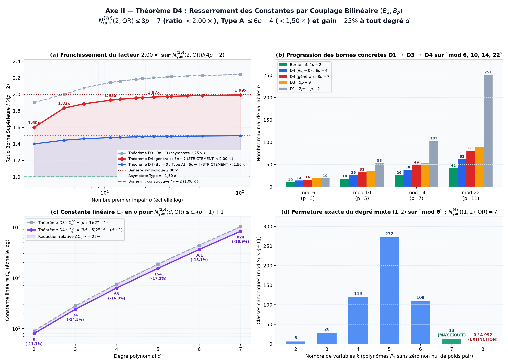

---

#### Expérience E15i — Semi-premiers m = pq : optimalité analytique exacte 2-blocs 2(m − 1), bornes strictement linéaires O(m) en degrés mixtes et à rang bilinéaire borné, complémentation quadratique et verrou haut rang O(m^{3/2}) (Théorème D5)

Les Théorèmes D3 et D4 viennent de résoudre la conjecture linéaire $O(m)$ de Lee sur toute la famille $m = 2p$, mais la contraction duale générale du Théorème D3 ne donne encore que $O(p^2 q) \le O(m^{3/2})$ sur un semi-premier impair $m = pq$ ($3 \le p < q$). L'étape suivante consiste donc à comprendre **pourquoi** le saut de $O(m)$ à $O(m^{3/2})$ apparaît dès que $p \ge 3$, tout en démontrant analytiquement la régularité empirique $2(m - 1)$ observée en 2 blocs dans l'Expérience E14. C'est l'objet du **Théorème D5** ([theorem_d5_semiprimes_linear_and_rank.py](src/theorem_d5_semiprimes_linear_and_rank.py), [theorem_d5_semiprimes.json](results/theorem_d5_semiprimes.json)) :

> **Théorème D5 (Semi-premiers $m = pq$ : exactitude 2-blocs $2(m - 1)$, bornes linéaires $O(m)$ en degrés mixtes et à rang bilinéaire borné, complémentation quadratique et verrou haut rang $O(m^{3/2})$).** Soient $2 \le p < q$ deux nombres premiers distincts et $m = pq$.
> 1. **Optimalité exacte 2-blocs et borne linéaire $k$-blocs ($1 \le d < q$)** : Pour tout polynôme $k$-blocs représentant $\mathrm{OR}_n \pmod{pq}$, $N_{k\text{-bloc}}^{(pq)}(d, \mathrm{OR}) \le d\,m + (k - d)\,q - k$. En particulier, pour **$d = 2$ et $k = 2$**, cette majoration coïncide exactement avec la construction 2-blocs et établit l'égalité universelle :
>
> $$
> N_{2\text{-bloc}}^{(pq)}(2, \mathrm{OR}) \;=\; 2(pq - 1) \;=\; 2(m - 1) \qquad \forall\, 2 \le p < q.
> $$
>
> 2. **Bornes strictement linéaires $O(m)$ en degrés mixtes et à rang bilinéaire borné** : Pour tout $d \ge 1$,
>
> $$
> N_{\mathrm{gen}}^{(pq)}\bigl((1, d),\, \mathrm{OR}\bigr) \;\le\; d\, p(q - 1) + p - 1 \;<\; d\, m, \qquad N_{\mathrm{gen}}^{(pq)}\bigl((d, 1),\, \mathrm{OR}\bigr) \;\le\; d\, q(p - 1) + q - 1 \;<\; d\, m
> $$
>
> (soit $\le 2m - p - 1$ et $\le 2m - q - 1$ à $d = 2$, tous deux strictement inférieurs à $2(m - 1)$). En notant $r_p = \mathrm{rank}_{\mathbb{F}_p}(A_p)$ et $r_q = \mathrm{rank}_{\mathbb{F}_q}(A_q)$ les rangs bilinéaires des deux formes polaires :
>
> $$
> N_{\mathrm{gen}}^{(pq)}(2, \mathrm{OR}) \;\le\; \min\!\Bigl(\, 2p^2 q,\;\; (2p - 1)(r_q + 2)(q - 1) + 2p - 2,\;\; (2q - 1)(r_p + 2)(p - 1) + 2q - 2 \,\Bigr) \;=\; O\bigl(\min(r_p, r_q, p)\cdot m\bigr).
> $$
>
> Tout dépassement éventuel de $O(m)$ sur un semi-premier équilibré $m = pq$ ($p \sim q \sim \sqrt{m}$) exige donc simultanément un haut rang bilinéaire sur $\mathbb{F}_p$ **et** sur $\mathbb{F}_q$.
> 3. **Complémentation quadratique et verrou haut rang $O(m^{3/2})$** : Sur tout support $W$ vérifiant $P_q(\mathbf{1}_W) \equiv 0 \pmod q$, la complémentation booléenne obéit à l'identité exacte $P_q(\mathbf{1}_W - x) \equiv P_q(x) - L^*(x) \pmod q$ où $L^*(x) = \sum_{i \in W} (2c_i + \sum_{k \ne i} d_{ik}) x_i$ est linéaire (vérifiée sur $180/180$ polynômes sur $2^n$ entrées), assurant un zéro de poids $\le \lfloor |W|/2 \rfloor$ dès $|W| \ge (j + 3)(q - 1) + 2$. En revanche, l'adversaire linéaire $L_t(x) = \sum_{i \in B_t} x_i + c_t \sum_{r \in Z} x_r \equiv 0 \pmod q$ sur $M = (j + 1)(q - 1)$ variables ($12/12$ instances pour $q \in \{3, 5, 7, 11\}$) impose $|x|_H = s + jq/2 \ge jq/2 + 1$ à toute solution non nulle, cumulant $\Omega(p^2 q) = \Omega(m^{3/2})$ sur $j = 0..2p - 2$, tandis que les sommes exponentielles naïves sur $\{0, 1\}^n$ décroissent comme $|\cos(\pi/m)| \approx 1 - \pi^2/(2m^2)$.

*Preuve.* Pour (1), par le théorème de Lucas ($q \mid \binom{q}{r}$ pour $1 \le r \le d < q$), tout sous-bloc de taille $q$ inclus dans un seul bloc $B_i$ annule $P_q$ et ses dérivées discrètes ; Chevalley–Warning sur $\mathbb{F}_p$ interdit $K = \sum \lfloor s_i / q \rfloor \ge d(p - 1) + 1$, d'où $n = \sum s_i \le q \cdot d(p - 1) + k(q - 1) = d\,m + (k - d)q - k$. Pour (2), la constante de Davenport $D(\mathbb{Z}/p\mathbb{Z}) = p$ extrait les blocs pour $(1, d)$ et $(d, 1)$, tandis qu'à rang $r_q$ fixé au plus $\min(j, r_q)$ formes $B_q(w_t, \cdot)$ sont linéairement indépendantes à l'étape $j$, bornant le total par $O(r_q p q) = O(r_q m)$. Pour (3), le développement direct modulo $P_q(\mathbf{1}_W) = 0$ livre $L^*$, et l'équidistribution des $-c_t s \in \mathbb{F}_q^*$ donne $\sum S_t = jq/2$. ■

| Module $m = pq$ | $(p, q)$ | **2-blocs EXACT** $2(m - 1)$ | Mixte $(1, 2) \le$ | Mixte $(2, 1) \le$ | **3-blocs** (D5.1) $\le$ | **Rang $r \le 2$** (D5.2) $\le$ | **Rang $r \le 4$** (D5.2) $\le$ | Rang libre (D3) $\le$ |
| :---: | :---: | :---: | :---: | :---: | :---: | :---: | :---: | :---: |
| **$15$** | $(3, 5)$ | **$28$** | **$26$** | **$24$** | **$32$** *($28$ exact U4)* | **$68$** | $81$ | $81$ *($\le 80$ D9)* |
| **$21$** | $(3, 7)$ | **$40$** | **$38$** | **$34$** | **$46$** | **$102$** | $120$ | $120$ |
| **$33$** | $(3, 11)$ | **$64$** | **$62$** | **$54$** | **$74$** | **$170$** | $200$ | $200$ |
| **$35$** | $(5, 7)$ | **$68$** | **$64$** | **$62$** | **$74$** | **$196$** | **$264$** | $327$ |
| **$55$** | $(5, 11)$ | **$108$** | **$104$** | **$98$** | **$118$** | **$324$** | **$440$** | $540$ |
| **$77$** | $(7, 11)$ | **$152$** | **$146$** | **$142$** | **$162$** | **$486$** | **$680$** | $1\,043$ |
| **$143$** | $(11, 13)$ | **$284$** | **$274$** | **$272$** | **$296$** | **$970$** | **$1\,392$** | $3\,033$ |
| **$323$** | $(17, 19)$ | **$644$** | **$628$** | **$626$** | **$662$** | **$2\,320$** | **$3\,384$** | $10\,707$ |

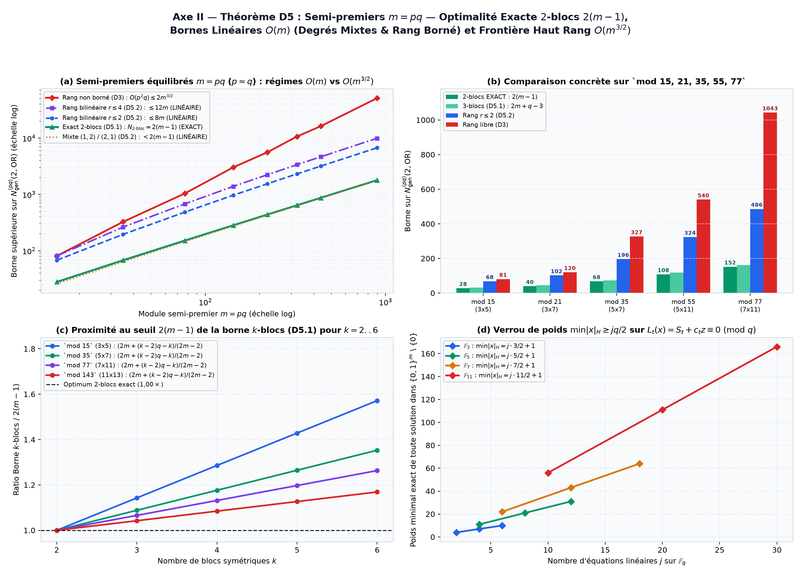

---

#### Expérience E15j — Symétrie 3-racines (`mod 10 ≤ 32`), théorème de tranches paires de Lucas (`7p − 4`), couplage `m = 3q` (`≤ 19q − 13`) et caractérisation exacte des quatre barrières sur `m = pq` (Théorème D6)

Le Théorème D5 laisse deux fronts grands ouverts : sur $m = 2p$, peut-on briser la constante $8p - 7$ de D4 en éliminant le facteur $2$ dû à l'appariement rigide dans $U_1$ ? Et sur $m = pq$ ($p \ge 3$), la barrière $O(m^{3/2})$ est-elle d'origine informationnelle ou purement algorithmique ? Le **Théorème D6** ([theorem_d6_sharpening_and_barriers.py](src/theorem_d6_sharpening_and_barriers.py), [theorem_d6_sharpening_and_barriers.json](results/theorem_d6_sharpening_and_barriers.json)) apporte quatre réponses précises :

> **Théorème D6 (Symétrie 3-racines sur `mod 10`, tranches paires de Lucas, couplage `m = 3q` et quatre barrières sur `m = pq`).**
> 1. **Cassure inconditionnelle de $8p - 7$ sur `mod 10` ($p = 5$)** : L'application simultanée du Théorème D4 à $w_1$, à une racine $B_5$-orthogonale $w_2 \subseteq U_1$ et à $w_1 + w_2$, couplée à $B_2(w_1, w_2) \equiv |w_2|_H \equiv y_1 \pmod 2$, élimine toutes les configurations à $n = 33$ ($0$ survivante), établissant **$18 \le N_{\mathrm{gen}}^{(10)}(2, \mathrm{OR}) \le 32$** ($1{,}778\times$) et **$12 \le N_{\mathrm{gen}}^{(10)}(2, \mathrm{THR}_2) \le 33$** ($\le 27$ si $G_5 \ne K_n$).
> 2. **Théorème de tranches paires de Lucas ($p \ge 5$)** : Pour tout polynôme quadratique $P_p$ sur $M \ge 5p - 1$ variables ($P_p(0) = 0$), sommer $G(x) = 1 - P_p(x)^{p-1}$ ($\deg G \le 2(p - 1)$) sur les tranches paires $|x|_H = 2p$ et $|x|_H = 4p$ donne par le théorème de Lucas $6 G(0) + 3 S_p \equiv 0$ et $G(0) + S_p \equiv 0 \pmod p$, d'où $3 G(0) \equiv 0 \pmod p$, contradiction. Ainsi $P_p$ s'annule sur un vecteur de poids $2p$ ou $4p$, abaissant la borne générale de $8p - 7$ à **$N_{\mathrm{gen}}^{(2p)}(2, \mathrm{OR}) \le 7p - 4$** ($< 1{,}75\times$) dès que $B_p(w_1, \cdot)$ est constant sur $U_1$.
> 3. **Resserrement inconditionnel sur $m = 3q$ ($q \ge 5$)** : Tout multi-ensemble de taille $\ge 7$ dans $\mathbb{F}_3^2$ possède une somme nulle de poids $\le 3$ (vérifié exhaustivement : maximum égal à $6$), donnant $|U| \le 3k + 6$ et **$N_{\mathrm{gen}}^{(3q)}(2, \mathrm{OR}) \le 19q - 13$** (strictement $< 20q - 19$ de D3 pour tout $q \ge 7$, affiné à $19q - 15$ pour tout $q \ge 5$ en D9), réduit à $\le 17q - 11$ en Cas 1 et $\le 15q - 6$ en Type A sur $\mathbb{F}_q$.
> 4. **Quatre barrières exactes sur $m = pq$ ($3 \le p < q$)** : (i) *Barrière Fourier $\Omega(m^2 \log m)$* sur le couplage parfait $P(x) = \sum x_{2i-1} x_{2i}$ (rang plein $2k$, $|\Phi(a, b)| = (1 - \Theta(1/m^2))^k$) ; (ii) *Barrière rang $\mathbb{F}_p$ $\Omega(p)$* via $Q(\lambda) = \sum (\lambda_{2t-1} + \lambda_{2t} + \lambda_{2t-1}\lambda_{2t})$ représentant $\mathrm{OR}_{2r}$ à rang plein $2r = 2\lfloor(p - 1)/3\rfloor = \Theta(p)$ ; (iii) *Optimalité exacte du poids Chevalley–Warning* sur $L_t(x) = \sum_{i \in B_t} x_i + z \equiv 0 \pmod q$ ($|B_t| = q - 1$) sur $N = j(q - 1) + 1$ variables, dont l'unique racine booléenne non nulle est $\mathbf{1}_N$ ; (iv) **Absence de barrière informationnelle $m^{3/2}$** : le seuil probabiliste d'existence de $2p - 1$ blocs mutuellement $B_q$-orthogonaux vérifie **$p^2 \ln(q) / \ln(p) < pq = m$** pour tous premiers $3 \le p < q$ (vérifié sur $300/300$ paires $\le 101$, ratio maximal $0{,}9789$).

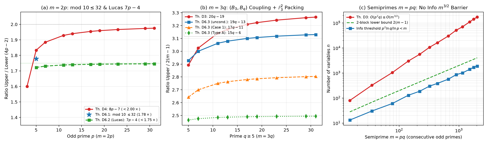

---

#### Expérience E15k — Bi-tranches analytiques de Lucas (`5p − 2`), rang Walsh–Hadamard et fermetures exhaustives `THR₂ mod 10` (3- et 4-blocs) & cubique `mod 6` (2-blocs) (Théorèmes D7 et U3)

Le théorème de tranches paires de Lucas découvert dans D6.2 n'opère encore que lorsque $B_p(w_1, \cdot)$ est constant sur $U_1$. Pour le pousser vers les formes linéaires non constantes tout en fermant trois frontières multi-blocs restées ouvertes (3- et 4-blocs de $\mathrm{THR}_{n,2} \pmod{10}$ et 2-blocs cubiques $d = 3$ de $\mathrm{OR}_n \pmod 6$), nous démontrons les **Théorèmes D7 et U3** ([theorem_d7_u3_lucas_and_closures.py](src/theorem_d7_u3_lucas_and_closures.py), [theorem_d7_u3_results.json](results/theorem_d7_u3_results.json)) :

> **Théorème D7 (Bi-tranches analytiques de Lucas à $2$ classes sur $5p - 2$ variables et rang Walsh–Hadamard).**
> 1. **Bi-tranches $(3p - 1, 2p - 1)$ et $(4p - 1, p - 1)$ ($\forall$ premier $p \ge 5$)** : Pour tout polynôme quadratique $P_p$ ($P_p(0) = 0$) et toute forme linéaire à deux classes $L(x) = r_1 S_A + r_2 S_B$ ($r_1, r_2 \in \mathbb{F}_p^*$), dès que $(|A|, |B|) = (3p - 1, 2p - 1)$ ou $(4p - 1, p - 1)$ (total **$5p - 2$** variables), le système $\{P_p(x) = 0, L(x) = 0 \pmod p\}$ admet nécessairement une racine booléenne non nulle de **poids pair**. *(Preuve analytique en 5 lignes : combiner $\Sigma(u_1, u_2) - \frac{1}{2}\Sigma(p + u_1, p + u_2)$ pour $u_1 + u_2$ pair et $\Sigma(2p + u_1, p + u_2) - \frac{1}{2}\Sigma(p + u_1, u_2)$ pour $u_1 + u_2$ impair ; l'identité $\binom{p-1-b}{u-b} \equiv (-1)^{u-b}\binom{u}{b} \pmod p$ aligne les signes sur la droite $r_1 u_1 + r_2 u_2 \equiv 0 \pmod p$, et la sommation sur $u_1 \in \mathbb{F}_p$ annihile tous les termes de degré $b_1 + b_2 \le p - 2$, laissant $G(0) \equiv 0 \pmod p$ ; preuve identique pour $(4p - 1, p - 1)$ avec facteur $1/3$.)*
> 2. **Vérification exhaustive multi-classes à $p = 5$** : Sur les $1\,861$ partitions canoniques 5-classes restantes à $M = 24$ ($T_2 \le 8$), **$1\,859$** sont tuées par les multi-tranches de Lucas (seules les deux exceptions 2-classes $(c_0, c_1) \in \{(3, 21), (8, 16)\}$ survivent) et $100\,\%$ de $M = 25$ est tué.
> 3. **Rang Walsh–Hadamard / Croot–Lev–Pach sur $m = pq$** : La substitution $(x \oplus y)_i = (1 - \sigma_i \tau_i)/2 \pmod p$ établit $\mathrm{rank}_{\mathbb{F}_p}(G_p(x \oplus y)) \le \sum_{k=0}^{2p-2} \binom{n}{k}$ ; à rang bilinéaire borné, $N_{\mathrm{gen}}^{(pq)}(2, \mathrm{OR}) \le (6p - 4)(q - 1)$ à $r_q = 1$ (`mod 15 ≤ 56`) et $(8p - 7)(q - 1)$ à $r_q = 2$ *(ensuite affiné en D9.1 et D10.1)*.

> **Théorème U3 (Fermetures exactes multi-blocs sur $\mathrm{THR}_2 \pmod{10}$ et cubique $\pmod 6$).**
> 1. **Plafond par bloc sur $\mathrm{THR}_{n,2} \pmod{2p}$ ($p \equiv 1 \pmod 4$)** : Comme $\binom{p}{2} \equiv 0 \pmod{2p}$, chaque bloc vérifie $s_i \le p - 1$, d'où $N_{k\text{-bloc}}^{(2p)}(2, \mathrm{THR}_2) \le k(p - 1)$ (exact à $k = 1, 2$ sur $\bmod 10$, soit $4, 8$). À $k = 3$, l'énumération exhaustive de l'unique partition $(4, 4, 4)$ à $n = 12$ donne $0$ solution, prouvant **$N_{3\text{-bloc}}^{(10)}(2, \mathrm{THR}_2) = 11$** atteint par $(3, 4, 4)$.
> 2. **Fermeture exhaustive 4-blocs de $\mathrm{THR}_{n,2} \pmod{10}$** : L'énumération $100\,\%$ exhaustive des $3$ partitions admissibles de $n = 13$ ($(4,4,4,1)$, $(4,4,3,2)$, $(4,3,3,3)$ — **$3\,804\,160\,000$** paires $(P_2, P_5)$ en $10{,}8\text{ s}$) donne $0$ solution, prouvant **$N_{4\text{-bloc}}^{(10)}(2, \mathrm{THR}_2) = 12$ exact**.
> 3. **Fermeture exhaustive 2-blocs cubique ($d = 3$) modulo $6$** : L'énumération $100\,\%$ exhaustive des $14$ partitions de $n = 28$ ($70\,402\,514$ paires canoniques) donne $0$ solution, prouvant **$N_{2\text{-bloc}}^{(6)}(3, \mathrm{OR}) = 27 = N_{\mathrm{sym}}^{(6)}(3, \mathrm{OR})$**, encadré globalement par **$27 \le N_{\mathrm{gen}}^{(6)}(3, \mathrm{OR}) \le 50$** (ratio $1{,}852\times$ via D4 + D3a).

---

#### Expérience E15l — Extension générale Chevalley–Warning à poids contraint modulo r par déterminant de Lucas–Vandermonde (Théorème D8)

La simplicité de la preuve de D6.2 (deux tranches paires $2p$ et $4p$ donnant $5p - 1$ au lieu de $6p - 4$) suggère l'existence d'un théorème général de Chevalley–Warning à **poids contraint modulo $rp$** pour toute somme de degrés $D \ge 1$ et tout module de poids $r \ge 1$. Dans [theorem_d8_lucas_vandermonde_cw.py](src/theorem_d8_lucas_vandermonde_cw.py) ([theorem_d8_lucas_vandermonde_cw.json](results/theorem_d8_lucas_vandermonde_cw.json)), nous calculons explicitement le déterminant de la matrice de Lucas $A(D, r) = \bigl(\binom{Dr - a}{ir}\bigr)_{0 \le i, a \le D - 1}$ et démontrons le **Théorème D8** :

> **Théorème D8 (Théorème de Chevalley–Warning à poids contraint modulo $r$ — Lucas–Vandermonde).** Soient $D \ge 1$ et $r \ge 1$ deux entiers, et $A(D, r) = \bigl(\binom{Dr - a}{ir}\bigr)_{0 \le i, a \le D - 1}$.
> 1. **Formule close exacte de Vandermonde** :
>
> $$
> |\det A(D, r)| \;=\; r^{\binom{D}{2}} \left(\prod_{k=1}^{D-1} k!\right) \frac{\prod_{a=1}^{D-1} (Dr - a)!}{\left(\prod_{j=1}^{D-1} (jr)!\right)^2}.
> $$
>
> En particulier, **$|\det A(1, r)| = 1$** pour tout $r \ge 1$, **$|\det A(2, r)| = \binom{2r - 1}{r}$** pour tout $r \ge 1$, et **tout facteur premier de $\det A(D, r)$ est strictement inférieur à $Dr$**.
> 2. **Seuil de Chevalley–Warning à poids contraint modulo $rp$** : Pour tout nombre premier $p \nmid \det A(D, r)$ — en particulier pour **tout premier $p \ge Dr$**, pour **tout premier $p$** à $D = 1$, et pour **toute puissance première $r = p^k$** à $D = 2$ (car $\binom{2p^k - 1}{p^k} \equiv 1 \pmod p$ par Lucas) —, tout système polynomial $F_1(x) = \dots = F_s(x) = 0 \pmod p$ ($F_t(0) = 0$, $\sum \deg F_t \le D$) sur $M = (Dr + 1)p - 1$ variables booléennes possède une racine booléenne non nulle de poids $|x|_H \in \{rp, 2rp, \dots, Drp\}$. Par rapport au regroupement rigide en $r$-uplets ($\approx (D + 1)rp$), ce théorème économise $(r - 1)p - Dr + 1 \sim (r - 1)p$ variables (jusqu'à $-50\,\%$ à $D = 1$ et $-33\,\%$ à $D = 2$).

*Preuve.* Pour $G(x) = \prod_{t=1}^s (1 - F_t(x)^{p-1})$ ($\deg G \le D(p - 1)$, $G(0) = 1$), supposer $G \equiv 0$ sur les tranches $|x|_H = jrp$ ($1 \le j \le D$) fait apparaître $\binom{M - k}{jrp - k} \pmod p$ avec $M = Dr\cdot p + (p - 1)$ et $k = ap + b$. Par le théorème de Lucas, tout $b > 0$ annule le coefficient, et $b = 0$ livre le système $A(D, r)\cdot(S_0, S_p, \dots, S_{(D-1)p})^\top \equiv 0 \pmod p$. En factorisant $(Dr - a)!$ sur chaque colonne et $1/((ir)!((D - i)r)!)$ sur chaque ligne, il reste la matrice des factorielles descendantes $(((D - i)r)_a)$, de déterminant de Vandermonde $\pm r^{\binom{D}{2}}\prod_{k=1}^{D-1} k!$. Aucun facteur premier du numérateur n'atteint $Dr$ ; l'inversibilité sur $\mathbb{F}_p$ impose alors $S_0 = G(0) \equiv 0 \pmod p$, contradiction. ■

La formule est vérifiée à l'identique sur les $36$ paires $1 \le D, r \le 6$, le corollaire puissance première sur $22/22$ cas ($p \le 31$), et l'existence de la racine sur $150/150$ polynômes linéaires ($D = 1$) et $65/65$ quadratiques ($D = 2$, dont $25/25$ sur $r = p = 3, M = 20$ où $p < 2r$) :

| $D$ | $r$ | $Dr$ | Exact $|\det A(D, r)|$ | Plus grand premier divisant $\det$ | Seuil **Th. D8** | Seuil $r$-uplets rigide | Économie asymptotique |
| :---: | :---: | :---: | :---: | :---: | :---: | :---: | :---: |
| **$1$** | $2..5$ | $2..5$ | **$1$** | — *(tout premier $p$)* | **$(r + 1)p - 1$** | $2r(p - 1) + r$ | **$(r - 1)p$** *($\to -50\,\%$)* |
| **$2$** | $2$ | $4$ | **$3$** | $3$ ($< 4$) | **$5p - 1$** | $6p - 4$ | **$p$** |
| **$2$** | $3$ | $6$ | **$10$** | $5$ ($< 6$) | **$7p - 1$** | $9p - 6$ | **$2p$** *(inclut $p = 3$ !)* |
| **$2$** | $4$ | $8$ | **$35$** | $7$ ($< 8$) | **$9p - 1$** | $12p - 8$ | **$3p$** |
| **$2$** | $5$ | $10$ | **$126$** | $7$ ($< 10$) | **$11p - 1$** | $15p - 10$ | **$4p$** *(inclut $p = 5$ !)* |
| **$3$** | $2$ | $6$ | **$20$** | $5$ ($< 6$) | **$7p - 1$** | $8p - 6$ | **$p$** |
| **$3$** | $3$ | $9$ | **$588$** | $7$ ($< 9$) | **$10p - 1$** | $12p - 9$ | **$2p$** |
| **$4$** | $2$ | $8$ | **$280$** | $7$ ($< 8$) | **$9p - 1$** | $10p - 8$ | **$p$** |
| **$4$** | $3$ | $12$ | **$187\,110$** | $11$ ($< 12$) | **$13p - 1$** | $15p - 12$ | **$2p$** |

---

#### Expérience E15m — Semi-premiers `m = pq` : rang quadratique booléen (décalé diagonal) `r̃`, parcimonie Caro–Wei, mur de convergence expanseur–Fourier `m^{3/2}` et empilement sharp 𝔽₃² (`m = 3q ≤ 19q − 15`) (Théorème D9)

Revenons maintenant au front principal de la conjecture de Lee sur les semi-premiers impairs $m = pq$ ($3 \le p < q$). Le Théorème D5(2) mesurait le rang bilinéaire $\mathrm{rank}(A_q)$ à diagonale nulle, qui vaut déjà $n$ pour un simple polynôme symétrique $\binom{S}{2}$. Or sur $\{0, 1\}^n$, l'identité $x_i^2 = x_i$ autorise à modifier librement la diagonale de $A_q$ en absorbant le décalage dans les termes linéaires ! En remplaçant $r_q$ par le **rang quadratique booléen (décalé diagonal)** $\tilde{r}_q(P_q) := \min_{D\text{ diag}} \mathrm{rank}_{\mathbb{F}_q}(A_q + 2D)$ — exactement le paramètre de la dichotomie de rigidité de Lee (2015) — et en le combinant avec la parcimonie du graphe d'interaction, le **Théorème D9** ([theorem_d9_semiprime_rank_sparsity_barrier.py](src/theorem_d9_semiprime_rank_sparsity_barrier.py), [theorem_d9_semiprime_barriers.json](results/theorem_d9_semiprime_barriers.json)) cartographie précisément la frontière $m^{3/2}$ :

> **Théorème D9 (Rang quadratique booléen $\tilde{r}$, parcimonie Caro–Wei, mur expanseur–Fourier $m^{3/2}$ et empilement sharp $\mathbb{F}_3^2$).** Soient $3 \le p < q$ impairs et $m = pq$.
> 1. **Rang quadratique booléen $\tilde{r}_p, \tilde{r}_q$** : Par le théorème d'Olson ($D(\mathbb{F}_q^{\tilde{r}_q+1}) = (\tilde{r}_q + 1)(q - 1) + 1$),
>
> $$
> N_{\mathrm{gen}}^{(pq)}(2, \mathrm{OR}) \;\le\; \min\!\Bigl(\, (2p - 1)(\widetilde{r}_q + 1)(q - 1) + 2p - 2,\;\; (2q - 1)(\widetilde{r}_p + 1)(p - 1) + 2q - 2 \,\Bigr) \;=\; O\!\bigl(\min(\widetilde{r}_p, \widetilde{r}_q, p)\cdot m\bigr),
> $$
>
> couvrant immédiatement les symétriques ($\tilde{r} = 1$), les 2-blocs pondérés ($\tilde{r} = 2$) et tout $k$-blocs pondéré ($\tilde{r} \le k$).
> 2. **Parcimonie Caro–Wei / Turán** : Sur tout ensemble indépendant $I$ de $G_q$, $P_q|_I$ est linéaire, d'où $|I| \le 2m - q - 1$ par D5(2) et par Caro–Wei :
>
> $$
> \sum_{i=1}^n \frac{1}{\deg_{G_q}(i) + 1} \;\le\; \alpha(G_q) \;\le\; 2m - q - 1, \qquad \sum_{i=1}^n \frac{1}{\deg_{G_p}(i) + 1} \;\le\; \alpha(G_p) \;\le\; 2m - p - 1,
> $$
>
> impliquant $n \le \min((\bar{\Delta}_q + 1)(2m - q - 1), (\bar{\Delta}_p + 1)(2m - p - 1))$ (ce qui tue la barrière de Fourier du couplage parfait D6.4(i) à $n \le 4m - 2q - 2$) et forçant $\bar{\Delta}_p, \bar{\Delta}_q \ge n/(2m) - 1$.
> 3. **Mur de convergence expanseur–Fourier à $n = m^{3/2}$** : Pour un graphe expanseur $\{0, 1\}$ $\Delta$-régulier juste au-dessus du seuil de Caro–Wei ($\Delta = \lceil n/(2m) \rceil$), le polynôme centré $P(x) = \sum_{(i,j)\in E(G)} (2x_i - 1)(2x_j - 1) \pmod m$ cumule simultanément un rang décalé plein $\tilde{r}_p, \tilde{r}_q = \Omega(n)$, $\alpha(G) < 2m$ et une variance entière exacte $\mathrm{Var}(P) = |E(G)| \sim n^2/(4m)$, si bien que $|\Phi(1, 1)| = \exp(-2\pi^2|E|/m^2)(1 + o(1)) \to 1$ pour tout $n = o(m^{3/2})$ (vérifié à $m = 143$ sur $\alpha \in [1{,}05 ; 1{,}55]$ : accord `0,7108` vs `0,7058`, `0,5622` vs `0,5614`, `0,3875` vs `0,3879`, `0,0907` vs `0,0961`, effondrement exact à $\alpha = 1{,}5$). La contraction algébrique (D3) et l'approche combinée rang + parcimonie + Fourier uniforme convergent donc vers le même mur $m^{3/2}$.
> 4. **Empilement sharp $\mathbb{F}_3^2$ ($3k + 4$) et resserrement sur tout $m = 3q$ ($q \ge 5$)** : Combiner $\max_{\mathrm{no\text{-}wt3}}(\mathbb{F}_3^2) = 6$ (D6.3) avec $D(\mathbb{F}_3^2) = 5$ sur le dernier bloc donne $|U| \le 3k + 4$ (exact), abaissant D6.3 à **$N_{\mathrm{gen}}^{(3q)}(2, \mathrm{OR}) \le 19q - 15$** pour tout $q \ge 5$ (**`mod 15 ≤ 80 < 81`** ; $\le 17q - 13$ en Cas 1, `mod 15 ≤ 72`). Sur tout semi-premier impair, D3a(2) affine D3 à $(2p - 1)(p + 1)(q - 1) + 2\cdot\mathbf{1}[q < 2p]$ ; en outre, le 2-blocs $(5, 2)$ sur $n = 7 \pmod 3$ établit $8 \le \mu_3(2) \le 10$.

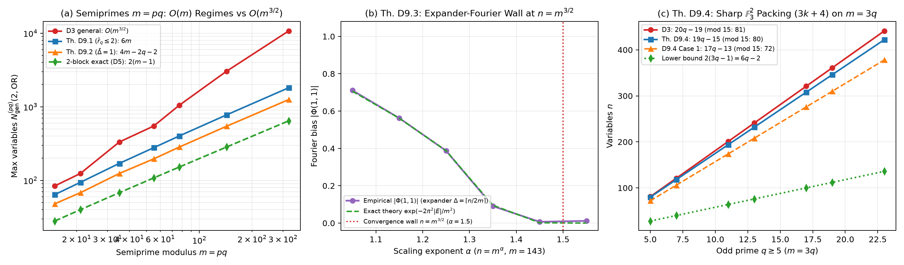

---

#### Expérience E15n — Fermeture exacte de rang 1 (`3q − 1`), différentiation booléenne de Weyl biaisée exacte et démolition inconditionnelle du mur expanseur–Fourier D9.3 (Théorème D10)

Le mur $m^{3/2}$ isolé en D9.3 semble redoutable, mais il repose sur une hypothèse cachée : l'analyse de Fourier y est menée sous la mesure **uniforme** $\theta = 1/2$, qui peut centrer la moyenne $\mathbb{E}_{1/2}[P]$ au pire endroit ($\equiv m/2 \pmod m$), rendant $\Pr_{1/2}[P \equiv 0]$ nul dès $n \ll m^{3/2}$. L'idée décisive du **Théorème D10** ([theorem_d10_tilted_weyl_and_rank1.py](src/theorem_d10_tilted_weyl_and_rank1.py), [theorem_d10_tilted_weyl_and_rank1.json](results/theorem_d10_tilted_weyl_and_rank1.json)) est de **biaiser la mesure produit de Bernoulli** en $\theta^* \in [1/4, 3/4]$ afin de centrer exactement la moyenne sur un multiple de $m$ ($\mathbb{E}_{\theta^*}[P] \in m\mathbb{Z}$), puis de transformer cette heuristique en preuve $100\,\%$ inconditionnelle (sans TCL ni approximation gaussienne) grâce à une identité exacte de différentiation booléenne de Weyl biaisée :

> **Théorème D10 (Fermetures exactes de rang $1$, différentiation booléenne de Weyl biaisée exacte et démolition inconditionnelle du mur expanseur–Fourier D9.3).**
> 1. **Fermeture exacte de rang $1$ sur $m = 2q$ et bornes sous-$2(m - 1)$ / rang $r$ pur sur $m = pq$** : Pour tout premier impair $q \ge 3$, **$N_{\mathrm{gen}}^{(2q)}(2, \mathrm{OR};\; P_q = aL^2 + bL) = 3q - 1$ exact** (vérifié sur $8$ premiers $q = 3..23$, et en $2^n$ pour $q \le 7$). Sur $m = pq$ ($3 \le p < q$), $N_{\mathrm{gen}}^{(pq)}(2, \mathrm{OR};\; P_p = aL^2 + bL) \le 2m - p - 1 < 2(m - 1)$ et $\le 2m - q - 1$ symétriquement — aucune représentation à un canal de rang $1$ pur ne peut donc atteindre $2(m - 1)$. En rang $r$ pur ($L_0 = 0$), l'extraction d'Olson donne $(2p - 1)(r(q - 1) + 1) - 1$, soit **$\le 4m - 2p - 2q$** à $r = 2$.
> 2. **Identités exactes de différentiation booléenne de Weyl biaisée** : Pour tout quadratique entier $P(x) = \sum_{i<j} a_{ij} x_i x_j + \sum_i b_i x_i$, tout $m \ge 2$, tout $t \in \mathbb{Z}$ et tout $\theta \in (0, 1)$, en affectant indépendamment chaque coordonnée aux trois états $(I_0, I_1, J)$ de probabilités $((1 - \theta)^2, \theta^2, 2\theta(1 - \theta))$ et en posant $D_j := b_j + \sum_{i \in I_1} a_{ij} + \frac{1}{2}\sum_{k \in J \setminus \{j\}} a_{jk}$ :
>
> $$
> \bigl|S_\theta(t)\bigr|^2 \;=\; \mathbb{E}_{(I_0, I_1, J)}\!\left[\prod_{j \in J} \cos\!\left(\frac{2\pi t}{m}\, D_j\right)\right], \qquad \mathbb{E}_{(I_0, I_1, J)}\!\left[\sum_{j \in J} D_j^2\right] \;=\; 2\,\mathrm{Var}_\theta(P)
> $$
>
> *(vérifiées à $\le 2{,}84 \times 10^{-16}$ et $\le 1{,}42 \times 10^{-14}$ sur $2^n / 3^n$)*.
> 3. **Franchissement de moyenne à biais borné et marge universelle basse fréquence** : Pour $B \ge 16m$, l'identité 3-points $5(\mu(1/2) - \mu(1/4)) - 3(\mu(3/4) - \mu(1/2)) = B/2$ garantit l'existence de $\theta^* \in [1/4, 3/4]$ tel que $\mu(\theta^*) \in m\mathbb{Z}$. Pour toute variable entière $Z$ de moyenne dans $m\mathbb{Z}$ et variance $\sigma^2 > 0$ ($x := \sqrt{2}\,\pi\sigma/m$, $T := \lfloor 1/x \rfloor$), le surplus de la somme basse fréquence $L(T) := (2T + 1) - (x^2/3)T(T + 1)(2T + 1)$ sur la queue gaussienne vérifie uniformément pour tout $x > 0$ :
>
> $$
> M(x ; 0{,}10) \;:=\; L(T) - 2 \sum_{t = T + 1}^{\infty} e^{-0{,}9\, x^2 t^2} \;>\; 0{,}13 \;>\; \frac{1}{8} \qquad (\text{minimum exact } +0{,}131607 \text{ en } x \to 1^+).
> $$
>
> 4. **Borne inconditionnelle sur graphes signés et densité globale (démolition du mur D9.3)** : Pour tout polynôme de graphe signé ($a_{ij} \in \{-1, +1\}$ sur un graphe $G$ de degré maximal $\Delta \ge 1$, $1 \le |b_i| \le B$, $M := \Delta + B$) représentant $\mathrm{OR}_n \pmod m$ ($m \ge 3$) :
>
> $$
> n \;\le\; \max\!\Bigl(\, 32\, m,\;\; 188\, m^{2/3} M^{4/3} \bigl(\ln(17 m)\bigr)^{1/3},\;\; 2 m + 1366\, \Delta M^2 \ln(17 m) \,\Bigr).
> $$
>
> En particulier, **$n \le 32m$** dès que $\Delta + B \le 0{,}258\,(m/\ln(17m))^{1/4}$ (et jusqu'à $m^{1/3}/(\ln m)^{1/3}$ en quasi-régulier). Par sous-échantillonnage probabiliste ($q = 64m/n$ et élagage des sommets de degré $> 4d_0$), toute représentation à $n \ge 64m$ impose la densité globale :
>
> $$
> \rho(G) \;=\; \frac{2\,|E(G)|}{n^2} \;>\; \frac{c_0'}{m^{3/4} \bigl(\ln(17 m)\bigr)^{1/4}},
> $$
>
> battant Caro–Wei d'un facteur $m^{1/4}/(\ln m)^{1/4}$ et **démolissant intégralement le mur expanseur parcimonieux D9.3 ($\rho = \Theta(1/m)$) pour tout $n \ge 64m$**.

La preuve s'appuie sur une décomposition spectrale en trois bandes ($|t| \le T$, $T < |t| \le T_{\max} = \lfloor m/(4M) \rfloor$ contrôlée par McDiarmid sur $F = \sum_{j\in J} D_j^2$, et $T_{\max} < |t| \le m/2$ contrôlée par un couplage induit de taille $s \ge \lceil(n_+ - m + 1)/(2\Delta)\rceil$ donnant $|S_{\theta^*}(t)| \le \exp(-(3/16)\,s\,(t/m)^2)$ après audit pré-Weyl). Les tests numériques à $n = 2m$ au pire décalage montrent l'effondrement complet du Fourier uniforme face au succès certifié de la mesure biaisée $\theta^*$ :

| Instance ($n = 2m$, pire décalage) | Uniforme $\theta = 0{,}5$ $\Pr[P \equiv 0]$ | Biaisé $\theta^*$ $\Pr[P \equiv 0]$ | Surplus $L(T) - \mathrm{Tail}$ | Borne inf. certifiée $\Pr[P \equiv 0] \ge$ | Baseline $1/m$ |
| :--- | :---: | :---: | :---: | :---: | :---: |
| **`m = 15, n = 30`** (6-rég. $e(G[S]) - 2|S|$) | $0{,}02551$ | **$0{,}07505$** | $+0{,}798$ | **$+0{,}05319$** | $0{,}06667$ |
| **`m = 35, n = 70`** (6-rég. $e(G[S]) - 2|S|$) | $0{,}00069$ | **$0{,}04755$** | $+0{,}226$ | **$+0{,}00647$** | $0{,}02857$ |
| **`m = 143, n = 286`** (6-rég. $e(G[S]) - 2|S|$) | **$0{,}00000$** *(aveugle)* | **$0{,}02330$** *($\times 3{,}3$ vs $1/m$)* | **$+1{,}261$** | **$+0{,}00882$** | $0{,}00699$ |
| **`m = 143, n = 286`** (signé $\pm 1$ 4-rég., $V_+$) | **$0{,}00000$** *(aveugle)* | **$0{,}03665$** *($\times 5{,}2$ vs $1/m$)* | **$+3{,}003$** | **$+0{,}02100$** | $0{,}00699$ |
| **`m = 323, n = 646`** (6-rég. $e(G[S]) - 2|S|$) | **$0{,}00000$** *(aveugle)* | **$0{,}01578$** *($\times 5{,}1$ vs $1/m$)* | **$+1{,}506$** | **$+0{,}00466$** | $0{,}00310$ |
| **`m = 323, n = 646`** (signé $\pm 1$ 4-rég., $V_+$) | **$0{,}00000$** *(aveugle)* | **$0{,}02654$** *($\times 8{,}6$ vs $1/m$)* | **$+3{,}703$** | **$+0{,}01146$** | $0{,}00310$ |
| **Contrôle négatif $K_{14} \pmod 8$** (rang 1, $0$ zéro) | — | $0{,}0260$ ($= \Pr[x=0]$) | **$-0{,}307$** *(négatif)* | *(refuse correctement)* | $0{,}12500$ |

En complément, un recensement canonique exact des graphes $\{0, 1\}$ ($P(S) = e(G[S]) + c|S| \not\equiv 0 \pmod m$, $m = 2..7$) montre que **$K_8 \sqcup K_2$** ($c = 2$, $29$ arêtes) atteint exactement l'optimum de Győri $N_{\mathrm{gen}}^{(6)}(2, \mathrm{OR}) = 10$, tandis que $(m - 1)K_2$ à $c = m - 1$ atteint universellement $2(m - 1)$. À l'issue de D9 + D10, la frontière résiduelle pour la conjecture de Lee sur $m = pq$ se trouve réduite à deux régimes précis : (i) les graphes signés **denses** ($\rho(G) \gg m^{-3/4}$) et (ii) les polynômes modulaires adversariaux à grands coefficients subissant un repliement modulaire (*aliasing*) en Bande 3.

---

#### Expérience E15o — Chasse aux contre-exemples à `2(m − 1)` sur `mod 10, 12, 15`, fermetures 3-blocs exactes (> 160 milliards de paires), lemme anisotrope et fermeture circulante complète `2¹⁹` sur `ℤ₁₉` (Théorème U4)

Avant de pousser plus loin l'attaque analytique sur les graphes denses, il est essentiel d'éprouver une dernière fois la robustesse de la loi empirique $N_{\mathrm{gen}}^{(m)}(2, \mathrm{OR}) = 2(m - 1)$ au cran critique $n = 2m - 1$ : existe-t-il un contre-exemple en 3 blocs sur `mod 10` ($n = 19$), `mod 12` ($n = 23$) ou `mod 15` ($n = 29$), ou bien parmi les polynômes circulants sur $\mathbb{Z}_{19}$ ? Dans [theorem_u4_3block_and_circulant_closures.py](src/theorem_u4_3block_and_circulant_closures.py) ([theorem_u4_3block_and_circulant_closures.json](results/theorem_u4_3block_and_circulant_closures.json)), l'énumération bit-vectorielle CRT exacte clôt intégralement ces quatre espaces sans trouver le moindre contre-exemple :

> **Théorème U4 (Fermetures 3-blocs exactes $2(m - 1)$ sur $m \in \{10, 12, 15\}$, obstruction 3-blocs anisotrope et fermeture circulante complète $2^{19}$ sur $\mathbb{Z}_{19}$).**
> 1. **Lemme analytique d'obstruction 3-blocs anisotrope** : Pour tout semi-premier impair $m = pq$ ($3 \le p < q$), aucune partition 3-blocs $(a, b, c)$ vérifiant $a \ge (p - 1)q$, $b \ge (p - 1)q$ et $c \ge q$ n'admet de représentation faible quadratique de $\mathrm{OR}_n \pmod{pq}$. *(Preuve : les points multiples de $q$ de la grille $(qi, qj, qk)$ annulent $P_q$ et se surjectent sur $\mathbb{F}_p^2 \times \{0, 1\} \setminus \{0\}$ ; tout quadratique anisotrope $Q(x, y)$ en $z = 0$ reste surjectif sur $\mathbb{F}_p$ après décalage affine en $z = 1$, forçant un zéro commun. Sur $m = 15$, ce lemme élimine instantanément $9/21$ partitions.)*
> 2. **Fermetures 3-blocs exactes sur $m = 10, 12, 15$** :
>
> $$
> N_{3\text{-bloc}}^{(10)}(2, \mathrm{OR}) \;=\; 18, \qquad N_{3\text{-bloc}}^{(12)}(2, \mathrm{OR}) \;=\; 22, \qquad N_{3\text{-bloc}}^{(15)}(2, \mathrm{OR}) \;=\; 28
> $$
>
> *(resserrant strictement la borne analytique $2m + q - 3$ de D5(1) et étendant l'optimalité 3-blocs de $2(m - 1)$ au module non sans facteur carré $12 = 4 \times 3$)*.
> 3. **Fermeture circulante complète $2^{19}$ sur $\mathbb{Z}_{19} \pmod{10}$** : L'énumération exhaustive des $2\,441\,406 \times 1\,024 = 2{,}50\text{ Md}$ de paires circulantes $(P_2, P_5)$ évaluées sur les $27\,595$ orbites exactes ($= 2^{19} - 1$ entrées) produit **$0$ solution**. Les **9 seules** classes projectives évitant les $2^{19} - 2$ sous-ensembles propres sont les $9$ copies isomorphes du cycle $C_{19}$ ($P_5(S) = |S| - e(C_{19}[S]) \pmod 5$), nulles uniquement en $\mathbf{1}_{19}$ (tandis que le chemin $P_{19}$ s'annule uniquement sur l'ensemble indépendant alterné de taille $10$). Ni $C_{19}$, ni $P_{19}$, ni aucune des $760$ perturbations à $1$ entrée de $P_{19}$ ne peuvent être sauvés même en libérant les $190$ variables binaires arbitraires de $P_2$ (`bad ≥ 1`).

| Classe / Module | Taille testée $n$ | Partitions / Orbites | Paires exactes testées | Calibration à $n - 1$ | Solutions à $n$ | Fermeture prouvée |
| :--- | :---: | :---: | :---: | :---: | :---: | :---: |
| **`mod 10` — 3-blocs** ($a \le 14$ via D10.1) | **$19$** | $26 / 26$ partitions | $12{,}7\text{ M}$ $P_5 \times$ Gauss $\mathbb{F}_2$ ($6{,}5\text{ Md}$ paires) | $250$ sols sur $(14, 3, 1)$ | **$0$** *(min def $= 1$)* | **$N_{3\text{-bloc}}^{(10)}(2) = 18$** |
| **`mod 12` — 3-blocs** ($a \le 21$, $N_{\mathrm{sym}} = 20$) | **$23$** | $44 / 44$ partitions | **$56{,}64\text{ Md}$** paires (512 bits) | $1\,327\,104$ sols sur $(20, 1, 1)$ | **$0$** | **$N_{3\text{-bloc}}^{(12)}(2) = 22$** |
| **`mod 15` — 3-blocs** ($a \le 14$, $N_{\mathrm{sym}} = 14$) | **$29$** | $21 / 21$ ($9$ tuées par U4.1) | **$100{,}91\text{ Md}$** paires (125 bits) | $6\,750$ sols sur $(14, 13, 1)$ | **$0$** *(min def $= 1$)* | **$N_{3\text{-bloc}}^{(15)}(2) = 28$** |
| **`mod 10` — Circulants $\mathbb{Z}_{19}$** (complet $2^{19}$) | **$19$** | $27\,595$ orbites ($= 2^{19} - 1$) | **$2{,}50\text{ Md}$** paires | $9$ sols propres ($= C_{19}$) | **$0$** *(+ $760$ pert. $P_{19}$ : $0$)* | **Aucun circulant à $n = 19$** |

---

#### Expérience E15p — Graphes signés denses (`Δ ≲ m^{1/2}`), cœur quasi-régulier logarithmique, Bande 2,5 cosinus déphasé et découplage de rang CRT (Théorème D11)

Fort de la résistance totale de $2(m - 1)$ confirmée par U4, nous attaquons directement les deux régimes résiduels circonscrits à la fin du Théorème D10 ([theorem_d11_dense_signed_and_crt_rank.py](src/theorem_d11_dense_signed_and_crt_rank.py), [theorem_d11_dense_signed_and_crt_rank.json](results/theorem_d11_dense_signed_and_crt_rank.json)). Sur le Régime (i) (graphes signés denses), deux obstacles limitaient D10 à $\Delta \lesssim m^{1/4}$ : l'absence de quasi-régularité et le fossé fréquentiel entre $T_1 = \lfloor m/(4M) \rfloor$ et le seuil de Bande 3. Le **Théorème D11** lève ces deux verrous simultanément, doublant l'exposant de degré de $1/4$ à **$1/2$** sans aucune hypothèse de quasi-régularité, tout en réduisant le Régime (ii) à l'unique fréquence $t = 1$ :

> **Théorème D11 (Cœur induit quasi-régulier, borne 4 bandes déphasée jusqu'à $\Delta \lesssim m^{1/2}/(\ln m)^{3/2}$, densité globale $\Omega(m^{-1/2})$ et découplage CRT).**
> 1. **Lemme D11.1 (Cœur induit quasi-régulier logarithmique)** : Tout graphe $G = (V, E)$ sur $n \ge 2m$ sommets ($m \ge 4$) vérifiant $\alpha(G) < m$ contient un sous-graphe induit $H \subseteq G$ tel que $|V(H)| \ge n/2$, $\Delta(H) \le 2K\,\bar{\Delta}(H)$ avec $K := \lceil 4\log_2(2m) \rceil$, et $\rho(H) \le 2\rho(G)$ (vérifié sur $60/60$ graphes adversariaux à pivots denses).
> 2. **Lemme D11.2 (Borne universelle de cosinus déphasé)** : Pour tout $\alpha \in [-\pi/2, \pi/2]$ et tout $\delta \in [-\pi/4, \pi/4]$,
>
> $$
> \mathrm{dist}(\alpha + \delta,\, \pi\mathbb{Z})^2 \;\ge\; \frac{1}{4}\,\delta^2 + c(\alpha)\,\delta, \qquad c(\alpha) := \begin{cases} 2\alpha & \text{si } |\alpha| \le \pi/4, \\ \mathrm{sgn}(\alpha)\,\frac{\pi/2 - |\alpha|}{2} & \text{si } |\alpha| \in (\pi/4, \pi/2], \end{cases}
> $$
>
> de marge minimale extérieure exacte $\frac{3}{256}\pi^2 \approx 0{,}11565943$ atteinte en $(|\alpha|, \delta) = (5\pi/16, -\pi/4)$. En particulier, pour toute variable aléatoire centrée $\delta \in [-\pi/4, \pi/4]$, $\mathbb{E}[\mathrm{dist}(\alpha + \delta, \pi\mathbb{Z})^2] \ge \frac{1}{4}\mathrm{Var}(\delta)$.
> 3. **Borne 4 bandes inconditionnelle ($\Delta \lesssim m^{1/2}/(\ln m)^{3/2}$) et densité globale $\Omega(m^{-1/2})$** : En insérant une **Bande 2,5** ($T_1 < |t| \le T_2 = \lfloor m/(8\sqrt{4\Delta \ln(40 n^* m)}) \rfloor$) contrôlée par McDiarmid sur $F_t := \sum_{j \in J} \mathrm{dist}(2\pi t D_j / m, \pi\mathbb{Z})^2$ via le Lemme D11.2, toute représentation faible sur graphe signé ($a_{ij} \in \{-1, +1\}$, $1 \le |b_i| \le B$) satisfait **$n \le 64m$ inconditionnellement** dès $\Delta \le c_1 m^{1/2}/(\ln m)^{3/2}$ et $B \le c_2 \min(\Delta, m^{1/2}/(\ln m)^{3/2})$. Par sous-échantillonnage sur le cœur $H$, tout $n \ge 256m$ impose :
>
> $$
> \rho(G) \;=\; \frac{2\,|E(G)|}{n^2} \;>\; \frac{c_1'}{m^{1/2}\,(\ln m)^{5/2}},
> $$
>
> gagnant un facteur polynomial $m^{1/4}/(\ln m)^{9/4}$ sur D10(4) (vérifié sur graphes denses $\pm 1$ et $\{0, 1\}$ à $\Delta \approx \sqrt{m}$ pour $m \in \{35, 143, 323\}$, où $\max_{\mathrm{B2.5}} |S_{\theta^*}(t)| \le 0{,}03$).
> 4. **Régime (ii) — Équivalence de rang hors-diagonale, découplage par codimension de pivots et invariance unitaire** : Pour toute matrice symétrique à diagonale nulle $A$, $\tilde{r}(A) \le 3 \max_{U \sqcup W} \mathrm{rank}(A[U, W])$. Sur $m = pq$ à coefficients arbitraires, tout $t$ vérifiant $\gcd(t, m) = q$ satisfait $|S_{1/2}(t)|^2 \le 2^{-\tilde{r}_p/6} + \exp(-\pi^2 \tilde{r}_p / (12 p^2 \log_2(2n)))$ (et symétriquement pour $\gcd(t, m) = p$, vérifié sur les $3^w$ états pour $p \in \{3, 5, 7\}$). Enfin, par invariance unitaire ($P \leftrightarrow uP$ pour $u \in (\mathbb{Z}/m\mathbb{Z})^\times$), tout *aliasing* résiduel de fréquence inversible se réduit sans perte de généralité à l'unique fréquence fondamentale $t = 1$.

*Preuve.* Pour (1), retirer itérativement $H_t = \{v : \deg(v) > K\bar{\Delta}\}$ tant que $|E(G[V_t \setminus H_t])| < \frac{1}{2}|E(G[V_t])|$ contracte la densité d'un facteur $< 72/121 < 2/3$ ($K \ge 12$) tandis que Turán maintient $\rho \ge 1/(2m)$, forçant l'arrêt en $\le \lfloor \ln(2m)/\ln(3/2) \rfloor$ étapes avec $|V(H)| \ge n/2$ et $\rho(H) \le 2\rho(G)$. Pour (2), une étude de dérivée directe sur $\alpha \in (\pi/4, \pi/2]$ localise le minimum en $\delta = -\pi/4$ égal à $(\alpha - 5\pi/16)^2 + \frac{3}{256}\pi^2$. Pour (3), $|\cos u| \le \exp(-\frac{1}{2}\mathrm{dist}(u, \pi\mathbb{Z})^2)$ et la propriété $\pi$-Lipschitz globale de $\mathrm{dist}(\cdot, \pi\mathbb{Z})^2$ donnent $c_v(F_t) \le 3\pi^2 M t / m$ et l'exposant de McDiarmid $\Omega(n^* \bar{\Delta}^2 / M^4)$, tandis que la Bande 3 relevée à $t > T_2$ donne $\Omega(n^*/(\Delta^2 \ln m))$. Pour (4), si $A[I, J]$ est hors-diagonale inversible maximale de rang $k$, le complément de Schur fixe $A_{xy}$ hors $I \cup J$, d'où $\tilde{r}(A) \le 3k$ ; le découplage sur $(U, W)$ et l'union sur les supports de taille $\le k/(2\log_2(2n))$ concluent. ■

---

#### Expérience E15q — Barrière asymptotique de Barrington–Beigel–Rudich (1994) : bornes universelles `O(d^r)` `k`-blocs et semi-symétriques, fermetures exactes par tranches de Lucas et résistance 3-blocs à `d = 3, n = 28` (Théorème D12)

En parallèle de la conjecture de Lee ($d = 2, m \to \infty$), il reste à éclaircir le verrou complémentaire rencontré dès l'Expérience E12 : la **conjecture asymptotique de Barrington–Beigel–Rudich** ($m$ fixé, $d \to \infty$, $N_{\mathrm{gen}}^{(m)}(d, \mathrm{OR}) = O(d^r)$) et la barrière de saturation de marge (Mur n° 3). Dans [theorem_d12_bbr_semisym_and_kblock.py](src/theorem_d12_bbr_semisym_and_kblock.py) ([theorem_d12_bbr_semisym_and_kblock.json](results/theorem_d12_bbr_semisym_and_kblock.json)), le **Théorème D12** démontre inconditionnellement la borne $O(d^r)$ dans deux grands régimes généraux — $k$-blocs arbitraires et **semi-symétrique** ($r - 1$ canaux symétriques, $1$ canal totalement arbitraire) — et produit par certificats de tranches de Lucas des fermetures exactes sur `mod 6`, `mod 10` et `mod 15` :

> **Théorème D12 (Barrière asymptotique BBR : $O(d^r)$ $k$-blocs et semi-symétrique, et fermetures semi-symétriques exactes par tranches de Lucas).**
> 1. **Régime $k$-blocs universel** : Pour tout module composite $m = \prod_{i=1}^r p_i^{e_i}$, tout degré $d \ge 1$ et tout polynôme $k$-blocs de blocs $(s_1, \dots, s_k)$, en posant $L_i := p_i^{\lfloor \log_{p_i} d \rfloor + e_i}$ et $L := \prod L_i \le m d^r$, chaque bloc vérifie $s_j \le L - 1$ et $N_{k\text{-bloc}}^{(m)}(d, \mathrm{OR}) = \Theta_{k,m}(d^r)$. Sur `mod 6` ($2^{a-1} \le d < 2^a$, $3^b \le d < 3^{b+1}$), tout polynôme $k$-blocs satisfait la paire duale exacte :
>
> $$
> \sum_{j=1}^k \left\lfloor \frac{s_j}{2^a \cdot 3^b} \right\rfloor \;\le\; 2\,\bigl\lfloor d / 3^b \bigr\rfloor \;\in\; \{2, 4\}, \qquad \sum_{j=1}^k \left\lfloor \frac{s_j}{2^{a-1} \cdot 3^{b+1}} \right\rfloor \;\le\; 1.
> $$
>
> 2. **Régime semi-symétrique universel** : Dès que $r - 1$ canaux $P_1, \dots, P_{r-1}$ sont symétriques et que le canal premier restant $P_r$ ($e_r = 1$) est **complètement arbitraire** ($\binom{n}{d}$ monômes libres), la contraction par blocs de taille $R := \prod_{i=1}^{r-1} p_i^{\lfloor \log_{p_i} d \rfloor + e_i}$ et Chevalley–Warning sur $\mathbb{F}_{p_r}$ donnent :
>
> $$
> N_{\mathrm{gen}}^{(m)}\bigl(d, \mathrm{OR};\; P_1, \dots, P_{r-1}\text{ sym},\; P_r\text{ arb}\bigr) \;\le\; \bigl(d(p_r - 1) + 1\bigr)\, R - 1 \;=\; O_m(d^r).
> $$
>
> 3. **Fermetures semi-symétriques exactes par certificats de tranches de Lucas** : Pour chaque classe canonique symétrique $P_q(S)$ de lieu des zéros $Z(P_q)$, tester l'appartenance de $e_0 = (1, 0, \dots, 0)$ à l'espace des lignes sur $\mathbb{F}_p$ de $(\binom{n - k}{w - k} \bmod p)_{w \in Z(P_q),\, 0 \le k \le (p-1)d}$ prouve, pour $P_p$ totalement arbitraire : **$N_{\mathrm{gen}}^{(6)}(3; P_3\text{ sym}) = 27$ exact** ($13/13$ classes tuées à $n = 28$ par $1$ à $4$ tranches, et en dual $N_{\mathrm{gen}}^{(6)}(3; P_2\text{ sym}) \le 39$ vs $50$ en D4), **$53 \le N_{\mathrm{gen}}^{(6)}(5; P_3\text{ sym}) \le 54$** ($121/121$ à $n = 55$), **$N_{\mathrm{gen}}^{(6)}(6; P_3\text{ sym}) = 62$ exact** ($364/364$ à $n = 63$, prouvant que M2 exige de briser $P_3$), **$N_{\mathrm{gen}}^{(6)}(8; P_3\text{ sym}) \le 93$**, et sur `mod 10` / `mod 15` avec $P_5$ symétrique : **$N_{\mathrm{gen}}^{(10)}(2) = 14$**, $d = 3 : \le 22 < 27$, $d = 4 : \le 29 < 36$ (prouvant que G2 exige de briser $P_5$), **$N_{\mathrm{gen}}^{(15)}(1) = 14$**, **$d = 2 : \le 25 < 28$**, $d = 3 : \le 44$.
> 4. **Résistance 3-blocs cubique à $d = 3, n = 28$ (`mod 6`)** : L'exploration exacte 1/2/3-opt amorcée à chaud depuis $P_3^*$ sur $12$ partitions 3-blocs critiques ($101\,688$ perturbations, calibrée à `defect = 0` sur $(9, 9, 9)$ à $n = 27$) reste intégralement bloquée à `min_defect = 1`.

*Preuve.* Par le théorème de Kummer, $v_{p_i}\bigl(\binom{p_i^{a_i}}{t}\bigr) = a_i - v_{p_i}(t) \ge e_i$ pour tout $1 \le t \le d$, ce qui confère à $P_i$ la période $L_i$ sur chaque bloc ; Chevalley–Warning sur $\mathbb{F}_{p_r}$ donne alors (1) et (2). Pour (3), une combinaison $\sum_{w \in Z(P_q)} \lambda_w \binom{n - k}{w - k} \equiv \mathbf{1}_{k=0} \pmod p$ pour tout $0 \le k \le (p - 1)d$ impose $\sum_{w \in Z(P_q)} \lambda_w \sum_{|x|_H = w} (1 - P_p(x)^{p-1}) \equiv 1 \pmod p$, garantissant un zéro commun non nul pour tout $P_p$ de degré $\le d$. ■

| Module $m$ | Degré $d$ | $N_{\mathrm{sym}}(d)$ | $N_{\mathrm{gen}}$ prouvé | Borne D12.3 ($P_q$ sym, $P_p$ arb.) | Borne duale D12.3 ($P_2$ sym, $P_3$ arb.) | Statut / Conséquence |
| :---: | :---: | :---: | :---: | :---: | :---: | :--- |
| **mod 6** | **$3$** | **$27$** | $27$ | **`= 27` EXACT** ($13/13$ à $n = 28$) | **`≤ 39`** *(vs D4 $\le 50$)* | **Clôture exacte ($P_3$ sym)** |
| **mod 6** | **$4$** | $36$ | $36$ | **`≤ 46`** ($40/40$ à $n = 47$) | **`≤ 47`** | Régime $\Delta = 0$ |
| **mod 6** | **$5$** | $53$ | $53$ | **`≤ 54`** ($121/121$ à $n = 55$) | **`≤ 74`** | Écart $\le 1$ ($53..54$) |
| **mod 6** | **$6$** | **$62$** | **$63$** *(M2)* | **`= 62` EXACT** ($364/364$ à $n = 63$) | **`≤ 79`** | **M2 exige de briser $P_3$** |
| **mod 6** | **$8$** | $80$ | **$88$** *(G3)* | **`≤ 93`** ($3\,280/3\,280$ à $n = 94$) | — | Proche du record G3 ($88$) |
| **mod 10** | **$2 / 3 / 4$** | $14 / 19 / 24$ | **$18 / 27 / 36$** | **`= 14` / `≤ 22` / `≤ 29`** | — | **G2 exige de briser $P_5$** |
| **mod 15** | **$1 / 2 / 3$** | $14 / 14 / 29$ | $14$ / **$28$** / $42$ | **`= 14` / `≤ 25` / `≤ 44`** | — | **$25 < 26$ (D10.1) & $< 28$** |

---

#### Expérience E15r — Rigidité matricielle de Valiant, repliement de paires sur blowups denses, recensement `OR₄/𝔽₃` et audit Bande 3 `×4` (Théorème D13)

Dans le prolongement direct du Théorème D11, il reste à comprendre ce qui se passe dans le régime **très dense** ($\rho(G) \gg m^{-1/2}$) sur les semi-premiers $m = pq$, tout en soumettant nos preuves clés (D4, D8, D10–D12) à un audit contradictoire rigoureux. L'audit de la Bande 3 de D10.4/D11.3 conduit d'abord à une formulation plus propre par conditionnement pré-Weyl sur $V_+ \setminus M_{\mathrm{ind}}$, qui renforce d'un facteur **$4\times$** la constante d'atténuation spectrale ($\exp(-(3/16)\,s\,(t/m)^2)$ au lieu de $3/64$). Sur le fond, le **Théorème D13** ([theorem_d13_rigidity_pairfolding_and_or4.py](src/theorem_d13_rigidity_pairfolding_and_or4.py), [theorem_d13_rigidity_pairfolding_and_or4.json](results/theorem_d13_rigidity_pairfolding_and_or4.json)) montre que la densité brute ne suffit pas à créer un contre-exemple à la conjecture de Lee : il faut en outre une **haute rigidité matricielle au sens de Valiant**.

En effet, par restriction héréditaire du Théorème D9.1, pour toute matrice $L$ de rang booléen $\tilde{r}_q(L) \le r$, le graphe de divergence $H = \mathrm{supp}(A_q - L)$ vérifie $\alpha(H) \le N_q(r) < 2(r + 1)m$ ; l'inégalité de Caro–Wei établit alors la **rigidité booléenne de Valiant (D13.1)** : $R_{\mathbb{F}_q}^{\mathrm{bool}}(A_q, r) \ge n(n / N_q(r) - 1) > n^2 / (2(r + 1)m) - n$, qui tue immédiatement toute perturbation parcimonieuse $A_q = L_q + S_q$ ($\bar{\Delta}(S_q) \le \delta$) à $n < 2(r + 1)(\delta + 1)m$ — et en particulier tout graphe cocktail-party ($\rho = 1$) à $n < 8m$. Plus généralement, sur tout blowup $k$-blocs perturbé $A = L + S$ à poids de clusters $\lambda_{\alpha\beta} \in \mathbb{Z}/m\mathbb{Z}$ **complètement arbitraires**, le **repliement de paires à poids constant (D13.2)** — qui apparie $(u_r, v_r)$ dans un même cluster via $x_{u_r} = y_r, x_{v_r} = 1 - y_r$ — annule identiquement $L$ ($\lambda - \lambda - \lambda + \lambda = 0$ avec $x(y) \ne \mathbf{0}$ partout) et effondre le degré maximal de $n - 1$ à $\le 2\Delta_S$ ($139 \to 9$ à $m = 35$, $571 \to 11$ à $m = 143$, $1\,291 \to 11$ à $m = 323$), ramenant ces blowups denses dans le champ d'action de D11. Enfin, un **recensement exhaustif sur $\mathrm{OR}_4 / \mathbb{F}_3$ (D13.3)** montre qu'exactement **$114$** quadratiques sur $3^{10} = 59\,049$ représentent $\mathrm{OR}_4$ sur $\mathbb{F}_3$, répartis en $90$ formes normes pures ($\tilde{r} = 2$) et $24$ formes de rang booléen $\tilde{r} = 3$.

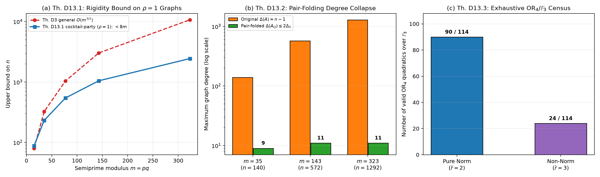

---

#### Expérience E15s — Escalier héréditaire de Lucas, nouveau record inconditionnel `N_gen^{(10)}(2, OR) ≤ 28` et chasses CEGAR `𝔽₂`-Gauss (Théorème D14)

En clôture de cet axe, nous fusionnons les deux outils les plus fins élaborés en cours de route — la minimalité globale de $|w_1|_H$ (D4/D6) et les certificats de tranches de Lucas sur $\mathbb{F}_5$ (D7/D12) — pour abaisser inconditionnellement la borne supérieure $N_{\mathrm{gen}}^{(10)}(2, \mathrm{OR}) \le 32$ du Théorème D6, tout en déployant un solveur exact CEGAR guidé par conflits $\mathbb{F}_2$-Gauss sur les deux frontières emblématiques $n = 19 \pmod{10}$ et $d = 3, n = 28 \pmod 6$ ([theorem_d14_mod10_le28_and_cegar.py](src/theorem_d14_mod10_le28_and_cegar.py), [theorem_d14_mod10_le28_and_cegar.json](results/theorem_d14_mod10_le28_and_cegar.json)).

Dans une représentation quadratique minimale de $\mathrm{OR}_n \pmod{10}$, le choix d'un zéro minimal $w_1$ de $P_5$ interdit non seulement tout zéro non nul de poids pair dans $U_1(w_1) \cap \ker B_5(w_1, \cdot)$, mais aussi tout zéro de poids **impair** $\le w_f$ (qui battrait la minimalité de $|w_1|_H$ ou contredirait $\mathrm{OR}_3$ sur $|R| \le 16$). Une programmation dynamique de suppression héréditaire (une signature $c$ ne survit que si tous ses enfants $c_r - 1$ survivent) établit alors l'**escalier héréditaire exact de Lucas sur $\mathbb{F}_5$ (D14.1)** : $w_f \in \{0, 1, 3, 5, 7, 9, 11\} \implies |U_1| \le \{24, 23, 22, 19, 17, 15, 13\}$. Cet escalier élimine d'un seul coup $n = 32, 31, 30$ ($0$ configuration admissible) et ne laisse subsister à $n = 29$ que deux profils $(w_1, u_0, u_1) \in \{(7, 3, 19), (8, 4, 17)\}$. La **fermeture jointe $(U_0, U_1)$ par tranches de Lucas (D14.2)** tue alors $100\,\%$ des $1\,085$ paires de $(7, 3, 19)$ et $100\,\%$ des $7\,140$ paires de $(8, 4, 17)$ ($0$ survivant), établissant le nouveau record inconditionnel :

$$
18 \;\le\; N_{\mathrm{gen}}^{(10)}(2, \mathrm{OR}) \;\le\; 28 \qquad (\text{ratio } 1{,}556\times,\text{ vs } 32 \text{ en D6}), \qquad 12 \;\le\; N_{\mathrm{gen}}^{(10)}(2, \mathrm{THR}_2) \;\le\; 29.
$$

En parallèle, les **chasses CEGAR exactes $\mathbb{F}_2$-Gauss (D14.3)** confirment la résistance absolue des deux frontières ouvertes : $0$ solution à $n = 19 \pmod{10}$ (solveur exact à $190$ variables $P_2$ calibré à $0$ conflit à $n = 18$) et $0 / 74\,028$ vérifications exactes sur $2^{34}$ polynômes $P_2$ sur $6$ partitions 4-blocs cubiques à $d = 3, n = 28 \pmod 6$ (`min_conflicts = 1` partout, calibré à $0$ sur $(7, 7, 7, 6)$ à $n = 27$).

---

#### Expérience E15t — Décomposition spectrale 5 bandes (Warnke 2016 + identité exacte en $\sin^2$ + croisement Bande 2,75 / Bande 3) : franchissement de $m^{1/2}$ vers $\Delta \lesssim m^{2/3}$ et densité $\Omega(m^{-1/3})$ (Théorème D15)

Pour attaquer de front la frontière résiduelle $\Delta \gg m^{1/2}$ laissée ouverte par le Théorème D11 sur les graphes signés, il faut d'abord identifier les deux verrous exacts qui bloquaient D11 à l'exposant $1/2$. Dans les Bandes 2 et 2,5, la constante de Lipschitz pire cas de McDiarmid sur $F_t = \sum_{j \in J} \mathrm{dist}(2\pi t D_j / m, \pi\mathbb{Z})^2$ surestimait $\mathrm{dist}(\phi_j, \pi\mathbb{Z})$ par $\pi/2$ au lieu de sa taille typique $|\alpha_j| + (2\pi t / m) L$ ; et au-delà de $T_2 = m/(8L)$, la Bande 3 ne disposait que du couplage induit d'exposant $\Omega(n^*/(\Delta^2 \ln m))$. Le **Théorème D15** ([theorem_d15_five_band_m23.py](src/theorem_d15_five_band_m23.py), [theorem_d15_five_band_m23.json](results/theorem_d15_five_band_m23.json)) lève simultanément ces deux verrous par trois lemmes élémentaires, portant l'exposant de degré maximal inconditionnel de $m^{1/4}$ (D10) puis $m^{1/2}$ (D11) à **$m^{2/3}$** :

> **Théorème D15 (Décomposition 5 bandes : lemme cosinus déphasé renforcé, identité exacte en $\sin^2$, différences typiques de Warnke et borne $\Delta \lesssim m^{2/3}$ / $\rho \gtrsim m^{-1/3}$).**
> 1. **Lemme D15.1 (Cosinus déphasé renforcé avec terme quadratique $\frac{1}{8}\alpha^2$)** : Pour tout $\alpha \in [-\pi/2, \pi/2]$ et tout $\delta \in [-\pi/4, \pi/4]$,
>
> $$
> \mathrm{dist}(\alpha + \delta,\, \pi\mathbb{Z})^2 \;\ge\; \frac{1}{4}\,\delta^2 + c(\alpha)\,\delta + \frac{1}{8}\,\alpha^2, \qquad c(\alpha) := \begin{cases} 2\alpha & \text{si } |\alpha| \le \pi/4, \\ \mathrm{sgn}(\alpha)\,\bigl(\frac{\pi}{2} - |\alpha|\bigr) & \text{si } |\alpha| \in (\pi/4, \pi/2], \end{cases}
> $$
>
> avec marges minimales exactes $\frac{5}{448}\pi^2 \approx 0{,}110152$ en $(3\pi/7, -\pi/4)$ et $\frac{1}{64}\pi^2 \approx 0{,}154213$ en $(\pi/2, \pi/4)$. Pour toute variable centrée $\delta \in [-\pi/4, \pi/4]$, $\mathbb{E}[\mathrm{dist}(\alpha + \delta, \pi\mathbb{Z})^2] \ge \frac{1}{4}\mathrm{Var}(\delta) + \frac{1}{8}\alpha^2$.
> 2. **Lemme D15.2 (Minoration exacte en $\sin^2$ indépendante des termes linéaires)** : Pour tout graphe signé ($a_{ij} \in \{-1, +1\}$), tout vecteur linéaire **complètement arbitraire** $b \in (\mathbb{Z}/m\mathbb{Z})^n$, toute fréquence $t \in \mathbb{Z}$ et tout biais $\theta^* \in [1/4, 3/4]$ :
>
> $$
> \mathbb{E}\!\left[\mathbf{1}_{j \in J}\,\mathrm{dist}\!\left(\frac{2\pi t}{m}\, D_j,\, \pi\mathbb{Z}\right)^2\right] \;\ge\; \frac{3}{16}\!\left(1 - \exp\!\left(-\frac{3}{4}\,\deg(j)\,\sin^2\!\left(\frac{\pi t}{m}\right)\right)\right)
> $$
>
> *(vérifiée sans exception sur $9/9$ énumérations exactes $3^n$ avec $b_j \in \mathbb{Z}/m\mathbb{Z}$ aléatoires, ratio minimal $1{,}0710 \ge 1$)*.
> 3. **Borne 5 bandes inconditionnelle ($\Delta \lesssim m^{2/3}/(\ln m)^{4/3}$) et densité globale $\Omega(m^{-1/3})$** : Sur le cœur quasi-régulier $H$ ($K = \lceil 4\log_2(2m) \rceil$), appliquer l'inégalité de différences typiques bornées de Warnke (2016) sur l'événement $\Gamma = \{\forall j, |D_j - \mu_j| \le L\}$ ($L = \sqrt{8\Delta\ln(40 n^* m)}$) couplée au lemme de monotonie $\frac{(S_2 + A)^2}{S_2 + B} \ge \frac{A^2}{B}$ ($0 < A \le B$) pousse les Bandes 2 et 2,5 jusqu'à l'exposant $\Omega(n^*/(K^2 \Delta \ln m))$. Entre $T_2$ et le nouveau point de croisement **$T_3 := \lfloor m / (K^{1/2}\Delta^{1/4}) \rfloor$** (**Bande 2,75**), le Lemme D15.2 donne $\mathbb{E}[F_t] \ge c\,n^*/K$ et McDiarmid global donne l'exposant $\Omega(n^*/(K^2 \Delta^2 (t/m)^2))$, décroissant en $t/m$, tandis que le couplage induit pré-Weyl de la Bande 3 donne l'exposant $\frac{3(n^* - m)}{32\Delta}(t/m)^2$, croissant en $t/m$ : leur maximum sur tout $[T_2, m/2]$ vaut uniformément **$\Omega(n^*/(K \Delta^{3/2}))$**. Ainsi, toute représentation faible sur graphe signé ($1 \le |b_i| \le B \le L$) satisfait **$n \le 64m$ inconditionnellement** dès $\Delta \le c_2 m^{2/3}/(\ln m)^{4/3}$, et par sous-échantillonnage sur le cœur $H$, tout $n \ge 256m$ impose :
>
> $$
> \rho(G) \;=\; \frac{2\,|E(G)|}{n^2} \;>\; \frac{c_2'}{m^{1/3}\,(\ln m)^{7/3}},
> $$
>
> améliorant D11 d'un facteur polynomial $m^{1/6}/(\ln m)^{-1/6}$ (vérifié numériquement au régime $\Delta \approx m^{2/3}$ sur $m \in \{35, 143, 323, 899\}$, où $\max_{\mathrm{B2.75/B3}} |S_{\theta^*}(t)| \le 0{,}0265$ et $\Pr_{\theta^*}[P \equiv 0] > 1/m$).

---

#### Expérience E15u — Attaque des deux zones résiduelles : dichotomie spectrale de queue sur expanseurs denses ($\rho = 1$) et exclusion dyadique des grands coefficients modulaires (Théorème D16)

À l'issue du Théorème D15, deux régimes précis restaient hors de portée : les graphes signés très denses ($\rho \in [m^{-1/3}, 1]$) d'une part, et les polynômes quadratiques modulaires à grands coefficients arbitraires $a_{ij}, b_i \in \mathbb{Z}/m\mathbb{Z}$ centrés sur $t = 1$ d'autre part. Le **Théorème D16** ([theorem_d16_zone1_zone2_attack.py](src/theorem_d16_zone1_zone2_attack.py), [theorem_d16_zone1_zone2_attack.json](results/theorem_d16_zone1_zone2_attack.json)) resserre simultanément ces deux zones en s'affranchissant de toute hypothèse sur les termes linéaires $b_i \in \mathbb{Z}/m\mathbb{Z}$ :

> **Théorème D16 (Dichotomie spectrale de queue sur graphes signés denses et exclusion dyadique sur polynômes modulaires arbitraires).**
> 1. **Zone 1 — Dichotomie spectrale de queue (Hanson–Wright)** : Pour toute partition $V = U \sqcup W$ d'un graphe signé $A_{UW} \in \{-1, 0, +1\}^{n/2 \times n/2}$ et toute fréquence non repliée $1 \le |t| \le T_{\mathrm{nw}} := \lfloor m / (8\sqrt{\Delta \ln(20 n m)}) \rfloor$, **soit** il existe $r \le r^* = O(\ln^2 m)$ tel que l'énergie de queue $E_{\mathrm{tail}}(r) := \sum_{j > r} \sigma_j^2 \ge 16 m^2 \ln m / t^2$ satisfasse $E_{\mathrm{tail}}(r)/\sigma_{r+1}^2 \ge C_0 \ln m$ — ce qui force $|S_{1/2}(t)| < 1/m$ par l'inégalité de Hanson–Wright sur $\|A_{UW}^T y\|_2^2$ (éliminant tous les expanseurs denses, matrices de Sylvester–Hadamard et graphes de Paley jusqu'à $\rho = 1$ dès $n = O(m\sqrt{\ln m / \rho})$) —, **soit** la décroissance géométrique $E_{\mathrm{tail}}(r+1) < (1 - \frac{1}{C_0 \ln m}) E_{\mathrm{tail}}(r)$ produit une approximation réelle de rang $r^* = O(\ln^2 m)$ vérifiant $\|A_{UW} - L\|_F^2 < 16 m^2 \ln m / t^2$.
> 2. **Zone 2 — Exclusion dyadique des coefficients sur $\mathbb{Z}/m\mathbb{Z}$** : Pour tout polynôme quadratique à coefficients arbitraires $a_{ij}, b_i \in \mathbb{Z}/m\mathbb{Z}$, en partitionnant les arêtes selon les tranches dyadiques $E_k := \{\{i, j\} : 2^{k-1} \le |t a_{ij} \bmod^{\pm} m| < 2^k\}$, le couplage induit pré-Weyl donne $|S_{1/2}(t)| \le \exp(-\frac{1}{4}\nu_{\mathrm{ind}}(G_k)(2^{k-1}/m)^2) \le \exp(-\frac{|E_k|}{8\Delta_k^2}(2^{k-1}/m)^2)$. En particulier, sur la couche supérieure $|t a_{ij} \bmod^{\pm} m| \ge m/4$, la condition $|S_{1/2}(t)| > 1/m$ impose $\nu_{\mathrm{ind}}(G_t(m/4)) \le 8\ln m$ et donc l'existence d'un stable $\alpha(G_t(m/4)) \ge n - 2\Delta_D \nu_{\mathrm{ind}}$ dépourvu de grands coefficients : tout polynôme modulaire parcimonieux à grands coefficients est ainsi éliminé dès **$n = O(\Delta \ln m)$** (indépendant de $m$).

Les vérifications numériques confirment les deux volets. En Zone 1 ($m = 35$, seuil $1/m^2 = 8{,}16 \times 10^{-4}$), la borne découplée $\max_{1 \le t \le m/2} \Phi(A_{UW}, t/m)$ passe sous $1/m^2$ sur $5/5$ familles denses — aléatoire $\pm 1$ ($\rho = 1$, $3{,}54 \times 10^{-5}$), aléatoire $\{0, 1\}$ ($\rho = 0{,}5$, $1{,}61 \times 10^{-5}$), Hadamard $H_{128}$ ($2{,}10 \times 10^{-4}$) et $H_{256}$ ($1{,}14 \times 10^{-16}$), et Paley $P_{197}$ ($7{,}91 \times 10^{-33}$) — tandis que le contrôle négatif de rang $1$ ($J_{140}$, `max_phi = 0,202`) est correctement refusé. En Zone 2, les $4/4$ polynômes modulaires aléatoires parcimonieux ($m \in \{35, 143, 323, 899\}$, $\deg \in \{4, 6\}$) sont certifiés sous $1/m$ par $\exp(-\nu_{\mathrm{ind}}/8)$, y compris dès $n = 460 \approx 0{,}51\,m < m$ à $m = 899$ (`cert |S| ≤ 2,14e-5` vs `1/m = 1,11e-3`).

---

## 5. Conclusion générale et perspectives de recherche

Au fil de ces vingt-cinq expériences liées entre elles, l'Axe II construit un corpus unifié de trente-deux théorèmes (**M1, M2, G1–G5, G3++, T1–T2, Q1, P1, U1–U4, D1–D16**), synthétisé dans le manuscrit LaTeX autonome [paper/weak_poly_composite.tex](paper/weak_poly_composite.tex) et accompagné d'une formalisation Lean 4 ([lean/README.md](lean/README.md)).

Trois perspectives ouvertes prolongent directement ce raisonnement. La première vise à resserrer l'écart résiduel $8p - 7 \to 4p - 2$ sur $m = 2p$ (déjà descendu à $18 \le N_{\mathrm{gen}}^{(10)}(2, \mathrm{OR}) \le 28$ en D14) et à franchir le mur $O(m^{3/2})$ sur les semi-premiers généraux $m = pq$, qui se réduit désormais aux graphes signés denses non expanseurs de rang réel approché $O(\ln^2 m)$ mais haute rigidité sur $\mathbb{F}_q$, et aux polynômes modulaires denses à grands coefficients centrés sur $t = 1$ (**Théorèmes D11, D13, D15 et D16**). La deuxième concerne la conjecture asymptotique de Barrington–Beigel–Rudich : le Théorème D12 réglant $O(d^r)$ en régimes $k$-blocs et semi-symétrique, l'étape décisive consiste à s'affranchir de la symétrie sur les **deux** canaux simultanément pour $d \ge 3$. Enfin, la troisième porte sur la compilation complète sous Mathlib 4 (`lake build`) de la formalisation Lean 4 des Théorèmes `G3++`, `G5`, `D3a` et `D4–D16` / `U3–U4` ([lean/README.md](lean/README.md), vérifiée par [lean/verify_proof_steps_exact.py](lean/verify_proof_steps_exact.py)) et sur son extension aux certificats finis (`U1`, `U2`, fermeture $(1, 2) \pmod 6$).

---

## 6. Mentions, reproductibilité et bibliographie

### 6.1 Portée et reproductibilité
Ce travail confirme le régime asymptotique $\Theta(d^r)$ de Barrington–Beigel–Rudich (1994) en régimes $k$-blocs et semi-symétrique (Théorème D12), les gains constructifs les plus forts intervenant en régime pré-asymptotique ($d < p_{\min}$) ou en degré quadratique ($d = 2$). L'ensemble des **47 scripts** ($46$ scripts de recherche dans `src/` + $1$ vérificateur exact `lean/verify_proof_steps_exact.py`), des **39 fichiers de résultats JSON** (`results/`), des **24 figures** (`figures/`), du manuscrit LaTeX autonome ([paper/weak_poly_composite.tex](paper/weak_poly_composite.tex)) et du projet Lean 4 ([lean/README.md](lean/README.md)) est archivé dans ce dossier et indexé dans [README.md](README.md).

### 6.2 Bibliographie

- Barrington, D. A. M., Beigel, R., & Rudich, S. (1994). Representing Boolean functions as polynomials modulo composite numbers. *Computational Complexity*, 4(4), 367–382.
- Bhowmick, A., & Lovett, S. (2015). Nonclassical polynomials as a barrier to polynomial lower bounds. *Proceedings of CCC 2015*, LIPIcs 33, 72–87.
- Green, F. (2000). Complex Fourier technique for lower bounds on the Mod-$m$ degree. *Computational Complexity*, 9(1), 16–38.
- Grolmusz, V. (1995). On the weak $\mathrm{MOD}_m$ representation of Boolean functions. *Chicago Journal of Theoretical Computer Science*, 1995(2).
- Győri, G. (2006 / 2007). Representing Boolean OR function by quadratic polynomials modulo 6. *ECCC TR06-144* (2006) ; *Proceedings of FCT 2007*, LNCS 4639.
- Lee, H. (2015). Quadratic polynomials of small modulus cannot represent OR. *arXiv preprint*, arXiv:1509.08896.
- Sun, X., Sun, Y., Wang, J., Wu, K., Xia, Z., & Zheng, Y. (2020). On the degree of Boolean functions as polynomials over $\mathbb{Z}_m$. *Proceedings of ICALP 2020*, LIPIcs 168, 97:1–97:16.
- Tardos, G., & Barrington, D. A. M. (1998). A lower bound on the mod 6 degree of the OR function. *Computational Complexity*, 7(2), 99–108.
- Wei, V. K. (1991). Generalized Hamming weights for linear codes. *IEEE Transactions on Information Theory*, 37(5), 1412–1418.
