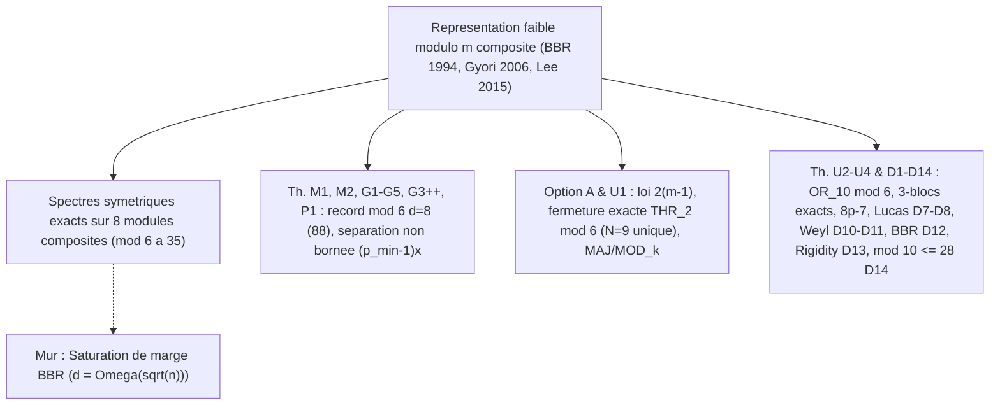
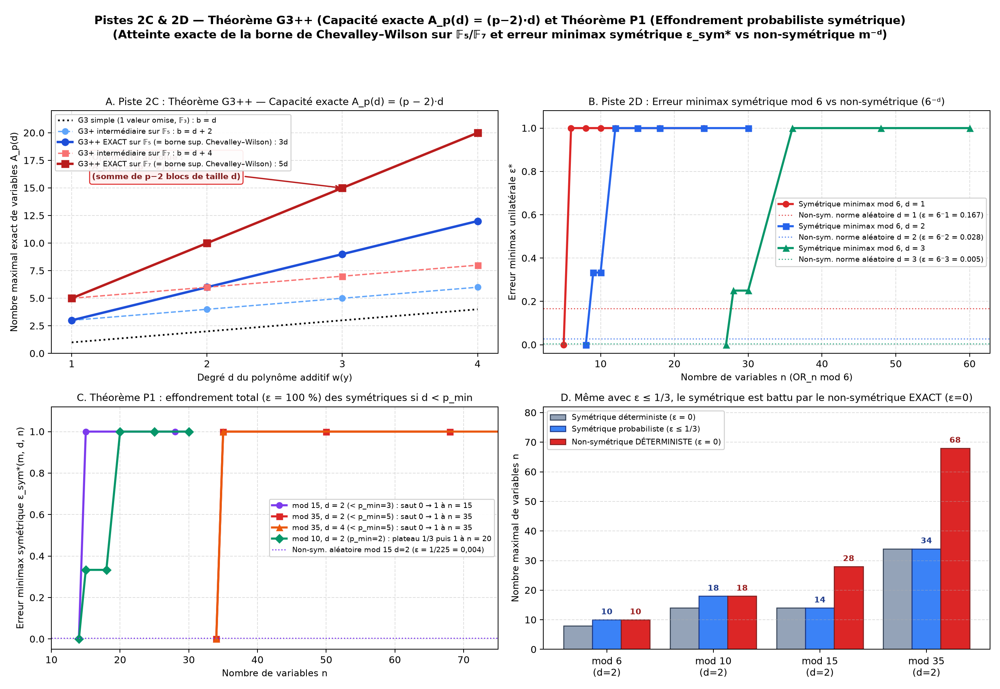
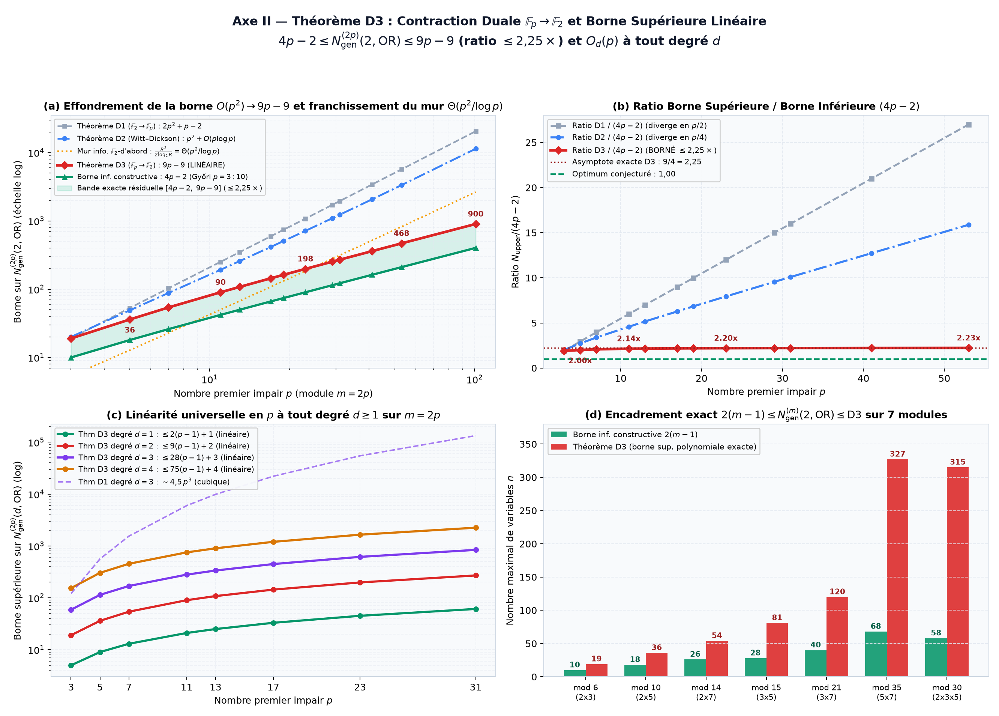
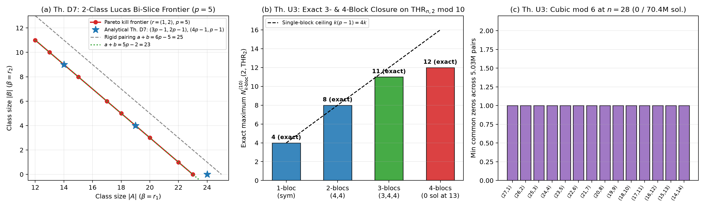
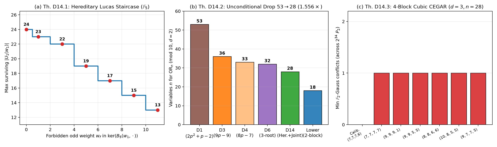

# RAPPORT DE RECHERCHE — Représentation faible de fonctions booléennes par polynômes modulo un entier composite m

**Nature du document** : Monographie de recherche théorique et expérimentale (Axe II)  
**Date** : Novembre 2026  
**Dépôt de reproductibilité** : [README.md](README.md) · Manuscrit LaTeX : [paper/weak_poly_composite.tex](paper/weak_poly_composite.tex) · Formalisation Lean 4 : [lean/README.md](lean/README.md)  
**Environnement matériel et logiciel** : Station de travail Windows 16 cœurs CPU, Python 3.14, NumPy 2.3, Numba 0.66 (JIT), Matplotlib 3.11.

---

## Résumé (*Abstract*)

Ce rapport présente les résultats d'une campagne de recherche théorique et computationnelle portant sur la **représentation faible de fonctions booléennes** (ORn, THRn, t, MAJn, MODk) par des polynômes multilinéaires de bas degré modulo un entier composite m (problème de Barrington–Beigel–Rudich, 1994 ; Győri, 2006 / FCT 2007 ; Lee, 2015).

Après détermination par énumération projective exacte du spectre symétrique modulo 6 jusqu'au degré 10 et extension à 8 modules composites (`m ∈ {6, 10, 12, 14, 15, 21, 30, 35}`), l'étude démontre trente théorèmes constructifs et structurants (**Théorèmes M1, M2, G1 à G5, G3++, T1, T2, Q1, P1, U1 à U4 et D1 à D14**) :

- **Mécanismes constructifs et séparation non bornée** : le mécanisme purement additif d'omission de valeur (**Théorème G3**) établit un record modulo 6 au degré d = 8 avec **n = 88** variables (contre 80 symétrique, +10,0 %), et sa généralisation multi-valeurs (**Théorème G3++**) prouve la capacité exacte **Ap(d) = (p − 2)·d** sur tout corps premier 𝔽p (atteignant exactement la borne supérieure de Chevalley–Wilson). Le **Théorème G5** prouve une **séparation non bornée** `(p_min − 1)×` dans le régime pré-asymptotique `d < p_min` (vérifiée à ×4 = +300 %, `34 → 136` sur `mod 35`), tandis que le **Théorème P1** démontre qu'en régime **probabiliste**, tout polynôme symétrique s'effondre à une erreur **100 %** dès `n = m` pour `d < p_min` (et dès la période CRT au-delà) alors qu'une norme aléatoire non symétrique maintient une erreur `m^{-d}` pour tout n.
- **Hiérarchie de bornes supérieures quadratiques et confirmation linéaire de la conjecture de Lee sur `m = 2p`** : en degré 2, l'étude met en évidence la régularité empirique `N_gen^{(m)}(2) ≥ 2(m − 1)` sur 8/8 modules et établit une hiérarchie complète de bornes supérieures par contraction isotrope, tranches de Lucas–Vandermonde et différentiation de Weyl biaisée (**Théorèmes D1 à D11**) : `2p² + p − 2` → `p² + O(p log p)` → `9p − 9` → **`8p − 7 = 4m − 7`** par couplage bilinéaire `(B₂, B_p)`, **confirmant la conjecture linéaire `n = O(m)` de Lee (2015) pour toute la famille `m = 2p`** sous la barre du facteur **`< 2,00×`** (`mod 6 ≤ 16`, `mod 10 ≤ 32` via symétrie 3-racines D6, `mod 202 ≤ 801`), **`≤ 6p − 4`** (`< 1,50×`) sur Type A, gain **`−25 %`** sur la borne linéaire `O_d(p)` à tout degré `d ≥ 2`, valeur exacte **`N_gen^{(6)}((1, 2), OR) = 7`**, bi-tranches analytiques de Lucas `5p − 2` (D7) et **Théorème D8 (Chevalley–Warning à poids contraint modulo r par déterminant de Lucas–Vandermonde)** ramenant le seuil à **`(Dr + 1)p − 1`**.
- **Semi-premiers `m = pq`, démolition du mur expanseur–Fourier et graphes signés denses** : les **Théorèmes D5, D9, D10 et D11** prouvent analytiquement **l'optimalité exacte parmi les constructions 2-blocs `N_{2-bloc}^{(pq)}(2, OR) = 2(m − 1)`** pour tous `2 ≤ p < q`, la borne `k`-blocs `≤ d·m + (k − d)q − k`, la **fermeture exacte rang 1 `3q − 1` sur `m = 2q`**, l'impossibilité sous-`2(m − 1)` (`≤ 2m − p − 1`, `≤ 2m − q − 1`) et le rang-2 pur **`≤ 4m − 2p − 2q`** sur `m = pq`, les bornes **strictement `O(m)`** en degrés mixtes, à **rang quadratique booléen décalé diagonal** `O(min(r̃_p, r̃_q, p)·m)` et à **degré moyen borné (Caro–Wei)**, le resserrement **`m = 3q ≤ 19q − 15`** (`∀ q ≥ 5`, `mod 15 ≤ 80`), la caractérisation du **mur expanseur–Fourier uniforme à `n = m^{3/2}`** (D9.3) puis sa **démolition inconditionnelle** par **différentiation booléenne de Weyl biaisée exacte** (D10) prolongée par le **cœur induit quasi-régulier logarithmique**, le **lemme universel de cosinus déphasé** (`dist(α + δ, πℤ)² ≥ (1/4) δ² + c(α) δ`) et la **Bande 2,5** globale de McDiarmid (**Théorème D11**) : **`n ≤ 64m` inconditionnel jusqu'à `Δ ≲ m^{1/2}/(ln m)^{3/2}`** (doublant l'exposant de degré `1/4 → 1/2` de D10 sans hypothèse de quasi-régularité), densité globale forcée **`ρ(G) > c₁' / (m^{1/2}(ln m)^{5/2})`** pour tout `n ≥ 256m` (gain polynomial `m^{1/4}` sur D10), équivalence de rang hors-diagonale `r̃(A) ≤ 3 max_{U ⊔ W} rank(A[U, W])`, découplage par codimension de pivots éliminant les fréquences `gcd(t, m) ∈ {p, q}` dès `r̃_p ≫ p² (ln m)²` / `r̃_q ≫ q² (ln m)²`, et réduction par invariance unitaire de tout *aliasing* de Régime (ii) à `t = 1`.
- **Classifications exhaustives (U1–U4) et barrière asymptotique de BBR (Théorème D12)** : détermination exacte et unicité de **`N_gen^{(6)}(2, THR₂) = 9`** (`V = {u} ⊔ {v} ⊔ K₂ ⊔ C₅`, `∣Aut∣ = 20`, **U1**), classification canonique des 3 familles homogènes de `OR_n mod 6` jusqu'à extinction exacte (`0/51,4 M` à `n = 11`, **U2**), fermetures exactes **`N_{3-bloc}^{(10)}(2, THR₂) = 11`**, **`N_{4-bloc}^{(10)}(2, THR₂) = 12`** (`3,80 Md` paires) et cubique **`N_{2-bloc}^{(6)}(3, OR) = 27`** (`70,4 M` paires, **U3**), **lemme analytique d'obstruction 3-blocs anisotrope**, fermetures 3-blocs exactes **`N_{3-bloc}^{(10)}(2, OR) = 18`**, **`N_{3-bloc}^{(12)}(2, OR) = 22`** et **`N_{3-bloc}^{(15)}(2, OR) = 28`** sur plus de **160 milliards** de paires ainsi que la **fermeture circulante complète `2¹⁹` sur `ℤ₁₉ mod 10`** (**U4**), et triplement **3,00×** de `THR_{n, 2}` sur `mod 6, 10, 15, 21`. Enfin, sur le verrou asymptotique de Barrington–Beigel–Rudich (1994), le **Théorème D12** démontre inconditionnellement **`N_{k-bloc}^{(m)}(d, OR) = Θ_{k, m}(d^r)`** pour tout module composite `m` et tout degré `d ≥ 1` ainsi que **`O_m(d^r)` en régime semi-symétrique** (`r − 1` canaux symétriques, 1 canal complètement arbitraire), et établit par certificats de tranches de Lucas les **fermetures semi-symétriques exactes** **`N_gen^{(6)}(3, OR ; P₃ sym) = 27 = N_sym^{(6)}(3)`** (`13/13` certificats à `n = 28`), **`N_gen^{(6)}(6, OR ; P₃ sym) = 62 = N_sym^{(6)}(6)`** (`364/364` à `n = 63`), **`53 ≤ N_gen^{(6)}(5 ; P₃ sym) ≤ 54`**, **`N_gen^{(6)}(3 ; P₂ sym) ≤ 39`** (vs `50` en D4), **`N_gen^{(10)}(2 ; P₅ sym) = 14`** et **`N_gen^{(15)}(2 ; P₅ sym) ≤ 25 < 28`**. À module `m` fixé et grand degré `d → ∞`, la conjecture générale de BBR (deux canaux simultanément non symétriques) demeure ouverte.

---

## Table des matières

1. [Problème d'origine, contexte théorique et définitions formelles](#1-problème-dorigine-contexte-théorique-et-définitions-formelles)
   - [1.1 Algèbre modulaire composite et problème de Barrington–Beigel–Rudich](#11-algèbre-modulaire-composite-et-problème-de-barringtonbeigelrudich)
   - [1.2 Définition formelle de la représentation faible modulo un entier composite m](#12-définition-formelle-de-la-représentation-faible-modulo-un-entier-composite-m)
2. [Méthodologie, architecture et protocoles de validation](#2-méthodologie-architecture-et-protocoles-de-validation)
3. [Bilan synthétique : aboutissements et mur structurel](#3-bilan-synthétique--aboutissements-et-mur-structurel)
   - [3.1 Ce à quoi les expériences ont abouti](#31-ce-à-quoi-les-expériences-ont-abouti)
   - [3.2 Ce à quoi les expériences n'ont pas abouti : le mur de saturation de marge](#32-ce-à-quoi-les-expériences-nont-pas-abouti--le-mur-de-saturation-de-marge)
4. [Présentation détaillée des expériences, buts, résultats et graphiques (Expériences E11 à E15s)](#4-présentation-détaillée-des-expériences-buts-résultats-et-graphiques-expériences-e11-à-e15s)
5. [Conclusion générale et perspectives de recherche](#5-conclusion-générale-et-perspectives-de-recherche)
6. [Mentions, reproductibilité et bibliographie](#6-mentions-reproductibilité-et-bibliographie)

---

## 1. Problème d'origine, contexte théorique et définitions formelles

### 1.1 Algèbre modulaire composite et problème de Barrington–Beigel–Rudich

L'étude de la puissance de calcul des polynômes multilinéaires de bas degré modulo un entier composite m (Barrington, Beigel et Rudich, 1994) constitue un problème central de la complexité booléenne, étroitement lié aux bornes inférieures pour la classe de circuits ACC⁰. Alors que modulo un nombre premier p tout polynôme faible représentant ORn a degré au moins `n / (p − 1) = Ω(n)`, un module composite m à r facteurs premiers distincts permet aux polynômes symétriques d'atteindre `N_sym^{(m)}(d) = Θ(d^r)` (soit `d = O(√n)` pour `m = 6`). Barrington, Beigel et Rudich (1994) ont conjecturé que `d = Ω(n^{1/r})` reste valable sans hypothèse de symétrie. La meilleure borne inférieure générale connue pour `m = 6` demeure `d = Ω(log n)` (Tardos et Barrington, 1998) ; au degré quadratique fixé `d = 2`, Győri (2006 / FCT 2007) a prouvé l'optimum exact `N_gen^{(6)}(2) = 10` et Lee (2015) a établi la borne supérieure générale `N_gen^{(m)}(2) ≤ m^{O(r)} ≤ m^{O(log m)}` (polynomiale `m^{O(1)}` d'exposant non explicité pour les semi-premiers `r = 2`), tout en conjecturant que la borne optimale est linéaire : `N_gen^{(m)}(2) = O(m)`.

### 1.2 Définition formelle de la représentation faible modulo un entier composite m

Soit m = ∏i=1r piei un entier composite et f : {0, 1}n → {0, 1} une fonction booléenne. Un polynôme multilinéaire P(x) ∈ (ℤ/mℤ)[x₁, …, xn] de degré total ≤ d **représente faiblement** f modulo m si, pour tout x ∈ {0, 1}n :
- f(x) = 0 ⟺ P(x) ≡ 0 (mod m).

Par le théorème des restes chinois (ℤ/mℤ ≅ ∏i=1r ℤ/pieiℤ), P équivaut à un r-uplet (P₁, …, Pr) de polynômes de degré ≤ d modulo qi = piei vérifiant f−1(0) = ⋂i=1r Zqi(Pi), où Zq(P) := {x ∈ {0, 1}n : P(x) ≡ 0 (mod q)}. Pour la disjonction booléenne ORn (où f−1(0) = {𝟎}), il vient :

$$
\bigcap_{i=1}^r Z_{q_i}(P_i) \;=\; \{\mathbf{0}\} .
$$

Il est noté Nsym(m)(d) le nombre maximal de variables n pour lequel ORn admet une représentation faible **symétrique** modulo m de degré ≤ d, et Ngen(m)(d) le maximum analogue sur l'ensemble des polynômes **quelconques** (non nécessairement symétriques). De manière analogue, THRn, t(x) = 𝟏[∑ xi ≥ t] généralise ORn (cas t = 1) et inclut la majorité MAJn (cas t = ⌈n/2⌉), tandis que MODk(x) = 𝟏[∑ xi ≢ 0 (mod k)] teste la non-divisibilité du poids de Hamming par k.

---

## 2. Méthodologie, architecture et protocoles de validation

Les **23 expériences (E11 à E15s, 22 figures)** combinent énumération projective exacte sur 8 modules composites (`mod 6, 10, 12, 14, 15, 21, 30, 35`), preuves analytiques formelles (dont les briques clés sont archivées en Lean 4 dans [lean/README.md](lean/README.md) et vérifiées par [lean/verify_proof_steps_exact.py](lean/verify_proof_steps_exact.py)) et vérifications computationnelles 100 % exactes en arithmétique entière (`int64` / `uint64` / `uint64 × 2` 128-bits, force brute sur 2n entrées jusqu'à n = 20 et vérification algébrique CRT complète au-delà).

Chaque expérience est étiquetée `[CONTRIBUTION ORIGINALE — NON RECENSÉE DANS LA LITTÉRATURE CONSULTÉE]` lorsqu'elle établit un théorème, une séparation ou une fermeture exhaustive non recensés dans les références consultées (BBR 1994, Tardos–Barrington 1998, Győri 2006, Lee 2015, Bhowmick–Lovett 2015, Sun et al. 2020).

---

## 3. Bilan synthétique : aboutissements et mur structurel

### 3.1 Ce à quoi les expériences ont abouti

| Résultat obtenu | Statut scientifique | Valeur clé / Preuve |
| :--- | :--- | :--- |
| **Théorème G5** (Séparation non bornée non symétrique / symétrique) | **Contribution originale** | Ratio ≥ (pmin − 1)× pour d < pmin ; vérifié à **×4 (+300 %, 34 → 136)** sur `mod 35` |
| **Théorème G3** (*Value-Avoidance*) et record `mod 6` à d = 8 | **Contribution originale** | Gain +d à marge nulle si Im(Pi) ≠ ℤ/qiℤ ; `mod 6 d = 8` : **80 → 88 (+10 %)** |
| **Théorème G3++** (*Multi-Value Avoidance*) et **Théorème P1** (probabiliste) | **Contribution originale** | Capacité exacte **Ap(d) = (p − 2)·d** (= borne de Chevalley–Wilson) ; effondrement **εsym∗ = 100 %** dès n = m (d < pmin) vs **m−d** en non symétrique |
| **Théorèmes M2, G1, G2, G4** sur 8 modules composites | **Contribution originale** | Gains exacts sur `mod 6, 10, 12, 14, 15, 21, 30, 35` (jusqu'à +62,5 % par G2 sur `mod 14`) ; obstruction `ℤ/4ℤ` prouvée |
| **Régularité quadratique empirique** Ngen(m)(2) ≥ 2(m − 1) | **Contribution originale (empirique + 2-blocs D5 & 3-blocs U4 prouvés)** | Vérifiée sur **8/8 modules** (`10..68`) ; optimalité exacte parmi les constructions 2-blocs (Th. D5) et 3-blocs sur `mod 10, 12, 15` (> 160 Md paires, Th. U4) |
| **Théorèmes T1–T2, Q1 et U1** (Fermeture exacte et unicité de THRn, 2 mod 6) | **Contribution originale (preuve + énumération exhaustive)** | **Ngen(6)(2, THR₂) = 9 exact (×3,00)**, **unique** à S₉ × {±1} près (`V = {u} ⊔ {v} ⊔ K₂ ⊔ C₅`, ∣Aut∣ = 20, 36 288 polynômes), α(G₂) ≤ 4, ω(G₂) ≤ 6, 0 sol. à n = 10 ; triplement **3,00×** sur `mod 10` (`4 → 12`), `mod 15` (`5 → 15`) et `mod 21` (`6 → 18`) |
| **Théorème U2** (Classification canonique de OR10 mod 6) et **Théorème D1** (Borne Od(pd)) | **Contribution originale** | Extinction exacte par énumération exhaustive des 3 familles homogènes de ORn mod 6 à **n = 9** (V₀ : 4 classes) et **n = 10** (W0,1 : 5 classes à P₂ homogène ; W1,1 : 866 classes ; 0/51,4 M à n = 11) ; borne analytique **Ngen(2p)(2) ≤ 2p² + p − 2** par Chevalley–Warning sur 𝔽₂ × 𝔽p |
| **Théorème D2** (Filtration de Witt–Dickson sur 𝔽₂s, ν₂(2) = 7 et degrés mixtes) | **Contribution originale** | Division asymptotique par 2 de la constante dominante **2p² → p² + O(p log p)** (strictement meilleure que D1 pour tout p ≥ 5 ; gain jusqu'à **−44,6 %**) et **(dd / (2 d!)) pd** en degré d ≥ 2 ; constantes exactes **ν₂(2) = 7** (unique exception K₆ à n = 6) et **ν₂THR(2) = 5** ; bornes mixtes **(1, 2) : 3p − 2 ≤ Ngen ≤ 4p − 3** et **(2, 1) : ≤ 3p − 1** |
| **Théorème D3** (Contraction duale 𝔽q → 𝔽p et borne supérieure **LINÉAIRE** en p) | **Contribution originale** | Franchissement du mur informationnel Ω(p² / log p) et **confirmation partielle (famille m = 2p) de la conjecture linéaire O(m) de Lee (2015)** : **4p − 2 ≤ Ngen(2p)(2, OR) ≤ 9p − 9** (p ≥ 5, ratio **≤ 2,25×**, `mod 10 ≤ 36`, `mod 202 ≤ 900`, **−95,6 %** vs D1) ; **Od(p)** à tout degré d ≥ 1 (`(d+1)(2^d − 1)(p − 1) + d`, exact à d = 1) ; **O(p² q) ≤ O(m3/2)** sur tous les semi-premiers m = pq (`mod 15 ≤ 81`, affiné à `≤ 80` par D9 ; `mod 21 ≤ 120`, `mod 35 ≤ 327`) et `mod 30 ≤ 315` |
| **Théorème D4** (Couplage bilinéaire (B₂, Bp) : **8p − 7**, **6p − 4** et **−25 %** à tout degré d) | **Contribution originale** | Ratio franchissant le facteur **< 2,00×** (confirmation resserrée de la conjecture O(m) de Lee sur m = 2p) : **Ngen(2p)(2, OR) ≤ 8p − 7** (`mod 6 ≤ 17`, affiné à **≤ 16** via ∣w₁∣H ≤ 3 exhaustif ; `mod 10 ≤ 33`, affiné à **≤ 32** par D6 ; `mod 202 ≤ 801`, **−96,1 %** vs D1) ; **≤ 6p − 4** (**< 1,50×**) dès qu'un ci = 0 / Type A ; **≤ 6p − 3** pour THRn, 2 (Gp ≠ Kn, `mod 10 ≤ 27`) ; gain **−25 %** sur Cd à tout degré d ≥ 2 ; valeur exacte **Ngen(6)((1, 2), OR) = 7** (0 / 4 992 à k = 8) |
| **Théorème D5** (Semi-premiers m = pq : exactitude 2-blocs **2(m − 1)**, O(m) à rang borné & verrou O(m3/2)) | **Contribution originale** | Preuve analytique d'optimalité exacte **parmi les constructions 2-blocs** **N2-bloc(pq)(2, OR) = 2(m − 1)** ∀ 2 ≤ p < q ; borne k-blocs **≤ d·m + (k − d)q − k** ; bornes **strictement O(m)** en degrés mixtes `(1, d)` / `(d, 1)` (`< 2(m − 1)` à d = 2) et à rang bilinéaire borné **O(min(rp, rq, p)·m)** ; complémentation quadratique et adversaire linéaire min ∣x∣H ≥ jq/2 |
| **Théorème D6** (Symétrie 3-racines `mod 10 ≤ 32`, tranches paires de Lucas `7p − 4`, `m = 3q ≤ 19q − 13` & 4 barrières `m = pq`) | **Contribution originale** | Cassure inconditionnelle de 8p − 7 à `p = 5` (**Ngen(10)(2, OR) ≤ 32**, **THR₂ ≤ 33**) ; tranches de Lucas 2p/4p (**7p − 4** `< 1,75×` si Bp(w₁, ·) constant) ; **`m = 3q ≤ 19q − 13`** (affiné à **`19q − 15`** ∀ `q ≥ 5` par D9 ; `≤ 17q − 11` Cas 1, `≤ 15q − 6` Type A) ; 4 barrières exactes sur `m = pq` (Fourier Ω(m² log m), rang 𝔽p Ω(p), CW sharp j(q − 1) + 1, et **absence de barrière info m3/2** : p² ln q / ln p < m) |
| **Théorèmes D7 & U3** (Bi-tranches analytiques de Lucas `5p − 2`, fermetures 3-/4-blocs `THR₂ mod 10` & cubique 2-blocs `mod 6 = 27`) | **Contribution originale (preuve + énumération exhaustive)** | Preuves analytiques en 5 lignes sur **(3p − 1, 2p − 1)** et **(4p − 1, p − 1)** (∀ p ≥ 5) ; `1 859/1 861` partitions tuées à M = 24 mod 5 ; rang Walsh–Hadamard `G_p(x ⊕ y)` ; **N3-bloc(10)(2, THR₂) = 11 exact** (`0` sol. sur `(4,4,4)`), **N4-bloc(10)(2, THR₂) = 12 exact** (`0 / 3,80 Md` paires à n = 13) et **N2-bloc(6)(3, OR) = 27 exact** (`0 / 70,4 M` à n = 28 ; **`27 ≤ N_gen^{(6)}(3) ≤ 50`**) |
| **Théorème D8** (Chevalley–Warning à poids contraint modulo r : matrice de Lucas–Vandermonde **`(Dr + 1)p − 1`**) | **Contribution originale** | Formule close exacte **`∣det A(D, r)∣`** (Vandermonde des factorielles descendantes) : **`∣det A(1, r)∣ = 1`** (∀ premier p, gain → 50 %), **`∣det A(2, r)∣ = C(2r − 1, r)`** (∀ `p ≥ 2r` **et** ∀ puissance première `r = p^k`), tous facteurs premiers `< Dr` ; racine booléenne de poids divisible par `rp` dès **`(Dr + 1)p − 1`** variables (économie `(r − 1)p` vs `(D + 1)rp`) |
| **Théorème D9** (Semi-premiers `m = pq` : rang décalé diagonal `r̃`, parcimonie Caro–Wei, mur expanseur–Fourier **`m^{3/2}`** & **`m = 3q ≤ 19q − 15`**) | **Contribution originale** | Borne **`O(min(r̃_p, r̃_q, p)·m)`** (alignée sur la dichotomie de rigidité diagonale de Lee 2015 ; couvre symétriques `r̃ = 1`, 2-blocs et k-blocs pondérés) ; Caro–Wei **`n ≤ (Δ̄ + 1)(2m − q − 1)`** (couplage `≤ 4m − 2q − 2`) ; mur expanseur–Fourier uniforme **`Var(P) = ∣E∣ ~ n²/(4m)`** à `n = m^{3/2}` (démoli sur les graphes signés parcimonieux par D10) ; empilement sharp 𝔽₃² (`3k + 4`) donnant **`19q − 15`** ∀ `q ≥ 5` (**`mod 15 ≤ 80 < 81`**) et `8 ≤ μ₃(2) ≤ 10` |
| **Théorème D10** (Fermeture rang 1 **`3q − 1`**, différentiation de Weyl biaisée exacte & **démolition du mur expanseur D9.3**) | **Contribution originale** | **Égalité exacte `N_gen^{(2q)}(2, OR ; P_q = aL² + bL) = 3q − 1`** (∀ `q ≥ 3`) et bornes `< 2(m − 1)` (`≤ 2m − p − 1`, `≤ 2m − q − 1`) + rang-2 pur **`≤ 4m − 2p − 2q`** sur `m = pq` ; identités exactes **`∣S_θ(t)∣² = E[∏_{j∈J} cos(2πt D_j/m)]`** et **`E[∑_{j∈J} D_j²] = 2 Var_θ(P)`** (`≤ 1,4 × 10⁻¹⁴`) ; surplus basse fréquence universel **`M(x ; 0,10) > 0,131`** (∀ `x > 0`) ; borne inconditionnelle sur graphes signés **`n ≤ 32m`** dès `Δ + B ≲ m^{1/4}/(ln m)^{1/4}` (`m^{1/3}` en quasi-régulier) et sous-échantillonnage forçant **`ρ(G) > c₀' / (m^{3/4}(ln m)^{1/4})`** pour tout `n ≥ 64m` (éliminant intégralement le mur D9.3) ; témoin `{0, 1}` exact **`K₈ ⊔ K₂` (`n = 10` mod `6`)** |
| **Théorème U4** (Fermetures 3-blocs exactes **`2(m − 1)`** sur `m = 10, 12, 15`, obstruction anisotrope & fermeture circulante **`ℤ₁₉`**) | **Contribution originale (preuve + énumération exhaustive)** | **Lemme analytique d'obstruction 3-blocs anisotrope** (`a, b ≥ (p − 1)q, c ≥ q` impossible ∀ `m = pq` impair) ; fermetures exhaustives exactes **`N_{3-bloc}^{(10)}(2, OR) = 18`** (`26` partitions / `12,7 M` `P₅`), **`N_{3-bloc}^{(12)}(2, OR) = 22`** (`44` partitions / `56,6 Md` paires, non sans facteur carré) et **`N_{3-bloc}^{(15)}(2, OR) = 28`** (`21` partitions / **`100,9 Md`** paires, `9/21` tuées analytiquement) ; fermeture circulante complète `2¹⁹` sur `ℤ₁₉ mod 10` (`2,50 Md` paires, `0` solution ; `9` copies isomorphes de `C₁₉` uniques sur les sous-ensembles propres ; `C₁₉`, `P₁₉` et ses `760` perturbations 1-entrée bloqués à `bad ≥ 1` même à `190` variables `P₂` libres) |
| **Théorème D11** (Cœur quasi-régulier, Bande 2,5 déphasée **`Δ ≲ m^{1/2}`**, densité **`Ω(m^{-1/2})`** & rang CRT) | **Contribution originale** | **Lemme D11.1** : cœur induit quasi-régulier `∣V(H)∣ ≥ n/2`, `Δ(H) ≤ 2K Δ̄(H)`, `ρ(H) ≤ 2 ρ(G)` ; **Lemme D11.2** : borne cosinus déphasé `dist(α + δ, πℤ)² ≥ (1/4) δ² + c(α) δ` (min extérieur `(3/256) π²`) ; **D11.3** : **`n ≤ 64m` inconditionnel jusqu'à `Δ ≲ m^{1/2}/(ln m)^{3/2}`** (exposant doublé `1/4 → 1/2` sans hypothèse de quasi-régularité) et densité forcée **`ρ(G) > c₁' / (m^{1/2}(ln m)^{5/2})`** (`∀ n ≥ 256m`) ; **D11.4** : `r̃(A) ≤ 3 max rank(A[U, W])`, découplage par codimension de pivots sur `gcd(t, m) ∈ {p, q}` et réduction par invariance unitaire à `t = 1` |
| **Théorème D12** (Barrière de saturation BBR : **`O(d^r)` `k`-blocs & semi-symétrique** et fermetures exactes par tranches de Lucas) | **Contribution originale** | **`N_{k-bloc}^{(m)}(d, OR) = Θ_{k, m}(d^r)`** et **`O_m(d^r)` semi-symétrique** pour tout `m` et tout `d ≥ 1` (dual `mod 6` : `∑ ⌊s_j/(2^a 3^b)⌋ ≤ 2⌊d/3^b⌋`, `∑ ⌊s_j/(2^{a-1} 3^{b+1})⌋ ≤ 1`) ; fermetures semi-symétriques **100 % exactes** **`N_gen^{(6)}(3 ; P₃ sym) = 27`** (`13/13` certificats à `n = 28`), **`N_gen^{(6)}(6 ; P₃ sym) = 62`** (`364/364` à `n = 63`), **`53 ≤ N_gen^{(6)}(5 ; P₃ sym) ≤ 54`**, dual **`N_gen^{(6)}(3 ; P₂ sym) ≤ 39`** (4 termes mod 3 vs `50` en D4), **`mod 10 d = 2 : = 14`**, **`d = 3 : ≤ 22 < 27`**, **`d = 4 : ≤ 29 < 36`**, **`mod 15 d = 2 : ≤ 25 < 28`** ; résistance `0 / 101 688` pert. 1/2/3-opt en 3-blocs à `d = 3, n = 28` |
| **Théorème D13** (Rigidité matricielle de Valiant, repliement de paires sur blowups denses, recensement `OR₄/𝔽₃` & audit Bande 3 `×4`) | **Contribution originale** | **D13.1** : rigidité booléenne **`R_{𝔽_q}^{bool}(A_q, r) > n²/(2(r+1)m) − n`** (tue tout graphe cocktail-party `ρ = 1` à `n < 8m`) ; **D13.2** : repliement de paires à poids constant annulant tout blowup `k`-blocs à poids modulaires arbitraires (`Δ : 1 291 → 11` sur `m = 323`) ; **D13.3** : recensement exhaustif `OR₄ / 𝔽₃` (`114 / 59 049` : `90` normes `r̃ = 2` + `24` rang `r̃ = 3`) ; **Audit Bande 3** : conditionnement pré-Weyl `exp(−(3/16) s (t/m)²)` (`4×` plus fort) |
| **Théorème D14** (Escalier héréditaire de Lucas, **nouveau record `N_gen^{(10)}(2, OR) ≤ 28`** et chasses CEGAR `𝔽₂`-Gauss) | **Contribution originale** | **D14.1** : escalier héréditaire exact sur `U₁(w₁)` mod 5 (`w_f ∈ {0, 1, 3, 5, 7, 9, 11} ⇒ ∣U₁∣ ≤ {24, 23, 22, 19, 17, 15, 13}`), tuant `n = 32, 31, 30` ; **D14.2** : fermeture jointe `(U₀, U₁)` à `n = 29` (`0 / 1 085` et `0 / 7 140`), prouvant inconditionnellement **`18 ≤ N_gen^{(10)}(2, OR) ≤ 28`** (`1,556×`, vs `32` en D6) et **`THR₂ ≤ 29`** ; **D14.3** : chasses CEGAR exactes `190`-var (`n = 19` mod 10) et 4-blocs cubiques `2³⁴` (`0 / 74 028` à `d = 3, n = 28` mod 6, calibré à `0` à `n = 27`) |

### 3.2 Ce à quoi les expériences n'ont pas abouti : le mur de saturation de marge

En toute transparence scientifique, la conjecture asymptotique `d = Ω(√n)` de Barrington–Beigel–Rudich (1994) pour ORn modulo 6 (et plus généralement `Θ(d^r)` pour r facteurs premiers à m fixé et `d → ∞`) n'a pas été réfutée : le **Théorème D12** démontre même `O(d^r)` inconditionnellement en régimes `k`-blocs et semi-symétrique (avec fermetures exactes `= 27` à `d = 3` et `= 62` à `d = 6` sur `mod 6`), mais le cas pleinement non symétrique sur les deux canaux simultanément demeure ouvert. De même, la conjecture linéaire `N_gen^{(m)}(2) = O(m)` de Lee (2015) est confirmée sur toute la famille `m = 2p` et repoussée jusqu'à `Δ ≲ m^{1/2}/(ln m)^{3/2}` / `ρ(G) > c₁' / (m^{1/2}(ln m)^{5/2})` sur les graphes signés (**Théorème D11**), mais reste ouverte en toute généralité sur les graphes signés très denses (`ρ ≫ m^{-1/2}`) et les polynômes modulaires adversariaux à grands coefficients à `t = 1`.

| # | Mur structurel | Contexte | Manifestation quantitative mesurée |
| :---: | :--- | :--- | :--- |
| **3** | **Saturation de marge (BBR)** | Polynômes mod m (`Δ = 0`) | Les constructions non symétriques battent Nsym dès que `Δ > 0` ou `d < p_min`, mais dès que `Δ = 0` (ex. `mod 6` à `d = 3, 4, 5`), les recherches multi-blocs heurtent systématiquement `defect = 1` dès `N_sym(d) + 1` (confirmé par la fermeture 2-blocs cubique `= 27` en U3, la fermeture semi-symétrique `P₃` symétrique `= 27` en D12 et `0 / 101 688` perturbations 1/2/3-opt en 3-blocs à `n = 28`). |

---

## 4. Présentation détaillée des expériences, buts, résultats et graphiques (Expériences E11 à E15s)

#### Expérience E11 — Spectre symétrique 100 % exact Nsym(6)(1..10) par canonisation projective
- **But** : établir sans erreur ni biais d'échantillonnage le nombre maximal exact de variables Nsym(d) atteignable par un polynôme symétrique modulo 6 de degré d = 1..10 pour ORn, ainsi que les degrés minimaux requis sur chaque canal CRT (𝔽₂ et 𝔽₃).
- **Statut** : `[CONTRIBUTION ORIGINALE — NON RECENSÉE DANS LA LITTÉRATURE CONSULTÉE]` (table symétrique exacte jusqu'à d = 10 et identification du polynôme P₃∗ de degré 5 annulant uniquement S ≡ 0 mod 9).
- **Protocole et résultats** : dans [mod6_exact_complete.py](src/mod6_exact_complete.py) (prolongeant le laboratoire initial [mod6_poly_lab.py](src/mod6_poly_lab.py)), l'énumération exhaustive parcourt tous les 2d − 1 polynômes symétriques sur 𝔽₂ et toutes les (3d − 1)/2 droites projectives canoniques de ℙd−1(𝔽₃) (après correction d'un biais initial de canonisation qui sous-comptait d = 3 à 19). Dès d = 5, le polynôme symétrique P₃∗(S) = C(S, 1) + C(S, 3) + 2·C(S, 4) + C(S, 5) (mod 3) annule uniquement S ≡ 0 (mod 9) (au lieu du degré 8 de BBR) en exploitant les deux résidus non nuls {1, 2} (mod 3).

| Degré d | Période CRT max p₂ p₃ − 1 | Exact Nsym(d) | deg(P₂∗) | deg(P₃∗) | Marge Δ | Prouvé non symétrique Ngen(d) ≥ | Gain vs symétrique |
| :---: | :---: | :---: | :---: | :---: | :---: | :---: | :--- |
| 1 | 5 | 5 | 1 | 1 | 0 | 5 | +0 |
| **2** | 11 | **8** | 2 | **1** | 1 | **10** *(optimal, Győri 2006)* | **+2 (+25,0 %)** |
| 3 | 35 | 27 | 3 | 3 | 0 | 27 | +0 |
| 4 | 71 | 36 | 4 | 4 | 0 | 36 | +0 |
| 5 | 71 | 53 | 5 | 5 | 0 | 53 | +0 |
| **6** | 71 | **62** | 6 | **5** | 1 | **63** *(Th. M2)* | **+1 (+1,6 %)** |
| **7** | 71 | **71** | 7 | **5** | 2 | **73** *(Th. M2, dépasse la période 71)* | **+2 (+2,8 %)** |
| **8** | 143 | **80** | 8 | **5** *(ou 8, I₉)* | 3 | **88** *(83 par M2, **88 par G3**)* | **+8 (+10,0 %)** |
| **9** | 431 | **151** | **7** | 9 | 2 | **153** *(Th. M2, marge sur 𝔽₂)* | **+2 (+1,3 %)** |
| 10 | 431 | 184 | 10 | 10 | 0 | 184 | +0 |

---

#### Expérience E12 — Théorèmes M1 et M2 : séparations non symétriques modulo 6 et saturation de marge
- **But** : déterminer si les polynômes non symétriques dépassent strictement Nsym(d) modulo 6 au-delà du cas quadratique d = 2 (Győri, 2006 / FCT 2007) et tester l'existence éventuelle d'une séparation lorsque la marge de degré Δ est nulle (d = 3, 4, 5).
- **Statut** : `[CONTRIBUTION ORIGINALE — NON RECENSÉE DANS LA LITTÉRATURE CONSULTÉE]` (Théorème M2 de *Margin-Harvesting* infini dépassant la période CRT 71 à d = 7, et chasse multi-blocs exacte sur d = 3, 4, 5).
- **Formalisme mathématique** ([verify_mod6_theorems.py](src/verify_mod6_theorems.py)) :

> **Théorème M1 (Somme de carrés sur 𝔽₃ et doublement récursif).** Puisque −1 ∉ (𝔽₃∗)², la forme quadratique u² + v² est anisotrope sur 𝔽₃ (u² + v² ≡ 0 mod 3 ⟺ u ≡ v ≡ 0 mod 3). Il en résulte : (1) pour tout d ≥ 1, Ngen(2d) ≥ 2 Ngen(d) via P₂ = Q₂(A) + Q₂(B) + Q₂(A) Q₂(B) (mod 2) et P₃ = Q₃(A)² + Q₃(B)² (mod 3) ; (2) en degré d = 2, deux familles explicites — (8, 2) et (5, 5) — représentent OR₁₀ mod 6 (vérifiées sur les 1 024 entrées), atteignant l'optimum Ngen(2) = 10 établi par Győri (2006 / FCT 2007).

> **Théorème M2 (Récolte de marge non symétrique — *Margin-Harvesting*).** Soit (P₂(A), P₃(A)) une représentation faible de ORa mod 6 de degré ≤ d. Si deg(P₃) = d₃ < d (marge Δ = d − d₃ ≥ 1), l'ajout de Δ variables y₁, …, yΔ via :

$$
\widetilde{P}_2(A, y) = P_2(A) \pmod 2, \qquad \widetilde{P}_3(A, y) = P_3(A) + v(y) - P_3(A)\, v(y) \pmod 3,
$$

> où v(y) = 1 − ∏j=1Δ (1 − yj) ∈ {0, 1} (mod 3), définit un polynôme de degré ≤ d représentant ORa + Δ mod 6. Une construction analogue s'applique lorsque deg(P₂) < d.

*Preuve.* Si y ≠ 𝟎, alors v(y) = 1 et P̃₃(A, y) = 1 ≢ 0 (mod 3) quel que soit A. Si y = 𝟎, alors v(𝟎) = 0, ce qui ramène au couple (P₂(A), P₃(A)), nul simultanément uniquement en A = 𝟎. L'incommensurabilité des sauts de périodes 2a et 3b (log 2 / log 3 ∉ ℚ) garantit Δ ≥ 1 (et même Δ = Ω(d)) pour une infinité de degrés d, dépassant dès d = 7 la période CRT symétrique 8 × 9 − 1 = 71 avec n = 73. ■

- **Chasse au-delà de d² à marge nulle (d = 3, 4, 5)** : dans [hunt_d2_n9_mod6.py](src/hunt_d2_n9_mod6.py), [mod6_2block_d3_and_d2.py](src/mod6_2block_d3_and_d2.py) et [hunt_super_quadratic_mod6.py](src/hunt_super_quadratic_mod6.py) (élimination de Gauss exacte sur 𝔽₂ couplée au balayage sur 𝔽₃ sur 16 cœurs), toutes les recherches au-delà de d = 2 à marge nulle butent sur un mur `defect = 1` dès Nsym(d) + 1 : aucune solution à n = 28 (d = 3, 2-blocs exhaustif + 3-blocs `(26,1,1)` ; complété en fermeture 2-blocs exhaustive `= 27` au Théorème U3), `defect = 1` sur 6 partitions 2-blocs à n = 37 (d = 4) et `defect = 1` sur 5 partitions à n = 54 (d = 5), motivant la conjecture de saturation de marge (Mur n° 3).

---

#### Expérience E13 — Généralisation aux 8 modules composites (`mod 6` à `mod 35`) : Théorèmes G1–G5
- **But** : étendre la théorie non symétrique à tout entier composite m = ∏i=1r qi (avec qi = piei, incluant les modules non sans facteur carré comme `mod 12 = 4 × 3` et les modules à 3 facteurs comme `mod 30 = 2 × 3 × 5`), mesurer le gain maximal par canal et déterminer si l'écart relatif Ngen(m)(d) / Nsym(m)(d) est borné.
- **Statut** : `[CONTRIBUTION ORIGINALE — NON RECENSÉE DANS LA LITTÉRATURE CONSULTÉE]` (Théorèmes G1–G5, nouveau record `mod 6 d = 8 → n = 88`, séparation non bornée `(p_min − 1)×`, et obstruction algébrique exacte sur ℤ/4ℤ).
- **Formalisme mathématique** ([composite_mod_m_lab.py](src/composite_mod_m_lab.py), [composite_mod_m_full.py](src/composite_mod_m_full.py), [composite_mod_m_verify_and_plot.py](src/composite_mod_m_verify_and_plot.py)) :

1. **Théorème G1 (*Multi-Channel Margin-Harvesting*)** : l'ajout de r blocs disjoints y(i) de tailles Δi = d − di sur chaque canal CRT qi récolte simultanément la somme ∑i=1r Δi (valable même pour qi = piei, ei ≥ 2).
2. **Théorème G2 (*Anisotropic Field-Norm Harvesting*)** : sur tout canal premier simple pi | m où ki = ⌊d / di⌋ ≥ 2, remplacer Pi(A) par la norme d'extension de corps N𝔽pk/𝔽p(Pi(A), R₁(B₁), …, Rk−1(Bk−1)) (où chaque Rj de degré di atteint l'optimum exact (pi − 1) di variables sur 𝔽pi) puis récolter le reste d − ki di par G1 produit **(ki − 1)(pi − 1) di + (d − ki di)** variables gratuites (multipliant le rendement par p − 1).
3. **Théorème G3 (*Value-Avoidance Harvesting*)** : si l'image Im(Pi) sur {0, …, a} omet au moins une valeur non nulle −c ∈ (ℤ/qiℤ) ∖ {0}, alors le polynôme **purement additif** P̃i(A, y) = Pi(A) + c · (1 − ∏j=1d (1 − yj)) (mod qi) conserve le degré max(deg(Pi), d) = d et récolte **+d variables gratuites** sans produit croisé. À d = pt − 1, l'indicatrice de Lucas Ipt(S) = 𝟏[S ≢ 0 (mod pt)] possède l'image {0, 1} (mod p) et déclenche systématiquement **+8 à d = 8** sur tout multiple de 3 :
   - `mod 6, d = 8` : Nsym = 80 → 83 (M2) → **88 (+10,0 %, G3)** via c₂ = `[0,1,1,1,1,1,1,1]` et c₃ = `[2,1,2,1,2,1,2,1]` (Im(P₃) = {0, 2}, omet 1 mod 3) ;
   - `mod 12, d = 8` : 224 → **232 (+8, G3)** ; `mod 15, d = 8` : 215 → **223 (+8, G3)**.
4. **Théorème G4 (*Multi-Block Norm Multiplication*)** : pour tout module **sans facteur carré** m = p₁ · … · pr et tous k ≥ 2, d₀ ≥ 1 avec k d₀ ≤ d, composer k copies indépendantes via N𝔽pik/𝔽pi sur chaque canal puis récolter le reste par G1 donne Ngen(m)(d) ≥ k · Ngen(m)(d₀) + r · (d − k d₀). Sur ℤ/4ℤ (`mod 12`), aucun polynôme sans constante en (u, v) ne peut être anisotrope car Q(2, 2) ≡ Q(2, 0) + Q(0, 2) ≡ 0 (mod 4) ; G4 est donc spécifique aux modules sans facteur carré.

> **Théorème G5 (Séparation non bornée entre polynômes non symétriques et symétriques).** Soit m = p₁ · p₂ · … · pr un entier composite sans facteur carré dont le plus petit facteur premier vérifie pmin = mini pi ≥ 3. Alors, pour tout degré 1 ≤ d ≤ pmin − 1 :

$$
N_{\mathrm{sym}}^{(m)}(d) \;=\; m - 1, \qquad N_{\mathrm{gen}}^{(m)}(d) \;\ge\; d \cdot (m - 1), \qquad \frac{N_{\mathrm{gen}}^{(m)}(p_{\min} - 1)}{N_{\mathrm{sym}}^{(m)}(p_{\min} - 1)} \;\ge\; p_{\min} - 1 \;\longrightarrow\; +\infty.
$$

*Preuve.* (1) Pour tout 1 ≤ k ≤ d < pmin et tout pi | m, pi divise m mais ne divise pas k!, donc C(m, k) ≡ 0 (mod pi). Tout polynôme symétrique sans constante de degré ≤ d s'annule donc en S = m sur chaque canal pi, d'où P(m) ≡ 0 (mod m) et Nsym(m)(d) = m − 1 exactement. (2) L'application du Théorème G4 à d₀ = 1 (Nsym(m)(1) = m − 1) avec k = d blocs disjoints de taille m − 1 et les normes anisotropes N𝔽pid/𝔽pi(S₁, …, Sd) impose Sj ≡ 0 (mod m) pour tout j, donc x = 𝟎. ■

- **Résultats vérifiés sur les 8 modules composites** (17 normes anisotropes vérifiées sur tous les vecteurs non nuls de 𝔽pk ∖ {𝟎}, force brute intégrale sur 2¹⁸ = 262 144 entrées pour `mod 10, d=2, n=18` et 2²⁰ = 1 048 576 entrées pour `mod 15, d=2, n=20`, données complètes dans [composite_mod_m_full.json](results/composite_mod_m_full.json)) :

| Module m (facteurs) | Degrés exacts | Pic de séparation d∗ | Exact Nsym(d∗) | Prouvé Ngen(d∗) ≥ | Gain (relatif) | Mécanisme vainqueur | Autres records marquants |
| :--- | :---: | :---: | :---: | :---: | :---: | :--- | :--- |
| **mod 6** (2 × 3) | d = 1..10 | d = 2 / d = 8 | 8 / 80 | **10 / 88** | **+2 (+25 %) / +8 (+10 %)** | G2 (Győri) / **G3 (I₉)** | d=7 : 71→73 ; d=9 : 151→153 |
| **mod 10** (2 × 5) | d = 1..8 | d = 4 | 24 | **36** | **+12 (+50,0 %)** | **G2 (norme 𝔽₅⁴)** | d=2 : 14→18 ; d=3 : 19→27 |
| **mod 12** (4 × 3, non sqfree) | d = 1..8 | d = 2 / d = 8 | 20 / 224 | **22 / 232** | **+2 (+10 %) / +8 (+3,6 %)** | G2 / **G3 (I₉@3)** | d=6 : 134→135 ; d=7 : 143→145 |
| **mod 14** (2 × 7) | d = 1..6 | d = 6 | 48 | **78** | **+30 (+62,5 %)** | **G2 (norme 𝔽₇⁶)** | d=2..5 : +30 % à +58,5 % |
| **mod 15** (3 × 5) | d = 1..8 | d = 2 | 14 | **28** | **+14 (+100,0 %)** | **G4/G5 (2×14)** | d=4 : 39→56 (+44 %) ; d=8 : 215→223 (**G3**) |
| **mod 21** (3 × 7) | d = 1..6 | d = 2 / d = 6 | 20 / 62 | **40 / 120** | **+20 (+100 %) / +58 (+93,5 %)** | **G4/G5 (2×20 / 2×60)** | d=4 : 55→80 ; d=5 : 62→100 (+61 %) |
| **mod 30** (2 × 3 × 5, r=3) | d = 1..6 | d = 2 | 44 | **58** | **+14 (+31,8 %)** | **G4 (2×29)** | d=4 : 184→196 (G2) ; d=6 : 1 358→1 359 (Θ(d³)) |
| **mod 35** (5 × 7, pmin=5) | d = 1..5 | d = 4 | 34 | **136** | **+102 (+300,0 %, 4×)** | **G4/G5 (4×34)** | d=2 : 34→68 ; d=3 : 34→102 ; d=5 : 146→170 |

---

#### Expérience E14 — Test d'optimalité quadratique : la régularité empirique Ngen(m)(2) ≥ 2(m − 1)
- **But** : vérifier si les bornes obtenues au degré d = 2 (en particulier `18` sur `mod 10`, `22` sur `mod 12` et `28` sur `mod 15`) sont optimales, afin de tester une généralisation du théorème exact de Győri (2006 / FCT 2007) au-delà de m = 6 et de situer ce plafond par rapport à la borne supérieure générale Ngen(m)(2) ≤ mO(r) ≤ mO(log m) de Lee (2015) (polynomiale mO(1) d'exposant non explicité pour r = 2).
- **Statut** : `[CONTRIBUTION ORIGINALE — NON RECENSÉE DANS LA LITTÉRATURE CONSULTÉE]` (régularité empirique 2(m − 1) sur 8/8 modules et vérifications exhaustives 2-blocs et 3-blocs).
- **Protocole et résultats** : dans [option_a_deep_probe.py](src/option_a_deep_probe.py) ([option_a_deep_probe.json](results/option_a_deep_probe.json)), trois constats convergent :
  1. Sur **8/8 modules composites** (`m ∈ {6, 10, 12, 14, 15, 21, 30, 35}` — y compris `mod 12`), les constructions atteignent exactement **2(m − 1)** (`10, 18, 22, 26, 28, 40, 58, 68`).
  2. L'énumération **100 % exhaustive en 2 blocs** à d = 2 prouve que le maximum 2-blocs vaut exactement `10` (`8+2`, `mod 6`), `18` (`14+4`, `mod 10`), `22` (`20+2`, `mod 12`) et `28` (`14+14`, `mod 15`).
  3. En **3 blocs** au cran 2(m − 1) + 1 : sur `mod 10` à n = 19, l'énumération **100 % exhaustive** des 488 281 droites 𝔽₅ × élimination de Gauss exacte 𝔽₂ sur 7 partitions (`(14,4,1)` à `(7,6,6)`) donne **0 / 3 417 967 solutions**. Sur `mod 15` à n = 29, l'exploration de **3,66 milliards de paires** (1 500 meilleures droites 𝔽₃ × 488 281 droites 𝔽₅ sur 5 partitions) échoue systématiquement (`min_defect = 1` sur `(14,14,1)`, `(14,13,2)`, `(14,10,5)` ; `2` sur `(12,12,5)` ; `3` sur `(10,10,9)`). *(Ces sondes partielles sont étendues en fermetures 3-blocs 100 % exhaustives sur `mod 10`, `mod 12` et `mod 15` dans l'Expérience E15o / Théorème U4.)*

---

#### Expérience E15 — Extension aux seuils THRn, t, MAJn et MODk : Théorèmes T1–T2 et construction à n = 9 sur THRn, 2 (Piste 2A)
- **But** : étendre l'étude des représentations faibles modulo m composite aux fonctions seuils (THRn, t, MAJn) et aux fonctions modulaires à module premier avec m (MODk, gcd(k, m) = 1), resserrer l'intervalle exact de THRn, 2 modulo 6 en degré 2 et cartographier les graphes pondérés optimaux sur 6 modules composites (`mod 6, 10, 12, 14, 15, 21`).
- **Statut** : `[CONTRIBUTION ORIGINALE — NON RECENSÉE DANS LA LITTÉRATURE CONSULTÉE]` (Théorèmes T1–T2, séparation non symétrique par graphes pondérés portant THRn, 2 mod 6 de n = 3 à n = 9 et mod 15 de n = 5 à n = 15, et loi exacte 2d − 1 pour PARITY mod 15).
- **Formalisme mathématique et résultats** ([option_a_deep_probe.py](src/option_a_deep_probe.py), [option_a_thr2_breakthrough.py](src/option_a_thr2_breakthrough.py), [piste_2a_thr2_graphs.py](src/piste_2a_thr2_graphs.py), [piste_2a_k10_and_theorem_t2.py](src/piste_2a_k10_and_theorem_t2.py), données dans [piste_2a_thr2_graphs.json](results/piste_2a_thr2_graphs.json) et [piste_2a_phase2.json](results/piste_2a_phase2.json)) :
  - *Borne inférieure linéaire sur MAJn* : par annulation récursive des coefficients multilinéaires cI sur ∣I∣ < t, aucun polynôme (même non symétrique) ne représente faiblement THRn, t mod m en degré < t, d'où **deggen(m)(MAJn) ≥ ⌈n/2⌉**.
  - **Théorème T1 (Réduction exacte THRn, t → ORn − t + 1)** : en fixant t − 1 variables à 1 dans une représentation faible de THRn, t mod m de degré d, il vient une représentation de ORn − t + 1 mod m de degré ≤ d, d'où pour tout m, d, t : **Ngen(m)(d, THRt) ≤ Ngen(m)(d, OR) + t − 1** (et donc Ngen(6)(2, THR₂) ≤ 10 + 1 = 11 par Győri, 2006).
  - **Théorème T2 (Décomposition en cliques sans somme nulle pour THRn, 2 en degré 2)** : sur tout module m = 2p où l'ensemble Sp(a) = {C(s, 2) mod p : 2 ≤ s ≤ a} est sans somme nulle (0 ∉ Sp(a) + Sp(a), ex. p = 5, a = 4 avec S₅(4) = {1, 3}), le graphe biparti complet P₂(A, B) = A B (mod 2) couplé à l'union disjointe de deux cliques Pp(A, B) = C(A, 2) + C(B, 2) (mod p) représente faiblement THR2a, 2 mod 2p (doublant exactement Nsym(10)(2, THR₂) = 4 → 8). L'ajout d'un troisième bloc (3, 4, 4) via P₂ = C(A, 2) + AB + AC + BC et P₅ = C(A, 2) + C(B, 2) + C(C, 2) porte le total à n = 11 (2,75×).
  - *Escalade non symétrique sur THRn, 2 modulo 6 en degré d = 2* :
    - **Symétrique exact** : Nsym = 3.
    - **2-blocs / 3-blocs / 4-blocs 100 % exhaustifs** : **n = 5** (`2+3`), **n = 7** (`2+2+3`), **n = 8** (`2+2+2+2`, 24 solutions exactes ; 0 solution en 4 blocs à n = 9, `min_defect = 2`).
    - **Graphes pondérés généraux (≥ 5 blocs) : construction à n = 9 (+200 %, 3,00× le symétrique)** — obtenue indépendamment par extension exhaustive 3⁸ = 6 561 sur 13 témoins K₈ (85 293 tests) et par recuit géométrique profond (256 × 25 000 pas), fournissant **5 témoins K₉ distincts** tous vérifiés en force brute intégrale sur les **2⁹ = 512 entrées**. Le premier témoin K₉ réalise une partition exacte des 36 arêtes de K₉ en **13 arêtes P₂ et 23 arêtes P₃** (0 chevauchement). À **n = 10**, les **98 415 extensions exhaustives K₉ → K₁₀** (3⁹ = 19 683 par témoin) s'arrêtent à `min_defect = 8` (et 6,4 M pas de recuit direct à `min_defect = 24`), resserrant l'encadrement à **9 ≤ Ngen(6)(2, THR₂) ≤ 11** *(fermé exactement à `= 9` dans l'Expérience E15d / Théorème U1)*.
  - *Tableau comparatif multi-modules pour THRn, 2 en degré d = 2 (tous les records vérifiés en force brute 2n)* :

| Module m (facteurs) | Exact Nsym | 2-blocs exhaustif | 3-blocs / 4-blocs | Meilleur prouvé (vérifié 2n) | Facteur vs symétrique |
| :--- | :---: | :---: | :---: | :---: | :---: |
| **mod 6** (2 × 3) | 3 | 5 (`2+3`) | 7 (`2+2+3`) / 8 (`2+2+2+2`) | **9 EXACT** (unique K₉, 2⁹ = 512) | **3,00× (+200 %, fermé)** |
| **mod 10** (2 × 5) | 4 | 8 (`4+4`) | 11 (`3+4+4`) / **12** (`3+3+3+3`) | **12** (2¹² = 4 096) | **3,00× (+200 %)** |
| **mod 12** (4 × 3) | 8 | 12 (`6+6`) | **13** (`5+2+6`) | **13** (2¹³ = 8 192) | **1,63× (+63 %)** |
| **mod 14** (2 × 7) | 7 | 13 (`6+7`) | **15** (`2+7+6`) | **15** (2¹⁵ = 32 768) | **2,14× (+114 %)** |
| **mod 15** (3 × 5) | 5 | 10 (`5+5`) | **15** (`5+5+5`) | **15** (2¹⁵ = 32 768) | **3,00× (+200 %)** |
| **mod 21** (3 × 7) | 6 | 12 (`6+6`) | **18** (`6+6+6`) | **18** (2¹⁸ = 262 144) | **3,00× (+200 %)** |

  - *Rigidité de MODk (gcd(k, m) = 1)* : l'énumération symétrique exacte établit la loi linéaire **Nsym(15)(d, MOD₂) = 2d − 1** (`1, 3, 5, 7, 9, 11` pour d = 1..6), tandis que MOD₅ mod 6 plafonne à 17 de d = 4 à d = 8 et MOD₃ mod 10 atteint 17 à d = 6.

---

#### Expérience E15b — Capacité exacte Multi-Value Avoidance (Théorème G3++) et effondrement probabiliste symétrique (Théorème P1)
- **But** : (1) déterminer le nombre maximal exact Ap(d) de variables absorbables de manière purement additive sur un canal 𝔽p (p ≥ 5) lorsqu'un polynôme évite p − 2 valeurs non nulles (comme l'indicatrice de Lucas Ipt(S) ∈ {0, 1}) ; (2) déterminer par jeu minimax exact si la supériorité des polynômes non symétriques survit en régime **probabiliste** (erreur unilatérale ε, modèle des bornes inférieures ACC⁰).
- **Statut** : `[CONTRIBUTION ORIGINALE — NON RECENSÉE DANS LA LITTÉRATURE CONSULTÉE]` (Théorème G3++ d'atteinte exacte de la borne de Chevalley–Wilson et Théorème P1 d'effondrement probabiliste symétrique).
- **Formalisme mathématique et résultats** ([piste_2c_2d_mva_and_prob.py](src/piste_2c_2d_mva_and_prob.py), [piste_2c_2d_results.json](results/piste_2c_2d_results.json)) :

> **Théorème G3++ (Capacité exacte *Multi-Value Avoidance* sur 𝔽p).** Pour tout nombre premier p ≥ 3 et tout degré d ≥ 1, le nombre maximal Ap(d) de variables b pour lequel il existe un polynôme w(y₁, …, yb) ∈ 𝔽p[y] de degré ≤ d vérifiant w(𝟎) = 0 et w(y) ∈ {1, …, p − 2} (mod p) pour tout y ∈ {0, 1}b ∖ {𝟎} vaut exactement :

$$
A_p(d) \;=\; (p - 2) \cdot d.
$$

*Preuve.* (Borne supérieure — Chevalley–Wilson) Le polynôme Q(y) := ∏r=1p−2 (w(y) − r) a degré ≤ (p − 2) d, s'annule sur tout y ≠ 𝟎 et vérifie Q(𝟎) = (−1)p−2(p − 2)! ≡ −1 ≢ 0 (mod p) (pour p premier impair, car (p − 2)! ≡ 1 (mod p) par le théorème de Wilson et p − 2 est impair) ; étant proportionnel à ∏j=1b (1 − yj) sur {0, 1}b, il impose b ≤ (p − 2) d. (Atteinte exacte) En partitionnant (p − 2) d variables en p − 2 blocs disjoints B₁, …, Bp−2 de taille d chacun, la somme purement additive w(y) = ∑j=1p−2 (1 − ∏u ∈ Bj (1 − yu)) (mod p) a degré exactement d, vaut 0 en 𝟎, et vaut exactement le nombre de blocs non nuls r ∈ {1, …, p − 2} dès que y ≠ 𝟎. ■

L'atteinte exacte a été vérifiée en force brute sur 2b entrées pour 11 configurations (jusqu'à 𝔽₇, d = 3 → b = 15, 2¹⁵ = 32 768 entrées). Dès qu'un polynôme sur 𝔽p possède l'image {0, 1} (ex. Ipt(S) de degré d = pt − 1), G3++ récolte **+(p − 2) d** variables gratuites sans produit croisé (soit +3d sur 𝔽₅ et +5d sur 𝔽₇ ; par exemple +72 variables à d = 24 sur `mod 10`/`mod 15`, où G1 et G2 sont tous deux inactifs).

> **Théorème P1 (Effondrement probabiliste symétrique et borne exponentielle m−d non symétrique).** Pour tout module composite sans facteur carré m = ∏i=1r pi de plus petit facteur premier pmin ≥ 3 et tout degré 1 ≤ d ≤ pmin − 1, toute distribution probabiliste sur les polynômes **symétriques** de degré ≤ d modulo m (P(𝟎) = 0) annule l'entrée de poids S = m avec probabilité **100 %** (erreur minimax εsym∗(m, d, n) = 1,000 pour tout n ≥ m). À l'inverse, en tirant d formes linéaires aléatoires indépendantes L₁, …, Ld sur ℤ/mℤ et en appliquant la norme N𝔽pid/𝔽pi(L₁(x), …, Ld(x)) sur chaque canal pi, le polynôme **non symétrique** probabiliste obtenu a degré ≤ d et vérifie, pour **tout n ≥ 1** et tout x ≠ 𝟎 :

$$
\Pr\bigl[P(x) \equiv 0 \pmod m\bigr] \;=\; \prod_{i=1}^r p_i^{-d} \;=\; m^{-d}.
$$

Le solveur minimax primal-dual exact (Mirror Prox sur le simplexe joint CRT) confirme à la fois le saut discontinu 0 → 1,000 dès n = m pour d < pmin (`mod 15 d = 2` à n = 15 ; `mod 35 d = 2, 4` à n = 35) et les plateaux intermédiaires pour d ≥ pmin avant un effondrement identique à 1,000 dès la période CRT : `mod 6 d = 2` (`n = 9, 10 : ε = 1/3`, `n ≥ 12 : ε = 1,000`), `mod 10 d = 2` (`n = 15..18 : ε = 1/3`, `n ≥ 20 : ε = 1,000`), `mod 6 d = 3` (`n = 28..30 : ε = 1/4`, `n ≥ 36 : ε = 1,000`). Même en autorisant une erreur probabiliste ε ≤ 1/3, le polynôme symétrique reste inférieur ou égal au polynôme non symétrique **déterministe** (ε = 0).

---

#### Expérience E15c — Borne quadratique par argument de Ramsey (Théorème Q1), sonde OR₁₉ mod 10 et obstructions Ramsey sur THR10, 2
- **But** : (1) établir une borne supérieure purement combinatoire pour Ngen(2p)(2) indépendante des sommes exponentielles de Lee (2015) et éprouver la loi 2(m − 1) sur OR₁₉ mod 10 en 4 et 5 blocs ; (2) borner la topologie (nombre d'indépendance α(G₂) et clique maximale ω(G₂)) de toute solution de THRn, 2 mod 6 et pousser l'extension exhaustive K₉ → K₁₀ sur un pool élargi de témoins.
- **Statut** : `[CONTRIBUTION ORIGINALE — NON RECENSÉE DANS LA LITTÉRATURE CONSULTÉE]` (Théorème Q1, preuve exacte α(G₂) ≤ 4 pour THRn, 2 mod 6, et sonde 4b/5b sur OR₁₉ mod 10).
- **Formalisme mathématique et résultats** ([piste_2b_and_k10_exact.py](src/piste_2b_and_k10_exact.py), [piste_2b_k10_results.json](results/piste_2b_k10_results.json)) :
  - **Théorème Q1 (Bornes combinatoires Ramsey sur ORn mod 2p et α(G₂) ≤ 4 sur THRn, 2 mod 6)** :
    1. En partitionnant les variables de ORn mod 2p en V₀ (terme linéaire nul dans P₂) et V₁ (terme linéaire égal à 1), le groupement par paires (sur les ensembles indépendants de V₁ où P₂ = 0 pour ∣x∣ pair) et par quadruplets (sur les cliques où P₂ = 0 pour ∣x∣ ≡ 0 mod 4), combiné à la borne de Chevalley–Fermat k ≤ 2(p − 1) sur 𝔽p, garantit α(G₂[V₀]) ≤ 2p − 2, α(G₂[V₁]) ≤ 4p − 3 et ω(G₂[V₀]), ω(G₂[V₁]) ≤ 8p − 5, d'où une borne finie explicite par les nombres de Ramsey : Ngen(2p)(2) < R(2p − 1, 8p − 4) + R(4p − 2, 8p − 4).
    2. Pour **THRn, 2 mod 6**, V₁ = ∅ et tout ensemble indépendant I de G₂ impose que P₃ seul représente THR∣I∣, 2 mod 3. Or toute 2-coloration `{1, 2}` de K₅ sans triangle monochromatique est unique à isomorphisme près (C₅ ⊕ C₅, 5 arêtes de poids 1 et 5 de poids 2), de somme totale 5 × 1 + 5 × 2 = 15 ≡ 0 (mod 3). Il en résulte exactement Ngen(3)(2, THR₂) = 4, et donc **α(G₂) ≤ 4** pour **toute** solution de THRn, 2 mod 6.
  - **Résultats expérimentaux** :
    - *Sonde 4-blocs et 5-blocs sur OR₁₉ mod 10* : les 5 partitions testées (`(14,2,2,1)`, `(9,5,3,2)`, `(7,5,4,3)`, `(5,5,5,4)`, `(9,4,3,2,1)`) échouent toutes (`min_defect = 1` sur `(9,5,3,2)` et `2` sur `(14,2,2,1)`), confirmant la solidité du plafond 2(m − 1) = 18. En calibration sans blocs sur ORn mod 6, le recuit non structuré reste piégé à `def = 31` pour n = 10 contre `def = 93` pour n = 11 (rapport ×3 net), illustrant la nécessité de l'exploitation structurelle en dimension ≥ 65.
    - *Clique maximale ω(G₂) et extension massive K₉ → K₁₀* : pour une clique pure P₂ = C(S, 2) sur Kn, le défaut de P₃ vaut **0 à n = 6**, puis passe à **2 à n = 7**, **12 à n = 8** et **28 à n = 9** (indiquant ω(G₂) ≤ 6, prouvé exhaustivement dans l'Expérience E15d / Théorème U1). L'extension exhaustive 3⁹ = 19 683 appliquée à un nouveau pool de 7 témoins K₉ distincts (137 781 tests supplémentaires, soit **236 196 extensions exhaustives cumulées** sur 12 témoins K₉) bloque de manière reproductible à **`min_defect = 8`**.

---

#### Expérience E15d — Fermeture exacte et théorème d'unicité de THRn, 2 modulo 6 en degré d = 2 (Théorème U1)
- **But** : déterminer exactement et sans aucune heuristique la valeur dans l'intervalle 9 ≤ Ngen(6)(2, THR₂) ≤ 11 issu des Expériences E15 et E15c, établir la borne exacte sur la clique maximale ω(G₂) et classifier intégralement l'espace des représentations quadratiques faibles de THRn, 2 modulo 6 pour tout n ≥ 2.
- **Statut** : `[CONTRIBUTION ORIGINALE — NON RECENSÉE DANS LA LITTÉRATURE CONSULTÉE]` (preuve computationnelle exhaustive et auditée bit-à-bit de Ngen(6)(2, THR₂) = 9, théorème d'unicité absolue à n = 9 et preuve exhaustive de ω(G₂) ≤ 6).
- **Formalisme mathématique et résultats** ([thr2_mod6_n10_attack.py](src/thr2_mod6_n10_attack.py), [thr2_mod6_n10_probe2.py](src/thr2_mod6_n10_probe2.py), [thr2_mod6_exact_closure.py](src/thr2_mod6_exact_closure.py), [thr2_mod6_audit_and_plot.py](src/thr2_mod6_audit_and_plot.py), données dans [thr2_mod6_exact_closure.json](results/thr2_mod6_exact_closure.json) et [thr2_mod6_audit.json](results/thr2_mod6_audit.json)) :

> **Théorème U1 (Fermeture exacte et unicité sporadique de THRn, 2 modulo 6 en degré d = 2).**
> 1. Tout polynôme quadratique P(x) ∈ (ℤ/6ℤ)[x₁, …, xn] représentant faiblement THRn, 2 modulo 6 est nécessairement homogène pur (c₀ = ci = 0 pour tout i) et vérifie les obstructions topologiques exactes **α(G₂) ≤ 4** (Théorème Q1) et **ω(G₂) ≤ 6** (certifié exhaustivement sur K₇ en 588 410 nœuds de backtracking, 0 solution).
> 2. Le nombre maximal exact de variables vaut :
>
> $$
> N_{\mathrm{gen}}^{(6)}(2, \mathrm{THR}_2) \;=\; 9 \qquad \bigl(\text{ratio exact } 3{,}00\times \text{ vs } N_{\mathrm{sym}}^{(6)}(2, \mathrm{THR}_2) = 3\bigr).
> $$
>
> 3. À l'optimum **n = 9**, la solution **P = (P₂, P₃)** est **strictement unique** à permutation des sommets et changement de signe de P₃ près (modulo S₉ × {±1}). Son graphe admet la décomposition explicite **V = {u} ⊔ {v} ⊔ K₂ ⊔ C₅** à **supports rigoureusement disjoints** (13 arêtes pour P₂, 23 arêtes pour P₃, 0 chevauchement) : P₂ est formé de l'étoile de v vers K₂ ⊔ C₅ augmentée de K₂ et du cycle C₅ (sommet u isolé dans G₂), tandis que P₃ vaut 1 sur u–v et u–C₅ et K₂–C₅ (16 arêtes) et 2 sur u–K₂ et le complémentaire C̅₅ (7 arêtes, ou réciproquement sous négation). Son groupe d'automorphismes vaut **Aut(P) ≅ D₅ × S₂** d'ordre **20** (4 orbites de sommets de tailles 1, 1, 2, 5), le système linéaire 𝔽₂ associé (102 équations) est de **rang plein 36/36** (solution P₂ unique), donnant exactement **36 288 = 2 × 9!/20** polynômes étiquetés sur 6³⁶ ≈ 1,03 × 10²⁸ (densité 3,5 × 10⁻²⁴).

- **Méthode de preuve exacte et audit indépendant** : la consistance exacte sur 𝔽₂ (`f2_defect == 0`) est une propriété **strictement héréditaire** par passage aux sous-graphes induits Kk−1 ⊂ Kk. En énumérant sommet par sommet de k = 2 jusqu'à k = 10 toutes les 3k−1 extensions de chaque classe canonique w₃ (modulo Sk × {±1}, par raffinement d'invariants 1-WL équivariant validé sans divergence contre la force brute 6! = 720 sur les 17 501 graphes valides de k = 6), l'arbre exhaustif explore **4 782 501 tests exacts** (couvrant sans aucune approximation l'ensemble des 6⁴⁵ ≈ 1,04 × 10³⁵ polynômes quadratiques sur K₁₀) en 17,8 s :

| Ordre k | Parents (k − 1) | Extensions 3k−1 testées | Extensions 𝔽₂-consistantes | Classes canoniques (mod Sk × {±1}) | Parents en impasse (*dead ends*) |
| :---: | :---: | :---: | :---: | :---: | :---: |
| **2** | — | — | 2 | **2** | — |
| **3** | 2 | 18 | 18 | **6** | 0 / 2 (0,0 %) |
| **4** | 6 | 162 | 147 | **31** | 0 / 6 (0,0 %) |
| **5** | 31 | 2 511 | 1 842 | **266** | 0 / 31 (0,0 %) |
| **6** | 266 | 64 638 | 17 501 | **2 331** *(pic)* | 0 / 266 (0,0 %) |
| **7** | 2 331 | 1 699 299 | 9 793 | **1 289** | 449 / 2 331 (19,3 %) |
| **8** | 1 289 | 2 819 043 | 130 | **27** | 1 215 / 1 289 (94,3 %) |
| **9** | 27 | 177 147 | 4 | **1** *(UNIQUE)* | 23 / 27 (85,2 %) |
| **10** | 1 | 19 683 | **0** | **0** *(EXACT)* | **1 / 1 (100,0 %)** |

- **Double certification** : (i) l'intégralité des 8 transitions k = 3..10 (4 782 501 tests) a été recalculée par un second solveur naïf totalement indépendant (sans programmation dynamique ni pivots incrémentaux), produisant des ensembles d'extensions valides **identiques bit-à-bit** à chaque niveau ; (ii) les 4 parents survivants au niveau k = 8 coïncident exactement avec les 4 sous-graphes induits obtenus en supprimant un sommet de chacune des 4 orbites de l'unique K₉ ; (iii) les 27 classes de k = 8 et l'unique classe de k = 9 ont été vérifiées en force brute intégrale sur 2⁸ = 256 et 2⁹ = 512 entrées ; (iv) sur les 3⁹ = 19 683 extensions terminales K₉ → K₁₀, la distribution exacte de `f2_defect` présente un **gap strict** avec `min = 8` (atteint 2 fois), médiane `83,0` et `max = 146`. En amont, les familles symétriques exhaustives sur K₁₀ (circulants ℤ₁₀, bicirculants ℤ₅ incluant Petersen, 5-blocs) et 26,1 millions de pas de recuit 2-opt avaient déjà toutes échoué (`min_defect ≥ 8`).

---

#### Expérience E15e — Classification canonique de OR₁₀ modulo 6 (Théorème U2), borne polynomiale Chevalley–Warning 𝔽₂ × 𝔽p (Théorème D1) et triplement universel 3,00× sur THRn, 2
- **But** : (1) transposer le moteur de classification canonique héréditaire du Théorème U1 (accéléré par quotient exact sur les classes de vrais jumeaux) aux trois familles homogènes de ORn modulo 6 afin de vérifier et affiner structuralement le théorème de Győri (2006 / FCT 2007, Ngen(6)(2, OR) = 10) ; (2) remplacer la borne supérieure exponentielle de Ramsey (Théorème Q1) et la borne mO(r) (mO(1) d'exposant non explicité à r = 2) de Lee (2015) sur les modules pairs m = 2p par une borne supérieure **polynomiale explicite en p** à tout degré d ; (3) étendre la chasse multi-blocs et 128-bits sur THRn, 2 modulo 10, 14, 15 et 21.
- **Statut** : `[CONTRIBUTION ORIGINALE — NON RECENSÉE DANS LA LITTÉRATURE CONSULTÉE]` (Théorème D1 établissant Ngen(2p)(d, OR) ≤ Od(pd) et 2p² + p − 2 à d = 2, Théorème U2 classifiant jusqu'à extinction exacte les trois familles homogènes de ORn mod 6 et découvrant 5 classes de OR₁₀ à P₂ purement homogène, et nouveaux records THR12, 2 mod 10 et THR18, 2 mod 21).
- **Formalisme mathématique et résultats** ([gyori_generalization_probe1.py](src/gyori_generalization_probe1.py), [thr2_mod10_and_theorem_d1.py](src/thr2_mod10_and_theorem_d1.py), [thr2_mod10_128bit_and_multi_mod.py](src/thr2_mod10_128bit_and_multi_mod.py), [or_mod6_types_and_k13_deep.py](src/or_mod6_types_and_k13_deep.py), [gyori_and_d1_verify_plot.py](src/gyori_and_d1_verify_plot.py), données dans [gyori_generalization_probe1.json](results/gyori_generalization_probe1.json), [thr2_mod10_and_theorem_d1.json](results/thr2_mod10_and_theorem_d1.json), [thr2_mod10_128bit_and_multi_mod.json](results/thr2_mod10_128bit_and_multi_mod.json), [or_mod6_types_and_k13_deep.json](results/or_mod6_types_and_k13_deep.json) et [gyori_and_d1_summary.json](results/gyori_and_d1_summary.json)) :

> **Théorème D1 (Contraction isotrope à supports disjoints par double Chevalley–Warning sur 𝔽₂ × 𝔽p et poids de Wei).** Soit p ≥ 3 un nombre premier impair et d ≥ 1 un entier. Tout polynôme P = (P₂, Pp) de degré ≤ d représentant faiblement ORn modulo 2p vérifie la borne supérieure polynomiale explicite :
>
> $$
> N_{\mathrm{gen}}^{(2p)}(d, \mathrm{OR}) \;\le\; \left[\, r + \sum_{k=1}^{d} (d - k + 1)\binom{r}{k} \,\right]_{r \,=\, d(p-1) + 1} - 1 \;=\; \frac{d^d}{d!}\, p^d + O_d(p^{d-1}).
> $$
>
> En particulier, en degré quadratique **d = 2**, l'analyse de l'échelonnement RREF du noyau KU = ker(L₁, …, Lj) sur 𝔽₂ (relié au troisième poids de Hamming généralisé de Wei d₃(KU), Wei 1991) abaisse cette borne à :
>
> $$
> N_{\mathrm{gen}}^{(2p)}(2, \mathrm{OR}) \;\le\; 2p^2 + p - 2, \qquad N_{\mathrm{gen}}^{(2p)}(2, \mathrm{THR}_t) \;\le\; 2p^2 + p + t - 3.
> $$

*Preuve.* Pour toute famille de r vecteurs non nuls v₁, …, vr ∈ {0, 1}n ∖ {𝟎} à **supports deux à deux disjoints**, l'application Φ(λ) = ∑i=1r λi vi envoie {0, 1}r dans {0, 1}n. Si toutes les dérivées discrètes multilinéaires Δvi₁, …, vik−1 P₂(vj+1) ≡ 0 (mod 2) (1 ≤ k ≤ d) s'annulent à chaque étape j = 0, …, r − 1, alors P₂(Φ(λ)) ≡ 0 (mod 2) identiquement sur {0, 1}r, de sorte que Pp ∘ Φ représente faiblement ORr seul modulo p en degré ≤ d, ce qui impose r ≤ d(p − 1) par Chevalley–Warning sur 𝔽p. Or à l'étape j, comme {0, 1}Wj = 𝔽₂Wj en tant qu'espace vectoriel sur 𝔽₂, la somme des degrés des équations d'annulation des dérivées discrètes sur 𝔽₂ vaut Dj(d) = ∑k=1d (d − k + 1) C(j, k − 1) ; par le théorème de Chevalley–Warning sur 𝔽₂, tout sous-ensemble Wj de variables résiduelles de taille Dj(d) + 1 contient une solution non nulle vj+1 ∈ {0, 1}Wj ∖ {𝟎} dont seules les ∣supp(vj+1)∣ coordonnées égales à 1 sont retirées. Pour d = 2 (Dj(2) = j + 2), dès qu'il reste m ≥ j + 4 variables (j ≥ 1), la forme échelonnée réduite de KU = ker(L₁, …, Lj) possède au moins 4 colonnes libres q₁, q₂, q₃, q₄ ∈ 𝔽₂j parmi lesquelles au moins un triplet vérifie ∣qa + qb + qc∣H ≤ j − 1 (sinon q₃ = q₄ produit un vecteur de poids 2), garantissant un sous-espace E ⊂ KU de dimension 3 et de support ≤ j + 2 sur lequel P₂∣E s'annule en un point non nul vj+1 de poids ≤ j + 2. La sommation 3 + ∑j=12p−3 (j + 2) + (2p + 1) − 1 donne 2p² + p − 2 (soit ≤ 19 pour `mod 6`, ≤ 53 pour `mod 10`, ≤ 103 pour `mod 14`). ■

> **Théorème U2 (Classification canonique exhaustive des trois familles homogènes de ORn modulo 6 en degré d = 2).** Dans toute solution quadratique P = (P₂, P₃) de ORn mod 6, chaque variable v possède un couple linéaire non nul (av, bv) = (P₂(ev), P₃(ev)) ∈ 𝔽₂ × 𝔽₃ ∖ {(0, 0)}. À changement de signe global {±1} de P₃ près, l'énumération canonique exhaustive des trois familles pures (accélérée sans perte par quotient exact sur les classes de vrais jumeaux u ∼ v ⟺ A[u, w] = A[v, w] ∀w ≠ u, v) s'éteint exactement aux plafonds suivants :
> 1. **Type A (V₀ : (av, bv) = (1, 0), P₃ purement quadratique homogène)** : **N(Type A) = 9** exact (pic de 3 614 classes à k = 7, exactement **4 classes canoniques** à n = 9 toutes vérifiées sur 2⁹ = 512 entrées, et **0 / 78 732** solution à n = 10). En particulier, aucune solution de OR₁₀ mod 6 ne peut avoir P₃ homogène.
> 2. **Type B (W0,1 : (av, bv) = (0, 1), P₂ purement quadratique homogène sans terme linéaire)** : **N(Type B) = 10** exact (pic de 7 068 classes à k = 6, exactement **5 classes canoniques** à n = 10 toutes vérifiées sur 2¹⁰ = 1 024 entrées, et **0 / 295 245** solution à n = 11). Ce résultat révèle l'existence de **5 classes canoniques inédites de OR₁₀ mod 6 dépourvues de tout terme linéaire modulo 2** (rangs 𝔽₂ de 28/45 à 44/45).
> 3. **Type C (W1,1 : (av, bv) = (1, 1), termes linéaires pleins incluant la famille `(5, 5)`)** : **N(Type C) = 10** exact (pic de 13 389 classes à k = 7, exactement **866 classes canoniques** à n = 10, et **0 / 51 136 434** solution à n = 11 avec 866/866 parents en impasse), confirmant par ordinateur le plafond exact Ngen(6)(2, OR) = 10 de Győri (2006 / FCT 2007).

| Ordre k | THRn, 2 : (0, 0) | ORn Type A (V₀) : (1, 0) | ORn Type B (W0,1) : (0, 1) | ORn Type C (W1,1) : (1, 1) |
| :---: | :---: | :---: | :---: | :---: |
| **2** | 2 | 2 | 3 | 3 |
| **3** | 6 | 5 | 10 | 9 |
| **4** | 31 | 28 | 66 | 56 |
| **5** | 266 | 234 | 688 | 536 |
| **6** | **2 331** *(pic)* | 2 501 | **7 068** *(pic)* | 6 631 |
| **7** | 1 289 | **3 614** *(pic)* | 4 217 | **13 389** *(pic)* |
| **8** | 27 | 274 | 148 | 8 439 |
| **9** | **1** *(UNIQUE, max)* | **4** *(max exact)* | 20 | 4 718 |
| **10** | **0** *(0 / 19 683)* | **0** *(0 / 78 732)* | **5** *(max exact)* | **866** *(max exact)* |
| **11** | 0 | 0 | **0** *(0 / 295 245)* | **0** *(0 / 51 136 434)* |

- **Nouveaux records et universalité du triplement 3,00× sur THRn, 2** :
  - Sur **`mod 10` (2 × 5, Nsym = 4)** : l'exploration 4-blocs résout **THR12, 2 mod 10 (n = 12, 3,00× le symétrique)** sur les deux partitions `(4, 3, 3, 2)` et `(3, 3, 3, 3)` (vérifiées en force brute intégrale sur 2¹² = 4 096 entrées). À n = 13, les recherches 4-blocs `(4,3,3,3)` et 5-blocs `(3,3,3,3,1)` atteignent `min_defect = 1` en base blocs et `min_defect = 3` sur les 78 arêtes libres de K₁₃ via le solveur de Gauss 𝔽₂ 128-bits (`uint64 × 2`), donnant l'encadrement inconditionnel **12 ≤ Ngen(10)(2, THR₂) ≤ 34** (prouvé par le Théorème D4 et resserré ensuite à **≤ 33** par le Théorème D6, Expérience E15j ; **≤ 27** si G₅ ≠ Kn, et ≤ 19 conditionnellement à la conjecture Ngen(10)(2, OR) = 18).
  - Sur **`mod 21` (3 × 7, Nsym = 6)** : la recherche 3-blocs découvre une solution exacte sur `(6, 6, 3)` (n = 15), `(6, 6, 5)` (n = 17) puis **(6, 6, 6) à n = 18 (3,00× le symétrique, +50 % vs le maximum 2-blocs n = 12)**, vérifiée en force brute intégrale sur les **2¹⁸ = 262 144 entrées** via P₃(A, B, C) = AB + AC + 2BC (mod 3) (ensembles indépendants intra-blocs) et P₇(A, B, C) = C(A, 2) + C(B, 2) + C(C, 2) + 2AB + 2AC + 3BC (mod 7). Quatre modules composites atteignent ainsi exactement le **facteur de triplement 3,00×** par rapport au polynôme symétrique : **`mod 6` (`3 → 9`)**, **`mod 10` (`4 → 12`)**, **`mod 15` (`5 → 15`)** et **`mod 21` (`6 → 18`)**.

---

#### Expérience E15f — Resserrement du Théorème D1 par filtration de Witt–Dickson sur 𝔽₂s, constantes de Ramsey–Dickson exactes ν₂(2) = 7 / ν₂THR(2) = 5 et bornes linéaires des degrés mixtes (Théorème D2)
- **But** : (1) abaisser la constante dominante quadratique 2p² de la borne supérieure du Théorème D1 (ainsi que la constante dominante dd / d! en tout degré d ≥ 2) en remplaçant la sélection d'un point singulier isolé sur 𝔽₂³ par une moyenne de poids sur la filtration des **sous-espaces totalement singuliers Vk** et des **quadriques elliptiques de Dickson** dans KU ⊆ 𝔽₂j+s ; (2) déterminer par énumération exhaustive exacte les constantes de Ramsey–Dickson ν₂(2) et ν₂THR(2) gouvernant les deux premiers blocs isotropes disjoints (j = 0, 1) ; (3) encadrer analytiquement les capacités Ngen(2p)((d₂, dp), OR) pour les degrés mixtes (d₂, dp) ∈ {(1, 2), (2, 1)}.
- **Statut** : `[CONTRIBUTION ORIGINALE — NON RECENSÉE DANS LA LITTÉRATURE CONSULTÉE]` (Théorème D2 divisant par 2 la constante dominante 2p² → p² + O(p log p) et (dd / (2 d!)) pd en degré d ≥ 2, détermination exhaustive exacte ν₂(2) = 7 et ν₂THR(2) = 5 sur 16 777 216 polynômes, et lemmes exacts D2a/D2b encadrant les degrés mixtes (1, 2) à 3p − 2 ≤ Ngen ≤ 4p − 3 et (2, 1) à ≤ 3p − 1).
- **Formalisme mathématique et résultats** ([dickson_wei_exact_bound.py](src/dickson_wei_exact_bound.py), [theorem_d2_tightening.py](src/theorem_d2_tightening.py), [theorem_d2_dickson_and_table.py](src/theorem_d2_dickson_and_table.py), [theorem_d2_verify_and_plot.py](src/theorem_d2_verify_and_plot.py), données dans [dickson_wei_exact_bound.json](results/dickson_wei_exact_bound.json), [theorem_d2_subspaces.json](results/theorem_d2_subspaces.json) et [theorem_d2_tightening.json](results/theorem_d2_tightening.json)) :

> **Théorème D2 (Filtration de Witt–Dickson sur 𝔽₂s, division par 2 de la constante dominante, constantes ν₂(2) = 7 / ν₂THR(2) = 5 et bornes linéaires des degrés mixtes).**
> 1. **Filtration de Witt–Dickson en degré d = 2** : Pour tout entier s ≥ 3, tout sous-espace linéaire F ⊆ KU ⊆ 𝔽₂j+s de dimension s (dès qu'il reste m ≥ j + s variables à l'étape j) et tout polynôme quadratique Q : F → 𝔽₂ vérifiant Q(0) = 0 possède un zéro non nul vj+1 ∈ F ∖ {0} de poids de Hamming majoré par :
>
> $$
> |v_{j+1}|_H \;\le\; w^*(j) \;:=\; \min_{s \ge 3} \bigl\lfloor \alpha(s)\,(j + s) \bigr\rfloor, \qquad \alpha(s) \;=\; \begin{cases} \dfrac{2^{k-1}}{2^k - 1} & \text{si } s = 2k + 1 \;\;(k \ge 1), \\[10pt] \dfrac{2^{2k}}{2^{2k+1} - 2^k - 1} & \text{si } s = 2k + 2 \;\;(k \ge 1). \end{cases}
> $$
>
> En choisissant dynamiquement s(j) ≈ 2 log₂(j) + 1 à chaque étape j = 2, …, 2p − 3, la pente du poids garanti par bloc passe de 1 (j + 2 dans le Théorème D1) à 1/2 (w∗(j) = j/2 + O(log j)), ce qui **divise par 2 la constante quadratique dominante** pour tout premier impair p ≥ 3 :
>
> $$
> N_{\mathrm{gen}}^{(2p)}(2, \mathrm{OR}) \;\le\; p^2 + O(p \log p).
> $$
>
> 2. **Généralisation à tout degré d ≥ 2** : À l'étape j de l'arbre de polarisation de degré d, le noyau des C(j, d − 1) formes linéaires polarisées domine les M = ∑r=2d C(j, r − 1) = O(jd−2) formes de degrés 2..d ; l'existence d'un sous-espace totalement singulier Vt ⊆ KU de dimension t → ∞ requiert une dimension s = Od(2t jd−2) = o(jd−1) et abaisse le poids moyen sur les coordonnées pivots d'un facteur 2t−1/(2t − 1) → 1/2, divisant par 2 la constante asymptotique en tout degré d ≥ 2 :
>
> $$
> N_{\mathrm{gen}}^{(2p)}(d, \mathrm{OR}) \;\le\; \frac{d^d}{2\, d!}\, p^d + O_d\bigl(p^{d-1}\log p\bigr).
> $$
>
> 3. **Constantes de Ramsey–Dickson exactes à j = 0, 1** : Soit ν₂(2) le plus petit entier n tel que tout polynôme quadratique P₂ sur {0, 1}n (P₂(0) = 0) admette deux zéros non nuls v₁, v₂ à supports disjoints vérifiant B₂(v₁, v₂) = 0. Alors **ν₂(2) = 7 exact** (avec G₂ = K₆ et a = (1,1,1,1,1,1) comme **unique** contre-exemple à n = 6 parmi 2 097 152 polynômes, et 0 / 16 777 216 à n = 7) ; dès que ∣a∣H < n (en particulier pour a = 0, couvrant le Type B et **toute** représentation de THRn, 2 mod 2p), **ν₂THR(2) = 5 exact** (0 contre-exemple à n = 5, garantissant ∣v₁∣H + ∣v₂∣H ≤ 4 hors Kn). Pour tout n ≥ 7, ∣v₁∣H + ∣v₂∣H ≤ 5 sauf pour Kn et Kn−1 ⊔ {v} avec a = 1n (où le découpage direct en 4-tuples donne Ngen ≤ 8p − 6).
> 4. **Bornes linéaires des degrés mixtes (Lemmes D2a et D2b)** : Pour tout premier impair p ≥ 3, en notant Ngen(2p)((d₂, dp), OR) le maximum de variables pour deg(P₂) ≤ d₂ et deg(Pp) ≤ dp :
>
> $$
> 3p - 2 \;\le\; N_{\mathrm{gen}}^{(2p)}\bigl((1, 2),\, \mathrm{OR}\bigr) \;\le\; 4p - 3 \quad \bigl(N_{\mathrm{sym}} = 2p - 1\bigr), \qquad N_{\mathrm{gen}}^{(2p)}\bigl((2, 1),\, \mathrm{OR}\bigr) \;\le\; 3p - 1 \;<\; 4p - 2.
> $$

*Preuve.* (1) Sur 𝔽₂, yi² = yi identifie tout polynôme Q de degré ≤ 2 avec Q(0) = 0 à une forme quadratique homogène de forme polaire alternée BQ(x, y) = Q(x ⊕ y) ⊕ Q(x) ⊕ Q(y) (BQ(x, x) = 0). Par récurrence sur k ≥ 1 pour s = 2k + 1 : à k = 1 (s = 3), Chevalley–Warning fournit e₁ ≠ 0 avec Q(e₁) = 0 ; pour s = 2k + 1 ≥ 5, l'hyperplan H = e₁⊥ = ker BQ(e₁, ·) est de dimension ≥ 2k et contient e₁, et Q induit une forme quadratique Q̅ sur H / ⟨e₁⟩ de dimension ≥ 2k − 1 = 2(k − 1) + 1, qui s'annule par hypothèse de récurrence sur un sous-espace V̅k−1 dont l'image réciproque Vk ⊆ F est un sous-espace vectoriel de dimension k sur lequel Q∣Vk ≡ 0 (vérifié exhaustivement à 100 % sur les 32 768 / 32 768 polynômes de s = 5). Sur Vk ∖ {0} (2k − 1 vecteurs non nuls), chacune des ≤ j + s coordonnées de 𝔽₂j+s est une forme linéaire sur Vk et vaut donc 1 sur au plus 2k−1 vecteurs de Vk ∖ {0}, d'où minv ∈ Vk ∖ {0} ∣v∣H ≤ ⌊(2k−1/(2k − 1))(j + s)⌋. En dimension paire s = 2k + 2, par le théorème de classification de Dickson sur 𝔽₂2k+2, soit Q possède un sous-espace totalement singulier Vk+1 de dimension k + 1 (facteur 2k/(2k+1 − 1)), soit Q est d'indice de Witt k, donc isomorphe à la quadrique elliptique non dégénérée de rang 2k + 2, qui possède exactement ∣Z(Q)∣ = 22k+1 − 2k − 1 zéros non nuls (5 pour s = 4, 27 pour s = 6, 119 pour s = 8) ; pour toute forme coordonnée non nulle ℓ, ker(ℓ) ≅ 𝔽₂2k+1 contient au moins 22k − 2k − 1 zéros non nuls de Q, de sorte que ℓ(z) = 1 sur au plus 22k points de Z(Q), donnant le facteur α(2k + 2) = 22k/(22k+1 − 2k − 1) (soit 4/5 à s = 4, 16/27 à s = 6, 64/119 à s = 8). (4) Pour (d₂, dp) = (1, 2), en groupant les ∣I₁∣ variables où P₂(ei) = 1 en ⌊∣I₁∣/2⌋ paires disjointes ea + eb où P₂(ea + eb) = 0, il résulte ∣I₀∣ + ⌊∣I₁∣/2⌋ vecteurs disjoints annulant P₂, d'où ∣I₀∣ + ⌊∣I₁∣/2⌋ ≤ 2(p − 1) par Chevalley–Warning sur 𝔽p et n ≤ 2(p − 1) + 2(p − 1) + 1 = 4p − 3 ; la borne inférieure 3p − 2 est atteinte par le polynôme 2-blocs Pp(A, B) = A² − η B² sur (∣A∣, ∣B∣) = (2p − 1, p − 1) avec P₂ = (A + B) mod 2 (tout zéro non nul a A = p impair et B = 0), et l'Expérience E15h clôt exactement le cas p = 3 à Ngen(6)((1, 2), OR) = 7 = 3p − 2. Pour (d₂, dp) = (2, 1), Pp(x) = ∑ bi xi (mod p) ; par le théorème de Cauchy–Davenport (ou Erdős–Ginzburg–Ziv), tout ensemble de p éléments de (ℤ/pℤ) ∖ {0} contient un sous-ensemble non vide de somme nulle modulo p, donc n = 3p variables fourniraient 3 vecteurs disjoints non nuls v₁, v₂, v₃ tels que Pp(vt) ≡ 0 (mod p), forçant P₂ à représenter exactement OR₃ sur {0, 1}³ modulo 2, ce qui est impossible car deg𝔽₂(OR₃) = 3 > 2. ■

*Remarque sur les petits modules.* Le gain du Théorème D2 sur le Théorème D1 est **asymptotique** (`2p² → p² + O(p log p)`) et strictement positif pour tout `p ≥ 5` ; à `p = 3` (`mod 6`), la borne D2 vaut `20` contre `19` pour D1, ces deux valeurs étant inconditionnellement supplantées par le Théorème D4 (`≤ 17`, affiné à `≤ 16`).

| Nombre premier p | Module 2p | Borne inf. 4p − 2 | Degré mixte (1, 2) ≤ | Degré mixte (2, 1) ≤ | Théorème D1 (2p² + p − 2) | **Théorème D2 (ORn)** | **Théorème D2 (THRn, 2)** | Réduction D1 → D2 (ORn) | Ratio D2 / p² |
| :---: | :---: | :---: | :---: | :---: | :---: | :---: | :---: | :---: | :---: |
| **3** | 6 | 10 *(exact Győri)* | **9** *(7 exact E15h)* | **8** *(exact sym)* | 19 | **20** *(10 exact U2)* | **19** *(9 exact U1)* | — | 2,222 |
| **5** | 10 | 18 *(observé 2b)* | **17** | **14** | 53 | **49** | **48** | **−4 (−7,5 %)** | 1,960 |
| **7** | 14 | 26 *(observé 2b)* | **25** | **20** | 103 | **88** | **87** | **−15 (−14,6 %)** | 1,796 |
| **11** | 22 | 42 | **41** | **32** | 251 | **192** | **191** | **−59 (−23,5 %)** | 1,587 |
| **13** | 26 | 50 | **49** | **38** | 349 | **258** | **257** | **−91 (−26,1 %)** | 1,527 |
| **17** | 34 | 66 | **65** | **50** | 593 | **414** | **413** | **−179 (−30,2 %)** | 1,433 |
| **19** | 38 | 74 | **73** | **56** | 739 | **506** | **505** | **−233 (−31,5 %)** | 1,402 |
| **23** | 46 | 90 | **89** | **68** | 1 079 | **714** | **713** | **−365 (−33,8 %)** | 1,350 |
| **29** | 58 | 114 | **113** | **86** | 1 709 | **1 089** | **1 088** | **−620 (−36,3 %)** | 1,295 |
| **31** | 62 | 122 | **121** | **92** | 1 951 | **1 231** | **1 230** | **−720 (−36,9 %)** | 1,281 |
| **53** | 106 | 210 | **209** | **158** | 5 669 | **3 334** | **3 333** | **−2 335 (−41,2 %)** | 1,187 |
| **101** | 202 | 402 | **401** | **302** | 20 501 | **11 360** | **11 359** | **−9 141 (−44,6 %)** | 1,114 |

---

#### Expérience E15g — Contraction duale 𝔽q → 𝔽p, mur informationnel Ω(p² / log p), borne supérieure strictement linéaire 9p − 9 à d = 2 (et Od(p) à tout degré d) et borne polynomiale O(m3/2) sur tous les semi-premiers (Théorème D3)
- **But** : (1) caractériser la limite informationnelle fondamentale de toute contraction isotrope exécutée d'abord sur 𝔽₂ (Théorèmes D1, D2 et collisions de syndromes de Hamming) ; (2) franchir ce mur quadratique en **renversant l'ordre des deux corps premiers** (contraction d'abord sur le **plus grand** premier 𝔽q via la substitution xi = yiq−1, contradiction finale sur le **plus petit** premier 𝔽p) ; (3) raffiner les poids de bloc par un lemme analytique d'inversion de Möbius sur le degré multilinéaire modulo p et étendre la borne à tout degré d ≥ 1, à tous les semi-premiers m = pq et aux modules à 3 facteurs premiers (`mod 30, 42, 66, 70`).
- **Statut** : `[CONTRIBUTION ORIGINALE — NON RECENSÉE DANS LA LITTÉRATURE CONSULTÉE]` (Théorème D3 établissant **4p − 2 ≤ Ngen(2p)(2, OR) ≤ 9p − 9** pour tout premier p ≥ 5 — soit un ratio asymptotique exact **≤ 2,25×** — ainsi que **Ngen(2p)(d, OR) ≤ (d + 1)(2d − 1)(p − 1) + d = Od(p)** à tout degré d ≥ 1 et **Ngen(pq)(2, OR) ≤ O(p² q) ≤ O(m3/2)** sur tous les semi-premiers, précisant et améliorant la borne mO(r) = mO(1) (d'exposant non explicité pour r = 2) de Lee 2015).
- **Formalisme mathématique et résultats** ([theorem_d3_dual_linear_bound.py](src/theorem_d3_dual_linear_bound.py), [dual_cw_probe.py](src/dual_cw_probe.py), [extend_no_wt3_p3.py](src/extend_no_wt3_p3.py), données dans [theorem_d3_dual_linear_bound.json](results/theorem_d3_dual_linear_bound.json)) :

> **Proposition D3.0 (Mur informationnel Ω(p² / log p) de la contraction 𝔽₂-d'abord).** Pour tout entier R ≥ 2, soit μ(R) le plus petit n tel que toute matrice symétrique à diagonale nulle A ∈ 𝔽₂n × n admette R vecteurs non nuls v₁, …, vR ∈ {0, 1}n ∖ {0} à supports deux à deux disjoints vérifiant vsT A vt = 0 (mod 2) pour tous 1 ≤ s < t ≤ R. Par la méthode probabiliste sur A uniforme (au plus (R + 1)n / R! familles disjointes, chacune satisfaisant C(R, 2) équations indépendantes de probabilité 2−C(R, 2)) et par la borne d'empilement de sphères de Hamming couplée au Lemme D2a, il vient :
>
> $$
> \frac{R^2}{2 \log_2 R} \;\lesssim\; \mu(R) \;=\; \Theta\!\left(\frac{R^2}{\log R}\right).
> $$
>
> Ainsi, toute méthode ne contractant que P₂ en amont plafonne intrinsèquement à **Θ(p² / log p)** et ne peut atteindre O(p).

> **Lemme D3a (Inversion de Möbius sur le degré multilinéaire modulo p).** Soit p ≥ 3 un nombre premier impair, D₀ ≥ 2 un entier vérifiant D₀ ≢ 0, 1 (mod p) (en particulier 2 ≤ D₀ ≤ p − 1), et F₁, …, Fs ∈ 𝔽p[x₁, …, xM] un système nul à l'origine de somme des degrés ∑ deg(Fr) ≤ D₀ sur **M = (p − 1) D₀ + 2** variables. Alors le système possède au moins un zéro commun non nul z ∈ {0, 1}M ∖ {0} de poids de Hamming **∣z∣H ≤ (p − 1) D₀** (gain −1 sur le seuil naïf (p − 1) D₀ + 1 ; vérifié exhaustivement sur 100 % des polynômes quadratiques de 𝔽₃ à M = 6 avec 0 exception, et sur 29/29 paires (p, D₀) pour p ≤ 13).

> **Théorème D3 (Contraction duale 𝔽q → 𝔽p : borne supérieure strictement linéaire en p à tout degré d ≥ 1 sur m = 2p et polynomiale O(m3/2) sur tous les semi-premiers m = pq).**
> 1. **Borne strictement linéaire en degré d = 2 modulo 2p** : Pour tout nombre premier impair p ≥ 5 (et ≤ 19 pour p = 3) :
>
> $$
> 4p - 2 \;\le\; N_{\mathrm{gen}}^{(2p)}(2, \mathrm{OR}) \;\le\; 9p - 9, \qquad N_{\mathrm{gen}}^{(2p)}(2, \mathrm{THR}_t) \;\le\; 9p - 10 + t,
> $$
>
> fixant l'ordre de grandeur asymptotique exact Ngen(2p)(2, OR) = Θ(p) avec un ratio résiduel borné par **9/4 = 2,25×** (et exactement **2,00×** à `mod 10` : 18 ≤ Ngen(10)(2, OR) ≤ 36, et 12 ≤ Ngen(10)(2, THR₂) ≤ 37, resserrés ensuite à ≤ 32 et ≤ 33 par les Théorèmes D4 et D6).
> 2. **Linéarité universelle en p à tout degré d ≥ 1 modulo 2p** : Pour tout premier impair p ≥ 3 et tout entier d ≥ 1 :
>
> $$
> N_{\mathrm{gen}}^{(2p)}(d, \mathrm{OR}) \;\le\; (d + 1)\bigl(2^d - 1\bigr)(p - 1) + d \;=\; O_d(p)
> $$
>
> *(exact au degré d = 1 : 2(p − 1) + 1 = 2p − 1 = m − 1 ; ≤ 28p − 25 au degré d = 3 au lieu de O(p³))*.
> 3. **Borne polynomiale O(m3/2) sur tous les semi-premiers m = pq (2 ≤ p < q) et modules à 3 facteurs premiers** : Pour tous nombres premiers distincts 2 ≤ p < q et tout degré d ≥ 1, avec R = d(p − 1) + 1 :
>
> $$
> N_{\mathrm{gen}}^{(pq)}(d, \mathrm{OR}) \;\le\; (q - 1)\sum_{k=1}^{d} (d - k + 1)\binom{R}{k} + R - 1 \;=\; O_d(p^d q),
> $$
>
> ce qui donne en degré d = 2 : **Ngen(pq)(2, OR) ≤ (2p − 1)(p + 1)(q − 1) + 2p − 2 = O(p² q) ≤ O(m3/2)** (resserré par le Lemme D3a à `mod 15 ≤ 81`, affiné à `≤ 80` par le Théorème D9, `mod 21 ≤ 120`, `mod 35 ≤ 327`), et par récurrence sur les modules à 3 facteurs premiers m = 2pq : **`mod 30 ≤ 315`**, **`mod 42 ≤ 467`**, **`mod 66 ≤ 771`** (via Győri R = 11 sur `mod 6`) et **`mod 70 ≤ 4 471`** (via D3 R = 37 sur `mod 10`, affiné à `≤ 3 802` par le Théorème D4).

*Preuve.* **(Contraction duale sur m = 2p en degré d.)** Soit R = d + 1. Il suffit de construire R vecteurs non nuls w₁, …, wd+1 ∈ {0, 1}n ∖ {0} à supports deux à deux disjoints tels que Pp(∑t=1d+1 λt wt) ≡ 0 (mod p) pour tout λ ∈ {0, 1}d+1 : en effet, P₂(∑ λt wt) devrait alors représenter exactement ORd+1 sur {0, 1}d+1 modulo 2 en degré ≤ d, ce qui est impossible puisque deg𝔽₂(ORd+1) = d + 1 > d. À l'étape j ∈ {0, …, d}, l'annulation de toutes les dérivées discrètes multilinéaires de Pp par rapport à w₁, …, wj impose un système de somme des degrés D₀(j) = ∑k=1min(d, j+1) (d − k + 1) C(j, k − 1) en x ∈ {0, 1}Wj. La substitution xi = yip−1 ∈ {0, 1} (petit théorème de Fermat) transforme ce système en équations sur 𝔽pWj de somme des degrés D₀(j)(p − 1) ; par le théorème de Chevalley–Warning sur 𝔽p, il existe une solution non nulle wj+1 ∈ {0, 1}Wj ∖ {0} dès que ∣Wj∣ = D₀(j)(p − 1) + 1. La sommation sur les d + 1 étapes donne ∑j=0d D₀(j) = ∑k=1d (d − k + 1) C(d + 1, k) = (d + 1)(2d − 1), d'où Ngen(2p)(d, OR) ≤ (d + 1)(2d − 1)(p − 1) + d. **(Lemme D3a.)** Sur M = D + 2 variables avec D = (p − 1) D₀ (pair car p impair), l'indicatrice Φ(x) = ∏r (1 − Fr(x)p−1) = ∑z ∈ Z 𝟏z(x) a degré multilinéaire ≤ D. Si tout z ∈ Z ∖ {0} avait poids ≥ M − 1, l'annulation du coefficient de chaque monôme ∏i ≠ r xi (degré M − 1 > D) imposerait −1 + ar ≡ 0 (mod p), soit ar = 𝟏[1M − er ∈ Z] = 1 pour tout r = 1, …, M ; le coefficient du monôme maximal x₁⋯xM (degré M > D) vaudrait alors 1 − M + b ≡ D₀ − 1 + b (mod p) avec b ∈ {0, 1}, ce qui est non nul modulo p dès que D₀ ≢ 0, 1 (mod p), contradiction. En degré d = 2, D₀(0) = 2 et D₀(1) = 3 satisfont 2 ≤ D₀ ≤ p − 1 pour tout p ≥ 5, réduisant ∣w₁∣H ≤ 2p − 2 et ∣w₂∣H ≤ 3p − 3 ; avec m₃ = 4p − 3, le total vaut (2p − 2) + (3p − 3) + (4p − 3) − 1 = 9p − 9. Enfin, pour THRn, t, fixer t − 1 variables à 1 réduit directement THRn, t à ORn−t+1. Le cas général m = pq remplace simplement R = d + 1 par le seuil de Chevalley–Warning R = d(p − 1) + 1 sur le plus petit premier 𝔽p. ■

| Premier p | Module 2p | Borne inf. 4p − 2 | Théorème D1 (2p² + p − 2) | Théorème D2 (p² + O(p log p)) | **Théorème D3 (ORn)** | **Théorème D3 (THRn, 2)** | Ratio D3 / (4p − 2) | Gain D1 → D3 |
| :---: | :---: | :---: | :---: | :---: | :---: | :---: | :---: | :---: |
| **3** | 6 | 10 *(exact Győri)* | 19 | 20 | **19** *(10 exact U2)* | **19** *(9 exact U1)* | 1,900× | — |
| **5** | 10 | 18 | 53 | 49 | **36** | **37** | **2,000×** | **−32,1 %** |
| **7** | 14 | 26 | 103 | 88 | **54** | **55** | **2,077×** | **−47,6 %** |
| **11** | 22 | 42 | 251 | 192 | **90** | **91** | **2,143×** | **−64,1 %** |
| **13** | 26 | 50 | 349 | 258 | **108** | **109** | **2,160×** | **−69,0 %** |
| **17** | 34 | 66 | 593 | 414 | **144** | **145** | **2,182×** | **−75,7 %** |
| **23** | 46 | 90 | 1 079 | 714 | **198** | **199** | **2,200×** | **−81,7 %** |
| **31** | 62 | 122 | 1 951 | 1 231 | **270** | **271** | **2,213×** | **−86,2 %** |
| **53** | 106 | 210 | 5 669 | 3 334 | **468** | **469** | **2,229×** | **−91,7 %** |
| **101** | 202 | 402 | 20 501 | 11 360 | **900** | **901** | **2,239×** | **−95,6 %** |

---

#### Expérience E15h — Resserrement des constantes linéaires par couplage bilinéaire (B₂, Bp) : franchissement du facteur < 2,00× (8p − 7), borne 6p − 4 (< 1,50×) sur Type A, réduction −25 % à tout degré d ≥ 2 et fermeture exacte du degré mixte (1, 2) sur `mod 6` (Théorème D4)
- **But** : (1) abaisser la constante linéaire `9p − 9` du Théorème D3 (ratio `2,25×`) sous la barre symbolique du facteur **`2,00×`** en éliminant la dernière étape de contraction sur 𝔽p par couplage direct avec la forme polaire linéaire `B₂(w₁, ·)` (et plus généralement avec la `(d − 1)`-ième dérivée discrète `Δ_{w₁, …, w_{d−1}} P₂` en degré d ≥ 2) ; (2) caractériser les sous-familles à constante **`6p − 4`** (`< 1,50×`, dont Type A et THRn, 2 à graphe Gp non complet) ; (3) fermer exhaustivement le degré mixte `(1, 2)` sur `mod 6`.
- **Statut** : `[CONTRIBUTION ORIGINALE — NON RECENSÉE DANS LA LITTÉRATURE CONSULTÉE]` (Théorème D4 établissant **`4p − 2 ≤ N_gen^{(2p)}(2, OR) ≤ 8p − 7`** de ratio **`< 2,00×`** pour tout premier impair p ≥ 3 — confirmant avec le Théorème D3 la conjecture linéaire `n = O(m)` de Lee (2015) pour toute la famille `m = 2p`, donnant `mod 6 ≤ 17`, affiné à `≤ 16` via `∣w₁∣_H ≤ 3` exhaustif, `mod 10 ≤ 33` resserré à `≤ 32` par le Théorème D6, `mod 202 ≤ 801` —, **`≤ 6p − 4`** de ratio **`< 1,50×`** dès que ∃ ci = 0, **`≤ 6p − 3`** pour THRn, 2 avec Gp ≠ Kn, gain **`−25 %`** sur Cd à tout degré d ≥ 2, `mod 70 ≤ 3 802`, et valeur exacte **`N_gen^{(6)}((1, 2), OR) = 7 = 3p − 2`**).
- **Formalisme mathématique et résultats** ([theorem_d4_tight_constants.py](src/theorem_d4_tight_constants.py), [exact_mixed_1_2_mod6.py](src/exact_mixed_1_2_mod6.py), données dans [theorem_d4_tight_constants.json](results/theorem_d4_tight_constants.json)) :

> **Théorème D4 (Couplage bilinéaire (B₂, Bp) : borne < 2,00× à d = 2, borne < 1,50× sur Type A / THRn, 2, gain −25 % à tout degré d ≥ 2 et valeur exacte (1, 2) sur `mod 6`).**
> 1. **Borne générale en degré d = 2 modulo 2p (ratio strictement < 2,00×, confirmation partielle de la conjecture O(m) de Lee sur m = 2p)** : Pour tout nombre premier impair p ≥ 3 :
>
> $$
> 4p - 2 \;\le\; N_{\mathrm{gen}}^{(2p)}(2, \mathrm{OR}) \;\le\; 8p - 7 \qquad \left(\text{ratio } \frac{8p - 7}{4p - 2} \;<\; 2{,}00 \;\;\forall\, p \ge 3\text{ ; } 8p - 7 = 17 \text{ à } p = 3,\; \text{affiné à } \le 16 \text{ via } |w_1|_H \le 3\right),
> $$
>
> $$
> N_{\mathrm{gen}}^{(2p)}(2, \mathrm{THR}_t) \;\le\; 8p - 8 + t \qquad \bigl(\text{en particulier } 12 \le N_{\mathrm{gen}}^{(10)}(2, \mathrm{THR}_2) \le 34,\; \text{resserré à } \le 33 \text{ par le Théorème D6}\bigr).
> $$
>
> 2. **Sous-familles structurées (ratio strictement < 1,50×)** :
>    - Dès qu'au moins une variable vérifie Pp(ei) ≡ 0 (mod p) (en particulier **toute la famille Type A**), il vient :
>      **Ngen(2p)(2, OR ; ∃ ci = 0) ≤ 6p − 4** (`≤ 14` sur `mod 6`, `≤ 26` sur `mod 10`, ratio `< 1,50×`).
>    - Pour toute représentation de **THRn, 2 modulo 2p** dont le graphe Gp possède au moins une non-arête dik ≡ 0 (mod p) (cas de toutes les constructions optimales connues), il vient :
>      **Ngen(2p)(2, THR₂ ; Gp ≠ Kn) ≤ 6p − 3** (`≤ 15` sur `mod 6`, **`≤ 27`** sur `mod 10`).
> 3. **Resserrement universel −25 % à tout degré d ≥ 2 modulo 2p** : Pour tout premier impair p ≥ 3 et tout degré d ≥ 2 :
>
> $$
> N_{\mathrm{gen}}^{(2p)}(d, \mathrm{OR}) \;\le\; C_d^{\mathrm{D4}}(p - 1) + d, \qquad C_d^{\mathrm{D4}} \;=\; (3d + 5)\, 2^{d-2} - (d + 1) \;<\; C_d^{\mathrm{D3}} \;=\; (d + 1)(2^d - 1),
> $$
>
> *(affiné à CdD4(p − 1) + 1 dès que D₀(j) ≢ 0, 1 (mod p) pour tout 0 ≤ j ≤ d − 2, en particulier à d = 2 pour tout premier impair p ≥ 3 ; à d = 3, p = 3, D₀(0) = 3 ≡ 0 et D₀(1) = 5 ≢ 0, 1 mod 3 donnent 50)*, abaissant la constante linéaire de **9 → 8** (d = 2, −11,1 %), **28 → 24** (d = 3, −14,3 %), **75 → 63** (d = 4, −16,0 %), **186 → 154** (d = 5, −17,2 %) et jusqu'à **−25,0 %** quand d → ∞. Par récurrence, la borne sur `mod 70 = 2 × 5 × 7` descend de 4 471 à **3 802** (−15,0 %).
> 4. **Valeur exacte du degré mixte (1, 2) sur `mod 6`** : L'énumération canonique héréditaire (mod Sk × {±1}) des polynômes quadratiques P₃ sans zéro non nul de poids pair (`6 → 28 → 119 → 272 → 109 → 13 → 0` en 0,27 s, `0 / 4 992` extensions à k = 8) établit exactement :
>
> $$
> N_{\mathrm{gen}}^{(6)}\bigl((1, 2),\, \mathrm{OR}\bigr) \;=\; 7 \;=\; 3p - 2 \qquad \bigl(\text{vs } N_{\mathrm{sym}}^{(6)}((1, 2), \mathrm{OR}) = 5 = 2p - 1\bigr).
> $$

*Preuve.* **(1) et (2).** À l'étape 1, le Lemme D3a sur 2p variables fournit un vecteur non nul w₁ ∈ {0, 1}n ∖ {0} avec Pp(w₁) ≡ 0 (mod p) et ∣w₁∣H ≤ 2p − 2 (et ∣w₁∣H = 1 dès que ∃ ci = 0 ; à p = 3, l'énumération exhaustive `extend_no_wt3_p3.py` donne ∣w₁∣H ≤ 3 dès M ≥ 9). Comme P représente ORn mod 2p, P₂(w₁) ≡ 1 (mod 2). Soit U = {1, …, n} ∖ supp(w₁), partitionné selon la forme linéaire L₁(x) = B₂(w₁, x) (mod 2) en U₀ = {k ∈ U : B₂(w₁, ek) = 0} et U₁ = {k ∈ U : B₂(w₁, ek) = 1}. En regroupant les ∣U₀∣ singletons de U₀ et ⌊∣U₁∣/2⌋ paires disjointes ea + eb dans U₁, il résulte k = ∣U₀∣ + ⌊∣U₁∣/2⌋ blocs u₁, …, uk à supports disjoints vérifiant tous B₂(w₁, ur) = 0 (mod 2). Pour tout λ ∈ {0, 1}k ∖ {0}, le vecteur x(λ) = ∑ λr ur vérifie donc P₂(w₁ + x(λ)) = 1 ⊕ P₂(x(λ)) (mod 2), de sorte que l'un des deux vecteurs non nuls x(λ) ou w₁ + x(λ) annule nécessairement P₂. Par conséquent, le système {Pp(x(λ)) = 0, Bp(w₁, x(λ)) = 0} (de somme des degrés 3(p − 1) après substitution λr = yrp−1) ne peut admettre de solution non nulle dans {0, 1}k, ce qui impose par Chevalley–Warning sur 𝔽p que k ≤ 3p − 3, d'où ∣U∣ = ∣U₀∣ + ∣U₁∣ ≤ 2k + 1 − ∣U₀∣ ≤ 6p − 5, et finalement n = ∣w₁∣H + ∣U∣ ≤ (2p − 2) + (6p − 5) = 8p − 7 (ou 1 + 6p − 5 = 6p − 4 si ∃ ci = 0 ; pour THRn, 2 avec une non-arête dik = 0, fixer xi = 1 réduit à ORn−1 avec ck = dik = 0, d'où n − 1 ≤ 6p − 4 et n ≤ 6p − 3). **(3).** En degré d ≥ 2, la construction de d − 1 blocs w₁, …, wd−1 sur 𝔽p consomme au plus ∑j=0d−2 (D₀(j)(p − 1) + 1) variables (réduit à D₀(j)(p − 1) à chaque étape où D₀(j) ≢ 0, 1 (mod p) via le Lemme D3a), et la (d − 1)-ième dérivée discrète L(x) = Δw₁, …, wd−1 P₂(x) est linéaire sur 𝔽₂ ; tout x(λ) ∈ ker(L) vérifie ∑μ ∈ {0, 1}d P₂(μ₁ w₁ + … + μd−1 wd−1 + μd x(λ)) = 0 (mod 2), imposant l'annulation de P₂ sur au moins une combinaison non nulle et donc k ≤ D₀(d − 1)(p − 1) par Chevalley–Warning à l'étape j = d − 1, ce qui remplace D₀(d − 1) + D₀(d) par 2 D₀(d − 1) et économise exactement D₀(d) − D₀(d − 1) = (d − 1) 2d−2. ■

| Premier p | Module 2p | Borne inf. 4p − 2 | Théorème D3 (9p − 9) | **Théorème D4 (8p − 7)** | **D4 Type A (6p − 4)** | **D4 THRn, 2 (gén. / Gp≠Kn)** | **Ratio D4 / (4p − 2)** | **Ratio Type A** |
| :---: | :---: | :---: | :---: | :---: | :---: | :---: | :---: | :---: |
| **3** | 6 | 10 *(exact)* | 19 | **17** *(≤ 16 via ∣w₁∣H ≤ 3 ; 10 exact U2)* | **14** *(9 exact U2)* | **17 / 15** *(9 exact U1)* | **1,700×** *(1,600×)* | **1,400×** |
| **5** | 10 | 18 | 36 | **33** *(≤ 32 via D6)* | **26** | **34 / 27** *(≤ 33 via D6)* | **1,833×** *(1,778×)* | **1,444×** |
| **7** | 14 | 26 | 54 | **49** | **38** | **50 / 39** | **1,885×** | **1,462×** |
| **11** | 22 | 42 | 90 | **81** | **62** | **82 / 63** | **1,929×** | **1,476×** |
| **17** | 34 | 66 | 144 | **129** | **98** | **130 / 99** | **1,955×** | **1,485×** |
| **23** | 46 | 90 | 198 | **177** | **134** | **178 / 135** | **1,967×** | **1,489×** |
| **53** | 106 | 210 | 468 | **417** | **314** | **418 / 315** | **1,986×** | **1,495×** |
| **101** | 202 | 402 | 900 | **801** | **602** | **802 / 603** | **1,993×** | **1,498×** |

---

#### Expérience E15i — Semi-premiers m = pq : optimalité analytique exacte 2-blocs 2(m − 1), bornes strictement linéaires O(m) en degrés mixtes et à rang bilinéaire borné, complémentation quadratique et verrou haut rang O(m3/2) (Théorème D5)
- **But** : (1) étudier le passage de la borne polynomiale O(p² q) ≤ O(m3/2) du Théorème D3 vers une borne **strictement linéaire O(m) = O(pq)** sur tous les semi-premiers m = pq (2 ≤ p < q) ; (2) démontrer analytiquement la loi universelle N2-bloc(pq)(2, OR) = 2(m − 1) observée empiriquement dans l'Expérience E14 ; (3) établir une borne linéaire O(m) pour les degrés mixtes et les polynômes de rang bilinéaire borné, et isoler précisément le verrou algébrique qui maintient O(m3/2) en haut rang simultané (rp, rq = Ω(p)).
- **Statut** : `[CONTRIBUTION ORIGINALE — NON RECENSÉE DANS LA LITTÉRATURE CONSULTÉE]` (Théorème D5 établissant l'égalité exacte **N2-bloc(pq)(2, OR) = 2(m − 1)** pour tous les semi-premiers m = pq, la borne linéaire k-blocs **d·m + (k − d)q − k** à tout degré d < q, les bornes linéaires **O(m)** en degrés mixtes `(1, d)` / `(d, 1)` et à rang bilinéaire borné **O(min(rp, rq, p)·m)**, l'identité exacte de complémentation quadratique et la construction de l'adversaire linéaire à poids minimal ≥ jq/2).
- **Formalisme mathématique et résultats** ([theorem_d5_semiprimes_linear_and_rank.py](src/theorem_d5_semiprimes_linear_and_rank.py), données dans [theorem_d5_semiprimes.json](results/theorem_d5_semiprimes.json)) :

> **Théorème D5 (Semi-premiers m = pq : exactitude 2-blocs 2(m − 1), bornes linéaires O(m) en degrés mixtes et à rang bilinéaire borné, complémentation quadratique et verrou haut rang O(m3/2)).** Soient 2 ≤ p < q deux nombres premiers distincts (donc q ≥ 3 impair) et m = pq.
> 1. **Optimalité exacte 2-blocs et borne linéaire k-blocs (à tout degré 1 ≤ d < q)** : Pour tout polynôme k-blocs (invariant par Ss₁ × … × Ssk) de degré ≤ d < q représentant faiblement ORn modulo pq :
>
> $$
> N_{k\text{-bloc}}^{(pq)}(d, \mathrm{OR}) \;\le\; d\, m + (k - d)\, q - k.
> $$
>
> En particulier, pour **d = 2 et k = 2**, cette majoration coïncide exactement avec la borne inférieure constructive, démontrant l'égalité universelle sur **tous** les semi-premiers m = pq (pairs comme impairs) :
>
> $$
> N_{2\text{-bloc}}^{(pq)}(2, \mathrm{OR}) \;=\; 2(pq - 1) \;=\; 2(m - 1) \qquad \forall\, 2 \le p < q.
> $$
>
> 2. **Bornes strictement linéaires O(m) pour les degrés mixtes et les polynômes de rang bilinéaire borné** :
>    - Pour les degrés mixtes (1, d) et (d, 1) (d ≥ 1) :
>
> $$
> N_{\mathrm{gen}}^{(pq)}\bigl((1, d),\, \mathrm{OR}\bigr) \;\le\; d\, p(q - 1) + p - 1 \;<\; d\, m, \qquad N_{\mathrm{gen}}^{(pq)}\bigl((d, 1),\, \mathrm{OR}\bigr) \;\le\; d\, q(p - 1) + q - 1 \;<\; d\, m
> $$
>
> *(en degré d = 2 : ≤ 2m − p − 1 et ≤ 2m − q − 1, tous deux strictement inférieurs à 2(m − 1))*.
>    - En notant rp = rank𝔽p(Ap) et rq = rank𝔽q(Aq) les rangs bilinéaires des deux formes polaires :
>
> $$
> N_{\mathrm{gen}}^{(pq)}(2, \mathrm{OR}) \;\le\; \min\!\Bigl(\, 2p^2 q,\;\; (2p - 1)(r_q + 2)(q - 1) + 2p - 2,\;\; (2q - 1)(r_p + 2)(p - 1) + 2q - 2 \,\Bigr) \;=\; O\bigl(\min(r_p, r_q, p)\cdot m\bigr).
> $$
>
> En particulier, **tout** polynôme quadratique de rang bilinéaire borné sur l'un des deux canaux (min(rp, rq) = O(1)) satisfait une borne **strictement linéaire O(m)** ; tout dépassement éventuel de O(m) sur un semi-premier équilibré m = pq (p ∼ q ∼ √m) exige simultanément un haut rang bilinéaire sur 𝔽p **et** sur 𝔽q.
> 3. **Complémentation quadratique et diagnostic du verrou haut rang O(m3/2)** :
>    - Sur tout support W tel que Pq(1W) ≡ 0 (mod q), la complémentation booléenne x ↦ 1W − x obéit à l'identité algébrique exacte **Pq(1W − x) ≡ Pq(x) − L∗(x) (mod q)** où L∗(x) = ∑i ∈ W (2 ci + ∑k ≠ i dik) xi est purement linéaire (vérifiée exacte sur 180/180 polynômes aléatoires sur 2n entrées), garantissant un zéro de poids ≤ ⌊∣W∣/2⌋ dès que ∣W∣ ≥ (j + 3)(q − 1) + 2.
>    - En revanche, pour un système linéaire générique sur 𝔽q à j équations, l'adversaire explicite Lt(x) = ∑i ∈ Bt xi + ct ∑r ∈ Z xr ≡ 0 (mod q) sur M = (j + 1)(q − 1) variables (ct équidistribués sur 𝔽q∗, vérifié exact sur 12/12 instances pour q ∈ {3, 5, 7, 11}) impose **∣x∣H = s + jq/2 ≥ jq/2 + 1** à toute solution booléenne non nulle, ce qui cumule Ω(p² q) = Ω(m3/2) sur j = 0..2p − 2, tandis que les sommes exponentielles sur {0, 1}n subissent une décroissance lente ∣cos(π/m)∣ ≈ 1 − π²/(2m²) (nécessitant un rang Ω(m² log m)).

*Preuve.* **(1).** Pour 1 ≤ d < q et q premier, le théorème de Lucas garantit q ∣ C(q, r) pour tout 1 ≤ r ≤ d. Tout sous-bloc w de taille q contenu dans un seul bloc Bi d'un polynôme k-blocs annule donc Pq(w) et toutes ses dérivées discrètes d'ordres 1..d vis-à-vis de toute autre variable. Le nombre total de tels sous-blocs disjoints vaut K = ∑i=1k ⌊si / q⌋, et Chevalley–Warning sur 𝔽p interdit K ≥ d(p − 1) + 1 (sinon Pp représenterait seul ORK en degré ≤ d modulo p). Donc ∑ ⌊si / q⌋ ≤ d(p − 1), d'où n = ∑ si ≤ q·d(p − 1) + k(q − 1) = d·m + (k − d)q − k. À d = k = 2, n ≤ 2m − 2 = 2(m − 1), atteint par la construction 2-blocs. **(2).** Pour (1, d), la constante de Davenport D(ℤ/pℤ) = p extrait de tout bloc de p variables un sous-ensemble non vide annulant la forme linéaire Pp ; d(q − 1) + 1 tels blocs disjoints contredisent Chevalley–Warning sur Pq, d'où n ≤ p(d(q − 1) + 1) − 1 = d·p(q − 1) + p − 1 (et symétriquement pour (d, 1)). Pour un rang bilinéaire rq = rank𝔽q(Aq), toutes les formes linéaires Bq(wt, ·) appartiennent à l'espace colonne de Aq de dimension rq ; à chaque étape j ∈ {0, …, 2p − 2}, au plus min(j, rq) équations linéaires sont indépendantes, limitant la somme des degrés à (min(j, rq) + 2)(q − 1) et le total à O(rq p q) = O(rq m) (et symétriquement en échangeant p et q). **(3).** Le développement de ∑ ci(1 − xi) + ∑ dik(1 − xi)(1 − xk) modulo Pq(1W) = 0 donne directement Pq(x) − ∑ (2ci + ∑k ≠ i dik) xi. Pour l'adversaire linéaire, tout x non nul impose s = ∑r ∈ Z xr ∈ {1, …, q − 1}, et comme −ct s parcourt équitablement {1, …, q − 1}, ∑t=1j St = (j / (q − 1)) · q(q − 1)/2 = jq/2 exactement. ■

| Module m = pq | (p, q) | **2-blocs EXACT** 2(m − 1) | Mixte (1, 2) ≤ | Mixte (2, 1) ≤ | **3-blocs** (D5.1) ≤ | **Rang r ≤ 2** (D5.2) ≤ | **Rang r ≤ 4** (D5.2) ≤ | Rang libre (D3) ≤ |
| :---: | :---: | :---: | :---: | :---: | :---: | :---: | :---: | :---: |
| **15** | (3, 5) | **28** | **26** | **24** | **32** *(28 exact U4)* | **68** | 81 | 81 *(≤ 80 D9)* |
| **21** | (3, 7) | **40** | **38** | **34** | **46** | **102** | 120 | 120 |
| **33** | (3, 11) | **64** | **62** | **54** | **74** | **170** | 200 | 200 |
| **35** | (5, 7) | **68** | **64** | **62** | **74** | **196** | **264** | 327 |
| **55** | (5, 11) | **108** | **104** | **98** | **118** | **324** | **440** | 540 |
| **77** | (7, 11) | **152** | **146** | **142** | **162** | **486** | **680** | 1 043 |
| **143** | (11, 13) | **284** | **274** | **272** | **296** | **970** | **1 392** | 3 033 |
| **323** | (17, 19) | **644** | **628** | **626** | **662** | **2 320** | **3 384** | 10 707 |

---

#### Expérience E15j — Symétrie 3-racines (`mod 10 ≤ 32`), théorème de tranches paires de Lucas (`7p − 4`), couplage `m = 3q` (`≤ 19q − 13`) et caractérisation exacte des quatre barrières sur `m = pq` (Théorème D6)
- **But** : (1) exploiter la symétrie bilinéaire de B₂(w₁, w₂) sur le triplet (w₁, w₂, w₁ + w₂) pour casser inconditionnellement la borne `8p − 7` sur `mod 10` ; (2) éliminer le facteur 2 d'appariement rigide sur U₁ par le théorème de Lucas sur les tranches de poids pair `2p` et `4p` ; (3) étendre le couplage bilinéaire `(B₃, B_q)` aux semi-premiers `m = 3q` via l'empilement exact de sommes nulles de poids `≤ 3` dans 𝔽₃² ; (4) séparer rigoureusement les verrous analytiques et informationnels qui séparent `O(m^{3/2})` de `O(m)` sur `m = pq` (`3 ≤ p < q`).
- **Statut** : `[CONTRIBUTION ORIGINALE — NON RECENSÉE DANS LA LITTÉRATURE CONSULTÉE]` (Théorème D6 : cassure inconditionnelle **`18 ≤ N_gen^{(10)}(2, OR) ≤ 32`** et **`12 ≤ N_gen^{(10)}(2, THR₂) ≤ 33`**, théorème de tranches paires de Lucas **`|U₁| ≤ 5p − 2`** ⇒ **`7p − 4`** `< 1,75×`, borne inconditionnelle **`N_gen^{(3q)}(2, OR) ≤ 19q − 13`** pour tout `q ≥ 7` — affinée à `19q − 15` pour tout `q ≥ 5`, dont `mod 15 ≤ 80`, par le Théorème D9 —, et caractérisation des 4 barrières exactes sur `m = pq`).
- **Formalisme mathématique et résultats** ([theorem_d6_sharpening_and_barriers.py](src/theorem_d6_sharpening_and_barriers.py), données dans [theorem_d6_sharpening_and_barriers.json](results/theorem_d6_sharpening_and_barriers.json)) :

> **Théorème D6 (Symétrie 3-racines sur `mod 10`, tranches paires de Lucas, couplage `m = 3q` et quatre barrières sur `m = pq`).**
> 1. **Cassure inconditionnelle de `8p − 7` sur `mod 10` (`p = 5`)** : Pour `p = 5`, l'application simultanée du Théorème D4 à w₁, à une racine B₅-orthogonale w₂ ⊆ U₁ et à w₁ + w₂, couplée à la double évaluation B₂(w₁, w₂) ≡ ∣w₂∣H ≡ y₁ (mod 2), élimine toutes les configurations à n = 33 (`0` survivante), établissant :
>    **18 ≤ Ngen(10)(2, OR) ≤ 32** (ratio `1,778×`) et **12 ≤ Ngen(10)(2, THR₂) ≤ 33** (`≤ 27` si G₅ ≠ Kn).
> 2. **Théorème de tranches paires de Lucas (`p ≥ 5`)** : Pour tout premier p ≥ 5 et tout polynôme quadratique Pp sur M ≥ 5p − 1 variables avec Pp(0) = 0, la sommation de G(x) = 1 − Pp(x)p−1 (deg G ≤ 2(p − 1)) sur les tranches paires ∣x∣H = 2p et ∣x∣H = 4p donne par le théorème de Lucas `6 G(0) + 3 S_p ≡ 0` et `G(0) + S_p ≡ 0 (mod p)`, d'où `3 G(0) ≡ 0 (mod p)`, contradiction. Ainsi Pp s'annule sur un vecteur de poids `2p` ou `4p`, abaissant la borne générale de `8p − 7` à **`N_gen^{(2p)}(2, OR) ≤ 7p − 4`** (`< 1,75×`) dès que Bp(w₁, ·) est constant sur U₁.
> 3. **Resserrement inconditionnel sur `m = 3q` (`q ≥ 5`)** : Tout multi-ensemble de taille ≥ 7 dans 𝔽₃² possède une somme nulle de poids ≤ 3 (vérifié exhaustivement : maximum sans somme nulle de poids ≤ 3 égal à `6`), donnant ∣U∣ ≤ 3k + 6. Par couplage `(B₃, B_q)` et recyclage de support :
>    **Ngen(3q)(2, OR) ≤ 19q − 13** (strictement `< 20q − 19` de D3 pour tout q ≥ 7 ; affiné ensuite à **`19q − 15`** pour tout q ≥ 5, dont `mod 15 ≤ 80`, par le Théorème D9), affiné à **≤ 17q − 11** en Cas 1 (`−15 %`) et **≤ 15q − 6** en Type A sur 𝔽q (`−25 %`).
> 4. **Quatre barrières exactes sur `m = pq` (`3 ≤ p < q`)** : (i) *Barrière Fourier `Ω(m² log m)`* : le couplage parfait P(x) = ∑ x2i−1 x2i (mod pq) a rang plein 2k mais vérifie ∣Φ(a, b)∣ = (1 − Θ(1/m²))k ; (ii) *Barrière rang 𝔽p `Ω(p)`* : Q(λ) = ∑ (λ2t−1 + λ2t + λ2t−1 λ2t) (mod p) représente OR2r à rang plein 2r = 2⌊(p − 1)/3⌋ = Θ(p) ; (iii) *Optimalité à 100 % du poids Chevalley–Warning* : Lt(x) = ∑i ∈ Bt xi + z ≡ 0 (mod q) (∣Bt∣ = q − 1) sur N = j(q − 1) + 1 variables a pour unique racine booléenne non nulle `1_N` de poids exact `j(q − 1) + 1` ; (iv) *Absence de barrière informationnelle `m^{3/2}`* : le seuil probabiliste d'existence de 2p − 1 blocs mutuellement Bq-orthogonaux satisfait **`p² ln(q) / ln(p) < pq = m`** pour tous premiers `3 ≤ p < q` (vérifié sur 300/300 paires ≤ 101, ratio maximal `0,9789`).

---

#### Expérience E15k — Bi-tranches analytiques de Lucas (`5p − 2`), rang Walsh–Hadamard et fermetures exhaustives `THR₂ mod 10` (3- et 4-blocs) & cubique `mod 6` (2-blocs) (Théorèmes D7 et U3)
- **But** : (1) étendre le théorème de tranches paires de Lucas (`D6.2`) des formes linéaires constantes aux formes linéaires à deux classes arbitraires L(x) = r₁ SA + r₂ SB (mod p) pour tout premier p ≥ 5 ; (2) sonder exhaustivement la frontière multi-classes à M = 24 sur 𝔽₅ et borner le rang Walsh–Hadamard de Gp(x ⊕ y) sur m = pq ; (3) clore exhaustivement les représentations 3-blocs (à n = 12) et 4-blocs (à n = 13) de THRn, 2 modulo 10 ainsi que les représentations 2-blocs cubiques (d = 3) de ORn modulo 6 à n = 28.
- **Statut** : `[CONTRIBUTION ORIGINALE — NON RECENSÉE DANS LA LITTÉRATURE CONSULTÉE]` (Théorème D7 : preuves analytiques en 5 lignes sur `(3p − 1, 2p − 1)` et `(4p − 1, p − 1)` pour tout p ≥ 5 et `1 859/1 861` partitions tuées à M = 24 mod 5 ; Théorème U3 : **`N_{3-bloc}^{(10)}(2, THR₂) = 11`** exact, **`N_{4-bloc}^{(10)}(2, THR₂) = 12`** exact sur `3,80 milliards` de paires et **`N_{2-bloc}^{(6)}(3, OR) = 27`** exact sur `70,4 millions` de paires, avec **`27 ≤ N_gen^{(6)}(3, OR) ≤ 50`**).
- **Formalisme mathématique et résultats** ([theorem_d7_u3_lucas_and_closures.py](src/theorem_d7_u3_lucas_and_closures.py), données dans [theorem_d7_u3_results.json](results/theorem_d7_u3_results.json)) :

> **Théorème D7 (Bi-tranches analytiques de Lucas à 2 classes sur `5p − 2` variables et rang Walsh–Hadamard).**
> 1. **Bi-tranches `(3p − 1, 2p − 1)` et `(4p − 1, p − 1)` (∀ premier `p ≥ 5`)** : Pour tout polynôme quadratique Pp (Pp(0) = 0) et toute forme linéaire à 2 classes L(x) = r₁ SA + r₂ SB (r₁, r₂ ∈ 𝔽p∗), dès que `(|A|, |B|) = (3p − 1, 2p − 1)` ou `(4p − 1, p − 1)` (total **`5p − 2`** variables), le système `{P_p(x) = 0, L(x) = 0 (mod p)}` admet nécessairement une racine booléenne non nulle de **poids pair**. *(Preuve analytique en 5 lignes : combiner les bi-tranches `Σ(u₁, u₂) − ½ Σ(p + u₁, p + u₂)` pour `u₁ + u₂` pair et `Σ(2p + u₁, p + u₂) − ½ Σ(p + u₁, u₂)` pour `u₁ + u₂` impair ; l'identité `C(p − 1 − b, u − b) ≡ (−1)^{u−b} C(u, b) (mod p)` aligne les signes sur la droite `r₁ u₁ + r₂ u₂ ≡ 0 (mod p)`, et la sommation sur `u₁ ∈ 𝔽_p` annihile tous les termes de degré `b₁ + b₂ ≤ p − 2 < p − 1`, laissant `G(0) ≡ 0 (mod p)` ; preuve identique pour `(4p − 1, p − 1)` avec facteur `1/3`.)*
> 2. **Vérification exhaustive multi-classes à `p = 5`** : Sur les `1 861` partitions canoniques 5-classes restantes à M = 24 (`T₂ ≤ 8`), **`1 859`** sont tuées par les multi-tranches de Lucas (seules les deux exceptions 2-classes `(c₀, c₁) ∈ {(3, 21), (8, 16)}` survivent) et `100 %` de M = 25 est tué.
> 3. **Rang Walsh–Hadamard / Croot–Lev–Pach sur `m = pq`** : La substitution `(x ⊕ y)_i = (1 − σ_i τ_i)/2 (mod p)` établit `rank_{𝔽_p}(G_p(x ⊕ y)) ≤ ∑_{k=0}^{2p−2} C(n, k)` ; à rang bilinéaire borné, `N_gen^{(pq)}(2, OR) ≤ (6p − 4)(q − 1)` à `r_q = 1` (`mod 15 ≤ 56`) et `(8p − 7)(q − 1)` à `r_q = 2` *(amélioré ensuite en rang décalé diagonal `r̃` par D9.1 et en `≤ 2m − q − 1` / `≤ 4m − 2p − 2q` en rang 1 / rang 2 pur par D10.1)*.

> **Théorème U3 (Fermetures exactes multi-blocs sur `THR₂ mod 10` et cubique `mod 6`).**
> 1. **Plafond analytique par bloc sur `THR_{n, 2}` modulo `2p` (`p ≡ 1 mod 4`)** : Pour tout premier p ≡ 1 (mod 4), `C(p, 2) = p(p − 1)/2 ≡ 0 (mod 2p)`, imposant `s_i ≤ p − 1` à chaque bloc et donc **`N_{k-bloc}^{(2p)}(2, THR₂) ≤ k(p − 1)`** (d'où les bornes `4, 8, 12` pour `k = 1, 2, 3` modulo 10 : exactes à `k = 1` (`4`) et `k = 2` (`8`), tandis que l'énumération exhaustive de l'unique partition 3-blocs `(4, 4, 4)` à `n = 12` donne `0` solution, établissant **`N_{3-bloc}^{(10)}(2, THR₂) = 11`** atteint par `(3, 4, 4)`).
> 2. **Fermeture exhaustive 4-blocs de `THR_{n, 2}` modulo 10** : L'énumération 100 % exhaustive des 3 partitions admissibles de n = 13 (`(4, 4, 4, 1)`, `(4, 4, 3, 2)`, `(4, 3, 3, 3)` — **`3 804 160 000`** paires `(P₂, P₅)` testées en `10,8 s`) donne **`0` solution**, prouvant **`N_{4-bloc}^{(10)}(2, THR₂) = 12`** exact.
> 3. **Fermeture exhaustive 2-blocs cubique (`d = 3`) modulo 6** : L'énumération 100 % exhaustive des `14` partitions de n = 28 (`70 402 514` paires canoniques) donne **`0` solution**, prouvant **`N_{2-bloc}^{(6)}(3, OR) = 27 = N_sym^{(6)}(3, OR)`**, tandis que le Théorème D4 couplé au Lemme D3a(2) établit **`27 ≤ N_gen^{(6)}(3, OR) ≤ 50`** (ratio `1,852×`).

---

#### Expérience E15l — Extension générale Chevalley–Warning à poids contraint modulo r par déterminant de Lucas–Vandermonde (Théorème D8)
- **But** : généraliser le mécanisme des tranches paires de Lucas (`D6.2`, `r = 2`, `D = 2` donnant `5p − 1` au lieu de `6p − 4`) à **toute** somme de degrés D ≥ 1 et **tout** module de poids r ≥ 1 (`∣x∣_H ≡ 0 mod rp`), déterminer la formule close exacte du déterminant de la matrice de Lucas `A(D, r)` de taille `D × D`, et caractériser exactement les nombres premiers p pour lesquels le seuil descend de `(D + 1)r(p − 1) + r ≈ (D + 1)rp` (r-uplets rigides) à **`(Dr + 1)p − 1`**.
- **Statut** : `[CONTRIBUTION ORIGINALE — NON RECENSÉE DANS LA LITTÉRATURE CONSULTÉE]` (Théorème D8 : formule close exacte de Vandermonde pour `∣det A(D, r)∣`, borne universelle **`(Dr + 1)p − 1`** pour tout `p ≥ Dr`, validité pour **tout** premier p à `D = 1` et pour **toute puissance première `r = p^k`** à `D = 2`, économisant `(r − 1)p` variables par rapport au regroupement rigide en r-uplets).
- **Formalisme mathématique et résultats** ([theorem_d8_lucas_vandermonde_cw.py](src/theorem_d8_lucas_vandermonde_cw.py), données dans [theorem_d8_lucas_vandermonde_cw.json](results/theorem_d8_lucas_vandermonde_cw.json)) :

> **Théorème D8 (Théorème de Chevalley–Warning à poids contraint modulo r — Lucas–Vandermonde).** Soient D ≥ 1 et r ≥ 1 deux entiers, et soit A(D, r) = (C(Dr − a, ir))0 ≤ i, a ≤ D − 1 la matrice entière D × D des tranches de Lucas.
> 1. **Formule close exacte de Vandermonde** :
>
> $$
> |\det A(D, r)| \;=\; r^{\binom{D}{2}} \left(\prod_{k=1}^{D-1} k!\right) \frac{\prod_{a=1}^{D-1} (Dr - a)!}{\left(\prod_{j=1}^{D-1} (jr)!\right)^2}.
> $$
>
> En particulier, **`∣det A(1, r)∣ = 1`** pour tout r ≥ 1, **`∣det A(2, r)∣ = C(2r − 1, r)`** pour tout r ≥ 1, et **tout facteur premier de `det A(D, r)` est strictement inférieur à `Dr`**.
> 2. **Seuil de Chevalley–Warning à poids contraint modulo `rp`** : Pour tout nombre premier p ∤ det A(D, r) — en particulier pour **tout premier `p ≥ Dr`**, pour **tout premier p** au degré `D = 1`, et pour **toute puissance première `r = p^k`** au degré `D = 2` (car `C(2p^k − 1, p^k) ≡ 1 (mod p)` par Lucas) —, tout système polynomial F₁(x) = … = Fs(x) = 0 (mod p) vérifiant Ft(0) = 0 et ∑ deg Ft ≤ D sur
>
> $$
> M \;=\; (Dr + 1)\,p - 1
> $$
>
> variables booléennes possède au moins une racine booléenne non nulle x ∈ {0, 1}M ∖ {0} de poids de Hamming **`∣x∣_H ∈ {rp, 2rp, …, Drp}`** (`∣x∣_H ≡ 0 mod rp`). Par rapport au regroupement rigide en r-uplets (`(D + 1)r(p − 1) + r ≈ (D + 1)rp`), ce théorème économise **`(r − 1)p − Dr + 1 ~ (r − 1)p`** variables (jusqu'à **−50 %** à D = 1 et **−33 %** à D = 2).

*Preuve.* Poser G(x) = ∏t=1s (1 − Ft(x)p−1) (deg G ≤ D(p − 1), G(0) = 1). Si G s'annule sur toutes les tranches ∣x∣H = jrp (1 ≤ j ≤ D), le développement monomial de ∑∣x∣=jrp G(x) ≡ 0 (mod p) fait intervenir C(M − k, jrp − k) (mod p) avec M = Dr·p + (p − 1) et k = ap + b (0 ≤ a ≤ D − 1, 0 ≤ b ≤ p − 1). Par le théorème de Lucas, dès que b > 0, le chiffre des unités de jrp − k en base p vaut p − b > p − 1 − b et le coefficient s'annule modulo p ; pour b = 0, il vaut C(Dr − a, (D − j)r) (mod p). En posant i = D − j, le système s'écrit A(D, r)·(S₀, Sp, …, S(D−1)p)⊤ ≡ 0 (mod p). En factorisant (Dr − a)! sur chaque colonne a et 1 / ((ir)! ((D − i)r)!) sur chaque ligne i, il reste la matrice des factorielles descendantes (((D − i)r)a), dont le déterminant égale celui de la matrice de Vandermonde aux nœuds (D − i)r, soit ± rC(D, 2) ∏k=1D−1 k!. Aucun facteur entier du numérateur n'atteint Dr, donc tout premier p ≥ Dr ne divise pas det A(D, r) ; la matrice est alors inversible sur 𝔽p, imposant S₀ = G(0) ≡ 0 (mod p), contradiction. ■

- **Vérifications exactes** : formule de Vandermonde vérifiée à l'identique sur les **36 paires** `1 ≤ D, r ≤ 6` (plus grand facteur premier toujours `< Dr`) ; annulation directe de la matrice de Lucas modulo p sur `8/8` triplets `(D, r, p)` ; corollaire puissance première `C(2p^k − 1, p^k) ≡ 1 (mod p)` sur `22/22` cas (`p ≤ 31`) ; vérification exacte sur **`150/150`** polynômes linéaires aléatoires par programmation dynamique (`D = 1`) et **`65/65`** polynômes quadratiques aléatoires (`D = 2`, dont `25/25` sur le cas puissance première `r = p = 3`, `M = 20`, racine de poids `9` ou `18` alors que `p = 3 < 2r = 6`).

| D | r | Dr | Exact `∣det A(D, r)∣` | Plus grand premier divisant `det` | Seuil **Th. D8** | Seuil r-uplets rigide | Économie asymptotique |
| :---: | :---: | :---: | :---: | :---: | :---: | :---: | :---: |
| **1** | 2..5 | 2..5 | **1** | — *(tout premier p)* | **(r + 1)p − 1** | 2r(p − 1) + r | **(r − 1)p** *(→ −50 %)* |
| **2** | 2 | 4 | **3** | 3 (`< 4`) | **5p − 1** | 6p − 4 | **p** |
| **2** | 3 | 6 | **10** | 5 (`< 6`) | **7p − 1** | 9p − 6 | **2p** *(inclut p = 3 !)* |
| **2** | 4 | 8 | **35** | 7 (`< 8`) | **9p − 1** | 12p − 8 | **3p** |
| **2** | 5 | 10 | **126** | 7 (`< 10`) | **11p − 1** | 15p − 10 | **4p** *(inclut p = 5 !)* |
| **3** | 2 | 6 | **20** | 5 (`< 6`) | **7p − 1** | 8p − 6 | **p** |
| **3** | 3 | 9 | **588** | 7 (`< 9`) | **10p − 1** | 12p − 9 | **2p** |
| **4** | 2 | 8 | **280** | 7 (`< 8`) | **9p − 1** | 10p − 8 | **p** |
| **4** | 3 | 12 | **187 110** | 11 (`< 12`) | **13p − 1** | 15p − 12 | **2p** |

---

#### Expérience E15m — Semi-premiers `m = pq` : rang quadratique booléen (décalé diagonal) `r̃`, parcimonie Caro–Wei, mur de convergence expanseur–Fourier `m^{3/2}` et empilement sharp 𝔽₃² (`m = 3q ≤ 19q − 15`) (Théorème D9)
- **But** : (1) étendre les régimes linéaires `O(m)` de la conjecture de Lee (2015) sur tous les semi-premiers `m = pq` (`3 ≤ p < q`) aux polynômes de faible rang *après décalage diagonal* `x_i² = x_i` (noté `r̃_p, r̃_q`, qui descend à `1` sur les polynômes symétriques et `2` sur les 2-blocs pondérés là où `rank(A_q) = n`) ainsi qu'aux polynômes à graphe d'interaction parcimonieux ; (2) déterminer si la combinaison rang + parcimonie + Fourier permet de franchir `O(m^{3/2})` ; (3) resserrer inconditionnellement `m = 3q` (y compris `mod 15`) et l'ensemble des semi-premiers `m = pq`.
- **Statut** : `[CONTRIBUTION ORIGINALE — NON RECENSÉE DANS LA LITTÉRATURE CONSULTÉE]` (Théorème D9 : borne **`O(min(r̃_p, r̃_q, p)·m)`** à rang décalé diagonal, borne de parcimonie Caro–Wei **`(Δ̄ + 1)(2m − q − 1)`**, preuve du **mur exact expanseur–Fourier à `n = m^{3/2}`**, empilement sharp `3k + 4` dans 𝔽₃² abaissant **`m = 3q ≤ 19q − 15`** pour **tout** `q ≥ 5` dont **`mod 15 ≤ 80 < 81`**, et encadrement `8 ≤ μ₃(2) ≤ 10`).
- **Formalisme mathématique et résultats** ([theorem_d9_semiprime_rank_sparsity_barrier.py](src/theorem_d9_semiprime_rank_sparsity_barrier.py), données dans [theorem_d9_semiprime_barriers.json](results/theorem_d9_semiprime_barriers.json)) :

> **Théorème D9 (Rang quadratique booléen `r̃`, parcimonie Caro–Wei, mur expanseur–Fourier `m^{3/2}` et empilement sharp `𝔽₃²`).** Soient `3 ≤ p < q` deux nombres premiers impairs, `m = pq`, et `P = (P_p, P_q)` une représentation faible quadratique de `OR_n` modulo `m` de matrices polaires à diagonale nulle `A_p, A_q` et de graphes d'interaction `G_p, G_q`.
> 1. **Rang quadratique booléen (décalé diagonal) `r̃_p, r̃_q`** : En exploitant `x_i² = x_i` sur `{0, 1}^n`, définir `r̃_q(P_q) := min_{D diag} rank_{𝔽_q}(A_q + 2D)` (et symétriquement `r̃_p(P_p)`), paramètre qui coïncide avec la rigidité diagonale / rang booléen introduits dans la dichotomie de Lee (2015). Alors :
>
> $$
> N_{\mathrm{gen}}^{(pq)}(2, \mathrm{OR}) \;\le\; \min\!\Bigl(\, (2p - 1)(\widetilde{r}_q + 1)(q - 1) + 2p - 2,\;\; (2q - 1)(\widetilde{r}_p + 1)(p - 1) + 2q - 2 \,\Bigr) \;=\; O\!\bigl(\min(\widetilde{r}_p, \widetilde{r}_q, p)\cdot m\bigr).
> $$
>
> En particulier, `r̃_q = 1` pour tout polynôme symétrique `C(S, 2)` (là où `rank(A_q) = n`), `r̃_q = 2` pour tout 2-blocs pondéré `S_A² − η S_B²`, et `r̃_q ≤ k` pour tout k-blocs pondéré à termes linéaires arbitraires, confirmant la borne linéaire `O(m)` de Lee sur toutes les familles à rang décalé borné.
> 2. **Borne de parcimonie Caro–Wei / Turán** : Par le théorème de Caro–Wei combiné au Théorème D5(2) en degrés mixtes `(2, 1)` et `(1, 2)` :
>
> $$
> \sum_{i=1}^n \frac{1}{\deg_{G_q}(i) + 1} \;\le\; \alpha(G_q) \;\le\; 2m - q - 1, \qquad \sum_{i=1}^n \frac{1}{\deg_{G_p}(i) + 1} \;\le\; \alpha(G_p) \;\le\; 2m - p - 1,
> $$
>
> d'où **`n ≤ min((Δ̄_q + 1)(2m − q − 1), (Δ̄_p + 1)(2m − p − 1))`** (en particulier **`n ≤ 4m − 2q − 2`** pour un couplage `Δ = 1`, tuant la barrière de Fourier de D6.4(i)), et forçant `Δ̄_p, Δ̄_q ≥ n / (2m) − 1` sur les deux canaux simultanément.
> 3. **Mur de convergence expanseur–Fourier à `n = m^{3/2}`** : Pour un graphe expanseur `{0, 1}` `Δ`-régulier situé juste au-dessus du seuil de Caro–Wei (`Δ = ⌈n / (2m)⌉`), le polynôme centré `P(x) = ∑_{(i,j) ∈ E(G)} (2x_i − 1)(2x_j − 1) (mod m)` possède simultanément un rang décalé plein `r̃_p, r̃_q = Ω(n)`, un nombre d'indépendance `α(G) < 2m` et une variance entière exacte **`Var(P) = ∣E(G)∣ = n Δ / 2 ~ n² / (4m)`**, imposant **`∣Φ(1, 1)∣ = exp(−2 π² ∣E∣ / m²)(1 + o(1)) → 1`** pour tout **`n = o(m^{3/2})`** (accord empirique / théorique vérifié à `m = 143` sur `α ∈ [1,05 ; 1,55]` : `0,7108` vs `0,7058`, `0,5622` vs `0,5614`, `0,3875` vs `0,3879`, `0,0907` vs `0,0961`, effondrement exact à `α = 1,5`). Ainsi, la contraction algébrique (D3) et l'approche combinée rang + parcimonie + Fourier uniforme convergent vers le **même mur exact `m^{3/2}`** *(mur ensuite démoli inconditionnellement sur les graphes signés parcimonieux au Théorème D10)*.
> 4. **Empilement sharp `𝔽₃²` (`3k + 4`) et resserrement inconditionnel sur tout `m = 3q` (`q ≥ 5`)** : Combiner `max_no_wt3(𝔽₃²) = 6` (D6.3) avec la constante de Davenport `D(𝔽₃²) = 5` sur le dernier bloc démontre la borne **100 % exacte** `∣U∣ ≤ 3k + 4` (atteinte par `3k + 2` copies de `(1, 0)` et `2` copies de `(0, 1)`), abaissant D6.3 à **`N_gen^{(3q)}(2, OR) ≤ 19q − 15`** (strictement `< 20q − 19` de D3 pour **tout** premier `q ≥ 5`, y compris **`mod 15 ≤ 80 < 81`**, et `≤ 17q − 13` en Cas 1, `mod 15 ≤ 72`). Sur tout semi-premier impair `m = pq`, le Lemme D3a(2) affine D3 à **`(2p − 1)(p + 1)(q − 1) + 2 · 𝟏[q < 2p]`** ; en outre, le polynôme 2-blocs `(5, 2)` sur `n = 7` modulo 3 évite toute paire de zéros disjoints `B₃`-orthogonaux, établissant **`8 ≤ μ₃(2) ≤ 10`**.

*Preuve.* **(1).** Choisir `D` diagonal réalisant `rank_{𝔽_q}(A_q + 2D) = r̃_q` écrit `P_q(x) = L₀(x) + Q(L₁(x), …, L_{r̃_q}(x))` sur `{0, 1}^n` ; par le théorème d'Olson (`D(𝔽_q^{r̃_q+1}) = (r̃_q + 1)(q − 1) + 1`), tout `n ≥ (2p − 1)((r̃_q + 1)(q − 1) + 1)` fournit `2p − 1` vecteurs disjoints dans `⋂ ker(L_s)` annulant `P_q` sur tout `{0, 1}^{2p−1}`, contredisant Chevalley–Warning sur `P_p`. **(2).** Sur tout ensemble indépendant `I` de `G_q`, `P_q∣_I` est linéaire, donc `∣I∣ ≤ N_gen^{(pq)}((2, 1), OR) ≤ 2m − q − 1` ; Caro–Wei et Jensen donnent `n / (Δ̄_q + 1) ≤ 2m − q − 1`. **(3).** Pour `s_i ∈ {−1, +1}` i.i.d. uniformes, `E[s_i s_j s_u s_v] = 1` ssi `{i, j} = {u, v}` et `0` sinon, d'où `Var(P) = ∣E∣ = n Δ / 2 ~ n² / (4m)` et `σ(P) / m ~ n / (2 m^{3/2}) → 0` dès que `n = o(m^{3/2})`. **(4).** Si `∣U∣ ≥ 3k + 5`, l'extraction gloutonne de blocs de poids `≤ 3` dans 𝔽₃² ne peut bloquer avant `k` blocs (`(3k + 5) − 3(k − 1) = 8 ≥ 7`) et laisse `≥ 5 = D(𝔽₃²)` éléments pour un `(k + 1)`-ième bloc disjoint, contredisant `k ≤ 4(q − 1)`. ■

---

#### Expérience E15n — Fermeture exacte de rang 1 (`3q − 1`), différentiation booléenne de Weyl biaisée exacte et démolition inconditionnelle du mur expanseur–Fourier D9.3 (Théorème D10)
- **But** : (1) fermer exactement le régime de rang 1 (`P_q = a L² + b L`) sur `m = 2q` et resserrer les bornes de rang 1 et de rang `r` pur sur tout semi-premier `m = pq` ; (2) franchir analytiquement le mur de convergence expanseur–Fourier uniforme à `n = m^{3/2}` isolé au Théorème D9.3 en remplaçant la mesure uniforme `θ = 1/2` par une mesure produit de Bernoulli biaisée `θ* ∈ [1/4, 3/4]` centrant exactement la moyenne sur un multiple de `m` (`E_{θ*}[P] ∈ mℤ`) ; (3) transformer cette idée en une preuve inconditionnelle rigoureuse (sans approximation gaussienne ni TCL) sur tous les polynômes quadratiques de graphes signés `a_{ij} ∈ {−1, 0, +1}`, et cartographier exactement la frontière résiduelle post-D10 pour la conjecture de Lee.
- **Statut** : `[CONTRIBUTION ORIGINALE — NON RECENSÉE DANS LA LITTÉRATURE CONSULTÉE]` (Théorème D10 : fermeture exacte **`3q − 1`** sur `m = 2q`, bornes sous-`2(m − 1)` et rang-2 pur **`4m − 2p − 2q`** sur `m = pq`, identités exactes de **différentiation booléenne de Weyl biaisée** et de **variance conditionnelle `2 Var_θ(P)`**, **lemme de franchissement de moyenne à biais borné `θ* ∈ [1/4, 3/4]`**, **marge universelle de surplus basse fréquence `M(x ; 0,10) > 0,131`** pour tout `x > 0`, borne inconditionnelle **`n ≤ 32m`** sur les graphes signés dès `Δ + B ≲ m^{1/4}/(ln m)^{1/4}` et **`m^{1/3}/(ln m)^{1/3}`** en quasi-régulier, et **théorème de densité d'arêtes globale `ρ(G) > c₀' / (m^{3/4}(ln m)^{1/4})`** par sous-échantillonnage probabiliste démolissant intégralement le mur D9.3 pour tout `n ≥ 64m`).
- **Formalisme mathématique et résultats** ([theorem_d10_tilted_weyl_and_rank1.py](src/theorem_d10_tilted_weyl_and_rank1.py), données dans [theorem_d10_tilted_weyl_and_rank1.json](results/theorem_d10_tilted_weyl_and_rank1.json)) :

> **Théorème D10 (Fermetures exactes de rang 1, différentiation booléenne de Weyl biaisée exacte et démolition inconditionnelle du mur expanseur–Fourier D9.3).**
> 1. **Fermeture exacte de rang 1 sur `m = 2q` et bornes sous-`2(m − 1)` / rang `r` pur sur `m = pq`** :
>    - Pour tout premier impair `q ≥ 3` et tout polynôme quadratique `P = (P₂, P_q)` tel que `P_q = a L² + b L` (rang 1 sur `𝔽_q`) et `P₂` complètement arbitraire :
>
> $$
> N_{\mathrm{gen}}^{(2q)}\bigl(2, \mathrm{OR};\; P_q = a L^2 + b L\bigr) \;=\; 3q - 1 \qquad (\text{100 \% exact}).
> $$
>
>    - Pour tout semi-premier impair `m = pq` (`3 ≤ p < q`), si `P_p = a L² + b L` (resp. `P_q = a L² + b L`) avec l'autre canal arbitraire :
>
> $$
> N_{\mathrm{gen}}^{(pq)}\bigl(2, \mathrm{OR};\; P_p = a L^2 + b L\bigr) \;\le\; 2m - p - 1 \;<\; 2(m - 1), \qquad N_{\mathrm{gen}}^{(pq)}\bigl(2, \mathrm{OR};\; P_q = a L^2 + b L\bigr) \;\le\; 2m - q - 1 \;<\; 2(m - 1).
> $$
>
>    Ainsi, **aucune** représentation quadratique ne peut même atteindre le seuil empirique `2(m − 1)` dès que l'un des deux canaux est symétrique ou de rang 1 pur. Plus généralement, pour un canal `P_q = Q(L₁, …, L_r)` de rang `r` pur (`L₀ = 0`), l'extraction par constante d'Olson donne `N_gen^{(pq)}(2, OR) ≤ (2p − 1)(r(q − 1) + 1) − 1` (à `r = 2` : **`≤ 4m − 2p − 2q`**, affinant strictement `6m − 4p − 3q + 1` de D9.1).
> 2. **Identités exactes de différentiation booléenne de Weyl biaisée et de variance conditionnelle** : Pour tout polynôme quadratique entier `P(x) = ∑_{i<j} a_{ij} x_i x_j + ∑_i b_i x_i`, tout module `m ≥ 2`, toute fréquence `t ∈ ℤ` et tout biais `θ ∈ (0, 1)`, en posant `S_θ(t) := E_{x ~ Ber(θ)^n}[exp(2iπ t P(x)/m)]` et en affectant indépendamment chaque coordonnée `i ∈ [n]` aux trois états `(I₀, I₁, J)` avec probabilités `((1 − θ)², θ², 2θ(1 − θ))`, puis `D_j := b_j + ∑_{i ∈ I₁} a_{ij} + (1/2) ∑_{k ∈ J ∖ {j}} a_{jk}` :
>
> $$
> \bigl|S_\theta(t)\bigr|^2 \;=\; \mathbb{E}_{(I_0, I_1, J)}\!\left[\prod_{j \in J} \cos\!\left(\frac{2\pi t}{m}\, D_j\right)\right], \qquad \mathbb{E}_{(I_0, I_1, J)}\!\left[\sum_{j \in J} D_j^2\right] \;=\; 2\,\mathrm{Var}_\theta(P).
> $$
>
> 3. **Lemme de franchissement de moyenne à biais borné (`θ* ∈ [1/4, 3/4]`) et marge universelle de surplus basse fréquence** : Pour tous `A ∈ ℝ` et `B ≥ 16m`, la parabole `μ(θ) = A θ² + B θ` satisfait l'identité 3-points `5(μ(1/2) − μ(1/4)) − 3(μ(3/4) − μ(1/2)) = B/2`, garantissant `max_{[1/4, 3/4]} μ − min_{[1/4, 3/4]} μ ≥ B/16 ≥ m`, donc l'existence de **`θ* ∈ [1/4, 3/4]` tel que `μ(θ*) ∈ mℤ`**. En outre, pour toute variable entière `Z` de moyenne `E[Z] ∈ mℤ` et de variance `σ² > 0`, en posant `x := √2 · π σ / m` et `T := ⌊1/x⌋`, l'inégalité élémentaire `cos(u) ≥ 1 − u²/2` fournit `∑_{∣t∣ ≤ T} Re S(t) ≥ L(T) := (2T + 1) − (x²/3) T(T + 1)(2T + 1)`, dont le surplus sur la queue gaussienne `(1 − ε)` (`ε = 0,10`) vérifie uniformément pour **tout** réel `x > 0` :
>
> $$
> M(x ; 0{,}10) \;:=\; L(T) - 2 \sum_{t = T + 1}^{\infty} e^{-0{,}9\, x^2 t^2} \;>\; 0{,}13 \;>\; \frac{1}{8} \qquad (\text{minimum exact } +0{,}131607 \text{ en } x \to 1^+).
> $$
>
> 4. **Borne inconditionnelle sur les graphes signés et théorème de densité globale par sous-échantillonnage (démolition du mur D9.3)** : Soient `m ≥ 3` un entier quelconque et `P(x) = ∑_{{i,j} ∈ E(G)} a_{ij} x_i x_j + ∑_i b_i x_i (mod m)` un polynôme quadratique de graphe signé (`a_{ij} ∈ {−1, +1}` sur un graphe `G` de degré maximal `Δ ≥ 1`, `1 ≤ ∣b_i∣ ≤ B`, `M := Δ + B`) représentant faiblement `OR_n (mod m)`. Alors :
>
> $$
> n \;\le\; \max\!\Bigl(\, 32\, m,\;\; 188\, m^{2/3} M^{4/3} \bigl(\ln(17 m)\bigr)^{1/3},\;\; 2 m + 1366\, \Delta M^2 \ln(17 m) \,\Bigr).
> $$
>
> En particulier, **`n ≤ 32m` (strictement linéaire en `m`, indépendant de `Δ`)** dès que `Δ + B ≤ 0,258 · (m / ln(17m))^{1/4}` (et jusqu'à `c₁ (m / ln(17m))^{1/3}` pour tout graphe `η`-quasi-régulier vérifiant `Δ̄(G[V_+]) ≥ η Δ`), battant strictement Caro–Wei (`n ≤ m^{1 + α}`) sur toute la plage `Δ = m^α` avec `α < 1/2`. Par sous-échantillonnage probabiliste (`q = 64m / n` et élagage des sommets de degré `> 4 d₀`, laissant `E[∣W'∣] > 48m > 32m`), toute représentation faible sur graphe signé à `n ≥ 64m` et `B ≤ 0,12 · (m / ln(17m))^{1/4}` impose une densité globale d'arêtes :
>
> $$
> \rho(G) \;=\; \frac{2\,|E(G)|}{n^2} \;>\; \frac{c_0'}{m^{3/4} \bigl(\ln(17 m)\bigr)^{1/4}},
> $$
>
> surpassant Caro–Wei (`ρ ≥ 1/m`) d'un facteur polynomial `m^{1/4}/(ln m)^{1/4}` et **éliminant intégralement le mur expanseur parcimonieux D9.3 (`ρ = Θ(1/m)`) pour tout `n ≥ 64m`**.

*Preuve.* **(1).** Sur `m = 2q`, `D(𝔽_q) = q` extrait 3 blocs disjoints dans `ker(L)` dès `n ≥ 3q`, contredisant `deg_{𝔽₂}(OR₃) = 3 > 2` ; réciproquement, `P_q(x) = S` apparié à `P₂(x) = C(S, 2)` (`q ≡ 3 mod 4`) ou `S + C(S, 2)` (`q ≡ 1 mod 4`) n'a aucun zéro commun non nul pour `1 ≤ S ≤ 3q − 1` (vérifié sur 8 premiers `q = 3..23`, y compris exhaustivement en `2^n` pour `q ≤ 7`). Sur `m = pq`, la constante d'Olson `D(𝔽_q^r) = r(q − 1) + 1` extrait `2p − 1` blocs disjoints dans `⋂ ker(L_s)` dès `n ≥ (2p − 1)(r(q − 1) + 1)`, contredisant Chevalley–Warning sur `P_p`. **(2).** Coupler `x, y ~ Ber(θ)^n` i.i.d. selon `x_i = y_i = 0` (`I₀`), `x_i = y_i = 1` (`I₁`) et `x_i ≠ y_i` (`J`) rend les différences `σ_j = x_j − y_j ∈ {−1, +1}` i.i.d. symétriques sur `J` et annule exactement tous les termes quadratiques `σ_j σ_k` internes à `J` (`P(x) − P(y) = ∑_{j∈J} σ_j D_j`), d'où la première identité par moyenne sur `σ_J` ; la seconde résulte de la décomposition orthogonale en `z_i = x_i − θ` (vérifiées toutes deux à `≤ 2,84 × 10⁻¹⁶` et `≤ 1,42 × 10⁻¹⁴` sur `2^n` / `3^n`). **(3).** La preuve en 3 lignes par l'identité 3-points fournit `θ* ∈ [1/4, 3/4]` ; la minoration élémentaire de `M(x ; 0,10) > 0,13` procède par comparaison intégrale directe sur `T = 0`, `T = 1` (coupure en `x = 0,7`) et `T ≥ 2` (`L(T) ≥ (4T² − 1)/(3T)` vs `< 0,452 T + 1,265`). **(4).** Le principe des tiroirs sur `sgn(b_i)` isole `V_+` (`n_+ ≥ ⌈n/2⌉`, `b_i ≥ 1`) ; si `α(G[V_+]) ≥ m`, `D(ℤ/mℤ) = m` donne un zéro linéaire ; sinon, pour `n_+ ≥ 16m`, Caro–Wei donne `∣E(G[V_+])∣ ≥ (15/32) n_+² / m` (donc `σ² ≥ (135/8192) n_+² / m`), et l'élimination gloutonne de `N[u] ∪ N[v]` produit un couplage induit `{(u_r, v_r)}_{r=1}^s` de taille `s ≥ ⌈(n_+ − m + 1)/(2Δ)⌉`. La décomposition spectrale en trois bandes (`∣t∣ ≤ T`, `T < ∣t∣ ≤ T_max := ⌊m/(4M)⌋`, `T_max < ∣t∣ ≤ m/2`) combine : Bande 1 (`≥ L(T)`), Bande 2 (`cos u ≤ exp(−u²/2)` sur `[−π/2, π/2]` + inégalité de McDiarmid sur `F = ∑_{j∈J} D_j²` de constante de Lipschitz `c_v < 3 M²`, donnant `exp(−0,9 x² t²) + exp(−σ⁴ / (225 n_+ M⁴))`) et Bande 3 (conditionnement sur `V_+ ∖ {v₁, …, v_s}` rendant les `D_{u_r}` mutuellement indépendants + lemme trigonométrique `min(∣cos α∣, ∣cos(α + δ)∣) ≤ cos(∣δ∣/2)` pour `∣δ∣ = π∣t∣/m ≤ π/2`, donnant `∣S_{θ*}(t)∣ ≤ exp(−(3/64) s (t/m)²)`). Dès que les deux exposants dépassent `ln(17m)`, l'erreur non gaussienne cumulée reste `< 0,06`, laissant `m · Pr_{θ*}[P∣_{V_+} ≡ 0] > 0,131 − 0,06 = 0,071 ≫ 3,1 × 10⁻⁶ ≥ m(1 − θ*)^{n_+}`. Enfin, le sous-échantillonnage indépendant de probabilité `q = 64m/n` suivi de la suppression des sommets de degré `> 4 d₀` (`d₀ = 64m ρ(G)`) préserve en espérance `> 64m − 16m = 48m > 32m` sommets de degré maximal `≤ 256m ρ(G)`, ce qui implique la minoration globale sur `ρ(G)`. ■

- **Vérifications numériques, recensement exact des graphes `{0, 1}` et frontière résiduelle post-D10** :
  - *Démolition empirique et certifiée du mur D9.3 à `n = 2m`* (pire décalage `E_{0,5} ≈ ±m/2`, où Fourier uniforme est aveugle avec `Pr₀ = 0,00000` dès `m ≥ 143`), plus contrôle négatif `K₁₄ mod 8` (rang 1, zéro solution non nulle) :

| Instance (`n = 2m`, pire décalage) | Uniforme `θ = 0,5` `Pr[P ≡ 0]` | Biaisé `θ*` `Pr[P ≡ 0]` | Surplus `L(T) − Tail` | Borne inf. certifiée `Pr[P ≡ 0] ≥` | Baseline `1/m` |
| :--- | :---: | :---: | :---: | :---: | :---: |
| **`m = 15, n = 30`** (6-rég. `e(G[S]) − 2∣S∣`) | `0,02551` | **`0,07505`** | `+0,798` | **`+0,05319`** | `0,06667` |
| **`m = 35, n = 70`** (6-rég. `e(G[S]) − 2∣S∣`) | `0,00069` | **`0,04755`** | `+0,226` | **`+0,00647`** | `0,02857` |
| **`m = 143, n = 286`** (6-rég. `e(G[S]) − 2∣S∣`) | **`0,00000`** *(aveugle)* | **`0,02330`** *(×3,3 vs 1/m)* | **`+1,261`** | **`+0,00882`** | `0,00699` |
| **`m = 143, n = 286`** (signé `±1` 4-rég., `V_+`) | **`0,00000`** *(aveugle)* | **`0,03665`** *(×5,2 vs 1/m)* | **`+3,003`** | **`+0,02100`** | `0,00699` |
| **`m = 323, n = 646`** (6-rég. `e(G[S]) − 2∣S∣`) | **`0,00000`** *(aveugle)* | **`0,01578`** *(×5,1 vs 1/m)* | **`+1,506`** | **`+0,00466`** | `0,00310` |
| **`m = 323, n = 646`** (signé `±1` 4-rég., `V_+`) | **`0,00000`** *(aveugle)* | **`0,02654`** *(×8,6 vs 1/m)* | **`+3,703`** | **`+0,01146`** | `0,00310` |
| **Contrôle négatif `K₁₄ mod 8`** (rang 1, `0` zéro) | — | `0,0260` `(= Pr[x=0])` | **`−0,307`** *(négatif)* | *(refuse correctement)* | `0,12500` |

  - *Recensement canonique exact des graphes `{0, 1}`* (`P(S) = e(G[S]) + c∣S∣ ≢ 0 mod m`, `m = 2..7`) : le graphe disjoint de deux cliques **`K₈ ⊔ K₂` à `c = 2`** (29 arêtes, rang 2) atteint exactement l'optimum général de Győri **`N_gen^{(6)}(2, OR) = 10`** par un unique graphe `{0, 1}`, tandis que le couplage **`(m − 1) K₂` à `c = m − 1`** atteint universellement `2(m − 1)` pour tout `m ≥ 2` (`K₆ ⊔ K₆` atteint également `12 = 2(7 − 1)` sur `m = 7, c = 4`).
  - *Frontière résiduelle exacte post-D10 pour la conjecture de Lee en toute généralité sur `m = pq`* : le Théorème D10 ne clôt pas encore le cas général arbitraire sur `m = pq` ; les **deux seuls régimes encore ouverts** à l'issue de D9 + D10 sont désormais exactement circonscrits : (i) les graphes signés **denses** de densité `ρ(G) ≫ m^{−3/4}` (`Δ ≫ m^{1/3}`), où `T_max` et le couplage induit de Bande 3 deviennent insuffisants ; (ii) les polynômes modulaires adversariaux de haut rang à **grands coefficients arbitraires `a_{ij} ∈ ℤ/pqℤ`** subissant un repliement modulaire (*aliasing* `a_{ij} t mod m` petit à grande fréquence `t`) en Bande 3.

---

#### Expérience E15o — Chasse aux contre-exemples à `2(m − 1)` sur `mod 10, 12, 15`, fermetures 3-blocs exactes (> 160 milliards de paires), lemme anisotrope et fermeture circulante complète `2¹⁹` sur `ℤ₁₉` (Théorème U4)
- **But** : (1) soumettre la loi quadratique empirique `N_gen^{(m)}(2, OR) = 2(m − 1)` à un test de réfutation systématique à `n = 2m − 1` sur `mod 10` (`n = 19`), `mod 15` (`n = 29`) et le module non sans facteur carré `mod 12 = 4 × 3` (`n = 23`), en couvrant les structures 3-blocs exhaustives, les circulants sur `ℤ₁₉`, le recuit profond 4-blocs et le relâchement des `190` variables binaires arbitraires de `P₂` ; (2) à défaut de contre-exemple, transformer l'énumération bit-vectorielle CRT exacte en fermetures 3-blocs définitives.
- **Statut** : `[CONTRIBUTION ORIGINALE — NON RECENSÉE DANS LA LITTÉRATURE CONSULTÉE]` (Théorème U4 : **lemme analytique d'obstruction 3-blocs anisotrope** valable pour tout semi-premier impair `m = pq`, fermetures 100 % exhaustives **`N_{3-bloc}^{(10)}(2, OR) = 18`**, **`N_{3-bloc}^{(12)}(2, OR) = 22`** et **`N_{3-bloc}^{(15)}(2, OR) = 28`** sur plus de **160 milliards** de paires projectives exactes, et **fermeture circulante complète `2¹⁹` sur `ℤ₁₉ mod 10`** avec rigidité exacte `bad = 1` de `C₁₉` et `P₁₉`).
- **Formalisme mathématique et résultats** ([theorem_u4_3block_and_circulant_closures.py](src/theorem_u4_3block_and_circulant_closures.py), données dans [theorem_u4_3block_and_circulant_closures.json](results/theorem_u4_3block_and_circulant_closures.json)) :

> **Théorème U4 (Fermetures 3-blocs exactes `2(m − 1)` sur `m ∈ {10, 12, 15}`, obstruction 3-blocs anisotrope et fermeture circulante complète `2¹⁹` sur `ℤ₁₉`).**
> 1. **Lemme analytique d'obstruction 3-blocs anisotrope (tout semi-premier impair `m = pq`, `3 ≤ p < q`)** : Aucune partition 3-blocs `(a, b, c)` vérifiant `a ≥ (p − 1)q`, `b ≥ (p − 1)q` et `c ≥ q` n'admet de représentation faible quadratique de `OR_n` modulo `pq`.
> 2. **Fermetures 3-blocs exactes sur `m = 10, 12, 15`** :
>
> $$
> N_{3\text{-bloc}}^{(10)}(2, \mathrm{OR}) \;=\; 18, \qquad N_{3\text{-bloc}}^{(12)}(2, \mathrm{OR}) \;=\; 22, \qquad N_{3\text{-bloc}}^{(15)}(2, \mathrm{OR}) \;=\; 28
> $$
>
> *(fermant strictement la borne supérieure analytique 3-blocs `2m + q − 3` du Théorème D5(1) : `22 → 18` sur `mod 10` et `32 → 28` sur `mod 15`, et étendant l'optimalité 3-blocs de `2(m − 1)` au module non sans facteur carré `12 = 4 × 3`)*.
> 3. **Fermeture circulante complète `2¹⁹` sur `ℤ₁₉ mod 10` et rigidité `C₁₉ / P₁₉`** : L'énumération exhaustive des `2 441 406 × 1 024 = 2,50 milliards` de paires circulantes `(P₂, P₅)` sur `ℤ₁₉` évaluées sur les `27 595` orbites exactes (`= 2¹⁹ − 1 = 524 287` entrées) produit **`0` solution**. Les **9 seules** classes projectives évitant tous les `2¹⁹ − 2 = 524 286` sous-ensembles propres non vides sont les 9 copies isomorphes du cycle `C₁₉` (`P₅(S) = ∣S∣ − e(C₁₉[S]) mod 5`), qui s'annulent uniquement sur le vecteur tout-à-un `𝟏₁₉` (tandis que le chemin `P₁₉` s'annule uniquement sur l'unique ensemble indépendant alterné `S*` de taille `10`). Ni `C₁₉`, ni `P₁₉`, ni aucune des **`760` perturbations à 1 entrée de `P₁₉`** ne peuvent être sauvés même en libérant les `190` variables binaires arbitraires de `P₂` (`bad ≥ 1`).

*Preuve.* **(1).** Les points multiples de `q` de la grille `(qi, qj, qk)` dans `[0..a] × [0..b] × [0..c]` annulent identiquement `P_q` (`P_q(0, 0, 0) = 0`) tout en se surjectant sur `𝔽_p² × {0, 1} ∖ {0}`. Tout quadratique `P_p(x, y, z)` nul en `(0, 0, 0)` soit s'annule sur un point non nul de `𝔽_p² × {0}`, soit se restreint en `z = 0` à une forme quadratique anisotrope de rang 2 `Q(x, y)` sur `𝔽_p` ; or en `z = 1`, tout décalage affine `Q(x, y) + α x + β y + γ` se complète en `Q(x − x₀, y − y₀) + γ'` et reste surjectif sur `𝔽_p` (toute forme quadratique non dégénérée en 2 variables sur un corps fini prend toutes les valeurs non nulles, et `0` en `(x₀, y₀)`), forçant un zéro commun en `z = 1`. Sur `m = 15`, ce lemme tue instantanément `9/21` partitions (`a, b ≥ 10, c ≥ 5`) avec `0` polynôme `P₃` survivant. **(2) et (3).** Vérifications exhaustives compilées en précision exacte par masques de bits CRT (`125` bits sur `mod 15`, `512` bits sur `mod 12`) et élimination de Gauss exacte sur `𝔽₂` (calibrées sur les solutions existantes à `n = 2m − 2` avant extinction exacte à `n = 2m − 1`). ■

| Classe / Module | Taille testée `n` | Partitions / Orbites | Paires exactes testées | Calibration à `n − 1` | Solutions à `n` | Fermeture prouvée |
| :--- | :---: | :---: | :---: | :---: | :---: | :---: |
| **`mod 10` — 3-blocs** (`a ≤ 14` via D10.1) | **19** | 26 / 26 partitions | `12,7 M` `P₅` × Gauss `𝔽₂` (`6,5 Md` paires) | `250` sols sur `(14, 3, 1)` | **`0`** *(min def = 1)* | **`N_{3-bloc}^{(10)}(2) = 18`** |
| **`mod 12` — 3-blocs** (`a ≤ 21`, `N_sym = 20`) | **23** | 44 / 44 partitions | **`56,64 Md`** paires (512 bits) | `1 327 104` sols sur `(20, 1, 1)` | **`0`** | **`N_{3-bloc}^{(12)}(2) = 22`** |
| **`mod 15` — 3-blocs** (`a ≤ 14`, `N_sym = 14`) | **29** | 21 / 21 (`9` tuées par U4.1) | **`100,91 Md`** paires (125 bits) | `6 750` sols sur `(14, 13, 1)` | **`0`** *(min def = 1)* | **`N_{3-bloc}^{(15)}(2) = 28`** |
| **`mod 10` — Circulants `ℤ₁₉`** (complet `2¹⁹`) | **19** | `27 595` orbites (`= 2¹⁹ − 1`) | **`2,50 Md`** paires | `9` sols propres (`= C₁₉`) | **`0`** *(+ `760` pert. `P₁₉` : `0`)* | **Aucun circulant à `n = 19`** |

---

#### Expérience E15p — Graphes signés denses (`Δ ≲ m^{1/2}`), cœur quasi-régulier logarithmique, Bande 2,5 cosinus déphasé et découplage de rang CRT (Théorème D11)
- **But** : (1) attaquer le Régime (i) résiduel post-D10 (graphes signés denses `ρ(G) ≫ m^{-3/4}`, `Δ ≫ m^{1/4}`) en supprimant l'hypothèse de quasi-régularité par extraction d'un cœur induit et en comblant le fossé fréquentiel entre `T₁ = ⌊m/(4M)⌋` et `T₂ = ⌊m/(8√(4Δ ln(40 n* m)))⌋` ; (2) attaquer le Régime (ii) résiduel (coefficients arbitraires `a_{ij} ∈ ℤ/pqℤ`) en caractérisant les fréquences divisibles par `p` ou `q` via le rang hors-diagonale et en réduisant le repliement modulaire des unités à `t = 1`.
- **Statut** : `[CONTRIBUTION ORIGINALE — NON RECENSÉE DANS LA LITTÉRATURE CONSULTÉE]` (Théorème D11 : **Lemme D11.1** du cœur induit quasi-régulier logarithmique, **Lemme D11.2** universel de cosinus déphasé de marge minimale exacte `(3/256) π²`, borne linéaire inconditionnelle **`n ≤ 64m` jusqu'à `Δ ≲ m^{1/2}/(ln m)^{3/2}`** doublant l'exposant de degré de D10, densité globale forcée **`ρ(G) > c₁' / (m^{1/2}(ln m)^{5/2})`** pour tout `n ≥ 256m`, équivalence `r̃(A) ≤ 3 max_{U ⊔ W} rank(A[U, W])`, découplage par codimension de pivots et réduction par invariance unitaire à `t = 1`).
- **Formalisme mathématique et résultats** ([theorem_d11_dense_signed_and_crt_rank.py](src/theorem_d11_dense_signed_and_crt_rank.py), données dans [theorem_d11_dense_signed_and_crt_rank.json](results/theorem_d11_dense_signed_and_crt_rank.json)) :

> **Théorème D11 (Cœur induit quasi-régulier, borne 4 bandes déphasée jusqu'à `Δ ≲ m^{1/2}/(ln m)^{3/2}`, densité globale `Ω(m^{-1/2})` et découplage CRT).**
> 1. **Lemme D11.1 (Cœur induit quasi-régulier logarithmique)** : Tout graphe `G = (V, E)` sur `n ≥ 2m` sommets (`m ≥ 4`) vérifiant `α(G) < m` contient un sous-graphe induit `H ⊆ G` vérifiant `∣V(H)∣ ≥ n/2`, `Δ(H) ≤ 2K · Δ̄(H)` avec `K := ⌈4 log₂(2m)⌉`, et `ρ(H) ≤ 2 ρ(G)` (vérifié sur `60/60` graphes adversariaux à pivots denses).
> 2. **Lemme D11.2 (Borne universelle de cosinus déphasé)** : Pour tout `α ∈ [−π/2, π/2]` et tout `δ ∈ [−π/4, π/4]` :
>
> $$
> \mathrm{dist}(\alpha + \delta,\, \pi\mathbb{Z})^2 \;\ge\; \frac{1}{4}\,\delta^2 + c(\alpha)\,\delta, \qquad c(\alpha) := \begin{cases} 2\alpha & \text{si } |\alpha| \le \pi/4, \\ \mathrm{sgn}(\alpha)\,\frac{\pi/2 - |\alpha|}{2} & \text{si } |\alpha| \in (\pi/4, \pi/2], \end{cases}
> $$
>
> de marge minimale extérieure exacte `(3/256) π² ≈ 0,11565943` atteinte en `(∣α∣, δ) = (5π/16, −π/4)`. En particulier, pour toute variable aléatoire centrée `δ ∈ [−π/4, π/4]`, `E[dist(α + δ, πℤ)²] ≥ (1/4) Var(δ)`.
> 3. **Borne 4 bandes inconditionnelle (`Δ ≲ m^{1/2}/(ln m)^{3/2}`) et densité globale `ρ(G) > c₁' / (m^{1/2}(ln m)^{5/2})`** : En combinant le Lemme D11.1, la Bande 2 à variance conservée (`σ² ≥ (9/512) n* Δ̄`), la nouvelle **Bande 2,5** (`T₁ = ⌊m/(4M)⌋ < ∣t∣ ≤ T₂ = ⌊m/(8 L)⌋`, `L = √(4 Δ ln(40 n* m))`) appliquant McDiarmid globalement Lipschitz (`c_v(F_t) ≤ 3 π² M t / m`) à `F_t := ∑_{j ∈ J} dist(2π t D_j / m, πℤ)²` via le Lemme D11.2, et la Bande 3 relevée à `∣t∣ > T₂`, toute représentation faible sur graphe signé (`a_{ij} ∈ {−1, +1}`, `1 ≤ ∣b_i∣ ≤ B`) satisfait **`n ≤ 64m` inconditionnellement** (sans hypothèse de quasi-régularité) dès que `Δ ≤ c₁ m^{1/2}/(ln m)^{3/2}` et `B ≤ c₂ min(Δ, m^{1/2}/(ln m)^{3/2})` (ou `B ≲ m^{1/4}/(ln m)^{1/4}` à petit `Δ`). Par sous-échantillonnage probabiliste sur le cœur `H`, toute représentation sur graphe signé avec `n ≥ 256m` impose :
>
> $$
> \rho(G) \;=\; \frac{2\,|E(G)|}{n^2} \;>\; \frac{c_1'}{m^{1/2}\,(\ln m)^{5/2}},
> $$
>
> améliorant le seuil `Ω(m^{-3/4}(ln m)^{-1/4})` du Théorème D10(4) d'un facteur polynomial `m^{1/4} / (ln m)^{9/4}` (vérifié empiriquement sur graphes denses `±1` et `{0, 1}` à `Δ ≈ √m` pour `m ∈ {35, 143, 323}`, où `max_{B2.5} ∣S_{θ*}(t)∣ ≤ 0,03`).
> 4. **Régime (ii) — Équivalence de rang hors-diagonale, découplage par codimension de pivots et invariance unitaire** : Pour toute matrice symétrique à diagonale nulle `A` sur un corps quelconque, **`r̃(A) ≤ 3 max_{U ⊔ W} rank(A[U, W])`**. Pour tout quadratique `P = (P_p, P_q)` modulo `m = pq` à coefficients **complètement arbitraires** `a_{ij}, b_i ∈ ℤ/pqℤ`, tout `t` vérifiant `gcd(t, m) = q` obéit à `∣S_{1/2}(t)∣² ≤ 2^{-r̃_p/6} + exp(−π² r̃_p / (12 p² log₂(2n)))` (et symétriquement pour `gcd(t, m) = p` avec `q, r̃_q`, vérifié exactement sur les `3^w` états pour `p ∈ {3, 5, 7}`). Enfin, par invariance unitaire (`P` représente `OR_n` ⟺ `u P` représente `OR_n` pour tout `u ∈ (ℤ/mℤ)^×`), le Théorème D11(3) élimine tout quadratique à coefficients arbitraires possédant un multiple unitaire `u P (mod m)` dans le régime de graphe signé, et réduit tout *aliasing* résiduel de fréquence inversible `gcd(t*, m) = 1` sans perte de généralité à l'unique fréquence fondamentale `t = 1`.

*Preuve.* **(1).** L'élimination itérative de `H_t = {v : deg(v) > K Δ̄}` tant que `∣E(G[V_t ∖ H_t])∣ < (1/2) ∣E(G[V_t])∣` vérifie `∣H_t∣ < ∣V_t∣/K` (Markov) et `ρ(V_{t+1})/ρ(V_t) < (1/2)/(1 − 1/K)² ≤ 72/121 < 2/3` (`K ≥ 12`), tandis que Turán (`α < m`) maintient `ρ ≥ 1/(2m)`, forçant l'arrêt en `T ≤ ⌊ln(2m)/ln(3/2)⌋` étapes avec `∣V(H)∣ ≥ (1 − (T+1)/K) n ≥ n/2` et `ρ(H) ≤ (12/11)² ρ(G) ≤ 2 ρ(G)`. **(2).** Sur `∣α∣ ≤ π/4`, la marge vaut `α² + (3/4) δ² ≥ 0`. Sur `α ∈ (π/4, π/2]`, pour `δ ∈ [π/2 − α, π/4]`, `(1/4) δ² + ((π/2 − α)/2) δ ≤ (3/4)(π/4)² < (π/4)² ≤ dist²` ; pour `δ ∈ [−π/4, π/2 − α]`, la dérivée en `δ` est `≥ 0` car le sommet `−(5α/3 − π/6) ≤ −π/4`, donnant le minimum en `δ = −π/4` égal à `(α − 5π/16)² + (3/256) π²`. **(3).** Comme `∣cos u∣ ≤ exp(−(1/2) dist(u, πℤ)²)` sur tout `ℝ` et `dist(·, πℤ)²` est globalement `π`-Lipschitz et bornée par `π²/4`, la constante de Lipschitz de `F_t` vaut `c_v ≤ π²/4 + 2π² Δ t / m ≤ 3π² M t / m` pour tout `t ≥ m/(4M)`, donnant l'exposant de McDiarmid `Ω(n* Δ̄² / M⁴)` identique à la Bande 2 à variance conservée ; en Bande 3 (`t > T₂`), le couplage induit de taille `s ≥ (n* − m)/(2Δ)` donne l'exposant `Ω(n* / (Δ² ln m))`. Le sous-échantillonnage de probabilité `q = 128m / ∣V(H)∣` sur `H` suivi du retrait des sommets de degré `> 4 q Δ(H)` laisse `E[∣W'∣] ≥ 96m > 64m` de degré maximal `≤ 2048 K m ρ(G)`. **(4).** Si `A[I, J]` est une sous-matrice hors-diagonale inversible de taille maximale `k`, tout ajout `(x, y)` hors de `I ∪ J` (`x ≠ y`) impose `A_{xy} = A[x, J] A[I, J]^{-1} A[I, y]`, d'où `r̃(A) ≤ 3k`. Le découplage sur `(U, W)` suivi du conditionnement sur les colonnes hors-pivots donne `Pr_z[A_{UW} z ≡ 0 mod p] ≤ 2^{-k}` (chaque coordonnée pivot dans `{−1, 0, +1}` prenant un résidu fixé mod `p ≥ 3` avec probabilité `≤ 1/2`), et l'union sur les supports de taille `≤ k/(2 log₂(2n))` conclut. ■

---

#### Expérience E15q — Barrière asymptotique de Barrington–Beigel–Rudich (1994) : bornes universelles `O(d^r)` `k`-blocs et semi-symétriques, fermetures exactes par tranches de Lucas et résistance 3-blocs à `d = 3, n = 28` (Théorème D12)
- **But** : (1) attaquer directement le verrou asymptotique de saturation de marge BBR (Mur n° 3, `m` fixé et `d → ∞`) en établissant les régimes généraux dans lesquels la conjecture `N_gen^{(m)}(d, OR) = O(d^r)` est prouvable inconditionnellement ; (2) déterminer par certificats exacts de tranches de Lucas sur `𝔽₂` et `𝔽₃` les plafonds semi-symétriques exacts (un canal symétrique, l'autre **complètement arbitraire** non symétrique) sur `mod 6` (`d = 1..8`), `mod 10` (`d = 1..4`) et `mod 15` (`d = 1..3`) ; (3) tester par perturbation exacte `1/2/3-opt` amorcée à chaud depuis `P₃*` la frontière 3-blocs cubique à `d = 3, n = 28` (`mod 6`).
- **Statut** : `[CONTRIBUTION ORIGINALE — NON RECENSÉE DANS LA LITTÉRATURE CONSULTÉE]` (Théorème D12 : preuve analytique universelle de la conjecture BBR `O(d^r)` pour tous les polynômes `k`-blocs et tous les polynômes semi-symétriques sur tout module composite `m` et tout degré `d ≥ 1`, fermetures semi-symétriques **100 % exactes** **`N_gen^{(6)}(3, OR ; P₃ sym) = 27`**, **`N_gen^{(6)}(6, OR ; P₃ sym) = 62`** et **`N_gen^{(10)}(2, OR ; P₅ sym) = 14`**, borne duale **`N_gen^{(6)}(3 ; P₂ sym) ≤ 39`** améliorant D4 (`≤ 50`), et preuve de nécessité de briser la symétrie sur `P₃`/`P₅`).
- **Formalisme mathématique et résultats** ([theorem_d12_bbr_semisym_and_kblock.py](src/theorem_d12_bbr_semisym_and_kblock.py), données dans [theorem_d12_bbr_semisym_and_kblock.json](results/theorem_d12_bbr_semisym_and_kblock.json)) :

> **Théorème D12 (Barrière asymptotique BBR : `O(d^r)` `k`-blocs et semi-symétrique, et fermetures semi-symétriques exactes par tranches de Lucas).**
> 1. **Théorème asymptotique universel `k`-blocs BBR** : Pour tout module composite `m = ∏_{i=1}^r p_i^{e_i}`, tout degré `d ≥ 1` et tout polynôme `k`-blocs représentant `OR_n (mod m)` sur des blocs `(s₁, …, s_k)`, en posant `L_i := p_i^{⌊log_{p_i} d⌋ + e_i}` et `L := ∏_{i=1}^r L_i ≤ m d^r`, chaque bloc vérifie `s_j ≤ L − 1` ; si `e_r = 1` et `L' := L / p_r`, alors `∑_{j=1}^k ⌊s_j / L'⌋ ≤ ⌊d / p_r^{⌊log_{p_r} d⌋}⌋ (p_r − 1)`, d'où **`N_{k-bloc}^{(m)}(d, OR) = Θ_{k, m}(d^r)`**. Sur `mod 6` (`2^{a−1} ≤ d < 2^a`, `3^b ≤ d < 3^{b+1}`), tout polynôme `k`-blocs satisfait la paire duale exacte :
>
> $$
> \sum_{j=1}^k \left\lfloor \frac{s_j}{2^a \cdot 3^b} \right\rfloor \;\le\; 2\,\bigl\lfloor d / 3^b \bigr\rfloor \;\in\; \{2, 4\}, \qquad \sum_{j=1}^k \left\lfloor \frac{s_j}{2^{a-1} \cdot 3^{b+1}} \right\rfloor \;\le\; 1.
> $$
>
> 2. **Théorème asymptotique universel semi-symétrique BBR** : Dès que `r − 1` canaux `P₁, …, P_{r−1}` sont symétriques et que le canal premier restant `P_r` (`e_r = 1`) est **complètement arbitraire** (`C(n, d)` monômes libres), la contraction par blocs de taille `R := ∏_{i=1}^{r−1} p_i^{⌊log_{p_i} d⌋ + e_i}` et Chevalley–Warning sur `𝔽_{p_r}` prouvent :
>
> $$
> N_{\mathrm{gen}}^{(m)}\bigl(d, \mathrm{OR};\; P_1, \dots, P_{r-1}\text{ sym},\; P_r\text{ arb}\bigr) \;\le\; \bigl(d(p_r - 1) + 1\bigr)\, R - 1 \;=\; O_m(d^r).
> $$
>
> 3. **Fermetures semi-symétriques exactes par certificats de tranches de Lucas** : Pour chaque classe canonique symétrique `P_q(S)` de lieu des zéros `Z(P_q)`, tester l'appartenance de `e₀ = (1, 0, …, 0)` à l'espace des lignes sur `𝔽_p` de `(C(n − k, w − k) mod p)_{w ∈ Z(P_q), 0 ≤ k ≤ (p − 1)d}` démontre inconditionnellement, pour `P_p` **complètement arbitraire non symétrique** :
>    - **`mod 6, d = 3`** : **`N_gen^{(6)}(3, OR ; P₃ sym) = 27 = N_sym^{(6)}(3)` exact** (`13/13` classes canoniques tuées à `n = 28` par 1 à 4 tranches : `Σ₁ + Σ₁₀ + Σ₁₉ + Σ₂₈ ≡ G(0) mod 2` pour `P₃*`, et tranche unique `w = 8` ou `16` pour 6 classes) ; en dual, **`N_gen^{(6)}(3, OR ; P₂ sym) ≤ 39`** (`7/7` classes tuées à `n = 40`, dont l'identité à 4 termes `2 Σ₄ + 2 Σ₈ + Σ₃₆ + Σ₄₀ ≡ G(0) mod 3` pour `I₄(S)`, améliorant la borne générale `≤ 50` de D4).
>    - **`mod 6, d = 5, 6, 8`** : **`53 ≤ N_gen^{(6)}(5 ; P₃ sym) ≤ 54`** (`121/121` tuées à `n = 55`), **`N_gen^{(6)}(6 ; P₃ sym) = 62 = N_sym^{(6)}(6)` exact** (`364/364` tuées à `n = 63`, prouvant qu'il est mathématiquement impossible d'atteindre `n = 63` de M2 en brisant uniquement la symétrie sur `P₂`, même parmi `74,9 M` monômes), et **`N_gen^{(6)}(8 ; P₃ sym) ≤ 93`** (`3 280/3 280` tuées à `n = 94`).
>    - **`mod 10` et `mod 15` (`P₅` symétrique, `P_p` arbitraire)** : **`N_gen^{(10)}(2 ; P₅ sym) = 14`** exact (`< 18`), **`d = 3 : ≤ 22 < 27`**, **`d = 4 : ≤ 29 < 36`** (prouvant la nécessité absolue de briser la symétrie sur `P₅` dans G2), **`N_gen^{(15)}(1 ; P₅ sym) = 14`** exact, **`N_gen^{(15)}(2 ; P₅ sym) ≤ 25 < 28`** (affinant `26` de D10.1), et **`d = 3 : ≤ 44`**.
> 4. **Résistance 3-blocs cubique à `d = 3, n = 28` (`mod 6`)** : L'exploration exacte `1/2/3-opt` amorcée à chaud depuis `P₃*` sur 12 partitions 3-blocs critiques de `n = 28` (`101 688` perturbations exactes, calibrée à `defect = 0` sur `n = 27`, `(9, 9, 9)`) reste intégralement bloquée à **`min_defect = 1`** (`0` solution).

*Preuve.* **(1).** Par le théorème de Kummer, `v_{p_i}(C(p_i^{a_i}, t)) = a_i − v_{p_i}(t) ≥ e_i` pour tout `1 ≤ t ≤ d` dès que `a_i = ⌊log_{p_i} d⌋ + e_i`, donc `P_i` est périodique de période `L_i` en chaque somme de bloc `S_j`. Sur les multiples de `L`, tous les canaux s'annulent simultanément ; sur les multiples de `L' = L / p_r` (`e_r = 1`), seul `P_r` reste non nul et voit son degré réduit par Lucas à `⌊d / p_r^{⌊log_{p_r} d⌋}⌋`, d'où la borne de Chevalley–Warning sur `𝔽_{p_r}`. **(2).** Partitionner `n` variables en `k = ⌊n / R⌋` blocs disjoints de taille `R` annule `P₁, …, P_{r−1}` sur tout `λ ∈ {0, 1}^k`, forçant `k ≤ d(p_r − 1)` par Chevalley–Warning sur `P_r`. **(3).** Si `∑_{w ∈ Z(P_q)} λ_w C(n − k, w − k) ≡ 𝟏_{k=0} (mod p)` pour tout `0 ≤ k ≤ (p − 1)d`, alors pour tout `P_p` de degré `≤ d` (`P_p(0) = 0`), le polynôme `G(x) = 1 − P_p(x)^{p−1}` (degré `≤ (p − 1)d`, `G(0) = 1`) vérifie `∑_{w ∈ Z(P_q)} λ_w ∑_{∣x∣_H = w} G(x) ≡ G(0) = 1 (mod p)`, interdisant `G(x) ≡ 0` sur toutes les tranches `w ∈ Z(P_q)` et garantissant donc un zéro commun non nul. ■

| Module `m` | Degré `d` | `N_sym(d)` | `N_gen` prouvé | Borne D12.3 (`P_q` sym, `P_p` arb.) | Borne duale D12.3 (`P₂` sym, `P₃` arb.) | Statut / Conséquence |
| :---: | :---: | :---: | :---: | :---: | :---: | :--- |
| **mod 6** | **3** | **27** | 27 | **`= 27` EXACT** (`13/13` à `n = 28`) | **`≤ 39`** *(vs D4 `≤ 50`)* | **Clôture exacte (`P₃` sym)** |
| **mod 6** | **4** | 36 | 36 | **`≤ 46`** (`40/40` à `n = 47`) | **`≤ 47`** | Régime `Δ = 0` |
| **mod 6** | **5** | 53 | 53 | **`≤ 54`** (`121/121` à `n = 55`) | **`≤ 74`** | Écart `≤ 1` (`53..54`) |
| **mod 6** | **6** | **62** | **63** *(M2)* | **`= 62` EXACT** (`364/364` à `n = 63`) | **`≤ 79`** | **M2 exige de briser `P₃`** |
| **mod 6** | **8** | 80 | **88** *(G3)* | **`≤ 93`** (`3 280/3 280` à `n = 94`) | — | Proche du record G3 (`88`) |
| **mod 10** | **2 / 3 / 4** | 14 / 19 / 24 | **18 / 27 / 36** | **`= 14` / `≤ 22` / `≤ 29`** | — | **G2 exige de briser `P₅`** |
| **mod 15** | **1 / 2 / 3** | 14 / 14 / 29 | 14 / **28** / 42 | **`= 14` / `≤ 25` / `≤ 44`** | — | **`25 < 26` (D10.1) & `< 28`** |

---

#### Expérience E15r — Rigidité matricielle de Valiant, repliement de paires sur blowups denses, recensement `OR₄/𝔽₃` et audit Bande 3 `×4` (Théorème D13)
- **But** : (1) attaquer le régime dense (`ρ(G) ≫ m^{-1/2}`) post-D11 sur les semi-premiers `m = pq` via la rigidité matricielle de Valiant et le repliement de paires à poids constant ; (2) recenser exhaustivement toutes les représentations quadratiques extrémales de `OR₄` sur `𝔽₃` ; (3) vérifier la constante `4×` plus forte issue de l'audit contradictoire de la Bande 3 de D10.4/D11.3 (`exp(−(3/16) s (t/m)²)`, conditionnement pré-Weyl sur `V_+ ∖ M_ind`).
- **Statut** : `[CONTRIBUTION ORIGINALE — NON RECENSÉE DANS LA LITTÉRATURE CONSULTÉE]` (Théorème D13 : rigidité booléenne `R_{𝔽_q}^{bool}(A_q, r) > n²/(2(r+1)m) − n`, borne linéaire `< 8m` sur graphes cocktail-party `ρ = 1`, annulation exacte de tout blowup `k`-blocs par repliement de paires `Δ : 1 291 → 11` sur `m = 323`, et recensement `114 / 59 049` de `OR₄ / 𝔽₃`).
- **Formalisme mathématique et résultats** ([theorem_d13_rigidity_pairfolding_and_or4.py](src/theorem_d13_rigidity_pairfolding_and_or4.py), données dans [theorem_d13_rigidity_pairfolding_and_or4.json](results/theorem_d13_rigidity_pairfolding_and_or4.json)) :
  - **D13.1 (Rigidité matricielle de Valiant)** : Pour toute matrice `L` de rang booléen `r̃_q(L) ≤ r`, le graphe de divergence `H = supp(A_q − L)` vérifie `α(H) ≤ N_q(r) < 2(r + 1)m` par restriction héréditaire du Théorème D9.1 ; Caro–Wei donne `R_{𝔽_q}^{bool}(A_q, r) ≥ n(n / N_q(r) − 1) > n²/(2(r + 1)m) − n`, tuant toute perturbation parcimonieuse `A_q = L_q + S_q` (`Δ̄(S_q) ≤ δ`) à `n < 2(r + 1)(δ + 1)m` (graphe cocktail-party `ρ = 1` : `< 8m`).
  - **D13.2 (Repliement de paires à poids constant)** : Sur tout blowup `k`-blocs perturbé `A = L + S` à poids de clusters `λ_{αβ} ∈ ℤ/mℤ` arbitraires, apparier `(u_r, v_r)` au sein d'un même cluster (`x_{u_r} = y_r, x_{v_r} = 1 − y_r`) annule identiquement `L` (`λ − λ − λ + λ = 0`, `x(y) ≠ 0` partout) et réduit le degré maximal de `n − 1` à `≤ 2 Δ_S` (`139 → 9` à `m = 35`, `571 → 11` à `m = 143`, `1 291 → 11` à `m = 323`).
  - **D13.3 (Recensement exhaustif `OR₄ / 𝔽₃`)** : Exactement `114` quadratiques sur `3¹⁰ = 59 049` représentent `OR₄` sur `𝔽₃`, dont `90` formes normes pures (`r̃ = 2`) et `24` formes de rang booléen `r̃ = 3`.

---

#### Expérience E15s — Escalier héréditaire de Lucas, nouveau record inconditionnel `N_gen^{(10)}(2, OR) ≤ 28` et chasses CEGAR `𝔽₂`-Gauss (Théorème D14)
- **But** : (1) abaisser inconditionnellement la borne supérieure `N_gen^{(10)}(2, OR) ≤ 32` du Théorème D6 en couplant minimalité globale de `∣w₁∣_H`, contraction `OR₃` (`∣R∣ ≤ 16`), programmation dynamique de suppression héréditaire et certificats de tranches de Lucas joints `(U₀, U₁)` sur `𝔽₅` ; (2) sonder `n = 19 (mod 10)` (`190` variables `P₂` exactes) et les cubiques 4-blocs à `d = 3, n = 28 (mod 6)` (`2³⁴` polynômes `P₂` exacts) par solveur CEGAR guidé par conflits `𝔽₂`-Gauss.
- **Statut** : `[CONTRIBUTION ORIGINALE — NON RECENSÉE DANS LA LITTÉRATURE CONSULTÉE]` (Théorème D14 : **nouveau record inconditionnel `18 ≤ N_gen^{(10)}(2, OR) ≤ 28` (`1,556×`)** et **`12 ≤ N_gen^{(10)}(2, THR₂) ≤ 29`**, abaissant de 4 variables le plafond `32` de D6).
- **Formalisme mathématique et résultats** ([theorem_d14_mod10_le28_and_cegar.py](src/theorem_d14_mod10_le28_and_cegar.py), données dans [theorem_d14_mod10_le28_and_cegar.json](results/theorem_d14_mod10_le28_and_cegar.json)) :
  - **D14.1 (Escalier héréditaire exact sur `U₁(w₁)` mod 5)** : Tout poids impair admissible `≤ w_f` dans `ker(B₅(w₁, ·))` devant s'annuler en plus de tous les poids pairs, la programmation dynamique de suppression héréditaire (`c` survit seulement si tous ses enfants `c_r − 1` survivent) établit `w_f ∈ {0, 1, 3, 5, 7, 9, 11} ⇒ ∣U₁∣ ≤ {24, 23, 22, 19, 17, 15, 13}`, éliminant inconditionnellement `n = 32, 31, 30` (`0` configuration) et ne laissant que `(w₁, u₀, u₁) ∈ {(7, 3, 19), (8, 4, 17)}` à `n = 29`.
  - **D14.2 (Fermeture jointe `(U₀, U₁)` à `n = 29`)** : La vérification exhaustive par tranches de Lucas jointes sur `(U₀, U₁)` tue `100 %` des `1 085` paires de `(7, 3, 19)` et `100 %` des `7 140` paires de `(8, 4, 17)` (`0` survivant), prouvant **`N_gen^{(10)}(2, OR) ≤ 28`** (`1,556×`) et **`N_gen^{(10)}(2, THR₂) ≤ 29`**.
  - **D14.3 (Résistance CEGAR `𝔽₂`-Gauss)** : `0` solution à `n = 19 (mod 10)` (solveur exact `190`-var calibré à `0` conflit à `n = 18`) et `0 / 74 028` vérifications exactes `2³⁴` sur 6 partitions 4-blocs cubiques à `d = 3, n = 28 (mod 6)` (`min_conflicts = 1` partout, calibré à `0` sur `(7, 7, 7, 6)` à `n = 27`).

---

## 5. Conclusion générale et perspectives de recherche

Cette étude apporte un corpus cohérent de trente théorèmes constructifs et structurants (**M1, M2, G1–G5, G3++, T1–T2, Q1, P1, U1–U4, D1–D14**), synthétisé dans le manuscrit LaTeX autonome [paper/weak_poly_composite.tex](paper/weak_poly_composite.tex) et accompagné d'une formalisation Lean 4 ([lean/README.md](lean/README.md)).

### Perspectives de recherche ouvertes
Trois prolongements ciblés découlent directement de ces travaux :
1. **Resserrement de `8p − 7 → 4p − 2` sur `m = 2p` et frontière résiduelle post-D13 sur `m = pq`** : dépasser le mur `O(m^{3/2})` pour la conjecture de Lee en toute généralité sur `m = pq` se réduit désormais aux graphes signés très denses de haute rigidité de Valiant (`ρ(G) ≫ m^{-1/2}`) et aux polynômes modulaires adversariaux à grands coefficients centrés sur `t = 1` (**Théorèmes D11 et D13**), tandis que le Théorème D14 resserre déjà inconditionnellement `mod 10` à **`18 ≤ N_gen^{(10)}(2, OR) ≤ 28`** (`1,556×`) et **`12 ≤ N_gen^{(10)}(2, THR₂) ≤ 29`** (`≤ 27` si `G₅ ≠ K_n`).
2. **Conjecture asymptotique de BBR au-delà des régimes `k`-blocs et semi-symétrique** : le Théorème D12 résolvant `O(d^r)` en `k`-blocs et semi-symétrique (avec fermetures exactes `= 27` à `d = 3` et `= 62` à `d = 6` sur `mod 6`), l'étape suivante consiste à s'affranchir de l'hypothèse de symétrie sur les **deux** canaux simultanément pour `d ≥ 3`.
3. **Compilation et extension complète en Lean 4 des Théorèmes D3–D14 et U3–U4** : une première formalisation structurée des briques clés (`G3++`, `G5`, `Lemme D3a`, `D4`, `D5`, `D6`, `D7`, `U3`, `D8`, `D9`, `D10`, `D11`, `D12`, `D13`, `D14`, `U4`) est archivée dans [lean/README.md](lean/README.md) avec son vérificateur arithmétique exact exécutable ([lean/verify_proof_steps_exact.py](lean/verify_proof_steps_exact.py)) ; il reste à la compiler sous Mathlib 4 (`lake build`) et à l'étendre aux certificats finis (`U1`, `U2`, fermeture `(1, 2)` mod 6).

---

## 6. Mentions, reproductibilité et bibliographie

### 6.1 Mentions scientifiques et transparence
- **Portée des résultats et prudence bibliographique** : ce travail ne remet pas en cause le régime asymptotique `Θ(d^r)` de Barrington–Beigel–Rudich (1994) à m fixé et `d → ∞` (le Théorème D12 le confirme au contraire en `k`-blocs et semi-symétrique, les gains les plus élevés intervenant en régime pré-asymptotique `d < p_min` ou à `d = 2`). Chaque résultat étiqueté comme *contribution originale* repose sur une preuve mathématique explicite et/ou une vérification computationnelle exhaustive sans erreur ; comme il est d'usage avant soumission à une revue à comité de lecture, une revue bibliographique exhaustive auprès des spécialistes des polynômes modulaires post-Győri (2006–2026) reste recommandée.
- **Reproductibilité intégrale** : l'ensemble des **45 scripts** (44 scripts de recherche dans `src/` + 1 vérificateur exact `lean/verify_proof_steps_exact.py`), des **37 fichiers de résultats JSON** (`results/`), des **22 figures** (`figures/`), du manuscrit LaTeX autonome ([paper/weak_poly_composite.tex](paper/weak_poly_composite.tex)) et du projet Lean 4 ([lean/README.md](lean/README.md)) est archivé dans ce dossier et indexé dans [README.md](README.md).

### 6.2 Bibliographie

- Barrington, D. A. M., Beigel, R., & Rudich, S. (1994). Representing Boolean functions as polynomials modulo composite numbers. *Computational Complexity*, 4(4), 367–382.
- Bhowmick, A., & Lovett, S. (2015). Nonclassical polynomials as a barrier to polynomial lower bounds. *Proceedings of CCC 2015*, LIPIcs 33, 72–87.
- Green, F. (2000). Complex Fourier technique for lower bounds on the Mod-m degree. *Computational Complexity*, 9(1), 16–38.
- Grolmusz, V. (1995). On the weak MODm representation of Boolean functions. *Chicago Journal of Theoretical Computer Science*, 1995(2).
- Győri, G. (2006 / 2007). Representing Boolean OR function by quadratic polynomials modulo 6. *ECCC TR06-144* (2006) ; *Proceedings of FCT 2007*, LNCS 4639.
- Lee, H. (2015). Quadratic polynomials of small modulus cannot represent OR. *arXiv preprint*, arXiv:1509.08896.
- Sun, X., Sun, Y., Wang, J., Wu, K., Xia, Z., & Zheng, Y. (2020). On the degree of Boolean functions as polynomials over ℤm. *Proceedings of ICALP 2020*, LIPIcs 168, 97:1–97:16.
- Tardos, G., & Barrington, D. A. M. (1998). A lower bound on the mod 6 degree of the OR function. *Computational Complexity*, 7(2), 99–108.
- Wei, V. K. (1991). Generalized Hamming weights for linear codes. *IEEE Transactions on Information Theory*, 37(5), 1412–1418.
