# RAPPORT DE RECHERCHE — Représentation faible de fonctions booléennes par polynômes modulo un entier composite m

**Nature du document** : Monographie de recherche théorique et expérimentale (Axe II)  
**Date** : Novembre 2026  
**Dépôt de reproductibilité** : [README.md](README.md) · Manuscrit LaTeX : [paper/weak_poly_composite.tex](paper/weak_poly_composite.tex) · Formalisation Lean 4 : [lean/README.md](lean/README.md)  
**Environnement matériel et logiciel** : Station de travail Windows 16 cœurs CPU, Python 3.14, NumPy 2.3, Numba 0.66 (JIT), Matplotlib 3.11.

---

## Résumé (*Abstract*)

Ce rapport présente les résultats d'une campagne de recherche théorique et computationnelle consacrée à la **représentation faible de fonctions booléennes** (OR<sub>n</sub>, THR<sub>n,t</sub>, MAJ<sub>n</sub>, MOD<sub>k</sub>) par des polynômes multilinéaires de bas degré modulo un entier composite m (problème de Barrington–Beigel–Rudich, 1994 ; Győri, 2006 / FCT 2007 ; Lee, 2015).

Partant de la détermination exacte du spectre symétrique modulo 6 jusqu'au degré 10 puis de son extension à huit modules composites (m ∈ {6, 10, 12, 14, 15, 21, 30, 35}), la démarche développe un raisonnement continu articulé autour de trente-trois théorèmes constructifs et structurants (**Théorèmes M1, M2, G1 à G5, G3++, T1, T2, Q1, P1, U1 à U4 et D1 à D17**).

Sur le versant constructif, la récolte de marge (**M2, G1**), la norme d'extension de corps (**G2, G4**) et le mécanisme purement additif d'omission de valeur (**G3**) portent le record modulo 6 au degré d = 8 à n = 88 variables (contre 80 symétrique, +10,0 %), tandis que sa généralisation multi-valeurs (**G3++**) démontre la capacité exacte A<sub>p</sub>(d) = (p - 2)d sur tout corps premier 𝔽<sub>p</sub>, atteignant la borne de Chevalley–Wilson. Le **Théorème G5** établit une séparation non bornée (p<sub>min</sub> - 1)× dans le régime pré-asymptotique d < p<sub>min</sub> (vérifiée à × 4 = +300 %, 34 → 136 sur $`\bmod 35`$), et le **Théorème P1** prouve qu'en régime probabiliste tout polynôme symétrique s'effondre à une erreur de 100 % dès n = m (pour d < p<sub>min</sub>) alors qu'une norme aléatoire non symétrique maintient une erreur m<sup>-d</sup> pour tout n.

Sur le versant des bornes supérieures quadratiques, la régularité empirique N<sub>gen</sub><sup>(m)</sup>(2) ≥ 2(m - 1) observée sur les huit modules conduit à une hiérarchie de réductions algébriques et analytiques (**D1 à D14**). Sur la famille m = 2p, la contraction duale 𝔽<sub>p</sub> → 𝔽<sub>2</sub> puis le couplage bilinéaire (B<sub>2</sub>, B<sub>p</sub>) abaissent successivement la borne de 2p<sup>2</sup> + p - 2 à p<sup>2</sup> + O(p log p), 9p - 9, puis 8p - 7 = 4m - 7 (ratio < 2,00×, confirmant la conjecture linéaire n = O(m) de Lee, 2015 sur toute la famille m = 2p), avec ≤ 6p - 4 sur Type A, un gain de -25 % à tout degré d ≥ 2, la valeur exacte N<sub>gen</sub><sup>(6)</sup>((1, 2), OR) = 7, le théorème de Chevalley–Warning à poids contraint de Lucas–Vandermonde (**D8**, (Dr + 1)p - 1), et enfin un nouveau record inconditionnel sur $`\bmod 10`$ : 18 ≤ N<sub>gen</sub><sup>(10)</sup>(2, OR) ≤ 28 (1,556×, **D14**).

Sur les semi-premiers généraux m = pq, les **Théorèmes D5, D9, D10, D11, D13, D15, D16 et D17** démontrent l'optimalité exacte parmi les constructions 2-blocs N<sub>2-bloc</sub><sup>(pq)</sup>(2, OR) = 2(m - 1), la fermeture exacte de rang 1 (3q - 1 sur m = 2q), les bornes linéaires $`O(\min(\tilde{r}_p, \tilde{r}_q, p)\cdot m)`$ à rang booléen décalé borné et Caro–Wei, la caractérisation du mur expanseur–Fourier uniforme à n = m<sup>3/2</sup> puis sa démolition inconditionnelle par différentiation booléenne de Weyl biaisée, cœur quasi-régulier logarithmique, différences typiques bornées de Warnke et croisement 5 bandes en sin<sup>2</sup> (n ≤ 64m jusqu'à Δ ≲ m<sup>2/3</sup>/(ln m)<sup>4/3</sup>, densité forcée ρ(G) > c<sub>2</sub>'/(m<sup>1/3</sup>(ln m)<sup>7/3</sup>)), complétés par la rigidité matricielle de Valiant, la dichotomie spectrale de queue sur expanseurs ρ = 1 (Hadamard, Paley), l'exclusion dyadique des grands coefficients modulaires dès n = O(Δ ln m) et la cassure stricte de O(m<sup>3/2</sup>) vers O(m<sup>7/6</sup>(ln m)<sup>5/3</sup>) sur les blowups k-blocs modulaires perturbés par repliement de paires. Enfin, les classifications exhaustives (**U1–U4**) établissent notamment l'unicité de N<sub>gen</sub><sup>(6)</sup>(2, THR<sub>2</sub>) = 9 et les fermetures 3-blocs exactes 2(m - 1) sur m ∈ {10, 12, 15} (plus de 160 milliards de paires), tandis que le **Théorème D12** démontre la borne asymptotique de Barrington–Beigel–Rudich O(d<sup>r</sup>) en régimes k-blocs et semi-symétrique, avec fermetures exactes par tranches de Lucas (N<sub>gen</sub><sup>(6)</sup>(3; P<sub>3</sub> sym) = 27 et N<sub>gen</sub><sup>(6)</sup>(6; P<sub>3</sub> sym) = 62).

---

## Table des matières

1. [Problème d'origine, contexte théorique et définitions formelles](#1-problème-dorigine-contexte-théorique-et-définitions-formelles)
   - [1.1 Algèbre modulaire composite et problème de Barrington–Beigel–Rudich](#11-algèbre-modulaire-composite-et-problème-de-barringtonbeigelrudich)
   - [1.2 Définition formelle de la représentation faible modulo un entier composite m](#12-définition-formelle-de-la-représentation-faible-modulo-un-entier-composite-m)
2. [Méthodologie, architecture et protocoles de validation](#2-méthodologie-architecture-et-protocoles-de-validation)
3. [Bilan synthétique : résultats établis et mur structurel](#3-bilan-synthétique--résultats-établis-et-mur-structurel)
   - [3.1 Synthèse des résultats établis](#31-synthèse-des-résultats-établis)
   - [3.2 Limites et mur de saturation de marge](#32-limites-et-mur-de-saturation-de-marge)
4. [Présentation détaillée des expériences, buts, résultats et graphiques (Expériences E11 à E15v)](#4-présentation-détaillée-des-expériences-buts-résultats-et-graphiques-expériences-e11-à-e15v)
5. [Conclusion générale et perspectives de recherche](#5-conclusion-générale-et-perspectives-de-recherche)
6. [Mentions, reproductibilité et bibliographie](#6-mentions-reproductibilité-et-bibliographie)

---

## 1. Problème d'origine, contexte théorique et définitions formelles

### 1.1 Algèbre modulaire composite et problème de Barrington–Beigel–Rudich

L'étude de la puissance de calcul des polynômes multilinéaires de bas degré modulo un entier composite m (Barrington, Beigel et Rudich, 1994) constitue un problème central de la complexité booléenne, étroitement lié aux bornes inférieures pour la classe de circuits $`\mathsf{ACC}^0`$. Alors que modulo un nombre premier p, tout polynôme faible représentant OR<sub>n</sub> a degré au moins n / (p - 1) = Ω(n), un module composite m à r facteurs premiers distincts permet aux polynômes symétriques d'atteindre N<sub>sym</sub><sup>(m)</sup>(d) = Θ(d<sup>r</sup>) (soit $`d = O(\sqrt{n})`$ pour m = 6). Barrington, Beigel et Rudich (1994) ont conjecturé que d = Ω(n<sup>1/r</sup>) demeure valable sans hypothèse de symétrie. La meilleure borne inférieure générale connue pour m = 6 reste d = Ω(log n) (Tardos et Barrington, 1998) ; au degré quadratique fixé d = 2, Győri (2006 / FCT 2007) a prouvé l'optimum exact N<sub>gen</sub><sup>(6)</sup>(2) = 10 et Lee (2015) a établi la borne supérieure générale N<sub>gen</sub><sup>(m)</sup>(2) ≤ m<sup>O(r)</sup> ≤ m<sup>O(log m)</sup> (polynomiale m<sup>O(1)</sup> d'exposant non explicité pour les semi-premiers r = 2), tout en conjecturant que la borne optimale est linéaire : N<sub>gen</sub><sup>(m)</sup>(2) = O(m).

### 1.2 Définition formelle de la représentation faible modulo un entier composite m

Soit $`m = \prod_{i=1}^r p_i^{e_i}`$ un entier composite et f : {0, 1}<sup>n</sup> → {0, 1} une fonction booléenne. Un polynôme multilinéaire $`P(x) \in (\mathbb{Z}/m\mathbb{Z})[x_1, \dots, x_n]`$ de degré total ≤ d **représente faiblement** f modulo m si, pour tout x ∈ {0, 1}<sup>n</sup>, f(x) = 0 ⇔ P(x) ≡ 0 (mod m). Par le théorème des restes chinois ($`\mathbb{Z}/m\mathbb{Z} \cong \prod_{i=1}^r \mathbb{Z}/p_i^{e_i}\mathbb{Z}`$), P équivaut à un r-uplet $`(P_1, \dots, P_r)`$ de polynômes de degré ≤ d modulo $`q_i = p_i^{e_i}`$ vérifiant $`f^{-1}(0) = \bigcap_{i=1}^r Z_{q_i}(P_i)`$, où Z<sub>q</sub>(P) := {x ∈ {0, 1}<sup>n</sup> : P(x) ≡ 0 (mod q)}. Pour la disjonction booléenne OR<sub>n</sub> (où $`f^{-1}(0) = \lbrace \mathbf{0}\rbrace`$), cette condition s'écrit :

```math
\bigcap_{i=1}^r Z_{q_i}(P_i) \;=\; \lbrace \mathbf{0}\rbrace.
```

On note N<sub>sym</sub><sup>(m)</sup>(d) le nombre maximal de variables n pour lequel OR<sub>n</sub> admet une représentation faible **symétrique** modulo m de degré ≤ d, et N<sub>gen</sub><sup>(m)</sup>(d) le maximum analogue sur l'ensemble des polynômes **quelconques**. De manière analogue, $`\mathrm{THR}_{n,t}(x) = \mathbf{1}[\sum x_i \ge t]`$ généralise OR<sub>n</sub> (t = 1) et inclut la majorité MAJ<sub>n</sub> ($`t = \lceil n/2 \rceil`$), tandis que $`\mathrm{MOD}_k(x) = \mathbf{1}[\sum x_i \not\equiv 0 \pmod k]`$ teste la non-divisibilité du poids de Hamming par k.

---

## 2. Méthodologie, architecture et protocoles de validation

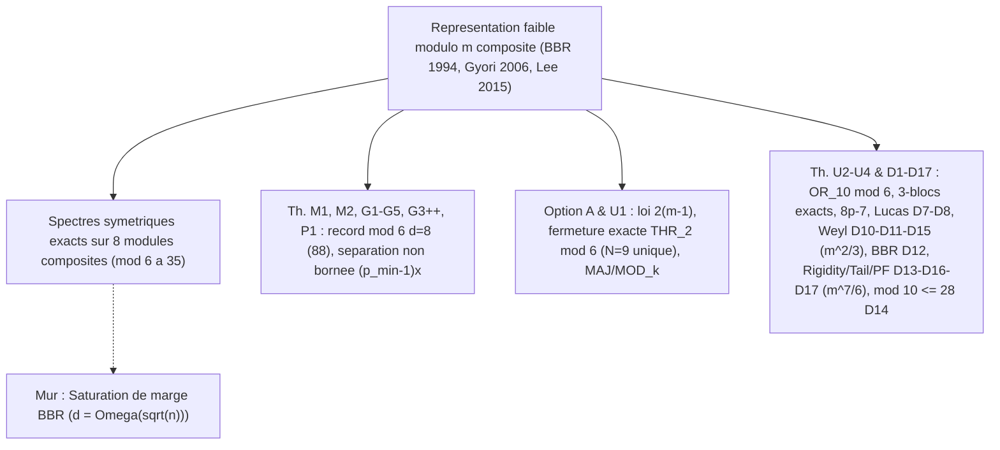

Les **26 expériences (E11 à E15v, 25 figures)** combinent énumération projective exacte sur huit modules composites (`mod 6, 10, 12, 14, 15, 21, 30, 35`), démonstrations analytiques formelles (dont les briques clés sont archivées en Lean 4 dans [lean/README.md](lean/README.md) et vérifiées par [lean/verify_proof_steps_exact.py](lean/verify_proof_steps_exact.py)) et vérifications computationnelles 100 % exactes en arithmétique entière (`int64` / `uint64` / `uint64 × 2` 128-bits, force brute sur 2<sup>n</sup> entrées jusqu'à n = 20 et vérification algébrique CRT complète au-delà).

---

## 3. Bilan synthétique : résultats établis et mur structurel

### 3.1 Synthèse des résultats établis

| Résultat | Nature | Énoncé clé / Vérification |
| :--- | :--- | :--- |
| **Théorème G5** (Séparation non bornée non symétrique / symétrique) | **Théorème analytique** | Ratio ≥ (p<sub>min</sub> - 1)× pour d < p<sub>min</sub> ; vérifié à **× 4 (+300 %, 34 → 136)** sur `mod 35` |
| **Théorème G3** (*Value-Avoidance*) et record `mod 6` à d = 8 | **Théorème analytique** | Gain +d à marge nulle si Im(P<sub>i</sub>) ≠ ℤ/q<sub>i</sub>ℤ ; `mod 6 d = 8` : **80 → 88 (+10 %)** |
| **Théorème G3++** (*Multi-Value Avoidance*) et **Théorème P1** (probabiliste) | **Théorème analytique** | Capacité exacte A<sub>p</sub>(d) = (p - 2)· d (= borne de Chevalley–Wilson) ; effondrement ε<sub>sym</sub><sup>∗</sup> = 100 % dès n = m (d < p<sub>min</sub>) vs m<sup>-d</sup> en non symétrique |
| **Théorèmes M2, G1, G2, G4** sur 8 modules composites | **Théorèmes constructifs** | Gains exacts sur `mod 6, 10, 12, 14, 15, 21, 30, 35` (jusqu'à +62,5 % par G2 sur `mod 14`) ; obstruction ℤ/4ℤ prouvée |
| **Régularité quadratique** N<sub>gen</sub><sup>(m)</sup>(2) ≥ 2(m - 1) | **Constat empirique + preuves 2-/3-blocs** | Vérifiée sur **8/8 modules** (`10..68`) ; optimalité exacte parmi les constructions 2-blocs (Th. D5) et 3-blocs sur `mod 10, 12, 15` (> 160 Md paires, Th. U4) |
| **Théorèmes T1–T2, Q1 et U1** (Fermeture exacte et unicité de THR<sub>n,2</sub> mod 6) | **Preuve + énumération exhaustive** | **N<sub>gen</sub><sup>(6)</sup>(2, THR<sub>2</sub>) = 9 exact (× 3,00)**, **unique** à S<sub>9</sub> × {± 1} près (V = {u} ⊔ {v} ⊔ K<sub>2</sub> ⊔ C<sub>5</sub>, $`\vert \mathrm{Aut}\vert = 20`$, 36 288 polynômes), α(G<sub>2</sub>) ≤ 4, ω(G<sub>2</sub>) ≤ 6, 0 sol. à n = 10 ; triplement 3,00× sur `mod 10` (4 → 12), `mod 15` (5 → 15) et `mod 21` (6 → 18) |
| **Théorème U2** (Classification canonique de OR<sub>10</sub> mod 6) et **Théorème D1** (Borne O<sub>d</sub>(p<sup>d</sup>)) | **Théorème + énumération exhaustive** | Extinction exacte par énumération exhaustive des 3 familles homogènes de OR<sub>n</sub> mod 6 à n = 9 (V<sub>0</sub> : 4 classes) et n = 10 (W<sub>0,1</sub> : 5 classes à P<sub>2</sub> homogène ; W<sub>1,1</sub> : 866 classes ; 0/51,4 M à n = 11) ; borne analytique N<sub>gen</sub><sup>(2p)</sup>(2) ≤ 2p<sup>2</sup> + p - 2 par Chevalley–Warning sur 𝔽<sub>2</sub> × 𝔽<sub>p</sub> |
| **Théorème D2** (Filtration de Witt–Dickson sur 𝔽<sub>2</sub><sup>s</sup>, ν<sub>2</sub>(2) = 7 et degrés mixtes) | **Théorème + énumération exhaustive** | Division asymptotique par 2 de la constante dominante 2p<sup>2</sup> → p<sup>2</sup> + O(p log p) (strictement meilleure que D1 pour tout p ≥ 5 ; gain jusqu'à -44,6 %) et (d<sup>d</sup> / (2 d!)) p<sup>d</sup> en degré d ≥ 2 ; constantes exactes ν<sub>2</sub>(2) = 7 (unique exception K<sub>6</sub> à n = 6) et ν<sub>2</sub><sup>THR</sup>(2) = 5 ; bornes mixtes (1, 2) : 3p - 2 ≤ N<sub>gen</sub> ≤ 4p - 3 et (2, 1) : ≤ 3p - 1 |
| **Théorème D3** (Contraction duale 𝔽<sub>q</sub> → 𝔽<sub>p</sub> et borne supérieure **LINÉAIRE** en p) | **Théorème analytique** | Franchissement du mur informationnel Ω(p<sup>2</sup> / log p) et **confirmation sur la famille m = 2p de la conjecture linéaire O(m) de Lee (2015)** : 4p - 2 ≤ N<sub>gen</sub><sup>(2p)</sup>(2, OR) ≤ 9p - 9 (p ≥ 5, ratio ≤ 2,25×, `mod 10 ≤ 36`, `mod 202 ≤ 900`, -95,6 % vs D1) ; O<sub>d</sub>(p) à tout degré d ≥ 1 ((d+1)(2<sup>d</sup> - 1)(p - 1) + d, exact à d = 1) ; O(p<sup>2</sup> q) ≤ O(m<sup>3/2</sup>) sur tous les semi-premiers m = pq (`mod 15 ≤ 81`, affiné à `≤ 80` par D9 ; `mod 21 ≤ 120`, `mod 35 ≤ 327`) et `mod 30 ≤ 315` |
| **Théorème D4** (Couplage bilinéaire (B<sub>2</sub>, B<sub>p</sub>) : 8p - 7, 6p - 4 et -25 % à tout degré d) | **Théorème analytique** | Ratio franchissant le facteur < 2,00× (confirmation resserrée de la conjecture O(m) de Lee sur m = 2p) : N<sub>gen</sub><sup>(2p)</sup>(2, OR) ≤ 8p - 7 (`mod 6 ≤ 17`, affiné à ≤ 16 via $`\vert w_1\vert_H \le 3`$ exhaustif ; `mod 10 ≤ 33`, affiné à ≤ 32 par D6 puis ≤ 28 par D14 ; `mod 202 ≤ 801`, -96,1 % vs D1) ; ≤ 6p - 4 (< 1,50×) dès qu'un c<sub>i</sub> = 0 / Type A ; ≤ 6p - 3 pour THR<sub>n,2</sub> (G<sub>p</sub> ≠ K<sub>n</sub>, `mod 10 ≤ 27`) ; gain -25 % sur C<sub>d</sub> à tout degré d ≥ 2 ; valeur exacte N<sub>gen</sub><sup>(6)</sup>((1, 2), OR) = 7 (0 / 4 992 à k = 8) |
| **Théorème D5** (Semi-premiers m = pq : exactitude 2-blocs 2(m - 1), O(m) à rang borné & verrou O(m<sup>3/2</sup>)) | **Théorème analytique** | Preuve analytique d'optimalité exacte **parmi les constructions 2-blocs** N<sub>2-bloc</sub><sup>(pq)</sup>(2, OR) = 2(m - 1) ∀ 2 ≤ p < q ; borne k-blocs ≤ d· m + (k - d)q - k ; bornes **strictement O(m)** en degrés mixtes (1, d) / (d, 1) (< 2(m - 1) à d = 2) et à rang bilinéaire borné O(min(r<sub>p</sub>, r<sub>q</sub>, p)· m) ; complémentation quadratique et adversaire linéaire $`\min \vert x\vert_H \ge jq/2`$ |
| **Théorème D6** (Symétrie 3-racines `mod 10 ≤ 32`, tranches paires de Lucas 7p - 4, m = 3q ≤ 19q - 13 & 4 barrières m = pq) | **Théorème analytique** | Cassure inconditionnelle de 8p - 7 à p = 5 (N<sub>gen</sub><sup>(10)</sup>(2, OR) ≤ 32, THR<sub>2</sub> ≤ 33, resserrés en D14) ; tranches de Lucas 2p/4p (7p - 4 < 1,75× si B<sub>p</sub>(w<sub>1</sub>, ·) constant) ; m = 3q ≤ 19q - 13 (affiné à 19q - 15 ∀ q ≥ 5 par D9 ; ≤ 17q - 11 Cas 1, ≤ 15q - 6 Type A) ; 4 barrières exactes sur m = pq (Fourier Ω(m<sup>2</sup> log m), rang 𝔽<sub>p</sub> Ω(p), CW sharp j(q - 1) + 1, et **absence de barrière info m<sup>3/2</sup>** : p<sup>2</sup> ln q / ln p < m) |
| **Théorèmes D7 & U3** (Bi-tranches analytiques de Lucas 5p - 2, fermetures 3-/4-blocs THR<sub>2</sub> mod 10 & cubique 2-blocs mod 6 = 27) | **Preuve + énumération exhaustive** | Preuves analytiques en 5 lignes sur (3p - 1, 2p - 1) et (4p - 1, p - 1) (∀ p ≥ 5) ; 1 859/1 861 partitions tuées à M = 24 (mod 5) ; rang Walsh–Hadamard G<sub>p</sub>(x ⊕ y) ; **N<sub>3-bloc</sub><sup>(10)</sup>(2, THR<sub>2</sub>) = 11 exact** (0 sol. sur (4,4,4)), **N<sub>4-bloc</sub><sup>(10)</sup>(2, THR<sub>2</sub>) = 12 exact** (0 / 3,80 Md paires à n = 13) et **N<sub>2-bloc</sub><sup>(6)</sup>(3, OR) = 27 exact** (0 / 70,4 M à n = 28 ; 27 ≤ N<sub>gen</sub><sup>(6)</sup>(3) ≤ 50) |
| **Théorème D8** (Chevalley–Warning à poids contraint modulo r : matrice de Lucas–Vandermonde (Dr + 1)p - 1) | **Théorème analytique** | Formule close exacte $`\vert \det A(D, r)\vert`$ (Vandermonde des factorielles descendantes) : $`\vert \det A(1, r)\vert = 1`$ (∀ premier p, gain → 50 %), $`\vert \det A(2, r)\vert = \binom{2r - 1}{r}`$ (∀ p ≥ 2r **et** ∀ puissance première r = p<sup>k</sup>), tous facteurs premiers < Dr ; racine booléenne de poids divisible par rp dès (Dr + 1)p - 1 variables (économie (r - 1)p vs (D + 1)rp) |
| **Théorème D9** (Semi-premiers m = pq : rang décalé diagonal $`\tilde{r}`$, parcimonie Caro–Wei, mur expanseur–Fourier m<sup>3/2</sup> & m = 3q ≤ 19q - 15) | **Théorème analytique** | Borne $`O(\min(\tilde{r}_p, \tilde{r}_q, p)\cdot m)`$ (alignée sur la dichotomie de rigidité diagonale de Lee 2015 ; couvre symétriques $`\tilde{r} = 1`$, 2-blocs et k-blocs pondérés) ; Caro–Wei $`n \le (\bar{\Delta} + 1)(2m - q - 1)`$ (couplage ≤ 4m - 2q - 2) ; mur expanseur–Fourier uniforme $`\mathrm{Var}(P) = \vert E\vert \sim n^2/(4m)`$ à n = m<sup>3/2</sup> (démoli sur les graphes signés parcimonieux par D10) ; empilement sharp 𝔽<sub>3</sub><sup>2</sup> (3k + 4) donnant 19q - 15 ∀ q ≥ 5 (**`mod 15 ≤ 80 < 81`**) et 8 ≤ μ<sub>3</sub>(2) ≤ 10 |
| **Théorème D10** (Fermeture rang 1 3q - 1, différentiation de Weyl biaisée exacte & **démolition du mur expanseur D9.3**) | **Théorème analytique** | **Égalité exacte N<sub>gen</sub><sup>(2q)</sup>(2, OR ; P<sub>q</sub> = aL<sup>2</sup> + bL) = 3q - 1** (∀ q ≥ 3) et bornes < 2(m - 1) (≤ 2m - p - 1, ≤ 2m - q - 1) + rang-2 pur ≤ 4m - 2p - 2q sur m = pq ; identités exactes $`\vert S_{\theta}(t)\vert^2 = \mathbb{E}[\prod_{j\in J} \cos(2\pi t D_j/m)]`$ et $`\mathbb{E}[\sum_{j\in J} D_j^2] = 2\mathrm{Var}_{\theta}(P)`$ (≤ 1,4 × 10<sup>-14</sup>) ; surplus basse fréquence universel M(x ; 0,10) > 0,131 (∀ x > 0) ; borne inconditionnelle sur graphes signés n ≤ 32m dès Δ + B ≲ m<sup>1/4</sup>/(ln m)<sup>1/4</sup> (m<sup>1/3</sup> en quasi-régulier) et sous-échantillonnage forçant ρ(G) > c<sub>0</sub>' / (m<sup>3/4</sup>(ln m)<sup>1/4</sup>) pour tout n ≥ 64m (éliminant intégralement le mur D9.3) ; témoin {0, 1} exact **K<sub>8</sub> ⊔ K<sub>2</sub> (n = 10 (mod 6))** |
| **Théorème U4** (Fermetures 3-blocs exactes 2(m - 1) sur m = 10, 12, 15, obstruction anisotrope & fermeture circulante ℤ<sub>19</sub>) | **Preuve + énumération exhaustive** | **Lemme analytique d'obstruction 3-blocs anisotrope** (a, b ≥ (p - 1)q, c ≥ q impossible ∀ m = pq impair) ; fermetures exhaustives exactes N<sub>3-bloc</sub><sup>(10)</sup>(2, OR) = 18 (26 partitions / 12,7 M P<sub>5</sub>), N<sub>3-bloc</sub><sup>(12)</sup>(2, OR) = 22 (44 partitions / 56,6 Md paires, non sans facteur carré) et N<sub>3-bloc</sub><sup>(15)</sup>(2, OR) = 28 (21 partitions / 100,9 Md paires, 9/21 tuées analytiquement) ; fermeture circulante complète 2<sup>19</sup> sur ℤ<sub>19</sub> (mod 10) (2,50 Md paires, 0 solution ; 9 copies isomorphes de C<sub>19</sub> uniques sur les sous-ensembles propres ; C<sub>19</sub>, P<sub>19</sub> et ses 760 perturbations 1-entrée bloqués à `bad ≥ 1` même à 190 variables P<sub>2</sub> libres) |
| **Théorème D11** (Cœur quasi-régulier, Bande 2,5 déphasée Δ ≲ m<sup>1/2</sup>, densité Ω(m<sup>-1/2</sup>) & rang CRT) | **Théorème analytique** | **Lemme D11.1** : cœur induit quasi-régulier $`\vert V(H)\vert \ge n/2`$, $`\Delta(H) \le 2K \bar{\Delta}(H)`$, ρ(H) ≤ 2ρ(G) ; **Lemme D11.2** : borne cosinus déphasé $`\mathrm{dist}(\alpha + \delta, \pi\mathbb{Z})^2 \ge \frac{1}{4}\delta^2 + c(\alpha)\delta`$ (min extérieur $`\frac{3}{256}\pi^2`$) ; **D11.3** : **n ≤ 64m inconditionnel jusqu'à Δ ≲ m<sup>1/2</sup>/(ln m)<sup>3/2</sup>** (exposant doublé 1/4 → 1/2 sans hypothèse de quasi-régularité) et densité forcée ρ(G) > c<sub>1</sub>' / (m<sup>1/2</sup>(ln m)<sup>5/2</sup>) (∀ n ≥ 256m) ; **D11.4** : $`\tilde{r}(A) \le 3 \max \mathrm{rank}(A[U, W])`$, découplage par codimension de pivots sur gcd(t, m) ∈ {p, q} et réduction par invariance unitaire à t = 1 |
| **Théorème D12** (Barrière de saturation BBR : **O(d<sup>r</sup>) k-blocs & semi-symétrique** et fermetures exactes par tranches de Lucas) | **Théorème + certificats exacts** | N<sub>k-bloc</sub><sup>(m)</sup>(d, OR) = Θ<sub>k,m</sub>(d<sup>r</sup>) et **O<sub>m</sub>(d<sup>r</sup>) semi-symétrique** pour tout m et tout d ≥ 1 (dual `mod 6` : $`\sum \lfloor s_j/(2^a 3^b) \rfloor \le 2\lfloor d/3^b \rfloor`$, $`\sum \lfloor s_j/(2^{a-1} 3^{b+1}) \rfloor \le 1`$) ; fermetures semi-symétriques **100 % exactes** N<sub>gen</sub><sup>(6)</sup>(3 ; P<sub>3</sub> sym) = 27 (13/13 certificats à n = 28), N<sub>gen</sub><sup>(6)</sup>(6 ; P<sub>3</sub> sym) = 62 (364/364 à n = 63), 53 ≤ N<sub>gen</sub><sup>(6)</sup>(5 ; P<sub>3</sub> sym) ≤ 54, dual N<sub>gen</sub><sup>(6)</sup>(3 ; P<sub>2</sub> sym) ≤ 39 (4 termes mod 3 vs 50 en D4), `mod 10 d = 2 : = 14`, `d = 3 : ≤ 22 < 27`, `d = 4 : ≤ 29 < 36`, `mod 15 d = 2 : ≤ 25 < 28` ; résistance 0 / 101 688 pert. 1/2/3-opt en 3-blocs à d = 3, n = 28 |
| **Théorème D13** (Rigidité matricielle de Valiant, repliement de paires sur blowups denses, recensement OR<sub>4</sub>/𝔽<sub>3</sub> & audit Bande 3 × 4) | **Théorème + énumération exhaustive** | **D13.1** : rigidité booléenne $`R_{\mathbb{F}_q}^{\mathrm{bool}}(A_q, r) > n^2/(2(r+1)m) - n`$ (tue tout graphe cocktail-party ρ = 1 à n < 8m) ; **D13.2** : repliement de paires à poids constant annulant tout blowup k-blocs à poids modulaires arbitraires (Δ : 1 291 → 11 sur m = 323) ; **D13.3** : recensement exhaustif OR<sub>4</sub> / 𝔽<sub>3</sub> (114 / 59 049 : 90 normes $`\tilde{r} = 2`$ + 24 rang $`\tilde{r} = 3`$) ; **Audit Bande 3** : conditionnement pré-Weyl exp(-(3/16) s (t/m)<sup>2</sup>) (4× plus fort) |
| **Théorème D14** (Escalier héréditaire de Lucas, **nouveau record N<sub>gen</sub><sup>(10)</sup>(2, OR) ≤ 28** et chasses CEGAR 𝔽<sub>2</sub>-Gauss) | **Théorème + certificats exacts** | **D14.1** : escalier héréditaire exact sur U<sub>1</sub>(w<sub>1</sub>) (mod 5) ($`w_f \in \lbrace 0, 1, 3, 5, 7, 9, 11\rbrace \Rightarrow \vert U_1\vert \le \lbrace 24, 23, 22, 19, 17, 15, 13\rbrace`$), tuant n = 32, 31, 30 ; **D14.2** : fermeture jointe (U<sub>0</sub>, U<sub>1</sub>) à n = 29 (0 / 1 085 et 0 / 7 140), prouvant inconditionnellement 18 ≤ N<sub>gen</sub><sup>(10)</sup>(2, OR) ≤ 28 (1,556×, vs 32 en D6) et THR<sub>2</sub> ≤ 29 ; **D14.3** : chasses CEGAR exactes 190-var (n = 19 (mod 10)) et 4-blocs cubiques 2<sup>34</sup> (0 / 74 028 à d = 3, n = 28 (mod 6), calibré à 0 à n = 27) |
| **Théorème D15** (Décomposition 5 bandes Warnke + sin<sup>2</sup> : Δ ≲ m<sup>2/3</sup> et densité Ω(m<sup>-1/3</sup>)) | **Théorème analytique** | **D15.1** : lemme cosinus déphasé renforcé $`\mathrm{dist}(\alpha + \delta, \pi\mathbb{Z})^2 \ge \frac{1}{4}\delta^2 + c(\alpha)\delta + \frac{1}{8}\alpha^2`$ (min exact $`\frac{5}{448}\pi^2`$) ; **D15.2** : identité exacte sin<sup>2</sup> indépendante des termes linéaires b<sub>j</sub> (vérifiée sur 9/9 énumérations 3<sup>n</sup>) ; **D15.3** : différences typiques bornées de Warnke (2016) + croisement Bande 2,75 / Bande 3 en T<sub>3</sub> = m/(K<sup>1/2</sup>Δ<sup>1/4</sup>) donnant **n ≤ 64m jusqu'à Δ ≲ m<sup>2/3</sup>/(ln m)<sup>4/3</sup>** et ρ(G) > c<sub>2</sub>'/(m<sup>1/3</sup>(ln m)<sup>7/3</sup>) (∀ n ≥ 256m) |
| **Théorème D16** (Dichotomie spectrale de queue sur expanseurs denses ρ = 1 & exclusion dyadique sur grands coefficients modulaires) | **Théorème analytique** | **D16.1** : sur A<sub>UW</sub> ∈ {-1, 0, +1}<sup>n/2 × n/2</sup>, soit Hanson–Wright tue $`\vert S_{1/2}(t)\vert < 1/m`$ dès $`n = O(m\sqrt{\ln m / \rho})`$ (vérifié sur aléatoire ± 1, {0,1}, Hadamard H<sub>128</sub>/H<sub>256</sub> et Paley P<sub>197</sub> jusqu'à 7,9 × 10<sup>-33</sup>), soit ‖ A<sub>UW</sub> - L‖<sub>F</sub><sup>2</sup> < 16 m<sup>2</sup> ln m / t<sup>2</sup> à rang réel O(ln<sup>2</sup> m) ; **D16.2** : exclusion dyadique $`\vert S_{1/2}(t)\vert \le \exp(-\frac{1}{4}\nu_{\mathrm{ind}}(G_k)(2^{k-1}/m)^2)`$ éliminant les grands coefficients parcimonieux dès n = O(Δ ln m) (indépendant de m, certifié 4/4 dont n = 460 < m = 899) |
| **Théorème D17** (Annulation quadratique + linéaire sous repliement de paires et cassure O(m<sup>3/2</sup>) → O(m<sup>7/6</sup>(ln m)<sup>5/3</sup>)) | **Théorème analytique** | **D17.1** : annulation identique des termes quadratiques et linéaires de tout blowup k-blocs modulaire λ<sub>αβ</sub> ∈ ℤ/mℤ (12/12 configurations vérifiées) ; **D17.2** : plancher de rigidité $`\vert E(S)\vert > c_4 (n - k)^2 / (m^{1/3}(\ln m)^{7/3})`$ via D15 (k · m<sup>2/3</sup> fois plus fort que D13.1) et récupération biaisée 2,55× vs 1/m à m = 899 ; **D17.3** : couplage avec D16.1 donnant n ≤ k + O(m<sup>7/6</sup>(ln m)<sup>5/3</sup>) ≪ m<sup>3/2</sup> |

### 3.2 Limites et mur de saturation de marge

Les deux grandes conjectures asymptotiques demeurent ouvertes dans leur pleine généralité. D'une part, la conjecture $`d = \Omega(\sqrt{n})`$ de Barrington–Beigel–Rudich (1994) pour OR<sub>n</sub> (mod 6) (et Θ(d<sup>r</sup>) pour r facteurs premiers à m fixé et d → ∞) est démontrée inconditionnellement en régimes k-blocs et semi-symétrique par le **Théorème D12** (avec fermetures exactes = 27 à d = 3 et = 62 à d = 6 sur $`\bmod 6`$), mais le cas simultanément non symétrique sur les deux canaux reste ouvert. D'autre part, la conjecture linéaire N<sub>gen</sub><sup>(m)</sup>(2) = O(m) de Lee (2015) est établie sur toute la famille m = 2p et repoussée jusqu'à Δ ≲ m<sup>2/3</sup>/(ln m)<sup>4/3</sup> et ρ(G) > c<sub>2</sub>' / (m<sup>1/3</sup>(ln m)<sup>7/3</sup>) sur les graphes signés (**Théorème D15**), sur les expanseurs denses ρ = 1 et les polynômes modulaires parcimonieux à grands coefficients (**Théorème D16**), ainsi que jusqu'à O(m<sup>7/6</sup>(ln m)<sup>5/3</sup>) sur tous les blowups k-blocs perturbés (**Théorème D17**) ; la frontière résiduelle porte uniquement sur les matrices denses non expanseurs de rang réel approché O(ln<sup>2</sup> m) dépourvues de structure de blocs (mais rigides sur 𝔽<sub>q</sub>) et sur les polynômes modulaires denses à grands coefficients centrés sur t = 1.

| # | Mur structurel | Contexte | Manifestation quantitative mesurée |
| :---: | :--- | :--- | :--- |
| **3** | **Saturation de marge (BBR)** | Polynômes $`\bmod m`$ (Δ = 0) | Les constructions non symétriques battent N<sub>sym</sub> dès que Δ > 0 ou d < p<sub>min</sub>, mais dès que Δ = 0 (ex. `mod 6` à d = 3, 4, 5), les recherches multi-blocs heurtent systématiquement `defect = 1` dès N<sub>sym</sub>(d) + 1 (confirmé par la fermeture 2-blocs cubique = 27 en U3, la fermeture semi-symétrique P<sub>3</sub> symétrique = 27 en D12 et 0 / 101 688 perturbations 1/2/3-opt en 3-blocs à n = 28). |

---

## 4. Présentation détaillée des expériences, buts, résultats et graphiques (Expériences E11 à E15v)

#### Expérience E11 — Spectre symétrique 100 % exact N<sub>sym</sub><sup>(6)</sup>(1..10) par canonisation projective

Toute comparaison rigoureuse entre polynômes généraux et polynômes symétriques modulo 6 suppose de connaître d'abord, sans erreur ni biais d'échantillonnage, le plafond exact N<sub>sym</sub><sup>(6)</sup>(d) des polynômes symétriques ainsi que les degrés minimaux réellement consommés sur chacun des deux canaux 𝔽<sub>2</sub> et 𝔽<sub>3</sub>. Prolongeant le laboratoire initial [mod6_poly_lab.py](src/mod6_poly_lab.py), l'énumération exhaustive [mod6_exact_complete.py](src/mod6_exact_complete.py) parcourt l'intégralité des 2<sup>d</sup> - 1 polynômes symétriques sur 𝔽<sub>2</sub> et de toutes les (3<sup>d</sup> - 1)/2 droites projectives canoniques de ℙ<sup>d-1</sup>(𝔽<sub>3</sub>) pour d = 1..10 (après correction d'un biais initial de canonisation qui sous-comptait d = 3 à 19).

L'énumération met d'emblée au jour un phénomène marquant : dès d = 5, le polynôme symétrique $`P_3^{\ast}(S) = \binom{S}{1} + \binom{S}{3} + 2\binom{S}{4} + \binom{S}{5} \pmod 3`$ annule uniquement S ≡ 0 (mod 9) (au lieu du degré 8 de la construction de BBR) en exploitant les deux résidus non nuls {1, 2} (mod 3). Surtout, le tableau complet révèle que pour de nombreux degrés (d = 2, 6, 7, 8, 9), l'un des deux canaux sature avant l'autre et laisse une marge de degré Δ = d - min(deg P<sub>2</sub><sup>∗</sup>, deg P<sub>3</sub><sup>∗</sup>) ≥ 1 inutilisée :

| Degré d | Période CRT max p<sub>2</sub> p<sub>3</sub> - 1 | Exact N<sub>sym</sub>(d) | deg(P<sub>2</sub><sup>∗</sup>) | deg(P<sub>3</sub><sup>∗</sup>) | Marge Δ | Prouvé non symétrique N<sub>gen</sub>(d) ≥ | Gain vs symétrique |
| :---: | :---: | :---: | :---: | :---: | :---: | :---: | :--- |
| 1 | 5 | 5 | 1 | 1 | 0 | 5 | +0 |
| 2 | 11 | 8 | 2 | 1 | 1 | 10 *(optimal, Győri 2006)* | **+2 (+25,0 %)** |
| 3 | 35 | 27 | 3 | 3 | 0 | 27 | +0 |
| 4 | 71 | 36 | 4 | 4 | 0 | 36 | +0 |
| 5 | 71 | 53 | 5 | 5 | 0 | 53 | +0 |
| 6 | 71 | 62 | 6 | 5 | 1 | 63 *(Th. M2)* | **+1 (+1,6 %)** |
| 7 | 71 | 71 | 7 | 5 | 2 | 73 *(Th. M2, dépasse la période 71)* | **+2 (+2,8 %)** |
| 8 | 143 | 80 | 8 | 5 *(ou 8, I<sub>9</sub>)* | 3 | 88 *(83 par M2, **88 par G3**)* | **+8 (+10,0 %)** |
| 9 | 431 | 151 | 7 | 9 | 2 | 153 *(Th. M2, marge sur 𝔽<sub>2</sub>)* | **+2 (+1,3 %)** |
| 10 | 431 | 184 | 10 | 10 | 0 | 184 | +0 |

---

#### Expérience E12 — Théorèmes M1 et M2 : séparations non symétriques modulo 6 et saturation de marge

Le spectre exact de l'Expérience E11 pose immédiatement deux questions : comment expliquer algébriquement le dépassement N<sub>gen</sub>(2) = 10 > N<sub>sym</sub>(2) = 8 établi par Győri (2006 / FCT 2007), et peut-on exploiter les marges Δ ≥ 1 repérées aux degrés d ≥ 6 — ou même dépasser N<sub>sym</sub>(d) lorsque Δ = 0 (d = 3, 4, 5) ? Les constructions correspondantes sont formalisées et vérifiées dans [verify_mod6_theorems.py](src/verify_mod6_theorems.py).

En degré pair, la clé vient de l'anisotropie quadratique sur 𝔽<sub>3</sub> : comme -1 ∉ (𝔽<sub>3</sub><sup>∗</sup>)<sup>2</sup>, la somme de carrés u<sup>2</sup> + v<sup>2</sup> ne s'annule modulo 3 que si u ≡ v ≡ 0 (mod 3). En combinant deux blocs disjoints A et B, le **Théorème M1** établit un doublement récursif immédiat :

> **Théorème M1 (Somme de carrés sur 𝔽<sub>3</sub> et doublement récursif).** Puisque -1 ∉ (𝔽<sub>3</sub><sup>∗</sup>)<sup>2</sup>, la forme quadratique u<sup>2</sup> + v<sup>2</sup> est anisotrope sur 𝔽<sub>3</sub> (u<sup>2</sup> + v<sup>2</sup> ≡ 0 (mod 3) ⇔ u ≡ v ≡ 0 (mod 3)). Il en résulte : (1) pour tout d ≥ 1, N<sub>gen</sub>(2d) ≥ 2 N<sub>gen</sub>(d) via P<sub>2</sub> = Q<sub>2</sub>(A) + Q<sub>2</sub>(B) + Q<sub>2</sub>(A)Q<sub>2</sub>(B) (mod 2) et P<sub>3</sub> = Q<sub>3</sub>(A)<sup>2</sup> + Q<sub>3</sub>(B)<sup>2</sup> (mod 3) ; (2) en degré d = 2, deux familles explicites — (8, 2) et (5, 5) — représentent OR<sub>10</sub> (mod 6) (vérifiées sur les 1 024 entrées), atteignant l'optimum N<sub>gen</sub>(2) = 10 de Győri (2006 / FCT 2007).

Ce doublement ne suffit toutefois pas aux degrés impairs ou intermédiaires. L'observation décisive issue du tableau de E11 est que les sauts de période 2<sup>a</sup> et 3<sup>b</sup> sont incommensurables (log 2 / log 3 ∉ ℚ), créant une marge Δ = d - d<sub>3</sub> ≥ 1 (ou d - d<sub>2</sub> ≥ 1) pour une infinité de degrés. Le **Théorème M2** convertit directement chaque unité de marge en une variable supplémentaire gratuite :

> **Théorème M2 (Récolte de marge non symétrique — *Margin-Harvesting*).** Soit (P<sub>2</sub>(A), P<sub>3</sub>(A)) une représentation faible de OR<sub>a</sub> (mod 6) de degré ≤ d. Si deg(P<sub>3</sub>) = d<sub>3</sub> < d (marge Δ = d - d<sub>3</sub> ≥ 1), l'ajout de Δ variables $`y_1, \dots, y_{\Delta}`$ via :

```math
\widetilde{P}_2(A, y) = P_2(A) \pmod 2, \qquad \widetilde{P}_3(A, y) = P_3(A) + v(y) - P_3(A)\, v(y) \pmod 3,
```

> où $`v(y) = 1 - \prod_{j=1}^{\Delta} (1 - y_j) \in \lbrace 0, 1\rbrace \pmod 3`$, définit un polynôme de degré ≤ d représentant OR<sub>a + Δ</sub> (mod 6). Une construction analogue s'applique lorsque deg(P<sub>2</sub>) < d.

*Preuve.* Si $`y \ne \mathbf{0}`$, alors v(y) = 1 et $`\widetilde{P}_3(A, y) = 1 \not\equiv 0 \pmod 3`$ quel que soit A. Si $`y = \mathbf{0}`$, alors $`v(\mathbf{0}) = 0`$, ce qui ramène au couple (P<sub>2</sub>(A), P<sub>3</sub>(A)), nul simultanément uniquement en $`A = \mathbf{0}`$. L'incommensurabilité des sauts de périodes 2<sup>a</sup> et 3<sup>b</sup> garantit Δ ≥ 1 (et même Δ = Ω(d)) pour une infinité de degrés d, dépassant dès d = 7 la période CRT symétrique 8 × 9 - 1 = 71 avec n = 73. ■

Reste alors le cas symétrique opposé : lorsque la marge s'annule (Δ = 0, à d = 3, 4, 5), peut-on encore dépasser N<sub>sym</sub>(d) ? Les chasses exactes menées par élimination de Gauss sur 𝔽<sub>2</sub> couplée au balayage sur 𝔽<sub>3</sub> sur 16 cœurs ([hunt_d2_n9_mod6.py](src/hunt_d2_n9_mod6.py), [mod6_2block_d3_and_d2.py](src/mod6_2block_d3_and_d2.py), [hunt_super_quadratic_mod6.py](src/hunt_super_quadratic_mod6.py)) butent systématiquement sur un mur `defect = 1` dès N<sub>sym</sub>(d) + 1 : aucune solution à n = 28 pour d = 3 (en 2-blocs exhaustif — ensuite fermé à = 27 au Théorème U3 — ni en 3-blocs (26, 1, 1)), `defect = 1` sur 6 partitions 2-blocs à n = 37 (d = 4) et `defect = 1` sur 5 partitions à n = 54 (d = 5). C'est cet obstacle qui motive la conjecture de saturation de marge (Mur n° 3).


---

#### Expérience E13 — Généralisation aux 8 modules composites (`mod 6` à `mod 35`) : Théorèmes G1–G5

Les mécanismes M1 et M2 découverts modulo 6 s'étendent-ils à tout entier composite $`m = \prod_{i=1}^r q_i`$ ($`q_i = p_i^{e_i}`$, incluant les modules non sans facteur carré comme `mod 12 = 4 × 3` et les modules à 3 facteurs comme `mod 30 = 2 × 3 × 5`), et l'écart relatif N<sub>gen</sub><sup>(m)</sup>(d) / N<sub>sym</sub><sup>(m)</sup>(d) reste-t-il borné ? En généralisant la démarche sur huit modules composites ([composite_mod_m_lab.py](src/composite_mod_m_lab.py), [composite_mod_m_full.py](src/composite_mod_m_full.py), [composite_mod_m_verify_and_plot.py](src/composite_mod_m_verify_and_plot.py), données dans [composite_mod_m_full.json](results/composite_mod_m_full.json)), cinq théorèmes s'enchaînent.

Premièrement, le **Théorème G1 (*Multi-Channel Margin-Harvesting*)** montre que l'ajout de r blocs disjoints y<sup>(i)</sup> de tailles Δ<sub>i</sub> = d - d<sub>i</sub> sur chaque canal CRT q<sub>i</sub> récolte simultanément la somme $`\sum_{i=1}^r \Delta_i`$ (même lorsque $`q_i = p_i^{e_i}`$ avec e<sub>i</sub> ≥ 2). Deuxièmement, le **Théorème G2 (*Anisotropic Field-Norm Harvesting*)** amplifie ce gain d'un facteur p - 1 : sur tout canal premier simple p<sub>i</sub> | m où $`k_i = \lfloor d / d_i \rfloor \ge 2`$, remplacer P<sub>i</sub>(A) par la norme d'extension de corps $`N_{\mathbb{F}_{p^k}/\mathbb{F}_p}(P_i(A), R_1(B_1), \dots, R_{k-1}(B_{k-1}))`$ (chaque R<sub>j</sub> de degré d<sub>i</sub> absorbant l'optimum exact (p<sub>i</sub> - 1)d<sub>i</sub> variables sur $`\mathbb{F}_{p_i}`$) puis récolter le reste d - k<sub>i</sub> d<sub>i</sub> par G1 fournit (k<sub>i</sub> - 1)(p<sub>i</sub> - 1)d<sub>i</sub> + (d - k<sub>i</sub> d<sub>i</sub>) variables gratuites.

Troisièmement, même lorsque la marge est nulle, le **Théorème G3 (*Value-Avoidance Harvesting*)** exploite l'image de P<sub>i</sub> : si Im(P<sub>i</sub>) sur $`\lbrace 0, \dots, a\rbrace`$ omet au moins une valeur non nulle -c ∈ (ℤ/q<sub>i</sub>ℤ) ∖ {0}, alors le polynôme **purement additif** $`\widetilde{P}_i(A, y) = P_i(A) + c \cdot (1 - \prod_{j=1}^d (1 - y_j)) \pmod{q_i}`$ conserve le degré max(deg P<sub>i</sub>, d) = d sans aucun produit croisé et récolte **+d variables gratuites**. À d = p<sup>t</sup> - 1, l'indicatrice de Lucas $`I_{p^t}(S) = \mathbf{1}[S \not\equiv 0 \pmod{p^t}]`$ a pour image {0, 1} (mod p) et déclenche systématiquement **+8 à d = 8** sur tout multiple de 3 : sur `mod 6, d = 8`, on passe ainsi de N<sub>sym</sub> = 80 à 83 (M2) puis **88 (+10,0 %, G3)** via c<sub>2</sub> = [0,1,1,1,1,1,1,1] et c<sub>3</sub> = [2,1,2,1,2,1,2,1] (Im(P<sub>3</sub>) = {0, 2} omet 1 (mod 3)) ; de même `mod 12, d = 8` passe de 224 à 232 et `mod 15, d = 8` de 215 à 223.

Quatrièmement, le **Théorème G4 (*Multi-Block Norm Multiplication*)** généralise M1 à tout module **sans facteur carré** m = p<sub>1</sub> ⋯ p<sub>r</sub> : pour tous k ≥ 2 et d<sub>0</sub> ≥ 1 avec k d<sub>0</sub> ≤ d, composer k copies indépendantes par les normes $`N_{\mathbb{F}_{p_i^k}/\mathbb{F}_{p_i}}`$ sur chaque canal puis récolter le reste par G1 donne N<sub>gen</sub><sup>(m)</sup>(d) ≥ k · N<sub>gen</sub><sup>(m)</sup>(d<sub>0</sub>) + r(d - k d<sub>0</sub>). En revanche, sur ℤ/4ℤ (`mod 12`), aucun polynôme sans constante en (u, v) ne peut être anisotrope car Q(2, 2) ≡ Q(2, 0) + Q(0, 2) ≡ 0 (mod 4), ce qui montre que G4 est spécifique aux modules sans facteur carré. Enfin, appliqué au régime d < p<sub>min</sub>, G4 entraîne une **séparation non bornée** entre polynômes généraux et symétriques :

> **Théorème G5 (Séparation non bornée entre polynômes non symétriques et symétriques).** Soit m = p<sub>1</sub> · p<sub>2</sub> ⋯ p<sub>r</sub> un entier composite sans facteur carré dont le plus petit facteur premier vérifie p<sub>min</sub> = min<sub>i</sub> p<sub>i</sub> ≥ 3. Alors, pour tout degré 1 ≤ d ≤ p<sub>min</sub> - 1 :

```math
N_{\mathrm{sym}}^{(m)}(d) \;=\; m - 1, \qquad N_{\mathrm{gen}}^{(m)}(d) \;\ge\; d \cdot (m - 1), \qquad \frac{N_{\mathrm{gen}}^{(m)}(p_{\min} - 1)}{N_{\mathrm{sym}}^{(m)}(p_{\min} - 1)} \;\ge\; p_{\min} - 1 \;\longrightarrow\; +\infty.
```

*Preuve.* Pour tout 1 ≤ k ≤ d < p<sub>min</sub> et tout p<sub>i</sub> | m, p<sub>i</sub> divise m mais ne divise pas k!, donc $`\binom{m}{k} \equiv 0 \pmod{p_i}`$. Tout polynôme symétrique sans constante de degré ≤ d s'annule ainsi en S = m sur chaque canal p<sub>i</sub>, d'où P(m) ≡ 0 (mod m) et N<sub>sym</sub><sup>(m)</sup>(d) = m - 1 exactement. Inversement, appliquer le Théorème G4 à d<sub>0</sub> = 1 (N<sub>sym</sub><sup>(m)</sup>(1) = m - 1) avec k = d blocs disjoints de taille m - 1 et les normes anisotropes $`N_{\mathbb{F}_{p_i^d}/\mathbb{F}_{p_i}}(S_1, \dots, S_d)`$ impose S<sub>j</sub> ≡ 0 (mod m) pour tout j, donc $`x = \mathbf{0}`$. ■

Les 17 normes anisotropes ont été vérifiées sur tous les vecteurs non nuls de $`\mathbb{F}_p^k \setminus \lbrace \mathbf{0}\rbrace`$, accompagnées de vérifications en force brute intégrale sur 2<sup>18</sup> = 262 144 entrées pour `mod 10, d=2, n=18` et 2<sup>20</sup> = 1 048 576 entrées pour `mod 15, d=2, n=20` :

| Module m (facteurs) | Degrés exacts | Pic de séparation d<sup>∗</sup> | Exact N<sub>sym</sub>(d<sup>∗</sup>) | Prouvé N<sub>gen</sub>(d<sup>∗</sup>) ≥ | Gain (relatif) | Mécanisme vainqueur | Autres records marquants |
| :--- | :---: | :---: | :---: | :---: | :---: | :--- | :--- |
| **mod 6** (2 × 3) | d = 1..10 | d = 2 / d = 8 | 8 / 80 | **10 / 88** | **+2 (+25 %) / +8 (+10 %)** | G2 (Győri) / **G3 (I<sub>9</sub>)** | d=7 : 71 → 73 ; d=9 : 151 → 153 |
| **mod 10** (2 × 5) | d = 1..8 | d = 4 | 24 | 36 | **+12 (+50,0 %)** | **G2 (norme 𝔽<sub>5</sub><sup>4</sup>)** | d=2 : 14 → 18 ; d=3 : 19 → 27 |
| **mod 12** (4 × 3, non sqfree) | d = 1..8 | d = 2 / d = 8 | 20 / 224 | **22 / 232** | **+2 (+10 %) / +8 (+3,6 %)** | G2 / **G3 (I<sub>9</sub>@3)** | d=6 : 134 → 135 ; d=7 : 143 → 145 |
| **mod 14** (2 × 7) | d = 1..6 | d = 6 | 48 | 78 | **+30 (+62,5 %)** | **G2 (norme 𝔽<sub>7</sub><sup>6</sup>)** | d=2..5 : +30 % à +58,5 % |
| **mod 15** (3 × 5) | d = 1..8 | d = 2 | 14 | 28 | **+14 (+100,0 %)** | **G4/G5 (2× 14)** | d=4 : 39 → 56 (+44 %) ; d=8 : 215 → 223 (**G3**) |
| **mod 21** (3 × 7) | d = 1..6 | d = 2 / d = 6 | 20 / 62 | **40 / 120** | **+20 (+100 %) / +58 (+93,5 %)** | **G4/G5 (2× 20 / 2× 60)** | d=4 : 55 → 80 ; d=5 : 62 → 100 (+61 %) |
| **mod 30** (2 × 3 × 5, r=3) | d = 1..6 | d = 2 | 44 | 58 | **+14 (+31,8 %)** | **G4 (2× 29)** | d=4 : 184 → 196 (G2) ; d=6 : 1 358 → 1 359 (Θ(d<sup>3</sup>)) |
| **mod 35** (5 × 7, p<sub>min</sub>=5) | d = 1..5 | d = 4 | 34 | 136 | **+102 (+300,0 %, 4×)** | **G4/G5 (4× 34)** | d=2 : 34 → 68 ; d=3 : 34 → 102 ; d=5 : 146 → 170 |


---

#### Expérience E14 — Test d'optimalité quadratique : la régularité empirique N<sub>gen</sub><sup>(m)</sup>(2) ≥ 2(m - 1)

En examinant la colonne d = 2 du tableau de l'Expérience E13, une régularité frappante saute aux yeux : sur **l'ensemble des huit modules composites** (`m ∈ {6, 10, 12, 14, 15, 21, 30, 35}`, y compris le module non sans facteur carré `mod 12`), les meilleures constructions quadratiques atteignent exactement 2(m - 1) variables (10, 18, 22, 26, 28, 40, 58, 68). Pour vérifier si ce plafond généralise effectivement le théorème exact N<sub>gen</sub><sup>(6)</sup>(2) = 10 de Győri (2006) — et le situer face à la borne m<sup>O(r)</sup> de Lee (2015) —, l'étude [option_a_deep_probe.py](src/option_a_deep_probe.py) ([option_a_deep_probe.json](results/option_a_deep_probe.json)) sonde systématiquement les constructions 2-blocs et 3-blocs.

L'énumération **100 % exhaustive en 2 blocs** confirme d'abord que le maximum 2-blocs vaut exactement 10 (8+2, `mod 6`), 18 (14+4, `mod 10`), 22 (20+2, `mod 12`) et 28 (14+14, `mod 15`). En passant à **3 blocs** au cran critique 2(m - 1) + 1, les sondes résistent tout autant : sur `mod 10` à n = 19, l'énumération exhaustive des 488 281 droites sur 𝔽<sub>5</sub> couplée à l'élimination de Gauss exacte sur 𝔽<sub>2</sub> sur 7 partitions ((14,4,1) à (7,6,6)) renvoie **0 / 3 417 967 solutions**. Sur `mod 15` à n = 29, l'exploration de **3,66 milliards de paires** (1 500 meilleures droites 𝔽<sub>3</sub> × 488 281 droites 𝔽<sub>5</sub> sur 5 partitions) échoue systématiquement (`min_defect = 1` sur (14,14,1), (14,13,2), (14,10,5) ; 2 sur (12,12,5) ; 3 sur (10,10,9)). *(Ces sondes partielles seront ensuite élevées en fermetures 3-blocs 100 % exhaustives dans l'Expérience E15o / Théorème U4.)*

---

#### Expérience E15 — Extension aux seuils THR<sub>n, t</sub>, MAJ<sub>n</sub> et MOD<sub>k</sub> : Théorèmes T1–T2 et construction à n = 9 sur THR<sub>n, 2</sub>

Avant d'attaquer la démonstration de bornes supérieures générales pour OR<sub>n</sub>, il est instructif de tester comment ces phénomènes se comportent sur d'autres fonctions booléennes symétriques : les fonctions seuils THR<sub>n,t</sub> (incluant MAJ<sub>n</sub>) et les fonctions modulaires MOD<sub>k</sub> (gcd(k, m) = 1). Les scripts [option_a_deep_probe.py](src/option_a_deep_probe.py), [option_a_thr2_breakthrough.py](src/option_a_thr2_breakthrough.py), [piste_2a_thr2_graphs.py](src/piste_2a_thr2_graphs.py) et [piste_2a_k10_and_theorem_t2.py](src/piste_2a_k10_and_theorem_t2.py) ([piste_2a_thr2_graphs.json](results/piste_2a_thr2_graphs.json), [piste_2a_phase2.json](results/piste_2a_phase2.json)) établissent d'abord deux garde-fous analytiques : par annulation récursive des coefficients multilinéaires c<sub>I</sub> sur | I| < t, aucun polynôme (même non symétrique) ne représente faiblement THR<sub>n,t</sub> (mod m) en degré < t, d'où $`\deg_{\mathrm{gen}}^{(m)}(\mathrm{MAJ}_n) \ge \lceil n/2 \rceil`$ ; et par le **Théorème T1**, fixer t - 1 variables à 1 réduit exactement THR<sub>n,t</sub> à OR<sub>n-t+1</sub>, donnant la majoration universelle N<sub>gen</sub><sup>(m)</sup>(d, THR<sub>t</sub>) ≤ N<sub>gen</sub><sup>(m)</sup>(d, OR) + t - 1 (donc N<sub>gen</sub><sup>(6)</sup>(2, THR<sub>2</sub>) ≤ 11 par Győri).

En sens inverse, la séparation entre polynômes généraux et symétriques sur THR<sub>n,2</sub> en degré 2 s'avère bien plus spectaculaire que sur OR<sub>n</sub>. Le **Théorème T2** (décomposition en cliques sans somme nulle) montre que sur tout module m = 2p où $`S_p(a) = \lbrace \binom{s}{2} \bmod p : 2 \le s \le a\rbrace`$ est sans somme nulle (0 ∉ S<sub>p</sub>(a) + S<sub>p</sub>(a), par exemple p = 5, a = 4), coupler le graphe biparti complet P<sub>2</sub>(A, B) = AB (mod 2) à l'union disjointe de deux cliques $`P_p(A, B) = \binom{A}{2} + \binom{B}{2} \pmod p`$ représente faiblement THR<sub>2a, 2</sub> (mod 2p), doublant N<sub>sym</sub><sup>(10)</sup>(2, THR<sub>2</sub>) = 4 → 8 (et jusqu'à n = 11 en 3 blocs (3, 4, 4)).

Sur $`\bmod 6`$, où le symétrique plafonne à N<sub>sym</sub> = 3, l'escalade non symétrique passe successivement par n = 5 (2+3, 2-blocs), n = 7 (2+2+3, 3-blocs) et n = 8 (2+2+2+2, 4-blocs, 24 solutions exactes, aucune en 4 blocs à n = 9), avant de franchir le cap des graphes pondérés généraux : une extension exhaustive 3<sup>8</sup> = 6 561 sur 13 témoins K<sub>8</sub> (85 293 tests), corroborée par recuit géométrique (256 × 25 000 pas), révèle **5 témoins K<sub>9</sub> (n = 9, soit 3,00× le symétrique)** tous vérifiés sur les 2<sup>9</sup> = 512 entrées (le premier partitionnant exactement les 36 arêtes de K<sub>9</sub> en 13 arêtes P<sub>2</sub> et 23 arêtes P<sub>3</sub> sans chevauchement). À n = 10, les 98 415 extensions K<sub>9</sub> → K<sub>10</sub> bloquent à `min_defect = 8`, resserrant l'encadrement à 9 ≤ N<sub>gen</sub><sup>(6)</sup>(2, THR<sub>2</sub>) ≤ 11 *(qui sera fermé à = 9 au Théorème U1)*. Le tableau multi-modules ci-dessous confirme la reproductibilité de ce facteur × 3,00, tandis que pour MOD<sub>k</sub> (gcd(k, m) = 1), l'énumération symétrique révèle au contraire une rigidité linéaire exacte : N<sub>sym</sub><sup>(15)</sup>(d, MOD<sub>2</sub>) = 2d - 1 (1, 3, 5, 7, 9, 11 pour d = 1..6), MOD<sub>5</sub> (mod 6) plafonnant à 17 de d = 4 à d = 8 et MOD<sub>3</sub> (mod 10) atteignant 17 à d = 6.

| Module m (facteurs) | Exact N<sub>sym</sub> | 2-blocs exhaustif | 3-blocs / 4-blocs | Meilleur prouvé (vérifié 2<sup>n</sup>) | Facteur vs symétrique |
| :--- | :---: | :---: | :---: | :---: | :---: |
| **mod 6** (2 × 3) | 3 | 5 (2+3) | 7 (2+2+3) / 8 (2+2+2+2) | **9 EXACT** (unique K<sub>9</sub>, 2<sup>9</sup> = 512) | **3,00× (+200 %, fermé)** |
| **mod 10** (2 × 5) | 4 | 8 (4+4) | 11 (3+4+4) / 12 (3+3+3+3) | 12 (2<sup>12</sup> = 4 096) | **3,00× (+200 %)** |
| **mod 12** (4 × 3) | 8 | 12 (6+6) | 13 (5+2+6) | 13 (2<sup>13</sup> = 8 192) | **1,63× (+63 %)** |
| **mod 14** (2 × 7) | 7 | 13 (6+7) | 15 (2+7+6) | 15 (2<sup>15</sup> = 32 768) | **2,14× (+114 %)** |
| **mod 15** (3 × 5) | 5 | 10 (5+5) | 15 (5+5+5) | 15 (2<sup>15</sup> = 32 768) | **3,00× (+200 %)** |
| **mod 21** (3 × 7) | 6 | 12 (6+6) | 18 (6+6+6) | 18 (2<sup>18</sup> = 262 144) | **3,00× (+200 %)** |


---

#### Expérience E15b — Capacité exacte Multi-Value Avoidance (Théorème G3++) et effondrement probabiliste symétrique (Théorème P1)

Deux questions naturelles prolongent immédiatement les Théorèmes G3 et G5 de l'Expérience E13 ([piste_2c_2d_mva_and_prob.py](src/piste_2c_2d_mva_and_prob.py), [piste_2c_2d_results.json](results/piste_2c_2d_results.json)). D'une part, lorsque l'image d'un polynôme sur 𝔽<sub>p</sub> (p ≥ 5) omet non pas une seule mais p - 2 valeurs non nulles — comme l'indicatrice de Lucas $`I_{p^t}(S) \in \lbrace 0, 1\rbrace`$ —, combien de variables gratuites peut-on absorber de manière purement additive ? Le **Théorème G3++** répond exactement à cette question en montrant que la borne supérieure de Chevalley–Wilson est atteinte :

> **Théorème G3++ (Capacité exacte *Multi-Value Avoidance* sur 𝔽<sub>p</sub>).** Pour tout nombre premier p ≥ 3 et tout degré d ≥ 1, le nombre maximal A<sub>p</sub>(d) de variables b pour lequel il existe un polynôme $`w(y_1, \dots, y_b) \in \mathbb{F}_p[y]`$ de degré ≤ d vérifiant $`w(\mathbf{0}) = 0`$ et $`w(y) \in \lbrace 1, \dots, p - 2\rbrace \pmod p`$ pour tout $`y \in \lbrace 0, 1\rbrace^b \setminus \lbrace \mathbf{0}\rbrace`$ vaut exactement :

```math
A_p(d) \;=\; (p - 2) \cdot d.
```

*Preuve.* Le polynôme $`Q(y) := \prod_{r=1}^{p-2} (w(y) - r)`$ a degré ≤ (p - 2)d, s'annule sur tout $`y \ne \mathbf{0}`$ et vérifie $`Q(\mathbf{0}) = (-1)^{p-2}(p - 2)! \equiv -1 \not\equiv 0 \pmod p`$ (par le théorème de Wilson pour p impair) ; proportionnel à $`\prod_{j=1}^b (1 - y_j)`$ sur {0, 1}<sup>b</sup>, il impose b ≤ (p - 2)d. Réciproquement, en partitionnant (p - 2)d variables en p - 2 blocs disjoints $`B_1, \dots, B_{p-2}`$ de taille d, la somme purement additive $`w(y) = \sum_{j=1}^{p-2} (1 - \prod_{u \in B_j} (1 - y_u)) \pmod p`$ a degré exactement d, vaut 0 en $`\mathbf{0}`$ et prend pour valeur exacte le nombre de blocs non nuls $`r \in \lbrace 1, \dots, p - 2\rbrace`$ dès que $`y \ne \mathbf{0}`$. ■

Vérifié en force brute sur 11 configurations jusqu'à 𝔽<sub>7</sub>, d = 3 → b = 15 (2<sup>15</sup> = 32 768 entrées), G3++ récolte ainsi +(p - 2)d variables gratuites sans produit croisé (soit +3d sur 𝔽<sub>5</sub> et +5d sur 𝔽<sub>7</sub>, par exemple +72 variables à d = 24 sur `mod 10`/`mod 15`, où G1 et G2 sont inactifs).

D'autre part, la supériorité des polynômes non symétriques survit-elle lorsqu'on autorise des polynômes **probabilistes** à erreur unilatérale ε (le modèle des bornes inférieures $`\mathsf{ACC}^0`$) ? Le **Théorème P1** établit une séparation tout aussi radicale :

> **Théorème P1 (Effondrement probabiliste symétrique et borne exponentielle m<sup>-d</sup> non symétrique).** Pour tout module composite sans facteur carré $`m = \prod_{i=1}^r p_i`$ de plus petit facteur premier p<sub>min</sub> ≥ 3 et tout degré 1 ≤ d ≤ p<sub>min</sub> - 1, toute distribution probabiliste sur les polynômes **symétriques** de degré ≤ d modulo m ($`P(\mathbf{0}) = 0`$) annule l'entrée de poids S = m avec probabilité 100 % (erreur minimax ε<sub>sym</sub><sup>∗</sup>(m, d, n) = 1,000 pour tout n ≥ m). À l'inverse, en tirant d formes linéaires aléatoires indépendantes $`L_1, \dots, L_d`$ sur ℤ/mℤ et en appliquant la norme $`N_{\mathbb{F}_{p_i^d}/\mathbb{F}_{p_i}}(L_1(x), \dots, L_d(x))`$ sur chaque canal p<sub>i</sub>, le polynôme **non symétrique** probabiliste obtenu a degré ≤ d et vérifie, pour **tout n ≥ 1** et tout $`x \ne \mathbf{0}`$ :

```math
\Pr\bigl[P(x) \equiv 0 \pmod m\bigr] \;=\; \prod_{i=1}^r p_i^{-d} \;=\; m^{-d}.
```

Le solveur minimax primal-dual exact (Mirror Prox sur le simplexe joint CRT) confirme aussi bien le saut discontinu 0 → 1,000 dès n = m pour d < p<sub>min</sub> (`mod 15 d = 2` à n = 15 ; `mod 35 d = 2, 4` à n = 35) que les plateaux intermédiaires pour d ≥ p<sub>min</sub> suivis d'un effondrement identique à 1,000 dès la période CRT : `mod 6 d = 2` (n = 9, 10 : ε = 1/3, n ≥ 12 : ε = 1,000), `mod 10 d = 2` (n = 15..18 : ε = 1/3, n ≥ 20 : ε = 1,000) et `mod 6 d = 3` (n = 28..30 : ε = 1/4, n ≥ 36 : ε = 1,000). Même en tolérant ε ≤ 1/3, le modèle symétrique probabiliste ne dépasse pas le modèle non symétrique déterministe (ε = 0).


---

#### Expérience E15c — Borne quadratique par argument de Ramsey (Théorème Q1), sonde OR₁₉ mod 10 et obstructions Ramsey sur THR₁₀,₂

Après avoir exploré la puissance des constructions non symétriques (E12 à E15b), l'étude bascule vers le problème dual : démontrer des **bornes supérieures** rigoureuses sur N<sub>gen</sub><sup>(m)</sup>(2) et fermer les cas extrémaux. Le premier pas, purement combinatoire ([piste_2b_and_k10_exact.py](src/piste_2b_and_k10_exact.py), [piste_2b_k10_results.json](results/piste_2b_k10_results.json)), contourne totalement les sommes exponentielles de Lee (2015) en passant par la théorie de Ramsey.

En partitionnant les variables de OR<sub>n</sub> (mod 2p) en V<sub>0</sub> (terme linéaire nul dans P<sub>2</sub>) et V<sub>1</sub> (terme linéaire égal à 1), le groupement par paires sur les ensembles indépendants de V<sub>1</sub> (où P<sub>2</sub> = 0 pour | x| pair) et par quadruplets sur les cliques (où P<sub>2</sub> = 0 pour | x| ≡ 0 (mod 4)), couplé à la borne de Chevalley–Fermat k ≤ 2(p - 1) sur 𝔽<sub>p</sub>, établit le **Théorème Q1** : α(G<sub>2</sub>[V<sub>0</sub>]) ≤ 2p - 2, α(G<sub>2</sub>[V<sub>1</sub>]) ≤ 4p - 3 et ω(G<sub>2</sub>[V<sub>0</sub>]), ω(G<sub>2</sub>[V<sub>1</sub>]) ≤ 8p - 5, d'où la borne finie explicite N<sub>gen</sub><sup>(2p)</sup>(2) < R(2p - 1, 8p - 4) + R(4p - 2, 8p - 4). Appliqué à THR<sub>n,2</sub> (mod 6) (où V<sub>1</sub> = ∅), ce même principe prouve une obstruction topologique forte : sur tout ensemble indépendant I de G<sub>2</sub>, P<sub>3</sub> doit représenter seul THR<sub>| I|, 2</sub> (mod 3) ; or toute 2-coloration {1, 2} de K<sub>5</sub> sans triangle monochromatique est unique à isomorphisme près (C<sub>5</sub> ⊕ C<sub>5</sub>, 5 arêtes de poids 1 et 5 de poids 2), de somme totale 15 ≡ 0 (mod 3), ce qui prouve exactement N<sub>gen</sub><sup>(3)</sup>(2, THR<sub>2</sub>) = 4 et donc α(G<sub>2</sub>) ≤ 4 pour toute solution de THR<sub>n,2</sub> (mod 6).

En parallèle, les sondes expérimentales confortent les plafonds observés : sur OR<sub>19</sub> (mod 10), les 5 partitions 4-blocs et 5-blocs testées ((14,2,2,1), (9,5,3,2), (7,5,4,3), (5,5,5,4), (9,4,3,2,1)) échouent toutes (`min_defect = 1` sur (9,5,3,2) et 2 sur (14,2,2,1)) ; en calibration sans blocs sur OR<sub>n</sub> (mod 6), le recuit non structuré reste piégé à `def = 31` pour n = 10 contre `def = 93` pour n = 11 (facteur × 3). Du côté de THR<sub>n,2</sub> (mod 6), le défaut de P<sub>3</sub> sur une clique pure $`P_2 = \binom{S}{2}`$ vaut 0 à n = 6 puis saute à 2 (n = 7), 12 (n = 8) et 28 (n = 9), annonçant ω(G<sub>2</sub>) ≤ 6, tandis que l'extension exhaustive 3<sup>9</sup> = 19 683 portée sur un pool élargi de 12 témoins K<sub>9</sub> (236 196 tests cumulés) bloque invariablement à `min_defect = 8`.


---

#### Expérience E15d — Fermeture exacte et théorème d'unicité de THR<sub>n, 2</sub> modulo 6 en degré d = 2 (Théorème U1)

Les obstructions α(G<sub>2</sub>) ≤ 4 et le blocage reproductible à `min_defect = 8` sur K<sub>9</sub> → K<sub>10</sub> dans l'Expérience E15c posent la question de la fermeture définitive de l'intervalle 9 ≤ N<sub>gen</sub><sup>(6)</sup>(2, THR<sub>2</sub>) ≤ 11. En observant que la consistance exacte sur 𝔽<sub>2</sub> (`f2_defect == 0`) est **strictement héréditaire** par passage aux sous-graphes induits K<sub>k-1</sub> ⊂ K<sub>k</sub>, nous bâtissons dans [thr2_mod6_n10_attack.py](src/thr2_mod6_n10_attack.py), [thr2_mod6_n10_probe2.py](src/thr2_mod6_n10_probe2.py), [thr2_mod6_exact_closure.py](src/thr2_mod6_exact_closure.py) et [thr2_mod6_audit_and_plot.py](src/thr2_mod6_audit_and_plot.py) ([thr2_mod6_exact_closure.json](results/thr2_mod6_exact_closure.json), [thr2_mod6_audit.json](results/thr2_mod6_audit.json)) une énumération canonique sommet par sommet de k = 2 à k = 10 (modulo S<sub>k</sub> × {± 1}, par raffinement d'invariants 1-WL validé sans divergence contre la force brute 6! = 720 sur les 17 501 graphes valides de k = 6).

> **Théorème U1 (Fermeture exacte et unicité sporadique de THR<sub>n,2</sub> modulo 6 en degré d = 2).**
> 1. Tout polynôme quadratique $`P(x) \in (\mathbb{Z}/6\mathbb{Z})[x_1, \dots, x_n]`$ représentant faiblement THR<sub>n,2</sub> (mod 6) est nécessairement homogène pur (c<sub>0</sub> = c<sub>i</sub> = 0 pour tout i) et vérifie les obstructions topologiques exactes α(G<sub>2</sub>) ≤ 4 (Théorème Q1) et ω(G<sub>2</sub>) ≤ 6 (certifié exhaustivement sur K<sub>7</sub> en 588 410 nœuds de backtracking, 0 solution).
> 2. Le nombre maximal exact de variables vaut :

```math
N_{\mathrm{gen}}^{(6)}(2, \mathrm{THR}_2) \;=\; 9 \qquad \bigl(\text{ratio exact } 3{,}00\times \text{ vs } N_{\mathrm{sym}}^{(6)}(2, \mathrm{THR}_2) = 3\bigr).
```

> 3. À l'optimum n = 9, la solution P = (P<sub>2</sub>, P<sub>3</sub>) est **strictement unique** modulo S<sub>9</sub> × {± 1}. Son graphe admet la décomposition explicite V = {u} ⊔ {v} ⊔ K<sub>2</sub> ⊔ C<sub>5</sub> à supports rigoureusement disjoints (13 arêtes pour P<sub>2</sub>, 23 arêtes pour P<sub>3</sub>, 0 chevauchement) : P<sub>2</sub> est formé de l'étoile de v vers K<sub>2</sub> ⊔ C<sub>5</sub> augmentée de K<sub>2</sub> et du cycle C<sub>5</sub> (u isolé dans G<sub>2</sub>), tandis que P<sub>3</sub> vaut 1 sur u–v, u–C<sub>5</sub> et K<sub>2</sub>–C<sub>5</sub> (16 arêtes) et 2 sur u–K<sub>2</sub> et le complémentaire $`\overline{C}_5`$ (7 arêtes). Son groupe d'automorphismes vaut Aut(P) ≅ D<sub>5</sub> × S<sub>2</sub> d'ordre 20 (4 orbites de tailles 1, 1, 2, 5), le système linéaire 𝔽<sub>2</sub> associé (102 équations) est de **rang plein 36/36** (solution P<sub>2</sub> unique), donnant exactement 36 288 = 2 × 9!/20 polynômes étiquetés sur 6<sup>36</sup> ≈ 1,03 × 10<sup>28</sup> (densité 3,5 × 10<sup>-24</sup>).

L'arbre exhaustif explore **4 782 501 tests exacts** en 17,8 s (couvrant sans aucune approximation les 6<sup>45</sup> ≈ 1,04 × 10<sup>35</sup> polynômes quadratiques sur K<sub>10</sub>) :

| Ordre k | Parents (k - 1) | Extensions 3<sup>k-1</sup> testées | Extensions 𝔽<sub>2</sub>-consistantes | Classes canoniques (mod S<sub>k</sub> × {± 1}) | Parents en impasse (*dead ends*) |
| :---: | :---: | :---: | :---: | :---: | :---: |
| 2 | — | — | 2 | 2 | — |
| 3 | 2 | 18 | 18 | 6 | 0 / 2 (0,0 %) |
| 4 | 6 | 162 | 147 | 31 | 0 / 6 (0,0 %) |
| 5 | 31 | 2 511 | 1 842 | 266 | 0 / 31 (0,0 %) |
| 6 | 266 | 64 638 | 17 501 | 2 331 *(pic)* | 0 / 266 (0,0 %) |
| 7 | 2 331 | 1 699 299 | 9 793 | 1 289 | 449 / 2 331 (19,3 %) |
| 8 | 1 289 | 2 819 043 | 130 | 27 | 1 215 / 1 289 (94,3 %) |
| 9 | 27 | 177 147 | 4 | 1 *(UNIQUE)* | 23 / 27 (85,2 %) |
| 10 | 1 | 19 683 | 0 | 0 *(EXACT)* | **1 / 1 (100,0 %)** |

Une double certification indépendante verrouille le résultat : l'intégralité des 8 transitions k = 3..10 a été recalculée par un second solveur naïf (sans programmation dynamique ni pivots incrémentaux) avec identité bit-à-bit à chaque niveau ; les 4 parents survivants de k = 8 coïncident exactement avec les 4 sous-graphes obtenus en supprimant un sommet de chaque orbite de l'unique K<sub>9</sub> ; les 27 classes de k = 8 et l'unique K<sub>9</sub> ont été vérifiées en force brute sur 2<sup>8</sup> et 2<sup>9</sup> entrées ; enfin, les 19 683 extensions K<sub>9</sub> → K<sub>10</sub> présentent un gap strict avec `min_defect = 8` (atteint 2 fois), médiane 83,0 et max 146 (cohérent avec l'échec préalable des circulants ℤ<sub>10</sub>, bicirculants ℤ<sub>5</sub> incluant Petersen, 5-blocs et 26,1 M pas de recuit 2-opt).


---

#### Expérience E15e — Classification canonique de OR<sub>10</sub> modulo 6 (Théorème U2), borne polynomiale Chevalley–Warning 𝔽<sub>2</sub> × 𝔽<sub>p</sub> (Théorème D1) et triplement universel 3,00× sur THR<sub>n, 2</sub>

Le succès du moteur héréditaire du Théorème U1 invite immédiatement à deux prolongements ([gyori_generalization_probe1.py](src/gyori_generalization_probe1.py), [thr2_mod10_and_theorem_d1.py](src/thr2_mod10_and_theorem_d1.py), [thr2_mod10_128bit_and_multi_mod.py](src/thr2_mod10_128bit_and_multi_mod.py), [or_mod6_types_and_k13_deep.py](src/or_mod6_types_and_k13_deep.py), [gyori_and_d1_verify_plot.py](src/gyori_and_d1_verify_plot.py) ; données dans [gyori_generalization_probe1.json](results/gyori_generalization_probe1.json), [thr2_mod10_and_theorem_d1.json](results/thr2_mod10_and_theorem_d1.json), [thr2_mod10_128bit_and_multi_mod.json](results/thr2_mod10_128bit_and_multi_mod.json), [or_mod6_types_and_k13_deep.json](results/or_mod6_types_and_k13_deep.json) et [gyori_and_d1_summary.json](results/gyori_and_d1_summary.json)). Sur le plan analytique d'abord, la borne de Ramsey du Théorème Q1 est exponentielle en p : en remplaçant l'argument de Ramsey par une **contraction isotrope à supports disjoints** pilotée par un double théorème de Chevalley–Warning sur 𝔽<sub>2</sub> × 𝔽<sub>p</sub>, le **Théorème D1** fait passer la borne supérieure en régime **polynomial explicite en p** à tout degré d :

> **Théorème D1 (Contraction isotrope à supports disjoints par double Chevalley–Warning sur 𝔽<sub>2</sub> × 𝔽<sub>p</sub> et poids de Wei).** Soit p ≥ 3 un nombre premier impair et d ≥ 1 un entier. Tout polynôme P = (P<sub>2</sub>, P<sub>p</sub>) de degré ≤ d représentant faiblement OR<sub>n</sub> (mod 2p) vérifie :

```math
N_{\mathrm{gen}}^{(2p)}(d, \mathrm{OR}) \;\le\; \left[\, r + \sum_{k=1}^{d} (d - k + 1)\binom{r}{k} \,\right]_{r \,=\, d(p-1) + 1} - 1 \;=\; \frac{d^d}{d!}\, p^d + O_d(p^{d-1}).
```

> En particulier, en degré quadratique d = 2, l'analyse de l'échelonnement RREF du noyau $`K_U = \ker(L_1, \dots, L_j)`$ sur 𝔽<sub>2</sub> (relié au troisième poids de Hamming généralisé de Wei d<sub>3</sub>(K<sub>U</sub>), Wei 1991) abaisse cette borne à :

```math
N_{\mathrm{gen}}^{(2p)}(2, \mathrm{OR}) \;\le\; 2p^2 + p - 2, \qquad N_{\mathrm{gen}}^{(2p)}(2, \mathrm{THR}_t) \;\le\; 2p^2 + p + t - 3.
```

*Preuve.* Pour r vecteurs non nuls $`v_1, \dots, v_r \in \lbrace 0, 1\rbrace^n \setminus \lbrace \mathbf{0}\rbrace`$ à supports deux à deux disjoints, $`\Phi(\lambda) = \sum_{i=1}^r \lambda_i v_i`$ envoie {0, 1}<sup>r</sup> dans {0, 1}<sup>n</sup>. Si toutes les dérivées discrètes multilinéaires $`\Delta_{v_{i_1}, \dots, v_{i_{k-1}}} P_2(v_{j+1}) \equiv 0 \pmod 2`$ (1 ≤ k ≤ d) s'annulent à chaque étape $`j = 0, \dots, r - 1`$, alors P<sub>2</sub> ∘ Φ ≡ 0 (mod 2) et P<sub>p</sub> ∘ Φ représente seul OR<sub>r</sub> (mod p) en degré ≤ d, imposant r ≤ d(p - 1) par Chevalley–Warning sur 𝔽<sub>p</sub>. Or sur $`\lbrace 0, 1\rbrace^{W_j} = \mathbb{F}_2^{W_j}`$, la somme des degrés des équations d'annulation vaut $`D_j(d) = \sum_{k=1}^d (d - k + 1)\binom{j}{k - 1}`$, assurant un zéro non nul v<sub>j+1</sub> dès | W<sub>j</sub>| = D<sub>j</sub>(d) + 1. Pour d = 2 (D<sub>j</sub>(2) = j + 2), dès qu'il reste m ≥ j + 4 variables (j ≥ 1), la forme RREF de K<sub>U</sub> possède au moins 4 colonnes libres $`q_1, \dots, q_4 \in \mathbb{F}_2^j`$ contenant un triplet de somme de poids ≤ j - 1, donc un sous-espace E ⊂ K<sub>U</sub> de dimension 3 et de support ≤ j + 2 où P<sub>2</sub>|<sub>E</sub> s'annule en un point non nul de poids ≤ j + 2. La sommation $`3 + \sum_{j=1}^{2p-3} (j + 2) + (2p + 1) - 1`$ donne 2p<sup>2</sup> + p - 2 (soit ≤ 19 pour `mod 6`, ≤ 53 pour `mod 10`, ≤ 103 pour `mod 14`). ■

Sur le plan computationnel ensuite, la transposition du moteur canonique U1 (accéléré sans perte par quotient sur les classes de vrais jumeaux $`u \sim v \iff A[u, w] = A[v, w]\ \forall w \ne u, v`$) aux trois familles homogènes de OR<sub>n</sub> (mod 6) établit le **Théorème U2** : dans toute solution quadratique de OR<sub>n</sub> (mod 6), chaque variable porte un couple linéaire non nul (a<sub>v</sub>, b<sub>v</sub>) = (P<sub>2</sub>(e<sub>v</sub>), P<sub>3</sub>(e<sub>v</sub>)) ∈ 𝔽<sub>2</sub> × 𝔽<sub>3</sub> ∖ {(0, 0)}. À signe global près sur P<sub>3</sub>, les trois familles pures s'éteignent exactement à N(Type A, (1,0)) = 9 (4 classes canoniques à n = 9, 0 / 78 732 à n = 10 — aucune solution de OR<sub>10</sub> (mod 6) n'a P<sub>3</sub> homogène), N(Type B, (0,1)) = 10 (5 classes canoniques inédites à n = 10 dépourvues de tout terme linéaire modulo 2, de rangs 𝔽<sub>2</sub> entre 28/45 et 44/45, 0 / 295 245 à n = 11) et N(Type C, (1,1)) = 10 (866 classes canoniques à n = 10, 0 / 51 136 434 à n = 11, confirmant informatiquement le plafond N<sub>gen</sub><sup>(6)</sup>(2, OR) = 10 de Győri) :

| Ordre k | THR<sub>n,2</sub> : (0, 0) | OR<sub>n</sub> Type A (V<sub>0</sub>) : (1, 0) | OR<sub>n</sub> Type B (W<sub>0,1</sub>) : (0, 1) | OR<sub>n</sub> Type C (W<sub>1,1</sub>) : (1, 1) |
| :---: | :---: | :---: | :---: | :---: |
| 2 | 2 | 2 | 3 | 3 |
| 3 | 6 | 5 | 10 | 9 |
| 4 | 31 | 28 | 66 | 56 |
| 5 | 266 | 234 | 688 | 536 |
| 6 | 2 331 *(pic)* | 2 501 | 7 068 *(pic)* | 6 631 |
| 7 | 1 289 | 3 614 *(pic)* | 4 217 | 13 389 *(pic)* |
| 8 | 27 | 274 | 148 | 8 439 |
| 9 | 1 *(UNIQUE, max)* | 4 *(max exact)* | 20 | 4 718 |
| 10 | 0 *(0 / 19 683)* | 0 *(0 / 78 732)* | 5 *(max exact)* | 866 *(max exact)* |
| 11 | 0 | 0 | 0 *(0 / 295 245)* | 0 *(0 / 51 136 434)* |

Enfin, l'extension multi-blocs et 128-bits sur THR<sub>n,2</sub> découvre deux nouveaux records portant à quatre le nombre de modules atteignant exactement le **facteur de triplement 3,00×** par rapport au symétrique : sur `mod 10` (N<sub>sym</sub> = 4), THR<sub>12,2</sub> (mod 10) est résolu sur (4, 3, 3, 2) et (3, 3, 3, 3) (vérifié sur 2<sup>12</sup> = 4 096 entrées, tandis qu'à n = 13 les recherches 4-blocs, 5-blocs et 128-bits sur les 78 arêtes de K<sub>13</sub> échouent à `min_defect = 1` et `3`) ; sur `mod 21` (N<sub>sym</sub> = 6), la partition 3-blocs (6, 6, 6) résout THR<sub>18,2</sub> (mod 21) (3,00×, vérifié sur 2<sup>18</sup> = 262 144 entrées via P<sub>3</sub> = AB + AC + 2BC et $`P_7 = \binom{A}{2} + \binom{B}{2} + \binom{C}{2} + 2AB + 2AC + 3BC`$).

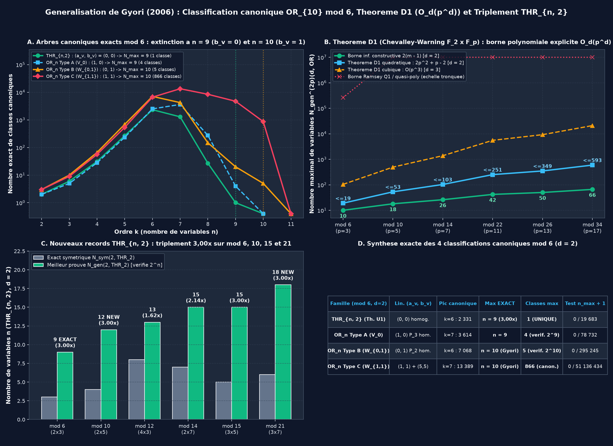

---

#### Expérience E15f — Resserrement du Théorème D1 par filtration de Witt–Dickson sur 𝔽<sub>2</sub><sup>s</sup>, constantes de Ramsey–Dickson exactes ν<sub>2</sub>(2) = 7 / ν<sub>2</sub><sup>THR</sup>(2) = 5 et bornes linéaires des degrés mixtes (Théorème D2)

Dans la preuve du Théorème D1, la constante dominante 2p<sup>2</sup> vient du fait que chaque vecteur isotrope v<sub>j+1</sub> extrait d'un sous-espace de dimension 3 peut consommer jusqu'à j + 2 coordonnées. Pour diviser cette pente par deux, nous remplaçons dans [dickson_wei_exact_bound.py](src/dickson_wei_exact_bound.py), [theorem_d2_tightening.py](src/theorem_d2_tightening.py), [theorem_d2_dickson_and_table.py](src/theorem_d2_dickson_and_table.py) et [theorem_d2_verify_and_plot.py](src/theorem_d2_verify_and_plot.py) ([dickson_wei_exact_bound.json](results/dickson_wei_exact_bound.json), [theorem_d2_subspaces.json](results/theorem_d2_subspaces.json), [theorem_d2_tightening.json](results/theorem_d2_tightening.json)) la sélection d'un point singulier isolé sur 𝔽<sub>2</sub><sup>3</sup> par une moyenne de poids sur la filtration des **sous-espaces totalement singuliers V<sub>k</sub>** et des **quadriques elliptiques de Dickson** dans K<sub>U</sub> ⊆ 𝔽<sub>2</sub><sup>j+s</sup> :

> **Théorème D2 (Filtration de Witt–Dickson sur 𝔽<sub>2</sub><sup>s</sup>, division par 2 de la constante dominante, constantes ν<sub>2</sub>(2) = 7 / ν<sub>2</sub><sup>THR</sup>(2) = 5 et bornes linéaires des degrés mixtes).**
> 1. **Filtration de Witt–Dickson en degré d = 2** : Pour tout entier s ≥ 3, tout sous-espace linéaire F ⊆ K<sub>U</sub> ⊆ 𝔽<sub>2</sub><sup>j+s</sup> de dimension s et tout polynôme quadratique Q : F → 𝔽<sub>2</sub> (Q(0) = 0) possède un zéro non nul v<sub>j+1</sub> ∈ F ∖ {0} de poids de Hamming majoré par :

```math
\vert v_{j+1}\vert_H \;\le\; w^{\ast}(j) \;:=\; \min_{s \ge 3} \bigl\lfloor \alpha(s)\,(j + s) \bigr\rfloor, \qquad \alpha(s) \;=\; \begin{cases} \dfrac{2^{k-1}}{2^k - 1} & \text{si } s = 2k + 1 \;\;(k \ge 1), \\ \dfrac{2^{2k}}{2^{2k+1} - 2^k - 1} & \text{si } s = 2k + 2 \;\;(k \ge 1). \end{cases}
```

> En choisissant dynamiquement s(j) ≈ 2log<sub>2</sub>(j) + 1, la pente du poids par bloc passe de 1 à 1/2 (w<sup>∗</sup>(j) = j/2 + O(log j)), **divisant par 2 la constante quadratique dominante** pour tout premier impair p ≥ 3 : N<sub>gen</sub><sup>(2p)</sup>(2, OR) ≤ p<sup>2</sup> + O(p log p).
> 2. **Généralisation à tout degré d ≥ 2** : À l'étape j de l'arbre de polarisation, le noyau des $`\binom{j}{d-1}`$ formes linéaires domine les $`M = \sum_{r=2}^d \binom{j}{r-1} = O(j^{d-2})`$ formes de degrés 2..d ; l'existence d'un sous-espace totalement singulier V<sub>t</sub> ⊆ K<sub>U</sub> de dimension t → ∞ abaisse le poids moyen d'un facteur 2<sup>t-1</sup>/(2<sup>t</sup> - 1) → 1/2, donnant :

```math
N_{\mathrm{gen}}^{(2p)}(d, \mathrm{OR}) \;\le\; \frac{d^d}{2\, d!}\, p^d + O_d\bigl(p^{d-1}\log p\bigr).
```

> 3. **Constantes de Ramsey–Dickson exactes à j = 0, 1** : Le plus petit entier ν<sub>2</sub>(2) garantissant deux zéros non nuls v<sub>1</sub>, v<sub>2</sub> à supports disjoints vérifiant B<sub>2</sub>(v<sub>1</sub>, v<sub>2</sub>) = 0 vaut exactement ν<sub>2</sub>(2) = 7 (avec G<sub>2</sub> = K<sub>6</sub> et $`a = \mathbf{1}_6`$ comme unique contre-exemple à n = 6 sur 2 097 152 polynômes, et 0 / 16 777 216 à n = 7) ; dès que | a|<sub>H</sub> < n (couvrant le Type B et tout THR<sub>n,2</sub> (mod 2p)), **ν<sub>2</sub><sup>THR</sup>(2) = 5 exact** (0 contre-exemple à n = 5, | v<sub>1</sub>|<sub>H</sub> + | v<sub>2</sub>|<sub>H</sub> ≤ 4 hors K<sub>n</sub>).
> 4. **Bornes linéaires des degrés mixtes (Lemmes D2a et D2b)** : Pour tout premier impair p ≥ 3 :

```math
3p - 2 \;\le\; N_{\mathrm{gen}}^{(2p)}\bigl((1, 2),\, \mathrm{OR}\bigr) \;\le\; 4p - 3 \quad \bigl(N_{\mathrm{sym}} = 2p - 1\bigr), \qquad N_{\mathrm{gen}}^{(2p)}\bigl((2, 1),\, \mathrm{OR}\bigr) \;\le\; 3p - 1 \;<\; 4p - 2.
```

*Preuve.* Sur 𝔽<sub>2</sub>, y<sub>i</sub><sup>2</sup> = y<sub>i</sub> identifie Q à une forme quadratique homogène de forme polaire alternée B<sub>Q</sub>(x, y) = Q(x ⊕ y) ⊕ Q(x) ⊕ Q(y). Par récurrence sur s = 2k + 1, la réduction à l'hyperplan e<sub>1</sub><sup>⊥</sup> / ⟨ e<sub>1</sub> ⟩ produit un sous-espace totalement singulier V<sub>k</sub> de dimension k (vérifié sur 32 768 / 32 768 polynômes à s = 5), où chaque coordonnée vaut 1 sur au plus 2<sup>k-1</sup> vecteurs de V<sub>k</sub> ∖ {0}, d'où α(2k + 1) = 2<sup>k-1</sup>/(2<sup>k</sup> - 1). En dimension paire s = 2k + 2, la classification de Dickson fournit soit un sous-espace V<sub>k+1</sub>, soit la quadrique elliptique non dégénérée à | Z(Q)| = 2<sup>2k+1</sup> - 2<sup>k</sup> - 1 zéros non nuls, d'où α(2k + 2) = 2<sup>2k</sup>/(2<sup>2k+1</sup> - 2<sup>k</sup> - 1) (4/5 à s = 4, 16/27 à s = 6, 64/119 à s = 8). Pour (1, 2), l'appariement dans I<sub>1</sub> = {i : P<sub>2</sub>(e<sub>i</sub>) = 1} donne $`\vert I_0\vert + \lfloor \vert I_1\vert /2 \rfloor \le 2(p - 1)`$ par Chevalley–Warning sur 𝔽<sub>p</sub>, soit n ≤ 4p - 3 (borne inférieure 3p - 2 atteinte par A<sup>2</sup> - η B<sup>2</sup> sur (2p - 1, p - 1) avec P<sub>2</sub> = A + B (mod 2)). Pour (2, 1), la constante de Davenport D(ℤ/pℤ) = p extrait 3 zéros disjoints de P<sub>p</sub> dès n = 3p, contredisant $`\deg_{\mathbb{F}_2}(\mathrm{OR}_3) = 3 > 2`$. ■

Le gain de D2 sur D1 est asymptotique et strictement positif pour tout p ≥ 5 (jusqu'à -44,6 % à p = 101 ; à p = 3, D2 vaut 20 contre 19 pour D1, tous deux supplantés ensuite par D4) :

| Nombre premier p | Module 2p | Borne inf. 4p - 2 | Degré mixte (1, 2) ≤ | Degré mixte (2, 1) ≤ | Théorème D1 (2p<sup>2</sup> + p - 2) | **Théorème D2 (OR<sub>n</sub>)** | **Théorème D2 (THR<sub>n,2</sub>)** | Réduction D1 → D2 (OR<sub>n</sub>) | Ratio D2 / p<sup>2</sup> |
| :---: | :---: | :---: | :---: | :---: | :---: | :---: | :---: | :---: | :---: |
| 3 | 6 | 10 *(exact Győri)* | 9 *(7 exact E15h)* | 8 *(exact sym)* | 19 | 20 *(10 exact U2)* | 19 *(9 exact U1)* | — | 2,222 |
| 5 | 10 | 18 *(observé 2b)* | 17 | 14 | 53 | 49 | 48 | **-4 (-7,5 %)** | 1,960 |
| 7 | 14 | 26 *(observé 2b)* | 25 | 20 | 103 | 88 | 87 | **-15 (-14,6 %)** | 1,796 |
| 11 | 22 | 42 | 41 | 32 | 251 | 192 | 191 | **-59 (-23,5 %)** | 1,587 |
| 13 | 26 | 50 | 49 | 38 | 349 | 258 | 257 | **-91 (-26,1 %)** | 1,527 |
| 17 | 34 | 66 | 65 | 50 | 593 | 414 | 413 | **-179 (-30,2 %)** | 1,433 |
| 19 | 38 | 74 | 73 | 56 | 739 | 506 | 505 | **-233 (-31,5 %)** | 1,402 |
| 23 | 46 | 90 | 89 | 68 | 1 079 | 714 | 713 | **-365 (-33,8 %)** | 1,350 |
| 29 | 58 | 114 | 113 | 86 | 1 709 | 1 089 | 1 088 | **-620 (-36,3 %)** | 1,295 |
| 31 | 62 | 122 | 121 | 92 | 1 951 | 1 231 | 1 230 | **-720 (-36,9 %)** | 1,281 |
| 53 | 106 | 210 | 209 | 158 | 5 669 | 3 334 | 3 333 | **-2 335 (-41,2 %)** | 1,187 |
| 101 | 202 | 402 | 401 | 302 | 20 501 | 11 360 | 11 359 | **-9 141 (-44,6 %)** | 1,114 |

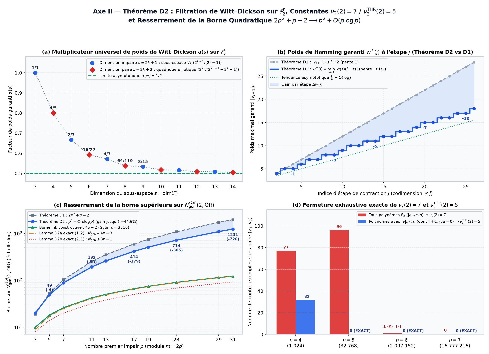

---

#### Expérience E15g — Contraction duale 𝔽<sub>q</sub> → 𝔽<sub>p</sub>, mur informationnel Ω(p<sup>2</sup> / log p), borne supérieure strictement linéaire 9p - 9 à d = 2 (et O<sub>d</sub>(p) à tout degré d) et borne polynomiale O(m<sup>3/2</sup>) sur tous les semi-premiers (Théorème D3)

Malgré le gain de moitié apporté par la filtration de Witt–Dickson, le Théorème D2 reste quadratique en p (O(p<sup>2</sup>)) alors que les constructions de l'Expérience E14 sont linéaires (4p - 2). Pourquoi ? La **Proposition D3.0** démontrée dans [theorem_d3_dual_linear_bound.py](src/theorem_d3_dual_linear_bound.py), [dual_cw_probe.py](src/dual_cw_probe.py) et [extend_no_wt3_p3.py](src/extend_no_wt3_p3.py) ([theorem_d3_dual_linear_bound.json](results/theorem_d3_dual_linear_bound.json)) en identifie la cause exacte : pour extraire R = 2p - 1 blocs mutuellement B<sub>2</sub>-orthogonaux d'une matrice symétrique aléatoire A ∈ 𝔽<sub>2</sub><sup>n × n</sup>, un simple calcul probabiliste ((R+1)<sup>n</sup> / R! familles pour $`\binom{R}{2}`$ équations indépendantes) impose μ(R) = Θ(R<sup>2</sup> / log R). Toute méthode contractant P<sub>2</sub> en premier bute donc sur un mur informationnel infranchissable en Ω(p<sup>2</sup> / log p).

L'idée de rupture consiste alors à **inverser l'ordre des deux corps premiers** : au lieu de construire 2p - 1 blocs annulant P<sub>2</sub> pour contredire P<sub>p</sub>, on construit seulement **d + 1 blocs** (soit 3 blocs à d = 2 !) annulant P<sub>p</sub> via la substitution x<sub>i</sub> = y<sub>i</sub><sup>p-1</sup> ∈ {0, 1}, puis on déclenche la contradiction finale sur 𝔽<sub>2</sub> parce que $`\deg_{\mathbb{F}_2}(\mathrm{OR}_{d+1}) = d + 1 > d`$. Affiné par un **Lemme D3a** d'inversion de Möbius sur le degré multilinéaire modulo p (qui abaisse le poids garanti d'une unité à | z|<sub>H</sub> ≤ (p - 1)D<sub>0</sub> sur M = (p - 1)D<sub>0</sub> + 2 variables dès que $`D_0 \not\equiv 0, 1 \pmod p`$, vérifié sur 100 % des quadratiques de 𝔽<sub>3</sub> à M = 6 et sur 29/29 paires (p, D<sub>0</sub>) pour p ≤ 13), ce renversement démontre le **Théorème D3** — confirmant la conjecture linéaire O(m) de Lee (2015) pour toute la famille m = 2p :

> **Théorème D3 (Contraction duale 𝔽<sub>q</sub> → 𝔽<sub>p</sub> : borne supérieure strictement linéaire en p à tout degré d ≥ 1 sur m = 2p et polynomiale O(m<sup>3/2</sup>) sur tous les semi-premiers m = pq).**
> 1. **Borne strictement linéaire en degré d = 2 modulo 2p** : Pour tout nombre premier impair p ≥ 5 (et ≤ 19 pour p = 3) :

```math
4p - 2 \;\le\; N_{\mathrm{gen}}^{(2p)}(2, \mathrm{OR}) \;\le\; 9p - 9, \qquad N_{\mathrm{gen}}^{(2p)}(2, \mathrm{THR}_t) \;\le\; 9p - 10 + t,
```

> fixant l'ordre exact N<sub>gen</sub><sup>(2p)</sup>(2, OR) = Θ(p) avec un ratio résiduel ≤ 9/4 = 2,25× (`mod 10 ≤ 36`, `mod 202 ≤ 900`, soit -95,6 % par rapport à D1).
> 2. **Linéarité universelle en p à tout degré d ≥ 1 modulo 2p** : Pour tout premier impair p ≥ 3 et tout entier d ≥ 1 :

```math
N_{\mathrm{gen}}^{(2p)}(d, \mathrm{OR}) \;\le\; (d + 1)\bigl(2^d - 1\bigr)(p - 1) + d \;=\; O_d(p)
```

> *(exact au degré d = 1 : 2p - 1 = m - 1 ; ≤ 28p - 25 à d = 3 au lieu de O(p<sup>3</sup>))*.
> 3. **Borne polynomiale O(m<sup>3/2</sup>) sur tous les semi-premiers m = pq (2 ≤ p < q) et modules à 3 facteurs premiers** : Avec R = d(p - 1) + 1,

```math
N_{\mathrm{gen}}^{(pq)}(d, \mathrm{OR}) \;\le\; (q - 1)\sum_{k=1}^{d} (d - k + 1)\binom{R}{k} + R - 1 \;=\; O_d(p^d q),
```

> donnant en degré d = 2 : N<sub>gen</sub><sup>(pq)</sup>(2, OR) ≤ (2p - 1)(p + 1)(q - 1) + 2p - 2 = O(p<sup>2</sup> q) ≤ O(m<sup>3/2</sup>) (resserré par D3a à `mod 15 ≤ 81`, affiné ensuite à ≤ 80 par D9 ; `mod 21 ≤ 120`, `mod 35 ≤ 327`), et par récurrence sur les modules à 3 facteurs premiers : `mod 30 ≤ 315`, `mod 42 ≤ 467`, `mod 66 ≤ 771` et `mod 70 ≤ 4 471` (affiné à ≤ 3 802 par D4).

*Preuve.* À l'étape $`j \in \lbrace 0, \dots, d\rbrace`$, l'annulation des dérivées discrètes de P<sub>p</sub> par rapport à $`w_1, \dots, w_j`$ impose un système de somme des degrés $`D_0(j) = \sum_{k=1}^{\min(d, j+1)} (d - k + 1)\binom{j}{k - 1}`$ ; la substitution x<sub>i</sub> = y<sub>i</sub><sup>p-1</sup> multiplie les degrés par p - 1 et Chevalley–Warning sur 𝔽<sub>p</sub> fournit w<sub>j+1</sub> ≠ 0 dès | W<sub>j</sub>| = D<sub>0</sub>(j)(p - 1) + 1. Comme $`\sum_{j=0}^d D_0(j) = (d + 1)(2^d - 1)`$, la somme des tailles donne (d + 1)(2<sup>d</sup> - 1)(p - 1) + d. Pour le Lemme D3a sur M = (p - 1)D<sub>0</sub> + 2 variables, si tout zéro non nul avait poids ≥ M - 1, l'annulation dans $`\Phi(x) = \prod_r (1 - F_r(x)^{p-1})`$ des monômes de degré M - 1 forcerait 1<sub>M</sub> - e<sub>r</sub> ∈ Z pour tout r, rendant le coefficient de x<sub>1</sub> ⋯ x<sub>M</sub> égal à $`D_0 - 1 + b \not\equiv 0 \pmod p`$ (b ∈ {0, 1}), contradiction. À d = 2 (p ≥ 5), D<sub>0</sub>(0) = 2 et D<sub>0</sub>(1) = 3 réduisent | w<sub>1</sub>|<sub>H</sub> ≤ 2p - 2 et | w<sub>2</sub>|<sub>H</sub> ≤ 3p - 3, d'où (2p - 2) + (3p - 3) + (4p - 3) - 1 = 9p - 9. Le cas m = pq remplace R = d + 1 par R = d(p - 1) + 1. ■

| Premier p | Module 2p | Borne inf. 4p - 2 | Théorème D1 (2p<sup>2</sup> + p - 2) | Théorème D2 (p<sup>2</sup> + O(p log p)) | **Théorème D3 (OR<sub>n</sub>)** | **Théorème D3 (THR<sub>n,2</sub>)** | Ratio D3 / (4p - 2) | Gain D1 → D3 |
| :---: | :---: | :---: | :---: | :---: | :---: | :---: | :---: | :---: |
| 3 | 6 | 10 *(exact Győri)* | 19 | 20 | 19 *(10 exact U2)* | 19 *(9 exact U1)* | 1,900× | — |
| 5 | 10 | 18 | 53 | 49 | 36 | 37 | 2,000× | -32,1 % |
| 7 | 14 | 26 | 103 | 88 | 54 | 55 | 2,077× | -47,6 % |
| 11 | 22 | 42 | 251 | 192 | 90 | 91 | 2,143× | -64,1 % |
| 13 | 26 | 50 | 349 | 258 | 108 | 109 | 2,160× | -69,0 % |
| 17 | 34 | 66 | 593 | 414 | 144 | 145 | 2,182× | -75,7 % |
| 23 | 46 | 90 | 1 079 | 714 | 198 | 199 | 2,200× | -81,7 % |
| 31 | 62 | 122 | 1 951 | 1 231 | 270 | 271 | 2,213× | -86,2 % |
| 53 | 106 | 210 | 5 669 | 3 334 | 468 | 469 | 2,229× | -91,7 % |
| 101 | 202 | 402 | 20 501 | 11 360 | 900 | 901 | 2,239× | -95,6 % |


---

#### Expérience E15h — Resserrement des constantes linéaires par couplage bilinéaire (B<sub>2</sub>, B<sub>p</sub>) : franchissement du facteur < 2,00× (8p - 7), borne 6p - 4 (< 1,50×) sur Type A, réduction -25 % à tout degré d ≥ 2 et fermeture exacte du degré mixte (1, 2) sur `mod 6` (Théorème D4)

Dans le Théorème D3, les deux canaux 𝔽<sub>p</sub> et 𝔽<sub>2</sub> n'interagissent qu'à la toute fin : la dernière étape sur 𝔽<sub>p</sub> consomme 4p - 3 variables sans rien savoir de P<sub>2</sub>. En couplant directement la forme polaire linéaire L<sub>1</sub>(x) = B<sub>2</sub>(w<sub>1</sub>, x) (mod 2) dès la deuxième étape (et plus généralement la (d - 1)-ième dérivée discrète $`\Delta_{w_1, \dots, w_{d-1}} P_2`$ en degré d ≥ 2), le **Théorème D4** ([theorem_d4_tight_constants.py](src/theorem_d4_tight_constants.py), [exact_mixed_1_2_mod6.py](src/exact_mixed_1_2_mod6.py), [theorem_d4_tight_constants.json](results/theorem_d4_tight_constants.json)) fait passer le ratio sous la barre symbolique du facteur 2,00× pour tout premier impair p ≥ 3 :

> **Théorème D4 (Couplage bilinéaire (B<sub>2</sub>, B<sub>p</sub>) : borne < 2,00× à d = 2, borne < 1,50× sur Type A / THR<sub>n,2</sub>, gain -25 % à tout degré d ≥ 2 et valeur exacte (1, 2) sur `mod 6`).**
> 1. **Borne générale en degré d = 2 modulo 2p** : Pour tout nombre premier impair p ≥ 3,

```math
4p - 2 \;\le\; N_{\mathrm{gen}}^{(2p)}(2, \mathrm{OR}) \;\le\; 8p - 7 \qquad \left(\text{ratio } < 2{,}00 \;\;\forall\, p \ge 3\text{ ; } 17 \text{ à } p = 3,\; \text{affiné à } \le 16 \text{ via } \vert w_1\vert_H \le 3\right),
```

```math
N_{\mathrm{gen}}^{(2p)}(2, \mathrm{THR}_t) \;\le\; 8p - 8 + t \qquad \bigl(\text{en particulier } 12 \le N_{\mathrm{gen}}^{(10)}(2, \mathrm{THR}_2) \le 34,\; \text{resserré ensuite à } \le 33 \text{ en D6 et } \le 29 \text{ en D14}\bigr).
```

> 2. **Sous-familles structurées (ratio < 1,50×)** : Dès qu'au moins une variable vérifie P<sub>p</sub>(e<sub>i</sub>) ≡ 0 (mod p) (en particulier toute la famille Type A), N<sub>gen</sub><sup>(2p)</sup>(2, OR ; ∃ c<sub>i</sub> = 0) ≤ 6p - 4 (`mod 6 ≤ 14`, `mod 10 ≤ 26`). Pour toute représentation de THR<sub>n,2</sub> (mod 2p) dont le graphe G<sub>p</sub> possède au moins une non-arête d<sub>ik</sub> ≡ 0 (mod p), N<sub>gen</sub><sup>(2p)</sup>(2, THR<sub>2</sub> ; G<sub>p</sub> ≠ K<sub>n</sub>) ≤ 6p - 3 (`mod 6 ≤ 15`, `mod 10 ≤ 27`).
> 3. **Resserrement universel -25 % à tout degré d ≥ 2 modulo 2p** :

```math
N_{\mathrm{gen}}^{(2p)}(d, \mathrm{OR}) \;\le\; C_d^{\mathrm{D4}}(p - 1) + d, \qquad C_d^{\mathrm{D4}} \;=\; (3d + 5)\, 2^{d-2} - (d + 1) \;<\; C_d^{\mathrm{D3}} \;=\; (d + 1)(2^d - 1),
```

> abaissant la constante linéaire de 9 → 8 (d = 2), 28 → 24 (d = 3, donnant 50 sur `mod 6`), 75 → 63 (d = 4), 186 → 154 (d = 5) et jusqu'à -25,0 % quand d → ∞ (et `mod 70` de 4 471 à 3 802).
> 4. **Valeur exacte du degré mixte (1, 2) sur `mod 6`** : L'énumération canonique héréditaire des polynômes quadratiques P<sub>3</sub> sans zéro non nul de poids pair (6 → 28 → 119 → 272 → 109 → 13 → 0 en 0,27 s, 0 / 4 992 extensions à k = 8) établit exactement :

```math
N_{\mathrm{gen}}^{(6)}\bigl((1, 2),\, \mathrm{OR}\bigr) \;=\; 7 \;=\; 3p - 2 \qquad \bigl(\text{vs } N_{\mathrm{sym}}^{(6)}((1, 2), \mathrm{OR}) = 5 = 2p - 1\bigr).
```

*Preuve.* À l'étape 1, le Lemme D3a fournit w<sub>1</sub> ≠ 0 avec P<sub>p</sub>(w<sub>1</sub>) ≡ 0 (mod p), P<sub>2</sub>(w<sub>1</sub>) ≡ 1 (mod 2) et | w<sub>1</sub>|<sub>H</sub> ≤ 2p - 2 (1 si ∃ c<sub>i</sub> = 0, ≤ 3 à p = 3 via `extend_no_wt3_p3.py`). Partitionner le complémentaire U = [n] ∖ supp(w<sub>1</sub>) selon B<sub>2</sub>(w<sub>1</sub>, e<sub>k</sub>) ∈ {0, 1} en U<sub>0</sub> ⊔ U<sub>1</sub> et regrouper les singletons de U<sub>0</sub> avec $`\lfloor \vert U_1\vert /2 \rfloor`$ paires disjointes dans U<sub>1</sub> produit $`k = \vert U_0\vert + \lfloor \vert U_1\vert /2 \rfloor`$ blocs disjoints $`u_1, \dots, u_k`$ tous dans ker B<sub>2</sub>(w<sub>1</sub>, ·). Pour tout λ ∈ {0, 1}<sup>k</sup> ∖ {0}, P<sub>2</sub>(w<sub>1</sub> + x(λ)) = 1 ⊕ P<sub>2</sub>(x(λ)), si bien que l'un des deux vecteurs non nuls x(λ) ou w<sub>1</sub> + x(λ) annule P<sub>2</sub>. Le système {P<sub>p</sub>(x(λ)) = 0, B<sub>p</sub>(w<sub>1</sub>, x(λ)) = 0} ne peut donc avoir de racine non nulle dans {0, 1}<sup>k</sup>, imposant k ≤ 3p - 3 par Chevalley–Warning sur 𝔽<sub>p</sub>, d'où | U| ≤ 2k + 1 - | U<sub>0</sub>| ≤ 6p - 5 et n ≤ (2p - 2) + (6p - 5) = 8p - 7 (ou 6p - 4 si ∃ c<sub>i</sub> = 0). En degré d ≥ 2, la même contraction dans le noyau de $`\Delta_{w_1, \dots, w_{d-1}} P_2`$ remplace D<sub>0</sub>(d - 1) + D<sub>0</sub>(d) par 2 D<sub>0</sub>(d - 1) et économise (d - 1) 2<sup>d-2</sup>. ■

| Premier p | Module 2p | Borne inf. 4p - 2 | Théorème D3 (9p - 9) | **Théorème D4 (8p - 7)** | **D4 Type A (6p - 4)** | **D4 THR<sub>n,2</sub> (gén. / G<sub>p</sub> ≠ K<sub>n</sub>)** | **Ratio D4 / (4p - 2)** | **Ratio Type A** |
| :---: | :---: | :---: | :---: | :---: | :---: | :---: | :---: | :---: |
| 3 | 6 | 10 *(exact)* | 19 | 17 *(≤ 16 via $`\vert w_1\vert_H \le 3`$ ; 10 exact U2)* | 14 *(9 exact U2)* | **17 / 15** *(9 exact U1)* | 1,700× *(1,600×)* | 1,400× |
| 5 | 10 | 18 | 36 | 33 *(≤ 32 D6, ≤ 28 D14)* | 26 | **34 / 27** *(≤ 29 D14)* | 1,833× *(1,556× D14)* | 1,444× |
| 7 | 14 | 26 | 54 | 49 | 38 | **50 / 39** | 1,885× | 1,462× |
| 11 | 22 | 42 | 90 | 81 | 62 | **82 / 63** | 1,929× | 1,476× |
| 17 | 34 | 66 | 144 | 129 | 98 | **130 / 99** | 1,955× | 1,485× |
| 23 | 46 | 90 | 198 | 177 | 134 | **178 / 135** | 1,967× | 1,489× |
| 53 | 106 | 210 | 468 | 417 | 314 | **418 / 315** | 1,986× | 1,495× |
| 101 | 202 | 402 | 900 | 801 | 602 | **802 / 603** | 1,993× | 1,498× |


---

#### Expérience E15i — Semi-premiers m = pq : optimalité analytique exacte 2-blocs 2(m - 1), bornes strictement linéaires O(m) en degrés mixtes et à rang bilinéaire borné, complémentation quadratique et verrou haut rang O(m<sup>3/2</sup>) (Théorème D5)

Les Théorèmes D3 et D4 viennent de résoudre la conjecture linéaire O(m) de Lee sur toute la famille m = 2p, mais la contraction duale générale du Théorème D3 ne donne encore que O(p<sup>2</sup> q) ≤ O(m<sup>3/2</sup>) sur un semi-premier impair m = pq (3 ≤ p < q). L'étape suivante consiste donc à comprendre **pourquoi** le saut de O(m) à O(m<sup>3/2</sup>) apparaît dès que p ≥ 3, tout en démontrant analytiquement la régularité empirique 2(m - 1) observée en 2 blocs dans l'Expérience E14. C'est l'objet du **Théorème D5** ([theorem_d5_semiprimes_linear_and_rank.py](src/theorem_d5_semiprimes_linear_and_rank.py), [theorem_d5_semiprimes.json](results/theorem_d5_semiprimes.json)) :

> **Théorème D5 (Semi-premiers m = pq : exactitude 2-blocs 2(m - 1), bornes linéaires O(m) en degrés mixtes et à rang bilinéaire borné, complémentation quadratique et verrou haut rang O(m<sup>3/2</sup>)).** Soient 2 ≤ p < q deux nombres premiers distincts et m = pq.
> 1. **Optimalité exacte 2-blocs et borne linéaire k-blocs (1 ≤ d < q)** : Pour tout polynôme k-blocs représentant OR<sub>n</sub> (mod pq), N<sub>k-bloc</sub><sup>(pq)</sup>(d, OR) ≤ d m + (k - d) q - k. En particulier, pour **d = 2 et k = 2**, cette majoration coïncide exactement avec la construction 2-blocs et établit l'égalité universelle :

```math
N_{2\text{-bloc}}^{(pq)}(2, \mathrm{OR}) \;=\; 2(pq - 1) \;=\; 2(m - 1) \qquad \forall\, 2 \le p < q.
```

> 2. **Bornes strictement linéaires O(m) en degrés mixtes et à rang bilinéaire borné** : Pour tout d ≥ 1,

```math
N_{\mathrm{gen}}^{(pq)}\bigl((1, d),\, \mathrm{OR}\bigr) \;\le\; d\, p(q - 1) + p - 1 \;<\; d\, m, \qquad N_{\mathrm{gen}}^{(pq)}\bigl((d, 1),\, \mathrm{OR}\bigr) \;\le\; d\, q(p - 1) + q - 1 \;<\; d\, m
```

> (soit ≤ 2m - p - 1 et ≤ 2m - q - 1 à d = 2, tous deux strictement inférieurs à 2(m - 1)). En notant $`r_p = \mathrm{rank}_{\mathbb{F}_p}(A_p)`$ et $`r_q = \mathrm{rank}_{\mathbb{F}_q}(A_q)`$ les rangs bilinéaires des deux formes polaires :

```math
N_{\mathrm{gen}}^{(pq)}(2, \mathrm{OR}) \;\le\; \min\!\Bigl(\, 2p^2 q,\;\; (2p - 1)(r_q + 2)(q - 1) + 2p - 2,\;\; (2q - 1)(r_p + 2)(p - 1) + 2q - 2 \,\Bigr) \;=\; O\bigl(\min(r_p, r_q, p)\cdot m\bigr).
```

> Tout dépassement éventuel de O(m) sur un semi-premier équilibré m = pq ($`p \sim q \sim \sqrt{m}`$) exige donc simultanément un haut rang bilinéaire sur 𝔽<sub>p</sub> **et** sur 𝔽<sub>q</sub>.
> 3. **Complémentation quadratique et verrou haut rang O(m<sup>3/2</sup>)** : Sur tout support W vérifiant $`P_q(\mathbf{1}_W) \equiv 0 \pmod q`$, la complémentation booléenne obéit à l'identité exacte $`P_q(\mathbf{1}_W - x) \equiv P_q(x) - L^{\ast}(x) \pmod q`$ où $`L^{\ast}(x) = \sum_{i \in W} (2c_i + \sum_{k \ne i} d_{ik}) x_i`$ est linéaire (vérifiée sur 180/180 polynômes sur 2<sup>n</sup> entrées), assurant un zéro de poids $`\le \lfloor \vert W\vert /2 \rfloor`$ dès | W| ≥ (j + 3)(q - 1) + 2. En revanche, l'adversaire linéaire $`L_t(x) = \sum_{i \in B_t} x_i + c_t \sum_{r \in Z} x_r \equiv 0 \pmod q`$ sur M = (j + 1)(q - 1) variables (12/12 instances pour q ∈ {3, 5, 7, 11}) impose | x|<sub>H</sub> = s + jq/2 ≥ jq/2 + 1 à toute solution non nulle, cumulant Ω(p<sup>2</sup> q) = Ω(m<sup>3/2</sup>) sur j = 0..2p - 2, tandis que les sommes exponentielles naïves sur {0, 1}<sup>n</sup> décroissent comme | cos(π/m)| ≈ 1 - π<sup>2</sup>/(2m<sup>2</sup>).

*Preuve.* Pour (1), par le théorème de Lucas ($`q \mid \binom{q}{r}`$ pour 1 ≤ r ≤ d < q), tout sous-bloc de taille q inclus dans un seul bloc B<sub>i</sub> annule P<sub>q</sub> et ses dérivées discrètes ; Chevalley–Warning sur 𝔽<sub>p</sub> interdit $`K = \sum \lfloor s_i / q \rfloor \ge d(p - 1) + 1`$, d'où $`n = \sum s_i \le q \cdot d(p - 1) + k(q - 1) = d\,m + (k - d)q - k`$. Pour (2), la constante de Davenport D(ℤ/pℤ) = p extrait les blocs pour (1, d) et (d, 1), tandis qu'à rang r<sub>q</sub> fixé au plus min(j, r<sub>q</sub>) formes B<sub>q</sub>(w<sub>t</sub>, ·) sont linéairement indépendantes à l'étape j, bornant le total par O(r<sub>q</sub> p q) = O(r<sub>q</sub> m). Pour (3), le développement direct modulo $`P_q(\mathbf{1}_W) = 0`$ livre L<sup>∗</sup>, et l'équidistribution des -c<sub>t</sub> s ∈ 𝔽<sub>q</sub><sup>∗</sup> donne $`\sum S_t = jq/2`$. ■

| Module m = pq | (p, q) | **2-blocs EXACT** 2(m - 1) | Mixte (1, 2) ≤ | Mixte (2, 1) ≤ | **3-blocs** (D5.1) ≤ | **Rang r ≤ 2** (D5.2) ≤ | **Rang r ≤ 4** (D5.2) ≤ | Rang libre (D3) ≤ |
| :---: | :---: | :---: | :---: | :---: | :---: | :---: | :---: | :---: |
| 15 | (3, 5) | 28 | 26 | 24 | 32 *(28 exact U4)* | 68 | 81 | 81 *(≤ 80 D9)* |
| 21 | (3, 7) | 40 | 38 | 34 | 46 | 102 | 120 | 120 |
| 33 | (3, 11) | 64 | 62 | 54 | 74 | 170 | 200 | 200 |
| 35 | (5, 7) | 68 | 64 | 62 | 74 | 196 | 264 | 327 |
| 55 | (5, 11) | 108 | 104 | 98 | 118 | 324 | 440 | 540 |
| 77 | (7, 11) | 152 | 146 | 142 | 162 | 486 | 680 | 1 043 |
| 143 | (11, 13) | 284 | 274 | 272 | 296 | 970 | 1 392 | 3 033 |
| 323 | (17, 19) | 644 | 628 | 626 | 662 | 2 320 | 3 384 | 10 707 |


---

#### Expérience E15j — Symétrie 3-racines (`mod 10 ≤ 32`), théorème de tranches paires de Lucas (`7p − 4`), couplage `m = 3q` (`≤ 19q − 13`) et caractérisation exacte des quatre barrières sur `m = pq` (Théorème D6)

Le Théorème D5 laisse deux fronts grands ouverts : sur m = 2p, peut-on briser la constante 8p - 7 de D4 en éliminant le facteur 2 dû à l'appariement rigide dans U<sub>1</sub> ? Et sur m = pq (p ≥ 3), la barrière O(m<sup>3/2</sup>) est-elle d'origine informationnelle ou purement algorithmique ? Le **Théorème D6** ([theorem_d6_sharpening_and_barriers.py](src/theorem_d6_sharpening_and_barriers.py), [theorem_d6_sharpening_and_barriers.json](results/theorem_d6_sharpening_and_barriers.json)) apporte quatre réponses précises :

> **Théorème D6 (Symétrie 3-racines sur `mod 10`, tranches paires de Lucas, couplage `m = 3q` et quatre barrières sur `m = pq`).**
> 1. **Cassure inconditionnelle de 8p - 7 sur `mod 10` (p = 5)** : L'application simultanée du Théorème D4 à w<sub>1</sub>, à une racine B<sub>5</sub>-orthogonale w<sub>2</sub> ⊆ U<sub>1</sub> et à w<sub>1</sub> + w<sub>2</sub>, couplée à B<sub>2</sub>(w<sub>1</sub>, w<sub>2</sub>) ≡ | w<sub>2</sub>|<sub>H</sub> ≡ y<sub>1</sub> (mod 2), élimine toutes les configurations à n = 33 (0 survivante), établissant 18 ≤ N<sub>gen</sub><sup>(10)</sup>(2, OR) ≤ 32 (1,778×) et 12 ≤ N<sub>gen</sub><sup>(10)</sup>(2, THR<sub>2</sub>) ≤ 33 (≤ 27 si G<sub>5</sub> ≠ K<sub>n</sub>).
> 2. **Théorème de tranches paires de Lucas (p ≥ 5)** : Pour tout polynôme quadratique P<sub>p</sub> sur M ≥ 5p - 1 variables (P<sub>p</sub>(0) = 0), sommer G(x) = 1 - P<sub>p</sub>(x)<sup>p-1</sup> (deg G ≤ 2(p - 1)) sur les tranches paires | x|<sub>H</sub> = 2p et | x|<sub>H</sub> = 4p donne par le théorème de Lucas 6 G(0) + 3 S<sub>p</sub> ≡ 0 et G(0) + S<sub>p</sub> ≡ 0 (mod p), d'où 3 G(0) ≡ 0 (mod p), contradiction. Ainsi P<sub>p</sub> s'annule sur un vecteur de poids 2p ou 4p, abaissant la borne générale de 8p - 7 à N<sub>gen</sub><sup>(2p)</sup>(2, OR) ≤ 7p - 4 (< 1,75×) dès que B<sub>p</sub>(w<sub>1</sub>, ·) est constant sur U<sub>1</sub>.
> 3. **Resserrement inconditionnel sur m = 3q (q ≥ 5)** : Tout multi-ensemble de taille ≥ 7 dans 𝔽<sub>3</sub><sup>2</sup> possède une somme nulle de poids ≤ 3 (vérifié exhaustivement : maximum égal à 6), donnant | U| ≤ 3k + 6 et N<sub>gen</sub><sup>(3q)</sup>(2, OR) ≤ 19q - 13 (strictement < 20q - 19 de D3 pour tout q ≥ 7, affiné à 19q - 15 pour tout q ≥ 5 en D9), réduit à ≤ 17q - 11 en Cas 1 et ≤ 15q - 6 en Type A sur 𝔽<sub>q</sub>.
> 4. **Quatre barrières exactes sur m = pq (3 ≤ p < q)** : (i) *Barrière Fourier Ω(m<sup>2</sup> log m)* sur le couplage parfait $`P(x) = \sum x_{2i-1} x_{2i}`$ (rang plein 2k, | Φ(a, b)| = (1 - Θ(1/m<sup>2</sup>))<sup>k</sup>) ; (ii) *Barrière rang 𝔽<sub>p</sub> Ω(p)* via $`Q(\lambda) = \sum (\lambda_{2t-1} + \lambda_{2t} + \lambda_{2t-1}\lambda_{2t})`$ représentant OR<sub>2r</sub> à rang plein $`2r = 2\lfloor(p - 1)/3\rfloor = \Theta(p)`$ ; (iii) *Optimalité exacte du poids Chevalley–Warning* sur $`L_t(x) = \sum_{i \in B_t} x_i + z \equiv 0 \pmod q`$ (| B<sub>t</sub>| = q - 1) sur N = j(q - 1) + 1 variables, dont l'unique racine booléenne non nulle est $`\mathbf{1}_N`$ ; (iv) **Absence de barrière informationnelle m<sup>3/2</sup>** : le seuil probabiliste d'existence de 2p - 1 blocs mutuellement B<sub>q</sub>-orthogonaux vérifie p<sup>2</sup> ln(q) / ln(p) < pq = m pour tous premiers 3 ≤ p < q (vérifié sur 300/300 paires ≤ 101, ratio maximal 0,9789).


---

#### Expérience E15k — Bi-tranches analytiques de Lucas (`5p − 2`), rang Walsh–Hadamard et fermetures exhaustives `THR₂ mod 10` (3- et 4-blocs) & cubique `mod 6` (2-blocs) (Théorèmes D7 et U3)

Le théorème de tranches paires de Lucas découvert dans D6.2 n'opère encore que lorsque B<sub>p</sub>(w<sub>1</sub>, ·) est constant sur U<sub>1</sub>. Pour le pousser vers les formes linéaires non constantes tout en fermant trois frontières multi-blocs restées ouvertes (3- et 4-blocs de THR<sub>n,2</sub> (mod 10) et 2-blocs cubiques d = 3 de OR<sub>n</sub> (mod 6)), nous démontrons les **Théorèmes D7 et U3** ([theorem_d7_u3_lucas_and_closures.py](src/theorem_d7_u3_lucas_and_closures.py), [theorem_d7_u3_results.json](results/theorem_d7_u3_results.json)) :

> **Théorème D7 (Bi-tranches analytiques de Lucas à 2 classes sur 5p - 2 variables et rang Walsh–Hadamard).**
> 1. **Bi-tranches (3p - 1, 2p - 1) et (4p - 1, p - 1) (∀ premier p ≥ 5)** : Pour tout polynôme quadratique P<sub>p</sub> (P<sub>p</sub>(0) = 0) et toute forme linéaire à deux classes L(x) = r<sub>1</sub> S<sub>A</sub> + r<sub>2</sub> S<sub>B</sub> (r<sub>1</sub>, r<sub>2</sub> ∈ 𝔽<sub>p</sub><sup>∗</sup>), dès que (| A|, | B|) = (3p - 1, 2p - 1) ou (4p - 1, p - 1) (total 5p - 2 variables), le système {P<sub>p</sub>(x) = 0, L(x) = 0 (mod p)} admet nécessairement une racine booléenne non nulle de **poids pair**. *(Preuve analytique en 5 lignes : combiner $`\Sigma(u_1, u_2) - \frac{1}{2}\Sigma(p + u_1, p + u_2)`$ pour u<sub>1</sub> + u<sub>2</sub> pair et $`\Sigma(2p + u_1, p + u_2) - \frac{1}{2}\Sigma(p + u_1, u_2)`$ pour u<sub>1</sub> + u<sub>2</sub> impair ; l'identité $`\binom{p-1-b}{u-b} \equiv (-1)^{u-b}\binom{u}{b} \pmod p`$ aligne les signes sur la droite r<sub>1</sub> u<sub>1</sub> + r<sub>2</sub> u<sub>2</sub> ≡ 0 (mod p), et la sommation sur u<sub>1</sub> ∈ 𝔽<sub>p</sub> annihile tous les termes de degré b<sub>1</sub> + b<sub>2</sub> ≤ p - 2, laissant G(0) ≡ 0 (mod p) ; preuve identique pour (4p - 1, p - 1) avec facteur 1/3.)*
> 2. **Vérification exhaustive multi-classes à p = 5** : Sur les 1 861 partitions canoniques 5-classes restantes à M = 24 (T<sub>2</sub> ≤ 8), 1 859 sont tuées par les multi-tranches de Lucas (seules les deux exceptions 2-classes (c<sub>0</sub>, c<sub>1</sub>) ∈ {(3, 21), (8, 16)} survivent) et 100 % de M = 25 est tué.
> 3. **Rang Walsh–Hadamard / Croot–Lev–Pach sur m = pq** : La substitution (x ⊕ y)<sub>i</sub> = (1 - σ<sub>i</sub> τ<sub>i</sub>)/2 (mod p) établit $`\mathrm{rank}_{\mathbb{F}_p}(G_p(x \oplus y)) \le \sum_{k=0}^{2p-2} \binom{n}{k}`$ ; à rang bilinéaire borné, N<sub>gen</sub><sup>(pq)</sup>(2, OR) ≤ (6p - 4)(q - 1) à r<sub>q</sub> = 1 (`mod 15 ≤ 56`) et (8p - 7)(q - 1) à r<sub>q</sub> = 2 *(ensuite affiné en D9.1 et D10.1)*.

> **Théorème U3 (Fermetures exactes multi-blocs sur THR<sub>2</sub> (mod 10) et cubique (mod 6)).**
> 1. **Plafond par bloc sur THR<sub>n,2</sub> (mod 2p) (p ≡ 1 (mod 4))** : Comme $`\binom{p}{2} \equiv 0 \pmod{2p}`$, chaque bloc vérifie s<sub>i</sub> ≤ p - 1, d'où N<sub>k-bloc</sub><sup>(2p)</sup>(2, THR<sub>2</sub>) ≤ k(p - 1) (exact à k = 1, 2 sur $`\bmod 10`$, soit 4, 8). À k = 3, l'énumération exhaustive de l'unique partition (4, 4, 4) à n = 12 donne 0 solution, prouvant N<sub>3-bloc</sub><sup>(10)</sup>(2, THR<sub>2</sub>) = 11 atteint par (3, 4, 4).
> 2. **Fermeture exhaustive 4-blocs de THR<sub>n,2</sub> (mod 10)** : L'énumération 100 % exhaustive des 3 partitions admissibles de n = 13 ((4,4,4,1), (4,4,3,2), (4,3,3,3) — 3 804 160 000 paires (P<sub>2</sub>, P<sub>5</sub>) en 10,8 s) donne 0 solution, prouvant **N<sub>4-bloc</sub><sup>(10)</sup>(2, THR<sub>2</sub>) = 12 exact**.
> 3. **Fermeture exhaustive 2-blocs cubique (d = 3) modulo 6** : L'énumération 100 % exhaustive des 14 partitions de n = 28 (70 402 514 paires canoniques) donne 0 solution, prouvant N<sub>2-bloc</sub><sup>(6)</sup>(3, OR) = 27 = N<sub>sym</sub><sup>(6)</sup>(3, OR), encadré globalement par 27 ≤ N<sub>gen</sub><sup>(6)</sup>(3, OR) ≤ 50 (ratio 1,852× via D4 + D3a).


---

#### Expérience E15l — Extension générale Chevalley–Warning à poids contraint modulo r par déterminant de Lucas–Vandermonde (Théorème D8)

La simplicité de la preuve de D6.2 (deux tranches paires 2p et 4p donnant 5p - 1 au lieu de 6p - 4) suggère l'existence d'un théorème général de Chevalley–Warning à **poids contraint modulo rp** pour toute somme de degrés D ≥ 1 et tout module de poids r ≥ 1. Dans [theorem_d8_lucas_vandermonde_cw.py](src/theorem_d8_lucas_vandermonde_cw.py) ([theorem_d8_lucas_vandermonde_cw.json](results/theorem_d8_lucas_vandermonde_cw.json)), nous calculons explicitement le déterminant de la matrice de Lucas $`A(D, r) = \bigl(\binom{Dr - a}{ir}\bigr)_{0 \le i, a \le D - 1}`$ et démontrons le **Théorème D8** :

> **Théorème D8 (Théorème de Chevalley–Warning à poids contraint modulo r — Lucas–Vandermonde).** Soient D ≥ 1 et r ≥ 1 deux entiers, et $`A(D, r) = \bigl(\binom{Dr - a}{ir}\bigr)_{0 \le i, a \le D - 1}`$.
> 1. **Formule close exacte de Vandermonde** :

```math
\vert \det A(D, r)\vert \;=\; r^{\binom{D}{2}} \left(\prod_{k=1}^{D-1} k!\right) \frac{\prod_{a=1}^{D-1} (Dr - a)!}{\left(\prod_{j=1}^{D-1} (jr)!\right)^2}.
```

> En particulier, | det A(1, r)| = 1 pour tout r ≥ 1, $`\vert \det A(2, r)\vert = \binom{2r - 1}{r}`$ pour tout r ≥ 1, et **tout facteur premier de det A(D, r) est strictement inférieur à Dr**.
> 2. **Seuil de Chevalley–Warning à poids contraint modulo rp** : Pour tout nombre premier p ∤ det A(D, r) — en particulier pour **tout premier p ≥ Dr**, pour **tout premier p** à D = 1, et pour **toute puissance première r = p<sup>k</sup>** à D = 2 (car $`\binom{2p^k - 1}{p^k} \equiv 1 \pmod p`$ par Lucas) —, tout système polynomial $`F_1(x) = \dots = F_s(x) = 0 \pmod p`$ (F<sub>t</sub>(0) = 0, $`\sum \deg F_t \le D`$) sur M = (Dr + 1)p - 1 variables booléennes possède une racine booléenne non nulle de poids $`\vert x\vert_H \in \lbrace rp, 2rp, \dots, Drp\rbrace`$. Par rapport au regroupement rigide en r-uplets (≈ (D + 1)rp), ce théorème économise (r - 1)p - Dr + 1 ∼ (r - 1)p variables (jusqu'à -50 % à D = 1 et -33 % à D = 2).

*Preuve.* Pour $`G(x) = \prod_{t=1}^s (1 - F_t(x)^{p-1})`$ (deg G ≤ D(p - 1), G(0) = 1), supposer G ≡ 0 sur les tranches | x|<sub>H</sub> = jrp (1 ≤ j ≤ D) fait apparaître $`\binom{M - k}{jrp - k} \pmod p`$ avec M = Dr· p + (p - 1) et k = ap + b. Par le théorème de Lucas, tout b > 0 annule le coefficient, et b = 0 livre le système $`A(D, r)\cdot(S_0, S_p, \dots, S_{(D-1)p})^\top \equiv 0 \pmod p`$. En factorisant (Dr - a)! sur chaque colonne et 1/((ir)!((D - i)r)!) sur chaque ligne, il reste la matrice des factorielles descendantes (((D - i)r)<sub>a</sub>), de déterminant de Vandermonde $`\pm r^{\binom{D}{2}}\prod_{k=1}^{D-1} k!`$. Aucun facteur premier du numérateur n'atteint Dr ; l'inversibilité sur 𝔽<sub>p</sub> impose alors S<sub>0</sub> = G(0) ≡ 0 (mod p), contradiction. ■

La formule est vérifiée à l'identique sur les 36 paires 1 ≤ D, r ≤ 6, le corollaire puissance première sur 22/22 cas (p ≤ 31), et l'existence de la racine sur 150/150 polynômes linéaires (D = 1) et 65/65 quadratiques (D = 2, dont 25/25 sur r = p = 3, M = 20 où p < 2r) :

| D | r | Dr | Exact $`\vert \det A(D, r)\vert`$ | Plus grand premier divisant det | Seuil **Th. D8** | Seuil r-uplets rigide | Économie asymptotique |
| :---: | :---: | :---: | :---: | :---: | :---: | :---: | :---: |
| 1 | 2..5 | 2..5 | 1 | — *(tout premier p)* | (r + 1)p - 1 | 2r(p - 1) + r | (r - 1)p *(→ -50 %)* |
| 2 | 2 | 4 | 3 | 3 (< 4) | 5p - 1 | 6p - 4 | p |
| 2 | 3 | 6 | 10 | 5 (< 6) | 7p - 1 | 9p - 6 | 2p *(inclut p = 3 !)* |
| 2 | 4 | 8 | 35 | 7 (< 8) | 9p - 1 | 12p - 8 | 3p |
| 2 | 5 | 10 | 126 | 7 (< 10) | 11p - 1 | 15p - 10 | 4p *(inclut p = 5 !)* |
| 3 | 2 | 6 | 20 | 5 (< 6) | 7p - 1 | 8p - 6 | p |
| 3 | 3 | 9 | 588 | 7 (< 9) | 10p - 1 | 12p - 9 | 2p |
| 4 | 2 | 8 | 280 | 7 (< 8) | 9p - 1 | 10p - 8 | p |
| 4 | 3 | 12 | 187 110 | 11 (< 12) | 13p - 1 | 15p - 12 | 2p |

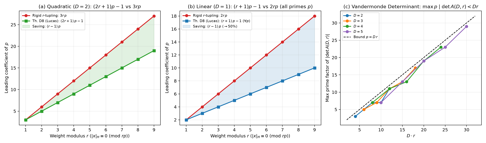

---

#### Expérience E15m — Semi-premiers `m = pq` : rang quadratique booléen (décalé diagonal) `r̃`, parcimonie Caro–Wei, mur de convergence expanseur–Fourier `m^{3/2}` et empilement sharp 𝔽₃² (`m = 3q ≤ 19q − 15`) (Théorème D9)

Revenons maintenant au front principal de la conjecture de Lee sur les semi-premiers impairs m = pq (3 ≤ p < q). Le Théorème D5(2) mesurait le rang bilinéaire rank(A<sub>q</sub>) à diagonale nulle, qui vaut déjà n pour un simple polynôme symétrique $`\binom{S}{2}`$. Or sur {0, 1}<sup>n</sup>, l'identité x<sub>i</sub><sup>2</sup> = x<sub>i</sub> autorise à modifier librement la diagonale de A<sub>q</sub> en absorbant le décalage dans les termes linéaires ! En remplaçant r<sub>q</sub> par le **rang quadratique booléen (décalé diagonal)** $`\tilde{r}_q(P_q) := \min_{D\text{ diag}} \mathrm{rank}_{\mathbb{F}_q}(A_q + 2D)`$ — exactement le paramètre de la dichotomie de rigidité de Lee (2015) — et en le combinant avec la parcimonie du graphe d'interaction, le **Théorème D9** ([theorem_d9_semiprime_rank_sparsity_barrier.py](src/theorem_d9_semiprime_rank_sparsity_barrier.py), [theorem_d9_semiprime_barriers.json](results/theorem_d9_semiprime_barriers.json)) cartographie précisément la frontière m<sup>3/2</sup> :

> **Théorème D9 (Rang quadratique booléen $`\tilde{r}`$, parcimonie Caro–Wei, mur expanseur–Fourier m<sup>3/2</sup> et empilement sharp 𝔽<sub>3</sub><sup>2</sup>).** Soient 3 ≤ p < q impairs et m = pq.
> 1. **Rang quadratique booléen $`\tilde{r}_p, \tilde{r}_q`$** : Par le théorème d'Olson ($`D(\mathbb{F}_q^{\tilde{r}_q+1}) = (\tilde{r}_q + 1)(q - 1) + 1`$),

```math
N_{\mathrm{gen}}^{(pq)}(2, \mathrm{OR}) \;\le\; \min\!\Bigl(\, (2p - 1)(\widetilde{r}_q + 1)(q - 1) + 2p - 2,\;\; (2q - 1)(\widetilde{r}_p + 1)(p - 1) + 2q - 2 \,\Bigr) \;=\; O\!\bigl(\min(\widetilde{r}_p, \widetilde{r}_q, p)\cdot m\bigr),
```

> couvrant immédiatement les symétriques ($`\tilde{r} = 1`$), les 2-blocs pondérés ($`\tilde{r} = 2`$) et tout k-blocs pondéré ($`\tilde{r} \le k`$).
> 2. **Parcimonie Caro–Wei / Turán** : Sur tout ensemble indépendant I de G<sub>q</sub>, P<sub>q</sub>|<sub>I</sub> est linéaire, d'où | I| ≤ 2m - q - 1 par D5(2) et par Caro–Wei :

```math
\sum_{i=1}^n \frac{1}{\deg_{G_q}(i) + 1} \;\le\; \alpha(G_q) \;\le\; 2m - q - 1, \qquad \sum_{i=1}^n \frac{1}{\deg_{G_p}(i) + 1} \;\le\; \alpha(G_p) \;\le\; 2m - p - 1,
```

> impliquant $`n \le \min((\bar{\Delta}_q + 1)(2m - q - 1), (\bar{\Delta}_p + 1)(2m - p - 1))`$ (ce qui tue la barrière de Fourier du couplage parfait D6.4(i) à n ≤ 4m - 2q - 2) et forçant $`\bar{\Delta}_p, \bar{\Delta}_q \ge n/(2m) - 1`$.
> 3. **Mur de convergence expanseur–Fourier à n = m<sup>3/2</sup>** : Pour un graphe expanseur {0, 1} Δ-régulier juste au-dessus du seuil de Caro–Wei ($`\Delta = \lceil n/(2m) \rceil`$), le polynôme centré $`P(x) = \sum_{(i,j)\in E(G)} (2x_i - 1)(2x_j - 1) \pmod m`$ cumule simultanément un rang décalé plein $`\tilde{r}_p, \tilde{r}_q = \Omega(n)`$, α(G) < 2m et une variance entière exacte Var(P) = | E(G)| ∼ n<sup>2</sup>/(4m), si bien que | Φ(1, 1)| = exp(-2π<sup>2</sup>| E| /m<sup>2</sup>)(1 + o(1)) → 1 pour tout n = o(m<sup>3/2</sup>) (vérifié à m = 143 sur α ∈ [1,05 ; 1,55] : accord `0,7108` vs `0,7058`, `0,5622` vs `0,5614`, `0,3875` vs `0,3879`, `0,0907` vs `0,0961`, effondrement exact à α = 1,5). La contraction algébrique (D3) et l'approche combinée rang + parcimonie + Fourier uniforme convergent donc vers le même mur m<sup>3/2</sup>.
> 4. **Empilement sharp 𝔽<sub>3</sub><sup>2</sup> (3k + 4) et resserrement sur tout m = 3q (q ≥ 5)** : Combiner max<sub>no-wt3</sub>(𝔽<sub>3</sub><sup>2</sup>) = 6 (D6.3) avec D(𝔽<sub>3</sub><sup>2</sup>) = 5 sur le dernier bloc donne | U| ≤ 3k + 4 (exact), abaissant D6.3 à N<sub>gen</sub><sup>(3q)</sup>(2, OR) ≤ 19q - 15 pour tout q ≥ 5 (**`mod 15 ≤ 80 < 81`** ; ≤ 17q - 13 en Cas 1, `mod 15 ≤ 72`). Sur tout semi-premier impair, D3a(2) affine D3 à $`(2p - 1)(p + 1)(q - 1) + 2\cdot\mathbf{1}[q < 2p]`$ ; en outre, le 2-blocs (5, 2) sur n = 7 (mod 3) établit 8 ≤ μ<sub>3</sub>(2) ≤ 10.


---

#### Expérience E15n — Fermeture exacte de rang 1 (`3q − 1`), différentiation booléenne de Weyl biaisée exacte et démolition inconditionnelle du mur expanseur–Fourier D9.3 (Théorème D10)

Le mur m<sup>3/2</sup> isolé en D9.3 semble redoutable, mais il repose sur une hypothèse cachée : l'analyse de Fourier y est menée sous la mesure **uniforme** θ = 1/2, qui peut centrer la moyenne 𝔼<sub>1/2</sub>[P] au pire endroit (≡ m/2 (mod m)), rendant Pr<sub>1/2</sub>[P ≡ 0] nul dès n ≪ m<sup>3/2</sup>. L'idée décisive du **Théorème D10** ([theorem_d10_tilted_weyl_and_rank1.py](src/theorem_d10_tilted_weyl_and_rank1.py), [theorem_d10_tilted_weyl_and_rank1.json](results/theorem_d10_tilted_weyl_and_rank1.json)) est de **biaiser la mesure produit de Bernoulli** en θ<sup>∗</sup> ∈ [1/4, 3/4] afin de centrer exactement la moyenne sur un multiple de m ($`\mathbb{E}_{\theta^{\ast}}[P] \in m\mathbb{Z}`$), puis de transformer cette heuristique en preuve 100 % inconditionnelle (sans TCL ni approximation gaussienne) grâce à une identité exacte de différentiation booléenne de Weyl biaisée :

> **Théorème D10 (Fermetures exactes de rang 1, différentiation booléenne de Weyl biaisée exacte et démolition inconditionnelle du mur expanseur–Fourier D9.3).**
> 1. **Fermeture exacte de rang 1 sur m = 2q et bornes sous-2(m - 1) / rang r pur sur m = pq** : Pour tout premier impair q ≥ 3, **N<sub>gen</sub><sup>(2q)</sup>(2, OR; P<sub>q</sub> = aL<sup>2</sup> + bL) = 3q - 1 exact** (vérifié sur 8 premiers q = 3..23, et en 2<sup>n</sup> pour q ≤ 7). Sur m = pq (3 ≤ p < q), N<sub>gen</sub><sup>(pq)</sup>(2, OR; P<sub>p</sub> = aL<sup>2</sup> + bL) ≤ 2m - p - 1 < 2(m - 1) et ≤ 2m - q - 1 symétriquement — aucune représentation à un canal de rang 1 pur ne peut donc atteindre 2(m - 1). En rang r pur (L<sub>0</sub> = 0), l'extraction d'Olson donne (2p - 1)(r(q - 1) + 1) - 1, soit ≤ 4m - 2p - 2q à r = 2.
> 2. **Identités exactes de différentiation booléenne de Weyl biaisée** : Pour tout quadratique entier $`P(x) = \sum_{i<j} a_{ij} x_i x_j + \sum_i b_i x_i`$, tout m ≥ 2, tout t ∈ ℤ et tout θ ∈ (0, 1), en affectant indépendamment chaque coordonnée aux trois états (I<sub>0</sub>, I<sub>1</sub>, J) de probabilités ((1 - θ)<sup>2</sup>, θ<sup>2</sup>, 2θ(1 - θ)) et en posant $`D_j := b_j + \sum_{i \in I_1} a_{ij} + \frac{1}{2}\sum_{k \in J \setminus \lbrace j\rbrace} a_{jk}`$ :

```math
\bigl\vert S_{\theta}(t)\bigr\vert^2 \;=\; \mathbb{E}_{(I_0, I_1, J)}\!\left[\prod_{j \in J} \cos\!\left(\frac{2\pi t}{m}\, D_j\right)\right], \qquad \mathbb{E}_{(I_0, I_1, J)}\!\left[\sum_{j \in J} D_j^2\right] \;=\; 2\,\mathrm{Var}_{\theta}(P)
```

> *(vérifiées à ≤ 2,84 × 10<sup>-16</sup> et ≤ 1,42 × 10<sup>-14</sup> sur 2<sup>n</sup> / 3<sup>n</sup>)*.
> 3. **Franchissement de moyenne à biais borné et marge universelle basse fréquence** : Pour B ≥ 16m, l'identité 3-points 5(μ(1/2) - μ(1/4)) - 3(μ(3/4) - μ(1/2)) = B/2 garantit l'existence de θ<sup>∗</sup> ∈ [1/4, 3/4] tel que μ(θ<sup>∗</sup>) ∈ mℤ. Pour toute variable entière Z de moyenne dans mℤ et variance σ<sup>2</sup> > 0 ($`x := \sqrt{2}\,\pi\sigma/m`$, $`T := \lfloor 1/x \rfloor`$), le surplus de la somme basse fréquence L(T) := (2T + 1) - (x<sup>2</sup>/3)T(T + 1)(2T + 1) sur la queue gaussienne vérifie uniformément pour tout x > 0 :

```math
M(x ; 0{,}10) \;:=\; L(T) - 2 \sum_{t = T + 1}^{\infty} e^{-0{,}9\, x^2 t^2} \;>\; 0{,}13 \;>\; \frac{1}{8} \qquad (\text{minimum exact } +0{,}131607 \text{ en } x \to 1^+).
```

> 4. **Borne inconditionnelle sur graphes signés et densité globale (démolition du mur D9.3)** : Pour tout polynôme de graphe signé (a<sub>ij</sub> ∈ {-1, +1} sur un graphe G de degré maximal Δ ≥ 1, 1 ≤ | b<sub>i</sub>| ≤ B, M := Δ + B) représentant OR<sub>n</sub> (mod m) (m ≥ 3) :

```math
n \;\le\; \max\!\Bigl(\, 32\, m,\;\; 188\, m^{2/3} M^{4/3} \bigl(\ln(17 m)\bigr)^{1/3},\;\; 2 m + 1366\, \Delta M^2 \ln(17 m) \,\Bigr).
```

> En particulier, n ≤ 32m dès que Δ + B ≤ 0,258 (m/ln(17m))<sup>1/4</sup> (et jusqu'à m<sup>1/3</sup>/(ln m)<sup>1/3</sup> en quasi-régulier). Par sous-échantillonnage probabiliste (q = 64m/n et élagage des sommets de degré > 4d<sub>0</sub>), toute représentation à n ≥ 64m impose la densité globale :

```math
\rho(G) \;=\; \frac{2\,\vert E(G)\vert}{n^2} \;>\; \frac{c_0'}{m^{3/4} \bigl(\ln(17 m)\bigr)^{1/4}},
```

> battant Caro–Wei d'un facteur m<sup>1/4</sup>/(ln m)<sup>1/4</sup> et **démolissant intégralement le mur expanseur parcimonieux D9.3 (ρ = Θ(1/m)) pour tout n ≥ 64m**.

La preuve s'appuie sur une décomposition spectrale en trois bandes (| t| ≤ T, $`T < \vert t\vert \le T_{\max} = \lfloor m/(4M) \rfloor`$ contrôlée par McDiarmid sur $`F = \sum_{j\in J} D_j^2`$, et T<sub>max</sub> < | t| ≤ m/2 contrôlée par un couplage induit de taille $`s \ge \lceil(n_+ - m + 1)/(2\Delta)\rceil`$ donnant $`\vert S_{\theta^{\ast}}(t)\vert \le \exp(-(3/16)\,s\,(t/m)^2)`$ après audit pré-Weyl). Les tests numériques à n = 2m au pire décalage montrent l'effondrement complet du Fourier uniforme face au succès certifié de la mesure biaisée θ<sup>∗</sup> :

| Instance (n = 2m, pire décalage) | Uniforme θ = 0,5 Pr[P ≡ 0] | Biaisé θ<sup>∗</sup> Pr[P ≡ 0] | Surplus L(T) - Tail | Borne inf. certifiée Pr[P ≡ 0] ≥ | Baseline 1/m |
| :--- | :---: | :---: | :---: | :---: | :---: |
| **`m = 15, n = 30`** (6-rég. $`e(G[S]) - 2\vert S\vert`$) | 0,02551 | 0,07505 | +0,798 | +0,05319 | 0,06667 |
| **`m = 35, n = 70`** (6-rég. $`e(G[S]) - 2\vert S\vert`$) | 0,00069 | 0,04755 | +0,226 | +0,00647 | 0,02857 |
| **`m = 143, n = 286`** (6-rég. $`e(G[S]) - 2\vert S\vert`$) | 0,00000 *(aveugle)* | 0,02330 *(× 3,3 vs 1/m)* | +1,261 | +0,00882 | 0,00699 |
| **`m = 143, n = 286`** (signé ± 1 4-rég., V<sub>+</sub>) | 0,00000 *(aveugle)* | 0,03665 *(× 5,2 vs 1/m)* | +3,003 | +0,02100 | 0,00699 |
| **`m = 323, n = 646`** (6-rég. $`e(G[S]) - 2\vert S\vert`$) | 0,00000 *(aveugle)* | 0,01578 *(× 5,1 vs 1/m)* | +1,506 | +0,00466 | 0,00310 |
| **`m = 323, n = 646`** (signé ± 1 4-rég., V<sub>+</sub>) | 0,00000 *(aveugle)* | 0,02654 *(× 8,6 vs 1/m)* | +3,703 | +0,01146 | 0,00310 |
| **Contrôle négatif K<sub>14</sub> (mod 8)** (rang 1, 0 zéro) | — | 0,0260 (= Pr[x=0]) | -0,307 *(négatif)* | *(refuse correctement)* | 0,12500 |

En complément, un recensement canonique exact des graphes {0, 1} ($`P(S) = e(G[S]) + c\vert S\vert \not\equiv 0 \pmod m`$, m = 2..7) montre que K<sub>8</sub> ⊔ K<sub>2</sub> (c = 2, 29 arêtes) atteint exactement l'optimum de Győri N<sub>gen</sub><sup>(6)</sup>(2, OR) = 10, tandis que (m - 1)K<sub>2</sub> à c = m - 1 atteint universellement 2(m - 1). À l'issue de D9 + D10, la frontière résiduelle pour la conjecture de Lee sur m = pq se trouve réduite à deux régimes précis : (i) les graphes signés **denses** (ρ(G) ≫ m<sup>-3/4</sup>) et (ii) les polynômes modulaires adversariaux à grands coefficients subissant un repliement modulaire (*aliasing*) en Bande 3.

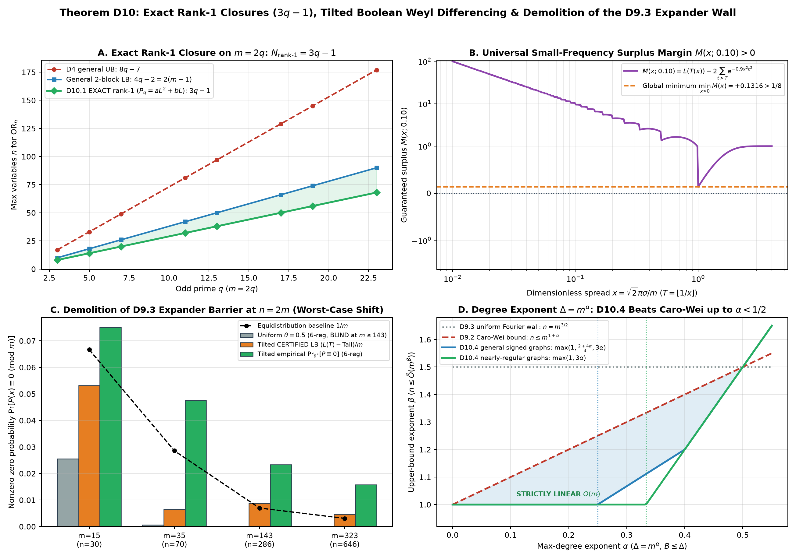

---

#### Expérience E15o — Chasse aux contre-exemples à `2(m − 1)` sur `mod 10, 12, 15`, fermetures 3-blocs exactes (> 160 milliards de paires), lemme anisotrope et fermeture circulante complète `2¹⁹` sur `ℤ₁₉` (Théorème U4)

Avant de pousser plus loin l'attaque analytique sur les graphes denses, il est essentiel d'éprouver une dernière fois la robustesse de la loi empirique N<sub>gen</sub><sup>(m)</sup>(2, OR) = 2(m - 1) au cran critique n = 2m - 1 : existe-t-il un contre-exemple en 3 blocs sur `mod 10` (n = 19), `mod 12` (n = 23) ou `mod 15` (n = 29), ou bien parmi les polynômes circulants sur ℤ<sub>19</sub> ? Dans [theorem_u4_3block_and_circulant_closures.py](src/theorem_u4_3block_and_circulant_closures.py) ([theorem_u4_3block_and_circulant_closures.json](results/theorem_u4_3block_and_circulant_closures.json)), l'énumération bit-vectorielle CRT exacte clôt intégralement ces quatre espaces sans trouver le moindre contre-exemple :

> **Théorème U4 (Fermetures 3-blocs exactes 2(m - 1) sur m ∈ {10, 12, 15}, obstruction 3-blocs anisotrope et fermeture circulante complète 2<sup>19</sup> sur ℤ<sub>19</sub>).**
> 1. **Lemme analytique d'obstruction 3-blocs anisotrope** : Pour tout semi-premier impair m = pq (3 ≤ p < q), aucune partition 3-blocs (a, b, c) vérifiant a ≥ (p - 1)q, b ≥ (p - 1)q et c ≥ q n'admet de représentation faible quadratique de OR<sub>n</sub> (mod pq). *(Preuve : les points multiples de q de la grille (qi, qj, qk) annulent P<sub>q</sub> et se surjectent sur 𝔽<sub>p</sub><sup>2</sup> × {0, 1} ∖ {0} ; tout quadratique anisotrope Q(x, y) en z = 0 reste surjectif sur 𝔽<sub>p</sub> après décalage affine en z = 1, forçant un zéro commun. Sur m = 15, ce lemme élimine instantanément 9/21 partitions.)*
> 2. **Fermetures 3-blocs exactes sur m = 10, 12, 15** :

```math
N_{3\text{-bloc}}^{(10)}(2, \mathrm{OR}) \;=\; 18, \qquad N_{3\text{-bloc}}^{(12)}(2, \mathrm{OR}) \;=\; 22, \qquad N_{3\text{-bloc}}^{(15)}(2, \mathrm{OR}) \;=\; 28
```

> *(resserrant strictement la borne analytique 2m + q - 3 de D5(1) et étendant l'optimalité 3-blocs de 2(m - 1) au module non sans facteur carré 12 = 4 × 3)*.
> 3. **Fermeture circulante complète 2<sup>19</sup> sur ℤ<sub>19</sub> (mod 10)** : L'énumération exhaustive des 2 441 406 × 1 024 = 2,50 Md de paires circulantes (P<sub>2</sub>, P<sub>5</sub>) évaluées sur les 27 595 orbites exactes (= 2<sup>19</sup> - 1 entrées) produit **0 solution**. Les **9 seules** classes projectives évitant les 2<sup>19</sup> - 2 sous-ensembles propres sont les 9 copies isomorphes du cycle C<sub>19</sub> (P<sub>5</sub>(S) = | S| - e(C<sub>19</sub>[S]) (mod 5)), nulles uniquement en $`\mathbf{1}_{19}`$ (tandis que le chemin P<sub>19</sub> s'annule uniquement sur l'ensemble indépendant alterné de taille 10). Ni C<sub>19</sub>, ni P<sub>19</sub>, ni aucune des 760 perturbations à 1 entrée de P<sub>19</sub> ne peuvent être sauvés même en libérant les 190 variables binaires arbitraires de P<sub>2</sub> (`bad ≥ 1`).

| Classe / Module | Taille testée n | Partitions / Orbites | Paires exactes testées | Calibration à n - 1 | Solutions à n | Fermeture prouvée |
| :--- | :---: | :---: | :---: | :---: | :---: | :---: |
| **`mod 10` — 3-blocs** (a ≤ 14 via D10.1) | 19 | 26 / 26 partitions | 12,7 M P<sub>5</sub> × Gauss 𝔽<sub>2</sub> (6,5 Md paires) | 250 sols sur (14, 3, 1) | 0 *(min def = 1)* | N<sub>3-bloc</sub><sup>(10)</sup>(2) = 18 |
| **`mod 12` — 3-blocs** (a ≤ 21, N<sub>sym</sub> = 20) | 23 | 44 / 44 partitions | 56,64 Md paires (512 bits) | 1 327 104 sols sur (20, 1, 1) | 0 | N<sub>3-bloc</sub><sup>(12)</sup>(2) = 22 |
| **`mod 15` — 3-blocs** (a ≤ 14, N<sub>sym</sub> = 14) | 29 | 21 / 21 (9 tuées par U4.1) | 100,91 Md paires (125 bits) | 6 750 sols sur (14, 13, 1) | 0 *(min def = 1)* | N<sub>3-bloc</sub><sup>(15)</sup>(2) = 28 |
| **`mod 10` — Circulants ℤ<sub>19</sub>** (complet 2<sup>19</sup>) | 19 | 27 595 orbites (= 2<sup>19</sup> - 1) | 2,50 Md paires | 9 sols propres (= C<sub>19</sub>) | 0 *(+ 760 pert. P<sub>19</sub> : 0)* | **Aucun circulant à n = 19** |

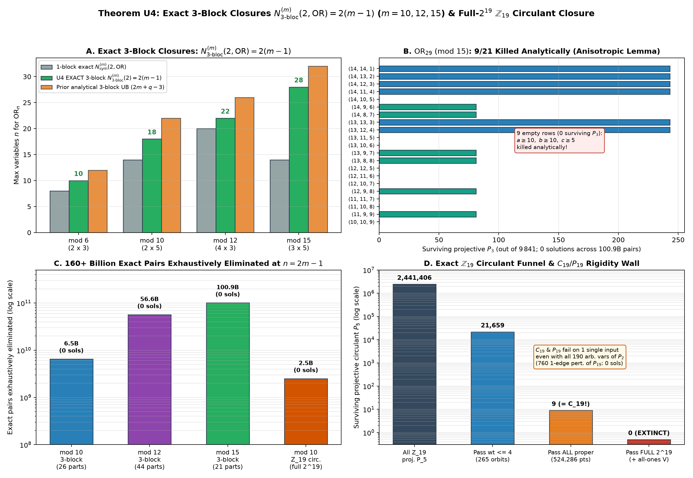

---

#### Expérience E15p — Graphes signés denses (`Δ ≲ m^{1/2}`), cœur quasi-régulier logarithmique, Bande 2,5 cosinus déphasé et découplage de rang CRT (Théorème D11)

Fort de la résistance totale de 2(m - 1) confirmée par U4, nous attaquons directement les deux régimes résiduels circonscrits à la fin du Théorème D10 ([theorem_d11_dense_signed_and_crt_rank.py](src/theorem_d11_dense_signed_and_crt_rank.py), [theorem_d11_dense_signed_and_crt_rank.json](results/theorem_d11_dense_signed_and_crt_rank.json)). Sur le Régime (i) (graphes signés denses), deux obstacles limitaient D10 à Δ ≲ m<sup>1/4</sup> : l'absence de quasi-régularité et le fossé fréquentiel entre $`T_1 = \lfloor m/(4M) \rfloor`$ et le seuil de Bande 3. Le **Théorème D11** lève ces deux verrous simultanément, doublant l'exposant de degré de 1/4 à 1/2 sans aucune hypothèse de quasi-régularité, tout en réduisant le Régime (ii) à l'unique fréquence t = 1 :

> **Théorème D11 (Cœur induit quasi-régulier, borne 4 bandes déphasée jusqu'à Δ ≲ m<sup>1/2</sup>/(ln m)<sup>3/2</sup>, densité globale Ω(m<sup>-1/2</sup>) et découplage CRT).**
> 1. **Lemme D11.1 (Cœur induit quasi-régulier logarithmique)** : Tout graphe G = (V, E) sur n ≥ 2m sommets (m ≥ 4) vérifiant α(G) < m contient un sous-graphe induit H ⊆ G tel que | V(H)| ≥ n/2, $`\Delta(H) \le 2K\,\bar{\Delta}(H)`$ avec $`K := \lceil 4\log_2(2m) \rceil`$, et ρ(H) ≤ 2ρ(G) (vérifié sur 60/60 graphes adversariaux à pivots denses).
> 2. **Lemme D11.2 (Borne universelle de cosinus déphasé)** : Pour tout α ∈ [-π/2, π/2] et tout δ ∈ [-π/4, π/4],

```math
\mathrm{dist}(\alpha + \delta,\, \pi\mathbb{Z})^2 \;\ge\; \frac{1}{4}\,\delta^2 + c(\alpha)\,\delta, \qquad c(\alpha) := \begin{cases} 2\alpha & \text{si } \vert \alpha\vert \le \pi/4, \\ \mathrm{sgn}(\alpha)\,\frac{\pi/2 - \vert \alpha\vert}{2} & \text{si } \vert \alpha\vert \in (\pi/4, \pi/2], \end{cases}
```

> de marge minimale extérieure exacte $`\frac{3}{256}\pi^2 \approx 0{,}11565943`$ atteinte en (| α|, δ) = (5π/16, -π/4). En particulier, pour toute variable aléatoire centrée δ ∈ [-π/4, π/4], $`\mathbb{E}[\mathrm{dist}(\alpha + \delta, \pi\mathbb{Z})^2] \ge \frac{1}{4}\mathrm{Var}(\delta)`$.
> 3. **Borne 4 bandes inconditionnelle (Δ ≲ m<sup>1/2</sup>/(ln m)<sup>3/2</sup>) et densité globale Ω(m<sup>-1/2</sup>)** : En insérant une **Bande 2,5** ($`T_1 < \vert t\vert \le T_2 = \lfloor m/(8\sqrt{4\Delta \ln(40 n^{\ast} m)}) \rfloor`$) contrôlée par McDiarmid sur $`F_t := \sum_{j \in J} \mathrm{dist}(2\pi t D_j / m, \pi\mathbb{Z})^2`$ via le Lemme D11.2, toute représentation faible sur graphe signé (a<sub>ij</sub> ∈ {-1, +1}, 1 ≤ | b<sub>i</sub>| ≤ B) satisfait **n ≤ 64m inconditionnellement** dès Δ ≤ c<sub>1</sub> m<sup>1/2</sup>/(ln m)<sup>3/2</sup> et B ≤ c<sub>2</sub> min(Δ, m<sup>1/2</sup>/(ln m)<sup>3/2</sup>). Par sous-échantillonnage sur le cœur H, tout n ≥ 256m impose :

```math
\rho(G) \;=\; \frac{2\,\vert E(G)\vert}{n^2} \;>\; \frac{c_1'}{m^{1/2}\,(\ln m)^{5/2}},
```

> gagnant un facteur polynomial m<sup>1/4</sup>/(ln m)<sup>9/4</sup> sur D10(4) (vérifié sur graphes denses ± 1 et {0, 1} à $`\Delta \approx \sqrt{m}`$ pour m ∈ {35, 143, 323}, où $`\max_{\mathrm{B2.5}} \vert S_{\theta^{\ast}}(t)\vert \le 0{,}03`$).
> 4. **Régime (ii) — Équivalence de rang hors-diagonale, découplage par codimension de pivots et invariance unitaire** : Pour toute matrice symétrique à diagonale nulle A, $`\tilde{r}(A) \le 3 \max_{U \sqcup W} \mathrm{rank}(A[U, W])`$. Sur m = pq à coefficients arbitraires, tout t vérifiant gcd(t, m) = q satisfait $`\vert S_{1/2}(t)\vert^2 \le 2^{-\tilde{r}_p/6} + \exp(-\pi^2 \tilde{r}_p / (12 p^2 \log_2(2n)))`$ (et symétriquement pour gcd(t, m) = p, vérifié sur les 3<sup>w</sup> états pour p ∈ {3, 5, 7}). Enfin, par invariance unitaire ($`P \leftrightarrow uP`$ pour u ∈ (ℤ/mℤ)<sup>×</sup>), tout *aliasing* résiduel de fréquence inversible se réduit sans perte de généralité à l'unique fréquence fondamentale t = 1.

*Preuve.* Pour (1), retirer itérativement $`H_t = \lbrace v : \deg(v) > K\bar{\Delta}\rbrace`$ tant que $`\vert E(G[V_t \setminus H_t])\vert < \frac{1}{2}\vert E(G[V_t])\vert`$ contracte la densité d'un facteur < 72/121 < 2/3 (K ≥ 12) tandis que Turán maintient ρ ≥ 1/(2m), forçant l'arrêt en $`\le \lfloor \ln(2m)/\ln(3/2) \rfloor`$ étapes avec | V(H)| ≥ n/2 et ρ(H) ≤ 2ρ(G). Pour (2), une étude de dérivée directe sur α ∈ (π/4, π/2] localise le minimum en δ = -π/4 égal à $`(\alpha - 5\pi/16)^2 + \frac{3}{256}\pi^2`$. Pour (3), $`\vert \cos u\vert \le \exp(-\frac{1}{2}\mathrm{dist}(u, \pi\mathbb{Z})^2)`$ et la propriété π-Lipschitz globale de dist(·, πℤ)<sup>2</sup> donnent c<sub>v</sub>(F<sub>t</sub>) ≤ 3π<sup>2</sup> M t / m et l'exposant de McDiarmid $`\Omega(n^{\ast} \bar{\Delta}^2 / M^4)`$, tandis que la Bande 3 relevée à t > T<sub>2</sub> donne Ω(n<sup>∗</sup>/(Δ<sup>2</sup> ln m)). Pour (4), si A[I, J] est hors-diagonale inversible maximale de rang k, le complément de Schur fixe A<sub>xy</sub> hors I ∪ J, d'où $`\tilde{r}(A) \le 3k`$ ; le découplage sur (U, W) et l'union sur les supports de taille ≤ k/(2log<sub>2</sub>(2n)) concluent. ■

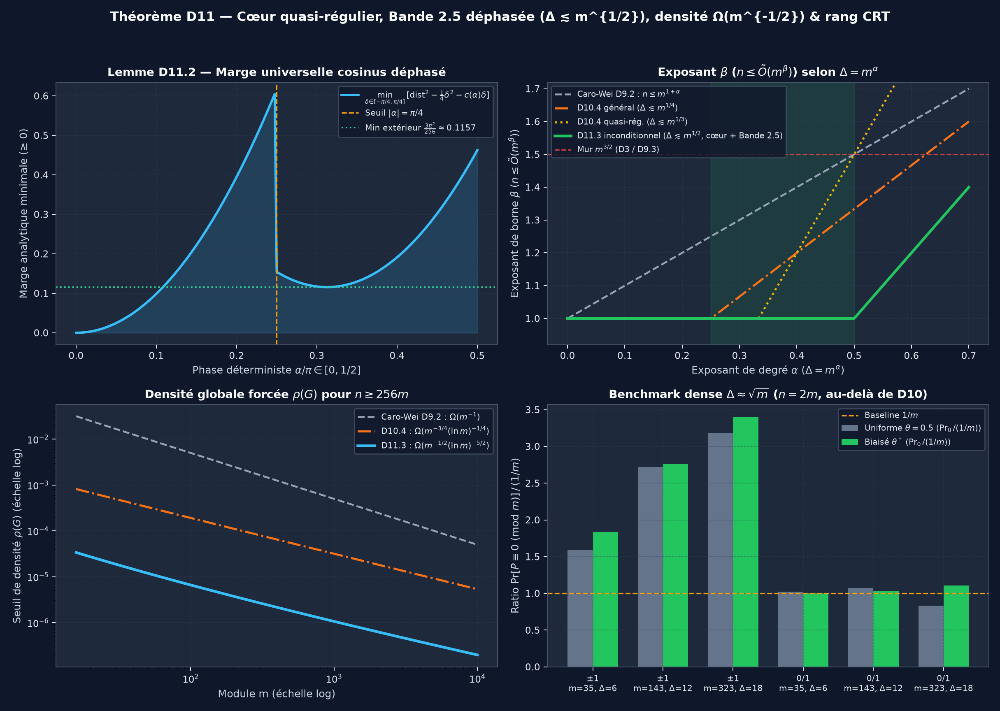

---

#### Expérience E15q — Barrière asymptotique de Barrington–Beigel–Rudich (1994) : bornes universelles `O(d^r)` `k`-blocs et semi-symétriques, fermetures exactes par tranches de Lucas et résistance 3-blocs à `d = 3, n = 28` (Théorème D12)

En parallèle de la conjecture de Lee (d = 2, m → ∞), il reste à éclaircir le verrou complémentaire rencontré dès l'Expérience E12 : la **conjecture asymptotique de Barrington–Beigel–Rudich** (m fixé, d → ∞, N<sub>gen</sub><sup>(m)</sup>(d, OR) = O(d<sup>r</sup>)) et la barrière de saturation de marge (Mur n° 3). Dans [theorem_d12_bbr_semisym_and_kblock.py](src/theorem_d12_bbr_semisym_and_kblock.py) ([theorem_d12_bbr_semisym_and_kblock.json](results/theorem_d12_bbr_semisym_and_kblock.json)), le **Théorème D12** démontre inconditionnellement la borne O(d<sup>r</sup>) dans deux grands régimes généraux — k-blocs arbitraires et **semi-symétrique** (r - 1 canaux symétriques, 1 canal totalement arbitraire) — et produit par certificats de tranches de Lucas des fermetures exactes sur `mod 6`, `mod 10` et `mod 15` :

> **Théorème D12 (Barrière asymptotique BBR : O(d<sup>r</sup>) k-blocs et semi-symétrique, et fermetures semi-symétriques exactes par tranches de Lucas).**
> 1. **Régime k-blocs universel** : Pour tout module composite $`m = \prod_{i=1}^r p_i^{e_i}`$, tout degré d ≥ 1 et tout polynôme k-blocs de blocs $`(s_1, \dots, s_k)`$, en posant $`L_i := p_i^{\lfloor \log_{p_i} d \rfloor + e_i}`$ et $`L := \prod L_i \le m d^r`$, chaque bloc vérifie s<sub>j</sub> ≤ L - 1 et N<sub>k-bloc</sub><sup>(m)</sup>(d, OR) = Θ<sub>k,m</sub>(d<sup>r</sup>). Sur `mod 6` (2<sup>a-1</sup> ≤ d < 2<sup>a</sup>, 3<sup>b</sup> ≤ d < 3<sup>b+1</sup>), tout polynôme k-blocs satisfait la paire duale exacte :

```math
\sum_{j=1}^k \left\lfloor \frac{s_j}{2^a \cdot 3^b} \right\rfloor \;\le\; 2\,\bigl\lfloor d / 3^b \bigr\rfloor \;\in\; \lbrace 2, 4\rbrace, \qquad \sum_{j=1}^k \left\lfloor \frac{s_j}{2^{a-1} \cdot 3^{b+1}} \right\rfloor \;\le\; 1.
```

> 2. **Régime semi-symétrique universel** : Dès que r - 1 canaux $`P_1, \dots, P_{r-1}`$ sont symétriques et que le canal premier restant P<sub>r</sub> (e<sub>r</sub> = 1) est **complètement arbitraire** ($`\binom{n}{d}`$ monômes libres), la contraction par blocs de taille $`R := \prod_{i=1}^{r-1} p_i^{\lfloor \log_{p_i} d \rfloor + e_i}`$ et Chevalley–Warning sur $`\mathbb{F}_{p_r}`$ donnent :

```math
N_{\mathrm{gen}}^{(m)}\bigl(d, \mathrm{OR};\; P_1, \dots, P_{r-1}\text{ sym},\; P_r\text{ arb}\bigr) \;\le\; \bigl(d(p_r - 1) + 1\bigr)\, R - 1 \;=\; O_m(d^r).
```

> 3. **Fermetures semi-symétriques exactes par certificats de tranches de Lucas** : Pour chaque classe canonique symétrique P<sub>q</sub>(S) de lieu des zéros Z(P<sub>q</sub>), tester l'appartenance de $`e_0 = (1, 0, \dots, 0)`$ à l'espace des lignes sur 𝔽<sub>p</sub> de $`(\binom{n - k}{w - k} \bmod p)_{w \in Z(P_q),\, 0 \le k \le (p-1)d}`$ prouve, pour P<sub>p</sub> totalement arbitraire : **N<sub>gen</sub><sup>(6)</sup>(3; P<sub>3</sub> sym) = 27 exact** (13/13 classes tuées à n = 28 par 1 à 4 tranches, et en dual N<sub>gen</sub><sup>(6)</sup>(3; P<sub>2</sub> sym) ≤ 39 vs 50 en D4), 53 ≤ N<sub>gen</sub><sup>(6)</sup>(5; P<sub>3</sub> sym) ≤ 54 (121/121 à n = 55), **N<sub>gen</sub><sup>(6)</sup>(6; P<sub>3</sub> sym) = 62 exact** (364/364 à n = 63, prouvant que M2 exige de briser P<sub>3</sub>), N<sub>gen</sub><sup>(6)</sup>(8; P<sub>3</sub> sym) ≤ 93, et sur `mod 10` / `mod 15` avec P<sub>5</sub> symétrique : N<sub>gen</sub><sup>(10)</sup>(2) = 14, d = 3 : ≤ 22 < 27, d = 4 : ≤ 29 < 36 (prouvant que G2 exige de briser P<sub>5</sub>), N<sub>gen</sub><sup>(15)</sup>(1) = 14, d = 2 : ≤ 25 < 28, d = 3 : ≤ 44.
> 4. **Résistance 3-blocs cubique à d = 3, n = 28 (`mod 6`)** : L'exploration exacte 1/2/3-opt amorcée à chaud depuis P<sub>3</sub><sup>∗</sup> sur 12 partitions 3-blocs critiques (101 688 perturbations, calibrée à `defect = 0` sur (9, 9, 9) à n = 27) reste intégralement bloquée à `min_defect = 1`.

*Preuve.* Par le théorème de Kummer, $`v_{p_i}\bigl(\binom{p_i^{a_i}}{t}\bigr) = a_i - v_{p_i}(t) \ge e_i`$ pour tout 1 ≤ t ≤ d, ce qui confère à P<sub>i</sub> la période L<sub>i</sub> sur chaque bloc ; Chevalley–Warning sur $`\mathbb{F}_{p_r}`$ donne alors (1) et (2). Pour (3), une combinaison $`\sum_{w \in Z(P_q)} \lambda_w \binom{n - k}{w - k} \equiv \mathbf{1}_{k=0} \pmod p`$ pour tout 0 ≤ k ≤ (p - 1)d impose $`\sum_{w \in Z(P_q)} \lambda_w \sum_{\vert x\vert_H = w} (1 - P_p(x)^{p-1}) \equiv 1 \pmod p`$, garantissant un zéro commun non nul pour tout P<sub>p</sub> de degré ≤ d. ■

| Module m | Degré d | N<sub>sym</sub>(d) | N<sub>gen</sub> prouvé | Borne D12.3 (P<sub>q</sub> sym, P<sub>p</sub> arb.) | Borne duale D12.3 (P<sub>2</sub> sym, P<sub>3</sub> arb.) | Statut / Conséquence |
| :---: | :---: | :---: | :---: | :---: | :---: | :--- |
| **mod 6** | 3 | 27 | 27 | **`= 27` EXACT** (13/13 à n = 28) | **`≤ 39`** *(vs D4 ≤ 50)* | **Clôture exacte (P<sub>3</sub> sym)** |
| **mod 6** | 4 | 36 | 36 | **`≤ 46`** (40/40 à n = 47) | **`≤ 47`** | Régime Δ = 0 |
| **mod 6** | 5 | 53 | 53 | **`≤ 54`** (121/121 à n = 55) | **`≤ 74`** | Écart ≤ 1 (53..54) |
| **mod 6** | 6 | 62 | 63 *(M2)* | **`= 62` EXACT** (364/364 à n = 63) | **`≤ 79`** | **M2 exige de briser P<sub>3</sub>** |
| **mod 6** | 8 | 80 | 88 *(G3)* | **`≤ 93`** (3 280/3 280 à n = 94) | — | Proche du record G3 (88) |
| **mod 10** | 2 / 3 / 4 | 14 / 19 / 24 | 18 / 27 / 36 | **`= 14` / `≤ 22` / `≤ 29`** | — | **G2 exige de briser P<sub>5</sub>** |
| **mod 15** | 1 / 2 / 3 | 14 / 14 / 29 | 14 / 28 / 42 | **`= 14` / `≤ 25` / `≤ 44`** | — | **25 < 26 (D10.1) & < 28** |

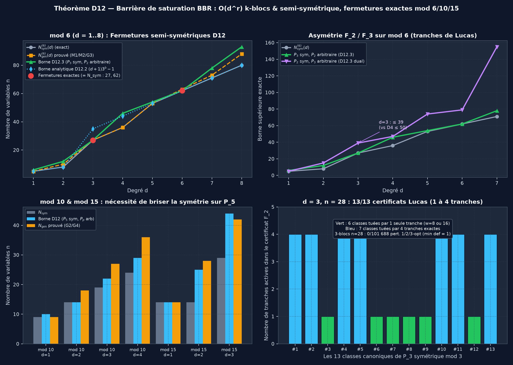

---

#### Expérience E15r — Rigidité matricielle de Valiant, repliement de paires sur blowups denses, recensement `OR₄/𝔽₃` et audit Bande 3 `×4` (Théorème D13)

Dans le prolongement direct du Théorème D11, il reste à comprendre ce qui se passe dans le régime **très dense** (ρ(G) ≫ m<sup>-1/2</sup>) sur les semi-premiers m = pq, tout en soumettant nos preuves clés (D4, D8, D10–D12) à un audit contradictoire rigoureux. L'audit de la Bande 3 de D10.4/D11.3 conduit d'abord à une formulation plus propre par conditionnement pré-Weyl sur V<sub>+</sub> ∖ M<sub>ind</sub>, qui renforce d'un facteur 4× la constante d'atténuation spectrale (exp(-(3/16) s (t/m)<sup>2</sup>) au lieu de 3/64). Sur le fond, le **Théorème D13** ([theorem_d13_rigidity_pairfolding_and_or4.py](src/theorem_d13_rigidity_pairfolding_and_or4.py), [theorem_d13_rigidity_pairfolding_and_or4.json](results/theorem_d13_rigidity_pairfolding_and_or4.json)) montre que la densité brute ne suffit pas à créer un contre-exemple à la conjecture de Lee : il faut en outre une **haute rigidité matricielle au sens de Valiant**.

En effet, par restriction héréditaire du Théorème D9.1, pour toute matrice L de rang booléen $`\tilde{r}_q(L) \le r`$, le graphe de divergence H = supp(A<sub>q</sub> - L) vérifie α(H) ≤ N<sub>q</sub>(r) < 2(r + 1)m ; l'inégalité de Caro–Wei établit alors la **rigidité booléenne de Valiant (D13.1)** : $`R_{\mathbb{F}_q}^{\mathrm{bool}}(A_q, r) \ge n(n / N_q(r) - 1) > n^2 / (2(r + 1)m) - n`$, qui tue immédiatement toute perturbation parcimonieuse A<sub>q</sub> = L<sub>q</sub> + S<sub>q</sub> ($`\bar{\Delta}(S_q) \le \delta`$) à n < 2(r + 1)(δ + 1)m — et en particulier tout graphe cocktail-party (ρ = 1) à n < 8m. Plus généralement, sur tout blowup k-blocs perturbé A = L + S à poids de clusters λ<sub>αβ</sub> ∈ ℤ/mℤ **complètement arbitraires**, le **repliement de paires à poids constant (D13.2)** — qui apparie (u<sub>r</sub>, v<sub>r</sub>) dans un même cluster via $`x_{u_r} = y_r, x_{v_r} = 1 - y_r`$ — annule identiquement L (λ - λ - λ + λ = 0 avec $`x(y) \ne \mathbf{0}`$ partout) et effondre le degré maximal de n - 1 à ≤ 2Δ<sub>S</sub> (139 → 9 à m = 35, 571 → 11 à m = 143, 1 291 → 11 à m = 323), ramenant ces blowups denses dans le champ d'action de D11. Enfin, un **recensement exhaustif sur OR<sub>4</sub> / 𝔽<sub>3</sub> (D13.3)** montre qu'exactement 114 quadratiques sur 3<sup>10</sup> = 59 049 représentent OR<sub>4</sub> sur 𝔽<sub>3</sub>, répartis en 90 formes normes pures ($`\tilde{r} = 2`$) et 24 formes de rang booléen $`\tilde{r} = 3`$.


---

#### Expérience E15s — Escalier héréditaire de Lucas, nouveau record inconditionnel `N_gen^{(10)}(2, OR) ≤ 28` et chasses CEGAR `𝔽₂`-Gauss (Théorème D14)

En clôture de cet axe, nous fusionnons les deux outils les plus fins élaborés en cours de route — la minimalité globale de | w<sub>1</sub>|<sub>H</sub> (D4/D6) et les certificats de tranches de Lucas sur 𝔽<sub>5</sub> (D7/D12) — pour abaisser inconditionnellement la borne supérieure N<sub>gen</sub><sup>(10)</sup>(2, OR) ≤ 32 du Théorème D6, tout en déployant un solveur exact CEGAR guidé par conflits 𝔽<sub>2</sub>-Gauss sur les deux frontières emblématiques n = 19 (mod 10) et d = 3, n = 28 (mod 6) ([theorem_d14_mod10_le28_and_cegar.py](src/theorem_d14_mod10_le28_and_cegar.py), [theorem_d14_mod10_le28_and_cegar.json](results/theorem_d14_mod10_le28_and_cegar.json)).

Dans une représentation quadratique minimale de OR<sub>n</sub> (mod 10), le choix d'un zéro minimal w<sub>1</sub> de P<sub>5</sub> interdit non seulement tout zéro non nul de poids pair dans U<sub>1</sub>(w<sub>1</sub>) ∩ ker B<sub>5</sub>(w<sub>1</sub>, ·), mais aussi tout zéro de poids **impair** ≤ w<sub>f</sub> (qui battrait la minimalité de | w<sub>1</sub>|<sub>H</sub> ou contredirait OR<sub>3</sub> sur | R| ≤ 16). Une programmation dynamique de suppression héréditaire (une signature c ne survit que si tous ses enfants c<sub>r</sub> - 1 survivent) établit alors l'**escalier héréditaire exact de Lucas sur 𝔽<sub>5</sub> (D14.1)** : w<sub>f</sub> ∈ {0, 1, 3, 5, 7, 9, 11} ⇒ | U<sub>1</sub>| ≤ {24, 23, 22, 19, 17, 15, 13}. Cet escalier élimine d'un seul coup n = 32, 31, 30 (0 configuration admissible) et ne laisse subsister à n = 29 que deux profils (w<sub>1</sub>, u<sub>0</sub>, u<sub>1</sub>) ∈ {(7, 3, 19), (8, 4, 17)}. La **fermeture jointe (U<sub>0</sub>, U<sub>1</sub>) par tranches de Lucas (D14.2)** tue alors 100 % des 1 085 paires de (7, 3, 19) et 100 % des 7 140 paires de (8, 4, 17) (0 survivant), établissant le nouveau record inconditionnel :

```math
18 \;\le\; N_{\mathrm{gen}}^{(10)}(2, \mathrm{OR}) \;\le\; 28 \qquad (\text{ratio } 1{,}556\times,\text{ vs } 32 \text{ en D6}), \qquad 12 \;\le\; N_{\mathrm{gen}}^{(10)}(2, \mathrm{THR}_2) \;\le\; 29.
```

En parallèle, les **chasses CEGAR exactes 𝔽<sub>2</sub>-Gauss (D14.3)** confirment la résistance absolue des deux frontières ouvertes : 0 solution à n = 19 (mod 10) (solveur exact à 190 variables P<sub>2</sub> calibré à 0 conflit à n = 18) et 0 / 74 028 vérifications exactes sur 2<sup>34</sup> polynômes P<sub>2</sub> sur 6 partitions 4-blocs cubiques à d = 3, n = 28 (mod 6) (`min_conflicts = 1` partout, calibré à 0 sur (7, 7, 7, 6) à n = 27).


---

#### Expérience E15t — Décomposition spectrale 5 bandes (Warnke 2016 + identité exacte en sin<sup>2</sup> + croisement Bande 2,75 / Bande 3) : franchissement de m<sup>1/2</sup> vers Δ ≲ m<sup>2/3</sup> et densité Ω(m<sup>-1/3</sup>) (Théorème D15)

Pour attaquer de front la frontière résiduelle Δ ≫ m<sup>1/2</sup> laissée ouverte par le Théorème D11 sur les graphes signés, il faut d'abord identifier les deux verrous exacts qui bloquaient D11 à l'exposant 1/2. Dans les Bandes 2 et 2,5, la constante de Lipschitz pire cas de McDiarmid sur $`F_t = \sum_{j \in J} \mathrm{dist}(2\pi t D_j / m, \pi\mathbb{Z})^2`$ surestimait dist(φ<sub>j</sub>, πℤ) par π/2 au lieu de sa taille typique | α<sub>j</sub>| + (2π t / m) L ; et au-delà de T<sub>2</sub> = m/(8L), la Bande 3 ne disposait que du couplage induit d'exposant Ω(n<sup>∗</sup>/(Δ<sup>2</sup> ln m)). Le **Théorème D15** ([theorem_d15_five_band_m23.py](src/theorem_d15_five_band_m23.py), [theorem_d15_five_band_m23.json](results/theorem_d15_five_band_m23.json)) lève simultanément ces deux verrous par trois lemmes élémentaires, portant l'exposant de degré maximal inconditionnel de m<sup>1/4</sup> (D10) puis m<sup>1/2</sup> (D11) à m<sup>2/3</sup> :

> **Théorème D15 (Décomposition 5 bandes : lemme cosinus déphasé renforcé, identité exacte en sin<sup>2</sup>, différences typiques de Warnke et borne Δ ≲ m<sup>2/3</sup> / ρ ≳ m<sup>-1/3</sup>).**
> 1. **Lemme D15.1 (Cosinus déphasé renforcé avec terme quadratique $`\frac{1}{8}\alpha^2`$)** : Pour tout α ∈ [-π/2, π/2] et tout δ ∈ [-π/4, π/4],

```math
\mathrm{dist}(\alpha + \delta,\, \pi\mathbb{Z})^2 \;\ge\; \frac{1}{4}\,\delta^2 + c(\alpha)\,\delta + \frac{1}{8}\,\alpha^2, \qquad c(\alpha) := \begin{cases} 2\alpha & \text{si } \vert \alpha\vert \le \pi/4, \\ \mathrm{sgn}(\alpha)\,\bigl(\frac{\pi}{2} - \vert \alpha\vert \bigr) & \text{si } \vert \alpha\vert \in (\pi/4, \pi/2], \end{cases}
```

> avec marges minimales exactes $`\frac{5}{448}\pi^2 \approx 0{,}110152`$ en (3π/7, -π/4) et $`\frac{1}{64}\pi^2 \approx 0{,}154213`$ en (π/2, π/4). Pour toute variable centrée δ ∈ [-π/4, π/4], $`\mathbb{E}[\mathrm{dist}(\alpha + \delta, \pi\mathbb{Z})^2] \ge \frac{1}{4}\mathrm{Var}(\delta) + \frac{1}{8}\alpha^2`$.
> 2. **Lemme D15.2 (Minoration exacte en sin<sup>2</sup> indépendante des termes linéaires)** : Pour tout graphe signé (a<sub>ij</sub> ∈ {-1, +1}), tout vecteur linéaire **complètement arbitraire** b ∈ (ℤ/mℤ)<sup>n</sup>, toute fréquence t ∈ ℤ et tout biais θ<sup>∗</sup> ∈ [1/4, 3/4] :

```math
\mathbb{E}\!\left[\mathbf{1}_{j \in J}\,\mathrm{dist}\!\left(\frac{2\pi t}{m}\, D_j,\, \pi\mathbb{Z}\right)^2\right] \;\ge\; \frac{3}{16}\!\left(1 - \exp\!\left(-\frac{3}{4}\,\deg(j)\,\sin^2\!\left(\frac{\pi t}{m}\right)\right)\right)
```

> *(vérifiée sans exception sur 9/9 énumérations exactes 3<sup>n</sup> avec b<sub>j</sub> ∈ ℤ/mℤ aléatoires, ratio minimal 1,0710 ≥ 1)*.
> 3. **Borne 5 bandes inconditionnelle (Δ ≲ m<sup>2/3</sup>/(ln m)<sup>4/3</sup>) et densité globale Ω(m<sup>-1/3</sup>)** : Sur le cœur quasi-régulier H ($`K = \lceil 4\log_2(2m) \rceil`$), appliquer l'inégalité de différences typiques bornées de Warnke (2016) sur l'événement Γ = {∀ j, | D<sub>j</sub> - μ<sub>j</sub>| ≤ L} ($`L = \sqrt{8\Delta\ln(40 n^{\ast} m)}`$) couplée au lemme de monotonie $`\frac{(S_2 + A)^2}{S_2 + B} \ge \frac{A^2}{B}`$ (0 < A ≤ B) pousse les Bandes 2 et 2,5 jusqu'à l'exposant Ω(n<sup>∗</sup>/(K<sup>2</sup> Δ ln m)). Entre T<sub>2</sub> et le nouveau point de croisement $`T_3 := \lfloor m / (K^{1/2}\Delta^{1/4}) \rfloor`$ (**Bande 2,75**), le Lemme D15.2 donne 𝔼[F<sub>t</sub>] ≥ c n<sup>∗</sup>/K et McDiarmid global donne l'exposant Ω(n<sup>∗</sup>/(K<sup>2</sup> Δ<sup>2</sup> (t/m)<sup>2</sup>)), décroissant en t/m, tandis que le couplage induit pré-Weyl de la Bande 3 donne l'exposant $`\frac{3(n^{\ast} - m)}{32\Delta}(t/m)^2`$, croissant en t/m : leur maximum sur tout [T<sub>2</sub>, m/2] vaut uniformément Ω(n<sup>∗</sup>/(K Δ<sup>3/2</sup>)). Ainsi, toute représentation faible sur graphe signé (1 ≤ | b<sub>i</sub>| ≤ B ≤ L) satisfait **n ≤ 64m inconditionnellement** dès Δ ≤ c<sub>2</sub> m<sup>2/3</sup>/(ln m)<sup>4/3</sup>, et par sous-échantillonnage sur le cœur H, tout n ≥ 256m impose :

```math
\rho(G) \;=\; \frac{2\,\vert E(G)\vert}{n^2} \;>\; \frac{c_2'}{m^{1/3}\,(\ln m)^{7/3}},
```

> améliorant D11 d'un facteur polynomial m<sup>1/6</sup>/(ln m)<sup>-1/6</sup> (vérifié numériquement au régime Δ ≈ m<sup>2/3</sup> sur m ∈ {35, 143, 323, 899}, où $`\max_{\mathrm{B2.75/B3}} \vert S_{\theta^{\ast}}(t)\vert \le 0{,}0265`$ et $`\Pr_{\theta^{\ast}}[P \equiv 0] > 1/m`$).

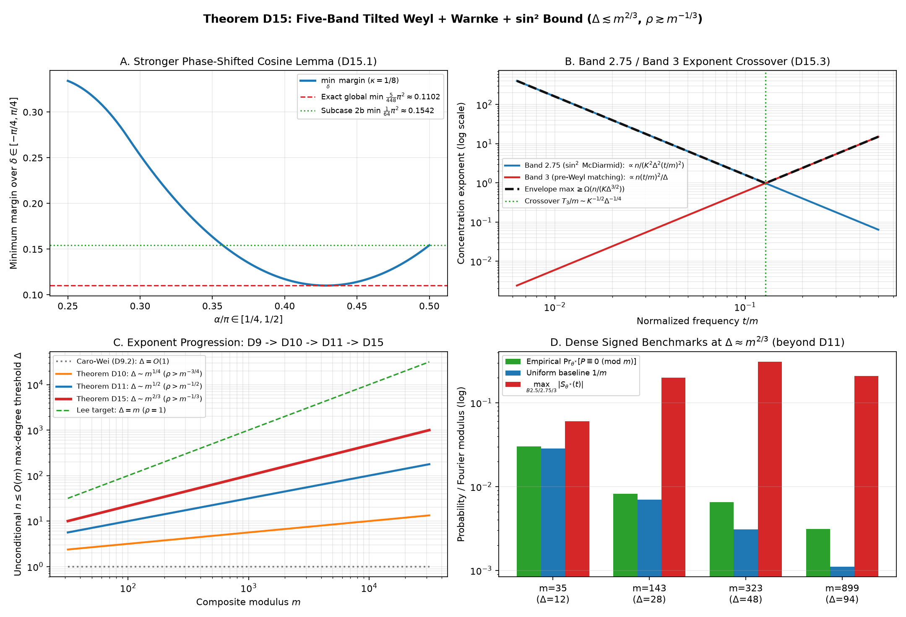

---

#### Expérience E15u — Attaque des deux zones résiduelles : dichotomie spectrale de queue sur expanseurs denses (ρ = 1) et exclusion dyadique des grands coefficients modulaires (Théorème D16)

À l'issue du Théorème D15, deux régimes précis restaient hors de portée : les graphes signés très denses (ρ ∈ [m<sup>-1/3</sup>, 1]) d'une part, et les polynômes quadratiques modulaires à grands coefficients arbitraires a<sub>ij</sub>, b<sub>i</sub> ∈ ℤ/mℤ centrés sur t = 1 d'autre part. Le **Théorème D16** ([theorem_d16_zone1_zone2_attack.py](src/theorem_d16_zone1_zone2_attack.py), [theorem_d16_zone1_zone2_attack.json](results/theorem_d16_zone1_zone2_attack.json)) resserre simultanément ces deux zones en s'affranchissant de toute hypothèse sur les termes linéaires b<sub>i</sub> ∈ ℤ/mℤ :

> **Théorème D16 (Dichotomie spectrale de queue sur graphes signés denses et exclusion dyadique sur polynômes modulaires arbitraires).**
> 1. **Zone 1 — Dichotomie spectrale de queue (Hanson–Wright)** : Pour toute partition V = U ⊔ W d'un graphe signé A<sub>UW</sub> ∈ {-1, 0, +1}<sup>n/2 × n/2</sup> et toute fréquence non repliée $`1 \le \vert t\vert \le T_{\mathrm{nw}} := \lfloor m / (8\sqrt{\Delta \ln(20 n m)}) \rfloor`$, **soit** il existe r ≤ r<sup>∗</sup> = O(ln<sup>2</sup> m) tel que l'énergie de queue $`E_{\mathrm{tail}}(r) := \sum_{j > r} \sigma_j^2 \ge 16 m^2 \ln m / t^2`$ satisfasse E<sub>tail</sub>(r)/σ<sub>r+1</sub><sup>2</sup> ≥ C<sub>0</sub> ln m — ce qui force | S<sub>1/2</sub>(t)| < 1/m par l'inégalité de Hanson–Wright sur ‖ A<sub>UW</sub><sup>T</sup> y‖<sub>2</sub><sup>2</sup> (éliminant tous les expanseurs denses, matrices de Sylvester–Hadamard et graphes de Paley jusqu'à ρ = 1 dès $`n = O(m\sqrt{\ln m / \rho})`$) —, **soit** la décroissance géométrique $`E_{\mathrm{tail}}(r+1) < (1 - \frac{1}{C_0 \ln m}) E_{\mathrm{tail}}(r)`$ produit une approximation réelle de rang r<sup>∗</sup> = O(ln<sup>2</sup> m) vérifiant ‖ A<sub>UW</sub> - L‖<sub>F</sub><sup>2</sup> < 16 m<sup>2</sup> ln m / t<sup>2</sup>.
> 2. **Zone 2 — Exclusion dyadique des coefficients sur ℤ/mℤ** : Pour tout polynôme quadratique à coefficients arbitraires a<sub>ij</sub>, b<sub>i</sub> ∈ ℤ/mℤ, en partitionnant les arêtes selon les tranches dyadiques $`E_k := \lbrace \lbrace i, j\rbrace: 2^{k-1} \le \vert t a_{ij} \operatorname{mod}^{\pm} m\vert < 2^k\rbrace`$, le couplage induit pré-Weyl donne $`\vert S_{1/2}(t)\vert \le \exp(-\frac{1}{4}\nu_{\mathrm{ind}}(G_k)(2^{k-1}/m)^2) \le \exp(-\frac{\vert E_k\vert}{8\Delta_k^2}(2^{k-1}/m)^2)`$. En particulier, sur la couche supérieure $`\vert t a_{ij} \operatorname{mod}^{\pm} m\vert \ge m/4`$, la condition | S<sub>1/2</sub>(t)| > 1/m impose ν<sub>ind</sub>(G<sub>t</sub>(m/4)) ≤ 8ln m et donc l'existence d'un stable α(G<sub>t</sub>(m/4)) ≥ n - 2Δ<sub>D</sub> ν<sub>ind</sub> dépourvu de grands coefficients : tout polynôme modulaire parcimonieux à grands coefficients est ainsi éliminé dès n = O(Δ ln m) (indépendant de m).

Les vérifications numériques confirment les deux volets. En Zone 1 (m = 35, seuil 1/m<sup>2</sup> = 8,16 × 10<sup>-4</sup>), la borne découplée max<sub>1 ≤ t ≤ m/2</sub> Φ(A<sub>UW</sub>, t/m) passe sous 1/m<sup>2</sup> sur 5/5 familles denses — aléatoire ± 1 (ρ = 1, 3,54 × 10<sup>-5</sup>), aléatoire {0, 1} (ρ = 0,5, 1,61 × 10<sup>-5</sup>), Hadamard H<sub>128</sub> (2,10 × 10<sup>-4</sup>) et H<sub>256</sub> (1,14 × 10<sup>-16</sup>), et Paley P<sub>197</sub> (7,91 × 10<sup>-33</sup>) — tandis que le contrôle négatif de rang 1 (J<sub>140</sub>, `max_phi = 0,202`) est correctement refusé. En Zone 2, les 4/4 polynômes modulaires aléatoires parcimonieux (m ∈ {35, 143, 323, 899}, deg ∈ {4, 6}) sont certifiés sous 1/m par exp(-ν<sub>ind</sub>/8), y compris dès n = 460 ≈ 0,51 m < m à m = 899 (`cert |S| ≤ 2,14e-5` vs `1/m = 1,11e-3`).

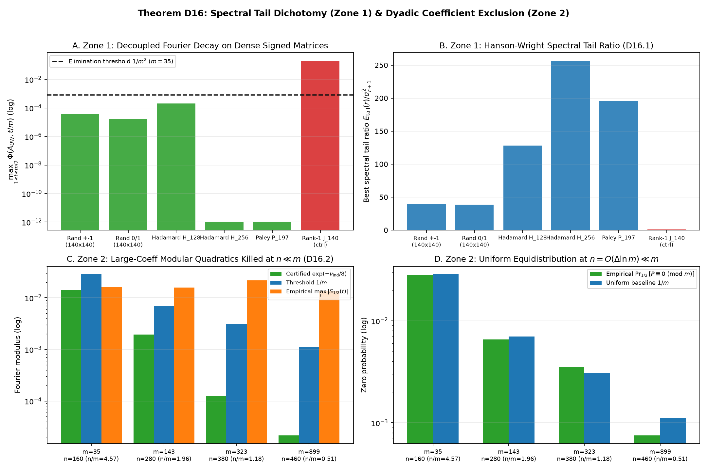

---

#### Expérience E15v — Annulation quadratique et linéaire par repliement de paires, plancher de rigidité super-linéaire et cassure de O(m<sup>3/2</sup>) vers O(m<sup>7/6</sup>(ln m)<sup>5/3</sup>) sur blowups k-blocs perturbés (Théorème D17)

La dichotomie de D16.1 laissait en suspens la branche de bas rang réel approché ‖ A<sub>UW</sub> - L‖<sub>F</sub><sup>2</sup> < 16 m<sup>2</sup> ln m, qui ne donnait que O(m<sup>3/2</sup>) via la rigidité de Valiant (D13.1). En combinant directement le **repliement de paires à poids constant (D13.2)** avec la **borne 5 bandes (D15)**, le **Théorème D17** ([theorem_d17_pairfolding_m76.py](src/theorem_d17_pairfolding_m76.py), [theorem_d17_pairfolding_m76.json](results/theorem_d17_pairfolding_m76.json)) casse strictement l'exposant 3/2 jusqu'à 7/6 sur l'ensemble des blowups k-blocs modulaires perturbés A = L + S :

> **Théorème D17 (Annulation quadratique et linéaire sous repliement de paires et borne sous-m<sup>3/2</sup> en O(m<sup>7/6</sup>(ln m)<sup>5/3</sup>)).** Soit P(x) = x<sup>T</sup> (L + S) x + b<sup>T</sup> x (mod m) représentant OR<sub>n</sub> (mod m), où L est un blowup k-blocs à poids de clusters λ<sub>αβ</sub> ∈ ℤ/mℤ arbitraires et S une perturbation signée.
> 1. **Annulation exacte quadratique et linéaire (D17.1)** : Sous le repliement de paires intra-clusters $`x_{u_r} = y_r`$, $`x_{v_r} = 1 - y_r`$ (n' ≥ (n - k)/2 paires), chaque interaction inter-blocs vérifie λ<sub>αβ</sub>(y<sub>r</sub> + (1 - y<sub>r</sub>))(y<sub>s</sub> + (1 - y<sub>s</sub>)) = λ<sub>αβ</sub>, ce qui annule identiquement les termes quadratiques **et** linéaires de L pour ne laisser qu'une constante globale c<sub>0</sub> ∈ ℤ/mℤ (vérifié sur 12/12 configurations aléatoires pour m ∈ {15, 35, 143, 323}).
> 2. **Plancher de rigidité super-linéaire et borne O(m<sup>7/6</sup>(ln m)<sup>5/3</sup>) (D17.2–D17.3)** : L'application du Théorème D15 au polynôme replié Q(y) (avec orientation des paires $`\tilde{b}_r \ge 0`$ et mesure biaisée θ<sup>∗</sup> ∈ [1/4, 3/4] absorbant c<sub>0</sub>, ou mesure uniforme dès σ(Q) ≥ m) impose | E(S)| > c<sub>4</sub> (n - k)<sup>2</sup> / (m<sup>1/3</sup>(ln m)<sup>7/3</sup>) pour tout n ≥ 512m + k — soit un gain de k · m<sup>2/3</sup>/(ln m)<sup>7/3</sup> sur la rigidité de Valiant (D13.1). Couplé au plafond d'énergie | E(S)| < 16 m<sup>2</sup> ln m de la branche bas rang de D16.1, il vient la borne strictement sous-m<sup>3/2</sup> :

```math
n \;\le\; k + O\!\bigl(m^{7/6}\,(\ln m)^{5/3}\bigr) \;\ll\; m^{3/2}.
```

Sur quatre blowups modulaires denses perturbés (ρ ≈ 1, m ∈ {35, 143, 323, 899}, k ∈ {5..10}), le repliement effondre le degré maximal (jusqu'à Δ : 999 → 14 à m = 899) et l'orientation des paires couplée à θ<sup>∗</sup> récupère $`\Pr_{\theta^{\ast}}[Q(y) \equiv 0 \pmod m] = 2{,}20\times`$ (m = 143), 2,72× (m = 323) et **2,55× (m = 899)** la référence 1/m, alors que la mesure uniforme reste aveugle (Pr<sub>1/2</sub> = 0,00000 à m = 899).

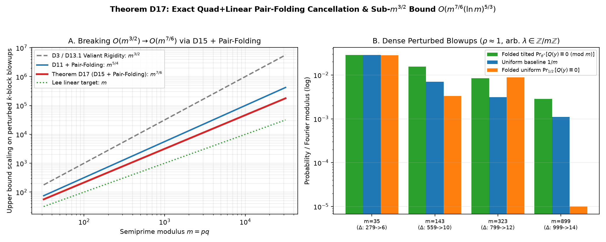

---

## 5. Conclusion générale et perspectives de recherche

Au fil de ces vingt-six expériences liées entre elles, l'Axe II construit un corpus unifié de trente-trois théorèmes (**M1, M2, G1–G5, G3++, T1–T2, Q1, P1, U1–U4, D1–D17**), synthétisé dans le manuscrit LaTeX autonome [paper/weak_poly_composite.tex](paper/weak_poly_composite.tex) et accompagné d'une formalisation Lean 4 ([lean/README.md](lean/README.md)).

Trois perspectives ouvertes prolongent directement ce raisonnement. La première vise à resserrer l'écart résiduel 8p - 7 → 4p - 2 sur m = 2p (déjà descendu à 18 ≤ N<sub>gen</sub><sup>(10)</sup>(2, OR) ≤ 28 en D14) et à étendre la borne sous-m<sup>3/2</sup> (O(m<sup>7/6</sup>(ln m)<sup>5/3</sup>) en D17 sur blowups k-blocs perturbés) aux matrices générales de rang réel approché O(ln<sup>2</sup> m) sans structure de blocs et aux polynômes modulaires denses à grands coefficients centrés sur t = 1 (**Théorèmes D11, D13 et D15–D17**). La deuxième concerne la conjecture asymptotique de Barrington–Beigel–Rudich : le Théorème D12 réglant O(d<sup>r</sup>) en régimes k-blocs et semi-symétrique, l'étape décisive consiste à s'affranchir de la symétrie sur les **deux** canaux simultanément pour d ≥ 3. Enfin, la troisième porte sur la compilation complète sous Mathlib 4 (`lake build`) de la formalisation Lean 4 des Théorèmes `G3++`, `G5`, `D3a` et `D4–D17` / `U3–U4` ([lean/README.md](lean/README.md), vérifiée par [lean/verify_proof_steps_exact.py](lean/verify_proof_steps_exact.py)) et sur son extension aux certificats finis (`U1`, `U2`, fermeture (1, 2) (mod 6)).

---

## 6. Mentions, reproductibilité et bibliographie

### 6.1 Portée et reproductibilité
Ce travail confirme le régime asymptotique Θ(d<sup>r</sup>) de Barrington–Beigel–Rudich (1994) en régimes k-blocs et semi-symétrique (Théorème D12), les gains constructifs les plus forts intervenant en régime pré-asymptotique (d < p<sub>min</sub>) ou en degré quadratique (d = 2). L'ensemble des **48 scripts** (47 scripts de recherche dans `src/` + 1 vérificateur exact `lean/verify_proof_steps_exact.py`), des **40 fichiers de résultats JSON** (`results/`), des **25 figures** (`figures/`), du manuscrit LaTeX autonome ([paper/weak_poly_composite.tex](paper/weak_poly_composite.tex)) et du projet Lean 4 ([lean/README.md](lean/README.md)) est archivé dans ce dossier et indexé dans [README.md](README.md).

### 6.2 Bibliographie

- Barrington, D. A. M., Beigel, R., & Rudich, S. (1994). Representing Boolean functions as polynomials modulo composite numbers. *Computational Complexity*, 4(4), 367–382.
- Bhowmick, A., & Lovett, S. (2015). Nonclassical polynomials as a barrier to polynomial lower bounds. *Proceedings of CCC 2015*, LIPIcs 33, 72–87.
- Green, F. (2000). Complex Fourier technique for lower bounds on the Mod-m degree. *Computational Complexity*, 9(1), 16–38.
- Grolmusz, V. (1995). On the weak MOD<sub>m</sub> representation of Boolean functions. *Chicago Journal of Theoretical Computer Science*, 1995(2).
- Győri, G. (2006 / 2007). Representing Boolean OR function by quadratic polynomials modulo 6. *ECCC TR06-144* (2006) ; *Proceedings of FCT 2007*, LNCS 4639.
- Lee, H. (2015). Quadratic polynomials of small modulus cannot represent OR. *arXiv preprint*, arXiv:1509.08896.
- Sun, X., Sun, Y., Wang, J., Wu, K., Xia, Z., & Zheng, Y. (2020). On the degree of Boolean functions as polynomials over ℤ<sub>m</sub>. *Proceedings of ICALP 2020*, LIPIcs 168, 97:1–97:16.
- Tardos, G., & Barrington, D. A. M. (1998). A lower bound on the mod 6 degree of the OR function. *Computational Complexity*, 7(2), 99–108.
- Wei, V. K. (1991). Generalized Hamming weights for linear codes. *IEEE Transactions on Information Theory*, 37(5), 1412–1418.
