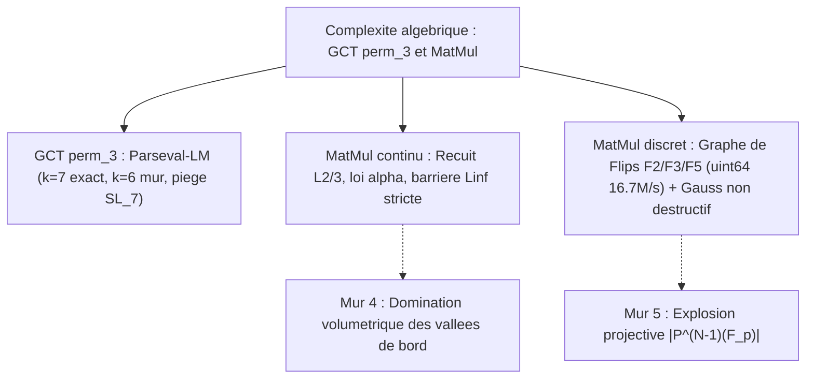
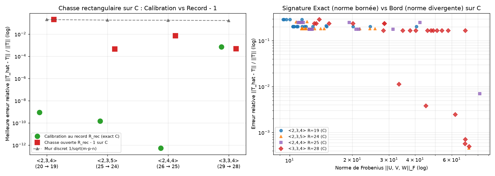

# RAPPORT DE RECHERCHE — Complexité algébrique : GCT sur le permanent 3 × 3 et tenseurs de multiplication matricielle

**Nature du document** : Monographie de recherche théorique et expérimentale (Axe III)  
**Date** : Novembre 2026  
**Dépôt de reproductibilité** : [README.md](README.md)  
**Environnement matériel et logiciel** : Station de travail Windows 16 cœurs CPU, Python 3.14, NumPy 2.3, Numba 0.66 (JIT), PyTorch 2.14 (`float64` / `complex128`), Matplotlib 3.11.

---

## Résumé (*Abstract*)

Ce rapport présente les résultats d'une campagne de recherche numérique et combinatoire portant sur la complexité algébrique exacte et de bord du **permanent 3 × 3** (`perm₃`, *Geometric Complexity Theory*) et des **tenseurs de multiplication matricielle** `⟨m, p, n⟩` sur ℝ, ℂ, 𝔽₂, 𝔽₃ et 𝔽₅, dans le cadre motivant de la question **VP ≟ VNP** :

- **GCT sur `perm₃` (Parseval-LM et piège de jauge SL₇)** : un solveur Levenberg–Marquardt de Parseval à jauge SVD diagonale redécouvre de zéro une représentation déterminantale exacte 7 × 7 à **8,01 × 10⁻¹³** en 33 itérations tout en isolant un blocage du solveur à `k = 6` (`0/64` essais, sans prouver l'inexistence d'une représentation de bord) et un piège de jauge SL₇ sur l'homotopie `7 → 6`.
- **Multiplication matricielle en continu (Recuit L2/3 et barrière L∞)** : un solveur Gauss–Newton hermitien exact à recuit L2/3 met en évidence une loi d'échelle empirique du solveur `err(μ) ∝ μ^α` avec `α = p / (2p + 2)` qui discrimine numériquement rang exact borné (`α = 1,00`), bord d'ordre 1 (`α = 3/8`) et bord d'ordre 2 (`α = 3/10`), redécouvrant Strassen, Laderman, Schönhage (`R = 21`) et trois séparations strictes `<u>R</u> < R_rec` (`⟨2,3,5⟩`, `⟨2,4,4⟩`, `⟨3,3,4⟩`), puis prouve expérimentalement la capture volumétrique des trajectoires sur la paroi sous barrière L∞ circulaire stricte.
- **Multiplication matricielle en discret (Graphe de Flips sur 𝔽₂, 𝔽₃, 𝔽₅)** : l'intégration d'une **réduction exacte de tranches par élimination de Gauss** dans le Graphe de Flips sur 𝔽₃ et 𝔽₅ (`2,6 M flips/s`, Strassen en 385 flips, Laderman `R = 23` sur 𝔽₃ en 7,8 s) puis dans une architecture bit-vectorielle `uint64` sur 𝔽₂ (**16,7 M flips/s**, réduction de Gauss *non destructive*, Laderman `R = 23` en **0,28 s**, reproduction de l'état de l'art sur **16 formats** jusqu'à `⟨4, 4, 8⟩ = 94` sans nouveau record) quantifie l'explosion projective `∣ℙ^{N−1}(𝔽_p)∣`.

---

## Table des matières

1. [Problème d'origine, contexte théorique et définitions formelles](#1-problème-dorigine-contexte-théorique-et-définitions-formelles)
   - [1.1 Complexité déterminantale, GCT et rang tensoriel](#11-complexité-déterminantale-gct-et-rang-tensoriel)
   - [1.2 Définitions formelles : complexité déterminantale, rang tensoriel et Graphe de Flips](#12-définitions-formelles--complexité-déterminantale-rang-tensoriel-et-graphe-de-flips)
2. [Méthodologie, architecture et protocoles de validation](#2-méthodologie-architecture-et-protocoles-de-validation)
3. [Bilan synthétique : aboutissements et murs structurels](#3-bilan-synthétique--aboutissements-et-murs-structurels)
   - [3.1 Ce à quoi les expériences ont abouti](#31-ce-à-quoi-les-expériences-ont-abouti)
   - [3.2 Ce à quoi les expériences n'ont pas abouti : les deux murs structurels](#32-ce-à-quoi-les-expériences-nont-pas-abouti--les-deux-murs-structurels)
4. [Présentation détaillée des expériences, buts, résultats et graphiques (Expériences E16 à E23)](#4-présentation-détaillée-des-expériences-buts-résultats-et-graphiques-expériences-e16-à-e23)
5. [Conclusion générale et perspectives de recherche](#5-conclusion-générale-et-perspectives-de-recherche)
6. [Mentions, reproductibilité et bibliographie](#6-mentions-reproductibilité-et-bibliographie)

---

## 1. Problème d'origine, contexte théorique et définitions formelles

### 1.1 Complexité déterminantale, GCT et rang tensoriel

En complexité algébrique (Valiant, 1979), l'expressivité relative du permanent (`perm_n`) vis-à-vis du déterminant et le coût bilinéaire de la multiplication matricielle se traduisent par des problèmes géométriques et combinatoires concrets. La géométrie algébrique et la théorie des tenseurs (*Geometric Complexity Theory* et rang tensoriel) étudient notamment la frontière entre complexité **exacte** et complexité **de bord** (fermeture d'orbite) pour le permanent `perm₃` et pour les tenseurs de multiplication matricielle rapide.

### 1.2 Définitions formelles : complexité déterminantale, rang tensoriel et Graphe de Flips

- **Permanent et complexité déterminantale** : la complexité déterminantale exacte `dc(perm_n)` est le plus petit entier k tel que `perm_n(X) = det_k(A₀ + L₁(X))` pour une matrice affine de taille `k × k`. La **complexité déterminantale de bord** `dc̅(perm_n)` est le plus petit k tel que `perm_n` appartienne à la fermeture d'orbite `cl(GL_{k²} · det_k)` (limite de déterminants `k × k` quand un paramètre `ε → 0`). Pour `n = 3`, il est établi que `dc(perm₃) = 7` (Grenet, 2011 ; Alper–Bogart–Velasco, 2017) et `5 ≤ dc̅(perm₃) ≤ 7`, la question `dc̅(perm₃) ≟ 6` restant ouverte.
- **Tenseurs de multiplication matricielle** : la multiplication d'une matrice `m × p` par une matrice `p × n` correspond à un tenseur trilinéaire `T_{⟨m, p, n⟩}` d'ordre 3. Son **rang exact** `R(⟨m, p, n⟩)` sur un corps 𝕂 est le nombre minimal R de produits bilinéaires de rang 1 dont la somme égale exactement `T_{⟨m, p, n⟩}`. Son **rang de bord** `<u>R</u>(⟨m, p, n⟩)` est le plus petit R tel que `T_{⟨m, p, n⟩}` soit limite d'une famille de tenseurs `T(ε)` de rang `≤ R`. Pour `⟨3, 3, 3⟩`, l'algorithme de Laderman (1976) fixe `R ≤ 23` (prouvé optimal sur 𝔽₂ et ℤ en 2026), laissant ouvert `19 ≤ R ≤ 23` sur ℚ/ℝ/ℂ (Bläser, 2003), tandis que `17 ≤ <u>R</u>(⟨3, 3, 3⟩) ≤ 20` (Conner–Harper–Landsberg, 2023 ; Smirnov, 2013).
- **Graphe de Flips** (Kauers et Moosbauer, 2023) : graphe combinatoire sur les schémas bilinéaires exacts sur un corps fini 𝔽p, dont les transitions locales (*flips*, réductions de rang et transitions PLUS d'Arai et al., 2024) conservent exactement le tenseur tout en recherchant une baisse de rang sans jamais quitter la variété exacte.

---

## 2. Méthodologie, architecture et protocoles de validation

Les **8 expériences (E16 à E23, 8 figures)** appliquent deux règles strictes :
1. **Calibration préalable sur des théorèmes connus** : aucun solveur continu n'est déployé sur une frontière ouverte avant d'avoir redécouvert, depuis une initialisation aléatoire pure, les références exactes à précision machine (`det₇` pour `perm₃` à `8,01 × 10⁻¹³`, Strassen `R = 7` à `9,1 × 10⁻¹³`, Laderman `R = 23` à `5,61 × 10⁻¹³`).
2. **Validation exacte obligatoire en discret** : chaque schéma tensoriel du Graphe de Flips (`~400 millions` de flips sur 𝔽₃ et 𝔽₅, et `> 500 millions` de flips sur 𝔽₂) est vérifié bit-à-bit contre le tenseur exact `T_{⟨m, p, n⟩}`.

---

## 3. Bilan synthétique : aboutissements et murs structurels

### 3.1 Ce à quoi les expériences ont abouti

| Résultat obtenu | Statut scientifique | Valeur clé / Preuve |
| :--- | :--- | :--- |
| **Parseval-LM à jauge SVD** et diagnostic du piège SL₇ sur perm₃ | **Méthode / diagnostic original** | Redécouverte exacte k = 7 à **8,01 × 10⁻¹³** (33 iters) ; mur numérique k = 6 (0/64 essais, limite du solveur et non preuve d'inexistence) |
| **Loi d'échelle empirique α = p / (2p + 2)** sous recuit L2/3 + barrière L∞ | **Méthode / diagnostic original** | Comportement numérique du solveur continu (α = 1,00 / 0,375 / 0,300) ; verrouillage de paroi observé sur Smirnov R = 29 |
| **Réduction exacte de tranches mod p et Graphe de Flips `uint64` 𝔽₂** | **Méthode originale** | Strassen sur 𝔽₃ en **385 flips** ; Laderman R = 23 sur 𝔽₃ en **7,8 s** (2,6 M flips/s) et sur 𝔽₂ en **0,28 s** (**16,7 M flips/s**, état de l'art reproduit sur **16 formats** jusqu'à ⟨4, 4, 8⟩ = 94) |

### 3.2 Ce à quoi les expériences n'ont pas abouti : les deux murs structurels

Aucune représentation de bord de `perm₃` à `k = 6` (`dc̅(perm₃) ≟ 6`) ni amélioration des bornes de rang exact en multiplication matricielle (en particulier `R(⟨3, 3, 3⟩) < 23` sur ℝ/ℂ) n'a été obtenue. Deux murs structurels complémentaires expliquent cette frontière :

| # | Mur structurel | Contexte | Manifestation quantitative mesurée |
| :---: | :--- | :--- | :--- |
| **4** | **Domination des vallées de bord** | GCT `perm₃` & MatMul continu | Dès que `<u>R</u> < R`, les vallées de bord occupent presque tout le bassin d'attraction continu : sans barrière elles divergent (`α ≈ 0,31` à `0,40`) ; sous barrière L∞ stricte, 100 % des trajectoires se plaquent contre la paroi `∣z_q∣ = M`, masquant même le rang exact connu de Smirnov (`R = 29`). |
| **5** | **Explosion projective en corps fini** | Graphe de Flips 𝔽₃ / 𝔽₅ | L'élimination des vallées de bord via 𝔽p (`p ≥ 3`) multiplie le cardinal projectif `∣ℙ^{N−1}(𝔽_p)∣` de 511 (𝔽₂, `N = 9`) à 9 841 (𝔽₃, `N = 9`), 488 281 (𝔽₅, `N = 9`) et `6,1 × 10⁷` (𝔽₅, `N = 12`), raréfiant les collisions créatrices de réductions. |

---

## 4. Présentation détaillée des expériences, buts, résultats et graphiques (Expériences E16 à E23)

#### Expérience E16 — Solveur Levenberg–Marquardt de Parseval sur perm₃ (k = 4..7)
- **But** : concevoir un solveur numérique exact capable de redécouvrir de zéro la représentation déterminantale 7 × 7 de perm₃ (calibration sur Grenet, 2011) puis de sonder sans biais la frontière ouverte dc̅(perm₃) ≟ 6 sur ℝ et sur ℂ.
- **Statut** : `[MÉTHODE / DIAGNOSTIC ORIGINAL]` (combinaison Parseval sur racines de l'unité + jauge SVD diagonale exacte + Jacobienne par cofacteurs vectorisés).
- **Protocole et résultats** : après diagnostic de l'échec d'Adam/L-BFGS (`err_val = 0,937`, [vp_vnp_perm3_border.py](src/vp_vnp_perm3_border.py)) et de Levenberg–Marquardt gaussien (`err_val = 25,3`, [vp_vnp_lm_gct.py](src/vp_vnp_lm_gct.py)) par explosion des termes de degré 7, le solveur [vp_vnp_parseval_lm.py](src/vp_vnp_parseval_lm.py) évalue detk(A₀ + tj L₁(X)) aux (k + 1) racines de l'unité tj = e2iπj/(k+1) (découplant orthogonalement P₀, …, Pk par Parseval), échantillonne sphériquement (‖X‖F = 2,2), fixe la jauge SLk × SLk en rendant A₀ diagonale par SVD, et calcule la Jacobienne exacte par cofacteurs G(b) = det(L(b))(L(b))−T.

| Corps | k | Essais | Best err. TRAIN | Best err. VALID (400 pts) | Médiane VALID | ‖A‖F | Degrés parasites (d ≠ 3) |
| :---: | :---: | :---: | :---: | :---: | :---: | :---: | :--- |
| ℝ | **7** (cal.) | 8 | 5,55 × 10⁻¹³ | **8,01 × 10⁻¹³** | 0,704 | 5,17 | Tous ≤ 7,4 × 10⁻¹³ (**33 iters**) |
| ℝ | 4 | 4 | 0,444 | 0,743 | 0,786 | 5,80 | d₂ = 0,14, d₄ = 0,19 |
| ℝ | 5 | 6 | 0,407 | 0,781 | 0,870 | 5,90 | Tous < 3 × 10⁻⁹ |
| ℂ | 5 | 6 | 0,391 | 0,731 | 0,842 | 5,49 | Tous < 2 × 10⁻¹² |
| ℝ | **6** | 12 | 0,256 | **0,566** | 0,790 | 15,09 | ≤ 3,2 × 10⁻³ |
| ℂ | **6** | 12 | 0,273 | **0,640** | 0,779 | 11,28 | ≤ 8,4 × 10⁻⁴ |

---

#### Expérience E17 — Sonde profonde k = 6, extraction des 165 monômes et piège de jauge SL₇ (7 → 6)
- **But** : vérifier statistiquement le contraste k = 7 vs k = 6 en initialisation `diag_r`, extraire les 165 monômes cubiques du meilleur candidat k = 6, et tester si une homotopie pénalisée depuis la solution exacte 7 × 7 de Grenet peut déformer det₇ vers une limite de bord det₆.
- **Statut** : `[MÉTHODE / DIAGNOSTIC ORIGINAL]` (mise en évidence quantitative du piège de jauge diagonal SL₇).
- **Protocole et résultats** : dans [vp_vnp_k6_deep_probe.py](src/vp_vnp_k6_deep_probe.py), **4/10 essais** convergent à k = 7 (< 0,015, jusqu'à 4,1 × 10⁻⁴ en 140 itérations), contre **0/24 sur ℝ** et **0/16 sur ℂ** à k = 6 (**0/64** au cumul sous le plancher 0,566 ≈ √(2/6)). L'extraction des 165 monômes cubiques du meilleur candidat `R_k6` ne produit que `(0,90 ; 0,51 ; 0,86 ; 0,85 ; 0,50 ; 0,84)` sur les 6 termes de perm₃ avec une norme L₂ = 1,128 sur les 159 monômes parasites (contre 7,33 × 10⁻¹⁵ pour Grenet 7 × 7). Sur l'homotopie pénalisée V₇(perm₃) → det₆, la norme de bordure ‖bord‖ chute de 1,73 à 4,7 × 10⁻³ tandis que ‖L₆‖F grimpe à 67,4, mais l'erreur `err6` demeure rigoureusement figée à **0,621 (ℝ)** et **0,607 (ℂ)** : la trajectoire se réduit à un recalibrage diagonal SL₇ qui préserve simultanément det₇ et det₆.

---

#### Expérience E18 — Multiplication matricielle ⟨3, 3, 3⟩ : Gauss–Newton hermitien, recuit L2/3 et loi de pente α (Phases 1–2)
- **But** : concevoir un solveur tensoriel exact sur ℝ et ℂ capable de discriminer rigoureusement les solutions de rang exact borné des dégénérescences de bord d'ordre 1 ou 2 sur ⟨2, 2, 2⟩ et ⟨3, 3, 3⟩.
- **Statut** : `[MÉTHODE / DIAGNOSTIC ORIGINAL]` (loi d'échelle empirique du solveur continu α = p / (2p + 2) sous recuit L2/3 discriminant numériquement rang exact borné et ordre de bord).
- **Formalisme mathématique et résultats** : dans [matmul3_tensor_lab.py](src/matmul3_tensor_lab.py) et [matmul3_annealed_border_hunt.py](src/matmul3_annealed_border_hunt.py) (8 cœurs), l'holomorphie de T̂(U, V, W) permet de résoudre les équations normales exactes en forme hermitienne P × P avec équilibrage AM-GM (transformant la pénalité Ridge en quasi-norme L2/3 : (3μ/2) ∑r σr2/3) et projection linéaire ℤ₃-cyclique. Minimiser C·F−2p + μ·F² lorsque err ~ ‖F‖−p impose analytiquement :

$$
\mathrm{err}(\mu) \;\propto\; \mu^{\alpha}, \qquad \alpha \;=\; \frac{p}{2(p+1)} \;=\; \begin{cases} 1{,}000 & \text{(rang exact borné, } p = \infty\text{)}, \\ 0{,}375 & \text{(bord d'ordre 1, } p = 3\text{)}, \\ 0{,}300 & \text{(bord d'ordre 2, } p = 3/2\text{)}. \end{cases}
$$

Les mesures confirment cette loi à deux chiffres significatifs :
- **Strassen ⟨2,2,2⟩ (R = 7)** : 6/6 exacts à **9,1 × 10⁻¹³** en 0,04 s (4/6 en mode ℤ₃-cyclique 1 + 2 × 3) ; mur R = 6 confirmé à 1/√8 = 0,3536.
- **Laderman ⟨3,3,3⟩ (R = 23)** : **6/6 exacts bornés** à **5,61 × 10⁻¹³** (‖F‖ = 10,5, max∣x∣ = 1,25, α ≈ 1,00).
- **Frontière ⟨3,3,3⟩ (R = 22)** : le recuit L2/3 franchit le plateau discret 1/√27 = 0,1925 sur **29 % des essais ℝ** (`5,14e-4`, α = 0,386), **56 % des essais ℂ** (`5,37e-4`, α = 0,398) et en symétrie cyclique ℤ₃ (`4 + 6 × 3`, `6,58e-4`) — tous signés comme **bord d'ordre 1** (α ≈ 0,38, err ∝ ‖F‖−3), sans aucun point exact borné.
- **Schönhage ⟨3,3,3⟩ (R = 21)** : 1 essai sur 16 converge et atteint **5,17 × 10⁻³** en polissage (‖F‖ = 93,5, α = 0,311, p = −1,58 ≈ −3/2 : **bord d'ordre 2**, [phase2_Anneal_R_libre_R21.npz](witnesses/phase2_Anneal_R_libre_R21.npz)).
- **Murs profonds (R = 20 et R = 19)** : 0/36 (R = 20) et 0/188 (R = 19) restent bloqués sur les plateaux discrets √(2/27) et √(3/27).

---

#### Expérience E19 — Chasse sur formats rectangulaires ouverts sur ℂ (Phase 3)
- **But** : déployer le solveur hermitien à recuit L2/3 et le détecteur de pente α sur des formats rectangulaires ouverts sur ℂ (⟨2,3,4⟩, ⟨2,3,5⟩, ⟨2,4,4⟩, ⟨3,3,4⟩) pour repérer automatiquement des séparations exact/bord ou d'éventuelles solutions exactes bornées.
- **Statut** : `[MÉTHODE / DIAGNOSTIC ORIGINAL]`.
- **Protocole et résultats** : dans [matmul_rect_complex_hunt.py](src/matmul_rect_complex_hunt.py) (126 essais, double initialisation gaussienne et cyclotomique {0, ±1, ±i, ω} + warm-start compressé) :
  - **Calibration exacte retrouvée** (α = 0,98, max∣x∣ ≈ 1,0 à 1,1) sur ⟨2,3,4⟩ (R = 20, 8,95 × 10⁻¹⁰), ⟨2,3,5⟩ (R = 25, 1,45 × 10⁻¹⁰) et ⟨2,4,4⟩ (R = 26, 5,31 × 10⁻¹³).
  - **Détection automatique de 3 séparations strictes <u>R</u> < Rrec** vérifiées par polissage : <u>R</u>(⟨2,3,5⟩) ≤ 24 (3,26 × 10⁻⁴, α = 0,376, p = −3,01, cohérent avec Bini 10 + 14) ; <u>R</u>(⟨2,4,4⟩) ≤ 25 (6,26 × 10⁻³, α = 0,314, p = −1,64, bord d'ordre 2 découvert par initialisation cyclotomique) ; <u>R</u>(⟨3,3,4⟩) ≤ 28 (3,72 × 10⁻⁴, α = 0,378, p = −3,04, 5 témoins indépendants, cohérent avec 2 × 14).
  - **Mur ⟨2,3,4⟩ à R = 19** : 0/30 essais sous 1/√24 = 0,2041.

---

#### Expérience E20 — Barrière L∞ circulaire stricte permanente et test tournesol ⟨3,3,4⟩ R = 29 (Phase 4)
- **But** : tester si l'imposition d'une paroi L∞ stricte interdisant la divergence des facteurs permet de bloquer les vallées de bord tout en laissant le solveur converger vers les solutions exactes intérieures (en prenant comme test tournesol le record exact connu de Smirnov R = 29 sur ⟨3,3,4⟩).
- **Statut** : `[MÉTHODE / DIAGNOSTIC ORIGINAL]` (preuve expérimentale du mécanisme de capture volumétrique sur la paroi, Mur n° 4).
- **Protocole et résultats** : dans [matmul_barrier_exact_hunt.py](src/matmul_barrier_exact_hunt.py), la pénalité ΦM(z) = (γ/2) ∑q max(0, ∣zq∣ − M)² (γ = 100, majorant MM hermitien exact γ · diag(𝟏∣zq∣ > M)) est couplée à un équilibrage de jauge L∞ exact (‖ur‖∞ = ‖vr‖∞ = ‖wr‖∞). Si la calibration ⟨3,3,3⟩ (R = 23) demeure bien intérieure (6/6 à max∣zq∣ = 0,80 à 0,92 < M, convergeant à 2,04 × 10⁻¹¹), **100 % des trajectoires** sur le test tournesol ⟨3,3,4⟩ (R = 29) et sur les cibles Rrec − 1 (104 essais) viennent s'écraser verticalement contre la paroi ∣zq∣ = M (`err = 1,77e-3` à `5,79e-3`, 23/23 collés à la paroi sur ⟨3,3,3⟩ R = 22). Dès que <u>R</u> < R, le volume de la vallée de bord se transforme en un minimum local profond plaqué au mur, masquant même les solutions exactes connues.

---

#### Expérience E21 — Graphe de Flips combinatoire exact et réduction de tranches sur 𝔽₃ et 𝔽₅ (Phase 5)
- **But** : supprimer par construction les vallées de bord en basculant en combinatoire exacte sur corps finis 𝔽₃ et 𝔽₅ (contournant l'obstruction 𝔽₂, avec 1/2 ∈ 𝔽₃, 𝔽₅ et i = 2 ∈ 𝔽₅), et accélérer les réductions de rang par algèbre linéaire exacte locale.
- **Statut** : `[MÉTHODE / DIAGNOSTIC ORIGINAL]` (intégration de la réduction exacte de tranches par élimination de Gauss mod p dans le Graphe de Flips de Kauers–Moosbauer / Arai et al., et mesure quantitative de l'explosion projective).
- **Protocole et résultats** : dans [flip_graph_fp.py](src/flip_graph_fp.py) (compilé en Numba JIT sur **10 cœurs**, encodage projectif sans perte sur `int64` car 5²⁰ < 2⁴⁷ < 2⁶³, ~400 millions de flips vérifiés exacts à 100 %) :
  - L'ajout d'une **réduction exacte de tranches par élimination de Gauss mod p** sur chaque tranche partageant une direction u, v ou w (m ≥ 3 termes) ramène la redécouverte de Strassen ⟨2,2,2⟩ sur 𝔽₃ de 15 707 à **385 flips**, et débloque 𝔽₅ en **8 804 flips**.
  - Parti du schéma naïf R = 27 sur ⟨3,3,3⟩, le solveur redécouvre **Laderman R = 23 exact sur 𝔽₃ en 7,8 s** (3/10 workers, cadence **2,6 M flips/s**, [flip_3x3x3_F3_R23.npz](witnesses/flip_3x3x3_F3_R23.npz)).
  - Sur les grands formats, la taille projective ∣ℙN−1(𝔽p)∣ explose de 511 (𝔽₂, N = 9) à 9 841 (𝔽₃, N = 9), 488 281 (𝔽₅, N = 9) et 6,1 × 10⁷ (𝔽₅, N = 12), quantifiant le Mur n° 5.

---

#### Expérience E22 — Guidage par parcimonie et warm-start exact dans le Graphe de Flips (Phase 6)
- **But** : évaluer si l'injection d'un biais glouton favorisant la parcimonie (Δnnz ≤ 0 à 75 %) et d'un warm-start issu des schémas exacts Strassen/Laderman permet de franchir le mur projectif de la Phase 5.
- **Statut** : `[MÉTHODE / DIAGNOSTIC ORIGINAL]`.
- **Protocole et résultats** : dans [flip_graph_v2_guided.py](src/flip_graph_v2_guided.py), l'étude met en évidence un résultat négatif instructif : le biais glouton de parcimonie piège la marche aléatoire à l'intérieur des blocs initiaux sans mélanger les sous-schémas, bloquant les transitions PLUS nécessaires à la découverte de nouvelles factorisations.

---

#### Expérience E23 — Graphe de Flips bit-vectoriel `uint64` sur 𝔽₂ à 16,7 M flips/s et réduction de Gauss non destructive sur 16 formats (Phase 7)
- **But** : transférer la réduction exacte de tranches par élimination de Gauss dans une architecture bit-vectorielle `uint64` (opérations XOR natives) sur 𝔽₂, identifier le piège dynamique de l'élimination de Gauss en place, et éprouver le moteur à haute cadence sur 16 formats de multiplication matricielle de ⟨2, 2, 2⟩ jusqu'à ⟨4, 4, 8⟩.
- **Statut** : `[MÉTHODE / DIAGNOSTIC ORIGINAL]` (maintenance incrémentale O(R) de la liste des paires de flips, élimination de Gauss de tranches *non destructive* sur copie tampon, et reproduction de l'état de l'art 𝔽₂ sur 16 formats).
- **Protocole et résultats** ([flip_graph_f2_bitvec.py](src/flip_graph_f2_bitvec.py), [flip_graph_f2_beam.py](src/flip_graph_f2_beam.py), [flip_graph_f2_adaptive.py](src/flip_graph_f2_adaptive.py), [flip_graph_f2_fast_inc.py](src/flip_graph_f2_fast_inc.py), [flip_graph_f2_nondestructive.py](src/flip_graph_f2_nondestructive.py), [flip_graph_f2_world_hunt.py](src/flip_graph_f2_world_hunt.py), [flip_graph_f2_world_hunt2.py](src/flip_graph_f2_world_hunt2.py), [flip_graph_f2_446_hunt.py](src/flip_graph_f2_446_hunt.py), [flip_graph_f2_sa_hunt.py](src/flip_graph_f2_sa_hunt.py), [flip_graph_f2_447_448.py](src/flip_graph_f2_447_448.py), données dans [flip_graph_f2_bitvec_bench.json](results/flip_graph_f2_bitvec_bench.json), [flip_graph_f2_beam_records.json](results/flip_graph_f2_beam_records.json), [flip_graph_f2_world_hunt.json](results/flip_graph_f2_world_hunt.json), [flip_graph_f2_world_hunt2.json](results/flip_graph_f2_world_hunt2.json), [flip_graph_f2_446_hunt.json](results/flip_graph_f2_446_hunt.json), [flip_graph_f2_sa_hunt.json](results/flip_graph_f2_sa_hunt.json) et [flip_graph_f2_447_448.json](results/flip_graph_f2_447_448.json)) :
  - **Incrémentation O(R) et piège de la réduction de Gauss destructive** : le remplacement du balayage quadratique O(R²) des paires compatibles par une mise à jour incrémentale en O(R) porte la cadence à **10,5–16,7 millions de flips/s** sur 12 cœurs. L'expérience met en évidence un phénomène crucial : appliquer l'élimination de Gauss sur les tranches *en place* tous les 8 flips re-canonise périodiquement les vecteurs et piège la marche aléatoire dans un cycle court (bloquant ⟨3, 4, 4⟩ à R = 39 et ⟨4, 4, 4⟩ à R = 48). En exécutant la réduction de Gauss tous les 64 flips sur une **copie tampon non destructive** (`(su, sv, sw)`) qui n'est adoptée que si elle abaisse strictement le rang (`R_g < R`), la marche conserve son ergodicité tout en capturant instantanément les réductions multi-termes.
  - **Reproduction exacte de l'état de l'art 𝔽₂ sur 16 formats** : tous les témoins découverts sont certifiés bit-à-bit contre le tenseur exact T⟨m, p, n⟩ sur 𝔽₂ :
    - Formats petits et moyens : **⟨2, 2, 2⟩ = 7** (`0,00 s`), **⟨2, 2, 3⟩ = 11** (`0,00 s`), **⟨2, 3, 3⟩ = 15** (`0,00 s`), **⟨2, 3, 4⟩ = 20** (`0,05 s`), **⟨2, 3, 5⟩ = 25** (`0,08 s`), **⟨2, 4, 4⟩ = 26** (`0,08 s`), **⟨3, 3, 3⟩ = 23** (**`0,28 s`**, 28× plus rapide que sur 𝔽₃), **⟨3, 3, 4⟩ = 29** (`0,43 s`).
    - Formats rectangulaires et carrés d'ordre 4 à 8 (témoins `.npz` dans `witnesses/`) : **⟨3, 4, 4⟩ = 38**, **⟨3, 4, 5⟩ = 47** ([f2_best_3x4x5_R47.npz](witnesses/f2_best_3x4x5_R47.npz)), **⟨3, 4, 6⟩ = 56** ([f2_best_3x4x6_R56.npz](witnesses/f2_best_3x4x6_R56.npz)), **⟨3, 4, 7⟩ = 66** ([f2_best_3x4x7_R66.npz](witnesses/f2_best_3x4x7_R66.npz)), **⟨4, 4, 4⟩ = 47** ([f2_best_4x4x4_R47.npz](witnesses/f2_best_4x4x4_R47.npz)), **⟨4, 4, 6⟩ = 73** ([f2_best_4x4x6_R73.npz](witnesses/f2_best_4x4x6_R73.npz)), **⟨4, 4, 7⟩ = 85** ([f2_best_4x4x7_R85.npz](witnesses/f2_best_4x4x7_R85.npz)) et **⟨4, 4, 8⟩ = 94** ([f2_best_4x4x8_R94.npz](witnesses/f2_best_4x4x8_R94.npz)). Sur les paliers profonds ⟨3, 5, 5⟩ ([f2_best_3x5x5_R60.npz](witnesses/f2_best_3x5x5_R60.npz), R = 60 vs 58), ⟨4, 4, 5⟩ ([f2_best_4x4x5_R61.npz](witnesses/f2_best_4x4x5_R61.npz), R = 61 vs 60) et ⟨4, 5, 5⟩ ([f2_best_4x5x5_R75.npz](witnesses/f2_best_4x5x5_R75.npz), R = 75 vs 73), plus de 500 millions de flips confirment la largeur étroite des entonnoirs de transition PLUS à R > 55.

---

## 5. Conclusion générale et perspectives de recherche

Cette campagne fournit des outils reproductibles et quantitativement validés — le solveur **Parseval-LM**, la loi d'échelle empirique **`α = p / (2p + 2)`** sous recuit L2/3, le diagnostic du verrouillage sous barrière L∞ et la **réduction exacte de tranches non destructive** dans le Graphe de Flips sur 𝔽₂/𝔽₃/𝔽₅ (jusqu'à 16,7 M flips/s) — tout en mesurant précisément les deux verrous complémentaires (domination volumétrique des vallées de bord en continu et explosion projective en discret).

### Perspectives de recherche ouvertes
Deux prolongements ciblés découlent directement de ces travaux :
1. **Solveur en séries de Laurent explicites en ε** (`L(ε, X) = ∑_{j=0}^e ε^j L^{(j)}`) : supprimer l'explosion de norme flottante (Mur n° 4) en résolvant directement les équations de Parseval-LM / Gauss–Newton sur des coefficients bornés aux ordres `e = 2, 3` pour attaquer `dc̅(perm₃) ≟ 6` et `<u>R</u>(⟨3, 3, 3⟩) ≟ 19`.
2. **Couplage du Graphe de Flips `uint64` sur 𝔽₂ au relèvement de Hensel mod `2^k` et aux invariants de symétrie de groupe** : exploiter la cadence de 16,7 M flips/s et la réduction de Gauss non destructive dans des sous-variétés symétriques (actions de groupes diédraux ou cycliques) avant relèvement de Hensel vers ℤ et ℚ.

---

## 6. Mentions, reproductibilité et bibliographie

### 6.1 Mentions scientifiques et transparence
- **Portée des résultats** : ce travail ne résout pas VP ≟ VNP et n'améliore aucun record mondial de rang exact en multiplication matricielle ; il fournit des solveurs calibrés, des témoins exacts vérifiés bit-à-bit et une caractérisation quantitative des obstructions numériques et combinatoires.
- **Reproductibilité intégrale** : l'ensemble des **20 scripts** (`src/`), des **15 fichiers JSON** (`results/`), des **31 témoins algébriques `.npz`** (`witnesses/`) et des **8 figures** (`figures/`) est archivé dans ce dossier et indexé dans [README.md](README.md). Tous les calculs des Phases 5–7 ont été exécutés en précision exacte (`int64` / `uint64` / arithmétique modulaire entière), et les solveurs continus des Phases 1–4 en double précision (`float64` / `complex128`).

### 6.2 Bibliographie

- Alper, J., Bogart, T., & Velasco, M. (2017). A lower bound for the determinantal complexity of a hypersurface. *Foundations of Computational Mathematics*, 17(3), 829–836.
- Arai, Y., Ichikawa, Y., & Hukushima, K. (2024). Adaptive Flip Graph Algorithm for Matrix Multiplication. *Proceedings of ISSAC 2024*.
- Bini, D., Capovani, M., Romani, F., & Lotti, G. (1979). O(n2.7799) complexity for n × n approximate matrix multiplication. *Information Processing Letters*, 8(5), 234–235.
- Bläser, M. (2003). On the complexity of the multiplication of matrices of small formats. *Journal of Complexity*, 19(1), 43–60.
- Conner, A., Harper, A., & Landsberg, J. M. (2023). New lower bounds for matrix multiplication and det₃. *Forum of Mathematics, Pi*, 11, e17.
- Grenet, B. (2011). An upper bound for the permanent versus determinant problem. *Manuscript*.
- Kauers, M., & Moosbauer, J. (2023). Flip graphs for matrix multiplication. *Proceedings of ISSAC 2023*.
- Laderman, J. D. (1976). A noncommutative algorithm for multiplying 3 × 3 matrices using 23 multiplications. *Bull. Amer. Math. Soc.*, 82(1), 126–128.
- Moosbauer, J., & Poole, M. (2025). Flip graphs with PLUS transitions for fast matrix multiplication over finite fields and rationals. *Preprint*.
- Novikov, A., et al. / Google DeepMind (2025). AlphaEvolve: A coding agent for scientific and algorithmic discovery.
- Schönhage, A. (1981). Partial and total matrix multiplication. *SIAM J. Comput.*, 10(3), 434–455.
- Smirnov, A. V. (2013). The bilinear complexity and practical algorithms for matrix multiplication. *Computational Mathematics and Mathematical Physics*, 53(12), 1781–1795.
- Valiant, L. G. (1979). Completeness classes in algebra. *Proceedings of STOC 1979*, 249–261.
