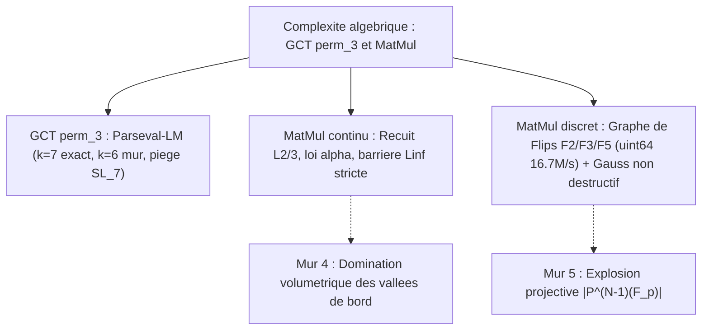
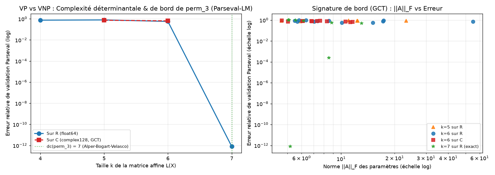
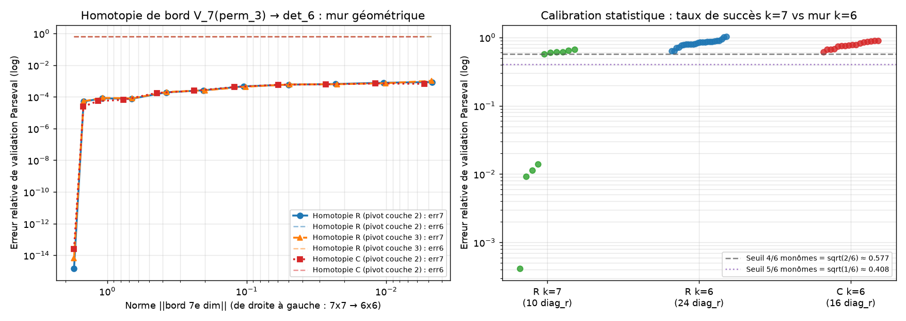
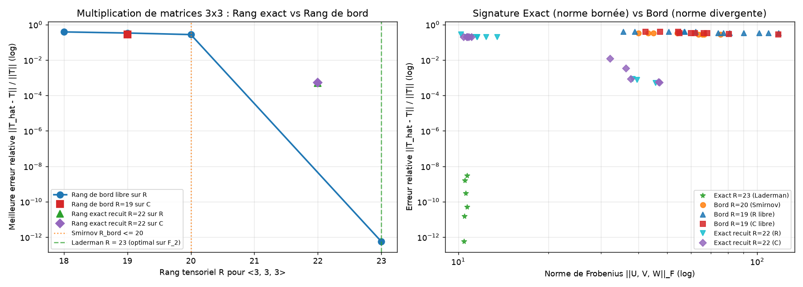
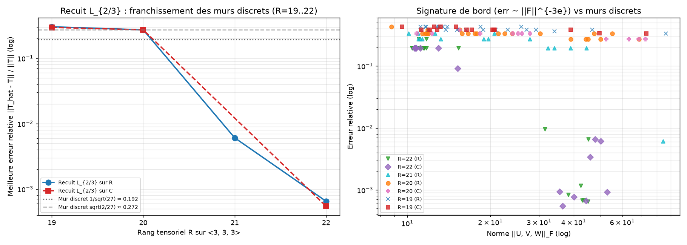
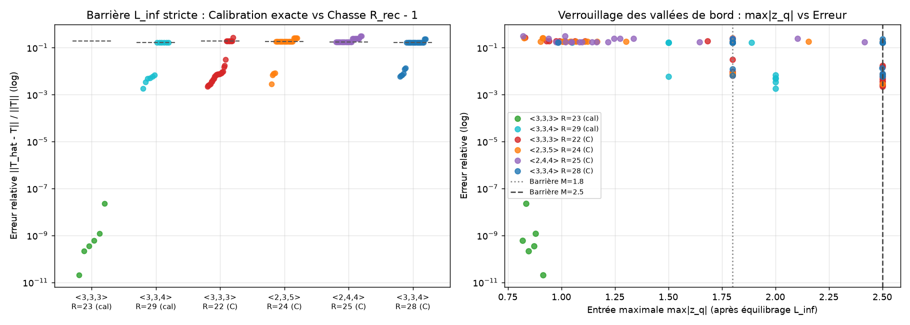
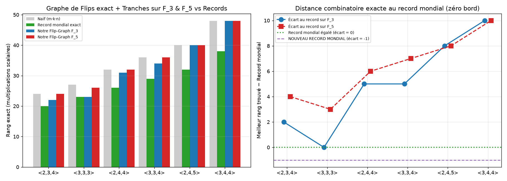
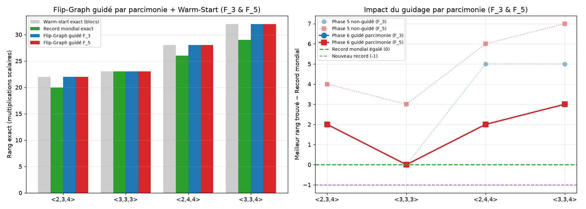

# RAPPORT DE RECHERCHE — Complexité algébrique : GCT sur le permanent 3 × 3 et tenseurs de multiplication matricielle

**Nature du document** : Monographie de recherche théorique et expérimentale (Axe III)  
**Date** : Novembre 2026  
**Dépôt de reproductibilité** : [README.md](README.md)  
**Environnement matériel et logiciel** : Station de travail Windows 16 cœurs CPU, Python 3.14, NumPy 2.3, Numba 0.66 (JIT), PyTorch 2.14 (`float64` / `complex128`), Matplotlib 3.11.

---

## Résumé (*Abstract*)

Ce rapport présente les résultats d'une campagne de recherche numérique et combinatoire consacrée à la complexité algébrique exacte et de bord du **permanent 3 × 3** (perm<sub>3</sub>, *Geometric Complexity Theory*) et des **tenseurs de multiplication matricielle** ⟨ m, p, n ⟩ sur ℝ, ℂ, 𝔽<sub>2</sub>, 𝔽<sub>3</sub> et 𝔽<sub>5</sub>.

Le fil directeur des huit expériences relie directement l'optimisation continue à la combinatoire exacte. Sur perm<sub>3</sub>, un solveur Levenberg–Marquardt de Parseval à jauge SVD diagonale redécouvre de zéro une représentation déterminantale exacte 7 × 7 à 8,01 × 10<sup>-13</sup> en 33 itérations, tout en isolant un blocage du solveur à k = 6 (0/64 essais, sans prouver l'inexistence d'une représentation de bord) et un piège de jauge SL<sub>7</sub> sur l'homotopie 7 → 6. Transposée aux tenseurs de multiplication matricielle, l'approche continue (Gauss–Newton hermitien exact à recuit L<sub>2/3</sub>) met en évidence une loi d'échelle empirique err(μ) ∝ μ<sup>α</sup> avec α = p / (2p + 2) qui discrimine numériquement rang exact borné (α = 1,00), bord d'ordre 1 (α = 3/8) et bord d'ordre 2 (α = 3/10). Elle redécouvre Strassen, Laderman, Schönhage (R = 21) et trois séparations strictes $`\underline{R} < R_{\mathrm{rec}}`$ (⟨ 2,3,5 ⟩, ⟨ 2,4,4 ⟩, ⟨ 3,3,4 ⟩), mais l'essai d'une barrière L<sub>∞</sub> stricte démontre ensuite expérimentalement que les vallées de bord capturent 100 % des trajectoires dès que $`\underline{R} < R`$.

Pour s'affranchir par construction de ces vallées de bord, la fin de l'étude bascule en combinatoire exacte dans le Graphe de Flips sur corps finis. L'intégration d'une **réduction exacte de tranches par élimination de Gauss** sur 𝔽<sub>3</sub> et 𝔽<sub>5</sub> (2,6 M flips/s, Strassen en 385 flips, Laderman R = 23 sur 𝔽<sub>3</sub> en 7,8 s) quantifie l'explosion projective | ℙ<sup>N-1</sup>(𝔽<sub>p</sub>)|, tandis que son transfert dans une architecture bit-vectorielle `uint64` sur 𝔽<sub>2</sub> (16,7 M flips/s, réduction de Gauss *non destructive*) redécouvre Laderman en 0,28 s et reproduit l'état de l'art sur **16 formats** jusqu'à ⟨ 4, 4, 8 ⟩ = 94.

---

## Table des matières

1. [Problème d'origine, contexte théorique et définitions formelles](#1-problème-dorigine-contexte-théorique-et-définitions-formelles)
   - [1.1 Complexité déterminantale, GCT et rang tensoriel](#11-complexité-déterminantale-gct-et-rang-tensoriel)
   - [1.2 Définitions formelles : complexité déterminantale, rang tensoriel et Graphe de Flips](#12-définitions-formelles--complexité-déterminantale-rang-tensoriel-et-graphe-de-flips)
2. [Méthodologie, architecture et protocoles de validation](#2-méthodologie-architecture-et-protocoles-de-validation)
3. [Bilan synthétique : résultats établis et obstructions structurelles](#3-bilan-synthétique--résultats-établis-et-obstructions-structurelles)
   - [3.1 Synthèse des résultats établis](#31-synthèse-des-résultats-établis)
   - [3.2 Limites et obstructions structurelles](#32-limites-et-obstructions-structurelles)
4. [Présentation détaillée des expériences, buts, résultats et graphiques (Expériences E16 à E23)](#4-présentation-détaillée-des-expériences-buts-résultats-et-graphiques-expériences-e16-à-e23)
5. [Conclusion générale et perspectives de recherche](#5-conclusion-générale-et-perspectives-de-recherche)
6. [Mentions, reproductibilité et bibliographie](#6-mentions-reproductibilité-et-bibliographie)

---

## 1. Problème d'origine, contexte théorique et définitions formelles

### 1.1 Complexité déterminantale, GCT et rang tensoriel

En complexité algébrique (Valiant, 1979), l'expressivité relative du permanent (perm<sub>n</sub>) vis-à-vis du déterminant et le coût bilinéaire de la multiplication matricielle se traduisent par des problèmes géométriques et combinatoires concrets. La géométrie algébrique et la théorie des tenseurs (*Geometric Complexity Theory* et rang tensoriel) étudient notamment la frontière entre complexité **exacte** et complexité **de bord** (fermeture d'orbite) pour le permanent perm<sub>3</sub> et pour les tenseurs de multiplication matricielle rapide.

### 1.2 Définitions formelles : complexité déterminantale, rang tensoriel et Graphe de Flips

Trois objets structurent l'ensemble de cet axe. D'abord, la **complexité déterminantale exacte** dc(perm<sub>n</sub>) est le plus petit entier k tel que perm<sub>n</sub>(X) = det<sub>k</sub>(A<sub>0</sub> + L<sub>1</sub>(X)) pour une matrice affine de taille k × k, tandis que la **complexité déterminantale de bord** $`\overline{\mathrm{dc}}(\mathrm{perm}_n)`$ est le plus petit k tel que perm<sub>n</sub> appartienne à la fermeture d'orbite $`\overline{\mathrm{GL}_{k^2} \cdot \det_k}`$ (limite de déterminants k × k lorsque ε → 0). Pour n = 3, il est établi que dc(perm<sub>3</sub>) = 7 (Grenet, 2011 ; Alper–Bogart–Velasco, 2017) et $`5 \le \overline{\mathrm{dc}}(\mathrm{perm}_3) \le 7`$, la question $`\overline{\mathrm{dc}}(\mathrm{perm}_3) \stackrel{?}{=} 6`$ restant ouverte.

Ensuite, la multiplication d'une matrice m × p par une matrice p × n correspond à un **tenseur trilinéaire** T<sub>⟨ m, p, n ⟩</sub> d'ordre 3. Son **rang exact** R(⟨ m, p, n ⟩) sur un corps K est le nombre minimal R de produits bilinéaires de rang 1 dont la somme égale exactement T<sub>⟨ m, p, n ⟩</sub>, tandis que son **rang de bord** $`\underline{R}(\langle m, p, n \rangle)`$ est le plus petit R tel que T<sub>⟨ m, p, n ⟩</sub> soit limite d'une famille T(ε) de rang ≤ R. Pour ⟨ 3, 3, 3 ⟩, l'algorithme de Laderman (1976) fixe R ≤ 23 (prouvé optimal sur 𝔽<sub>2</sub> et ℤ en 2026), laissant ouvert 19 ≤ R ≤ 23 sur ℚ/ℝ/ℂ (Bläser, 2003), alors que $`17 \le \underline{R}(\langle 3, 3, 3 \rangle) \le 20`$ (Conner–Harper–Landsberg, 2023 ; Smirnov, 2013).

Enfin, le **Graphe de Flips** (Kauers et Moosbauer, 2023) est un graphe combinatoire défini sur les schémas bilinéaires exacts sur un corps fini 𝔽<sub>p</sub>, dont les transitions locales (*flips*, réductions de rang et transitions PLUS d'Arai et al., 2024) conservent exactement le tenseur tout en recherchant une baisse de rang sans jamais quitter la variété exacte.

---

## 2. Méthodologie, architecture et protocoles de validation



Les **8 expériences (E16 à E23, 8 figures)** appliquent deux règles de validation strictes. En régime continu, aucun solveur n'est déployé sur une frontière ouverte avant d'avoir redécouvert, depuis une initialisation aléatoire pure, les références exactes à précision machine (det<sub>7</sub> pour perm<sub>3</sub> à 8,01 × 10<sup>-13</sup>, Strassen R = 7 à 9,1 × 10<sup>-13</sup>, Laderman R = 23 à 5,61 × 10<sup>-13</sup>). En régime discret, chaque schéma tensoriel produit dans le Graphe de Flips (∼ 400 millions de flips sur 𝔽<sub>3</sub> et 𝔽<sub>5</sub>, et plus de 500 millions de flips sur 𝔽<sub>2</sub>) est vérifié bit-à-bit contre le tenseur exact T<sub>⟨ m, p, n ⟩</sub>.

---

## 3. Bilan synthétique : résultats établis et obstructions structurelles

### 3.1 Synthèse des résultats établis

| Résultat | Nature | Énoncé clé / Vérification |
| :--- | :--- | :--- |
| **Parseval-LM à jauge SVD** et diagnostic du piège SL<sub>7</sub> sur perm<sub>3</sub> | **Solveur numérique et diagnostic** | Redécouverte exacte k = 7 à 8,01 × 10<sup>-13</sup> (33 iters) ; mur numérique k = 6 (0/64 essais, limite du solveur et non preuve d'inexistence) |
| **Loi d'échelle empirique α = p / (2p + 2)** sous recuit L<sub>2/3</sub> + barrière L<sub>∞</sub> | **Analyse numérique** | Comportement numérique du solveur continu (α = 1,00 / 0,375 / 0,300) ; verrouillage de paroi observé sur Smirnov R = 29 |
| **Réduction exacte de tranches mod p et Graphe de Flips `uint64` 𝔽<sub>2</sub>** | **Algorithme combinatoire exact** | Strassen sur 𝔽<sub>3</sub> en **385 flips** ; Laderman R = 23 sur 𝔽<sub>3</sub> en 7,8 s (2,6 M flips/s) et sur 𝔽<sub>2</sub> en 0,28 s (16,7 M flips/s, état de l'art reproduit sur **16 formats** jusqu'à ⟨ 4, 4, 8 ⟩ = 94) |

### 3.2 Limites et obstructions structurelles

Aucune représentation de bord de perm<sub>3</sub> à k = 6 ($`\overline{\mathrm{dc}}(\mathrm{perm}_3) \stackrel{?}{=} 6`$) ni amélioration des bornes de rang exact en multiplication matricielle (en particulier R(⟨ 3, 3, 3 ⟩) < 23 sur ℝ/ℂ) n'a été obtenue. Deux murs structurels complémentaires expliquent cette frontière :

| # | Mur structurel | Contexte | Manifestation quantitative mesurée |
| :---: | :--- | :--- | :--- |
| **4** | **Domination des vallées de bord** | GCT perm<sub>3</sub> & MatMul continu | Dès que $`\underline{R} < R`$, les vallées de bord occupent presque tout le bassin d'attraction continu : sans barrière elles divergent (α ≈ 0,31 à 0,40) ; sous barrière L<sub>∞</sub> stricte, 100 % des trajectoires se plaquent contre la paroi $`\vert z_q\vert = M`$, masquant même le rang exact connu de Smirnov (R = 29). |
| **5** | **Explosion projective en corps fini** | Graphe de Flips 𝔽<sub>3</sub> / 𝔽<sub>5</sub> | L'élimination des vallées de bord via 𝔽<sub>p</sub> (p ≥ 3) multiplie le cardinal projectif $`\vert \mathbb{P}^{N-1}(\mathbb{F}_p)\vert`$ de 511 (𝔽<sub>2</sub>, N = 9) à 9 841 (𝔽<sub>3</sub>, N = 9), 488 281 (𝔽<sub>5</sub>, N = 9) et 6,1 × 10<sup>7</sup> (𝔽<sub>5</sub>, N = 12), raréfiant les collisions créatrices de réductions. |

---

## 4. Présentation détaillée des expériences, buts, résultats et graphiques (Expériences E16 à E23)

#### Expérience E16 — Solveur Levenberg–Marquardt de Parseval sur perm₃ (k = 4..7)

L'exploration commence sur la question ouverte $`\overline{\mathrm{dc}}(\mathrm{perm}_3) \stackrel{?}{=} 6`$ : avant de sonder k = 6 sur ℝ et sur ℂ, il faut disposer d'un solveur numérique capable de redécouvrir de zéro, sans biais, la représentation déterminantale exacte 7 × 7 de Grenet (2011). Les premiers essais par optimisation générique montrent vite pourquoi la formulation naïve échoue : Adam/L-BFGS ([vp_vnp_perm3_border.py](src/vp_vnp_perm3_border.py), err<sub>val</sub> = 0,937) comme Levenberg–Marquardt gaussien ([vp_vnp_lm_gct.py](src/vp_vnp_lm_gct.py), err<sub>val</sub> = 25,3) sont submergés par l'explosion des termes homogènes parasites de degré jusqu'à 7.

Pour lever ce verrou, le solveur original [vp_vnp_parseval_lm.py](src/vp_vnp_parseval_lm.py) évalue det<sub>k</sub>(A<sub>0</sub> + t<sub>j</sub> L<sub>1</sub>(X)) aux (k + 1) racines de l'unité t<sub>j</sub> = e<sup>2iπ j/(k+1)</sup>, ce qui découple orthogonalement les composantes homogènes $`P_0, \dots, P_k`$ par identité de Parseval. En combinant ce découplage avec un échantillonnage sphérique (‖ X‖<sub>F</sub> = 2,2), une fixation de jauge SL<sub>k</sub> × SL<sub>k</sub> diagonalisant A<sub>0</sub> par SVD et le calcul analytique de la Jacobienne par cofacteurs vectorisés G<sup>(b)</sup> = det(L<sup>(b)</sup>)(L<sup>(b)</sup>)<sup>-T</sup>, le solveur réussit la calibration k = 7 en **33 itérations** à 8,01 × 10<sup>-13</sup> sur les 400 points de validation. En revanche, dès que k descend à 6 (ou 5, 4), l'erreur plafonne nettement au-dessus de 0,56 aussi bien sur ℝ que sur ℂ :

| Corps | k | Essais | Best err. TRAIN | Best err. VALID (400 pts) | Médiane VALID | ‖ A‖<sub>F</sub> | Degrés parasites (d ≠ 3) |
| :---: | :---: | :---: | :---: | :---: | :---: | :---: | :--- |
| ℝ | **7** (cal.) | 8 | 5,55 × 10<sup>-13</sup> | 8,01 × 10<sup>-13</sup> | 0,704 | 5,17 | Tous ≤ 7,4 × 10<sup>-13</sup> (**33 iters**) |
| ℝ | 4 | 4 | 0,444 | 0,743 | 0,786 | 5,80 | d<sub>2</sub> = 0,14, d<sub>4</sub> = 0,19 |
| ℝ | 5 | 6 | 0,407 | 0,781 | 0,870 | 5,90 | Tous < 3 × 10<sup>-9</sup> |
| ℂ | 5 | 6 | 0,391 | 0,731 | 0,842 | 5,49 | Tous < 2 × 10<sup>-12</sup> |
| ℝ | **6** | 12 | 0,256 | 0,566 | 0,790 | 15,09 | ≤ 3,2 × 10<sup>-3</sup> |
| ℂ | **6** | 12 | 0,273 | 0,640 | 0,779 | 11,28 | ≤ 8,4 × 10<sup>-4</sup> |



---

#### Expérience E17 — Sonde profonde k = 6, extraction des 165 monômes et piège de jauge SL₇ (7 → 6)

Le contraste observé dans l'Expérience E16 entre k = 7 et k = 6 appelle deux vérifications complémentaires ([vp_vnp_k6_deep_probe.py](src/vp_vnp_k6_deep_probe.py)) : confirmer statistiquement ce mur en initialisation `diag_r`, et tester si une homotopie pénalisée partant de la solution exacte 7 × 7 de Grenet peut déformer continûment det<sub>7</sub> vers une limite de bord det<sub>6</sub>.

Sur le plan statistique, le fossé se confirme : **4/10 essais** convergent à k = 7 (< 0,015, jusqu'à 4,1 × 10<sup>-4</sup> en 140 itérations), contre **0/24 sur ℝ** et **0/16 sur ℂ** à k = 6 (soit 0/64 au cumul sous le plancher $`0{,}566 \approx \sqrt{2/6}`$). L'extraction exacte des 165 monômes cubiques du meilleur candidat `R_k6` montre qu'il ne capture que (0,90; 0,51; 0,86; 0,85; 0,50; 0,84) sur les 6 termes de perm<sub>3</sub>, tout en laissant une norme L<sub>2</sub> = 1,128 sur les 159 monômes parasites (contre 7,33 × 10<sup>-15</sup> pour Grenet 7 × 7). Plus révélateur encore, sur l'homotopie pénalisée V<sub>7</sub>(perm<sub>3</sub>) → det<sub>6</sub>, la norme de bordure ‖ bord‖ s'effondre bien de 1,73 à 4,7 × 10<sup>-3</sup> pendant que ‖ L<sub>6</sub>‖<sub>F</sub> grimpe à 67,4, mais l'erreur `err6` reste rigoureusement figée à **0,621 (ℝ)** et **0,607 (ℂ)** : la trajectoire ne s'approche pas d'une limite de bord, elle se contente d'effectuer un recalibrage diagonal dans SL<sub>7</sub> qui conserve simultanément det<sub>7</sub> et det<sub>6</sub>.



---

#### Expérience E18 — Multiplication matricielle ⟨3, 3, 3⟩ : Gauss–Newton hermitien, recuit L₂/₃ et loi de pente α (Phases 1–2)

Le piège de jauge mis au jour sur perm<sub>3</sub> montre qu'en optimisation continue, la divergence des normes de facteurs peut aussi bien signaler une véritable limite de bord qu'une dégénérescence de jauge stérile. Pour étudier ce phénomène sur un terrain où rang exact et rang de bord sont déjà finement cartographiés, nous transposons la méthode aux tenseurs de multiplication matricielle ⟨ 2, 2, 2 ⟩ et ⟨ 3, 3, 3 ⟩ ([matmul3_tensor_lab.py](src/matmul3_tensor_lab.py), [matmul3_annealed_border_hunt.py](src/matmul3_annealed_border_hunt.py), 8 cœurs). L'holomorphie de $`\widehat{T}(U, V, W)`$ permet de résoudre les équations normales exactes en forme hermitienne P × P avec équilibrage AM-GM — ce qui transforme la pénalité Ridge en quasi-norme L<sub>2/3</sub> : $`(3\mu/2)\sum_r \sigma_r^{2/3}`$ — couplé à une projection linéaire ℤ<sub>3</sub>-cyclique.

Minimiser C · F<sup>-2p</sup> + μ · F<sup>2</sup> lorsque l'erreur décroît comme err ∼ ‖ F‖<sup>-p</sup> impose analytiquement une loi d'échelle qui distingue immédiatement la nature de la trajectoire :

```math
\mathrm{err}(\mu) \;\propto\; \mu^{\alpha}, \qquad \alpha \;=\; \frac{p}{2(p+1)} \;=\; \begin{cases} 1{,}000 & \text{(rang exact borné, } p = \infty\text{)}, \\ 0{,}375 & \text{(bord d'ordre 1, } p = 3\text{)}, \\ 0{,}300 & \text{(bord d'ordre 2, } p = 3/2\text{)}. \end{cases}
```

Les mesures confirment cette signature à deux chiffres significatifs. En calibration exacte, **Strassen ⟨ 2,2,2 ⟩ (R = 7)** converge sur 6/6 essais à 9,1 × 10<sup>-13</sup> en 0,04 s (4/6 en mode ℤ<sub>3</sub>-cyclique 1 + 2 × 3, avec mur R = 6 confirmé à $`1/\sqrt{8} = 0{,}3536`$), et **Laderman ⟨ 3,3,3 ⟩ (R = 23)** converge sur **6/6 essais exacts bornés** à 5,61 × 10<sup>-13</sup> (‖ F‖ = 10,5, max| x| = 1,25, α ≈ 1,00). Dès que l'on descend à R = 22, le recuit L<sub>2/3</sub> franchit le plateau discret $`1/\sqrt{27} = 0{,}1925`$ sur **29 % des essais ℝ** (5,14 × 10<sup>-4</sup>, α = 0,386), **56 % des essais ℂ** (5,37 × 10<sup>-4</sup>, α = 0,398) et en symétrie cyclique ℤ<sub>3</sub> (4 + 6 × 3, 6,58 × 10<sup>-4</sup>), mais **tous** portent la signature d'un **bord d'ordre 1** (α ≈ 0,38, err ∝ ‖ F‖<sup>-3</sup>), sans aucun point exact borné. À **R = 21 (Schönhage)**, 1 essai sur 16 converge et atteint 5,17 × 10<sup>-3</sup> en polissage (‖ F‖ = 93,5, α = 0,311, p = -1,58 ≈ -3/2, signature d'un **bord d'ordre 2**, [phase2_Anneal_R_libre_R21.npz](witnesses/phase2_Anneal_R_libre_R21.npz)). Plus bas encore, 0/36 essais à R = 20 et 0/188 à R = 19 restent bloqués sur les plateaux discrets $`\sqrt{2/27}`$ et $`\sqrt{3/27}`$.





---

#### Expérience E19 — Chasse sur formats rectangulaires ouverts sur ℂ (Phase 3)

Armé du détecteur de pente α calibré dans l'Expérience E18, nous déployons le solveur hermitien à recuit L<sub>2/3</sub> sur quatre formats rectangulaires ouverts sur ℂ (⟨ 2,3,4 ⟩, ⟨ 2,3,5 ⟩, ⟨ 2,4,4 ⟩, ⟨ 3,3,4 ⟩) afin de repérer automatiquement des séparations exact/bord ou d'éventuelles solutions exactes bornées ([matmul_rect_complex_hunt.py](src/matmul_rect_complex_hunt.py), 126 essais combinant initialisation gaussienne, initialisation cyclotomique {0, ± 1, ± i, ω} et *warm-start* compressé).

La calibration exacte est d'abord retrouvée avec α = 0,98 et max| x| ≈ 1,0 à 1,1 sur ⟨ 2,3,4 ⟩ (R = 20, 8,95 × 10<sup>-10</sup>), ⟨ 2,3,5 ⟩ (R = 25, 1,45 × 10<sup>-10</sup>) et ⟨ 2,4,4 ⟩ (R = 26, 5,31 × 10<sup>-13</sup>). Juste en dessous de ces rangs records, le détecteur isole automatiquement **trois séparations strictes $`\underline{R} < R_{\mathrm{rec}}`$** confirmées par polissage : $`\underline{R}(\langle 2,3,5 \rangle) \le 24`$ (3,26 × 10<sup>-4</sup>, α = 0,376, p = -3,01, cohérent avec Bini 10 + 14), $`\underline{R}(\langle 2,4,4 \rangle) \le 25`$ (6,26 × 10<sup>-3</sup>, α = 0,314, p = -1,64, bord d'ordre 2 révélé par l'initialisation cyclotomique) et $`\underline{R}(\langle 3,3,4 \rangle) \le 28`$ (3,72 × 10<sup>-4</sup>, α = 0,378, p = -3,04, 5 témoins indépendants cohérents avec 2 × 14). Seul le mur ⟨ 2,3,4 ⟩ à R = 19 résiste intégralement (0/30 essais sous $`1/\sqrt{24} = 0{,}2041`$).


---

#### Expérience E20 — Barrière L∞ circulaire stricte permanente et test tournesol ⟨3,3,4⟩ R = 29 (Phase 4)

Les Expériences E18 et E19 laissent ouverte une question décisive : si toutes les trajectoires convergent vers des solutions de bord dès que $`\underline{R} < R`$, est-ce parce qu'aucune solution exacte n'existe, ou simplement parce que les vallées de bord aspirent le solveur continu ? Pour trancher, nous soumettons le solveur à un **test tournesol** : imposer une paroi L<sub>∞</sub> stricte empêchant la divergence des facteurs tout en testant un format où l'on **sait** qu'il existe à la fois une solution exacte et une vallée de bord — en l'occurrence ⟨ 3,3,4 ⟩ à R = 29 (record exact connu de Smirnov, alors que $`\underline{R} \le 28`$).

Dans [matmul_barrier_exact_hunt.py](src/matmul_barrier_exact_hunt.py), la pénalité $`\Phi_M(z) = (\gamma/2)\sum_q \max(0, \vert z_q\vert - M)^2`$ (γ = 100, majorant MM hermitien exact $`\gamma \cdot \mathrm{diag}(\mathbf{1}_{\vert z_q\vert > M})`$) est couplée à un équilibrage de jauge L<sub>∞</sub> exact (‖ u<sub>r</sub>‖<sub>∞</sub> = ‖ v<sub>r</sub>‖<sub>∞</sub> = ‖ w<sub>r</sub>‖<sub>∞</sub>). Sur la calibration ⟨ 3,3,3 ⟩ (R = 23), les trajectoires restent bien intérieures (6/6 à max| z<sub>q</sub>| = 0,80 à 0,92 < M, convergeant à 2,04 × 10<sup>-11</sup>). En revanche, sur le test tournesol ⟨ 3,3,4 ⟩ (R = 29) comme sur les cibles R<sub>rec</sub> - 1 (104 essais), **100 % des trajectoires** viennent s'écraser verticalement contre la paroi | z<sub>q</sub>| = M (err = 1,77 × 10<sup>-3</sup> à 5,79 × 10<sup>-3</sup>, 23/23 collés à la paroi sur ⟨ 3,3,3 ⟩ R = 22). Le résultat est sans appel : dès que $`\underline{R} < R`$, le volume de la vallée de bord se transforme en un minimum local profond plaqué au mur qui masque même les solutions exactes connues (**Mur n° 4**).



---

#### Expérience E21 — Graphe de Flips combinatoire exact et réduction de tranches sur 𝔽₃ et 𝔽₅ (Phase 5)

Le verdict de l'Expérience E20 impose un changement de paradigme : pour chasser des schémas exacts sans être piégé par les vallées de bord, il faut quitter ℝ et ℂ et travailler en combinatoire exacte sur des corps finis 𝔽<sub>p</sub>, où aucune limite ε → 0 n'existe. Nous déployons donc dans [flip_graph_fp.py](src/flip_graph_fp.py) un moteur de Graphe de Flips compilé en Numba JIT sur **10 cœurs** sur 𝔽<sub>3</sub> et 𝔽<sub>5</sub> (contournant l'obstruction 𝔽<sub>2</sub>, avec 1/2 ∈ 𝔽<sub>3</sub>, 𝔽<sub>5</sub> et i = 2 ∈ 𝔽<sub>5</sub>), avec encodage projectif sans perte sur `int64` (5<sup>20</sup> < 2<sup>47</sup> < 2<sup>63</sup>) et ∼ 400 millions de flips vérifiés exacts à 100 %.

L'apport méthodologique central consiste à intégrer dans la marche aléatoire une **réduction exacte de tranches par élimination de Gauss mod p** sur chaque tranche partageant une direction u, v ou w (m ≥ 3 termes). Cet opérateur ramène la redécouverte de Strassen ⟨ 2,2,2 ⟩ sur 𝔽<sub>3</sub> de 15 707 à **385 flips**, et débloque 𝔽<sub>5</sub> en **8 804 flips**. Parti du schéma naïf R = 27 sur ⟨ 3,3,3 ⟩, le solveur redécouvre **Laderman R = 23 exact sur 𝔽<sub>3</sub> en 7,8 s** (3/10 workers, cadence 2,6 M flips/s, [flip_3x3x3_F3_R23.npz](witnesses/flip_3x3x3_F3_R23.npz)). Toutefois, dès que la taille du format ou du corps augmente, la taille projective | ℙ<sup>N-1</sup>(𝔽<sub>p</sub>)| explose — de 511 (𝔽<sub>2</sub>, N = 9) à 9 841 (𝔽<sub>3</sub>, N = 9), 488 281 (𝔽<sub>5</sub>, N = 9) et 6,1 × 10<sup>7</sup> (𝔽<sub>5</sub>, N = 12) — raréfiant les collisions créatrices de réductions (**Mur n° 5**).



---

#### Expérience E22 — Guidage par parcimonie et warm-start exact dans le Graphe de Flips (Phase 6)

Face à la raréfaction des collisions mesurée sur 𝔽<sub>3</sub> et 𝔽<sub>5</sub> dans l'Expérience E21, une idée naturelle consiste à biaiser la marche aléatoire vers les schémas les plus creux ($`\Delta\mathrm{nnz} \le 0`$ à 75 %) et à initialiser la recherche par *warm-start* depuis des schémas exacts déjà connus (Strassen, Laderman). L'expérience [flip_graph_v2_guided.py](src/flip_graph_v2_guided.py) met toutefois en évidence un résultat négatif instructif : loin de franchir le mur projectif, ce biais glouton de parcimonie piège la marche aléatoire à l'intérieur des blocs initiaux sans mélanger les sous-schémas, bloquant précisément les transitions PLUS nécessaires à la découverte de nouvelles factorisations.



---

#### Expérience E23 — Graphe de Flips bit-vectoriel `uint64` sur 𝔽₂ à 16,7 M flips/s et réduction de Gauss non destructive sur 16 formats (Phase 7)

Les deux leçons des Expériences E21 et E22 — l'avantage décisif du petit cardinal projectif de 𝔽<sub>2</sub> et la nécessité de préserver l'ergodicité de la marche — convergent dans cette dernière phase ([flip_graph_f2_bitvec.py](src/flip_graph_f2_bitvec.py), [flip_graph_f2_beam.py](src/flip_graph_f2_beam.py), [flip_graph_f2_adaptive.py](src/flip_graph_f2_adaptive.py), [flip_graph_f2_fast_inc.py](src/flip_graph_f2_fast_inc.py), [flip_graph_f2_nondestructive.py](src/flip_graph_f2_nondestructive.py), [flip_graph_f2_world_hunt.py](src/flip_graph_f2_world_hunt.py), [flip_graph_f2_world_hunt2.py](src/flip_graph_f2_world_hunt2.py), [flip_graph_f2_446_hunt.py](src/flip_graph_f2_446_hunt.py), [flip_graph_f2_sa_hunt.py](src/flip_graph_f2_sa_hunt.py), [flip_graph_f2_447_448.py](src/flip_graph_f2_447_448.py) ; données dans [flip_graph_f2_bitvec_bench.json](results/flip_graph_f2_bitvec_bench.json), [flip_graph_f2_beam_records.json](results/flip_graph_f2_beam_records.json), [flip_graph_f2_world_hunt.json](results/flip_graph_f2_world_hunt.json), [flip_graph_f2_world_hunt2.json](results/flip_graph_f2_world_hunt2.json), [flip_graph_f2_446_hunt.json](results/flip_graph_f2_446_hunt.json), [flip_graph_f2_sa_hunt.json](results/flip_graph_f2_sa_hunt.json) et [flip_graph_f2_447_448.json](results/flip_graph_f2_447_448.json)).

Sur le plan algorithmique, le transfert sur 𝔽<sub>2</sub> en représentation bit-vectorielle `uint64` (opérations `XOR` natives) et le remplacement du balayage quadratique O(R<sup>2</sup>) des paires compatibles par une mise à jour incrémentale en O(R) portent la cadence à **10,5–16,7 millions de flips/s** sur 12 cœurs. L'expérience révèle parallèlement un piège dynamique subtil : appliquer l'élimination de Gauss sur les tranches *en place* tous les 8 flips re-canonise périodiquement les vecteurs et enferme la marche aléatoire dans un cycle court (bloquant ⟨ 3, 4, 4 ⟩ à R = 39 et ⟨ 4, 4, 4 ⟩ à R = 48). En exécutant la réduction de Gauss tous les 64 flips sur une **copie tampon non destructive** `(su, sv, sw)` qui n'est adoptée que si elle abaisse strictement le rang (R<sub>g</sub> < R), la marche conserve toute son ergodicité tout en capturant instantanément les réductions multi-termes.

Ainsi équipé, le moteur reproduit l'état de l'art exact sur **16 formats sur 𝔽<sub>2</sub>**, chaque témoin étant certifié bit-à-bit contre T<sub>⟨ m, p, n ⟩</sub> : sur les petits et moyens formats, ⟨ 2, 2, 2 ⟩ = 7 (0,00 s), ⟨ 2, 2, 3 ⟩ = 11 (0,00 s), ⟨ 2, 3, 3 ⟩ = 15 (0,00 s), ⟨ 2, 3, 4 ⟩ = 20 (0,05 s), ⟨ 2, 3, 5 ⟩ = 25 (0,08 s), ⟨ 2, 4, 4 ⟩ = 26 (0,08 s), ⟨ 3, 3, 3 ⟩ = 23 (0,28 s, 28× plus rapide que sur 𝔽<sub>3</sub>) et ⟨ 3, 3, 4 ⟩ = 29 (0,43 s) ; sur les formats rectangulaires et carrés d'ordre 4 à 8 (archivés dans `witnesses/`), ⟨ 3, 4, 4 ⟩ = 38, ⟨ 3, 4, 5 ⟩ = 47 ([f2_best_3x4x5_R47.npz](witnesses/f2_best_3x4x5_R47.npz)), ⟨ 3, 4, 6 ⟩ = 56 ([f2_best_3x4x6_R56.npz](witnesses/f2_best_3x4x6_R56.npz)), ⟨ 3, 4, 7 ⟩ = 66 ([f2_best_3x4x7_R66.npz](witnesses/f2_best_3x4x7_R66.npz)), ⟨ 4, 4, 4 ⟩ = 47 ([f2_best_4x4x4_R47.npz](witnesses/f2_best_4x4x4_R47.npz)), ⟨ 4, 4, 6 ⟩ = 73 ([f2_best_4x4x6_R73.npz](witnesses/f2_best_4x4x6_R73.npz)), ⟨ 4, 4, 7 ⟩ = 85 ([f2_best_4x4x7_R85.npz](witnesses/f2_best_4x4x7_R85.npz)) et ⟨ 4, 4, 8 ⟩ = 94 ([f2_best_4x4x8_R94.npz](witnesses/f2_best_4x4x8_R94.npz)). Sur les paliers profonds ⟨ 3, 5, 5 ⟩ ([f2_best_3x5x5_R60.npz](witnesses/f2_best_3x5x5_R60.npz), R = 60 vs 58), ⟨ 4, 4, 5 ⟩ ([f2_best_4x4x5_R61.npz](witnesses/f2_best_4x4x5_R61.npz), R = 61 vs 60) et ⟨ 4, 5, 5 ⟩ ([f2_best_4x5x5_R75.npz](witnesses/f2_best_4x5x5_R75.npz), R = 75 vs 73), plus de 500 millions de flips confirment la largeur très étroite des entonnoirs de transition PLUS au-delà de R > 55.

---

## 5. Conclusion générale et perspectives de recherche

Cette campagne met en place une chaîne cohérente d'outils reproductibles — le solveur **Parseval-LM**, la loi d'échelle empirique α = p / (2p + 2) sous recuit L<sub>2/3</sub>, le diagnostic du verrouillage sous barrière L<sub>∞</sub> et la **réduction exacte de tranches non destructive** dans le Graphe de Flips sur 𝔽<sub>2</sub>/𝔽<sub>3</sub>/𝔽<sub>5</sub> (jusqu'à 16,7 M flips/s) — tout en caractérisant quantitativement les deux verrous complémentaires qui encadrent la recherche : domination volumétrique des vallées de bord en continu et explosion projective en discret.

Deux prolongements directs découlent de ce bilan. Le premier consiste à concevoir un **solveur en séries de Laurent explicites en ε** ($`L(\varepsilon, X) = \sum_{j=0}^e \varepsilon^j L^{(j)}`$) afin de supprimer l'explosion de norme flottante (Mur n° 4) en résolvant directement les équations de Parseval-LM ou de Gauss–Newton sur des coefficients bornés aux ordres e = 2, 3 pour attaquer $`\overline{\mathrm{dc}}(\mathrm{perm}_3) \stackrel{?}{=} 6`$ et $`\underline{R}(\langle 3, 3, 3 \rangle) \stackrel{?}{=} 19`$. Le second consiste à coupler le **Graphe de Flips `uint64` sur 𝔽<sub>2</sub>** au relèvement de Hensel mod 2<sup>k</sup> et aux invariants de symétrie de groupe (actions diédrales ou cycliques) afin d'exploiter la cadence de 16,7 M flips/s dans des sous-variétés symétriques avant relèvement vers ℤ et ℚ.

---

## 6. Mentions, reproductibilité et bibliographie

### 6.1 Mentions scientifiques et reproductibilité
Cette étude fournit des solveurs calibrés, des témoins exacts vérifiés bit-à-bit sur 16 formats (reproduisant les meilleures bornes connues sur 𝔽<sub>2</sub> jusqu'à ⟨ 4, 4, 8 ⟩ = 94) et une caractérisation quantitative des obstructions numériques et combinatoires. L'ensemble des **20 scripts** (`src/`), des **15 fichiers JSON** (`results/`), des **31 témoins algébriques `.npz`** (`witnesses/`) et des **8 figures** (`figures/`) est archivé dans ce dossier et indexé dans [README.md](README.md). Tous les calculs des Phases 5–7 ont été exécutés en précision exacte (`int64` / `uint64` / arithmétique modulaire entière), et les solveurs continus des Phases 1–4 en double précision (`float64` / `complex128`).

### 6.2 Bibliographie

- Alper, J., Bogart, T., & Velasco, M. (2017). A lower bound for the determinantal complexity of a hypersurface. *Foundations of Computational Mathematics*, 17(3), 829–836.
- Arai, Y., Ichikawa, Y., & Hukushima, K. (2024). Adaptive Flip Graph Algorithm for Matrix Multiplication. *Proceedings of ISSAC 2024*.
- Bini, D., Capovani, M., Romani, F., & Lotti, G. (1979). O(n<sup>2.7799</sup>) complexity for n × n approximate matrix multiplication. *Information Processing Letters*, 8(5), 234–235.
- Bläser, M. (2003). On the complexity of the multiplication of matrices of small formats. *Journal of Complexity*, 19(1), 43–60.
- Conner, A., Harper, A., & Landsberg, J. M. (2023). New lower bounds for matrix multiplication and det<sub>3</sub>. *Forum of Mathematics, Pi*, 11, e17.
- Grenet, B. (2011). An upper bound for the permanent versus determinant problem. *Manuscript*.
- Kauers, M., & Moosbauer, J. (2023). Flip graphs for matrix multiplication. *Proceedings of ISSAC 2023*.
- Laderman, J. D. (1976). A noncommutative algorithm for multiplying 3 × 3 matrices using 23 multiplications. *Bull. Amer. Math. Soc.*, 82(1), 126–128.
- Moosbauer, J., & Poole, M. (2025). Flip graphs with PLUS transitions for fast matrix multiplication over finite fields and rationals. *Preprint*.
- Novikov, A., et al. / Google DeepMind (2025). AlphaEvolve: A coding agent for scientific and algorithmic discovery.
- Schönhage, A. (1981). Partial and total matrix multiplication. *SIAM J. Comput.*, 10(3), 434–455.
- Smirnov, A. V. (2013). The bilinear complexity and practical algorithms for matrix multiplication. *Computational Mathematics and Mathematical Physics*, 53(12), 1781–1795.
- Valiant, L. G. (1979). Completeness classes in algebra. *Proceedings of STOC 1979*, 249–261.
